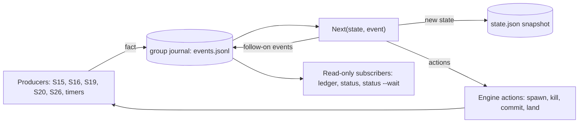
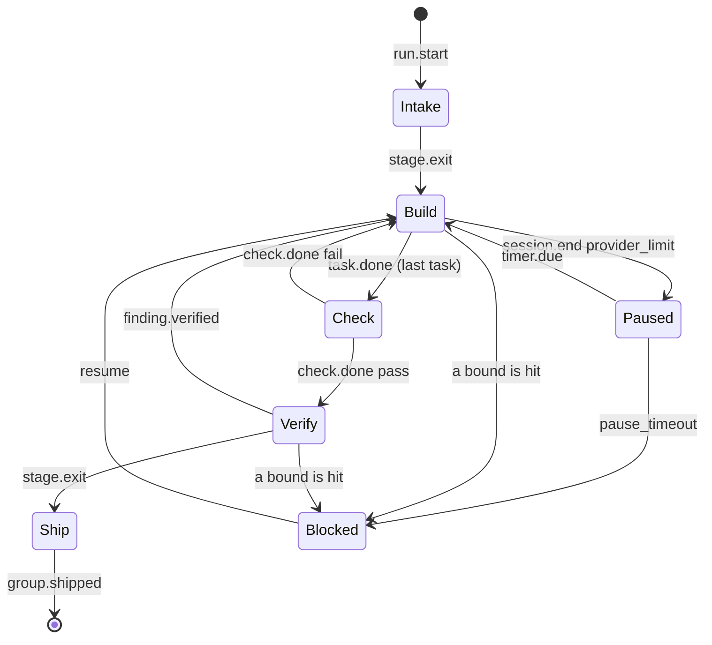
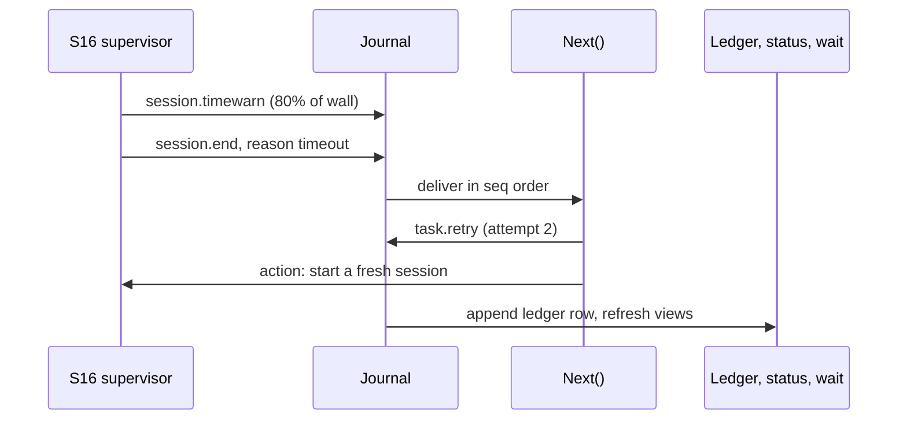

# Komodo 1.0.0-beta.6: standalone, model-agnostic Go harness

## Status

**Design approved for drafting, organized by subsystem.** S01–S13 were approved, with their Vet items settled on 2026-10-06; S14 was approved on 2026-10-07. Design reviews the same day changed S01, S02, S03, S04, S05, S07, S08 and S10 after approval, so those need a second look; see **Review changes (2026-10-06, 2026-10-07, 2026-10-08)**. Phase 1 turns this plan into prd, hld, lld, ADR 0001 and epic-1. Each subsystem (S01–S27) becomes one or more task groups; S28 waits for a later minor.

## How to read this plan

- **Part A:** context, foundation and the subsystem map.
- **Part B:** one card per subsystem, covering what it owns and does, its values and interfaces, what to vet, and the proof.
- **Part C:** the agent roster, folder layout, port map, build waves and end-to-end verification.
- **Vet lines** are the nuanced decisions to confirm. Each one already has a default, so nothing is blocked.

---

# Part A: Context and map

## Context

**Why.** In the prototype, Claude Code acts as the engine, and Komodo spends its effort fighting hooks, settings, plugins and render drift:
- **TG-15.4:** 11 fix commits.
- **TG-15.3:** stale renders and stale binaries.
- **The guard:** it fails open, and it refused 187 of the builder's own commands.
- **Retries:** effectively unbounded.
- **The USD cap:** always $0.

Every prior alpha and beta, including the first beta 6 attempt, is a failed prototype. The concepts carry forward; the code starts fresh in place, with the prototype parked in `backups/`.

**What.**
- **The engine:** one Go binary, standard library only.
- **The models:** stateless workers, one fresh session per task, each with a private toolset.
- **Two callers, one interface:** an orchestrator and a human at a shell call the same CLI verbs. The orchestrator is Claude Code first, any agent host with a shell next, and Komodo's own `komodo chat` (S28) later.

**Locked decisions:**
- **Repo and bridge:** rewrite in place. Claude Code talks to the harness through CLI subcommands with `--json`; there is no server process.
- **Isolation and tools:** worktree plus guard plus OS sandbox; Docker is needed only on native Windows without WSL. Each session gets a private MCP tool server, and native tools are off.
- **Execution:** one fresh session per task; a failed Check or Verify resumes it. Providers use a declared fallback chain per agent, and the pipeline has 5 stages.
- **Platforms and config:** macOS, Linux, WSL2 (preferred on Windows) and native Windows `.exe`, which needs Docker. There is no repo config folder or repo layer; every setting lives in `~/.komodo/config.json` and changes only through `komodo config` (S04), and runtime state lives outside the tree.
- **Carry-over:** the backlog tree and lint, release, worktree protections, the subagent ledger, economy mode (now the `mode` key) and all 34 `standards-*` skills are kept. Eval, recall, plugins and standalone facets are deleted.
- **Docs:** `AGENTS.md` is the source of truth, and `CLAUDE.md` imports it. Specs start from zero: the PRD is rewritten, and prior specs sit in `backups/` and at tag `prototype-final`.
- **OpenAI:** scoped now, implemented in a later minor version. Beta 6 ships the interfaces, the `install` probe, Codex detection and `AGENTS.md` compatibility. `codex-cli` and `openai-api` refuse with `not yet`, and `.codex/` install reports `not yet`. `openai.go` still ships for `http:` endpoints, local or on a server.

## 1. Foundation

```
 Claude Code (orchestrator per repo)      Human at a shell
            │  komodo <verb> --json              │
            └──────────────┬─────────────────────┘
                           ▼
  ┌──────────────── komodo (Go, stdlib only) ────────────────┐
  │ S01 CLI ─► S14 engine (stages) ◄─ S17 scheduler (tick)   │
  │   S15 workspace · S16 supervisor · S18 recovery          │
  │   S19 check · S20 review · S26 ship                      │
  │ S11 brief ◄─ S09 skills · S10 rules · S07 agents         │
  │ S08 tools ─► S12 guard ─► S13 sandbox                    │
  │ S21 resources · S22 cache · S23 ledger · S24 events      │
  └───────┬──────────────────┬───────────────────┬───────────┘
   S05 claude -p (Max)  codex exec (later)  S06 HTTP: Anthropic API,
   + private MCP        + private MCP       OpenAI-compatible, local
     tool server          tool server       (harness-owned tool loop)
```

- **80% mechanical, 20% prompt.** If a guard row, parser or check can prevent a failure, Go prevents it.
- **The engine orchestrates.** The orchestrator is only the control plane: it refines intent, calls `plan`/`run`/`status`/`wait`, and reports back.
- **One tool registry, two transports.** The API loop calls the Go tools directly. CLI providers reach them through `komodo internal tools --agent <a> --session <id>`.
- **Every result is schema-checked twice.** The provider enforces the schema first, then Go re-validates it. A failure gets one re-prompt; a second failure fails the task.
- **Events carry facts; `Next()` decides.** Every stage move, error and retry travels as an event through one pure function (Event model, below).

### Event model (core tenet)

**Facts flow as events; one pure function decides.** The mechanical parts publish what happened. `Next(state, event)` returns the new state, the actions to take and any follow-on events. Nothing else changes group state.

- **The engine emits, never a model:** a killed or crashed session can't report, and a model can forget or invent. A session's typed JSON (its result, `submit_finding`) becomes an event only after Go validates it.
- **Journal first:** each event is appended and synced to `runs/<group>/events.jsonl` before it is applied. `state.json` is a snapshot holding the last `seq`; resume replays the events after it (S18).
- **Subscribers are read-only:** the ledger, `status --wait` wakes and notifications react to events but never change state (S24).
- **Coarse grain:** events fire per run, group, stage, session and task, never per model turn or token. S08's in-session loop stays direct code.
- **In-process and ordered:** one bus per engine, delivered synchronously in `seq` order, with no broker. Machine-wide state (pool, quota) stays in files (S05, S14); each engine turns a change there into a local event.
- **Outside the bus:** inline gates (S12's guard, S08's formatting after `edit`) and shutdown (S15) are direct code. They log an event afterward when they can.
- **Actions are journaled too (the outbox):** `Next()` returns actions; `Drive` appends `action.start {id, kind}` before running one and `action.done` after. `id = sha256(seq, kind, args)`. On replay a done action is skipped, a started one reruns, and every action is idempotent by a declared key (S18). This is Temporal's workflow-and-activity split: the pure function never does I/O, and every side effect can run twice safely. [web: docs.temporal.io/workflows]
- **One journal per group, one per run:** group events go to `runs/<group>/events.jsonl`; `run.*` events go to `runs/<run>.jsonl`. Groups never read each other's journals; they meet only in the queue and the pool (S14).
- **Epochs fence late events:** every spawn carries the stage's `epoch` (an int that rises on each stage entry). A session event whose epoch is older than the current stage's is journaled with `stale: true` and `Next()` ignores it. This is how Verify cancels one session without the loser's last event moving the stage twice.
- **A new type is a plan change:** the catalog is a Go enum. S27's gate fails on an emitted type missing from it, or a listed type nothing emits.

**Envelope:**

| Field | Type | Meaning |
|---|---|---|
| `v` | int | envelope version, 1 |
| `seq` | int | order within the group journal, no gaps |
| `ts` | RFC 3339 | when the engine saw the fact |
| `run`, `group`, `session` | string | where it happened; `session` only on session and task events |
| `epoch`, `stale` | int, bool | the stage epoch the producer was spawned under; `stale` is set by `Drive` when it is older than the current one |
| `type`, `reason`, `data` | string, string, object | what happened; `reason` comes from S10's code list; `data` is typed per event |
| `crc` | uint32 | CRC-32 of the line before it; replay drops a torn last line and emits `journal.truncated` once |

**Catalog:**

| Family | Types | Emitted by |
|---|---|---|
| Run | `run.start`, `run.done`, `run.stopped` | S14; `run.stopped` by S15's shutdown |
| Group | `group.paused`, `group.blocked`, `group.cancelled`, `group.shipped`, `lease.lost` | S14, S15, S26 |
| Stage | `stage.enter`, `stage.exit` | S14 |
| Session | `session.start`, `session.idle`, `session.timewarn`, `session.end` with its exit reason | S16; S05 supplies provider-limit reasons |
| Work | `task.claimed`, `task.released`, `task.done`, `task.retry`, `check.done`, `finding.submit`, `finding.verified`, `tool.denied`, `timer.due`, `job.due`, `job.fail` | S08, S12, S16, S17, S18, S19, S20 |
| Ledger | `lock.taken`, `lock.released` (the group's task list, S23), `action.start`, `action.done`, `journal.truncated` | S14 `Drive`, S18 |
| Provider | `provider.skip` with its reason (such as `ctx_below_floor`), `limit.warn` | S05 |

32 types. Each type's `data` is a Go struct; the build generates `embed/events.schema.json` from the enum, `help --json` serves it as `events`, and the gate fails when the two disagree (S10, S27).

**The loop:**



**A group's lifecycle:** sessions run in Build and Verify, so `Paused` and `Blocked` can follow either.



**Example, a session timeout:**



**Guarantees (what the tests pin):**

| Guarantee | How |
|---|---|
| Ordered, gap-free | one writer per journal; `seq` is checked on append and on replay |
| Durable before applied | append, `fsync`, then `Next()`; a crash after the sync replays the event |
| Exactly-once state moves | a stage moves only in `Next()`, keyed by `seq`; stale-epoch events never move it |
| At-least-once actions, safe to repeat | every action has an idempotency key (S18 table) |
| No lost wake | `status --wait` reads the journal tail after subscribing, so an event between the two is still seen |
| Subscriber faults are contained | a panicking subscriber is logged and dropped; state is untouched (S24) |

**Gates are events with evidence.** A stage exits only when `Next()` has seen the events its gate names. No model says "done"; the engine's own checks do.

| Gate | Exit needs | Evidence (0 tokens unless noted) |
|---|---|---|
| Intake | `stage.exit` | lint pass, lease and fence taken, `commands.setup` exit 0, task list locked |
| Build | `task.done` for every task | each task's `done_when` exit 0 and a commit on the hidden ref |
| Check | `check.done pass` | `done_when` rerun, scope, secrets, impact tests, baseline diff, coverage (S19) |
| Verify | `stage.exit` | reviewer `met` for every task and 0 blocking findings; tester `confirmed` for every task and item; 0 regressions (S20; model tokens) |
| Ship | `group.shipped` | merge clean, Check on the epic tip, landing with the fence (S26) |

**The Verify race:** the reviewer and tester start under one epoch. The first verified failure makes `Next()` emit `cancel` for the other and enter Build under a new epoch. Whatever the cancelled session sends afterward carries the old epoch and is stale. Both passing needs both `session.end done` events; both failing in one tick is handled in `seq` order, so the second is already stale.

```mermaid
sequenceDiagram
  participant R as Reviewer (epoch 4)
  participant T as Tester (epoch 4)
  participant N as Next()
  T->>N: finding: item 3 failed, Go reran x2, still fails
  N->>N: Build, epoch 5; action cancel(R)
  R->>N: session.end done (epoch 4)
  N-->>R: journaled stale=true, ignored
```

## 2. Subsystem map

| ID | Subsystem | Layer | Package | Depends on |
|---|---|---|---|---|
| S01 | CLI processor | Interface | `cli` | every subsystem (thin calls) |
| S02 | Installer | Interface | `host` | S04, S03 |
| S03 | Binary lifecycle (`fresh`) | Interface | `host`, `core` | S06 |
| S04 | Configuration | Interface | `core` | — |
| S05 | Provider adapters | Model I/O | `provider` | S06, S07, S08 |
| S06 | HTTP stack | Model I/O | `core` | — |
| S07 | Agent registry | Model I/O | `agent` | S04 |
| S08 | Tool runtime | Model I/O | `tools`, `provider` | S12, S13, S22 |
| S09 | Skill loader | Context | `agent` | S22 |
| S10 | Rules and output contract | Context | `agent` | — |
| S11 | Context and brief builder | Context | `agent` | S07, S09, S10, S22 |
| S12 | Guardrails | Safety | `safety` | S04 |
| S13 | Sandbox and process control | Safety | `safety` | — |
| S14 | Orchestration engine | Orchestration | `engine` | S05, S11, S15, S16 |
| S15 | Workspace and leases | Orchestration | `engine` | S13 |
| S16 | Session supervisor | Orchestration | `engine` | S05, S13, S23 |
| S17 | Scheduler and job templates | Orchestration | `engine` | S14, S18 |
| S18 | Error recovery | Orchestration | `engine` | S16, S23 |
| S19 | Check (ground truth) | Quality | `quality` | S13, S22 |
| S20 | Review and evidence | Quality | `quality` | S11, S16, S22 |
| S21 | Token and resource management | Economy and ops | `ops`, `agent` | S23 |
| S22 | Cache store | Economy and ops | `core` | — |
| S23 | Runtime observability | Economy and ops | `ops`, `cli` | — |
| S24 | Event bus | Economy and ops | `ops` | S13 |
| S25 | Backlog and planning | Delivery | `repo` | S07, S10 |
| S26 | Ship: git, PR, release | Delivery | `repo` | S10, S12 |
| S27 | Gate and self-checks | Delivery | `repo`, `safety` | all |

**Concepts → subsystems:**

| Concept | Lives in |
|---|---|
| **Agents** | S07: `agent.json` for mechanics, `prompt.md` for what the model reads |
| **Skills** | S09: an indexed loader, preinjected or pulled on demand, usable by external sessions |
| **Rules** | S10: embedded in the binary and first in every prompt; the output style is config (S04) |
| **Hooks** | S24: Go lifecycle events; repo hooks wait for a later minor |
| **Guards** | S12: checked in-process on every tool call, fail-closed |
| **Commands** | S04 detects the command classes; S08 runs them; only S26 runs git writes |
| **Plugins** | Deleted. External MCPs become an opt-in allowlist per agent in S08 |

---

# Part B: Subsystem cards

## Interface layer

### S01 · CLI processor

**Owns:** `cmd/komodo/main.go`, `internal/cli/*`.

**Does:**
- **One ingress, one verb set:** you and the orchestrator call the same verbs. A few need a terminal, and `internal` verbs are the engine's.
- **Self-describing:** `komodo help --json` returns every verb, flag, type, default and result schema. Each verb says whether it needs a terminal.
- **One envelope:** `{v, ok, verdict, report, data, error{code, reason, fix}}` with `--json`; `v` is the envelope version, 1. `report` is the human text, already formatted to `output.profile`, so a caller can relay it verbatim.
- **Exit codes:** 0 ok, 1 refused, 2 usage, 3 blocked, 4 internal.
- **Pin check first:** a repo pinned above this binary refuses every verb except `help`, `version`, `fresh`, `install` and `doctor` (S03).

**Processing, the same 5 steps for every verb:**

| # | Step | Rule |
|---|---|---|
| 1 | Parse | one verb table, stdlib `flag` per verb; `--input` JSON merges under explicit flags, which win |
| 2 | Validate | types, enums, closest-match for unknown flags, the terminal check, the pin and the config hash guard; nothing has run yet |
| 3 | Resolve | repo id from cwd or `-C`, the effective config, the capacity profile when a verb needs a link |
| 4 | Dispatch | one thin call into the domain package; the verb never reads state files itself |
| 5 | Render | the result's codes and facts through S10's templates into `report`, then the envelope or text |

A verb that fails in steps 1–3 has made 0 writes, so `--dry-run` is only meaningful from step 4 on. Every writing verb is idempotent: a repeat with the same arguments reports `0 changes`.

**Tiers:**

| Class | Who calls it | Shown in `help` | Output |
|---|---|---|---|
| Shared | you and the orchestrator (Claude Code, later Codex) | yes | text on a terminal; the JSON envelope without one |
| Terminal-only | you; refused without a controlling terminal | yes, marked | the same |
| Internal | the engine; never typed | only in `help --all` | protocol-specific |

**Tier enforcement (a guardrail, not a wall):**
- **Terminal check (every host):** a human-only verb refuses with exit 1 unless it has a controlling terminal. Agent shells have none: Claude Code's Bash tool can't open `/dev/tty` (tested 2026-10-06).
- **No host hooks:** every host gets the same `AGENTS.md` rules (O1–O7, O9) and the same verbs. A shell can fake a terminal; rule O7 forbids it, but nothing enforces it.

**Global flags (every verb):**

| Flag | Meaning | Default |
|---|---|---|
| `--json` | print only the envelope | on when there is no terminal |
| `-C <path>` | act on that repo | cwd |
| `--input <file\|->` | take the verb's arguments as one JSON object | — |
| `-q, --quiet` / `-v, --verbose` | less or more human text | — |
| `--no-color` | plain text; `NO_COLOR` also works | auto |
| `-h, --help` | same as `help <verb>` | — |

Every verb that writes also takes `--dry-run`, which prints each write and makes none.

**Verbs (approve or deny each row):**

| Verb | Does | Flags | Shared |
|---|---|---|---|
| `help [verb]` | list verbs, or one verb's flags and examples | `--all` | yes |
| `version` | version, binary path, latest known, repo pin | `--check` | yes |
| `install` | binary, provider probe and repo files (S02) | `--repo-only`, `--machine-only`, `--hosts claude,codex` (default: detected), `--no-path`, `--from <file>`, `--project`, `--schedule`, `--force` | no |
| `uninstall` | remove every file the manifest owns | `--repo-only`, `--machine-only` | no |
| `fresh` | get the newest binary now (S03) | `--check`, `--to <version>`, `--restart-runs` | no |
| `doctor [install\|backlog]` | health of the install or the backlog; both by default | `--fix` (refused for the orchestrator) | yes |
| `config [agent\|endpoint <name>] <key>[=<value>]…` | read keys, or set several at once, all or none (S04) | `--all` (JSON, or a key's options), `--default` (reset), `--accept` (re-hash after a hand edit) | reads only |
| `sync` | after a merge: fetch, prune worktrees, refresh repo files | `--no-fetch` | yes |
| `add backlog` | add a task, group or epic (S25) | `--task <text>`, `--group <title>`, `--epic <title>`, `--to <id>`, `--files <globs>`, `--done-when <text>` | yes |
| `add changelog` | add an `Unreleased` entry | `--entry <text>`, `--kind added\|changed\|fixed\|removed` | yes |
| `plan <goal>` | planner drafts groups; writes only if the backlog check passes | `--from <spec>`, `--epic <N>` | yes |
| `run [group]` | start groups detached and return the run id at once; refuses a group whose dependency hasn't landed (S14) | `--stage <stage>` | yes |
| `status [run]` | pool, group graph, stages, budgets, blocks; `--wait` blocks until the next wake event, so the orchestrator runs it in the background (Claude Code's Bash tool stops at 2 min by default, 10 at most) | `--watch`, `--wait blocked\|done\|any`, `--timeout <dur>` (9m), `--session <id>`, `--explain` (the last 10 events with reasons), `--backlog`, `--metrics`, `--all` | yes |
| `skill list\|get` | skill index and bodies (S09) | `list --agent <name>`, `get <name> --section <heading>` | yes |
| `scope approve\|deny <group>` | answer a builder's `needs_scope`; approve adds the paths to the group's `files` (S19) | `--paths <list>`, `--reason <text>` | yes |
| `resume <run>` | continue a crashed, blocked, paused or restarted run; paused agents restart now | `--from <stage>` | yes |
| `stop <run>` | save work and release leases, the same clean shutdown as a signal (S15); `resume` continues | — | yes |
| `abandon <run>` | stop, free leases, keep evidence; dependents block with `dependency` (S14) | `--reason <text>`, `--keep-worktree` | yes |
| `jobs list\|show\|run\|pause\|resume\|tick` | job templates and the tick (S17) | `<id>`; `run --ignore-window` | `list`, `show`, `tick` only |
| `cache stats\|clear` | size, hit rate, purge (S22) | `--kind skills\|context\|checks\|review` | `stats` only |
| `gate` | full self-check; Komodo repo only (S27) | `--only <check>`, `--fast`, `--install` (dev build), `--install-hooks` | yes, except `--install` and `--install-hooks` |
| `release <version>` | tag, cross-build, checksum, sign; Komodo repo only (S26) | `--notes-file <path>` | no |

**Internal tier (`komodo internal <verb>`):**

| Verb | Called by | Does |
|---|---|---|
| `internal tools` | the engine, for `claude -p` | private MCP server for one session (S08); `--agent`, `--session` |
| `internal fresh-bg` | any verb, only when a newer version is known | the detached updater: download, verify, swap (S03) |

**Run flags, trimmed from 6 to 1:**
- **Kept:** `--stage` runs one stage, replacing `/build`, `/review` and `/ship`.
- **Dropped:** `--mode` and `--set`. A setting changes only through `komodo config`, never per run (S04).
- **Moved to config:** `--max-parallel` becomes `limits.pool_max`, and `--budget-tokens` becomes `limits.group_tokens`.
- **Moved elsewhere:** `--detach` is now how `run` always works, and `--until` was dropped.
- **Orchestrator tier removed:** `orch start` became `run`, `orch wait` became `status --wait`, and `orch plan`, `orch skill` and `orch scope` lost the prefix. The engine opens the epic PR (S26), and `orch agent` waits for a later minor.

**Prototype verbs not carried:**
- **Renamed or folded in, part 1:**
  - `init` and `setup` → `install`
  - `update` → `fresh`
  - `lint` → `doctor backlog`
  - `detect` → `config --all`
  - `check` and `ship` → `run --stage`
- **Renamed or folded in, part 2:**
  - `list`, `backlog` and `metrics` → `status` flags
  - `pr` → the engine opens the epic PR (S26); `threads` → `gh api` in the `respond` skill
  - `git-hook` → `gate --install-hooks`
  - `worktree` → engine-internal
- **Deleted:** `migrate`, `ingest`, `comments`, `diff`, `tag`, `rephase`, `recall`, `eval`.

**Vet:**
- **Verb classes:** decided in the 2026-10-08 design pass: one shared verb set, terminal-only verbs and internal, with the terminal check enforcing it.
- **`--input` JSON:** decided: every verb accepts its arguments as one JSON object; explicit flags win.
- **Exit codes:** decided: 5 codes; `error.code` carries the detail a caller branches on.
- **Install flags:** decided: 8, down from 13; `--hosts` replaces 4 flags and `--offline` is implied when `latest.json` is unreachable.

**Pass 2 (performance):** a short verb (`help`, `version`, `config` reads, `skill`) must answer under 50 ms with no network and no repo scan beyond the marker `stat`s; the gate times them.
**Pass 3 (caching):** `help --json` and the `komodo` skill are generated at build and embedded, never computed at run time.

**Proof:** each verb has a golden `--json` test. An unknown flag exits 2 and names the closest match. The gate fails if `help --json` and these tables disagree. With no controlling terminal, `komodo install` and `komodo config providers.paid=allowed` exit 1. `--input` with a flag that disagrees uses the flag. A repeated `add backlog` with the same task reports `0 changes`. `help`, `version` and `skill list` each answer under 50 ms in the gate.

### S02 · Installer (`komodo install`)

**Owns:** `host/install.go`, `host/claude.go`, `host/codex.go`, `host/probe.go`, `templates/`, `install.sh`, `install.ps1`.

**Does:** one verb puts Komodo on the machine and into the current repo. It replaces the prototype's `setup`; rerunning it is how you re-probe. It works offline and gives the same result on all 3 OSes.

**Steps, in order:**

| # | Target | Writes | When |
|---|---|---|---|
| 1 | Binary | `~/.komodo/versions/<v>/komodo`, then copies it to `~/.komodo/bin/komodo` (S03) | always, whatever version is installed |
| 2 | PATH | that bin directory on the user PATH | if missing; `--no-path` skips |
| 3 | Provider probe | `~/.komodo/state/providers.json` | always; local checks only, under 2 s |
| 4 | `AGENTS.md` | the full template, or only the `komodo:begin … komodo:end` block | inside a git repo |
| 5 | `CLAUDE.md` | the `@AGENTS.md` import line | `--claude`, or Claude detected |
| 6 | `.claude/settings.json` | 2 entries only: the `Bash(komodo *)` allow rule and a `SessionStart` hook that runs `komodo status`. Merged into an existing file; other keys are never touched. | `--claude`, or Claude detected |
| 7 | Manifest | `<git-common-dir>/komodo/install.json`, one hash per owned file or entry | inside a git repo |
| 8 | OS schedule | a launchd, cron or Task Scheduler entry that runs `komodo jobs tick` (S17) | `--schedule` only |

No config file is written. `~/.komodo/config.json` appears only on your first `komodo config` write (S04).

**The Komodo block in `AGENTS.md` (step 4).** Install owns this text, so every session in the repo reads it before any skill loads. It is how a session finds its verbs:

```markdown
<!-- komodo:begin min=1.0.0-beta.6 -->
## Komodo harness

- **You are the orchestrator.** Drive Komodo only through `komodo <verb>`; with no terminal, every reply is the JSON envelope.
- **Find your verbs:** run `komodo help --json` first. It lists every verb, flag and result schema, and marks the terminal-only ones.
- **Your verbs:** `plan`, `run`, `status`, `skill`, `scope`, `add`, `stop`, `resume`, `abandon`, `sync`, `doctor`, `gate`, `jobs tick` and config reads. Run `status --wait` in the background.
- **Not yours:** `install`, `fresh`, `config` writes, `gate --install` and `release` belong to the person. They refuse without a terminal. Hand the person the command.
- **Start:** run `komodo status` first: version, live runs, blocked groups.
- **Skills:** `komodo skill get run|plan|respond|komodo` returns the workflow for each job.
- **Rules:** <O1–O7, O9 and O10, from `embed/rules/orchestrator.md` (S10)>
- **Report:** relay the envelope's `report` field verbatim; it is already in the output contract.

<output style for output.profile, from embed/output/adhd.md (S10)>
<!-- komodo:end -->
```

**One more pointer:** `status` ends its report with `Verbs: komodo help`.
- **`SessionStart` (Claude only):** the step 6 hook runs `komodo status`, so a new session sees it on line one. A failing hook prints an error and blocks nothing.

**Provider probe (step 3):**

| Link | Check |
|---|---|
| `claude-cli` | its absolute path, its version, and `claude auth status --json` (login method and plan) |
| `anthropic-api` | the key reference in `providers.keys.anthropic` resolves |
| `codex-cli` | `codex` on PATH and its version; usable in the later minor |
| `openai-api` | the key reference in `providers.keys.openai` resolves; usable in the later minor |
| `http:<name>` | each endpoint's `GET /models` answers within 1 s and lists its models |

**Binary source (step 1), newest first:**
- **`--from <file>`:** that file, with no network.
- **Online:** the latest release, if it is newer than the running binary. It is verified as in S03.
- **Otherwise:** a copy of the running binary.

**Detection:**
- **Claude:** any one of `CLAUDE.md` or `.claude/` in the repo, `claude` on PATH, or `~/.claude/`.
- **Codex:** any one of `.codex/` in the repo, `codex` on PATH, or `~/.codex/`.
- **Both:** Codex already reads `AGENTS.md`, so step 4 serves it in beta 6.

**Repo rules:**
- **Hand edits survive:** an owned file whose hash differs from the manifest is left alone and reported. `--force` overwrites it.
- **Idempotent:** a rerun makes 0 repo changes, and stale owned files are pruned.
- **Pin only rises:** `min=` becomes the higher of the existing pin and this binary's version.
- **Never created:** a repo config folder, git hooks, `.codex/`, `~/.claude` or `~/.codex`. In `.claude/`, only the 2 entries of step 6: no skills, rules or guard hook. `AGENTS.md` stays the source of truth. `--project` adds `docs/{prd,hld,lld}.md`, `CHANGELOG.md` and a PR template.

**Bootstrap (no Komodo yet):**
- **macOS, Linux, WSL:** `curl -fsSL <repo>/install.sh | sh`.
- **Windows:** `irm <repo>/install.ps1 | iex`.
- **Both:** download the latest binary, check its SHA-256 against `latest.json`, then run `komodo install --machine-only`.

**Vet:**
- **Downgrade on install:** an offline install from an older binary points `bin/` at the older version, per your rule. S03 moves it forward on the next online check. OK?
- **PATH edit:** Windows sets the user PATH. macOS and Linux symlink into `~/.local/bin` if it is on PATH, else append one line to `~/.zshrc` or `~/.bashrc`. Default: yes.
- **Detection by machine:** does `claude` or `codex` on PATH alone count as detected? Default: yes.
- **Bootstrap check:** the scripts verify only SHA-256 over HTTPS, and the binary verifies ed25519 on every later fresh. OK?

**Proof:**
- **Fresh repos on macOS and Windows:** a new `claude` session reads the `AGENTS.md` block, `komodo skill list` shows the 4 orchestrator skills, and `komodo` resolves in a new shell. `.claude/settings.json` holds only the allow rule and the `SessionStart` hook, and a pre-existing key survives.
- **Rerun:** 0 repo changes, and a hand-edited `CLAUDE.md` survives.
- **Probe:** with `claude` removed from PATH, `providers.json` marks `claude-cli` unavailable with the reason.

### S03 · Binary lifecycle (`komodo fresh`)

**Owns:** `host/fresh.go`, `core/version.go`, `cli/internal.go` (`fresh-bg`), the PATH check in `host/doctor.go`.

**Goal:** every new `komodo` call runs the newest release, with no prompt, no added latency and no model involved.

**No model, ever:** the updater is plain Go code in the same binary, run by `komodo` verbs. No host hook is involved.

**Layout:**

```
~/.komodo/
├── bin/komodo                    # a copy of the current version; PATH and hooks point here
├── versions/1.0.0-beta.6/komodo  # every installed version, kept whole
├── versions/1.0.0-beta.7/komodo
└── state/{fresh.json, fresh.lock, fresh.log, active/}
```

**How a swap happens (Claude Code's pattern: download in the background, use on the next call):**

| Step | What | When |
|---|---|---|
| 1 | **Check:** fetch the ~1 KB `latest.json` in-process with a 1 s timeout, and record `latest` in `state/fresh.json`. Only `status`, the engine at run start, and `fresh --check` do this; short verbs never touch the network. | at most once an hour |
| 2 | **Spawn only if newer:** any verb compares `latest` in `state/fresh.json` with its own version. Only if `latest` is newer does it spawn `internal fresh-bg` detached, and then it carries on. | a local file read, no network |
| 2b | `fresh-bg` downloads to `versions/<v>/komodo.part`, verifies SHA-256 and ed25519, and renames it into place. | seconds, in the background |
| 3 | It atomically replaces `bin/komodo` with the new version. Windows renames the running `.exe` to `.old` first. | immediately; it never waits for runs |
| 4 | Every new call now gets the new binary, including the orchestrator's next `komodo …` call. | the hot swap |
| 5 | Live runs keep their own version. The engine starts every child from `versions/<its v>/komodo`, never from `bin/`. | until each run ends |
| 6 | Cleanup deletes versions that are neither current, previous, nor used by a live run in `state/active/`. | on every fresh |

**Why runs never block a swap:** each run is pinned to a version directory that is never touched while it is in use. With several live runs, new calls switch at once, and old runs finish on the version they started on.

**Forcing everyone onto the new version (`fresh --restart-runs`):**
- **Signal:** each live run gets a stop signal and checkpoints at the next safe point, between tool calls.
- **Resume:** each run exits with reason `restart`, and `fresh` resumes it on the new binary.
- **Bound:** a run that has not checkpointed in 2 min stays on its old version and is reported. It is never killed mid-write.
- **Cost:** a model turn that was in flight may repeat once.

**Version skew:**
- **State compatibility:** a new binary reads state written by the previous schema version.
- **Older than that:** `status` says "run is on beta.6; let it finish or use `fresh --restart-runs`".

| Concern | Design |
|---|---|
| Source | `github.com/rdevitto86/komodo-agentic-factory-coding/releases/latest/download/latest.json`. The repo is public, and a release download is not a REST API call, so the 60-per-hour limit does not apply. |
| Manifest | version, a URL and SHA-256 per OS and arch, and an ed25519 signature. The current and next public keys are embedded. |
| One updater | `state/fresh.lock`, created exclusively, stale after 10 min. |
| Direction | background fresh never downgrades. `fresh --to <v>` and `install` may. A dev build (`+dev.<commit>`) is replaced only by a strictly newer release. |
| Failure | silent and logged to `state/fresh.log`. After 3 failures in a row, `status` and `doctor` say so. |
| Off switch | `fresh.auto: false`, or `CI=true`. |

**Repo pin stays:** `<!-- komodo:begin min=1.0.0-beta.6 -->` in `AGENTS.md` covers offline machines and `fresh.auto: false`. Below it, verbs refuse with `run komodo fresh`.

**Vet:**
- **Hot swap:** approve versioned directories with runs pinned to their own version?
- **Check points:** check only at session start, run start and `fresh --check`, at most hourly? A machine with neither for days stays on its version until one happens.
- **`--restart-runs`:** approve a 2-minute checkpoint window, accepting that one in-flight model turn may repeat?
- **GitHub prerelease flag:** `releases/latest` skips prereleases, so betas publish as normal releases with "beta" in the version. OK?
- **Signing key:** default is `~/.komodo/release.key` (mode 0600), with releases cut only from your machine. Needed by phase 8.

**Proof:**
- **Hot swap:** a fresh during a fixture run makes the next `komodo version` report the new version, and the run finishes on the old one.
- **Restart:** `--restart-runs` resumes the fixture run on the new version with 0 repeated tool calls.
- **Refusals:** a bad checksum or signature keeps the old binary, and a pinned repo refuses verbs.
- **Latency and locking:** a short verb never makes a network call, the updater never spawns when `latest` is not newer, and 2 concurrent verbs spawn 1 updater.

### S04 · Configuration

**Owns:** `core/config.go`, `core/detect.go`, `cli/config.go`, `embed/defaults.json`, `embed/policy.json`.

**Answers one question:** for any setting, what is the value now, and which layer set it?

**One machine file, one write path.** Every setting lives in `~/.komodo/config.json` and changes only through `komodo config`. There is no repo layer and no per-run override. The only Komodo file in a repo is the block in `AGENTS.md`.

**Layers, lowest first:**

| # | Layer | Where | Power |
|---|---|---|---|
| 1 | Built-in | `embed/defaults.json`, `embed/policy.json`, inside the signed binary | defaults and hard limits |
| 2 | Machine | `~/.komodo/config.json`, top level | any value within the hard limits |

- **Merge:** the machine value wins, within the built-in hard limits. Every key exists out of the box, so nothing is ever removed; `--default` resets.
- **Repo id** (names worktrees, leases and caches, never config): the normalized origin URL, such as `github.com/rdevitto86/komodo-agentic-factory-coding`. With no remote, the path of the git common dir. Every worktree of a repo shares one id.
- **Agents can't touch it:** `~/.komodo/**` is protected by G3, and every write needs a terminal (S01), so no session can change its own settings.
- **Snapshot per run:** the effective config's hash goes into `runs/<group>/state.json`. Edits mid-run do nothing; the next run reads them, and `resume` keeps the snapshot.
- **File shape:** flat keys at the top level; groups as `agents.<name>` and `endpoints.<name>` sections.
- **Audit:** each write appends one row per changed key to `~/.komodo/state/config.log`: time, batch id, key, old and new value.
- **Strict decode:** an unknown key is an error naming the closest match. A value over a hard limit is refused, naming the key, the value and the limit.
- **Hash guard (decided):** `komodo config` writes `config.json` and its SHA-256 to `state/config.sha`. A hand edit makes every verb refuse with `config_tampered` and the fix line `komodo config --accept`, which rewrites the hash and logs one audit row. The orchestrator can't run it (terminal only).
- **Capacity profile per link (what dynamic config means here):** before each session the engine derives `{ctx, slots, cost_class, effort}` for the link it is about to use: `ctx` measured (S05), `slots` from `limits.link_sessions.<link>`, `cost_class` from the billing check, `effort` from the agent's weight. S11 sizes the brief from `ctx`, S14 takes a slot from `slots`, and S21 caches by the whole profile. Swapping Claude for a local or OpenAI link changes the profile, never the engine.

**Multi-repo on one binary:** each call resolves its repo from cwd or `-C` and uses that repo's state under `<git-common-dir>/komodo/`. Shared across repos: the binary, the config, the Max quota and the session pool.

**Flat keys (33):**

| Key | Default | Hard limit | Meaning |
|---|---|---|---|
| `output.profile` | `adhd` | — | the template set for everything you read (S10): `adhd` or `standard`; facts and codes are the same under both |
| `output.turn_end_summary` | `true` | — | the 4 headings at the end of reports |
| `output.color` | `auto` | — | `auto`, `on`, `off` |
| `mode` | `thorough` | — | `economy` or `thorough` |
| `fresh.auto` | `true` | — | background fresh |
| `fresh.interval` | `1h` | ≥ 10m | how often to check |
| `providers.paid` | `never` | — | `never`, `fallback` or `allowed`: when a paid link may run (S05) |
| `warn.usd_per_run` | 5 | — | warn when a run's metered USD passes this; never stops work |
| `warn.quota_pct` | 90 | — | warn when a provider window (Max 5-hour, weekly) passes this % |
| `providers.keys.anthropic` | `env:ANTHROPIC_API_KEY` | `env:` only | the key reference, never the value |
| `providers.keys.openai` | `env:OPENAI_API_KEY` | `env:` only | the same |
| `providers.ctx_floor` | 262144 | — | smallest endpoint context allowed (S05) |
| `http.ca_bundle` | none | PEM file path | extra trusted certificates, added to the system roots (S06) |
| `limits.pool_min` | 1 | `limits.pool_max` | session slots kept open even while throttled (S14) |
| `limits.pool_max` | 6 | 16 | most looping sessions at once, across all repos (S14) |
| `limits.link_sessions.<link>` | 3; loopback endpoints 1 | 8 | concurrent sessions per link, across all repos; Ollama serves 1 request per model unless `OLLAMA_NUM_PARALLEL` is raised, so `doctor` reads it and names the fix [web: docs.ollama.com/faq] |
| `limits.group_wall_min` | tasks × `limits.session_wall_min`, plus 2 × `limits.session_wall_min` for Verify | 720 | wall time per group; paused time doesn't count; a 4-task group gets 360 |
| `limits.group_tokens` | 2,000,000 | 10,000,000 | tokens per group: input, output and cache writes; cache reads are reported, not counted |
| `limits.task_attempts` | 6 | 10 | model attempts per task: fresh sessions, re-prompts, gate feedback and "continue" (S18) |
| `limits.pause_max_min` | 360 | 1,440 | longest a session stays paused on a provider limit before it is cancelled (S18) |
| `limits.session_wall_min` | 60 | 120 | wall time per session |
| `limits.session_idle_min` | 10 | 30 | silence before a nudge |
| `limits.repairs` | 3 | 5 | returns to Build before Blocked |
| `guard.refusal_limit` | 3 | 5 | refusals under one rule before the session ends (S12 G6) |
| `check.patch_coverage` | 80 | 100 | % of changed lines a test must cover; blocks for Go, warns for other languages (S19). Google's guide calls 75% "commendable" and 90% "exemplary"; Codecov recommends 100% on the patch, which punishes glue code, so 80 on changed lines is the middle [web: testing.googleblog.com, about.codecov.io] |
| `sandbox.network` | `deny` | — | network for run-class commands |
| `sandbox.max_procs` | 512 | 2048 | processes per session |
| `sandbox.max_mem_gb` | 8 | 32 | memory per session |
| `sandbox.image` | detected (S13) | — | Docker image for native Windows; required for Makefile-only or 2-language repos |
| `sandbox.lang_cache_gb` | 10 | 50 | language caches per repo (S13) |
| `cache.max_mb` | 256 | 4096 | cache size per repo |
| `ledger.retention_days` | 30 | 365 | ledger retention |
| `ship.mode` | `group` | — | `group`: a PR per group into the epic branch, merged by the engine; `epic`: groups merge straight into the epic branch (S26) |

**Why these defaults (the ones with outside evidence):**

| Key | Default | Evidence |
|---|---|---|
| `limits.pool_max` 6, `link_sessions` 3 | 6 sessions, 3 per link | Anthropic's lowest API tier allows 1,000 requests and 2M input tokens a minute on Opus 5.5; a session makes well under 1 request a second, so the bound is the Max plan's 5-hour window, not the API, and 3 keeps one window from draining in an hour [web: platform.claude.com/docs/en/api/rate-limits] |
| `providers.ctx_floor` 262,144 | local endpoints | the native window of the ~27B open models targeted; Ollama ships at 4,096, so the floor is what makes `doctor` catch an unconfigured server [web: docs.ollama.com/faq] |
| `limits.session_wall_min` 60 | per session | Claude Code's own headless runs stop background work after 10 min idle; 60 min bounds one task with 6 attempts inside a 6-hour group |
| `limits.task_attempts` 6, `limits.repairs` 3 | per task, per group | Temporal's default retry is unlimited with 2× backoff, which the plan rejects: every loop here has a counter, and 6 covers 2 fresh sessions with 2 re-prompts each [web: docs.temporal.io/encyclopedia/retry-policies] |
| `warn.usd_per_run` 5 | metered links | Opus 5.5 costs $4 per M input and $20 per M output; a 4-task group that uses 200K uncached input and 50K output per session costs about $7, so $5 warns before the second group [web: platform.claude.com/docs/en/models/overview] |
| `limits.group_tokens` 2,000,000 | per group | 4 tasks × 6 attempts × 50K uncached tokens is 1.2M; the cap is a runaway bound, 1.7× the expected worst case, and cache reads are excluded because they are 0.05× the price on Opus 5.5 and Sonnet 5.5 [web: platform.claude.com/docs/en/build-with-claude/prompt-caching] |

**Pass 2 (performance):** the effective config is parsed once per process and handed down; no verb re-reads it. Detection is cached by the marker-file hash, so `komodo status` on a cold repo costs one `stat` per marker.
**Pass 3 (caching):** the per-run snapshot hash (above) is also the S22 cache key prefix, so a config change never serves a stale brief or check.

**Agent group (`komodo config agent <name> …`, 4 keys per agent):**

| Key | Default | Hard limit | Meaning |
|---|---|---|---|
| `model` | the agent's weight: `opus`, `sonnet` or `haiku` | a probed model | `opus` is the latest in the line, `opus-prev` the version before; `<endpoint>:<model>` names an open-source model |
| `session_wall_min` | `limits.session_wall_min` | 120 | beats the flat key for this agent |
| `session_idle_min` | `limits.session_idle_min` | 30 | the same |
| `retries` | 2 | 3 | retries per session (S07) |

**Endpoint group (`komodo config endpoint <name> …`):** OpenAI-compatible servers. The default is one endpoint, `local`, at `http://localhost:11434/v1`.

| Key | Meaning |
|---|---|
| `url` | the server's `/v1` base |
| `models` | a model per weight |
| `ctx` | context tokens: required for non-Ollama servers, an optional lower cap for Ollama (S05) |
| `key` | `env:` reference only, optional |
| `self_hosted`, `first_byte_s` | a non-loopback server counted as free; first-byte timeout |

**Not config:** `commands.*` come from detection, `protected_paths` and `critical_refs` are built in, repo hooks wait for a later minor, and repo context comes from the `AGENTS.md` addendum (S11).

**Output profile (accessibility):**
- **Where it applies:**
  - Komodo's own human text, and the `report` field;
  - the 4-heading run report ported from `backups/internal/harness/report.go`;
  - the rules block install writes into `AGENTS.md`;
  - the PR body template (S26).
- **Source:** the `adhd` templates follow `backups/komodo/rules/accessibility.md`; that text, ported as `embed/output/adhd.md`, also goes into the `AGENTS.md` block for the orchestrator's own chat.
- **Change:** `komodo config output.profile=standard`, then `komodo sync` rewrites the `AGENTS.md` block.

**Env (2 only):**

| Variable | Use | Example |
|---|---|---|
| `KOMODO_HOME` | use another home dir (tests, CI) | `KOMODO_HOME=/tmp/k komodo doctor` |
| `NO_COLOR` | plain text | `NO_COLOR=1 komodo status` |

Everything else is a `komodo config` key, such as `komodo config mode=economy limits.group_tokens=500000`.

**Command detection (`core/detect.go`), cached by the hash of the marker files:**

| Marker | setup | build | test | lint | format |
|---|---|---|---|---|---|
| `go.mod` | `go mod download` | `go build ./...` | `go test ./...` | `go vet ./...` | `gofmt -l .` |
| `package.json` | `npm ci` | `npm run build` | `npm test` | `npm run lint` | `npm run format` |
| `Cargo.toml` | `cargo fetch` | `cargo build` | `cargo test` | `cargo clippy` | `cargo fmt --check` |
| `pyproject.toml` | — | — | `pytest` | `ruff check` | `ruff format --check` |
| `Makefile` | `make setup` | `make build` | `make test` | `make lint` | `make fmt` |

- **Only what exists:** npm scripts and make targets are used only if they are defined; `npm ci` needs a lockfile.
- **Tester copy (Verify, S14):** the tester's worktree gets the group's installed dependencies without a download. Go needs nothing, since its caches sit outside the repo. Node and Rust get a 1:1 copy of `node_modules` or `target/`: a copy-on-write clone where the filesystem has one, else a plain copy. Python reruns `uv sync` from the language caches, since a `.venv` hard-codes its path, and a Makefile-only repo reruns `make setup`. If the builder changed a lockfile, setup reruns instead of copying.
- **setup is the engine's:** Intake runs it once per worktree, in the sandbox with network on; no agent can run it. A fresh worktree has no `node_modules`, `.venv` or `target/`.
- **git-read is always on:** `git status`, `diff`, `log` and `show`.
- **Override:** none in config. A Makefile target wins over the detected command when the Makefile defines it, so a team wanting `make check` adds `test: check`. Commands run without a shell, so shell syntax fails `doctor`. Every command runs in the S13 sandbox, except `git-read` under Docker (S13).

**`komodo config`:**
- **Read:** bare keys, such as `komodo config mode limits.repairs`, print value and source; a group or agent name alone lists its keys.
- **Write:** `komodo config mode=economy limits.repairs=4` sets every pair or none; a bad type, an unknown key or a value over its limit writes nothing and names the pair.
- **Groups:** `komodo config agent reviewer model=sonnet retries=3`; `komodo config endpoint gpu-box url=https://…`.
- **`--all`:** alone, JSON of every key with value, default, limit and source; after a key, that key's valid values, such as `agent builder model --all`.
- **`--default`:** resets its scope: a key, an agent, a group or the whole file. Endpoint and whole-file resets list each change and need a typed `y`.
- **`--help`** at any level lists the keys below it, from the one schema in `embed/defaults.json`.
- **Mixing:** one call reads or writes, never both. Writes need a terminal (S01).

**Vet:**
- **Hard limits:** decided in the 2026-10-08 design pass: the table above, with the evidence rows for the 6 that have outside data; the rest are bounds against runaway loops, not tuned values.
- **Output profile:** decided: `adhd` on every machine.
- **Unknown repo types:** decided: with no detected commands, `run` refuses and names the marker files it looked for; read-only agents still run.
- **Keys:** decided: `env:` references only in beta 6; keychain support is a later minor.

**Proof:**
- **Limits:** `komodo config limits.repairs=9` is refused, naming the key and the limit, and the file is unchanged.
- **Hash guard:** a hand edit to `config.json` makes `komodo status` exit 1 with `config_tampered`; `config --accept` restores it and logs 1 audit row.
- **Capacity profile:** a session on a 262,144 endpoint and one on Opus 5.5 get different brief ceilings and the same engine path; the ledger records both profiles.
- **Detection:** the fixture repo yields 6 classes.
- **All or none:** a call with 1 bad pair of 3 writes nothing; a good call logs 1 audit row per changed key.
- **Discovery:** `config --all` names a default, limit and source for every key; `agent builder model --all` lists only probed models above the context floor.

## Model I/O layer

### S05 · Provider adapters

**Owns:** `provider/{provider,billing,claude,codex,anthropic,openai}.go`, the probe in `host/probe.go`, `embed/models.json`.

**Does:**
- **One interface:** `Probe`, `Start(session) → stream`, `Resume(session, input)`. The stream ends in a `Result`: the output, usage (tokens in, out, cache read and write, plus USD) and the resume handle.
- **Probe at install:** `komodo install` records each link's path, version and login in `state/providers.json`. The billing check below re-reads the login before every session.
- **Global default chain (every agent):** `claude-cli` first, then the open-source backstop (each free `http:<name>` endpoint in config order), then `anthropic-api` only as `providers.paid` allows.
- **ChatGPT chain:** `codex-cli`, then `openai-api`, recorded as `not yet` until the later minor.
- **Schema enforcement:** every link ends like `claude -p`: the model works with tools on `auto`, a text-only reply ends the work, and 1 final call returns the agent's result schema (S08).
  - **`claude-cli`:** `--json-schema`. **`codex-cli`:** `--output-schema`.
  - **Claude API (`anthropic-api`):** the final call uses structured outputs (`output_config.format`), with thinking left on. Opus 5.5 and Sonnet 5.5 refuse a forced `tool_choice` with a 400, and toggling thinking voids the message cache.
  - **OpenAI API (`openai-api`):** the final call sends no tools and `response_format: json_schema` with `strict: true`.
  - **Ollama and other `http:` endpoints:** the final call sends no tools and the schema as `response_format`; Ollama has no `tool_choice`.
- **Fallback rule:** a model or link is skipped only when it is unavailable, unauthorized or over its limit, never because a task failed. Each skip is a `provider.skip` event `{from, to, reason}` (§1).

**Links:**

| Link | Runs as | Auth | Tools via | Beta 6 |
|---|---|---|---|---|
| `claude-cli` | `claude -p` at the probed absolute path | the CLI's own login | private MCP server (S08) | ships |
| `anthropic-api` | HTTPS through S06 | `providers.keys.anthropic` | Go tool loop (S08) | ships |
| `http:<name>` | OpenAI-compatible HTTP through S06: Ollama, vLLM, llama.cpp, LM Studio, on this machine or a server | optional `key` per endpoint | Go tool loop | ships |
| `codex-cli` | `codex exec` | the CLI's own login | private MCP server | `not yet` |
| `openai-api` | HTTPS through S06 | `providers.keys.openai` | Go tool loop | `not yet` |

**HTTP endpoints (`komodo config endpoint <name>`):** one adapter (`openai.go`) serves any number of OpenAI-compatible servers.

```json
"endpoints": {
  "local":   {"url": "http://localhost:11434/v1", "models": {"heavy": "qwen3.6:27b", "light": "qwen3.6:27b"}},
  "gpu-box": {"url": "https://llm.example.internal/v1", "models": {"heavy": "qwen3-coder:480b"},
              "ctx": 262144, "key": "env:GPU_BOX_KEY", "self_hosted": true}
}}
```

- **Default:** one endpoint, `local`, at `http://localhost:11434/v1`, used only when it answers the probe.
- **Cost class:** a loopback URL is `free`. Any other URL is `paid` unless it says `"self_hosted": true`, so a hosted service like OpenRouter never runs by accident.
- **Network:** each endpoint's host joins S06's provider allowlist, and nothing else does.
- **Probe:** `GET <url>/models` within 1 s at install; each listed model id must be served.
- **Context is measured, not typed:** before each session the engine reads the context the link actually runs, and every brief and token count uses that number:

| Link | Source |
|---|---|
| `claude-cli`, `anthropic-api` | the Models API `max_input_tokens`, else the model's `embed/models.json` entry, else the default window |
| Ollama | `/api/ps` `context_length` for the loaded model; a model not yet loaded is loaded first with an empty request, then read |
| Other `http:` servers | the endpoint's `ctx`, required for them |

- **Logged:** each session's measured context and its source travel in the `session.start` event's data.
- **Ollama is detected** at the probe: its server answers `GET /api/version` at the endpoint's host.
- **`ctx` on an Ollama endpoint:** optional, and only lowers the measured number, never raises it.
- **Model catalog (`embed/models.json`):** the one list of models Komodo uses by default, about 10 entries:
  - **Claude:** per weight, the latest and prior IDs, each with its window and price from Anthropic's docs: Opus 5.5 $4/$20, Sonnet 5.5 $2/$10, Haiku 5.5 $0.10/$0.50 per M input/output, all 1M; Haiku 4.5 is listed at 200K; `fable` (Fable 5.1, $10/$50, 1M) is an opt-in heavy model (S07).
  - **Local:** the recommended `http:` models per weight (Qwen3.6-27B, Gemma 4 31B, Nemotron 3 Nano), with no window, since theirs is measured.
- **Default window (262,144):** used for any model that is neither measured nor in the catalog, such as a new Claude model on a login with no API key. A smaller window than the real one only makes briefs smaller; a larger one would let a server cut the prompt, so the catalog must list every pinned model whose window is under the default.
- **Documented in one place:** `doctor` prints the catalog as a table: weight, link, model ID, window, and whether the window was measured or came from the catalog or the default. The ledger records each session's model ID and window, and `status` shows the model each running task is on.
- **Context floor (`providers.ctx_floor`, 262,144):** applies to `http:` endpoints only; Claude links use their catalog window. It is the native context of the ~27B open models Komodo targets, such as Qwen3.6-27B, and of Kimi K2.6. An endpoint whose measured context is below the floor fails `doctor`, and the engine skips it with a `provider.skip` event, reason `ctx_below_floor`. Briefs are never shrunk to fit a smaller window.
- **Ollama's default:** a server left at its 4,096 default measures below the floor, so `doctor` names the fix: `OLLAMA_CONTEXT_LENGTH=262144` on the server.

**Model failover: open source is always the backstop.** When Claude hits a limit, work moves to an open-source model, never to a paid link first.

| Step | Link | Model per weight |
|---|---|---|
| 1 | `claude-cli` | each weight's latest model, then the prior version: heavy `claude-opus-5-5` → `claude-opus-5`, standard `claude-sonnet-5-5` → `claude-sonnet-5`, light `claude-haiku-5-5` → `claude-haiku-4-5`. Every current ID is a 1M-token window with 128K max output; Haiku 4.5 is 200K. Dateless IDs from the 4.6 generation on are pinned snapshots, so "exact ID, never an alias" costs nothing [web: platform.claude.com/docs/en/models/overview] |
| 2 (backstop) | each free `http:<name>` endpoint, in config order | the endpoint's `heavy`, `standard`, `light`; a missing weight uses the nearest one |
| 3 | `anthropic-api` | only under `providers.paid: fallback` or `allowed` |

- **Pinned to latest, prior as backup:** each weight runs the newest model in its line, by exact ID, never an alias. The prior version is the backup link, tried before the open-source backstop. An agent's `model` (S04) always beats `mode`, which sets review depth only (S21); an agent set to `-prev` falls back to the backstop, never forward to the latest.
- **Where the IDs come from:** the Models API's `line` field when an Anthropic key resolves, else `embed/models.json`. The probe refreshes them on `install`, `doctor` and `fresh`, and writes the exact IDs to `providers.json`, so a run never changes model mid-way.
- **A line with no current model:** its weight moves to the next line up, so light becomes `sonnet` if Haiku retires with no successor. `doctor` warns.
- **Any Claude limit** (5-hour window, weekly cap, model cap): the task's next session starts on the backstop.
- **The backstop is mandatory:** every chain must end in at least one free `http:` endpoint. `doctor` and `gate` refuse a chain without one, and `install` warns when no endpoint answers.
- **Back to Claude:** after the ledger timer's reset time, new sessions start on `claude-cli` again. A task already running on the backstop finishes there.
- **Nothing left** (the backstop is down too): pause with the ledger timer below.
- **Every failover is visible:** a `provider.skip` event plus a ⚠️ warning naming the model the task actually ran on.
- **Override:** `komodo config agent <name> model=…` picks the model the agent starts on (S04). The chain is fixed in `agent.json`: the chosen model's link first, then the default order, always ending in the free backstop. No config key reorders it.

**Finding `claude`** (macOS, Linux, Windows, WSL):
- **PATH first:** `exec.LookPath("claude")`, which also finds `claude.exe` on Windows.
- **Then known paths:** `~/.local/bin/claude`, `%USERPROFILE%\.local\bin\claude.exe`, `/opt/homebrew/bin/claude`, `/usr/local/bin/claude`.
- **Launch the launcher:** never a file under `~/.local/share/claude/versions/`, which Claude's updater prunes.
- **WSL is its own machine:** Windows `komodo.exe` and WSL `komodo` each probe their own side.
- **Never read credentials:** no Keychain and no `.credentials.json`. Login state comes only from `claude auth status --json`.

**Billing check (`provider/billing.go`): never pay by accident.** A Max plan has no API access, and the API bills per token. Go decides the cost class of each link before each session, and fails closed.

| Cost class | When | Runs? |
|---|---|---|
| `subscription` | `claude-cli` whose `auth status` says `authMethod: claude.ai` and `subscriptionType` is `pro`, `max`, `team` or `enterprise` | always |
| `free` | an `http:` endpoint on loopback, or one marked `self_hosted` | always |
| `paid` | `anthropic-api`, `openai-api`, `claude-cli` on any non-subscription login, or any other `http:` endpoint | only as `providers.paid` allows |

| `providers.paid` | Effect |
|---|---|
| `never` (default) | a paid link is removed from every chain; the run blocks with `paid_refused` and names the key |
| `fallback` | a paid link runs only after every subscription and free link is skipped |
| `allowed` | paid links run in chain order |

Three mechanical checks enforce it:
1. **Before each `claude-cli` session:** `claude auth status --json` (0.1 s) sets the cost class. A logged-out or unknown login is `paid`.
2. **Env scrub (S13):** `ANTHROPIC_API_KEY`, `ANTHROPIC_AUTH_TOKEN`, `ANTHROPIC_BASE_URL` and `CLAUDE_CODE_USE_*` are removed. In `-p` mode the CLI uses a present key over the Max login. `CLAUDE_CODE_OAUTH_TOKEN` stays; it is a subscription token.
3. **First stream line:** the `system/init` line must say `apiKeySource: "none"`. Anything else kills the session before its first model turn, with exit `billing`. The field is in the 2.1.291 binary but not in the headless docs, so the probe records one init line per CLI version. A version without the field fails the link at probe time instead of killing every session.

**Limits belong to the provider; Komodo pauses and warns.** Max windows, API spend limits and overage credits are enforced by Anthropic and OpenAI. Komodo adds no cost cap of its own; USD is a beta metric.
- **Provider halts → backstop, then pause:** on a quota or spend-limit stop, the task's next session starts on the next allowed link (S18). Only with no link left does the halted session pause: it keeps its resume handle, waits for the reset time the provider reported, and the group goes `paused: provider_limit`.
- **Wait timer on disk:** each halted session's ledger row gets `wait_until` (the reset time plus 1 min) and `wait_link`. The link's reset time also goes to `~/.komodo/state/quota.json`, so every repo on the machine skips that link until then. Both survive a crash or reboot.
- **Who fires it:** the live engine sleeps until the earliest `wait_until`. If the engine is gone, the startup sweep, `jobs tick` or `status` finds the due timer and resumes the run.
- **`komodo resume` restarts now:** it attempts every paused agent at once, from its session handle, so no work is lost.
- **Still limited → wait again:** a refused attempt costs no model turn. The session re-pauses with the provider's new reset time, or backs off 15, 30, then 60 min when none is given.
- **Pauses end:** paused time stops the wall clocks. At `limits.pause_max_min` (360) the session is cancelled, its WIP commit kept, and the group blocks with `pause_timeout` (S18).
- **Visible:** `status` shows `paused: provider_limit · claude-cli · resumes 15:31 (in 2h 14m)`. `abandon` clears the timer and ends the group.
- **Warnings, never stops:**
  - a provider window passes `warn.quota_pct` (default 90%);
  - `rate_limit_event` reports `isUsingOverage: true`, so Max is drawing paid credits;
  - a run's metered USD passes `warn.usd_per_run` (default $5).
- **Where warnings show:** the `⚠️ Warnings` heading of the run report, `status` and `status --wait`, and a `limit.warn` event (S24).
- **Visible:** `status`, `doctor` and the run report name the cost class of each link in use, for example `claude-cli: subscription (max)`.
- **USD as a metric:** metered links ledger `usd`; subscription sessions ledger `total_cost_usd` as notional `usd_equiv`.

**`claude-cli` launch:**

```
<probed path> -p --output-format stream-json --input-format stream-json --verbose
  --session-id <uuid>                       # Komodo picks the id
  --model <weight → model>
  --system-prompt-file <session>/system.md  # rules + agent prompt (S10, S11)
  --tools ""                                # native tools off
  --mcp-config <session>/mcp.json --strict-mcp-config
  --permission-mode dontAsk                 # a call nothing allows is denied
  --permission-prompts none                 # and the model is told not to retry it (2.1.259+)
  --allowedTools mcp__komodo                # the private tool server, nothing else
  --setting-sources ""                      # load no Claude settings or CLAUDE.md
  --json-schema <agent result schema>
  < brief as one stream-json user message; stdin stays open for S16, closed after the result
```

- **Resume:** `--resume <uuid>`, with the repair input on stdin.
- **Why `dontAsk` and `--allowedTools`:** in `-p` mode a call nothing allows is denied, and `--setting-sources ""` loads no allow rules. The prototype passed both.
- **No `--bare`:** it reads only `ANTHROPIC_API_KEY` and never the Max login; the docs say bare mode "doesn't use your subscription login" and will become the `-p` default, so the launch line pins the flags it needs instead of relying on either default [web: code.claude.com/docs/en/headless].
- **Stream facts the engine relies on:** the first line is `system/init` (billing check 3); `system/api_retry` lines carry `error` categories (`rate_limit`, `overloaded`, `billing_error`, `max_output_tokens`, …) that S05 maps to limit or failure classes without parsing prose; piped stdin is capped at 10 MB, and a 500K-token brief is about 2 MB; MCP servers get `MCP_TIMEOUT` (30 s) to start; SIGINT ends a turn with its result, SIGTERM leaves it unfinished with exit 143 (S18) [web: code.claude.com/docs/en/headless].
- **Effort per weight (API links):** heavy `high`, standard `medium`, light `low`, fixed per agent, because changing `effort` or thinking settings invalidates the prompt cache from the messages level up [web: platform.claude.com/docs/en/build-with-claude/prompt-caching].
- **Why `--setting-sources ""`:** by default `claude` loads `~/.claude/settings.json`, the repo's `.claude/settings*.json` and `CLAUDE.md`. Workers need none of it: Komodo supplies rules (S10), the `AGENTS.md` addendum (S11) and skills (S09) itself. Tested on 2.1.291: `""` fired 0 hooks and ignored a planted `CLAUDE.md`; `user` fired 2 hooks, and `project` obeyed the `CLAUDE.md`.

**Vet:** none open. Decided: Max quota blocks paid fallback; `resume` restarts now and re-waits; open-source `http:` models are the mandatory backstop for every agent, builders included; `--setting-sources ""` is proven.

**Pass 2 (performance):** the billing check's `claude auth status --json` result is cached for 60 s per process, so a group of 4 tasks pays it once. `keep_alive` on Ollama is set to the run's remaining wall time so the model is never reloaded between sessions (Ollama unloads after 5 min by default) [web: docs.ollama.com/faq].
**Pass 3 (caching):** on the Anthropic API, `cache_control` breakpoints follow S11's prefix order with 1-hour entries first, as the API requires; on `claude -p` caching is automatic for a byte-identical prefix; the ledger's `cache_read` column is the proof that the prefix held.

**Changed by the 2026-10-06 review (re-vet):** the launch flags, the Claude API final call, endpoint `ctx`, the context floor, measured context, latest-plus-prior model pinning, the machine-wide quota file and the pause cap. **Spike:** can the probe capture an init line without spending a model turn?

**Proof:**
- With `ANTHROPIC_API_KEY` set and a Max login, a `claude-cli` session runs on `apiKeySource: none`, and 0 `anthropic-api` calls are made.
- With `providers.paid: never` and a faked Max 100% stop, the group pauses, writes `wait_until` to the ledger, makes 0 paid calls, and resumes when the timer fires.
- `resume` before the reset attempts every paused agent, gets refused, and re-pauses with the new reset time and 0 model turns.
- `kill -9` on a paused engine, then `jobs tick` after `wait_until`, resumes the run.
- On the Claude API, a session with thinking on gets a schema-valid final call through structured outputs, with thinking still on.
- A worker launched with the flags above completes an MCP tool call; with `--allowedTools` removed, the same call is denied.
- A planted auto-memory file has 0 effect on a worker session.
- A faked Max stop past `limits.pause_max_min` cancels the session, keeps its WIP commit, and blocks with `pause_timeout`.
- A faked init line with `apiKeySource: "ANTHROPIC_API_KEY"` is killed before turn 1, exit `billing`.
- A faked `isUsingOverage: true` event raises one warning and the session finishes.
- A fixture Ollama whose `/api/ps` reports `context_length: 4096` is skipped with `ctx_below_floor`; one reporting 262,144 takes a brief of 131,072 tokens and refuses 131,073.
- An Ollama endpoint with `ctx: 65536` set and 262,144 measured sizes briefs to 32,768 tokens and logs both numbers.
- With no API key, Haiku 4.5 on `claude-cli` sizes to its 200K catalog window and is not skipped by the floor. A Claude ID missing from the catalog sizes to 262,144.
- `doctor` prints one catalog row per weight and link, each naming its window's source.
- A faked Max 5-hour limit moves the next session to the backstop endpoint, and 0 `anthropic-api` calls are made.
- A chain with no free `http:` endpoint fails `gate`.
- A non-loopback endpoint without `self_hosted` is refused as `paid` under `providers.paid: never`.
- A planted user hook and a planted `CLAUDE.md` have 0 effect on a worker session, with tools on.
- A missing link refuses with its reason; a forced quota error on link 1 records a `provider.skip` and finishes on link 2 when it is not paid.

### S06 · HTTP stack

**Owns:** `core/http.go` (new).

**Users:** `anthropic.go`, `openai.go` (the `http:` endpoints), the `web` tool, and `internal fresh-bg`. `claude -p` and `codex` own their own networking.

**Does:**
- **One client:** shared transport, system TLS roots plus `http.ca_bundle` when set, `HTTPS_PROXY`/`NO_PROXY`, no cookies. Loopback never goes through a proxy.
- **Streaming:** an SSE reader that feeds S16, so a silent stream trips the idle timer.
- **Retries:** only on idempotent failure classes, with jittered backoff and `Retry-After` honored.
- **Limits go to S05:** a 429 with `Retry-After` over 60 s, or a quota error in the body, is not retried. S06 returns it as a limit, and S05 fails over to the backstop or pauses.
- **Host allowlist per caller:** providers reach their endpoint, `web` only the allowlist and GET, and the fresh updater only the release host.
- **Redaction:** API keys and every value read from an `env:` reference never reach logs, ledger rows or error text.

| Value | Setting |
|---|---|
| Connect / first byte | 10 s / 60 s; loopback endpoints 300 s; per endpoint `first_byte_s` |
| Stream idle | 90 s on hosted links; 300 s on loopback and `self_hosted` endpoints, the same ceiling Codex uses for its model streams [web: learn.chatgpt.com/docs/config-file/config-reference] |
| Stream drop mid-answer | 1 retry from the start, partial answer discarded; a second failure fails the session |
| Retry classes | connection reset, 408, 429 with `retry-after` ≤ 60 s, 500, 502, 503, 504, and Anthropic's 529 `overloaded` |
| Not retried, returned as a limit | a 429 with no `retry-after` and `error.details.error_code: enforced_spend_limit_reached` (the monthly cap; retrying fails until the month resets), a 429 with `retry-after` over 60 s, or a quota error in the body [web: platform.claude.com/docs/en/api/rate-limits] |
| Retries | 4 attempts, full jitter: sleep = random(0, min(30 s, 1 s × 2^attempt)); `retry-after` replaces the formula when present. Full jitter is AWS's recommendation for remote clients and Codex's `request_max_retries` default is 4 [web: aws.amazon.com/blogs/architecture/exponential-backoff-and-jitter] |
| Headroom | `anthropic-ratelimit-*-remaining` and `-reset` headers are read on every response; below `100 − warn.quota_pct` % remaining, S05 gets a `limit.warn` before any 429 happens |
| Plain `http://` | loopback, or an endpoint with `self_hosted`, with a ⚠️ warning; anything else needs HTTPS |
| Custom CA | `http.ca_bundle`: a PEM file added to the system roots; a missing or bad file fails `doctor` |
| Body cap (non-stream) | 8 MB |
| Redirects | same host only |

**Vet:** none open. Decided: `http.ca_bundle` ships in beta 6; a dropped stream retries once, then fails the session; 4 attempts with full jitter.

**Pass 2 (performance):** one `http.Transport` per process with keep-alive and HTTP/2 to hosted links, so a 4-task group reuses one TLS session; SSE lines are parsed without buffering the whole body.
**Pass 3 (caching):** none at this layer; response caching is S22's job and never applies to model calls.

**Proof:** a fake server answering 429 then 200 succeeds on attempt 2. A 429 carrying `enforced_spend_limit_reached` and no `retry-after` returns a limit after 1 attempt. A 529 is retried. Retry sleeps over 100 runs stay within [0, 30 s] and are not identical. A 429 with `Retry-After: 3600` returns a limit after 1 attempt. A stream cut mid-answer succeeds on the retry; cut twice, the session fails. A planted key and an `env:` endpoint key never appear in any log. A server signed by a test CA fails without `http.ca_bundle` and passes with it. Plain `http://` to a non-loopback host without `self_hosted` is refused. Redirects to a new host are refused.

### S07 · Agent registry

**Owns:** `agent/agent.go`, `embed/agents/*/{agent.json,prompt.md}`.

**Does:**
- **`agent.json` (Go reads it):** weight, default provider chain, tools, run classes, guard rows, limits, pinned skills, required and optional slots (S11) and an inline result schema; fields a person reads are codes and facts (S10).

| Field | Type | Rule |
|---|---|---|
| `v` | int | schema version, 1; an older file fails the gate |
| `weight` | `heavy\|standard\|light` | picks the model per link (S05) and the API `effort`: `high`, `medium`, `low` |
| `chain` | `[]string` | links in order; must end in a free `http:` endpoint |
| `tools`, `run_classes` | `[]string` | the only tools advertised (G1) and the only `run` classes (R1) |
| `guard` | `[]string` | row IDs from `policy.json` beyond the inherited ones (S12) |
| `limits` | `{wall_min, idle_min, retries}` | time and retries only |
| `skills` | `{allow, always}` | S09 allowlist and preinjects |
| `slots` | `{required, optional}` | S11 brief slots |
| `result` | JSON Schema | the final call's schema; `code` fields are enums from S10's list |
| `pool_slot` | bool | whether a session takes a pool slot (S14): true for builder, reviewer, tester |

- **Registry at start:** the 7 agents decode once per process into one map; a verb or the engine asks the registry for an agent by name and never re-reads `embed/`. The registry also checks that no two agents share a `result` schema `$id`, that every `guard` row exists in `policy.json`, and that every tool in `tools` is registered in S08.
- **Limits are time and retries only:** wall, idle and retries. No turn or token caps; context size is not managed per agent.
- **Strict decode:** `DisallowUnknownFields`, one Go struct, checked by `doctor` and `gate`.
- **`prompt.md` (the model reads it):** `# Role` text, never a rule (S10), then a `# Brief` template with `{{slots}}`. Slots fill in one pass, so a filled value is never expanded again. `gate` fails on an unfilled or unknown slot.
- **Chain:** fixed in `agent.json`, never in config, so fallback order can't drift between runs. S05's backstop check covers it.
- **Overrides:** `komodo config agent <name>` may change the model and limits (S04). An agent-level limit beats `limits.session_*`. Repo context comes from the `AGENTS.md` addendum (S11), not config.

| Limit | Default | Hard limit |
|---|---|---|
| Wall | 60 min, every agent | 120 min |
| Idle | 10 min | 30 min |
| Retries | 2 per session | 3 |

**Roster (Part C):**

| Agent | Weight |
|---|---|
| Planner, architect, reviewer | heavy |
| Builder, researcher | standard |
| Tester, scout | light |

- **Weight** is the model size: heavy, standard, light map to the latest `opus`, `sonnet` and `haiku` on `claude-cli`, each with its prior version as backup (S05). It is not the verb tier of S01.

**Vet:** none open. Decided: no repo-defined agents in beta 6; 3 weights are enough; `fable` is an opt-in model name for `komodo config agent <name> model=fable` on heavy agents, at $10 per M input against Opus 5.5's $4, and only when the probe lists it for the login [web: platform.claude.com/docs/en/models/overview].

**Pass 2 (performance):** the registry's decode and cross-checks run once and are part of `komodo gate`, so a bad agent file fails the build, not a run.
**Pass 3 (caching):** tool definitions and role text are the first 2 prefix parts (S11), identical for every session of an agent, so they are the 1-hour cache block on the Anthropic API (S21).

**Proof:** an unknown field, an unfilled slot or an unknown slot fails `gate`. A slot value containing `{{task}}` stays literal. An agent override above a hard limit is refused by `komodo config`. An `agent.json` chain without a free endpoint fails `gate`. A `guard` row ID absent from `policy.json`, or a tool absent from S08's registry, fails `gate`.

### S08 · Tool runtime

**Owns:** `tools/*`, `provider/loop.go`.

**Does:**
- **Registry:** binds the tools in `agent.json` to one session. Unlisted tools are not even advertised (G1).
- **Private MCP server:** `komodo internal tools --agent --session`, over stdio. It dies with its session, and `--strict-mcp-config` is set.
- **Harness tool loop:** for API links (Claude API, OpenAI API, Ollama and other `http:` endpoints), Go runs the loop that Claude Code runs for `claude -p`, calling the same tool functions:
  1. **Tools stay on `auto`:** the model reasons and calls tools freely; thinking stays on.
  2. **A text-only reply ends the work,** as in Claude Code. No nudge.
  3. **1 final call** returns only the agent's result schema (per link in S05).
  4. **The engine checks the result:** schema first (1 re-prompt), then the agent's own gate: `done_when` for a builder, `lint_backlog` for a planner. A failure goes back into the same session with its output; 2 rejected results end it with `check_fail`.
  5. **A reply cut off at the output limit** gets "continue" once, then ends with `no_result`.
- **Context limit (API links):** Go counts tokens every turn against the link's measured context (S05). At 80%, old tool outputs shrink to one-line stubs; their full text stays in `<session>/out/`. Still over, the session ends with `no_result`; nothing past the context is sent, so a server never truncates silently.
- **No result tool mid-session:** the result always comes from the final call, on every link. `prompt.md` says: when finished, stop and summarize.
- **Shared behavior:** every call passes S12 first. `run` executes inside S13, and output is sanitized and capped.
- **Direct code, not events:** the turn loop and formatting after `edit` (`tool.post`) run inline. The session reaches the bus only through S16 and its validated result (§1 Event model).
- **Repeat reads:** an unchanged file or search returns "unchanged since your last read (N lines)". A second read in a row returns the full content, since compaction may have dropped it.

| Value | Setting |
|---|---|
| Tool output cap | 4 KB for every tool except `read`, head and tail kept; the full output goes to `<session>/out/<call>.log`, and the capped reply names that path |
| `read` cap | 2,000 lines per call, instead of the 4 KB cap |
| `run` | takes `{class, args[]}`; Go runs that class's command plus the args directly, with no shell (Part C, R1 and its facts) |
| `edit` | exact, unique search-and-replace; a miss returns the closest lines; the reply shows the edited lines after `tool.post` formats them |
| `write` | new files only; an existing file is refused with "use `edit`" |
| External MCPs | opt-in allowlist per agent, no credentials (final phase) |

- **MCP facts the server is built against (Claude Code 2.1.295):** a stdio server has no per-request timer, and `MCP_TOOL_TIMEOUT` defaults to about 28 hours, so S13's 10-minute `run` timeout is the only one that fires; `MAX_MCP_OUTPUT_TOKENS` defaults to 25,000 and the host warns past 10,000, so the 4 KB cap stays far below both; the server must answer `initialize` inside `MCP_TIMEOUT` (30 s), and it does so before loading anything, since the registry is already in memory [web: code.claude.com/docs/en/env-vars].
- **Claude Code's own retries stay off:** the worker env never sets `CLAUDE_CODE_RETRY_WATCHDOG`, which would retry 429 and 529 for hours inside the session and hold a pool slot while the backstop sits idle. Instead S16 reads `system/api_retry` lines; on `rate_limit` or `billing_error` the engine ends the session with reason `provider`, keeps its resume handle, and S05 fails over or pauses [web: code.claude.com/docs/en/env-vars].

**Vet:**
- **Tool count:** 6 builder tools (Part C). Decided: `edit` and `write` stay separate; `check_task` and `submit_result` drop out, since the engine gates the final result.
- **`run` streaming:** decided: return only the capped result; the full log stays at the named path.

**Pass 2 (performance):** `search` is a Go walker with the repo's `.gitignore` applied and a 1 MB per-file cap, so it never scans `node_modules` or `target/`; `read` returns line ranges, so a 2,000-line cap costs one `ReadAt`. The MCP server starts in under 100 ms because it reads nothing from disk at startup.
**Pass 3 (caching):** repeat-read dedupe (above) is the in-session cache; across sessions, file slices and signature trims come from S22 keyed by blob SHA, so a re-review of an unchanged file costs 0 tokens of new context.

**Proof:** a builder calling `submit_finding` is refused because it isn't listed. A faked `api_retry` line with `error: rate_limit` ends the session with reason `provider` and the next session starts on the backstop. A reviewer calling `edit` is refused. The MCP server exits within 2 s of its session. `write` on an existing file is refused. A 40 KB `run` output leaves its full log at the named path. On each API link, a fixture model that stops with text gets 1 final call and a schema-valid result; a builder whose `done_when` fails continues in the same session. A fixture session that passes 80% of `ctx` stubs old outputs and never sends past `ctx`. A `run` arg of `&&` reaches the command as a literal string.

## Context layer

### S09 · Skill loader

**Owns:** `agent/skills.go`, `embed/skills/*`.

**Does:**
- **Index:** keyed on name, file globs and repo markers. It covers the 34 `standards-*` skills plus `komodo`, `plan`, `run`, `respond` and `release`.
- **Harness only:** skills come from `embed/skills/` alone. The repo's `.claude/` is never read.
- **Allowlist:** an agent's `agent.json` `skills` list is the only set it can be given or pull. `always` names the ones preinjected on every brief (builder and reviewer: `standards-comments`).
- **Preinject every relevant skill:** a skill loads when its globs match a file in scope and its markers, if any, exist in the repo. No count or token cap.
- **Pull on demand:** the `skill` tool and `komodo skill get` return any allowlisted skill, or one section with `<name>#<section>`. No pull limit; bodies come from the S22 cache.
- **External sessions:** any Claude Code session can call `komodo skill list|get`.

| Value | Setting |
|---|---|
| Markers | a skill may require repo markers as well as globs: `standards-ui-mobile` needs `AndroidManifest.xml` or `*.xcodeproj`; `standards-aws` needs `cdk.json`, `samconfig.toml` or an AWS provider in `*.tf` |
| Glob fixes | `standards-cicd` drops `**/Makefile` |
| Order | `always` first, then name order, so the prefix is byte-identical across runs |
| Too big for the link | the brief over S11's limit never drops a skill; the task goes to the next link in its chain, else blocks with `context` |

**Vet:**
- **Preinject budget:** decided: no cap; every relevant allowlisted skill loads.
- **Pull limit:** decided: none; repeat pulls come from the cache.

**Proof:** a builder editing `*.go` gets `standards-go` preinjected. A backend `*.kt` in a repo without `AndroidManifest.xml` gets `standards-kotlin` but not `standards-ui-mobile`. A `.tsx` handler gets all 5 matching skills in the same order on 2 runs. A planted `.claude/skills/standards-go/SKILL.md` changes nothing. The index rebuilds only when its key changes.

### S10 · Rules and output contract

**Owns:** `agent/{rules,render}.go`, `embed/rules/orchestrator.md`, `embed/output/**`.

**Does:**
- **Rules are the harness's, never a worker's prompt:** no rule text goes into any agent brief. The harness enforces each rule where it acts:
  - **Tool calls:** the guard (S12); a refusal names the rule and the allowed alternative.
  - **Results:** the result schema (S08). Each field's description states the allowed outcomes, such as `needs_scope` for a file outside `files`.
  - **Work:** Check (S19) and review (S20).
  - **Comments:** the `standards-comments` skill, preinjected for builder and reviewer (S09).
- **Role text is not a rule:** `prompt.md` `# Role` says how to do the job: read neighbours, smallest change, test what you change. It is Markdown in the agent's own folder; `agent.json` holds only what Go reads.
- **Embedded files:** `embed/rules/orchestrator.md` and every `prompt.md` compile into the binary with `//go:embed`. Nothing is parsed or read from disk at run time.
- **`orchestrator.md`:** O1–O7, O9 and O10. Install and `sync` render it into the `AGENTS.md` block (S02); no worker brief ever includes it.
- **Deterministic output:** every word you read comes from a Go template. Models return codes and facts as JSON; the same facts render the same bytes on every run.
- **Model prose stays internal:** prose fields such as the builder `summary` (used to resume, S18) feed briefs, the ledger and `<session>/out/`. No template renders them.
- **Fact checks:** Go checks each fact before rendering: a SHA matches the repo, a path is in the diff or worktree, a task ID exists. A failed fact gets the S08 schema re-prompt.
- **Escaping:** fact strings render as literal code spans, so a fact holding a newline or `## ` cannot change the layout. G4 redaction and G5 run on rendered text.
- **Unlisted cases:** code `other` renders one fixed line, "Needs a decision; details in `<path>`", with the model's own text in that file.
- **Code list:** starts from beta 5's real blocks and escalations, PR #335's `branch_missing` among them. A new code is a plan change: schema enum, template and fixture together. Beta 6 adds `cancelled`, `paused`, `integration`, `epic_gate`, `dependency`, `flaky` and `tester`, plus the tester's `pass`, `fail`, `env`, `wrong_command` and `real_failure`.
- **Event reasons:** every event's `reason` is a code from this list, and the event types are a catalog under the same rule (§1 Event model).

**Output mapping (`embed/output/`):**

| What you read | Facts from | Template |
|---|---|---|
| Block or escalation | the agent's `code` plus its facts (SHA, ref, task ID) | `needs.<code>` |
| PR body | the engine: diff stat, tasks closed, Check results, finding codes | `pr_body` |
| Reviewer finding on a PR | `{severity, lens, rule, file, line}` | `finding.<lens>` |
| Architect or researcher result | `{recommend, options[{id, name}]}`, detail in `<session>/out/` | `options` |
| `status` and run report | `state.json` and the ledger | `status`, `run_report` |
| Envelope `report` and errors | the verb's `data`; S01's `{code}` | `report.<verb>`, `error.<code>` |
| Commit message | `<type>: <task title>` from the backlog | `commit` |

**Config:**
- **`output.profile`:** picks the template set, `embed/output/{adhd,standard}/`. The facts and codes are the same under both; only the layout differs.
- **`adhd`:** verdict on line one, bold labels, tables for data lists, at most 5 bullets and 3 options, turn-end headings in order (`output.turn_end_summary`).
- **`output.color`:** applied at render time only.
- **Fixed per machine:** no repo or flag changes a template.

**Rules:**
- **The result schema:** asks for codes and facts only, never sentences for a person. The final call (S08) sends it with `code` as an `enum`, so a link can't invent a code (S05 constrained decoding, then Go's check).
- **`gate` checks the mapping:** every `code` in every agent schema has a template in both profiles, and every template field exists in its schema. An unmapped code fails `gate`.
- **The orchestrator's own chat:** the only output Komodo cannot render. `orchestrator.md` makes it relay `report` verbatim, and the `AGENTS.md` block carries `embed/output/adhd.md` as its style.

**No leaks:**

| Path | Guard |
|---|---|
| Orchestrator rules into a worker | a brief holds only the role text, the repo context (S11), skills and the task; the addendum strips the Komodo block, and broken block markers drop the whole addendum, which `doctor` reports |
| Orchestrator skills into a worker | `gate` fails if a worker's `agent.json` lists `run`, `plan`, `respond` or `komodo` |
| Host auto-load | `claude-cli` workers start with `--setting-sources ""` (S05); API links send only the brief; `codex-cli` (later minor) must also load no `AGENTS.md` |
| A run changing its own guidance | the addendum is read from the base commit, so an `AGENTS.md` edit in a worktree never reaches a running brief; the config a run uses (`~/.komodo/**`, settings files, `embed/policy.json`) is G3 |

**Vet:** none open. Decided: no rule text in any worker prompt; role text and the orchestrator rules stay embedded Markdown; output is codes and facts rendered by Go templates, picked by `output.profile` (S04).

**Changed after approval (re-vet):** rules leave worker prompts; `core.md` and `agent.json` `rules` are dropped (S11 review).

**Proof:** a fixture `status` with 10 runs renders a table and passes its template test. A builder brief holds 0 lines from `embed/rules/`. A planted `AGENTS.md` line outside the block reaches the brief under Repo rules; the same line inside a block with a missing end marker reaches no brief. A builder whose `files` list `AGENTS.md` edits it, and its next brief in the same run still carries the base-commit text. A fixture escalation returning `{code: branch_missing, sha: ffcf41e9}` renders the same bytes on 2 runs under `adhd`. A schema code with no template fails `gate`. A fact path containing a newline and `## x` renders as one literal code span. A fact SHA absent from the repo gets 1 re-prompt.

### S11 · Context and brief builder

**Owns:** `agent/brief.go`, `agent/trim.go`.

**Does:**
- **Assembly order, most stable first:** tool definitions, role, repo context, standards, then task. The provider's cache reuses only an identical start, so what changes least goes first. No timestamps, IDs or unsorted maps go before the task.
- **No rules:** no rule text enters a brief (S10).
- **Slots:** each agent's `agent.json` marks its slots required or optional. An empty required slot fails the brief; an empty optional slot renders `none`.
- **Trimming:** Go signature trimming, delta-only diffs on re-review, and ANSI and build noise stripped.
- **Sizing:** the brief must fit in half the link's measured context (S05), read before each session. Over that, it goes to the next link in the chain that fits, as in S09; with none left, the task blocks with `context`.
- **Repo context:** the repo's `AGENTS.md` minus the Komodo block, read from the group's base commit, under "Repo context". It extends the harness per repo and is never a harness rule; the harness enforces its own limits regardless.
- **Reviewer context, from the engine only:** the task list from the backlog at the base commit, `done_when`, spec anchors, the diff, Check results (S19) and prior findings. Never builder prose: the builder's `summary` and status reach no reviewer.
- **Tester context, from the engine only:** the group's task list and acceptance items from the backlog at the base commit, the diff, Check results and its allowed commands. It tests blind against that list; no builder prose reaches it. A restart adds Go's rerun of the disputed item (S20).
- **Callers:** Go callers of changed symbols come from `go/packages`. Other languages get none preloaded; the reviewer finds callers with its `search` tool.

**Vet:** none open. Decided: one ceiling per link, half its measured context, replacing the 4 per-slot caps; the 17-slot list in `drafts/README.md`.

**Proof:** the fixture prefix hashes the same across 2 runs (gate test). An empty required slot fails with the slot named; a reviewer's first pass renders `findings` as `none`. A reviewer brief holds 0 bytes of the builder's `summary`. A Go task and a TS task in one repo share every prefix byte up to the standards.

## Safety layer

### S12 · Guardrails

**Owns:** `safety/{guard,rows,paths,shell}.go`, `embed/policy.json`.

**Does:**
- **Every tool call:** checked in-process before it runs, with a table per agent (rows in Part C).
- **Fails closed:** input it can't parse, an unknown tool or a guard error is a refusal.
- **Refusals teach:** each refusal names the rule and the allowed alternative.
- **Refusal limit:** the 3rd refusal under the same rule ends the session (G6).
- **Inline gate, not an event:** the check runs before the call as direct code (`tool.pre`). A refusal is logged afterward as `tool.denied`.
- **Orchestrator, any host:** no hook. Rules O1–O7, O9 and O10 are text in the `AGENTS.md` block, rendered from S10's `embed/rules/orchestrator.md`. The harness enforces them on its own side: verbs refuse leased worktrees and critical refs, and human-only verbs need a terminal.

- **The boundary is S13:** builders write tests and `run` them, so any code runs inside the sandbox. R1 limits command names only.

**Rules are data (`embed/policy.json`), one source for three readers:**

| Field | Values | Meaning |
|---|---|---|
| `id` | `G1`…`G6`, `R1`, `B1`, `O1`…`O10` | the row named in a refusal |
| `scope` | agent names, or `writers`, `runners`, `all`, `orchestrator` | who it binds to; `writers` is any agent with `edit` or `write`, `runners` any with `run` |
| `kind` | `tool`, `path`, `run`, `text` | what the check reads: the tool name, a path argument, a `run` class, or text an agent writes |
| `pattern` | glob or list | what matches; `~/.komodo/**` style globs expand at load |
| `action` | `refuse`, `warn` | `warn` only for `text` rows on the orchestrator, which no hook can refuse |
| `message`, `alternative` | template IDs | the refusal's rule line and the allowed alternative (S10) |

- **`safety/rows.go` only loads it:** no row is Go code. The Part C roster tables are rendered from `policy.json` into `docs/lld.md` by `gate`, which fails on drift; this plan's tables are the fixture.
- **Scoped, so no dead rows:** write rows (`G3` writes, `G4` written content, `G5`) bind to `writers`; `R1` to `runners`; `G1`, `G2`, `G4` reads and `G6` to `all`. The scout's table has 4 rows, the builder's 8.
- **Security rows are never config:** the only tunable is `guard.refusal_limit` (S04), G6's count. The steering-phrase list S09 scans skills against lives here too, as a `text` row with action `warn` for the repo addendum and `refuse` for a skill at the gate.
- **B2 is a lint fact, not a guard:** `doctor backlog` refuses a group whose `files` list `docs/backlog/**` (S25), so the builder can never be given its own cards. Part C drops B2.
- **Hooks are exactly 3, all inline Go:** `tool.pre` (this guard), `tool.post` (S08's format after `edit`), `session.end` (S18's WIP commit). No model, repo or host hook runs inside a worker. The Claude host keeps only install's `SessionStart` for the orchestrator (S02). Repo hooks wait for a later minor (S24).
- **One human path:** `needs_scope` (B1) is the only refusal a person or the orchestrator can turn into an allow; every other refusal is final for that session.

**Vet:** none open. Decided in the 2026-10-06 guard audit: G3 protects `bin/komodo` and `.git`, not `bin/**`; G4 names real key files and allows env templates; G6 counts by rule; read-only agents' `run` may write (S13); native Windows needs WSL or Docker (S13). Decided in the 2026-10-08 design pass: rows are `policy.json` data with scopes; B2 moves to lint; 3 hooks.

**Pass 2 (performance):** the guard compiles each agent's rows to a matcher once per session; a check is a map lookup plus at most 8 glob tests, under 50 µs, so it never shows against a tool call.
**Pass 3 (caching):** path containment results (realpath, symlink resolution) are cached per session by path until the worktree changes.

**Proof:** the guard table test covers every row for every agent; malformed input is refused. Verbs given a critical ref or a leased worktree refuse. The scout's rendered table has 0 write rows. A `policy.json` row edited without regenerating `lld.md` fails `gate`. A group whose `files` list `docs/backlog/**` fails `doctor backlog`.

### S13 · Sandbox and process control

**Owns:** `safety/proc*.go`, `safety/sandbox*.go`.

**Three layers, with the OS sandbox last:**
- **Tool surface (S08):** no native Bash or Edit. This does most of the work.
- **Process limits:** worktree working directory, an environment of only `PATH`, `HOME` (session temp), `TMPDIR`, `LANG`, `RUSTUP_HOME` and the cache variables, timeout, output cap, process and memory caps, and a whole-tree kill.
- **OS sandbox:** wraps every `run` command from the tool server, never the model client.

| OS | Sandbox | Profile |
|---|---|---|
| macOS | `sandbox-exec` (seatbelt) | reads allowed outside your home folder; inside it, only the worktree, the repo's git dir, Komodo's caches and toolchain folders; writes only to the worktree, session temp and language caches; network denied except loopback |
| Linux, WSL | `bwrap`; when user namespaces are blocked, every work verb refuses and names the fix | `/` read-only; home is an empty tmpfs with the worktree, the repo's git dir, Komodo's caches and toolchain folders bound back; worktree, session temp and language caches writable; `/tmp` tmpfs; `--unshare-net`; `--die-with-parent` |
| Windows native | Docker, when WSL is absent | `--network none`; only the worktree, session temp and language-cache volumes are writable; with neither WSL nor Docker, every work verb refuses and names both |

| Value | Setting |
|---|---|
| `run` timeout | 10 min per command |
| Processes / memory | 512 / 8 GB per session, through cgroups (Linux, when delegated) or Docker `--pids-limit` and `--memory` (Windows, per worktree); none on macOS, and `doctor` says so |
| Policy | `required` on every OS; no `run` goes unsandboxed |

- **Profiles come from `agent.json`:** read-only agents have no write tools, but their `run` may write the worktree so tests work. After the last read-only session in the worktree ends (S20 runs lenses in parallel), the engine resets changed tracked files and fails that review, removes new untracked files that aren't gitignored, and keeps ignored build output such as `target/`.
- **Loopback always allowed:** blocking it broke the repo's own tests in TG-15.20.
- **Language caches are Komodo's own:** one set per repo under `~/.komodo/cache/lang/<repo-id>/`, never your `~/.npm`, `~/.cargo/registry`, Go or pip caches, so agent code cannot plant files your own builds run. `GOCACHE`, `GOMODCACHE`, `npm_config_cache`, `CARGO_HOME` and `PIP_CACHE_DIR` point there, and they are writable: `go build` fails on a read-only build cache (tested 2026-10-06).
- **Toolchain folders are read-only:** `~/.rustup` and the folders holding each detected command's binary; `doctor` runs each command's `--version` in the sandbox to prove it.
- **Never the per-user process limit:** it counts every process you run. This Mac runs 607, so a limit of 512 made `fork` fail (tested).
- **Dependencies come first:** Intake runs `commands.setup` in the sandbox with network on (S04); `run` keeps network off.

**Vet:**
- **Linux default:** decided in the 2026-10-06 S13 audit: `required` on every OS.
- **Memory caps:** decided in the 2026-10-06 review: cgroups or Docker only; macOS has no cap.
- **Language cache cleanup:** decided in the 2026-10-06 S13 audit: `sandbox.lang_cache_gb` (10, hard limit 50, kept low for cloud storage) per repo; the S18 startup sweep deletes a repo's whole cache when it is over the cap or unused for 30 days, never while the repo holds a lease; the next Intake's setup refills it. `cache clear --kind lang` deletes it by hand, and `uninstall` removes it. On Docker, the same rules remove the volume.
- **Docker image:** decided in the 2026-10-06 review: the full (not slim) official image, so `git` and `make` exist: `golang:<go directive>`; `node:<.nvmrc, else the lowest engines major, else current LTS>`; `rust:<rust-toolchain channel, else stable>`; `python:<.python-version, else the lowest requires-python, else latest>`. A Makefile-only repo, or one with 2 language markers, needs `sandbox.image`, else work verbs refuse and name the key. Intake pulls the image and the ledger records its digest.
- **Docker tools:** decided in the 2026-10-06 review: official images lack tools the S04 table runs (`rust` has no `clippy` or `rustfmt`; `python` has no `pytest` or `ruff`), so on Docker Rust setup adds both components before `cargo fetch`; Python setup is `uv sync` with a `uv.lock`, else `pip install -e .[dev]` when a `dev` extra exists, else `doctor` names the missing tools.
- **Docker runtime:** decided in the 2026-10-06 review: one container per worktree, made at Intake with the caps, the worktree at `/work` and a named cache volume per repo for the language caches. Setup runs with network on, then the engine disconnects it, and each `run` is a `docker exec`. After setup, the engine saves the container as an image in the background, and the tester's container starts from it. A timeout or kill ends that command's process group inside the container, because killing `docker exec` alone leaves it running; the container restarts only if that fails. `git-read` runs on the host, because the worktree's `.git` file holds a Windows path. Windows worktrees are cut with `core.autocrlf=false`, so `gofmt -l` does not flag every file. `doctor` checks the daemon runs Linux containers.

**Proof:** on macOS and Linux, a `run` that writes outside the worktree fails; `go test` binding `127.0.0.1` passes; `go build` in a fresh worktree passes after Intake's setup; on native Windows, a `run` that writes outside the worktree fails under Docker, and with neither WSL nor Docker a work verb refuses and names both. On every OS: a `run` that connects to a public address fails; `env` in a `run` shows only the allowed variables; a `run` that sleeps past 10 min dies with its whole tree, under Docker too; a reviewer's test that edits a tracked file is reset and the review fails; a `run` that reads `~/.ssh` or writes your `~/.cargo/registry` fails.

## Orchestration layer

### S14 · Orchestration engine

**Owns:** `engine/{engine,stage,intake,build,verify,pool,state}.go`.

**Stages:** `Intake → Build → Check → Verify → Ship`, plus `Paused` and `Blocked`.
- **Intake (0 tokens):** lint the group, hash its card, take the lease, cut the worktree from the epic branch tip and run `commands.setup` (S04).
- **Build:** one fresh session per task. After each one, the harness runs that task's `done_when` and commits.
- **Check and Ship:** S19 and S26.
- **Paused (S05, S18):** a group waiting on a provider limit gives back its pool slot, keeps its lease and worktree, and resumes on its own when its timer fires.
- **Verify:** the reviewer and the tester (S20) run at once on the same commit. The first confirmed failure cancels the other: a verified blocking finding, a `not_met` task or a failed acceptance item. A failed item counts only after Go reruns its command twice and both fail. If both pass, the tester restarts once with Go's output and the reviewer keeps going; if they split, the group blocks with `flaky`. An item with no command never cancels.
- **Back to Build:** a failed Check or Verify resumes the task's own builder session with only the verified findings, including those submitted before a cancel. There is no Repair stage. Each return raises the task's attempt count (S18) and the stage epoch (§1).
- **Pure core:** `Next(state, event) → (state, actions, events)` has no I/O. `Drive` journals each event, then applies the result (§1 Event model).
- **Gates:** the table in §1. Every stage exit is a `Next()` case that names the events it needs; a table test enumerates every (stage, event) pair, including stale ones.

**Concurrency model (goroutines and locks):**
- **One `Drive` goroutine per group:** it owns the group's journal and state; nothing else writes them. A mutex is never needed inside a group.
- **One goroutine per session** (S16) that only produces events into its group's `Drive` channel, which is buffered to 256 and never dropped: a full channel blocks the producer, never loses the event.
- **Cross-group state is files with OS atomicity:** the queue, the pool and link slots, leases and `quota.json` are create-only or renamed-into-place files under `~/.komodo/state/` (S15, `core/lock.go`). Two engines on one machine coordinate only through them.
- **The run goroutine** builds the DAG, enqueues ready groups, and reaps finished `Drive`s. It holds no group state.
- **Every goroutine starts through S15's panic-catching helper;** a panic in one group's `Drive` emits `group.blocked crash` for that group alone.

**Work queue:** `~/.komodo/state/queue/<repo-id>.<kind>.<id>.json`, one create-only file per ready group or due job `{kind: group|job, repo, id, priority, enqueued_at}`. `run` enqueues groups as their dependencies land; `jobs tick` enqueues due jobs (S17). Taking a pool slot deletes the file and writes the lease, in that order, so a crash between the two leaves an item that the sweep re-enqueues rather than a lost one.

**Run order:**
- **A graph, not a tree or a list:** groups and their dependencies form a DAG (directed acyclic graph) that Go builds from the backlog (S25). A tree can't express a group needing 2 others; a list runs everything in sequence.
- **Start rule:** a group starts only after every group it depends on has landed and Check has passed on the epic tip.
- **Stuck dependency:** dependents of a Blocked group show `waiting on <group>`, while unrelated groups keep running.
- **One queue:** ready work waits in one machine-wide queue (the work queue above), shared by every repo and by jobs.
- **Picking the next item:** `priority: high` in `TG.md` first, then fair share across repos (round-robin when 2 or more repos have ready items), then the longest remaining chain weighted by task count, then the most groups unblocked, then backlog ID order.
- **Named runs:** `run <group>` refuses when a dependency outside the run hasn't landed, naming it.
- **Abandoned dependency:** its dependents block with `dependency`, naming it.

**Convergence:**
- **Join:** a group with 2 or more dependencies starts only after all of them land.
- **One landing at a time (S26):** after each landing, Check runs on the epic branch tip (0 tokens).
- **Integration break:** if that Check fails, landings pause and the last-landed group goes back to Build, in a new worktree cut from the epic tip.
- **Epic gate:** after the last group lands, the reviewer and tester run once across the whole epic diff. A finding goes to the group that last changed its file, which returns to Build in a new worktree cut from the epic tip; a finding with no file blocks the epic with `epic_gate`. A person approves only the epic PR.

**Session pool:**
- **One machine-wide pool of session slots:** only the looping sessions take a slot: builder, reviewer and tester, in runs and jobs alike. Each returns its slot when it ends, and groups hold none.
- **Every session still has its link limit:** planner and job sessions take no pool slot, but every harness session counts against `limits.link_sessions.<link>`, which keeps Claude and Ollama under their own limits.
- **Floor and ceiling:** `limits.pool_min` (1) slots stay open even while throttled; `limits.pool_max` (6) is the most at once.
- **Adapts:** the pool grows by 1 after each clean session end, while free memory covers one more session's `sandbox.max_mem_gb`. It halves, never below the floor, on a rate-limit error or quota over `warn.quota_pct`.
- **Per LLM max:** a session needs a pool slot and a link slot (`limits.link_sessions.<link>`; loopback endpoints 1). Both are lock files in `~/.komodo/state/`, freed when their pid dies.
- **No idle worktrees:** Intake runs just before a group's first session takes a slot.

**Concurrency inside a group:**
- **Tasks in sequence:** tasks within a group run one after another in that group's worktree.
- **No waiting on other groups:** a group goes from Build to Verify as soon as its own builders finish.

**Vet:**
- **Pool size:** decided in the 2026-10-07 review: floor 1, ceiling 6, hard limit 16.
- **Tasks in sequence:** decided in the 2026-10-07 review: 1 builder per group; tasks run one after another, and independent tasks go in separate groups.
- **Verify race:** decided in the 2026-10-08 design pass: epochs fence late events; the first verified failure cancels the other session (§1).

**Pass 2 (performance):** `Next()` table tests double as a replay benchmark; a 10,000-event journal must replay under 1 s. The run goroutine starts Intake for the next ready group while the current one's first session is still loading, so a slot is never idle longer than one setup.
**Pass 3 (caching):** Intake's `commands.setup` result is cached by lockfile hash (S22), so a second worktree of the same epic tip copies dependencies instead of downloading.

**Proof:** the fixture group runs all 5 stages and ships; `Next()` has table tests for every stage and event pair, `Paused` and `Blocked`, and the 4 Verify orderings (reviewer fails first, tester fails first, both pass, both fail in one tick) each move the stage exactly once; replaying a group's journal rebuilds its `state.json` exactly. A crash between taking a queue item and writing its lease leaves an item the sweep re-enqueues. With 2 repos and `pool_max` 2, 4 ready groups start in alternating repo order. A seeded bug fails Verify, cancels the tester and resumes the builder. With `limits.pool_max` 2 and 4 ready groups, 2 sessions run and the rest queue. A rate-limit error halves the pool, never below the floor. A group whose dependency is Blocked waits while an unrelated group runs. A landing that breaks Check on the epic tip sends the last-landed group back to Build. `run` on a group with an unlanded dependency refuses and names it. With 2 slots and 3 ready groups, the `priority: high` group starts first.

### S15 · Workspace and leases

**Owns:** `engine/worktree.go`, `engine/shutdown.go`, `~/.komodo/wt/<repo-id>/`, `~/.komodo/leases/<repo-id>/`, `refs/komodo/groups/`.

**Does:**
- **Detached worktree per group** under `~/.komodo/wt/<repo-id>/`, shared by every clone, so no path contains `.git`. Verify adds a throwaway one for the tester (S20), with dependencies copied per S04, removed when Verify ends.
- **Group lease:** the engine holds each group's lease from Intake until the group lands or is abandoned, renewing it every 5 min. A queued, checking, verifying, paused or blocked group keeps it. It expires 2 h after the last renewal.
- **Lease file:** one create-only file per group, `~/.komodo/leases/<repo-id>/<group>.json`, shared by every clone on the machine; the OS lets exactly one run create it. It holds the run ID, pid, host, clone path, `fence`, and taken and renewed times. A stale or dead-holder lease is renamed aside before takeover, so only one run wins.
- **Fence (the lease is not enough):** a paused or stalled holder can wake believing it still owns the group, and a reread before a push leaves a window between the read and the write. So every take or takeover increments `fence`, a monotonic int kept beside the lease in `<group>.fence`, and every side effect carries it: the hidden-ref update, the push, the landing and a scope change (S18 keys). The resource enforces it, not the client: `git update-ref <ref> <new> <old>` is a compare-and-swap that refuses when the ref moved, and the reflog message records `fence=<n>`. A holder whose update is refused emits `lease.lost`, and `Next()` stops the group. This is the fencing-token rule from distributed leases, applied to git. [web: hackernoon.com/building-distributed-leases-with-consensus-heartbeats-and-fencing-tokens] [cmd: git update-ref with a stale old value exits 128, "cannot lock ref", proven 2026-10-08]
- **Saved work:** the engine moves a hidden ref, `refs/komodo/groups/<group>`, to every group commit by compare-and-swap with the fence in its reflog. Git keeps it, `git branch` hides it, and it is never pushed. It is deleted when the group lands or is abandoned.
- **Lease release:** on landing or abandon; on clean shutdown after work is saved, from a signal or `stop <run>` (`resume` retakes it, or refuses and names the new holder); by the parent guard after a crash; by the startup sweep when both died. A lease is never freed while its agents live or their work is unsaved.
- **Shutdown:** every goroutine starts through one panic-catching helper, and every stop signal routes to one sequence: stop agents (30 s each), WIP-commit each worktree, free leases, write `state.json`, exit. After 60 s the rest is force-killed. Shutdown is direct code, outside the bus, and writes `run.stopped` when it can.
- **Parent guard:** `komodo run` starts a small parent that starts the engine. If the engine dies past its handler (`kill -9`, out-of-memory kill, Go fatal error) or writes no heartbeat for 10 min, the parent kills its agents by pid file and runs the same save and release. Power loss is left to the startup sweep.
- **Protection (O4):** verbs refuse a leased worktree, and the `AGENTS.md` rules forbid touching one by hand.
- **Sweep:** at start, cleans the workstation: kills orphans, frees dead leases, deletes `.stale-*` lease files and leases whose clone path is gone, and removes dead runs' tester worktrees, Docker containers and images, session temp, and worktree folders whose clone is gone. Worktrees with no live lease and no unsaved work are removed. A worktree unused for 3 days is WIP-committed to its hidden ref, then removed; `resume` rebuilds it from the ref.
- **Windows paths:** worktree names are short hashes to stay under `MAX_PATH`, and each worktree sets `core.longpaths`. `doctor` warns when the Windows long-path switch is off and names the fix.

**Vet:** none open. Decided: a lease expires 2 h after its last renewal; work left after expiry or a crash is WIP-committed and kept for `resume`; the fence is enforced by git's compare-and-swap, never by a reread.

**Pass 2 (performance):** a worktree is cut with `git worktree add --detach` from the epic tip, about 1 s on this repo; the tester's throwaway worktree reuses the builder's object store, so its cost is the dependency copy (S04), not git.
**Pass 3 (caching):** language caches per repo (S13) and the setup result cache (S22) make the second worktree of an epic tip a copy, not a download.

**Proof:** a second `run` on a leased group refuses with the holder named. 2 runs racing for one lease yield exactly 1 holder. 2 engines racing to land one group make exactly 1 landing, and the loser's journal ends in `lease.lost`. A `kill -9` of the engine mid-run leaves 0 orphan agents and 0 unsaved edits. Sweep never deletes a worktree with unsaved work.

### S16 · Session supervisor (subagent control)

**Owns:** `engine/session.go`, `sessions/<id>/`.

**Does:**
- **Spawn:** starts a provider session with its brief, tool server and sandbox profile, then records `request.json`.
- **Heartbeat:** any stream event or tool call counts. Silence starts the idle clock.
- **Events:** emits `session.start`, `session.idle`, `session.timewarn` and `session.end` with its exit reason. What happens next is `Next()`'s decision (§1 Event model).
- **Time warning and nudge:** injected through `claude -p --input-format stream-json` (stdin stays open) or the next API turn.
- **Kill:** a whole-tree kill (S13), then `result.json` gets the exit reason.
- **Exit reasons:** `done`, `needs_scope`, `check_fail`, `no_result`, `schema_fail`, `timeout`, `idle`, `refusals`, `budget`, `provider`, `billing`, `pause_timeout`, `cancelled`, `crash`.

| Control | Value |
|---|---|
| Wall clock | `limits.session_wall_min` (S04): 60 min default, 120 max; warning at 80%; stopped while paused |
| Idle | 10 min, one nudge, 5-min grace, then kill |
| Retries | per agent from `agent.json` (S07) |
| Orphans | process groups on Unix, Job Objects on Windows |

**Vet:**
- **Nudge text:** a fixed line ("Report status or submit now")?
- **Stream-json mode:** decided in the 2026-10-06 review: yes, stdin stays open (S05 launch). **Spike:** does a message sent mid-turn reach a turn stuck in a tool call, or wait until the turn ends? The docs don't say.

**Follow-up (from the S07 review, apply when S16 is vetted):**
- **Never ping the model:** liveness comes only from events the engine already receives.
- **One 15 s timer per session:** it checks wall, idle and the 80% warning, so a nudge or kill lands at most 15 s late.
- **A running tool counts as alive:** the idle clock pauses during a tool call; S13's 10-min `run` timeout still applies.
- **Lease renewal every 5 min:** not on every event.
- **Retries:** S18's "3 per task" for timeout or idle should read the agent's `retries` from `agent.json` (S07).

**Proof:** a forced hang ends with `idle` after the nudge and grace. A forced long task ends with `timeout`, leaving 0 orphan processes.

### S17 · Scheduler and job templates (new)

**Owns:** `engine/schedule.go` (new), `embed/jobs/*.json` and `~/.komodo/jobs/*.json` (new), `komodo jobs`.

**Why:** today everything starts from `komodo run`. Recurring subsets of agents need a clock, saved counters and an overlap rule.

**Does:**
- **Job template:** names an agent subset, its brief slots and an interval, never limits: a job run uses `komodo config` limits like any run (S04). It is decoded strictly like `agent.json`.
- **No daemon:** `komodo jobs tick` is idempotent and runs only jobs that are due. Each due job starts a run with id `job-<name>-<n>`, with its own ledger rows and report; `status --wait` takes that id.
- **Callers:** a launchd, cron or Task Scheduler entry from `install --schedule`. Claude Code `/loop` also works, but spends a model turn on every tick.
- **Saved counters:** `jobs/state.json` holds `attempt`, `next_at`, `last_fail_hash` and `running`.
- **Overlap:** a running job holds a lease, so the next tick skips it and logs the skip.
- **Events:** a due job emits `job.due`, and a failed one `job.fail`. The counters stay in `jobs/state.json`.

```json
{
  "name": "nightly-review",
  "agents": ["scout", "reviewer"],
  "slots": {"target": "main..HEAD"},
  "every": "24h"
}
```

| Value | Setting |
|---|---|
| Minimum interval | 5 min |
| Retries | 3, backoff 30 s, 2 m, 8 m ±20% |
| After the last retry | Blocked; wakes `komodo status --wait` |

**Vet:**
- **OS schedulers:** decided in the 2026-10-06 review: yes, opt-in `install --schedule` in beta 6; `/loop` is the fallback.
- **Shipped jobs:** ship any default jobs? Default: none; one example under `templates/`.

**Proof:** 2 ticks in one window run the job once. 3 failures end in Blocked and wake `wait`.

### S18 · Error recovery

**Owns:** `engine/limits.go`, `engine/recover.go` (new).

**Principle:** every failure has a detector, an action, a bound and a final state. Nothing loops without a counter. Each row is one `Next()` case: the detector emits an event, and `Next()` takes the action (§1 Event model).

| Failure | Detector | Action | Bound | Then |
|---|---|---|---|---|
| Transient HTTP | S06 | retry with backoff | 3 | session fails |
| Stream dropped mid-answer | S06 | resend from the start | 1 | session fails |
| Provider unavailable or unauthorized | S05 | next allowed chain link at the session boundary | chain length | Blocked: `no_provider` |
| Provider quota or spend limit hit | S05, S06 | next session on the open-source backstop; pause with a `wait_until` timer only when no link is left | until the reported reset, at most `limits.pause_max_min`; `resume` attempts sooner | Paused: `provider_limit`, then resumes; at the cap, Blocked: `pause_timeout`, WIP commit kept |
| Paid link not allowed, or wrong auth on a subscription link | S05 billing check | kill the session before turn 1; drop the link for the run | 1 | Blocked: `paid_refused` |
| Schema-invalid result | S08 | one re-prompt | 1 | task retry |
| Result fails the agent's gate (`done_when`, `lint_backlog`) | S08 | the failure goes back into the same session | 2 | `check_fail`, task retry |
| Reply cut off at the output limit | S08 | "continue" | 1 | `no_result`, task retry |
| Timeout or idle | S16 | kill, then a fresh session | 3 per task | Blocked |
| 3 refusals under one rule | S12 | end the session | 3 | task retry |
| `done_when` fails | S19 | task retry | 3 per task | Blocked |
| Findings or a failed acceptance item | S19, S20 | back to Build, in the task's own session | `limits.repairs` (3) per group | Blocked |
| Epic gate fails | S20 | the group that last changed each finding's file goes back to Build; a finding with no file blocks the epic | `limits.repairs` (3) per group | Blocked: `epic_gate` |
| Tester fails an item that Go's 2 reruns pass | S20 | restart the tester once with Go's output | 1 | Blocked: `tester` |
| Go's 2 reruns of an item split | S20 | stop | 0 | Blocked: `flaky` |
| A dependency is abandoned | S14 | stop its dependents | 0 | Blocked: `dependency` |
| Check fails on the epic tip after a landing | S14 | pause landings; the last-landed group goes back to Build | `limits.repairs` (3) per group | Blocked: `integration` |
| Builder needs a file outside scope | S12 B1 refusal | WIP commit, end the session, keep the lease | 1 request per task | Blocked: `needs_scope`, resumes on approve or deny |
| Flap: same failure hash or zero-diff repair | S18 | stop | 1 | Blocked |
| Any model attempt on a task: fresh session, re-prompt, gate feedback, "continue" | S18 | count it; the rows above stay inner bounds | `limits.task_attempts` (6) | Blocked: `attempts` |
| Brief over half the link's measured context | S11 | the next link in the chain that fits (S09) | 1 | Blocked: `context` |
| Landing conflicts with the epic branch | S26 | merge the epic branch into the group branch, rerun Check | 1 | Blocked: `merge_conflict` |
| Budget spent | S21 | stop | — | Blocked: `budget` |
| Harness crash or reboot | S18 | replay the journal after the `state.json` snapshot | — | continues |
| Scheduled job fails | S17 | backoff | 3 | Blocked |

- **Crash safety:** each event is appended and synced to `runs/<group>/events.jsonl` before it is applied. `state.json` is a snapshot holding the last `seq`, written atomically every 50 events or on a stage change, and every stage is idempotent.
- **Loss bound, stated:** any single failure (crash, kill, power loss, provider halt) loses at most one model turn and no committed edit. Every row above and every action below is designed to that sentence.
- **Startup sweep:** kills orphans by pid file, frees expired leases, re-enqueues queue items with no lease, and emits `session.end` with reason `crash` for dead sessions.

**Actions and their idempotency keys (the outbox, §1):** `Drive` journals each action before and after it runs. The gate fails an action kind missing from this table.

| Action | Key | Safe to repeat because |
|---|---|---|
| `spawn` session | session UUID, chosen by Komodo | a second spawn with a live UUID is a no-op; a dead one restarts the session |
| `wip_commit`, `commit` | `(group, fence, tree hash)` | the hidden ref moves by compare-and-swap on the old value (S15); an identical tree writes nothing |
| `cancel` session | session UUID | killing a dead process is a no-op |
| `setup` worktree | `(group, lockfile hash)` | reruns are cached (S22) and the sandbox makes them pure |
| `check` | `(tree hash, command)` | results are cached by that key (S19) |
| `land` group | `(group, fence, merge base)` | a landed group's merge commit already exists; the fence refuses a stale lander |
| `open_pr` | `(epic, head SHA)` | `gh` finds the existing PR for that head first |
| `scope_change` | `(group, sorted paths)` | adding a path twice is one path |
| `notify` wake | event `seq` | a wake is a file touch |

**Decided (closes the 3 deferred items):**
- **WIP commit at every session end:** `session.end` of any writing agent triggers `wip_commit`; an empty diff writes nothing.
- **A crash is contained to its group:** one `Drive` per group under the panic helper (S14); other groups continue; the run reports the crashed group as `Blocked: crash`.
- **`resume` continues sessions:** it tries the provider's resume handle first (S05: `--resume <uuid>` with `CLAUDE_CODE_RESUME_INTERRUPTED_TURN=1`, or the saved `messages.jsonl` on API links); a failed resume gets a fresh session with the brief, the WIP diff and the last `summary`, and the ledger logs `resume_lost`. Claude Code leaves a SIGTERM-interrupted turn unfinished and exits 143, so the engine stops a worker with SIGINT first (ends the turn, keeps its result), then SIGTERM after 30 s. [web: code.claude.com/docs/en/headless]
- **Block reasons:** a fixed enum, named in `status` and the `group.blocked` event.
- **Paused is not Blocked:** `paused` waits on a ledger timer and resumes itself; `blocked` needs a person or the orchestrator. Paused time stops the group and session wall clocks, and `limits.pause_max_min` bounds it.

**Vet:**
- **Auto-retry Blocked:** decided: no; a person or the orchestrator runs `resume`. A group blocked 3 times for one reason is flagged `needs redesign` in `status`.
- **Retry provider:** decided: a task retry stays on its link; only a provider failure moves it (S05).

**Pass 2 (performance):** the startup sweep runs its 4 scans in parallel and must finish under 2 s on a workstation with 20 dead runs. Snapshot writes are off the `Drive` goroutine's critical path.
**Pass 3 (caching):** replay from the snapshot, never from `seq` 0, so resume cost is bounded by 50 events.

**Proof:** forcing a timeout, a flap, 4 repairs or 7 attempts each ends Blocked with the reason named. `kill -9` on the engine and then `resume` finishes with 0 repeated paid sessions. `kill -9` between `action.start commit` and `action.done`, then `resume`, yields 1 commit. A torn last journal line replays with one `journal.truncated`. A panic injected in one group's `Drive` blocks that group while a second group lands. A 2-hour pause leaves the group wall clock where it was.

## Quality layer

### S19 · Check (ground truth)

**Owns:** `quality/check.go`.

**Does (0 tokens):**
- **Reruns** every `done_when` in the sandbox.
- **Scope:** every changed file is in the group's `files` or is a test sibling (B1).
- **Scope requests (end and resume):** a builder that needs another file stops, and its final result has status `needs_scope`, the paths and a reason. The engine makes a WIP commit, and the group goes Blocked: `needs_scope`. `status --wait` wakes the orchestrator, and `scope approve|deny` answers; approve adds the paths to the group's `files`, logged in the ledger. The engine then resumes the same session with the answer.
- **The session is never lost:** the resume handle is in `state.json` before the session ends. The lease and worktree stay held while Blocked: `needs_scope`, so the sweep skips them. API links persist every turn to `sessions/<id>/messages.jsonl`. If `--resume` fails or the link changed, a fresh session gets the brief, the WIP diff and the last `summary`, and the ledger logs `resume_lost`.
- **Secrets:** scans the diff for secret patterns.
- **Coverage:** measures changed-line coverage.
- **Cache:** results are keyed by tree hash plus command, so an unchanged tree skips the rerun (S22).

**Vet:**
- **Coverage bar:** 80% of changed lines? Default: 80% for Go, report-only for other languages.
- **Scope requests:** decided in the S08 review: end and resume, approved by the orchestrator (or you), logged.

**Proof:** a seeded out-of-scope write fails Check; a planted fake key fails the secret scan. A `needs_scope` then `approve` resumes the same session uuid; with its Claude session file deleted, the fresh session gets the WIP diff and the ledger logs `resume_lost`.

### S20 · Review and evidence

**Owns:** `quality/{review,qa,evidence}.go`, `embed/lenses/*.md`.

**Does:**
- **Profiles:** thorough runs N lenses in parallel plus a cold pass. Economy runs one merged lens.
- **Lenses are data:** correctness, security, readiness, quality and economy, as markdown.
- **Per-task verdicts:** the reviewer returns `met`, `not_met` or `brief_incomplete` for every task ID in the group, each exactly once; Go rejects a result that skips or repeats one.
- **Added checks:** the reviewer runs the build, tests and lint itself with `run`, beyond `done_when`. The engine reruns any check a verdict depends on.
- **Tester (QA):** runs beside the reviewer in Verify (S14), in its own throwaway worktree at the same commit. It proves the group's acceptance items from `TG.md` with `run`, returning pass or fail per item with evidence. It doesn't redo `done_when` or the reviewer's checks.
- **Tester restart:** when Go's 2 reruns pass an item the tester failed, the tester restarts once. Its brief adds one slot with the item, its evidence, and Go's command and output, and its result gives the item a reason code: `env`, `wrong_command`, `flaky` or `real_failure`. A second dispute blocks the group with `tester`, a harness fault that doesn't count against the builder. The ledger records each tester model's false-fail rate.
- **Back to the builder:** a `not_met` task, a failing check, a blocking finding or a failed acceptance item sends the group back to Build (S14) with the findings.
- **No bypass:** the reviewer's task list comes from the backlog at the base commit, never from the builder. The builder never writes its own group's backlog files (B2). A builder result that skips a task ID fails the S08 schema check.
- **Epic mode:** at the epic gate (S14), the reviewer returns one verdict per group over the whole epic diff.
- **Incomplete brief:** `brief_incomplete` blocks the group with `brief`. It is a harness fault and doesn't count against the builder.
- **Findings:** `submit_finding` takes a rule ID, `file:line` and quoted evidence.
- **Evidence check:** a finding blocks only if Go finds its quote at that line in the head or the diff. Failing findings are dropped and logged.
- **Re-review:** after a return to Build, only the delta is reviewed, and cached findings cost 0 tokens. The tester reruns every item.

**Vet:**
- **Lens set:** which "more nuanced" lenses to add (API contracts, concurrency, platform parity)?
- **Severity:** does a `minor` finding ever block? Default: no; only `blocker` and `major` block.

**Proof:** a seeded bug in the fixture is found and verified. A finding with a fake quote is dropped. A seeded failing acceptance item fails Verify and cancels the reviewer.

## Economy and ops layer

### S21 · Token and resource management

**Owns:** budgets in `ops/budget.go`, savings in `agent/brief.go`, provider caching settings.

**Budgets:**

| Budget | Value |
|---|---|
| Group wall time | 30 min per task plus 30, paused time excluded |
| Per agent | wall, idle and retries from `agent.json` (S07) |
| Per task | `limits.task_attempts` model attempts (S18) |
| Sessions | a machine-wide pool from `limits.pool_min` (1) to `limits.pool_max` (6), plus `limits.link_sessions.<link>` per link (S14) |
| Mode | economy (1 merged lens) or thorough (N lenses plus a cold pass) |

**Token savings:**
- **Ported:** clipping, signature trimming, glob-picked standards, delta diffs, session resume for repair, briefs that fit the link's `ctx`, 4 KB check output.
- **New:** a stable prefix, a sanitizer, per-task sessions, and light-weight work on local models.
- **Provider prompt caching:** `cache_control` breakpoints on the Anthropic API (rules and agent 1 h, skills and repo 5 min). `claude -p` and OpenAI caching are automatic with a byte-identical prefix. Local models keep `keep_alive` for the run.
- **Headline metric:** tokens and USD per accepted group, plus the cache hit rate per agent.

**Vet:**
- **Token caps:** keep `limits.group_tokens` as a runaway-loop bound, separate from cost? Default: yes; USD only warns (S05). It counts input, output and cache writes; cache reads are reported only, since each turn re-reads the whole context.
- **Economy default:** economy or thorough as the built-in `mode`? Default: thorough.

**Proof:** a token cap forced low ends Blocked with `budget`; `status` shows the hit rate per agent.

### S22 · Cache store

**Owns:** `core/cache.go`, `<git-common-dir>/komodo/cache/{skills,context,checks,review}/`.

**Does:**
- **Content-addressed:** every key is `sha256(inputs + binary version)`. Only the hourly release check (S03) uses time.
- **Outside every worktree,** so G2 keeps agents from reaching or poisoning it.
- **Verified on read:** a hash mismatch deletes the entry.
- **Bounded:** 256 MB, least recently used out first; `cache stats|clear`.
- **Never cached:** build responses, because they are nondeterministic and have side effects.

| Item | Key |
|---|---|
| Skill index / bodies | binary version / content hash |
| Repo profile | hash of marker files |
| File slices, signature trims | git blob SHA + trim settings |
| Diff | (base, head) |
| Brief | hash of every slot input |
| Check result | tree hash + command |
| Review findings | lens + diff + prompt hash + model |

**Vet:** **Cap:** 256 MB per repo, or per machine?

**Proof:** a second Check on an unchanged tree skips every rerun; a corrupted entry is deleted, not used.

### S23 · Runtime observability

**Owns:** `ops/ledger.go`, `status`/`wait` in `cli/work.go`, `sessions/<id>/stream.jsonl`.

**Does:**
- **Session ledger (`sessions.jsonl`):** one row per session, holding id, agent, task, link, model, measured context, capacity profile, tokens in/out/cached, USD, wall time, skill tokens and exit reason. A paused session adds `wait_until` and `wait_link` (S05).
- **Event log (`ledger/events.jsonl`):** a read-only subscriber copies every group journal's events here, plus fallbacks, skips and Claude Code subagent events. The group journal stays the source of truth (§1 Event model).
- **Workflow ledger (the lock table, `ledger/tasks.json` and `ledger/groups.json`):** read-only views that S23's subscriber rebuilds from the journals. They answer "who holds what" for `status`, the orchestrator and the sweep; nothing writes them directly.

| Row | Fields | Moves on |
|---|---|---|
| Group | `group, run, stage, epoch, fence, lock{card_hash, taken_at}, lease{pid, renewed_at}` | `lock.taken`, `stage.enter`, `lease.lost`, `lock.released` |
| Task | `task, group, state, session, attempts, claimed_at` | `task.claimed`, `task.released`, `task.done`, `task.retry` |

- **Task list lock:** Intake hashes the group's backlog files (`TG.md`, `tsk-*.md`) into `card_hash` and emits `lock.taken`. While locked, `add backlog --to <group>`, `plan --epic` on that group, and a hand edit (hash mismatch at the next verb) refuse with `locked` and the run ID. Landing or abandon emits `lock.released`. The builder and reviewer always read the list at the base commit (S11), so the lock protects the next run, not the current brief.
- **Task claims:** a task is `queued → claimed → done | returned | blocked`. `task.claimed` fires at `session.start` with the session UUID; `task.released` at `session.end`. A claimed task whose session is dead at the sweep is released with `crash`.
- **Scorecard (`status --metrics`):** per agent and model over `ledger.retention_days`: first-pass rate (tasks `done` on attempt 1), repairs per group, finding precision (S20), tester false-fail rate, tokens and USD per accepted group, cache hit rate. `doctor` suggests a weight change when a light model's first-pass rate beats the standard one over 20 groups.
- **Live views:** `status [--watch]` shows the pool, stages, budgets and blocks, and draws the group graph: dependencies, each group's stage, and which groups touch which files; `wait <run>` blocks until the next wake event.
- **Session detail:** `status --session <id>` prints the stream tail and result.
- **Redaction:** keys and secret matches are masked before anything is written.

**Vet:**
- **Retention:** decided: `ledger.retention_days` (30) or 100 MB per repo, oldest first; a journal of a group that is open, paused or blocked is never trimmed.
- **Export:** decided: no OpenTelemetry in beta 6; JSONL plus `events.schema.json` is the export.

**Pass 2 (performance):** the views are rebuilt incrementally from the last applied `seq`, never from the whole log; `status` on a repo with 1,000 ledger rows must render under 100 ms.
**Pass 3 (caching):** `status --metrics` aggregates are cached by the ledger file's size and mtime.

**Proof:** the fixture run has one ledger row per session, and `status --wait` returns on `group.blocked`. `ledger/tasks.json` after the fixture lists every task once as `done`. `add backlog --to <locked group>` exits 1 with `locked` and the run ID. A dead session's task shows `released: crash` after the sweep.

### S24 · Event bus

**Owns:** `ops/bus.go` (new), `ops/wake.go`.

**Bus:** the envelope, catalog, journal and in-order delivery of §1's Event model.

**Events:**
- **Stages and sessions:** `stage.enter`, `stage.exit`, `session.start`, `session.idle` and `session.timewarn`.
- **Tools and tasks:** `tool.denied`, `task.done`, `task.retry` and `finding.submit`. `tool.pre` and `tool.post` are inline steps of S12 and S08, not events.
- **Full catalog:** §1 Event model.
- **Outcomes:** `group.blocked`, `group.shipped` and `run.done`.
- **Providers:** `provider.skip` and `limit.warn` (S05).

**Does:**
- **Wakes:** `group.blocked`, `group.paused`, `run.done` and `run.stopped` wake `komodo status --wait`; `--wait any` also wakes on `stage.enter`. A wake is a file touch under `state/wake/<run>`; the waiter watches the file and then reads the journal tail, so an event between subscribe and watch is never missed (§1 guarantees).
- **Subscribers, exactly 3:** the ledger (S23), the wake file, and the `status --watch` renderer. Each is a read-only function `(event) → error` called in `seq` order after `Next()` returned; an error or panic is logged and the subscriber is dropped for the run.
- **Hooks:** the 3 inline hook points live in S12; the bus runs none. Repo hooks wait for a later minor and will be subscribers, never gates.

**Vet:** none open.

**Pass 2 (performance):** delivery is synchronous and in-process, so a subscriber must return under 5 ms; the ledger subscriber batches its appends per event tick.
**Pass 3 (caching):** none; the bus holds no state.

**Proof:** a fixture `group.blocked` wakes `status --wait`. An event emitted between a waiter's subscribe and its first watch still wakes it. A subscriber that panics leaves group state unchanged and the other 2 keep running. An emitted type missing from the catalog fails the gate.

## Delivery layer

### S25 · Backlog and planning

**Owns:** `repo/{backlog,lint,graph}.go`, `embed/rules/backlog.md`, the planner agent.

**Does:**
- **Grammar:** `docs/backlog/epic-N/tg-N.M/{TG.md, tsk-*.md}`, ported from the prototype.
- **Backlog check:** `komodo doctor backlog` checks the grammar, `files`, `done_when` and dependencies, and that groups in one wave share no `files`. A group whose `files` include a G3 path or any `docs/backlog/**` path fails (the former B2 guard, now a lint fact).
- **Planner output:** tasks sized for an LLM, a human-facing doc per group, acceptance items for the tester, and each group's dependencies.
- **Mechanical planner:** templates, per-task size caps and lint fix the structure; the planner fills in the blanks.
- **Dependency graph:** Go builds a DAG from the groups' dependencies, refuses cycles, and computes the waves and the longest chain (S14). `priority: high` in `TG.md`, set by the planner or a person, puts a group first.
- **Graph shape:** lint warns on a chain longer than 4 groups, a single group every other group waits on, and a group with more than 5 dependencies.
- **`plan <goal>`:** the planner drafts in memory and checks it with `lint_backlog`. Its final result is the plan; the engine lints it again and writes files only if lint passes, else the failure goes back into the session (S08).
- **`add backlog`:** adds a task, group or epic; out-of-scope work lands here. `add changelog` uses the same verb.

**Vet:**
- **Grammar changes:** does the backlog grammar need a `subsystem:` field so groups map to S-IDs? Default: yes.
- **Task size caps:** what bounds a task? Default: at most 5 files, and its brief fits S11's ceiling.

**Proof:** epic-1 passes `komodo doctor backlog`; a planner draft that fails lint writes 0 files; two groups in one wave sharing a file fail lint; a dependency cycle fails lint; a 5-group chain warns.

### S26 · Ship: git, PR, release

**Owns:** `repo/{ship,git,pr,release}.go`.

**Does:**
- **Only the harness writes git:** commit, branch, push and merge into the epic branch; no agent session has forge credentials. Never force push, `+refspec`, trailers or session links, or writes to critical refs.
- **Ship (0 tokens):** builds the PR body from the template, which S10's template tests cover. It merges the epic branch into the group branch (no rebase; pushed history is fixed), reruns Check, then lands the group. One group lands at a time, then Check runs on the epic tip (S14).
- **`ship.mode`:** `group` opens a PR into the epic branch, and the engine merges it at once. `epic` merges the group straight into the epic branch with `--no-ff`. GitHub won't merge a draft, so group PRs open ready.
- **Release:** version, tag, cross-built binaries, checksums, ed25519 signature and a changelog that starts fresh at `1.0.0-beta.6`.
- **Epic PR:** the engine opens it into its base, ready for review, once the epic gate passes, with the S26 body template.
- **Landing:** a person merges only the epic PR into its base; `komodo sync` follows.

**Vet:** **Ship mode default:** `group` or `epic`? Default: `group`, which keeps one PR per group as the record.

**Proof:** a shipped fixture branch has 0 trailers, and its PR body passes the S10 template test. Two groups landing at once merge one after the other. A seeded conflict blocks with `merge_conflict`.

### S27 · Gate and self-checks

**Owns:** `repo/gate.go`, `safety/table.go`.

**`komodo gate` runs:**
- **Build and test:** `go vet`, tests, and cross-builds for windows, linux and darwin.
- **Structure:** import direction, comment lint, and strict decode of every `agent.json` and job template.
- **Safety:** the guard table and the prefix-hash pin.
- **Events:** every emitted type is in the catalog, and every catalog type has an emitter (§1 Event model).
- **Docs drift:** a verb missing from `README.md` or the `komodo` skill, a broken decision link, or an `lld.md` package that doesn't exist.
- **Maps:** every task group names an S-ID, and every S-ID has an `lld.md` section.

**Vet:** **Gate time:** keep the gate under 3 minutes locally?

**Proof:** each failing case above has a fixture that makes the gate fail.

## Cross-cutting: security

| Threat | Stopped by |
|---|---|
| Agent escapes its worktree | S12 (G2), S13 |
| Agent leaks or reads secrets | S12 (G4), S13 environment allowlist and home-folder read block, S19 scan, S06 and S23 redaction |
| Agent pushes, merges or force-pushes | S08 (no git writes), S12 (R1: no class runs git; O1–O3 as rules), S26 |
| Tampered binary or stale binary | S03 |
| Runaway cost or loops | S16, S18, S21 |
| Poisoned cache | S22 (outside worktrees, verified on read); S13 (Komodo's own language caches per repo) |
| Malicious external MCP | S08 allowlist, off by default, no credentials |

---

# Part C: Roster, layout and delivery

## 3. Agent roster: tools, guards and hooks

These tables are the fixture for `gate`, which renders them from `embed/policy.json` (S12). Each row carries a scope; "every agent" below means scope `all`, and write rows bind to `writers` only.

### Rows every agent inherits

| ID | Refuse |
|---|---|
| G1 | A tool that isn't in the agent's set. The server doesn't list it either. |
| G2 | Reads or writes outside the session worktree, including `..` paths and symlink escapes. |
| G3 | Writes to protected paths: `.git` (file or folder), `.git/config`, `.git/hooks`, `bin/komodo`, `~/.komodo/**`, `~/.claude/settings*.json`, `.claude/settings*.json`, `embed/policy.json`, `docs/prd.md`. Memory (`~/.claude/projects/*/memory/`) and plans (`~/.claude/plans/`) are never blocked. Scope: `writers`. |
| G4 | Reads of secret files (`.env*` except `.env.example`, `.env.sample` and `.env.template`; `*.pem`; `id_rsa*`, `id_dsa*`, `id_ecdsa*`, `id_ed25519*`; `*.key`), or written content that matches a secret pattern. Scope: reads `all`, written content `writers`. |
| G5 | Attribution trailers or session links in any text the agent writes. Scope: `writers`. |
| G6 | The `guard.refusal_limit` (3rd) refusal under the same rule, whatever the target; it ends the session. |

**Run rows** (any agent with `run`):
- **R1:** only the declared command classes; `run` takes `{class, args[]}`.

**Facts of `run`, not guard rows** (each keeps its test):
- **No shell:** Go runs the class's command plus the args directly, so pipes, chains and `sh -c` can't happen.
- **No network:** the S13 sandbox enforces it.
- **No git writes:** no class runs git.

### Orchestrator (the interactive Claude Code session)

Any host: Claude Code now, Codex or a local model later. It uses its host's native tools with no Komodo hook. These rules are text in the `AGENTS.md` block, the same on every host. It may call every verb S01 marks shared (O9).

| ID | Refuse |
|---|---|
| O1 | Commit, push, merge, delete or force on `main`, `master`, `release/*`, or any critical ref |
| O2 | Force push, `--force-with-lease`, `+refspec` |
| O3 | Merging into the epic branch by hand; the engine lands groups (S26) |
| O4 | Editing, resetting or removing a worktree the harness has leased |
| O5 | `git stash`; use a WIP commit instead |
| O6 | `gh pr create` and `gh pr merge`; the engine opens the epic PR (S26) |
| O7 | Faking a terminal (`script`, `expect`, `unbuffer`) to run a human-only verb (S01) |
| O9 | A human-only verb (`install`, `uninstall`, `fresh`, `config` writes, `gate --install`, `release`, `doctor --fix`, …) or any `internal` verb |
| O10 | `--no-verify` on any git command |
| plus | G3, G4, G5 |

### Model agents

| Agent | Tools | Guard beyond G and R | Notes |
|---|---|---|---|
| Builder | `read`, `search`, `edit`, `write`, `run`, `skill` | B1: writes only to the group's `files` and test siblings; else the refusal says to stop with result status `needs_scope` (S19). Its own backlog files can never be in `files`: `doctor backlog` refuses them (S25) | `tool.post` formats the edited file |
| Reviewer | `read`, `search`, `skill`, `diff`, `git_read`, `run` (build, test, lint), `submit_finding` | no write tools; `run` may write, and the engine resets it (S13) | `finding.submit` verifies evidence; one verdict per task (S20) |
| Planner | `read`, `search`, `skill`, `lint_backlog` | every write refused | the harness writes files only if lint passes |
| Tester | `read`, `search`, `run` (build and test only) | no write tools; other run classes refused; `run` may write, and the engine resets it (S13) | pass or fail per acceptance item, with evidence; runs beside the reviewer in Verify, in its own worktree (S20) |
| Architect | `read`, `search`, `skill`, `web` (opt-in, GET) | every write refused | options plus a recommendation |
| Researcher | same as architect | every write refused | findings with `file:line` |
| Scout | `read`, `search` (paths only) | every write refused | runs on a local model when its chain allows |

### Engine (no model)

- **Only it runs:** worktree add and remove, the lease, `commands.setup`, `git commit`/`push`/`branch`, Check, the group PR, landing into the epic branch, and release.
- **It fires:** every event in the §1 Event model catalog; no model emits one.

## 4. Folder structure

`_test.go` files sit next to their sources and are omitted. Each file is tagged with its subsystem.

**Layout rules (for human maintainers):**
- **Similar code sits together.** Each package holds the subsystems of one layer of §2, never one package per subsystem. That is 11 packages and about 83 files.
- **Layers to packages:** Interface is `cli` and `host`. Model I/O is `provider`, `tools` and `agent`, and `agent` also holds Context. Orchestration is `engine`, Quality is `quality`, Economy and ops is `ops`, Safety is `safety` and Delivery is `repo`.
- **`core` is plumbing with no domain logic:** config, HTTP, cache, locks, version and files.
- **Files split before packages do.** A file splits at about 600 lines; a new package needs a new layer.
- **Imports flow down one order:** `cli` → `engine` → `quality` → `host` → `repo` → `provider` → `tools` → `ops` → `agent` → `safety` → `core`; a package may skip levels. `komodo gate` refuses any import that points up.
- **Higher needs come in as parameters:** the engine passes a session runner to `quality`, Check to ship in `repo`, backlog lint to `tools`, and filled slots to `agent`. Job templates decode in `agent`, beside `agent.json`.
- **`cmd/` holds 1 file.** Each verb lives in `internal/cli/` as a thin call into its domain package.

```
komodo-agentic-factory-coding/
├── AGENTS.md                      # source of truth: repo rules + Komodo block
├── CLAUDE.md                      # @AGENTS.md import only
├── README.md
├── CONTRIBUTING.md
├── CHANGELOG.md                   # fresh at 1.0.0-beta.6
├── PLAN.md                        # this plan; removed once phase 1 lands
├── LICENSE
├── go.mod                         # stdlib only
├── komodo.go                      # //go:embed embed templates
├── install.sh                     # [S02] macOS/Linux/WSL
├── install.ps1                    # [S02] native Windows
├── .github/
│   └── PULL_REQUEST_TEMPLATE.md
│
├── cmd/komodo/
│   └── main.go                    # [S01] calls cli.Run(os.Args)
│
├── internal/
│   ├── cli/                       # [S01]
│   │   ├── cli.go                 # verb table, dispatch, envelope, exit codes, pin check
│   │   ├── help.go                # help + komodo skill generation
│   │   ├── work.go                # run, status, stop, resume, abandon [S23]
│   │   ├── plan.go                # plan, skill, scope
│   │   ├── jobs.go                # jobs [S17]
│   │   ├── setup.go               # install, uninstall, fresh, doctor, sync, version
│   │   ├── config.go              # config [S04]
│   │   ├── repo.go                # add, gate, release, cache
│   │   └── internal.go            # internal tools|fresh-bg
│   │
│   ├── engine/                    # Orchestration
│   │   ├── engine.go              # [S14] Drive: loop over Next()
│   │   ├── stage.go               # [S14] 5 stages + Paused, Blocked; pure Next()
│   │   ├── intake.go              # [S14] lint, hash card, lease, cut worktree from the epic tip
│   │   ├── build.go               # [S14] one session per task; resume it with findings
│   │   ├── verify.go              # [S14] reviewer and tester at once, cancel on first failure
│   │   ├── pool.go                # [S14] session pool, floor, ceiling, queue
│   │   ├── state.go               # [S14] state.json
│   │   ├── worktree.go            # [S15] detached cut, sweep, lease
│   │   ├── shutdown.go            # [S15] catch-all shutdown, parent guard
│   │   ├── session.go             # [S16] spawn, heartbeat, warn, nudge, kill
│   │   ├── schedule.go            # [S17] tick, counters, overlap
│   │   ├── limits.go              # [S18] retries, repairs, flap, block reasons
│   │   └── recover.go             # [S18] startup sweep, crash resume
│   │
│   ├── quality/                   # Quality; sessions come in from the engine
│   │   ├── check.go               # [S19] done_when, scope, secrets, coverage
│   │   ├── review.go              # [S20] lenses, profiles, re-review delta
│   │   ├── qa.go                  # [S20] tester: acceptance items, own worktree
│   │   └── evidence.go            # [S20] verify a finding against the diff
│   │
│   ├── host/                      # Interface: this machine
│   │   ├── probe.go               # [S02][S05] probe claude, codex, endpoints, keys, sandbox
│   │   ├── install.go             # [S02] binary, AGENTS.md block, CLAUDE.md, manifest
│   │   ├── claude.go              # [S02] .claude/settings.json: allow rule, SessionStart hook
│   │   ├── codex.go               # [S02] Codex detection
│   │   ├── fresh.go               # [S03] background check, fetch, verify, versioned swap, cleanup
│   │   ├── schedule.go            # [S17] install --schedule: launchd, cron, Task Scheduler
│   │   └── doctor.go              # [S03][S04] drift, hook self-test, sandbox, PATH
│   │
│   ├── repo/                      # Delivery
│   │   ├── backlog.go             # [S25] grammar, parse, edit
│   │   ├── lint.go                # [S25] backlog check (doctor backlog)
│   │   ├── graph.go               # [S25] dependency DAG, waves, longest chain
│   │   ├── ship.go                # [S26] PR body, push, group PR, land per ship.mode
│   │   ├── git.go                 # [S26] git wrapper
│   │   ├── pr.go                  # [S26] gh wrapper
│   │   ├── release.go             # [S26] version, tag, binaries, checksums, signature
│   │   └── gate.go                # [S27] gate, docs drift, comment lint, S-ID map
│   │
│   ├── provider/                  # Model I/O
│   │   ├── provider.go            # [S05] interface, chain, usage
│   │   ├── billing.go             # [S05] cost class per link, fail closed
│   │   ├── loop.go                # [S08] harness tool loop + schema revalidation
│   │   ├── claude.go              # [S05] claude -p, stream-json
│   │   ├── codex.go               # [S05] stub refusal until a later minor
│   │   ├── anthropic.go           # [S05] Messages API, cache_control
│   │   └── openai.go              # [S05] OpenAI API + http: endpoints (local or server)
│   │
│   ├── tools/                     # [S08] Model I/O
│   │   ├── tools.go               # registry, bind tools to a session
│   │   ├── mcp.go                 # stdio MCP server
│   │   ├── files.go               # read, search, edit, write, repeat-read dedupe
│   │   ├── run.go                 # run
│   │   ├── git.go                 # diff, git_read
│   │   ├── submit.go              # submit_finding, lint_backlog, the final result call
│   │   └── extra.go               # skill, web
│   │
│   ├── ops/                       # Economy and ops
│   │   ├── budget.go              # [S21] group wall, tokens, mode
│   │   ├── ledger.go              # [S23] sessions, events, redaction
│   │   ├── bus.go                 # [S24] envelope, catalog, journal, in-order delivery
│   │   └── wake.go                # [S24] status --wait wakes
│   │
│   ├── agent/                     # Model I/O (S07) and Context (S09–S11)
│   │   ├── agent.go               # [S07][S17] agent.json and job template structs, strict load, tighten merge
│   │   ├── skills.go              # [S09] index, select, get, sections
│   │   ├── rules.go               # [S10] orchestrator rules into the AGENTS.md block
│   │   ├── render.go              # [S10] codes and facts to text, per output.profile
│   │   ├── brief.go               # [S11][S21] slots, stable prefix, caps
│   │   └── trim.go                # [S11] clip, signatures, diff trim, sanitize
│   │
│   ├── safety/                    # Safety
│   │   ├── guard.go               # [S12] Check → allow | refuse, fail-closed, refusal limit
│   │   ├── rows.go                # [S12] G, R, B, O rows + policy.json
│   │   ├── paths.go               # [S12] containment, symlinks, secret files
│   │   ├── shell.go               # [S12] tokenize, chains, git classifier
│   │   ├── table.go               # [S27] guard table for the gate
│   │   ├── proc.go                # [S13] run, timeout, output cap, heartbeat
│   │   ├── proc_unix.go           # [S13] process groups
│   │   ├── proc_windows.go        # [S13] Job Objects
│   │   ├── sandbox.go             # [S13] interface, profile from agent.json
│   │   ├── sandbox_darwin.go      # [S13] seatbelt
│   │   ├── sandbox_linux.go       # [S13] bwrap
│   │   └── sandbox_docker.go      # [S13] Docker, native Windows
│   │
│   └── core/                      # plumbing, no domain logic
│       ├── config.go              # [S04] config.json, groups, hard limits, audit log
│       ├── detect.go              # [S04] repo profile + command classes
│       ├── http.go                # [S06] client, SSE, retry, allowlist, redaction
│       ├── cache.go               # [S22] content-addressed store, LRU
│       ├── lock.go                # [S05][S14] machine-wide pool and link slots, quota.json
│       ├── version.go             # [S03] embedded version, semver
│       ├── fs.go                  # atomic writes, glob
│       └── testhome.go            # isolated HOME for tests
│
├── embed/                         # compiled into the binary; everything a model reads
│   ├── agents/                    # [S07]
│   │   └── {builder,reviewer,planner,tester,architect,researcher,scout}/{agent.json, prompt.md}
│   ├── jobs/                      # [S17] job templates (none shipped by default)
│   ├── rules/                     # [S10] orchestrator.md; [S25] backlog.md
│   ├── output/                    # [S10] {adhd,standard}/*.tmpl, adhd.md for the AGENTS.md block
│   ├── lenses/                    # [S20] correctness, security, readiness, quality, economy
│   ├── skills/                    # [S09]
│   │   ├── {komodo,plan,run,respond,release}/SKILL.md
│   │   └── standards-<name>/SKILL.md            # all 34
│   ├── defaults.json              # [S04] built-in defaults + hard limits
│   ├── models.json                # [S05] default models per weight and link, Claude windows
│   └── policy.json                # [S04][S12]
│
├── templates/                     # [S02]
│   ├── project/{AGENTS.md, CHANGELOG.md, PULL_REQUEST_TEMPLATE.md, docs/{prd,hld,lld}.md}.tmpl
│   ├── claude/{CLAUDE.md, settings.json}.tmpl
│   └── jobs/nightly-review.json   # [S17] example
│
├── docs/
│   ├── prd.md  hld.md  lld.md     # lld has one section per S-ID
│   ├── decisions/{README.md, 0001-standalone-harness.md}
│   └── backlog/epic-1/{EPIC.md, tg-1.N/{TG.md, tsk-*.md}}
│
└── testdata/fixture-repo/         # end-to-end run target
```

### Runtime state (not committed)

```
<git-common-dir>/komodo/
├── install.json                   # [S02]
├── runs/<group>/{events.jsonl, state.json}  # [S14][S18][S24] journal, snapshot
├── jobs/state.json                # [S17]
├── sessions/<id>/{brief.md, request.json, stream.jsonl, messages.jsonl, result.json}  # [S16]
├── ledger/{sessions.jsonl, events.jsonl}   # [S23]
└── cache/{skills,context,checks,review}/   # [S22] 256 MB LRU

~/.komodo/                         # (%LOCALAPPDATA%\komodo on Windows)
├── config.json                    # [S04] only after the first `komodo config` write
├── bin/komodo                     # [S03] current version; PATH and hooks point here
├── versions/<v>/komodo            # [S03] every installed version
├── jobs/*.json                    # [S17] your job templates
├── leases/<repo-id>/<group>.json  # [S15] one lock table per machine
├── wt/<repo-id>/<group>/          # [S15]
└── state/{providers.json, quota.json, pool/, links/, fresh.json, fresh.lock, fresh.log, active/, config.log}  # [S02][S03][S04][S05][S14]
```

### What `komodo install` puts in any repo

```
<repo>/
├── AGENTS.md                      # created, or Komodo block merged in
├── CLAUDE.md                      # @AGENTS.md import
└── .claude/settings.json          # komodo allow rule + SessionStart → komodo status
```

## 5. Port map (from the prototype in `backups/`)

| Prototype | New home | Subsystems | Action |
|---|---|---|---|
| `cmd/komodo/*.go` (about 20 files) | `cmd/komodo/main.go` + `cli/` | S01 | **Rewrite** as a thin verb table |
| `conductor`, `lease`, `harness/worktree*` | `engine/` | S14, S15 | **Port**; keep the pure `Next()` |
| `check`, `review` | `quality/` | S19, S20 | **Port**; lenses become data |
| `ledger` | `ops/ledger.go` | S23 | **Port**; add events and redaction |
| `harness/brief*`, `clip`, `diff`, `toolkit` | `agent/` | S11 | **Rewrite** with the stable prefix |
| standards, rules | `agent/`, `embed/` | S09, S10 | **Rewrite**: the loader; rules stay embedded Markdown |
| `mount/{claude,codex,ollama}` | `provider/`, `tools/` | S05, S08 | **Rewrite** behind one interface |
| `guard` suites + table, `proc` | `safety/` | S12, S13 | **Port** the table; fail closed; add Job Objects |
| `install`, `profile`, `preflight`, `doctor` | `host/` | S02, S03, S04 | **Rewrite**, thin |
| `backlog`, `gate`, `git`, `pr`, `release`, `changelog`, `comments` | `repo/` | S25, S26, S27 | **Port** into one package |
| `detect`, `fsx`, `glob`, `testhome` | `core/` | S04 | **Port** |
| 7 roles | `embed/agents/*` | S07 | **Port** to `agent.json` + `prompt.md` |
| `eval`, `recall`, `plugin`, `facet`, `ingest`, `run`, `harness`, `mount`, `hooks`, `_idea`, `migrate`, `machine` | — | — | **Delete** once surviving code has moved |
| CHANGELOG, prd/hld/lld, `docs/backlog/epic-*` | — | — | **Restart from zero**; history at `prototype-final` |

**New, with no prototype source:** S06 HTTP stack, S17 scheduler, S18 `recover.go`, S22 cache store, S03 `fresh`.

## 6. Build waves and phases (for agent work)

**Planning rule:** each subsystem is one task group in epic-1 (two if it exceeds about 8 tasks). Groups in a wave have no dependencies on each other, so they can run in parallel.

| Phase | Wave | Subsystems | Exit proof |
|---|---|---|---|
| 1 | Design docs | prd, hld, lld (one section per S-ID), ADR 0001, epic-1 | you approve the docs; epic-1 is linted in phase 2 |
| 2 | Foundations | S01 skeleton, S04, S06, S13, S22, S03 version, S25 lint, S27 gate core; a `claude -p` + MCP tool server spike | core tests pass on 3 OSes; `komodo doctor backlog` passes on epic-1; the spike's worker makes one MCP tool call under the S05 launch flags |
| 3 | Model surface | S07, S09, S10, S12 | guard table and strict decode pass |
| 4 | Model I/O | S05 (`claude -p`, local, Anthropic API), S08, S11 | a fixture task finishes through `claude -p` and through a local model |
| 5 | Runtime | S15, S16, S23, S24 | timeout, idle and kill proofs pass with 0 orphans |
| 6 | Engine | S14, S18, S19, S21, S26 ship | the fixture group lands on its epic branch |
| 7 | Quality and scale | S20, S17, S25 planner | review catches the seeded bug; a job ticks once per window |
| 8 | Edges | S02, S03 fresh, S26 release, S27 docs drift | fresh-repo smoke test on macOS and Windows; `komodo install` in this repo turns on the orchestrator hooks |
| 9 | User docs, as built, and cutover | README, CONTRIBUTING, AGENTS/CLAUDE, CHANGELOG, templates; the cutover table | docs-drift gate passes; `doctor install` finds 0 stale references |

**Who builds each phase:**
- **Phases 2–6, by hand:** you and plain Claude Code sessions build each group, with no Komodo hooks. `go vet`, `go test` and the S27 gate core are the check.
- **Phase 7 on, self-hosted:** `komodo gate --install` puts a dev build at `~/.komodo/bin/komodo`, and beta 6 runs its own groups. A builder takes each task in one fresh session, and a tester takes each exit proof.
- **Security lens required for:** S02, S03, S06, S08, S12, S13 and S26, even in economy mode. Before phase 7, you review those groups by hand.
- **Architect:** only for the Vet lines still open when a group starts.

## Bootstrap and cutover: retiring beta 5

**Why beta 5 retires first:** `~/.local/bin/komodo` is a symlink to `~/.komodo/bin/komodo`, the path beta 6 installs to. The global hooks call that path with beta 5 verbs. Beta 6 would answer `komodo guard` with exit 2 (usage), and Claude Code treats exit 2 as a block. Every `Agent`, `Bash`, `Edit` and `Write` call in every repo would be refused.

**Before phase 2:** retire beta 5 with the edits below. Its binary stays on disk, unused, until `gate --install` replaces it in phase 7. Beta 6 never writes `~/.claude`, so these are one-time hand edits.

**`~/.claude/settings.json`:**

| Line | Stale | Before phase 2 |
|---|---|---|
| 26 | `Bash(python -m komodo:*)` | removed; nothing runs Python |
| 114 | `komodo guard` (`PreToolUse`) | removed; nothing replaces it |
| 124 | `komodo hook status --host claude` | removed; from phase 8 the repo `SessionStart` hook runs `komodo status` |
| 128 | `komodo hook prune --host claude` | removed; S18's startup sweep prunes |
| `skillOverrides` | 36 entries: `backlog`, `komodo`, `review` and 33 `standards-*` | removed |

**`~/.claude/skills/`:** delete these 5 before phase 2. Leave `synced/`; it holds Anthropic's skills, not Komodo's.

| Skill | Stale | Replaced in phase 8 by |
|---|---|---|
| `komodo` | the beta 5 verb list (`init`, `migrate`, `next`, `brief`, `ingest`, `close`, …) | embedded; `skill get komodo` |
| `plan` | `komodo add EPIC-NN …`, `komodo lint`, `komodo migrate` | embedded; `skill get plan` |
| `run` | `komodo run <group>` in the background, `komodo resume <group>` | embedded; `skill get run` |
| `respond` | `komodo threads`, `komodo gate` | embedded; `skill get respond` |
| `adhoc` | `komodo stage build\|review\|ship`, `komodo metrics` | none; `run --stage` in the `run` skill |

**`~/.claude/AGENTS.md`:**

| Line | Stale | Before phase 2 | At cutover (phase 9) |
|---|---|---|---|
| 10 | `komodo add` task | a task in `docs/backlog/` | `komodo add backlog --task` |
| 18 | a `komodo/policy.json` ref | dropped | a critical ref in `embed/policy.json` |
| 21 | open a PR with `komodo pr create` | `gh pr create` | the engine (S26) |
| 22 | after a merge, run `komodo sync` | dropped | restored |
| 24 | `/run <group>` in session, `komodo run <group>` headless | removed | `komodo run <group>` |

**Inside this repo (phase 9):**

| File | Stale | Becomes |
|---|---|---|
| `.github/PULL_REQUEST_TEMPLATE.md` | `komodo pr create --title … --body-file …` | the engine's S26 body template |
| `backups/` | every beta 5 verb | unchanged; it is the archive |

**Order:**
1. **Before phase 2:** apply the "Before phase 2" edits above; phases 2–6 then run in plain Claude Code (§6).
2. **Phase 7:** `komodo gate --install` puts the beta 6 dev build at `~/.komodo/bin/komodo`.
3. **Phase 8:** `komodo install` in this repo writes the `AGENTS.md` block, the `CLAUDE.md` import and `.claude/settings.json`.
4. **Phase 9:** apply the "At cutover" column and the repo table.
5. **Check:** `komodo doctor install` confirms 0 shadowing binaries and 0 Komodo hooks.

**Gate check:** `doctor install` flags any `~/.claude` file that names a verb missing from `help --json`.

## 7. End-to-end verification

Each card carries its own proof. These checks cross subsystems:
- **Every phase:** `go run ./cmd/komodo gate` passes, and `GOOS=windows|linux|darwin go build ./...` cross-builds.
- **Full run:** `komodo install`, then `komodo run tg-fixture` on a local model and `komodo status --wait done`, ends with the group landed on its epic branch per `ship.mode` and one ledger row per session.
- **Crash:** `kill -9` mid-run, then `resume`, replays the journal and finishes with 0 repeated paid sessions.
- **Fresh repo:** following `README.md` on macOS and Windows reaches a shipped fixture group.
- **Scheduled:** a `tick` from an `install --schedule` entry runs a fixture job, and 3 forced failures end Blocked and wake `wait`.

## Later minor version

- **OpenAI path:** the `codex-cli` provider, the `openai-api` chain link and `.codex/` install.
- **`komodo chat` (S28):** Komodo's own front end, with an `orchestrator` agent whose only tools are the shared verbs. Any chain link, Ollama included, can then orchestrate under the in-process guard. It reuses the S08 loop and its compaction.
- **`orch agent`:** ad hoc delegation outside the pipeline, such as a free scout on a local model; deferred from beta 6, since hosts have their own subagents.
- **Possible:** Docker on macOS and Linux, `--global` install, OS-scheduled updates (S03 option D), keychain secrets, and OpenTelemetry export.

## Review changes (2026-10-06, 2026-10-07, 2026-10-08)

Facts were checked against Claude Code 2.1.291, its docs, Ollama v0.35.1, Anthropic's API docs and this machine.

| Change | Where |
|---|---|
| Worker launch adds `--permission-mode dontAsk`, `--allowedTools mcp__komodo` and stream-json input | S05 |
| Claude API final call uses structured outputs, with thinking on | S05 |
| Endpoints declare `ctx`; the harness loop stubs old tool output and never sends past `ctx` | S05, S08, S11 |
| `run` takes a class and args, with no shell | S08, Part C |
| Human-only verbs need a terminal; O7 now refuses faked terminals; `gate` is shared except `--install*` | S01, S02, Part C |
| `orch start --set` can't touch `providers.*`, `sandbox.*` or `http.*`, or raise a limit (superseded: `--set` and `orch` removed) | S01, S04 |
| Language caches writable, `commands.setup` at Intake, process caps only via cgroups or Job Objects | S04, S13, S14 |
| Pauses stop the wall clocks and end at `limits.pause_max_min`; quota and lane slots are machine-wide | S05, S14, S15, S16, S18 |
| Group wall scales with tasks; `limits.task_attempts`; cache reads don't count as tokens | S04, S18, S21 |
| The engine lands groups per `ship.mode`; `ship.draft_prs` dropped; groups in one wave share no files | S04, S25, S26, Part C |
| G3 protects settings files only; memory and plans are never blocked | Part C |
| Config moves to `core`; imports follow one order, with higher needs passed in | §2, S04, §4 |
| S25 lint and a `claude -p` spike move to phase 2, `claude -p` to phase 4; beta 6 self-hosts from phase 7 | §6 |
| Beta 5 retires before phase 2; cutover line numbers corrected | Bootstrap and cutover |
| `install --schedule` writes OS scheduler entries; `orch wait` defaults to 9m, in the background | S01, S02, S17 |
| Install writes only `.claude/settings.json` (allow rule, `SessionStart` → `status`) and no `.codex/`; the orchestrator gets `AGENTS.md` rules on every host; O8, `internal guard` and `internal session-start` dropped | S01, S02, S03, S12, Part C, cutover |
| The orchestrator rules are embedded `orchestrator.md`; models return codes and facts, and Go templates per `output.profile` write every word a person reads; `gate` checks the code-to-template mapping; the repo addendum is read from the base commit | S04, S07, S10, S11, S12, S25, S26, Part C, §4 |
| No rule text in worker prompts; brief order is tools, role, repo, standards, task; slots are required or optional; the reviewer gets engine facts only, runs checks, and returns one verdict per task | S07, S10, S11, S20, Part C |
| `embed/models.json` lists default models and Claude windows; unlisted, unmeasured models use 262,144; the floor applies to `http:` endpoints only; endpoint context floor of 262,144; context measured per session from the Models API or Ollama `/api/ps`, typed `ctx` only for other servers; each Claude weight pins its latest model with the prior version as backup | S04, S05, S07 |
| R2–R4 become facts of `run`, not guard rows; R5 becomes O10, text only (S12 guard audit) | S02, S08, S10, S12, security, Part C |
| Guard audit fixes: G3 protects `bin/komodo` and `.git`; G4 names real key files and allows env templates; G6 counts by rule; read-only agents' `run` may write and the engine resets it | S12, S13, Part C |
| Native Windows needs WSL (preferred) or Docker, else work verbs refuse; Docker sandbox moves into beta 6 for native Windows only; Job Object only mode dropped | Locked decisions, S13, §4, later minor |
| S13 audit: Komodo's own language caches per repo; `run` cannot read your home folder beyond the worktree, git dir, caches and toolchains; `required` on every OS; read-only cleanup after the last parallel lens; Docker kills by process group; 5 new proofs; a named environment allowlist; language caches capped at 10 GB per repo (hard limit 50) and swept whole | S04, S13, security |
| Docker backend: full official image per detected language, else `sandbox.image`; Rust and Python setup add missing tools; one container per worktree, restarted on kill; `git-read` on the host; LF worktrees; `doctor` checks Linux containers | S04, S13 |
| Packages group similar code by layer: 11 packages; new `quality` (S19, S20), `ops` (S21, S23, S24) and `safety` (guard and sandbox); ship moves to `repo`, detect to `core` | §2, §4, §5, S04, S12, S13, S19–S21, S23, S24, S26, S27 |
| Agents are not batched: a group goes from Build to Verify without waiting on other groups | S14 |
| A machine-wide session pool (floor 1, ceiling 6) replaces lanes; Repair folds into Build; Verify runs the reviewer and tester at once, and the first failure cancels the other; groups form a dependency DAG with a join rule, one landing at a time, a Check on the epic tip and an epic gate; the planner writes LLM-sized tasks, human docs and acceptance items | Context, S01, S04, S14, S15, S16, S18, S20, S21, S23, S25, S26, Part C, §4, §6 |
| Continuity review: S14 adds `Paused`; the engine holds a group's lease from Intake to landing, renewed every 5 min | S14, S15, §4 |
| Continuity review: pool and link limits are machine only; one brief ceiling, no slot caps; the epic gate routes findings to the group that last changed the file; a tester failure cancels only after Go's rerun; the tester gets blind engine facts; only builder, reviewer and tester take pool slots; 6 new codes; key count 36 | S01, S03, S04, S10, S11, S14, S18, S20, S21, S25 |
| Tester copy per language (copy `node_modules` and `target/`, rerun setup for Python and Make, Docker image saved at Intake); Go reruns a failed item twice, the tester restarts once, and splits block as `flaky`; groups start after landing plus epic-tip Check, pick by priority then longest chain; named runs refuse unlanded dependencies | S01, S04, S10, S11, S13, S14, S15, S18, S20, S25 |
| Text fixes: hourly release check, no `KOMODO_*` layer, `bin/komodo` is a copy, 4 skills, `respond` in the index, 4 KB cap scope, file count | S02, S04, S08, S09, S22, §4 |
| S15 review: one create-only lease file per group in a machine-wide table, with an ownership check before push or landing; a catch-all shutdown plus a parent guard; the sweep cleans the workstation; worktrees unused for 3 days are saved and removed; lease expiry is 2 h after the last renewal | S15, S18, §4 |
| S15 held items: saved work lives on a hidden `refs/komodo/groups/<group>` ref; worktrees move to `~/.komodo/wt/<repo-id>/`; Windows sets `core.longpaths` and `doctor` checks the long-path switch | S15, §4 |
| Every agent session defaults to a 60-min wall clock, replacing builder 30 min and others 10 min; set by `limits.session_wall_min` at the machine, repo, run or agent layer (superseded: machine and agent only); the built-in hard limit stays 120 | S04, S07, S16 |
| Alignment pass: job templates carry no limits; `stop <run>` gives detached runs a clean stop; `provider.skip` and `limit.warn` join the catalog; an agent's `model` beats `mode`, and `-prev` falls back to the backstop; config groups are `agents.<name>` and `endpoints.<name>` sections; the global flag is `-C` only | §1, S01, S02, S04, S05, S15, S17, S24, §4 |
| One verb set for you and the orchestrator: the `orch` tier is removed; `run` always detaches, `status --wait` replaces `orch wait`, `plan`, `skill` and `scope` lose the prefix, JSON is the default without a terminal, the engine opens the epic PR, and `orch agent` moves to a later minor | §1, S01, S02, S03, S05, S09, S12, S14, S15, S17, S18, S19, S24, S26, Part C, §4, cutover, later minor |
| Config has one write path: `komodo config [agent\|endpoint <name>] key=value…`, all or none, with `--all` and `--default` per scope and an audit log; no repo layer, `--set`, `--mode`, `--repo`, `get`/`show`/`unset`, `doctor config`, `--reload-config` or `KOMODO_FRESH`; agent models are `opus` or `opus-prev`, and chains are fixed in `agent.json`; repo hooks wait for a later minor | §1, S01, S02, S03, S04, S05, S07, S24, Part C, §4 |
| Hybrid event model as a core tenet: the engine emits typed events into a per-group journal, one pure `Next(state, event)` decides, subscribers and repo hooks are read-only, and inline gates and shutdown stay outside the bus | §1, S08, S10, S12, S14, S15, S16, S17, S18, S23, S24, S27, §3, §4, §7 |

## Open items

- **Vet lines:** S01–S14 were approved, but later reviews changed S01, S02, S03, S04, S05, S07, S08, S09, S10, S12 and S14; re-vet those. S15–S19, S23, S24 and S26 changed in the event and config reviews. S16–S27 carry 17 open Vet items, each with a default.
- **Recovery (deferred, S18):** a WIP commit at every session end, a crash contained to its group, and `resume` continuing unfinished sessions. S15 now decides shutdown, crash capture and worktree removal. S18's current design holds until these are decided.
- **S01–S04 Vet wording:** 19 Vet lines still read as questions, 9 with no answer; settle them in the re-vet.
- **Spikes:** the S05 init-line capture, the S16 mid-turn message, and whether a 24 GB machine runs Qwen3.6-27B at 262,144 context, all before phase 4.
- **Follow-ups:** S16 carries 5 heartbeat and retry items from the S07 review, applied when S16 is vetted.
- **S16 review on hold:** 5 open issues (retries per task, folding the follow-ups, idle on API links, the mid-turn spike as best-effort, a `paused` exit reason), plus the group clock: 30 min per task plus 30 no longer fits one 60-min session.
- **Scope answers:** should `scope approve` need a human, since it lets one model widen another model's write access? Default: no, the orchestrator answers.
- **Config held:** a model registry that keeps past exact IDs (S05); a hash check that refuses runs after a hand edit of `config.json`.
- **Signing key location (S03):** your decision, needed by phase 8.
