# Komodo 1.0.0-beta.6 — High-Level Design

## 0. Front Matter

**Contents**

- [1. Introduction and goals](#1-introduction-and-goals)
- [2. Constraints](#2-constraints)
- [3. Context and scope](#3-context-and-scope)
- [4. Solution strategy](#4-solution-strategy)
- [5. Building blocks](#5-building-blocks)
- [6. Runtime](#6-runtime)
- [7. Deployment](#7-deployment)
- [8. Crosscutting concepts](#8-crosscutting-concepts)
- [9. Architecture decisions](#9-architecture-decisions)
- [10. Quality requirements](#10-quality-requirements)
- [11. Risks, debt and roadmap](#11-risks-debt-and-roadmap)
- [12. Glossary](#12-glossary)

**Owners and controls**
- **Owners:** domain architect (CEO) decides every gap and signs off per component; technical lead authors.
- **Controls:** draft, awaiting sign-off; source of truth: the HLD and LLD together; patches only; no phase 2 code before sign-off.

**Related:** [docs/lld.md](lld.md), `docs/prd.md` and ADR 0001 `docs/decisions/0001-standalone-harness.md` (phase 1 deliverables, not yet written), [Appendix B](#appendix-b-references) (references).

## 1. Introduction and Goals

Komodo is one Go binary, `komodo`, that runs AI model sessions as workers to plan, build, check, review and ship code. It says what the harness is for, what drives its design, and its five ranked qualities. Without it, no decision can be judged. The owner reads it; the engine never does.

**📐 How work moves from the backlog to merged code**

**Reading the diagram.** This is the whole pipeline on one page; every other diagram zooms into one part of it.

1. **`komodo run`** takes ready task groups from the backlog. An epic is one feature; it splits into task groups of up to 8 tasks each.
2. **Intake** lints the group, takes its lease (a lock file only this group holds) and cuts a private git worktree. It spends 0 tokens.
3. **Build** runs one fresh builder session per task, one task after another. Go reruns each task's `done_when` command and commits.
4. **Check** reruns every test and scan in Go, at 0 tokens. A pass sends the group to Verify.
5. **Verify** runs the reviewer and the tester at once on the same commit. Both must approve.
6. **Ship** lands the group on the epic branch, one group at a time. When the last group lands, the epic gate starts.
7. **The epic gate** runs the reviewer and tester once over the whole epic. A pass opens the epic PR, the only PR a person merges.
8. **A failed Check or Verify** sends the task back to its own builder session with only the verified findings. After 3 returns (`limits.returns`) the group blocks.

A group can also wait. Paused waits for a provider limit to reset; Blocked waits for a person. Chapter 6 shows each stage, the waits and one session in detail.

**Scope.** This design covers the binary's 28 components and two callers: the orchestrator (see Glossary) and a person at a shell. It reaches three model links (see Glossary) on four platforms: macOS, Linux, WSL2 and native Windows. The OpenAI path and `komodo chat` wait for a later minor release.

**Business drivers.** Three drivers shape the design. Every loop carries a numeric bound, so no retry or fix cycle runs without limit. The guard fails closed, refusing input it cannot parse, and optional usage tracking of tokens and US dollars (`track.usage`) warns at $5 a run.

**Quality goals, in priority order**

1. **Safety:** a worker never writes outside its worktree, reads a secret, pushes to git or spends money without a decided setting.
2. **Durability:** a crash, kill or provider halt loses at most one model turn and no committed edit.
3. **Determinism:** the same facts render the same bytes; a stage moves only on evidence the engine produced.
4. **Cost control:** subscription and free links first, a cached prompt prefix, a bound on every loop.
5. **Portability:** one binary, the same behaviour on all four platforms.

**What matters**
- 80% mechanical, 20% prompt: whatever a guard row, parser or check can prevent, Go prevents.
- Never pay by accident: 0 paid calls under `providers.paid: never`.
- Models return codes and facts; Go templates render every word a person reads.
- One state schema, one door: every read and write of runtime state goes through the state manager, which validates it first.

**Lookup:** [LLD Appendix S](#appendix-s-hld-detail-tables-goals-building-blocks-decisions-quality-risks-roadmap) holds the stakeholder, requirements, goals and non-goals tables.

## 2. Constraints

A constraint is a locked rule the design cannot trade away. Owner-set; `komodo gate` (Komodo's self-check) enforces several.

| Constraint | Why |
|---|---|
| Go standard library only | Locked; nothing external to audit |
| No server; short verbs | A tick replaces a daemon |
| macOS, Linux, WSL2, Windows | One binary, same behaviour |
| One sandbox per OS: seatbelt, bwrap, Docker | Per-OS confinement |
| Only `komodo config` writes config | Auditable; no agent access |
| Claude Code: CLI verbs, `--json` only | One surface per host |
| No phase 2 code before sign-off | Owner approves first |
| `AGENTS.md` is the truth | `CLAUDE.md` imports it; no drift |
| Runtime state only through the state manager | One schema; checked before disk |

**What matters**
- Phases 2 to 6 are hand-built; the harness builds its own groups from phase 7.
- New event types or result codes are design changes: enum, schema, template, fixture.

## 3. Context and Scope

This chapter draws Komodo's boundary: who calls in, what it calls, and what flows across. Outside it lie Claude, GitHub and the operating system; without it, responsibilities blur. Callers: a person at a shell, the orchestrator (see Glossary), the OS scheduler. Callees: models, git, GitHub, the sandbox.

**📐 Who uses Komodo, and what it reaches**

**Reading the diagram.** Two actors call in: the human at a shell, and the orchestrator, an AI chat session. The orchestrator runs inside a host harness, Claude Code today and Codex in a later version, and takes prompts from the human. Both actors run `komodo` verbs; the orchestrator adds `--json` and reads one JSON reply. Model sessions reach one of three links: the Claude CLI, the Anthropic API, or a local OpenAI-compatible server. Every command a model asks to run executes inside the OS sandbox: seatbelt on macOS, bwrap on Linux, Docker on Windows. `komodo install --schedule` registers a launchd, cron or Task Scheduler entry that runs `komodo jobs tick` every 5 minutes. Only the binary runs git: it pushes branches and opens pull requests, and the human merges the epic pull request. The binary fetches `latest.json` from GitHub Releases at most once an hour to find signed updates. `komodo install --hosts` writes the Komodo block into `AGENTS.md`, which Claude Code and Codex both read, plus a `SessionStart` hook in `.claude/settings.json`. Machine state lives under `~/.komodo`: locks, leases and worktrees.

Every verb returns a JSON envelope (a fixed reply shape) and an exit code 0 to 4. `claude -p` runs as a child process with a private MCP tool server only that session talks to. The Anthropic API and OpenAI-compatible `/v1` endpoints stream replies over HTTP. Git and `gh` are child processes; GitHub Releases serves `latest.json` and signed binaries. The OS scheduler fires `komodo jobs tick` every 5 minutes.

| Input or output | Form | Who |
|---|---|---|
| Goal (in) | `komodo plan <goal>` or `--from <spec>` | Planner, two passes |
| Backlog (in) | `docs/backlog/epic-N/tg-N.M/{TG.md, tsk-*.md}` | Intake, Build, Verify |
| Configuration (in) | `~/.komodo/config.json` within hard limits | Every verb; snapshotted per run |
| Group commits (out) | Hidden ref, then branch `komodo/<epic>/<group>` | Build, Ship |
| Epic PR (out) | Into the base branch; a person merges | Epic gate |
| Ledgers (out) | `sessions.jsonl`, `events.jsonl`, `tasks.json`, `groups.json` | Observability subscriber |

**What matters**
- Nothing else calls in.
- The orchestrator calls `plan`, `run` and `status --wait`, answers `scope`, relays reports and never edits code.
- A person merges only the epic PR; the engine merges group PRs under `ship.mode: group`.

## 4. Solution Strategy

The design on one page: six bets, five tied to the chapter 1 quality goal each serves. The engine implements every line; no model is trusted to.

**What matters**
- Safety: minimal tool surface, no shell; fail-closed guard on every call; OS sandbox around every command; only the engine writes git.
- Durability: state-first events; one pure decider `Next()`; one state manager that validates every record before it reaches disk; group state keeping a group's events, snapshots and replay as one unit; recorded actions with idempotency keys; a WIP commit at every session end; epochs fence late events.
- Determinism: typed result schemas are enforced twice. Go templates render codes and facts against golden fixtures, and only the engine emits events.
- Cost control: each agent has a fixed chain ending in a free endpoint. A mechanical billing check, a cached prompt prefix and loop bounds cap spend.
- Portability: one binary cross-built at every gate; one sandbox backend per OS behind one interface; per-platform copy mechanics behind one "copy" verb.
- Technology: Go standard library only, with `claude -p` plus a private MCP server or a Go tool loop. State is append-only JSONL state files, snapshots and create-only claim files behind one state manager, one goroutine per group, rendered by Go `text/template`.

Every idea has a published precedent: Temporal's workflow and activity split, distributed-lease fencing tokens, OpenHands' event stream, Codex CLI's sandbox, Aider's repo map.

## 5. Building Blocks

The parts list of the `komodo` binary; a building block is one piece with one job, and without this list nobody can say which piece does what. There are 28 components over 12 Go packages (source folders): 27 sit in 8 layers, one package per layer, and the 28th, the state manager, is a core pillar under all of them. A person reads it; the engine is itself one block.

**📐 How the eight layers work together**

**Reading the diagram.** The orchestrator sits outside the binary, in the host harness; a person at a shell stands in the same place. Either one runs a verb, which enters through the Interface layer. Planning verbs go to Delivery, which writes the backlog. Delivery hands ready task groups to the Orchestration layer, the engine inside the binary. The `run` verb starts the engine directly. The engine asks Context to build a brief for each model session. Context passes the brief to Model I/O, which talks to the model. Every tool call the model makes passes through Safety first. Finished work goes to Quality for checks and review. Every layer's events land in Economy and ops, which feeds `status`. Every read or write of runtime state goes through the state manager; the engine's arrow stands for all of them.

**Orchestrator and Orchestration layer are two different things.** The orchestrator asks for work; the Orchestration layer does it. The names are close because both coordinate, at different levels.

| | Detail |
|---|---|
| Orchestrator | An AI chat session, Claude Code today, running in the host harness outside the binary. It turns a person's intent into `komodo` verbs and relays each reply's `report`. It never edits code, runs git or drives a stage itself. |
| Orchestration layer | The `engine` package inside the `komodo` binary, one of the eight layers. It moves each task group through its five stages, spawns and watches model sessions, holds worktrees and leases, and runs git. Every state change goes through its pure `Next()` function. |
| Where they meet | Only at the Interface layer. The orchestrator calls verbs such as `plan`, `run` and `status --wait`. Each verb returns one JSON envelope, and `status` reports what the Orchestration layer has done. |

**The eight layers.** Interface (`cli`, `host`, `core`) holds the CLI processor with one verb set and envelope. It also holds the installer, the binary lifecycle (`fresh`) and configuration with 34 flat keys. Model I/O (`provider`, `tools`, `agent`, `core`): provider adapters over every link, the HTTP stack, agent registry and tool runtime with its private MCP server. Context (`agent`), what a model reads: skill loader, rules and output contract, brief builder filling 20 slots. Safety (`safety`), what a model may do: guardrails on every tool call and the sandbox around every `run`. Orchestration layer (`engine`), not the orchestrator: the engine with its pure `Next()`, workspace and leases, the session supervisor, the scheduler and error recovery. Quality (`quality`): Check, and review with the tester. Economy and ops (`ops`, `core`): budgets, the cache store, observability and the event bus. Delivery (`repo`, `safety`): backlog and planning, Ship, and the gate.

**The state manager, a core pillar.** The `state` package is the only code that reads or writes runtime state: state events, snapshots, leases, the queue, timers, the ledger and session files. Every record and event has one schema, and the manager fills in each record's standard fields and refuses any write that breaks the schema. It runs inside every `komodo` process, never as a separate server.

**Imports flow one way**, from `cli` down to `core`; a package may skip levels but never import upward. Higher-level needs arrive as parameters; `komodo gate` refuses any upward import.

**The seven agents.** An agent is a role a model session plays, with its own tools and limits. Weight is model size: heavy, standard or light (Opus, Sonnet, Haiku on Claude links).

| Agent | Weight | What it produces |
|---|---|---|
| Builder | Standard | One implemented task per session, committed to the hidden ref |
| Reviewer | Heavy | Verified findings from ten lenses and one verdict per task |
| Tester | Light | Blind pass or fail per acceptance item, with evidence |
| Planner | Heavy | Epic outline, then tasks and acceptance items per group |
| Architect | Heavy | Options plus a recommendation |
| Researcher | Standard | Findings with `file:line` |
| Scout | Light | Path-only findings, on a local model when its chain allows |

**What matters**
- No package maps to a single component, except `state`, which is the state manager alone.
- No package outside `state` writes a runtime state file; `komodo gate` refuses one that does.
- Only builder, reviewer and tester take a pool slot, one of the 1 to 6 machine-wide session slots.
- No agent has git write tools, forge credentials or a shell; only the engine runs git, setup, Check, PRs, landing and release.
- The registry decodes `agent.json` (what Go reads) and `prompt.md` (what the model reads) once, cross-checked at the gate.

**Lookup:** [LLD Appendix S](#appendix-s-hld-detail-tables-goals-building-blocks-decisions-quality-risks-roadmap) holds the component responsibility table and the agent roster (tools, writes, pool slot).

### 5.1 Layers and Import Order

Written in the HLD rebuild. Until then, this subsystem is described in [Building Blocks](#5-building-blocks).

### 5.2 CLI and Configuration

Written in the HLD rebuild. Until then, this subsystem is described in [Building Blocks](#5-building-blocks).

### 5.3 Event Spine and State Machine

Written in the HLD rebuild. Until then, this subsystem is described in [Building Blocks](#5-building-blocks).

### 5.4 Engine Internals

Written in the HLD rebuild. Until then, this subsystem is described in [Building Blocks](#5-building-blocks).

### 5.5 Workspace and Leases

Written in the HLD rebuild. Until then, this subsystem is described in [Building Blocks](#5-building-blocks).

### 5.6 Sessions, Agents and Briefs

Written in the HLD rebuild. Until then, this subsystem is described in [Building Blocks](#5-building-blocks).

### 5.7 Tools, Guard and Sandbox

Written in the HLD rebuild. Until then, this subsystem is described in [Building Blocks](#5-building-blocks).

### 5.8 Providers and HTTP

Written in the HLD rebuild. Until then, this subsystem is described in [Building Blocks](#5-building-blocks).

### 5.9 Skills, Rules and Output

Written in the HLD rebuild. Until then, this subsystem is described in [Building Blocks](#5-building-blocks).

### 5.10 Check, Review, Tester and Recovery

Written in the HLD rebuild. Until then, this subsystem is described in [Building Blocks](#5-building-blocks).

### 5.11 Scheduler, Cache and Observability

Written in the HLD rebuild. Until then, this subsystem is described in [Building Blocks](#5-building-blocks).

### 5.12 Backlog, Planning, Ship and Release

Written in the HLD rebuild. Until then, this subsystem is described in [Building Blocks](#5-building-blocks).

### 5.13 Install, Binary Lifecycle and Gate

Written in the HLD rebuild. Until then, this subsystem is described in [Building Blocks](#5-building-blocks).

### 5.14 State Manager

Written in the HLD rebuild. Until then, this subsystem is described in [Building Blocks](#5-building-blocks).

## 6. Runtime

This chapter shows the parts at work, in three walkthroughs. The event spine is how every change to a group's state travels. The group lifecycle is the five stages a task group passes through. One session end to end follows a single model conversation from spawn to commit. All three take the engine's view; a person or the orchestrator appears only where named.

**The event spine.** An event is a typed fact the engine records, such as `task.done`; 35 types exist, and producers (workspace, supervisor, Check, review, ship, timers) publish them. One pure function, `Next(state, event)`, turns each event into the new state, actions and follow-on events, and nothing else changes group state.

**Group state.** A group's events, its snapshots and replay are one unit inside the state manager, called group state. Every event is checked, appended and fsynced to `runs/<group-id>/events.jsonl`, the group's state events, before it is applied; `state.json` is a snapshot of the state at a `sequence`, and `Load` replays the events after it. The engine's `Drive` loop uses 5 calls: `Open`, `Append`, `Snapshot`, `Load` and `Tail`, and `Next()` stays in the engine, passed to `Load` when it replays.

**Epochs and actions.** Every spawn carries the stage's epoch, an integer that rises on every stage entry except a return from Paused, and a session event with an older epoch is kept as `stale: true` and ignored. Actions go through group state too: `action.start` before and `action.done` after, so a crash replays safely.

**📐 How one event changes a group's state**
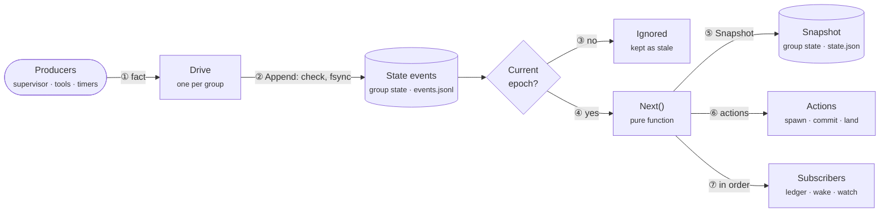
**Reading the diagram.** Both stores belong to group state, so the state events and the snapshot are always written, checked and replayed by the same code.

1. **A producer**, such as the session supervisor, publishes a fact stamped with the stage's epoch, and `Drive`, the one goroutine for this group, receives it.
2. **`Append`** hands it to group state, which checks it, appends it to the group state and fsyncs before anything else.
3. **An event from an older epoch** is kept as stale and ignored.
4. **A current event goes to `Next()`**, a pure function that always gives the same answer for the same input.
5. **`Snapshot`** receives the new state after every event; group state writes `state.json` only every 50 events or on a stage change.
6. **`Next()` also returns actions**, each recorded before and after it runs, so a crash replays safely.
7. **Three subscribers** then read the event in order: the ledger, the wake file and `status --watch`. They write only their own records, never group state.

**The state manager.** Every part of the harness reads and writes state through one service, the state manager. A record is one saved piece of state, such as a group snapshot, a lease or a pause timer, and every record shares one schema and one header. The manager fills in the header and refuses any write that breaks the schema, so nothing invalid reaches disk.

**📐 How every part reaches state**
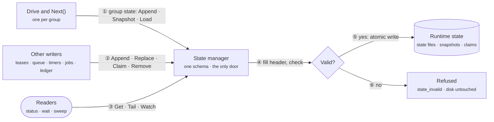
**Reading the diagram.**

1. **A group's `Drive` loop** appends each event, saves snapshots and, after a restart, loads its state, all through group state, the part of the manager that keeps them together. `Next()` still decides every change; the manager only stores and checks.
2. **The other writers** write their own kinds: the workspace its leases, the engine the queue and pool slots, the provider adapters the pause timers, the scheduler its job counters and the ledger its rows.
3. **Readers** such as `status`, `status --wait` and the startup sweep read through the same service, never the files directly.
4. **The manager fills in the header** (version, revision, time, writer) and checks types, required fields, allowed values and rules such as "no gaps in `sequence`".
5. **A valid write is atomic:** a event line is appended and fsynced, a snapshot is written to a temp file and renamed, and a claim file is created only if it does not exist.
6. **An invalid write is refused** with `state_invalid` and the field that failed, and the file on disk is unchanged. A record that fails its check on read is moved aside as `.bad-*`, and its group blocks. A torn last event line, left by a crash mid-write, is only dropped, and the group continues.

**A group's lifecycle.** A group holds up to 8 tasks that ship together. It moves through Intake, Build, Check, Verify and Ship, with Paused and Blocked as holding states. Intake lints the group, takes the lease and fence, cuts the worktree and runs `commands.setup`. Build runs one fresh builder session per task; after each, Go reruns its `done_when` and commits to the hidden ref. Check reruns every `done_when`, the scope check, secret scan, impact-set tests, baseline diff and changed-line coverage, at 0 tokens. Verify runs the reviewer and tester together on the same commit. Ship merges the epic branch in, reruns Check, lands with the fence, then runs Check on the epic tip. A failed Check or Verify resumes the task's builder session with only the verified findings; after `limits.returns` (3) returns per group, the group blocks.

**📐 The five stages of a group**
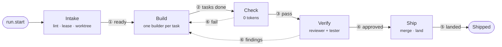
**Reading the diagram.** Intake lints the group, takes its lease and cuts a worktree. Build runs one fresh builder session per task and commits each to a hidden ref. Check reruns every test and scan at 0 tokens and passes the group to Verify. The reviewer and tester approve the same commit together. Ship merges the epic branch in, reruns Check and lands the group. A failed Check or a blocking finding returns the task to its builder, at most 3 times per group.

Only Build and Verify run model sessions, so only they can stop to wait. Paused waits for a provider limit to reset; Blocked waits for a person.

**📐 When a group waits or stops**
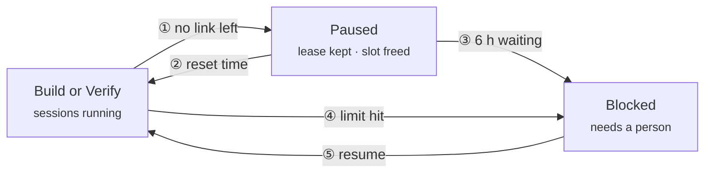
**Reading the diagram.** With no model link left, the group pauses and frees its session slot. When the provider's reset time passes, the group returns to the stage it left. After 6 hours paused (`limits.pause_max_min`), the group blocks with `pause_timeout`. Hitting any loop bound, such as 3 returns, also blocks the group. A person or the orchestrator runs `resume` to send it back to Build.

Inside Build and Verify, a supervisor watches each session through its stream of output lines.

**📐 How the engine watches a running session**
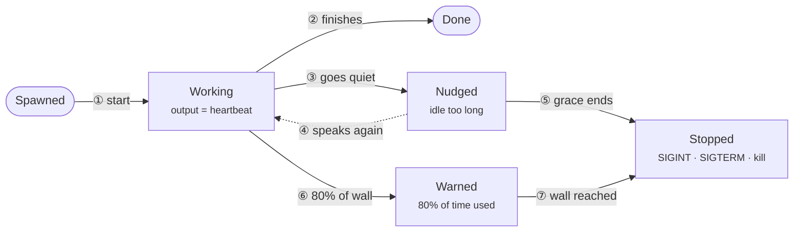
**Reading the diagram.** The session starts under the stage's epoch. A session that finishes ends with `session.end done`. A session silent for `session_idle_min` gets a nudge. Any new output line returns it to Working. Still silent after a 5-minute grace, it is stopped. At 80 percent of its wall-clock limit the session gets a time warning. At the limit it is stopped: SIGINT, then SIGTERM after 30 s, then the whole process tree after 60 s.

**One session end to end.** The engine first derives the link's capacity profile, `{ctx, slots, cost_class, effort}`, with context measured rather than typed. The brief builder fills 20 slots in the order tools, role, repo context, standards, task; the brief must fit in half the measured context. The billing check runs, failing closed, then the provider spawns the model with a private MCP server or a Go tool loop. Every tool call passes the guard; `run` executes in the sandbox with no shell and no network. The final call returns the result schema only; Go re-validates it, with one re-prompt. The agent's own gate runs next, and the session ends in a WIP commit to the hidden ref by compare-and-swap with the fence.

**📐 One builder session, start to finish**
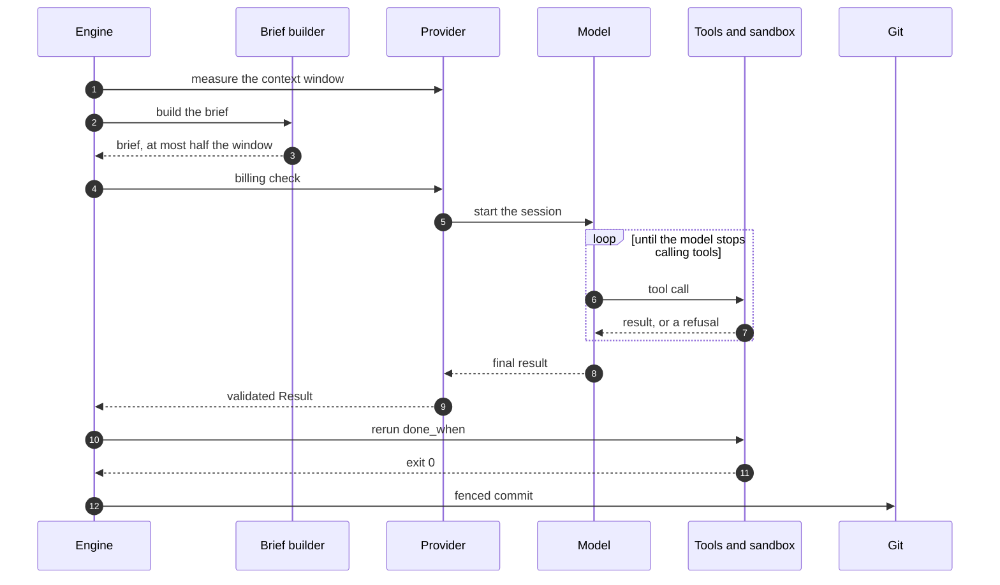
**Reading the diagram.** The engine measures the link's real context window. It asks the brief builder for a brief. The brief must fit in half the window, or the next link that fits is used. The billing check runs and fails closed. The provider starts the model session. The model calls a tool: read, search, edit, write or `run`. The guard checks the call and `run` executes in the sandbox, with replies capped at 4 KB. The model's final reply matches the result schema only. Go re-validates it, allowing one re-prompt. The engine reruns the task's `done_when` command in the sandbox. A failure goes back into the same session; two rejections end it. The engine commits to the hidden ref, guarded by the lease's fence.

**What matters**
- The engine emits events, never a model: a session's typed JSON becomes an event only after Go validates it.
- State first: append, fsync, then `Next()`; a crash after the sync replays the event.
- One door: the state manager is the only code that reads or writes state, and it refuses an invalid write before disk.
- One unit: group state keeps a group's events, snapshots and replay together; resuming a group is one `Load` call.
- Sessions run only in Build and Verify, so only those two stages can enter Paused or Blocked.
- Paused keeps the lease and worktree, returns the pool slot and waits on a timer record; wall clocks stop.
- Blocked never auto-retries; a person or the orchestrator runs `resume`, `scope approve|deny` or `abandon`.
- Two rejected results end a session with `check_fail`; every writing session ends in a WIP commit.

## 7. Deployment

Deployment is where `komodo` lives on a machine: one dependency-free file shared by every repository. A person installs it once; `fresh` updates it in the background. Without it, nobody could say what install changes or why a run survives an update.

| Platform | Sandbox | Notes |
|---|---|---|
| macOS | seatbelt | APFS clone for dependency copies; no process or memory cap |
| Linux | bwrap | cgroups caps when delegated; private loopback `[PENDING G-08]` |
| WSL2 | bwrap | Preferred on Windows; each side probes itself |
| Windows native | Docker | `komodo.exe`; one official image per detected language |

**📐 What one machine holds**
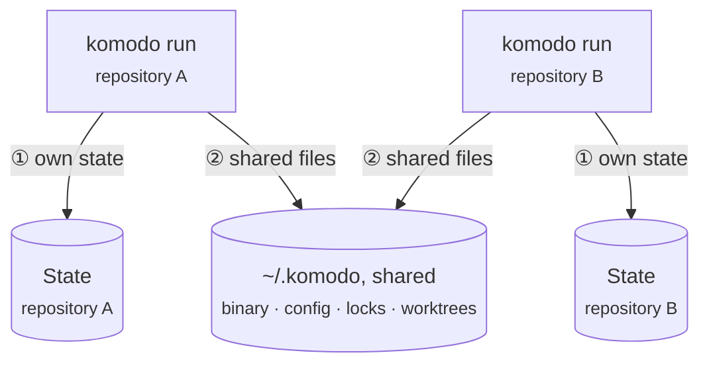
**Reading the diagram.** Each engine writes its state inside its own repository, under `<git-common-dir>/komodo`. Engines meet only through files in `~/.komodo`: the binary, config, locks and worktrees. A lock is a file the state manager creates exclusively, so two engines never take the same slot or group.

Three levels of files. Machine: the binary at `~/.komodo/versions/<v>/` and `bin/`, config, state (pool, link slots, queue, quota, leases), worktrees under `~/.komodo/wt/`. Repository: state files, sessions, ledger and cache under `<git-common-dir>/komodo/`. Session: sandboxed `run` commands, a private MCP tool server, own HOME and TMPDIR.

**What matters**
- One binary cross-built for windows, linux and darwin at every gate.
- Binary, config, Max quota and session pool are shared across repos.
- Install is an eight-step manifest diff; rerunning makes 0 changes.
- `init`, run by a person, puts Komodo's orchestrator skills and commands into the global Claude Code setup; how it writes there is open (LLD G-28).
- Self-update fetches the 1 KB `latest.json` at most hourly; live runs keep their version.

## 8. Crosscutting Concepts

A crosscutting concept is a rule spanning many components rather than living in one. Six shape the design: data, models and cost, security, quality gates, operations and interfaces; the LLD holds every table. Without them, each component would store and spend its own way. The engine enforces all six; a person meets them as files, refusals and `status` output.

**Data.** Files are of two kinds. Committed files live in the repository. They are `AGENTS.md` with the Komodo block, `CLAUDE.md` with its import line, `.claude/settings.json` with two entries, and `docs/backlog/`. Machine files never ship: `~/.komodo/config.json`, state, leases, worktrees and language caches under `~/.komodo/`; per-repo state, sessions, ledger and cache under `<git-common-dir>/komodo/`. Configuration has two layers: built-in defaults with hard limits, and the machine file. Only `komodo config` writes its 34 flat keys; a hand edit makes every verb refuse until `config --accept`. The cache is keyed by `sha256(inputs + binary version)`, verified on read, bounded by `cache.max_mb` (256), outside every worktree.

**One state schema.** Every runtime file is a kind in one schema, `embed/state.schema.json`, which also holds the 35 event types, and the state manager is the only code that reads or writes those files. Six things stay outside it, each with its own single owner:

- **`config.json`:** its own schema and its own writer, `komodo config`.
- **The cache:** derived data, checked by hash on every read.
- **Git refs and worktrees:** guarded by git's own compare-and-swap.
- **Job templates:** files a person writes, decoded strictly.
- **The binaries and the signing key:** signed and verified by `fresh`; the key is a secret only `release` reads.
- **Session temp:** each session's own scratch folders, removed by the sweep.

**📐 How inputs become a brief, and results become history**
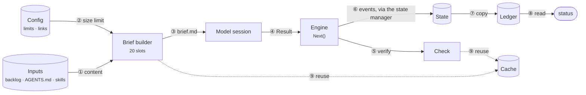
**Reading the diagram.** The backlog, `AGENTS.md` and skill bodies fill the brief's slots. The effective config and the measured context window cap the brief's size. The brief builder writes `brief.md` for the model session. The session returns a typed `Result` with output and, when `track.usage` is on, token usage. The engine sends the work to Check. The engine appends every event to the group state, through the state manager, before applying it. A subscriber copies events into the ledger, through the state manager. `status` and `status --metrics` read the ledger. The brief builder and Check reuse cached results keyed by a hash of their inputs.

**Models and cost.** A link is one way to reach a model; three ship: `claude-cli`, `anthropic-api` and `http:<name>`. Each agent has a weight and a fixed chain: `claude-cli` latest, then prior, each free `http:` backstop, then `anthropic-api` if `providers.paid` allows. A link is skipped only on provider failure, never because a task failed. Before every session, three mechanical checks that fail closed set the cost class: `subscription`, `free` or `paid`. With no link left, the session pauses on a timer record until the provider's reset time. At `limits.pause_max_min` (360) the group blocks with `pause_timeout`. Komodo adds no cost cap; USD is a beta metric that only warns, and only when `track.usage` is on.

**Usage tracking.** `track.usage` records the tokens and US dollars (USD) of each session. It takes `auto`, `on` or `off`; `auto`, the default, is on in `economy` mode and off in `thorough` mode. When it is off, the engine collects, writes and prints no token or USD data, and groups stay bounded by returns, attempts, retries and wall time.

**📐 Which model link a session gets**
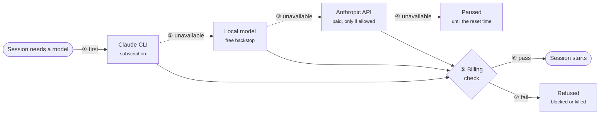
**Reading the diagram.** Every chain starts at the Claude CLI on the Max subscription. If it is unavailable or over a limit, the next link is a free local model. A paid Anthropic API link follows only when `providers.paid` allows it. With no link left, the group pauses until the provider's reset time. Whichever link is chosen passes the billing check first, which fails closed. A pass sets the cost class and starts the session. A fail blocks the group, or kills a session that shows an API key before turn 1.

The agent's weight picks the model on Claude links.

| Weight | Agents | Model, then fallback |
|---|---|---|
| Heavy | planner, architect, reviewer | `claude-opus-5-5`, then `claude-opus-5` |
| Standard | builder, researcher | `claude-sonnet-5-5`, then `claude-sonnet-5` |
| Light | tester, scout | `claude-haiku-5-5`, then `claude-haiku-4-5` |

**Security.** Three fences hold every worker. The guard checks every tool call in-process before it runs. Its rows are data in `embed/policy.json`: G1 to G6 for every agent, R1 for `run` and B1 for the builder. The orchestrator rows are O1 to O7, O9 and O10. A refusal names the rule and the allowed alternative; the third refusal under one rule ends the session. The sandbox confines every `run` at OS level with seatbelt, bwrap or Docker. Its limits: network off except loopback, a 10-minute timeout, a 4 KB reply cap, 512 processes and 8 GB. The worktree, lease and fence keep a session inside its own group. Releases are signed with ed25519; every `fresh` verifies SHA-256 and the signature.

**Quality gates.** Four gates stand between build and landing; three cost 0 tokens. Lint and coverage: `check.patch_coverage` (80) on changed lines, blocking for Go. Success: every `done_when` rerun. Regression: a baseline recorded at the base commit plus the impact set; a failing test is rerun twice alone, and a split reports `flaky`. Behaviour: the tester's blind pass over EARS acceptance items (`WHEN <event> THE SYSTEM SHALL <response>`). The reviewer applies ten lenses, rule catalogs chosen by file scope; a finding blocks only if Go finds its quoted line at `file:line`. Each task gets one verdict from each. `komodo gate`, the self-check for Komodo's own repository, must finish under 3 minutes.

**Operations.** No daemon runs. `komodo jobs tick` is one idempotent engine step, fired every 5 minutes by launchd, cron or Task Scheduler when installed with `--schedule`. Every failure has a detector, an action, a bound and a final state. The startup sweep kills orphans, frees expired leases and re-enqueues lost queue items. A crash stays in its group and loses at most one model turn. `status` shows the pool, stages, budgets and blocks. `status --wait` blocks until the next wake event, as the orchestrator's background loop; `status --metrics` is the scorecard, with tokens and USD only when `track.usage` is on. The ledger keeps `ledger.retention_days` (30) or 100 MB per repo and never trims an open group's state.

**Interfaces.** Every verb runs five steps: parse, validate, resolve, dispatch, render; a failure before dispatch has made 0 writes. Verbs sit in three tiers: shared (person and orchestrator), terminal-only (`install`, `init`, `fresh`, config writes, `release`; refused without a controlling terminal) and internal (the engine). Every verb returns one envelope, `{v, ok, verdict, report, data, error}`, with exit codes 0 ok, 1 refused, 2 usage, 3 blocked, 4 internal. `report` arrives formatted; the orchestrator relays it verbatim. Install writes a Komodo block into `AGENTS.md` telling any host session its verbs and rules; a `SessionStart` hook runs `komodo status`.

**What matters**
- Two environment variables exist, `KOMODO_HOME` and `NO_COLOR`; secrets are `env:` references only.
- Every chain ends in a free `http:` endpoint; `doctor` and `gate` refuse one that does not.
- Security rows are never config; the only guard tunable is `guard.refusal_limit`.
- `needs_scope` is the only refusal a person or the orchestrator can turn into an allow.
- The sandbox is `required` on every OS; Intake's `commands.setup` runs with network on, every `run` with it off.

**Lookup:** [LLD Appendix S](#appendix-s-hld-detail-tables-goals-building-blocks-decisions-quality-risks-roadmap) and LLD appendices A to M hold the tables. They cover locations, config keys, links, models, threats, guard rows, sandbox shapes, gates, runbook, verbs and the envelope.

## 9. Architecture Decisions

Index of the choices that shaped the design; DR-n numbers exist only here. The owner's three decisions of 2026-10-09 closed gaps G-01, G-05 and G-15 (a gap: an unverified fact or unconfirmed decision). Eleven rejected an alternative, kept with its reason in the LLD; DR-10 and DR-11 are the owner's own. Twelve design-pass defaults and four state-manager defaults await the owner's confirmation.

| ID | Decision | Component |
|---|---|---|
| G-01 | Local signing key plus one backup; `next` key at first release | Binary lifecycle |
| G-05 | Sole model registry `providers.json`; 404 fails over through the chain | Provider adapters |
| G-15 | Orchestrator answers `scope approve` after two engine denials | Check |
| DR-1 | Every loop has a counter | Configuration, Error recovery |
| DR-2 | `claude -p` with pinned flags, never `--bare` | Provider adapters |
| DR-3 | Fence enforced by git compare-and-swap | Workspace and leases |
| DR-4 | Measured context per session, never typed | Provider adapters |
| DR-5 | Shared Rust target dir per group | Sandbox and process control |
| DR-6 | Language caches owned by Komodo | Sandbox and process control |
| DR-7 | Session caps via cgroups or Docker only | Sandbox and process control |
| DR-8 | Machine-wide session pool, not per-repo lanes | Orchestration engine |
| DR-9 | No rule text in worker prompts | Rules and output contract |
| DR-10 | One state schema; the state manager is the only door to state | State manager |
| DR-11 | Group state: events, snapshots and replay as one unit | State manager |
| Defaults | 12 design-pass defaults: `fable` opt-in, Haiku 5.5 light, coverage 80, 10 lenses, EARS items, two-pass planner, 6 more | LLD Appendix S |
| State defaults | In-process, no daemon; 6 exclusions; quarantine, never repair; snapshot fields | State manager |

## 10. Quality Requirements

A quality requirement is a scenario with a number a test can prove or fail. Without one, "fast" and "safe" are unverifiable; tests and `komodo gate` measure them.

**What matters**
- Performance: `help`, `version`, a config read or `skill` under 50 ms `[PENDING G-19]`; a 10,000-event state replays under 1 s.
- Durability: `kill -9` mid-run then resume repeats 0 paid sessions and loses at most one model turn.
- Durability: two engines racing to land one group make exactly 1 landing; the loser ends `lease.lost`.
- Consistency: a write missing a required field is refused and the file is unchanged; replaying a state file through the state manager rebuilds `state.json` byte for byte.
- Safety: a `run` writing outside the worktree, reading `~/.ssh` or reaching a public address is refused.
- Capacity: 6 sessions machine-wide, 3 per link, 1 per loopback endpoint `[PENDING G-04]`, `[PENDING G-07]`; cache hits ≥50% with `track.usage` on `[PENDING G-17]`.

## 11. Risks, Debt and Roadmap

A risk is an unproved assumption; debt is a known shortcut to repay later. A builder closes each risk with a spike, a small experiment answering one question; per-risk owners are `[UNKNOWN: not yet designed]`.

**Top risks**
- The probe cannot capture `system/init` without a model turn, so billing check 3 costs one. G-02, phase 4.
- A 24 GB machine cannot run Qwen3.6-27B at 262,144 context, so the default backstop fails. G-03, phase 4.
- bwrap has no private loopback per session, so two Verify suites collide on one port. G-08, phase 2.
- Lens catalogs are unwritten, so review quality is unproven. G-16, phase 7.
- One owner holds the signing key; one backup and the `next` key mitigate. G-21, enterprise trigger.

**Debt.** Global Claude Code hooks and skills on the owner's machine call verbs this binary does not have; hand edits remove them before phase 2. The OpenAI path refuses with `not yet` (G-20). Enterprise custody, registry and scope ownership wait for G-21 to G-23.

**Roadmap**
- Phase 1, design docs: prd, hld, lld, ADR 0001, epic-1.
- Phase 2, foundations: CLI, state manager, configuration, HTTP, sandbox, cache, lint, gate core.
- Phase 3, model surface: agent registry, skills, rules and output, guardrails.
- Phase 4, model I/O: providers, tool runtime, brief builder.
- Phases 5-6, runtime and engine: workspace, supervisor, events, engine, Check, ship.
- Phase 7, quality and scale: review, tester, scheduler, planner; the harness builds itself.
- Phases 8-9, edges and cutover: installer, fresh, release, docs.
- Build process: from phase 7 a builder takes each task in one fresh session and a tester takes each exit proof; an architect joins only for design questions still open when a group starts. Phases 2-6 are checked by `go vet`, `go test` and the gate core.
- Later minor version: the OpenAI path and `komodo chat` (Komodo's own chat front end, where an `orchestrator` agent drives the pipeline). Possible after that: Docker on macOS and Linux, `--global` install, OS-scheduled updates, keychain secrets and OpenTelemetry export.

**Lookup:** [LLD Appendix S](#appendix-s-hld-detail-tables-goals-building-blocks-decisions-quality-risks-roadmap) holds the risk, debt and roadmap tables.

## 12. Glossary

Eighteen newcomer terms; the LLD links here.

| Term | Meaning |
|---|---|
| Harness | The `komodo` binary; its AI-session workers plan, build, check, review, ship code. |
| Orchestrator | A Claude Code session; drives the harness by verbs, never edits code. |
| Orchestration layer | The `engine` package inside the binary; moves groups through stages. Not the orchestrator. |
| Agent | Model role with private tools; seven: planner, architect, reviewer, builder, researcher, tester, scout. |
| Session | Fresh model conversation per task: brief, tool server, sandbox profile, 60-minute wall clock. |
| Epic, group, task | Epic holds groups; group up to 8 tasks; task at most 5 files. |
| Stage | Intake, Build, Check, Verify or Ship; Paused and Blocked hold. |
| Event | Typed fact recorded before applying, like `task.done`; 35 types. |
| Drive | The engine's loop for one group: the only code that changes that group's records. |
| `Next()` | Sole pure function: (state, event) to (new state, actions, follow-on events). |
| State manager | Only code that reads or writes runtime state; one schema, checked before disk. |
| Group state | A group's events, snapshots and replay as one unit inside the state manager. |
| Epoch | Integer rising per stage entry, except a return from Paused; session events with an older one are stale. |
| Lease, fence | Per-group lock file renewed every 5 minutes; rising integer every git write carries. |
| Worktree | Detached git checkout per group under `~/.komodo/wt/`, where the builder works. |
| Link | Way to reach a model: `claude-cli`, `anthropic-api`, `http:<name>`; later `codex-cli`, `openai-api`. |
| Chain, backstop | Agent's ordered links ending in the backstop, a free `http:` endpoint. |
| Brief | Worker prompt from 20 typed slots: tools, role, repo context, standards, task. |
| Guard, sandbox | Fail-closed check on every tool call; OS confinement around every `run`. |

---

*End of the read. The appendices below are lookup tables; every row carries a plain-language line.*

---

## Appendix A. Traceability

#### Appendix A. Traceability

| Component | Package | Phase |
|---|---|---|
| CLI processor | `cli` | 2 |
| Installer | `host` | 8 |
| Binary lifecycle | `host`, `core` | 2, 8 |
| Configuration | `core` | 2 |
| Provider adapters | `provider` | 4 |
| HTTP stack | `core` | 2 |
| Agent registry | `agent` | 3 |
| Tool runtime | `tools`, `provider` | 4 |
| Skill loader | `agent` | 3 |
| Rules and output contract | `agent` | 3 |
| Brief builder | `agent` | 4 |
| Guardrails | `safety` | 3 |
| Sandbox and process control | `safety` | 2 |
| Orchestration engine | `engine` | 6 |
| Workspace and leases | `engine` | 5 |
| Session supervisor | `engine` | 5 |
| Scheduler and job templates | `engine` | 7 |
| Error recovery | `engine` | 6 |
| Check | `quality` | 6 |
| Review and evidence | `quality` | 7 |
| Token and resource management | `ops`, `agent` | 6 |
| Cache store | `core` | 2 |
| Runtime observability | `ops`, `cli` | 5 |
| Event bus | `ops` | 5 |
| Backlog and planning | `repo` | 2, 7 |
| Ship | `repo` | 6, 8 |
| Gate and self-checks | `repo`, `safety` | 2, 8 |
| State manager | `state` | 2 |

---

## Appendix B. References

#### Appendix B. References

| Reference | Use in this document |
|---|---|
| arc42 template, https://arc42.org/overview | Section structure: introduction and goals, constraints, context, solution strategy, building blocks, runtime, deployment, cross-cutting views, decisions, quality requirements, risks |
| ISO/IEC/IEEE 42010:2022 | Stakeholders, concerns and views framing ([Stakeholders and concerns (LLD Appendix S)](#appendix-s-hld-detail-tables-goals-building-blocks-decisions-quality-risks-roadmap) and the view sections) |
| Design Docs at Google, https://www.industrialempathy.com/posts/design-docs-at-google/ | Goals and non-goals, decisions with rejected alternatives |
| Temporal workflows, https://docs.temporal.io/workflows | Pure decider and recorded activities |
| Distributed leases with fencing tokens, https://hackernoon.com/building-distributed-leases-with-consensus-heartbeats-and-fencing-tokens | Fence enforced by the resource |
| OpenHands, https://arxiv.org/pdf/2407.16741 | Event stream as the agent's spine |
| Codex CLI security, https://developers.openai.com/codex/security | Sandbox shape per OS, network off by default |
| AWS exponential backoff and jitter, https://aws.amazon.com/blogs/architecture/exponential-backoff-and-jitter | Full-jitter retries |
| Aider repo map, https://github.com/pdavis68/RepoMapper | Ranked repo map |
| Kiro spec-driven development, https://verdent.ai/guides/agents/kiro-spec-driven-development | EARS acceptance items |
| Google Testing Blog on coverage, https://testing.googleblog.com/2020/08/code-coverage-best-practices.html | Coverage bands |
| Claude Code headless docs, https://code.claude.com/docs/en/headless | Session launch, resume, structured output, signals |
| Anthropic prompt caching, https://platform.claude.com/docs/en/build-with-claude/prompt-caching | Cache breakpoints and pricing |
| Anthropic rate limits, https://platform.claude.com/docs/en/api/rate-limits | Pool and link defaults, limit classes |
| Ollama FAQ, https://docs.ollama.com/faq | Context length and parallelism defaults |

---

## Appendix C. Full Glossary

#### 2. Glossary

| Term | Meaning |
|---|---|
| Harness | The `komodo` binary: the engine that plans, builds, checks, reviews and ships code using AI model sessions as workers. |
| Orchestrator | The interactive AI session that drives the harness through CLI verbs. A Claude Code session. It never edits code itself. |
| Orchestration layer | The `engine` package inside the `komodo` binary, one of the eight layers. It moves each task group through its stages, runs sessions and runs git. It is not the orchestrator, which sits outside the binary and only calls verbs. |
| Worker, agent | A stateless model session with a private toolset. Seven agents exist: planner, architect, reviewer, builder, researcher, tester, scout. |
| Session | One fresh model conversation for one task. It has a brief, a tool server, a sandbox profile and a 60-minute wall clock. |
| Epic, group, task | The backlog hierarchy: an epic holds task groups; a group holds up to 8 tasks; a task names at most 5 files. |
| Stage | One of five pipeline steps a group moves through: Intake, Build, Check, Verify, Ship. Paused and Blocked are holding states. |
| Event | A typed fact the engine records, such as `task.done`. Thirty-five types exist. |
| State events | The append-only event file per group, `events.jsonl`. With the snapshot, it makes up group state, and replaying it rebuilds the state. |
| Group state | The part of the state manager that keeps a group's events, snapshots and replay as one unit. Its 5 calls are `Open`, `Append`, `Snapshot`, `Load` and `Tail`. |
| Snapshot | `state.json`: a group's state at one `sequence`, written every 50 events or on a stage change, so a restart replays at most 50 events. |
| Drive | The engine's loop for one group, and the only code that changes that group's records. It saves each event, asks `Next()` what to do and carries it out (LLD Appendix D). |
| `Next()` | The one pure function that turns (state, event) into (new state, actions, follow-on events). Nothing else changes group state. |
| State manager | The in-process service that is the only code reading or writing runtime state. It fills in each record's header and refuses a write that breaks the state schema. |
| State schema | `embed/state.schema.json`: one schema for every state record and every event type, generated from Go structs at build. |
| Kind | One type of state record in the schema, such as `group`, `lease`, `timer` or `event`; each kind lists its writers, and the manager refuses any other. |
| Record header | The fields every record carries, set by the state manager: `v`, `kind`, `key`, `rev`, `ts`, `writer`. Event lines carry their own envelope instead. |
| Append, Replace, Claim, Remove | The state manager's 4 ways to write: add a event line, swap a snapshot by rename, create a file only if it does not exist, or delete a record after checking its owner and revision. |
| Quarantine | A record that fails its check on read is moved aside as `.bad-*`, and its group blocks with `state_invalid`. A torn last event line is dropped instead. |
| Outbox | The group state entries `action.start` and `action.done` that bracket every side effect so a crash can replay it safely. |
| Epoch | An integer that rises on every stage entry, except when a group comes back from Paused. A session event carrying an older epoch is stale and ignored. |
| Lease | A per-group lock file on the machine, held from Intake to landing, renewed every 5 minutes, expiring 2 hours after the last renewal. |
| Fence | A monotonic integer beside the lease. Every git write carries it, and git's compare-and-swap refuses a stale holder. |
| Worktree | A detached git checkout per group under `~/.komodo/wt/`, where the builder works. |
| Hidden ref | `refs/komodo/groups/<group-id>`, where the engine saves every group commit. Never pushed, hidden from `git branch`. |
| Link | A way to reach a model: `claude-cli`, `anthropic-api`, `http:<name>`, and later `codex-cli`, `openai-api`. |
| Weight | An agent's model size: heavy, standard or light. Maps to Opus, Sonnet or Haiku on Claude links. |
| Chain | An agent's ordered list of links. Fixed in the agent's file, always ending in a free `http:` endpoint. |
| Backstop | The free open-source `http:` endpoint every chain ends in. Mandatory. |
| Cost class | `subscription`, `free` or `paid`, decided mechanically per link before each session. |
| Capacity profile | `{ctx, slots, cost_class, effort}` derived per link before each session; it sizes the brief and the pool take. |
| Brief | The prompt a worker receives: tools, role, repo context, standards, task. Assembled from 20 typed slots. |
| Slot | One named input to a brief, required or optional per agent. |
| Skill | A Markdown standards document embedded in the binary, preinjected by file globs or pulled on demand. |
| Lens | A reviewer rule catalog applied by file scope. Ten exist. |
| Finding | A reviewer claim with a rule ID, `file:line` and a quoted evidence line that Go verifies. |
| EARS | The acceptance-item grammar: `WHEN <event> THE SYSTEM SHALL <response>`, with `IF` and `WHILE` forms. |
| Check | The zero-token stage that reruns `done_when`, scope, secrets, impact tests, baseline diff and coverage. |
| Verify | The stage where the reviewer and the tester run at once on the same commit. |
| Pool slot | One of 1 to 6 machine-wide session slots that only builder, reviewer and tester sessions take. |
| Repo id | The normalized origin URL, or the git common dir path when there is no remote. Names worktrees, leases and caches. |
| Envelope | The JSON reply of every verb: `{v, ok, verdict, report, data, error}`. |
| Guard | The in-process, fail-closed check every tool call passes before it runs. |
| Sandbox | The OS-level confinement every `run` command executes in: seatbelt, bwrap or Docker. |
| Gap | A fact the design has not verified or a decision not yet confirmed, tracked as `G-NN` in the gap register. |
| arc42 | The 12-section architecture documentation template this document's section set follows. |
| `hash` | A short fingerprint worked out from some content; change one character and the fingerprint changes. Komodo hashes the config file, the task cards and every cache input to detect edits and name cached results. |
| `SHA-256`, `sha256` | A standard way to make a 64-character fingerprint of content. Komodo uses it to catch hand edits to config.json and to name each cache entry from its inputs. |
| `checksum` | A small number worked out from data to spot damage. Each event line in group state carries one, so a line cut short by a crash is detected and dropped on replay. |
| `CRC-32` | The formula behind Komodo's checksum: a standard, fast way to turn a line of text into one number of up to ten digits. Each event line's checksum covers that line's own text, so a cut-short last line is detected. |
| `lint` | An automatic check that reads files for rule breaks without running them. Komodo lints every planner draft of the backlog before writing any file, spending no model tokens. |
| `MCP` | Model Context Protocol: a standard way for an AI model to call tools that a small program offers it. Each Claude Code worker session gets its own private MCP server over stdio. |
| `WIP commit`, `WIP` | A work-in-progress save of unfinished files into git. Komodo makes one at the end of every writing session and on shutdown, so a stop or crash loses no edits. |
| `goroutine` | A lightweight strand of work inside a Go program; thousands can run side by side. Komodo gives each task group one Drive goroutine that owns its state, and each session its own. |
| `DAG` | Directed acyclic graph: steps joined by arrows meaning must finish first, with no loops, so a valid order always exists. Komodo builds one from group dependencies and refuses a plan with a loop. |
| `enum` | A fixed list of allowed values. Komodo's 35 event types, stage names and block reasons are enums, so the state manager rejects any value not on the list. |
| `atomic write`, `atomic` | Saving a file so it lands whole or not at all, never half-written. Komodo writes a temp file, syncs it to disk, then renames it into place. |
| `allowlist` | A list of the only things permitted; everything else is refused. Komodo uses allowlists for the web hosts agents may reach, the shell settings a sandbox passes in, and the skills an agent may load. |
| `idempotent`, `idempotency` | Safe to repeat: doing it twice has the same effect as once. Every Komodo side effect has an idempotency key, so replaying after a crash never commits or starts a session twice. |
| `pid` | Process ID: the number the operating system gives each running program. Komodo records pids in lock files, and the startup sweep uses them to find and stop leftover processes. |
| `golden file`, `golden fixture`, `golden`, `.golden` | A saved copy of the correct output, kept to compare against. Komodo's gate renders every output template and compares it byte for byte with its golden file. |
| `panic` | A sudden crash of one part of a Go program from an error nothing handled. A Drive panic blocks only its own group; a subscriber panic drops only that subscriber for the run. |
| `heartbeat` | A regular sign that a process is still alive. If the engine writes none for 10 minutes, the parent process kills its agents, saves the work and frees the leases. |
| `context window`, `ctx` | How much text a model can read at once, counted in tokens. Komodo measures it per link before each session and sizes every brief to half of it. |
| `stdio` | Standard input and output: the plain text pipe between a program and the one that started it. Claude Code workers reach Komodo's private tool server through it. |
| `fsync` | An instruction that forces the operating system to write data to the physical disk now. Komodo calls it when appending an event and before renaming a record into place, so a crash cannot lose them. |
| `stream-json` | A format where a program sends one JSON message per line as it works instead of one reply at the end. Komodo reads Claude's output this way and writes nudges into its open input. |
| `redaction`, `redact` | Blacking out sensitive text before it is stored. Komodo masks keys and secret matches before anything is written to the ledger, and in HTTP logs. |
| `channel` | A Go queue that passes messages between parts of a program running at the same time. Each group's Drive channel holds 256 events; when full, the sender waits and nothing is dropped. |
| `cgroups` | A Linux feature that caps the processes or memory a set of programs may use. Komodo uses it for sandbox.max_procs on Linux; macOS has no equivalent, and doctor says so. |
| `backoff` | Waiting longer after each failed attempt before trying again. A failed Komodo job waits 30 seconds, 2 minutes, then 8 minutes; HTTP retries use random delays. |
| `OOM` | Out of memory: the machine runs short and the operating system kills a program. Komodo's parent process treats an engine killed this way like any crash: it saves state and frees leases. |
| `LRU` | Least recently used: when a store is full, the entry untouched for longest is deleted first. Komodo's cache keeps at most 256 MB per repo this way. |
| `prompt cache`, `prompt caching` | A provider feature that charges less for the opening of a prompt it has seen before. Komodo puts the stable parts of each brief first so the provider can reuse them. |
| `cache_control`, `breakpoint` | A marker in an Anthropic API request showing where reusable text ends. Komodo sets at most 4 per request: tools plus role, repo context, standards, then task. |
| `stdlib` | Go's standard library: the code that ships with the language itself. Komodo's go.mod uses it alone, with no third-party packages. |
| `TTY` | A terminal: the interactive text window a person types in. Komodo's terminal-only verbs refuse to run without one, which keeps an agent's shell from running them. |
| `mutex` | A lock letting only one part of a program touch shared data at a time. Komodo's groups need none, because one Drive goroutine owns all of a group's state. |
| `semver` | Semantic versioning: version numbers written major.minor.patch, where each part signals how big a change is. Komodo embeds its version this way, and a repo can pin the lowest version it accepts. |
| `replay` | Reading recorded events back in order to rebuild a state. After a restart Komodo loads the latest snapshot and replays only the events after it, at most 50. |
| `ledger` | Komodo's history on disk: one line per model session, a copy of every event, and a row per group and task. The status command and the scorecard read from it. |
| `sweep`, `startup sweep` | A cleanup pass for leftovers. The startup sweep runs each time the engine starts: it kills stray processes, frees dead leases and re-queues work nobody owns after a crash. |
| `supervisor` | The engine code that starts, watches and stops each model session. It enforces time limits with a stop ladder: interrupt, terminate after 30 seconds, whole-tree kill after 60. |
| `stale` | Out of date. In Komodo an event from an older epoch is stale and changes nothing, and a stale lease holder is refused by the fence. |
| `fixture` | A prepared example used in tests. Komodo ships a fixture repo for end-to-end runs and deliberately broken fixtures that prove each gate check fails when it should. |
| `JSONL`, `jsonl` | JSON Lines: a text file with one JSON record per line, so new records are simply added at the end. Komodo's group events, ledger and raw session streams are JSONL files. |
| `loopback` | The machine talking to itself, also called localhost. A Komodo sandbox denies all network access except loopback, so a local test server works but the internet does not. |
| `seatbelt` | The macOS built-in tool, run as sandbox-exec, that confines a program to chosen files and network access. Komodo runs session commands under it on macOS. |
| `bwrap` | Bubblewrap: a Linux tool that runs a command in a locked-down view of the machine. Komodo uses it on Linux and WSL to make everything read-only except the worktree and to cut the network. |
| `Docker` | A tool that runs programs inside isolated containers. Komodo uses it as the sandbox on native Windows when WSL is absent, with no network and only the worktree writable. |
| `WSL` | Windows Subsystem for Linux: a real Linux running inside Windows. Komodo treats WSL like Linux and sandboxes with bwrap; native Windows without WSL falls back to Docker. |
| `compare-and-swap` | An update that succeeds only if the value is still what the caller last saw. Komodo moves the hidden ref this way, so a stale holder's write is refused. |
| `create-only` | A file written only if it does not exist yet, so the first writer wins and any other is refused. Komodo's leases and queue items are create-only files. |
| `regression` | A test that passed before a change and fails after it. Check compares against the base commit; a regression blocks the group, while a test failing both before and after only warns. |
| `flaky` | A test that sometimes passes and sometimes fails with no code change. Komodo reruns a failing test twice alone; in Check a split result only warns; in the tester's reruns a split blocks the group as `flaky`. |
| `baseline` | The starting measurement to compare against. Komodo's Check records the tests already failing at the base commit, so those failures are not blamed on the builder. |
| `Ollama` | A program that runs open-source AI models on your own machine. Komodo reaches it through an http: link and measures its real context window, refusing one below the configured floor. |
| `OpenAI-compatible` | A server that accepts requests in the same format as OpenAI's service, so one client fits many local and hosted models. Komodo's http: links all use that format. |
| `endpoint` | The web address where a server accepts one kind of request. An http: link points at an endpoint, and the engine refuses one whose context window is below providers.ctx_floor. |
| `quota` | A cap on how much a provider lets you use in a period. When a link hits its quota, Komodo pauses the group, records the reset time and resumes or fails over. |
| `API key` | A secret string that identifies you to a provider's service. Komodo stores only the name of the shell setting holding it, as env:NAME, never the key itself. |
| `wall clock`, `wall-clock` | Real elapsed time, as on a wall clock. A Komodo session has a 60-minute wall clock that stops while its group is paused. |
| `pure function` | A function whose result depends only on its inputs and which changes nothing else. Next() is one, so the same state and event always give the same actions. |
| `fail-closed` | When a check cannot decide or breaks, it refuses rather than allows. Komodo's guard works this way: a tool call it cannot approve does not run. |
| `rate limit` | A provider's cap on how many requests you may send per minute. On one, Komodo halves the session pool; a wait over 60 seconds pauses the group. |
| `SSE` | Server-sent events: a way for a server to stream a reply line by line as it is produced. Komodo reads model replies this way and never holds the whole body. |
| `symlink` | A shortcut file that points to another file or folder. Komodo's guard blocks reads and writes that escape the worktree through one. |
| `SIGTERM`, `SIGINT` | Signals the operating system sends to ask a program to stop: SIGINT is an interrupt, SIGTERM a firmer request. Komodo sends SIGINT, SIGTERM after 30 s, then a whole-tree kill after 60 s. |
| `orphan` | A leftover process whose parent has died. The startup sweep kills orphans by their pid files, and the proof cases require 0 orphan agents after a kill -9. |
| `TLS` | Transport Layer Security: the encryption behind https connections. Komodo's HTTP client keeps one connection pool, so a 4-task group shares one TLS session. |
| `daemon` | A program that keeps running in the background. Komodo has none: the binary lifecycle keeps komodo current with no daemon. |
| `PATH` | The list of folders the shell searches when you type a command name. The installer puts komodo on it: Windows user PATH, or a symlink into ~/.local/bin on macOS and Linux. |
| `glob`, `globs` | A pattern with wildcards, such as src/*.go, that matches many file names. Komodo uses globs to decide which skills to preinject and in each group's touches list. |

---

## Appendix D. Document Metadata

#### 3. Document metadata

#### 3.1 Owners

| Role | Who | Responsibility |
|---|---|---|
| Document owner | Komodo domain architect (CEO) | Approves the architecture; decides every open gap |
| Author | Technical lead | Keeps the document true to the design and the code |
| Reviewers | Domain architect, per component | Signs off component by component before phase 1 ends |

#### 3.2 Current controls

| Control | Value |
|---|---|
| Document | High-Level Design (HLD) |
| System | Komodo 1.0.0-beta.6, standalone model-agnostic Go harness |
| Status | Awaiting architecture sign-off by the document owner |
| Date | 2026-10-09 |
| Source of truth | This HLD and `docs/lld.md` together; the retired `PLAN.md` stays readable in git at commit `dee89326` |
| Change control | Patches only, smallest span |
| Approval control | No phase 2 code starts until the owner has signed off every component |
| Gap control | Every `[PENDING G-NN]` tag resolves to one row in the gap register (the LLD's gap register (Appendix O)); the gate fails a tag with no closing task |

#### 3.3 Related documents

| Document | Relationship |
|---|---|
| `docs/lld.md` | The Low-Level Design that details every component here |
| `docs/prd.md` | Product requirements, phase 1 deliverable |
| `docs/decisions/0001-standalone-harness.md` | First architecture decision record, phase 1 deliverable |
| Appendix B | External references |

**Placeholder convention.** Text in the form `[PENDING G-NN]` marks a fact the design has not yet verified or a decision the owner has not yet confirmed. No placeholder hides a proposal; each stands in for content that is decided but not yet proven.

---

## Appendix S. HLD Detail Tables: Goals, Building Blocks, Decisions, Quality, Risks, Roadmap

#### Introduction and goals

**In plain terms.** This section says what Komodo is for and what it must achieve. Komodo is the `komodo` program (the harness, see Glossary) that runs AI model sessions as workers to plan, build, check, review and ship code. The section exists so the document owner can judge every later design choice against a stated goal. Without it, a reader cannot tell a good design decision from a bad one. The owner reads it; nothing in the running system reads it.

#### Purpose

**In plain terms.** This subsection says who the document is written for and which questions it answers. The reader is the domain architect, the person who approves the design. arc42 (see Glossary) is a standard 12-section outline for architecture documents, and this document follows it. Without a stated purpose, reviewers would not know what level of detail to expect.

This document describes the architecture of Komodo at the level a domain architect needs to approve it: what the system is for, who has a stake in it, what constrains it, what it is made of, how the parts cooperate at run time, what data it keeps, how it stays safe, and how it will be delivered. It follows the arc42 structure with the owner's ordering for the front matter.

#### Scope

**In plain terms.** Scope lists what this design includes and what is pushed to a later release. A "later minor" is a smaller follow-up release. A link (see Glossary) is one way the harness reaches an AI model. Without a scope list, reviewers would ask for features that were left out on purpose. The owner decides scope; the engine ships only what is in it.

In scope:
- The single Go binary `komodo`, its 28 components in 8 layers plus the state manager pillar, and the cross-cutting security design.
- Two callers: an AI orchestrator (Claude Code today) and a human at a shell.
- Three model links: `claude-cli`, `anthropic-api`, and OpenAI-compatible `http:` endpoints (Ollama, vLLM, llama.cpp, LM Studio, local or on a server).
- Four platforms: macOS, Linux, WSL2, and native Windows (Docker required).
**What each one does**
- **The `komodo` binary, 28 components:** The one program. It is split into 27 parts grouped in 8 layers, plus the state manager, a core pillar every layer uses; section 8 lists them.
- **Two callers:** The orchestrator (the Claude Code session that drives the harness) and a person typing at a shell. Both use the same commands.
- **Three model links:** `claude-cli` runs the Claude command-line tool on a subscription login. `anthropic-api` calls Anthropic's paid web API. `http:` endpoints are OpenAI-compatible servers such as Ollama that run open-source models on your machine or a server.
- **Four platforms:** macOS, Linux, WSL2 (Linux inside Windows, the preferred choice there) and native Windows, which needs Docker for its sandbox.

Out of scope, deferred to a later minor version:
- The OpenAI execution path: `codex-cli` link, `openai-api` chain link, `.codex/` install. Only the interfaces and probe are built; the links refuse with `not yet`.
- `komodo chat`, Komodo's own orchestrator front end.
- `orch agent`, ad hoc delegation outside the pipeline.
- Repo-defined hooks and agents, keychain-backed secrets, OpenTelemetry export, Docker on macOS and Linux, service-backed test runs.
**What each one does**
- **`codex-cli` link:** Would run OpenAI's Codex command-line tool as a worker. Install detects it but refuses to use it with `not yet`.
- **`openai-api` chain link:** Would call OpenAI's web API as a worker. Same `not yet` refusal.
- **`.codex/` install:** Would write Codex's repo files at install time. Reports `not yet`.
- **`komodo chat`:** Komodo's own chat front end, an orchestrator built into the binary. It would be an `orchestrator` agent whose only tools are the shared verbs, so any link in the chain, Ollama included, could drive the pipeline under the in-process guard. It would reuse the tool-runtime loop and its context compaction.
- **`orch agent`:** A one-off delegation to a model outside the pipeline, such as a free scout on a local model. Deferred because hosts have their own subagents.
- **Repo-defined hooks and agents:** Letting a repository add its own hooks or agent definitions. The harness uses only the embedded agents and three built-in hooks.
- **Keychain-backed secrets:** Storing API keys in the OS keychain. The harness reads keys only from environment-variable references.
- **OpenTelemetry export:** Sending metrics to an external monitoring system. The harness writes JSONL files plus a schema instead.
- **Docker on macOS and Linux:** Using Docker as the sandbox there. The harness uses Docker only on native Windows.
- **Service-backed test runs:** Running tests that need a database, Docker or a public host. Such tests warn instead of blocking.

**Possible in a later minor version**
- **Docker on macOS and Linux:** The sandbox choice above; native Windows already uses Docker.
- **`--global` install:** An `install` mode that would set up the orchestrator hooks once for every repo on the machine, instead of per repo.
- **OS-scheduled updates:** Named as a possible later item; its design is `[UNKNOWN: not yet designed]`.
- **Keychain secrets:** The OS keychain holding API keys, as described above.
- **OpenTelemetry export:** Metrics sent to an external monitoring system, as described above.

#### Requirements overview

**In plain terms.** This table is the short list of what the harness must be. Each row is a hard requirement that later sections satisfy. The owner approves these; the engine, the orchestrator (the Claude Code session that drives the engine) and the worker sessions each implement part of them. Without them there is no bar to measure the design against.

| Requirement | Statement |
|---|---|
| Engine | One Go binary, standard library only, no server process |
| Workers | Stateless model sessions, one fresh session per task, each with a private toolset |
| Callers | An orchestrator and a human at a shell call the same CLI verbs; the orchestrator gets a JSON envelope |
| Pipeline | Five stages per task group: Intake, Build, Check, Verify, Ship |
| Isolation | Worktree plus guard plus OS sandbox for every worker |
| Models | A declared fallback chain per agent that always ends in a free open-source endpoint |
| Delivery | Fenced landings into an epic branch; a person merges only the epic pull request |
| Operations | Self-updating binary, one configuration file, no daemon, optional OS-scheduled tick |
**What each one does**
- **Engine:** The harness is one program written in Go using only Go's built-in library, so there are no third-party packages. It never runs as a background server; each command is a short-lived process.
- **Workers:** Each task gets a brand-new model conversation (a session, see Glossary) that remembers nothing from earlier tasks. Each session gets its own tool server that only it can reach.
- **Callers:** The orchestrator (Claude Code) and a person run the same `komodo` commands. The orchestrator gets the JSON envelope (see Glossary), a fixed machine-readable reply.
- **Pipeline:** Every task group passes through five stages in order.
  - **Intake:** The engine checks the backlog files, takes the group's lease (see Glossary), runs the repo's setup command and locks the task list.
  - **Build:** The builder agent does each task in its own session. A task is done when its `done_when` command exits 0 and a commit exists on the hidden ref.
  - **Check:** Zero-token mechanical checks: rerun `done_when`, scope, secrets, impact tests, baseline diff and coverage.
  - **Verify:** The reviewer and tester agents run at the same time on the same commit; both must pass.
  - **Ship:** The engine merges, reruns Check on the epic tip and lands the group with the fence (see Glossary).
- **Isolation:** Every worker edits only inside its worktree (a separate checkout, see Glossary). Every tool call passes through the guard, and every command runs inside an OS sandbox.
- **Models:** Each agent has a fixed, ordered list of links (a chain, see Glossary). The last link is always a free open-source endpoint, so work continues when Claude is unavailable.
- **Delivery:** Finished groups land on an epic branch carrying the fence, so a stale process cannot overwrite newer work. A person merges only the final epic pull request.
- **Operations:** The binary updates itself, all settings live in one file, and nothing runs permanently. An optional OS timer runs `komodo jobs tick` every 5 minutes.

#### Goals and non-goals

**In plain terms.** Goals are outcomes the design commits to, each with a way to measure it. Non-goals are things a reader might expect that the design deliberately does not do. Both guide every tradeoff in later sections. The owner sets them; `komodo gate`, the engine's build-time self-check, enforces several of them.

Goals:

| Goal | Measure |
|---|---|
| 80% mechanical, 20% prompt | Any failure a guard row, parser or check can prevent is prevented in Go |
| Bounded loss | Any single failure loses at most one model turn and no committed edit |
| Never pay by accident | 0 paid calls under `providers.paid: never`; a three-step billing check fails closed |
| Open source as the backstop | Every agent chain ends in a free `http:` endpoint; Claude limits move work there first |
| Every loop has a counter | Attempts, returns, retries, refusals, pauses and budgets each have a bound and a named final state |
| Deterministic output | Models return codes and facts; Go templates render every word a person reads |
**What each one does**
- **80% mechanical, 20% prompt:** Whenever Go code can stop a failure, Go does it instead of asking the model to behave. The prompt carries only what code cannot do.
- **Bounded loss:** Any crash or failure costs at most one model turn of work. Edits already committed are never lost.
- **Never pay by accident:** With the setting `providers.paid: never`, zero paid API calls happen. Before each `claude-cli` session, Go checks the login, scrubs API-key variables, and reads the first stream line; any doubt kills the session.
- **Open source as the backstop:** Every agent's chain ends in a free `http:` endpoint. When Claude's subscription limit hits, the next session moves there before anything pauses.
- **Every loop has a counter:** Each kind of repeat has a maximum and a named end state.
  - **Attempts:** `limits.task_attempts`, 6 sessions per task.
  - **Returns:** `limits.returns`, 3 trips back to Build per group before Blocked.
  - **Retries:** 4 HTTP attempts with random spacing.
  - **Refusals:** A builder may ask for a file outside its scope once per task.
  - **Pauses:** `limits.pause_max_min`, 360 minutes paused before the session is cancelled.
  - **Budgets:** Wall time bounds each session and group. With `track.usage` on, `limits.group_tokens` also bounds tokens per group and dollars only warn.
- **Deterministic output:** Models return short codes and facts as JSON. Go templates turn them into every sentence a person reads, so the same facts always give the same text.

Non-goals:

| Non-goal | Reason |
|---|---|
| A cost cap of Komodo's own | Provider windows and spend limits are the provider's; USD is a beta metric that only warns, with `track.usage` on |
| Per-run or per-repo configuration | One machine file keeps settings auditable and out of any agent's reach |
| Repo-defined agents, hooks or plugins | Deferred; the embedded roster and three inline hooks are enough |
| Third-party Go dependencies | Standard library only, by locked decision |
| A long-running service | Every verb is a short process; the engine runs detached per `run` and a tick replaces a daemon |
**What each one does**
- **A cost cap of Komodo's own:** Anthropic and OpenAI enforce their own usage windows and spend limits. With `track.usage` on, Komodo only warns when a run passes `warn.usd_per_run`, $5 by default.
- **Per-run or per-repo configuration:** All settings live in `~/.komodo/config.json`. No repo folder or command flag can override them, so a worker cannot change them.
- **Repo-defined agents, hooks or plugins:** The seven agents are built into the binary. Exactly three hooks exist, all in Go: before a tool call, after `edit`, and at session end.
- **Third-party Go dependencies:** `go.mod` lists no external packages. This is a locked decision.
- **A long-running service:** No daemon. `run` starts a detached engine process for that run; a scheduled `jobs tick` does the rest.

#### Quality goals

**In plain terms.** Quality goals are the five properties the design optimises for, in rank order. When two goals conflict, the higher one wins. Each scenario is a concrete test the owner can hold the design to. The engine's guard, state, templates, model chains and sandbox each serve one of them.

The five quality goals that shape the architecture, in priority order.

| Priority | Quality goal | Scenario |
|---|---|---|
| 1 | Safety | A worker can never write outside its worktree, read a secret, push to git, or spend money without a decided setting |
| 2 | Durability | A crash, kill, power loss or provider halt mid-run loses at most one model turn and no committed edit |
| 3 | Determinism | The same facts render the same bytes on every run; a stage moves only on evidence the engine produced |
| 4 | Cost control | Work prefers the subscription and free links, caches a stable prompt prefix, and bounds every loop |
| 5 | Portability | The same behaviour on macOS, Linux, WSL2 and native Windows from one binary |
**What each one does**
- **Safety:** A worker cannot write outside its worktree, read secret files, push to git, or spend money unless a setting allows it. The guard and the sandbox enforce this on every call.
- **Durability:** The engine writes every event to a state file before acting on it. After a crash it replays the group state, so at most one model turn is lost.
- **Determinism:** The same facts render the same bytes. A stage moves only on evidence the engine produced itself, never on a model saying "done".
- **Cost control:** Work goes to the subscription and free links first. Prompts keep a stable prefix so providers can cache them, and every loop has a limit.
- **Portability:** One binary behaves the same on all four platforms; only the sandbox backend differs per OS.

#### Stakeholders and concerns

**In plain terms.** A stakeholder is anyone, human or software, with something to gain or lose from this design. The table names each one, what they do, and what they need the design to guarantee. The owner uses it to check that no party was forgotten. Every later section should answer at least one concern listed here.

| Stakeholder | Role | Concerns |
|---|---|---|
| Domain architect (owner) | Approves the architecture, decides gaps, cuts releases | Correctness of the design, cost, safety, enterprise upgrade paths |
| Human operator | Installs, configures, updates, merges epic PRs | Install is idempotent (safe to repeat with the same result); updates never break a live run; `status` explains every block |
| Orchestrator (Claude Code) | Plans, runs, waits, answers scope requests | One verb set with self-describing help; a verbatim `report`; wakes instead of polling |
| Worker agents | Build, review, test, plan, research | A brief that fits; tools that teach on refusal; no harness rules in the prompt |
| Repository owners | Own the code Komodo changes | Nothing committed outside the backlog's scope; `AGENTS.md` stays the source of truth; no hooks or config added |
| Model providers | Anthropic, local endpoints | Rate limits and spend limits honoured; retries jittered; subscription login never bypassed |
| Future maintainers | Build phases 2 to 9 | One package per layer; import direction enforced; every generated artifact gated against its source |
**What each one does**
- **Domain architect (owner):** The person who approves this architecture, decides each open gap (`G-NN`, see Glossary) and cuts releases. They need the design correct, cheap, safe and upgradeable for enterprise use.
- **Human operator:** The person who installs, configures and updates Komodo and merges epic PRs. Rerunning install makes 0 changes; a live run keeps the binary version it started with; `status` lists every blocked group.
- **Orchestrator (Claude Code):** The AI session that calls `plan`, `run` and `status --wait`, answers scope requests and relays reports. `help --json` describes every verb; `report` is text to pass on unchanged; `status --wait` sleeps until an event instead of polling.
- **Worker agents:** The seven model sessions that build, review, test, plan and research. They need a brief sized to the model, refusals that name the rule and the allowed alternative, and no harness rules in the prompt.
- **Repository owners:** The people who own the code Komodo edits. The guard allows changes only to files in the group's scope; `AGENTS.md` stays the rules file; install adds no hooks or config to the repo.
- **Model providers:** Anthropic and local endpoints. Komodo honours their rate and spend limits, spaces retries randomly, and reads login state only from `claude auth status`.
- **Future maintainers:** The people who build phases 2 to 9. Each layer is one Go package, the gate enforces which package may import which, and every generated file is checked against its source.

#### Architecture constraints

**In plain terms.** A constraint is a rule the design must obey and cannot trade away. Some are technical (language, platforms), some organisational (who approves what), and some are conventions (how docs and events are written). They exist so later sections never silently break a locked decision. The owner set them; `komodo gate`, the engine's build-time self-check, enforces several.

#### Technical constraints

**In plain terms.** These are fixed technical choices made before the design started. Each one narrows what later sections may propose. The engine and its build process obey them; nobody can override them at run time.

| Constraint | Statement |
|---|---|
| Language and dependencies | Go, standard library only; `go.mod` has no dependencies |
| Process model | No server process; every verb is a short process; the engine runs detached per `run` |
| Platforms | macOS, Linux, WSL2 (preferred on Windows), native Windows `.exe` which requires Docker |
| Host bridge | Claude Code talks to the harness only through CLI subcommands with `--json` |
| Model access | Claude through `claude -p` on the subscription login, the Anthropic API when allowed, and OpenAI-compatible HTTP; OpenAI's own path is a later minor |
| Isolation | Worktree plus guard plus OS sandbox; each session gets a private MCP (Model Context Protocol, how a model calls tools) tool server; native host tools are off |
| Configuration | One machine file `~/.komodo/config.json`, changed only through `komodo config`; no repo layer, no per-run override; runtime state outside the tree |
| Sandbox backends | seatbelt on macOS, bwrap on Linux and WSL, Docker on native Windows only |
**What each one does**
- **Language and dependencies:** Go only, with no external packages, so the build downloads nothing and there is nothing to audit.
- **Process model:** Each `komodo` command runs and exits. `run` starts an engine process that keeps working after the command returns.
- **Platforms:** macOS, Linux, WSL2 (preferred on Windows) and a native Windows `.exe`. Native Windows needs Docker for the sandbox.
- **Host bridge:** Claude Code never links to Komodo as a library. It runs `komodo <verb> --json` as a command and reads the JSON reply.
- **Model access:** Claude through `claude -p` (the Claude CLI's non-interactive mode) on a subscription login. The Anthropic API only when `providers.paid` allows it. OpenAI-compatible HTTP servers. OpenAI's own tools come in a later minor.
- **Isolation:** Each worker gets a worktree, the guard, an OS sandbox and its own tool server. MCP (Model Context Protocol) is the tool-calling standard the Claude CLI uses to reach that server. The host's native tools are switched off.
- **Configuration:** One file, `~/.komodo/config.json`, edited only with `komodo config`. No repo file or run flag overrides it. Runtime state lives under `~/.komodo/`, not in the repo.
- **Sandbox backends:** `seatbelt` (`sandbox-exec`) on macOS, `bwrap` on Linux and WSL, Docker on native Windows. Each confines what a command can read, write and reach on the network.

#### Organizational constraints

**In plain terms.** These rules are about people and process, not code. They say who approves and who builds each phase. A phase is one numbered delivery step; phases 2 to 9 build the harness. The owner enforces them.

| Constraint | Statement |
|---|---|
| Ownership | One owner approves the architecture and holds the release signing key |
| Approval gate | No phase 2 code starts until every component is signed off |
| Build model | Phases 2 to 6 by hand in plain Claude Code sessions; from phase 7 the harness builds its own groups |
| Security review | The security lens is required for the installer, binary lifecycle, HTTP stack, tool runtime, guardrails, sandbox and ship; before phase 7 the owner reviews those groups by hand |
**What each one does**
- **Ownership:** One person approves the design and holds the key that signs releases, kept at `~/.komodo/release.key` with one backup copy.
- **Approval gate:** No phase 2 code is written until the owner has signed off every component.
- **Build model:** Phases 2 to 6 are built by the owner in ordinary Claude Code sessions with no Komodo hooks. From phase 7, a dev build of the harness runs its own task groups.
- **Security review:** The security lens is a reviewer rule catalog (see Glossary). It must run on the installer, binary lifecycle, HTTP stack, tool runtime, guardrails, sandbox and ship. Until phase 7, the owner reviews those groups by hand.

#### Conventions

**In plain terms.** Conventions are house rules for documents, output text and change control. They keep the docs and the code in step. The owner, the orchestrator and future maintainers follow them; `komodo gate` checks the output and event rules.

| Convention | Statement |
|---|---|
| Documentation | `AGENTS.md` is the source of truth in every repo; `CLAUDE.md` imports it |
| Output | Every word a person reads comes from a Go template selected by `output.profile` (`adhd` by default) |
| Events | A new event type or result code is a design change: enum (a fixed list of allowed values), schema, template and fixture together |
| Gaps | A design section may not say "later" or "TBD" without a `G-NN` register row |
**What each one does**
- **Documentation:** `AGENTS.md` holds the repo rules and `CLAUDE.md` only imports it.
- **Output:** Every sentence a person reads comes from a Go template. The `output.profile` setting picks the template set, `adhd` by default.
- **Events:** Adding an event type or result code means changing the Go enum, the JSON schema, the template and the test fixture together. The gate fails if one is missing.
- **Gaps:** Any "later" or "TBD" in a design section needs a `G-NN` row in the gap register, with a phase that closes it.

#### Context and scope

**In plain terms.** This section draws the boundary around Komodo: who calls it, what it calls, and what flows in and out. Everything inside the boundary is designed in this document; everything outside belongs to someone else's system. Without it, a reader cannot tell Komodo's responsibilities from Claude's, GitHub's or the operating system's.

#### Business context

**In plain terms.** The diagram and the table show every outside party Komodo talks to. "Calls in" means that party starts the conversation; "Called out" means Komodo starts it. The orchestrator, the person and the OS scheduler are the only callers in. Models, git, GitHub and the sandbox are called out.

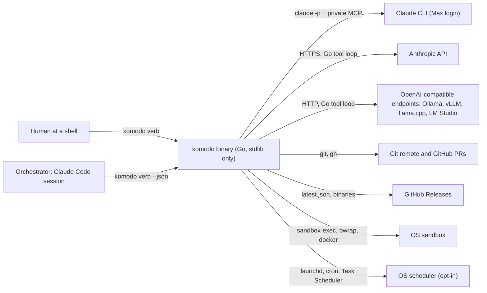

| Actor or system | Role | Direction |
|---|---|---|
| Human at a shell | Installs, configures, updates, releases; may also run every shared verb | Calls in |
| Orchestrator | Refines intent, calls `plan`, `run`, `status --wait`, answers `scope`, relays reports | Calls in |
| Claude CLI | Runs worker sessions on the Max subscription via `claude -p` | Called out |
| Anthropic API | Runs worker sessions when a paid link is allowed | Called out |
| OpenAI-compatible endpoints | Run worker sessions as the free backstop, local or self-hosted | Called out |
| Git remote and GitHub | Receives group and epic branches; `gh` opens PRs; a person merges only the epic PR | Called out |
| GitHub Releases | Serves `latest.json` and signed binaries for self-update | Called out |
| OS sandbox | Confines every `run` command | Called out |
| OS scheduler | Fires `komodo jobs tick` every 5 minutes when installed with `--schedule` | Calls in |
**What each one does**
- **Human at a shell:** The person. They install, configure, update and release, and may also run any verb the orchestrator runs.
- **Orchestrator:** The Claude Code session. It turns the person's intent into `komodo plan`, starts `run`, waits with `status --wait`, answers scope requests and relays the report text.
- **Claude CLI:** The `claude` program, run as `claude -p` on a Max subscription login, to host one worker session at a time.
- **Anthropic API:** Anthropic's paid web API. Used for workers only when `providers.paid` allows it.
- **OpenAI-compatible endpoints:** Local or self-hosted servers (Ollama, vLLM, llama.cpp, LM Studio) that run open-source models. They are the free last resort in every chain.
- **Git remote and GitHub:** Group branches and the epic branch are pushed there. The `gh` tool opens PRs. The engine merges group PRs; a person merges the epic PR.
- **GitHub Releases:** Hosts `latest.json`, a small manifest with version, download URLs, checksums and a signature, plus the binaries. The self-update reads it.
- **OS sandbox:** The operating-system feature that fences in every command a worker runs.
- **OS scheduler:** launchd (macOS), cron (Linux) or Task Scheduler (Windows). When installed with `--schedule`, it runs `komodo jobs tick` every 5 minutes.

#### Technical context

**In plain terms.** This table lists the same connections at the wire level: how bytes actually move. Inbound means the connection enters Komodo; outbound means Komodo opens it. A child process is a program Komodo starts and controls. SSE (server-sent events) is a way for a web server to stream a reply piece by piece.

| Interface | Protocol | Direction | Notes |
|---|---|---|---|
| CLI verbs | Process invocation; JSON envelope on stdout | Inbound | Exit codes 0 to 4; `--json` on automatically without a terminal |
| `claude -p` | Child process; stream-json (one JSON object per output line) on stdin and stdout | Outbound | Private MCP tool server over stdio (the program's standard input and output) per session |
| Anthropic Messages API | HTTPS, SSE streaming | Outbound | Structured outputs for the final call; `cache_control` breakpoints |
| OpenAI-compatible `/v1` | HTTP or HTTPS, SSE streaming | Outbound | `GET /models` probe; Ollama detected via `GET /api/version`; `/api/ps` for context |
| Git | Child process | Outbound | Worktrees, hidden refs by compare-and-swap, branches, merges, pushes |
| GitHub | `gh` child process; release download over HTTPS | Outbound | Group and epic PRs; `latest.json` and binaries |
| OS sandbox | `sandbox-exec`, `bwrap`, `docker exec` | Outbound | Wraps every `run`; never the model client |
| OS scheduler | launchd, cron, Task Scheduler | Inbound | Runs `komodo jobs tick` every 5 minutes |
**What each one does**
- **CLI verbs:** A caller runs `komodo <verb>`; the reply is the JSON envelope on stdout. `--json` turns on by itself when no terminal is attached. The exit codes:
  - **0:** ok.
  - **1:** refused.
  - **2:** usage error.
  - **3:** blocked.
  - **4:** internal error.
- **`claude -p`:** Komodo starts the Claude CLI as a child process and exchanges stream-json messages over stdin and stdout. The session's private tool server runs over the same kind of pipe.
- **Anthropic Messages API:** HTTPS calls with streamed replies. The final call asks for structured output so the result matches a schema. `cache_control` marks prompt sections for the provider to cache.
- **OpenAI-compatible `/v1`:** HTTP or HTTPS with streamed replies. `GET /models` at install checks the server answers within 1 s. Ollama is recognised by `GET /api/version`, and `/api/ps` reports the loaded model's context size.
- **Git:** Komodo runs `git` as a child process for worktrees, hidden refs (see Glossary), branches, merges and pushes. Hidden refs move by compare-and-swap, which refuses a writer holding a stale fence.
- **GitHub:** The `gh` command opens group and epic PRs. Release downloads come over plain HTTPS.
- **OS sandbox:** `sandbox-exec`, `bwrap` or `docker exec` wraps each command a worker runs. The model client itself is never sandboxed.
- **OS scheduler:** launchd, cron or Task Scheduler invokes `komodo jobs tick` every 5 minutes.

#### Inputs and outputs

**In plain terms.** Inputs are everything Komodo reads to do a run; outputs are everything it produces. "Consumed by" names the part of the engine, or the agent, that reads each input. The person and the orchestrator supply goals and decisions; the engine writes everything else.

| Input | Form | Consumed by |
|---|---|---|
| A goal | `komodo plan <goal>` text, or `--from <spec>` documents (PRD, RFC, ticket export, `docs/` tree) | Planner, two passes |
| The repository | Markers (`go.mod`, `package.json`, …), `AGENTS.md`, the symbol graph | Detection, brief builder, repo map |
| The backlog | `docs/backlog/epic-N/tg-N.M/{TG.md, tsk-*.md}` | Intake, Build, Verify |
| Configuration | `~/.komodo/config.json` within built-in hard limits | Every verb, snapshotted per run |
| Provider state | `providers.json` from the install probe; `quota.json` reset timers | Chain selection, billing check |
| Decisions | `scope approve|deny`, `resume`, `abandon`, config writes | The engine |
**What each one does**
- **A goal:** What the person wants built, as text to `komodo plan` or as documents through `--from`. The planner agent reads it in two passes: first the epic outline, then one session per group for its tasks.
- **The repository:** Marker files such as `go.mod` tell Komodo the language and its commands. `AGENTS.md` supplies repo rules. The symbol graph is a Go-built index of functions and types that feeds the repo map.
- **The backlog:** The task files under `docs/backlog/`. Intake locks them, Build does the tasks, Verify checks them.
- **Configuration:** `~/.komodo/config.json`, each value within built-in hard limits. Its hash (a content fingerprint) is snapshotted per run, so edits mid-run take effect on the next run.
- **Provider state:** `providers.json` records each link's path, version and login from the install probe. `quota.json` holds reset timers after a provider limit. Chain selection and the billing check read both.
- **Decisions:** Human or orchestrator choices the engine acts on.
  - **`scope approve|deny`:** Answers a builder's request for a file outside its scope.
  - **`resume`:** Restarts a paused or blocked run.
  - **`abandon`:** Stops a run, frees its leases and keeps the evidence; dependent groups block.
  - **Config writes:** `komodo config` changes a setting for the next run.

| Output | Form | Produced by |
|---|---|---|
| A linted backlog | Files under `docs/backlog/`, written only if lint (an automatic rule check) passes | Planner pass plus Go lint |
| Group commits | On the hidden ref, then a group branch `komodo/<epic>/<group>` | Build, Ship |
| Group PRs | Into the epic branch `komodo/<epic>`, merged by the engine (`ship.mode: group`) | Ship |
| The epic PR | Into the base branch, opened ready for a person to merge | Epic gate |
| Reports | The envelope's `report` text, `status`, the run report, `status --metrics` | Templates |
| Ledgers | `sessions.jsonl`, `events.jsonl`, `tasks.json`, `groups.json` | Observability subscriber |
| Signed releases | Tag, cross-built binaries, checksums, ed25519 signature, changelog | `komodo release` |
**What each one does**
- **A linted backlog:** The planner's result becomes files under `docs/backlog/` only after Go's lint passes.
- **Group commits:** Each commit goes first to the hidden ref `refs/komodo/groups/<group-id>`, then to the branch `komodo/<epic>/<group>` at Ship.
- **Group PRs:** With `ship.mode: group`, each group gets a PR into the epic branch `komodo/<epic>`, which the engine merges at once.
- **The epic PR:** The epic gate is one reviewer and tester pass over the whole epic after the last group lands. When it passes, the engine opens one PR into the base branch for a person to merge.
- **Reports:** Text for people, all rendered from templates.
  - **The envelope's `report`:** The human-readable part of every verb's reply.
  - **`status`:** Pool, group graph, stages, budgets and blocks.
  - **The run report:** A four-heading summary of a run.
  - **`status --metrics`:** With `track.usage` on, tokens and dollars per accepted group and the cache hit rate per agent.
- **Ledgers:** Files under `~/.komodo/ledger/`.
  - **`sessions.jsonl`:** One row per session: agent, task, link, model, wall time and exit reason, plus tokens and dollars when `track.usage` is on.
  - **`events.jsonl`:** A read-only copy of every group state's events, plus fallbacks and skips.
  - **`tasks.json`:** A read-only view of which task is held by whom, rebuilt from group state.
  - **`groups.json`:** The same view at group level.
- **Signed releases:** `komodo release` makes a git tag, binaries for each OS, checksums, an ed25519 signature and a changelog.

#### Solution strategy

**In plain terms.** This section summarises the big design bets on one page. 7.1 maps each quality goal to the mechanism that delivers it. 7.2 lists the technologies chosen. 7.3 names the published systems each idea was borrowed from, so a reviewer can check the idea has worked elsewhere.

#### Key decisions

**In plain terms.** Each row answers "how does the design achieve this quality goal?" Later sections give the detail; this is the summary. The engine implements every row; no model is trusted to.

| Quality goal | Strategy |
|---|---|
| Safety | A minimal tool surface with no shell; an in-process fail-closed guard on every call; an OS sandbox around every command; only the engine writes git |
| Durability | State-first events, one pure decider, recorded actions with idempotency keys, a WIP commit at every session end, stage epochs that fence late events |
| Determinism | Typed result schemas enforced twice; codes and facts rendered by Go templates with golden fixtures (stored expected output that a test compares against); the engine, never a model, emits events |
| Cost control | A fixed chain per agent ending in a free endpoint; a mechanical billing check; a stable five-part prompt prefix with four cache breakpoints; bounds on every loop |
| Portability | One binary cross-built at every gate; one sandbox backend per OS behind one interface; per-platform copy mechanics behind one "copy" verb |
**What each one does**
- **Safety:** Workers get a few typed tools and no shell. The guard checks every call inside the engine process and refuses when unsure. The sandbox wraps every command. Only the engine runs git writes.
- **Durability:** Every event is written to the group state before it is applied. One pure function, `Next()` (see Glossary), decides state changes. Each side effect is recorded with a key so a replay can skip or rerun it safely. Every session end makes a work-in-progress (WIP) commit. Epochs (see Glossary) discard events from a stage that already ended.
- **Determinism:** The model's result must match a JSON schema, checked by the provider and again by Go. Templates with golden fixtures (saved expected output) render the text. Only the engine emits events.
- **Cost control:** A fixed chain per agent ending in a free endpoint, and a mechanical billing check. The brief is built as five parts (tools, role, repo context, standards, task) in a fixed order. Four cache breakpoints mark it for the provider, and every loop has a limit.
- **Portability:** Every gate run cross-builds for Windows, Linux and macOS. One sandbox backend per OS sits behind one Go interface. Per-platform file-copy mechanics sit behind one "copy" operation.

#### Technology choices

**In plain terms.** These are the concrete technologies and patterns the engine is built with. Each was chosen to serve the goals above without any external dependency. Future maintainers live with these choices.

| Choice | Decision |
|---|---|
| Language | Go, standard library only |
| Model transports | `claude -p` with a private stdio MCP server; a Go tool loop for HTTP links |
| State | One state schema behind one in-process state manager; append-only JSONL state files, atomic snapshots and create-only files |
| Concurrency | One goroutine (a lightweight Go thread) per group owning its state; cross-group state in files with OS atomicity, written through the state manager |
| Caching | Content-addressed store verified on read; provider prompt caching by prefix order |
| Rendering | Go `text/template` with a six-function map and golden fixtures |
**What each one does**
- **Language:** Go with only its standard library.
- **Model transports:** The Claude CLI through `claude -p` with a private tool server over stdio. For HTTP links, Go itself runs the loop that sends tool results back to the model.
- **State:** Every record and event has one schema, and the state manager is the only code that reads or writes it. Group history is an append-only JSONL state file (one JSON object per line) plus a `state.json` snapshot. Machine-wide locks are files that only one process can create.
- **Concurrency:** One goroutine (a lightweight Go thread) per group owns that group's state. Groups share state only through files the OS writes atomically.
- **Caching:** Komodo's own cache keys each entry by a hash of its inputs and deletes any entry whose hash no longer matches. Provider prompt caching works because the brief keeps a fixed prefix order.
- **Rendering:** Go `text/template` with exactly six helper functions (`code`, `n`, `plural`, `dur`, `path`, `table`) and golden fixtures. A template cannot compute or read anything else.

#### Precedents

**In plain terms.** A precedent is an existing, published system that already uses one of Komodo's core ideas. The table shows each idea was not invented here, so a reviewer can check how it behaved elsewhere. The owner uses it to judge risk; nothing in the running system depends on it.

| Idea | Precedent | Used in |
|---|---|---|
| Pure decider, recorded side effects, replay | Temporal's workflow and activity split | Orchestration engine; state manager (group state) |
| Fencing tokens on leases, enforced by the resource | Distributed-lease practice | Workspace and leases |
| Event stream as the agent's spine | OpenHands | The event model every component shares |
| Minimal tool surface, no shell; sandbox with network off | SWE-agent's agent-computer interface; Codex CLI | Tool runtime; sandbox and process control |
| Seatbelt on macOS, bwrap on Linux | Codex CLI | Sandbox and process control |
| Full-jitter retries | AWS Architecture Blog | HTTP stack |
| Ranked repo map for planning | Aider | Backlog and planning |
| EARS acceptance items | Kiro specs | Backlog and planning |
| Coverage bands 60/75/90 | Google Testing Blog | Configuration; Check |
| Headless sessions, resume, structured output | Claude Code 2.1.295 | Provider adapters; session supervisor; error recovery |
**What each one does**
- **Pure decider, recorded side effects, replay:** Temporal, a workflow engine, separates pure decision code from side-effect activities. Komodo copies this: `Next()` never does I/O, and every action is recorded and replayable.
- **Fencing tokens on leases, enforced by the resource:** Distributed-systems practice: a lock holder carries a rising number, and the resource rejects an older one. Komodo's fence is checked by git itself.
- **Event stream as the agent's spine:** OpenHands, an open-source coding agent, drives everything from an event log. Komodo does the same.
- **Minimal tool surface, no shell; sandbox with network off:** SWE-agent gives the model a few purpose-built tools instead of a shell. Codex CLI runs with network off and writes only inside the workspace.
- **Seatbelt on macOS, bwrap on Linux:** Codex CLI uses the same OS sandboxes Komodo chose.
- **Full-jitter retries:** AWS recommends retry waits of random length up to a rising cap. Komodo uses 4 attempts this way.
- **Ranked repo map for planning:** Aider builds a ranked index of a repo's symbols to brief the model. Komodo's `repo_map` slot does the same.
- **EARS acceptance items:** Kiro's spec format writes acceptance tests as `WHEN <event> THE SYSTEM SHALL <response>` (see Glossary). Komodo's task items use this grammar.
- **Coverage bands 60/75/90:** Google's testing blog calls 75% coverage commendable and 90% exemplary. Komodo requires 80% on changed lines.
- **Headless sessions, resume, structured output:** Claude Code 2.1.295 can run without a terminal, resume a session and return schema-matched JSON. Komodo relies on all three.

#### Building block view

**In plain terms.** This section is the parts list of the `komodo` binary, the program this document calls the harness (see Glossary). A building block is one piece of that program with one job, such as checking tool calls or opening pull requests. Without this list, a reader cannot tell which piece does what or how the pieces are grouped. A person reads it to find where a behaviour lives. The engine, the part of the harness that runs the pipeline, is itself one of the blocks.

#### Level 1: layers

**In plain terms.** A layer is a group of components that share one concern, such as safety or delivery. A package is a Go source folder; the 28 components are spread over 12 packages. A package holds the components of one layer, never one component on its own. Grouping by layer keeps the import rules of section 8.4 simple, because each layer may only use layers below it. A person reads this table to find the folder for a concern; no model session ever sees it.

Eight layers plus the state pillar, 28 components, 12 Go packages. Each package holds the components of one layer; only `state` maps to a single component, the state manager.

| Layer | Purpose | Packages |
|---|---|---|
| Interface | How a person or orchestrator reaches the harness and how it reaches the machine | `cli`, `host`, `core` |
| Model I/O | Reaching models and giving them tools | `provider`, `tools`, `agent`, `core` |
| Context | What a model reads: skills, role text, the brief | `agent` |
| Safety | What a model may do: guard and sandbox | `safety` |
| Orchestration | Driving groups through stages | `engine` |
| Quality | Proving the work: Check, review, tester | `quality` |
| Economy and ops | Budgets, cache, ledger, events | `ops`, `core` |
| Delivery | Backlog, shipping, the gate | `repo`, `safety` |
| State (core pillar) | One schema and the only door to runtime state | `state` |

**What each one does**
- **Interface:** The front door. A person or the orchestrator (the Claude Code session that drives the harness, see Glossary) types commands here. It also installs, configures and updates the harness on the machine.
- **Model I/O:** Everything needed to talk to an AI model. It reaches the model over a CLI or HTTP, loads the seven agent definitions, and gives the model its tools.
- **Context:** What a model is given to read: the standards skills, its role text and the brief, the assembled prompt (see Glossary). It runs while a session is being prepared.
- **Safety:** What a model is allowed to do. The guard checks every tool call before it runs, and the sandbox confines every command the model runs.
- **Orchestration:** The engine that moves each group of tasks through its stages. It also holds each group's worktree and lease, watches its sessions, runs scheduled jobs and recovers from failures.
- **Quality:** Proof that the work is right. Check reruns commands with zero model tokens; the reviewer and the tester are model sessions that judge the result.
- **Economy and ops:** The bookkeeping: token budgets (when `track.usage` is on), the cache, the ledger that records every session, and the event bus that carries facts between parts.
- **Delivery:** Getting work in and out. The backlog lists the work, the planner drafts it, Ship lands it in git, and the gate self-checks the Komodo repo.
- **State (core pillar):** Not a layer but a pillar under all of them. Every layer that keeps state reads and writes it only through the state manager, which holds the one schema.

#### Level 2: components

**In plain terms.** This table names all 28 components, the smallest parts this document tracks, with one line each on what it is responsible for. Each row maps to one section in the LLD, the low-level design document. Without it, a reader has no index from a behaviour to the part that owns it. The bullets below restate each row for a reader new to the system. Terms are defined as they appear, or point to the Glossary.

| Layer | Component | Responsibility |
|---|---|---|
| Interface | CLI processor | One verb set, one envelope, five exit codes, pin check, five-step pipeline |
| Interface | Installer | Puts the binary on the machine and the Komodo block into a repo, idempotently, from a manifest |
| Interface | Binary lifecycle | Hourly release check, background download, verified hot swap, runs pinned to their version |
| Interface | Configuration | 34 flat keys plus agent and endpoint groups, hard limits, hash guard, audit log, command detection |
| Model I/O | Provider adapters | One interface over every link; chain and failover; billing check; measured context; model catalog |
| Model I/O | HTTP stack | One client: TLS roots, proxy, SSE streaming, jittered retries, limit classes, host allowlists (the list of what is permitted), redaction (blanking secrets out) |
| Model I/O | Agent registry | Seven agents decoded once from `agent.json` and `prompt.md`; cross-checked at the gate |
| Model I/O | Tool runtime | Tool registry, private MCP server, harness tool loop for API links, output caps, context compaction |
| Context | Skill loader | Indexed, hashed, size-bounded standards skills; preinject by glob, pull on demand |
| Context | Rules and output contract | Orchestrator rules embedded; codes and facts rendered by Go templates per output profile |
| Context | Brief builder | Stable five-part prefix, 20 slots, one ceiling per link at half its measured context |
| Safety | Guardrails | Fail-closed in-process check on every tool call; rows are `policy.json` data with scopes |
| Safety | Sandbox and process control | Seatbelt, bwrap or Docker around every `run`; process, memory, time and output caps; tree kill |
| Orchestration | Orchestration engine | Pure `Next()`, `Drive` per group, five stages, DAG (a graph of dependencies with no loops), queue, pool, convergence |
| Orchestration | Workspace and leases | Worktree per group, lease with fence, hidden ref, shutdown, parent guard, sweep |
| Orchestration | Session supervisor | Spawn, heartbeat (a regular I'm-alive signal), time warning, nudge, stop ladder, exit reasons |
| Orchestration | Scheduler and job templates | Job templates, idempotent `jobs tick`, counters, overlap through the lease |
| Orchestration | Error recovery | One row per failure: detector, action, bound, final state; outbox keys; startup sweep |
| Quality | Check | Zero-token ground truth: `done_when`, scope, secrets, baseline, impact set, flake rule, coverage |
| Quality | Review and evidence | Ten scoped lenses, verified findings, per-task verdicts, blind tester, precision ledger |
| Economy and ops | Token and resource management | Budgets, prompt-cache breakpoints, headline cost metrics (when `track.usage` is on) |
| Economy and ops | Cache store | Content-addressed, verified-on-read, LRU-bounded store outside every worktree |
| Economy and ops | Runtime observability | Session ledger, event log, lock-table views, scorecard, live `status` |
| Economy and ops | Event bus | Envelope, catalog, in-order delivery, three subscribers that never change group state, wakes |
| Delivery | Backlog and planning | Backlog grammar, lint, two-pass planner, Go-derived DAG, repo map, EARS items |
| Delivery | Ship | Sole git writer: fenced landings, group and epic PRs, signed releases |
| Delivery | Gate and self-checks | Build, structure, safety, events, state writes, docs drift, generated artifacts, timing; Komodo repo only |
| State (core pillar) | State manager | One schema for every record and event; populates, validates and persists; group state; the only door to state |

**What each one does**
- **CLI processor:** The command-line front door: each command a person or the orchestrator types, such as `komodo run`, is one verb handled in five fixed steps. It answers as terminal text, or as one JSON envelope (see Glossary) without a terminal, with one of five exit codes. Before any verb runs, the pin check refuses most of them in a repo that demands a newer binary.
- **Installer:** The `komodo install` verb puts the binary on the machine and the Komodo block into a repo's `AGENTS.md`. It works from a manifest, a hashed list of every file it owns, so a rerun changes nothing and hand edits survive. It ends by running `komodo doctor install`, the health check for the install, and fails if any check errors.
- **Binary lifecycle:** The `komodo fresh` verb and a background updater that checks for a newer release at most hourly. If one exists, a detached process downloads it, verifies its checksum and signature, and swaps it into place. Runs in progress keep the version they started on, so a swap never interrupts work.
- **Configuration:** The one settings file, `~/.komodo/config.json`, changed only through `komodo config`; it holds 34 flat keys plus per-agent and per-endpoint groups. Every key has a hard limit, a hash guard refuses all verbs after a hand edit, and each write is logged. It also detects a repo's commands (setup, build, test, lint, format) from marker files such as `go.mod`.
- **Provider adapters:** The code that reaches an AI model through a link, such as `claude-cli` or an `http:` endpoint (see Glossary), with one interface over every link. Each agent has a chain of links, and work fails down the chain when a link is unavailable or over its limit. Before each session it checks billing, so no paid link runs by accident, and measures the model's real context size.
- **HTTP stack:** The one HTTP client for API links, the `web` tool and the updater. It handles TLS roots, proxies, streaming replies, jittered retries, a per-caller host allowlist, and redaction so API keys never reach logs. A rate limit is not retried; it goes to the provider adapters, which fail over or pause.
- **Agent registry:** The loader for the seven worker agents: planner, architect, reviewer, builder, researcher, tester and scout. Each has an `agent.json` the Go code reads (weight, link chain, tools, limits) and a `prompt.md` the model reads. They decode once per process, and `komodo gate` cross-checks them against the guard rows and the tool registry.
- **Tool runtime:** The tools a model session may call, such as `read`, `search`, `edit`, `write` and `run`, limited per agent. For `claude-cli` it runs a private MCP server (a small tool process that dies with its session); for API links Go runs the loop itself. Every tool's output is capped at 4 KB (`read` excepted), and old outputs shrink when the context is 80% full.
- **Skill loader:** The index of standards skills, Markdown documents on how to write code in a given language or area (see Glossary). A skill is preinjected into a brief when its file globs match the files in scope, or pulled on demand with the `skill` tool. Each skill is hashed, bounded at 6,000 tokens and verified on read.
- **Rules and output contract:** Two things: the orchestrator's rules (O1 to O10), embedded in the binary and written into `AGENTS.md`, and the output templates. Models return only codes and facts as JSON; Go templates, picked by `output.profile`, render them to the same bytes every run. No rule text ever enters a worker's prompt.
- **Brief builder:** The assembler of the brief, the prompt a worker receives (see Glossary). It fills 20 named slots in a fixed order (tools, role, repo context, standards, task), stable parts first for the prompt cache. The brief must fit in half the link's measured context, else the task moves to the next link in the chain.
- **Guardrails:** The guard, the in-process check every tool call passes before it runs (see Glossary). Its rows are data in `policy.json`, each scoped to the agents it binds; a call it cannot parse is refused, so it fails closed. A refusal names the rule and the allowed alternative, and the third refusal under one rule ends the session.
- **Sandbox and process control:** The OS-level confinement around every `run` command: seatbelt on macOS, bwrap on Linux, Docker on native Windows. It limits processes, memory, time and output, denies network except loopback, and kills the whole process tree on timeout. Without it, a test a model writes could reach the network or write outside its worktree.
- **Orchestration engine:** The core of the harness. One pure function, `Next(state, event)`, decides every state change; `Drive`, one goroutine per group, appends events through group state and runs the actions `Next()` returns. It moves groups through the five stages, builds the dependency DAG, and runs the work queue and the session pool.
- **Workspace and leases:** The per-group worktree (a detached git checkout where the builder works) and the lease, a lock file naming the run that owns the group. The fence, an integer beside the lease, rides on every git write so git itself refuses a stale holder. It also owns the hidden ref that saves work, clean shutdown, the parent guard after a crash, and the startup sweep.
- **Session supervisor:** The watcher over one model session: it spawns it and treats any output line or tool call as a heartbeat. It warns at 80% of the wall clock, nudges after 10 minutes of silence, and stops with a ladder: SIGINT, SIGTERM, then a tree kill. Every exit gets a reason code such as `done`, `timeout` or `paused`.
- **Scheduler and job templates:** Recurring work without a daemon: a job template names an agent subset, brief slots and an interval. `komodo jobs tick`, run by cron, launchd or Task Scheduler every 5 minutes, enqueues due jobs, fires due timers and drives the pool once. Overlap is prevented by the job's lease, the same mechanism groups use.
- **Error recovery:** One table where every failure has a detector, an action, a bound and a final state, so nothing loops without a counter. It also owns the outbox keys that make actions safe to repeat, and the startup sweep that kills orphans and frees dead leases. It resumes a group through group state's `Load`. The stated loss bound: any single failure loses at most one model turn and no committed edit.
- **Check:** The zero-token stage that proves the builder's work mechanically (see Glossary). It reruns each task's `done_when`, checks scope, scans for secrets, tests every package that imports a change, diffs against the baseline, and measures coverage. A test failing before and after the change only warns; one that newly fails is a regression and blocks.
- **Review and evidence:** The reviewer and the tester, the two model sessions of Verify. The reviewer applies ten lenses (rule catalogs chosen by file scope); a finding counts only if Go finds its quoted evidence at the cited line. The tester runs blind in its own worktree, proving each acceptance item with `run`; a precision ledger tracks how often each rule's findings are verified.
- **Token and resource management:** The budgets: wall time per group, attempts per task, tokens per group, and sessions in the pool; the token cap applies only when `track.usage` is on. It places the four prompt-cache breakpoints at the brief's part boundaries so a repeated prefix costs 0.05 times the base price on the Anthropic API. When `track.usage` is on, its headline metrics are tokens and USD per accepted group and the cache hit rate per agent.
- **Cache store:** A store keyed by content hash under the repo's git common dir, outside every worktree so an agent cannot reach it. It keeps skill bodies, file slices, diffs, briefs, Check results, review findings, setup results and the test baseline. Entries are verified on read, and the store is bounded at 256 MB with the least recently used entry evicted first.
- **Runtime observability:** The records of what happened: a session ledger (agent, model, exit reason, and tokens and USD when `track.usage` is on), an event log, and lock-table views of who holds what. `komodo status` reads them to show the pool, stages, budgets and blocks live; `status --metrics` shows a scorecard per agent and model.
- **Event bus:** The in-process carrier of events, typed facts the engine records (see Glossary). It owns the event envelope, the catalog of 35 types and in-order delivery; group state writes and replays the events. Exactly three subscribers listen, each writing only its own derived kind through the state manager: the ledger, the wake file for `status --wait`, and the `status --watch` renderer.
- **Backlog and planning:** The backlog, the file tree under `docs/backlog/` that lists epics, groups and tasks (see Glossary), plus its lint and the planner. `komodo plan <goal>` runs the planner in two passes, an outline then tasks per group, and Go lints each before any file is written. Go also derives the dependency DAG from each group's `touches` globs and checks that acceptance items follow the EARS grammar.
- **Ship:** The only part of the harness that writes git: commits, branches, pushes and merges. It lands each group into the epic branch with the fence, opens group and epic pull requests, and cuts signed releases. No model session ever holds git or forge credentials.
- **Gate and self-checks:** `komodo gate`, a self-check for the Komodo repo only: build, tests, import direction, guard table, event catalog, docs drift, generated artifacts and timing. It is not `komodo doctor`, the everyday health check any repo can run. `doctor` inspects the install, the backlog, or both by default, reports each failing check, and names the fix where it knows one.
- **State manager:** The one piece of code that reads and writes runtime state: state events, snapshots, leases, queue items, timers, session files and ledgers. It holds one schema for every record and event, fills in each record's envelope, and refuses any write that breaks the schema or an invariant. Its group state module keeps each group's events, snapshots and replay together. It runs inside each `komodo` process, never as a separate server.

#### Component diagram

**In plain terms.** This diagram draws the 28 components as boxes inside eight layer frames and the state pillar, with arrows for the main calls between them. It exists so a reader can see the shape of the system at a glance instead of reading 27 rows. An arrow means the first part calls or feeds the second; a plain line inside a frame joins neighbours in the same layer. A person reads it; no code is generated from it.

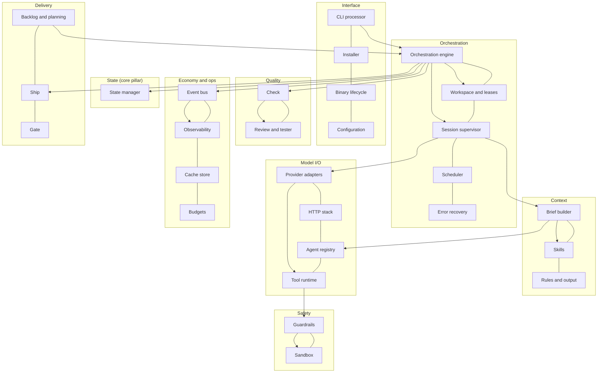

**Reading the diagram.** Eight frames hold the components by layer: Interface, Orchestration, Quality, Context, Model I/O, Safety, Economy and ops, and Delivery. Inside each frame, plain lines join the layer's components. The arrows start at the CLI processor, which calls the orchestration engine. The engine calls the session supervisor, which calls the provider adapters to start a model. The engine also calls Check, which hands on to Review and tester, and the engine calls Ship. The supervisor feeds the brief builder, which pulls in skills and the agent registry. The provider adapters reach the tool runtime, and every tool call passes the guardrails and then the sandbox. The engine publishes to the event bus, which feeds observability, and the engine uses workspace and leases. Last, backlog and planning feeds the engine with the groups to run. Beside the Orchestration frame, the state pillar holds the state manager. Only the engine's arrow to it is drawn; every other part that keeps state reaches it the same way.

#### Dependency rules

**In plain terms.** An import is one Go package using another. This rule fixes one direction for imports, from `cli` at the top down to `core` at the bottom. So no two packages can depend on each other in a circle. When a lower package needs something from a higher one, the higher one hands it in as a parameter instead of being imported. `komodo gate`, the self-check for the Komodo repo, refuses any import that points upward; only Komodo's own developers touch this rule.

Imports flow one way: `cli` → `engine` → `quality` → `host` → `repo` → `provider` → `tools` → `ops` → `agent` → `safety` → `state` → `core`. A package may skip levels. Higher-level needs enter lower packages as parameters: the engine passes a session runner into `quality`, Check into `repo`, backlog lint into `tools`, and filled slots into `agent`. `komodo gate` refuses any import that points up.

#### Concepts to components

**In plain terms.** Words such as agents, hooks and plugins mean different things across agent tools. This table says which component owns each idea in Komodo, or that Komodo does not have it. Each row names the component from section 8.2 that owns the idea.

| Concept | Lives in |
|---|---|
| Agents | Agent registry: `agent.json` for what Go reads, `prompt.md` for what the model reads |
| Skills | Skill loader: indexed, preinjected or pulled, usable by external sessions |
| Rules | Rules and output contract: embedded in the binary; the output style is config |
| Hooks | Event bus: Go lifecycle events. Exactly three inline hooks exist; repo hooks wait for a later minor |
| Guards | Guardrails: checked in-process on every tool call, fail-closed |
| Commands | Configuration detects command classes; the tool runtime runs them; only Ship runs git writes |
| Plugins | None. External MCPs are an opt-in allowlist per agent |

**What each one does**
- **Agents:** The seven workers (see Glossary) are defined by two files each in the agent registry: `agent.json` holds what the Go code reads, such as weight and tools; `prompt.md` holds the role text the model reads.
- **Skills:** Standards documents live in the skill loader, indexed by name and file globs. They are preinjected into a brief when the globs match, or pulled on demand. Any Claude Code session can also read them with `komodo skill list|get`.
- **Rules:** The orchestrator's rules are Markdown embedded in the binary, written into the `AGENTS.md` block by install. The output style, which decides how reports are laid out, is the `output.profile` config key, not a rule.
- **Hooks:** A hook is code that runs at a fixed lifecycle moment. Komodo has exactly three, all inline Go: before a tool call (the guard), after an `edit` (formatting), and at session end (the WIP commit). Everything else is an event on the bus; hooks a repo defines wait for a later minor version.
- **Guards:** The guard rows are checked in-process on every tool call before it runs. Input that cannot be parsed is refused, so the guard fails closed.
- **Commands:** Configuration detects a repo's command classes (setup, build, test, lint, format) from marker files. The tool runtime runs them with no shell inside the sandbox, and only Ship may run git writes.
- **Plugins:** Komodo has no plugins. External MCP servers, outside tool servers a model could call, are allowed only as an opt-in allowlist per agent, off by default and without credentials.

#### Scenario: a group's lifecycle

**In plain terms.** A group is a set of up to 8 tasks that ship together (see Glossary). This scenario shows the stages a group passes through: Intake, Build, Check, Verify and Ship, plus two holding states, Paused and Blocked. A stage exits only when the engine has seen the events its gate names; no model ever says "done". Model sessions run only in Build and Verify, so only those two can be interrupted into Paused or Blocked. A person or the orchestrator acts only on Blocked, with `resume`, `scope approve|deny` or `abandon`.

Five stages plus two holding states. Sessions run in Build and Verify, so Paused and Blocked can follow either.

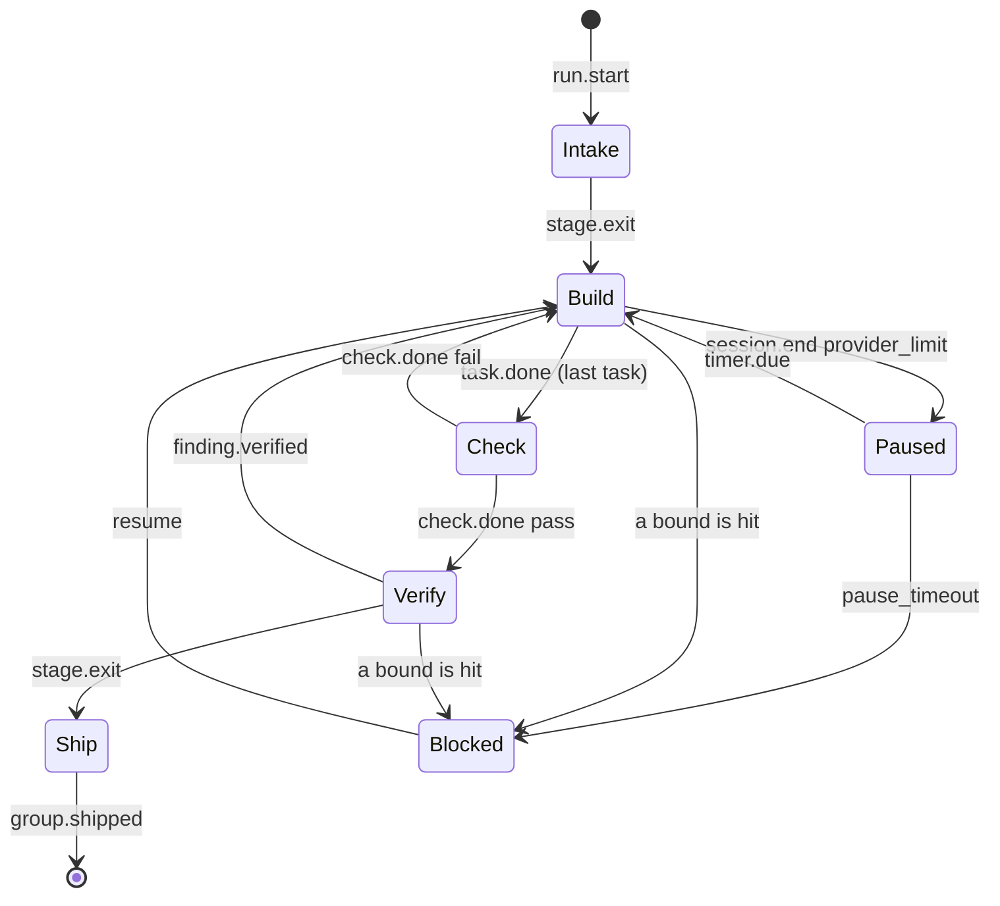

**Reading the diagram.** The group starts at Intake on `run.start`. Intake exits to Build when its gate passes. Build moves to Check when the last task's `task.done` arrives. Check passes to Verify, or fails back to Build. Verify sends the group back to Build on a verified finding, or on to Ship when its gate passes. Ship ends the group with `group.shipped`. On the side, a provider limit in Build moves the group to Paused. A timer returns it to Build, or a pause timeout sends it to Blocked. Either Build or Verify can go to Blocked when a bound is hit, and Blocked returns to Build only on `resume`.

| Stage | What happens | Tokens | Exit needs |
|---|---|---|---|
| Intake | Lint the group, hash its card, take the lease and fence, cut the worktree from the epic tip, run `commands.setup` with network on | 0 | lint pass, lease and fence taken, setup exit 0, task list locked |
| Build | One fresh builder session per task, in sequence, in the group worktree. After each task Go reruns its `done_when` and commits to the hidden ref | model | `task.done` for every task, each with `done_when` exit 0 and a commit |
| Check | Rerun every `done_when`, scope check, secret scan, impact-set tests, baseline diff, changed-line coverage | 0 | `check.done pass` |
| Verify | Reviewer (ten lenses, per-task verdicts) and tester (blind acceptance items) run at once on the same commit, the tester in its own throwaway worktree | model | reviewer `met` for every task and 0 blocking findings; tester `confirmed` for every task and item; 0 regressions |
| Ship | Merge the epic branch into the group branch, rerun Check, land with the fence, then Check on the epic tip | 0 | merge clean, Check passes, landing succeeds |
| Paused | A provider limit with no link left: the group returns its pool slot, keeps lease and worktree, waits on a disk timer. Wall clocks stop | 0 | the timer fires, or the pause cap ends it |
| Blocked | A bound was hit or a decision is needed. A person or the orchestrator runs `resume` | 0 | `resume`, `scope approve|deny`, or `abandon` |

**What each one does**
- **Intake:** The zero-token setup step: the engine lints the group's backlog files, hashes them to lock the task list, and takes the lease and fence. It then cuts a worktree from the epic branch tip and runs the repo's setup command with network on. It exits when all of that has succeeded.
- **Build:** The stage where code is written: one fresh builder session runs per task, in order, in the group's worktree. After each task Go reruns its `done_when` command and commits to the hidden ref (see Glossary). It exits when every task has a passing `done_when` and a commit.
- **Check:** The zero-token proof stage. Go reruns every `done_when`, checks scope, scans for secrets, runs impact tests, diffs results against the baseline, and measures coverage. It exits on `check.done pass`, or returns to Build on fail.
- **Verify:** Two model sessions judge the work at once on the same commit: the reviewer with its ten lenses, and the tester proving acceptance items blind. The tester works in its own throwaway worktree. It exits when the reviewer marks every task `met` with no blocking findings, and the tester confirms every task and item with no regressions.
- **Ship:** The zero-token landing. The engine merges the epic branch into the group branch, reruns Check, lands the group with the fence, then rechecks the epic tip. It ends with `group.shipped`.
- **Paused:** A holding state for a provider limit, such as a Claude quota, when no other link is left. The group gives back its pool slot, keeps its lease and worktree, and waits on a timer stored on disk; wall clocks stop. The timer resumes it, or the pause cap (`limits.pause_max_min`, 360 minutes by default) turns it into Blocked.
- **Blocked:** A holding state when a bound was hit (too many returns, say) or a decision is needed, such as a scope request. Nothing moves until a person or the orchestrator runs `resume`, `scope approve|deny` or `abandon`; `status --wait` wakes the orchestrator when a group blocks.

Back to Build: a failed Check or Verify resumes the task's own builder session with only the verified findings, including those submitted before a cancel. Each return raises the task's attempt count and the stage epoch. `limits.returns` (3) returns per group, then Blocked.

#### Architecture decisions

**In plain terms.** This section records the choices that shaped the design. Three were made by the owner personally. Nine weighed and rejected an alternative. Twelve are defaults the design pass picked that still await the owner's confirmation. Each decision names the question it settles so a later reader knows why the design is this way. Without the record, a future change could silently undo a reasoned choice. The owner reads this section to confirm or walk back a default.

#### Decisions the owner made (2026-10-09, 2026-10-11)

**In plain terms.** The first three decisions closed gaps G-01, G-05 and G-15; the fourth made the state manager a core pillar. A gap is an unverified fact or an unconfirmed decision, tracked in the gap register (see Glossary). Each has a single-machine answer now and a named enterprise target for later, with a trigger that says when the bigger answer is needed. Without a trigger, the enterprise work would either never start or start too early. The owner made them; the engine implements the Decision column.

| ID | Decision | Enterprise target |
|---|---|---|
| G-01 | Signing key: local file plus one backup copy; `next` key set at the first release | G-21: KMS or keyless signing; rollback refusal; trigger: the first machine the owner does not own runs `fresh` |
| G-05 | `providers.json` is the only model registry; a 404 fails over through the chain | G-22: a central model gateway with `retired_on` dates and 30-day warnings; trigger: 3 or more machines, or 2 people sharing one cap |
| G-15 | The orchestrator answers `scope approve` after two engine denials: protected paths and paths another live group owns | G-23: path ownership rows in `policy.json`, a named human for other teams' paths, a widening digest; trigger: the first repo with 2 teams or customer data |
| State | One state schema for every record and event, served by an in-process state manager that is the only way to read or write runtime state, and that populates and validates every record | None recorded |

**What each one does**
- **G-01:** Settles where the release signing key lives: a file at `~/.komodo/release.key` on the owner's machine, plus one backup in a password manager. The `next` public key is set at the first release, so a leaked key can be rotated. The other way is a KMS (a cloud key service) or keyless signing. That is deferred to G-21 and triggers when a machine the owner does not own first runs `fresh`.
- **G-05:** Settles how the harness knows which exact model IDs exist. `providers.json`, written by the install probe, is the only registry. A 404 from a retired model fails over down the chain to the next link. The other way is a central gateway with `retired_on` dates and 30-day warnings. That is G-22 and triggers at 3 or more machines, or 2 people sharing one cap.
- **G-15:** Settles who approves a builder's request for files outside its scope. The orchestrator answers, but only after the engine has denied protected paths and paths another live group owns. The other way is a named human per path, from ownership rows in `policy.json`. That is G-23 and triggers at the first repo with 2 teams or customer data.
- **State:** Settles how the harness keeps state consistent. Every record and event has one schema, and the state manager is the only code that reads or writes runtime state; it fills in and checks every record before it reaches disk. Decided on 2026-10-11 as a core pillar.

#### Decisions recorded with their rejected alternative

**In plain terms.** Each row names a design choice, the alternative that was considered, and the fact that ruled it out. These are not open; they are recorded so nobody reopens them without new evidence. Without the rejected column, a reviewer might propose the losing option again. The engine implements the left column.

| Decision | Rejected alternative | Reason recorded |
|---|---|---|
| Every loop has a counter | Temporal's default unlimited retry with 2× backoff (waiting longer between retries) | Unbounded retries burn tokens until someone notices |
| `claude -p` with pinned flags | `--bare` mode | Bare mode reads only an API key and never the subscription login |
| Fence enforced by git compare-and-swap | A reread before each push | A reread leaves a window between the read and the write |
| Measured context per session | Typed context per model | A larger typed window than the real one lets a server cut the prompt silently |
| Shared Rust target dir per group | Copying `target/` to the tester worktree | Fingerprints are keyed by package path, so a copy rebuilds anyway `[PENDING G-12]` |
| Language caches owned by Komodo | The user's `~/.npm`, `~/.cargo/registry`, Go and pip caches | Agent code could plant files the user's own builds run |
| Session caps through cgroups (Linux's per-process resource limits) or Docker only | The per-user process limit | It counts every process the user runs and made `fork` fail at 512 |
| Machine-wide session pool | Per-repo lanes | Quota and link limits are machine-wide; lanes could not see each other |
| No rule text in worker prompts | Rules in `core.md` and `agent.json` `rules` | The harness enforces rules where it acts; prompt rules are advisory |

**What each one does**
- **Every loop has a counter:** Settles that no retry runs unbounded. Every failure row has a numeric bound such as 3 returns or 6 attempts. Temporal (a workflow engine the design borrows from) retries forever by default. The other way, a run could burn tokens until someone noticed.
- **`claude -p` with pinned flags:** Settles how a Claude worker is launched: the `claude` command in print mode with every flag spelled out. The `--bare` alternative reads only an API key and never the user's Max subscription login. It would turn free subscription work into paid API calls.
- **Fence enforced by git compare-and-swap:** Settles how a stale engine is stopped from overwriting newer work. Git itself refuses a ref update whose old value moved. The alternative, rereading before each push, leaves a gap between the read and the write where another engine can land.
- **Measured context per session:** Settles how the brief is sized: from the model's real context window, asked at session start. A typed number per model could be larger than the real window, and a server would then cut the prompt silently.
- **Shared Rust target dir per group:** Settles how the tester gets Rust build output. One `CARGO_TARGET_DIR` per group lives in the language cache, shared with the builder. Copying `target/` was rejected because Rust fingerprints are keyed by package path, so a copy rebuilds anyway; G-12 still has to prove this.
- **Language caches owned by Komodo:** Settles where npm, Cargo, Go and pip caches live: under `~/.komodo/cache/lang/<repo-id>/`. Using the user's own caches was rejected because agent code could plant files there that the user's own builds would later run.
- **Session caps through cgroups or Docker only:** Settles how process and memory limits are applied. The per-user process limit was rejected because it counts every process the user runs. On a Mac running 607 processes, a limit of 512 made `fork` fail.
- **Machine-wide session pool:** Settles that the 1 to 6 session slots are shared across every repo on the machine. Per-repo lanes were rejected because provider quotas and link limits are machine-wide, and lanes could not see each other's use.
- **No rule text in worker prompts:** Settles that rules live in the guard, the result schema and Check, never in a prompt. Rules in `core.md` or `agent.json` were rejected because a prompt rule is only advice; the harness enforces rules where it acts.

#### Defaults chosen by the design pass, awaiting the owner's confirmation

**In plain terms.** The design pass is the 2026-10-08 series of 11 batches that filled in the architecture. It picked these twelve values so the design could proceed, and each can be walked back by the owner without reopening anything else. Without naming them here, the owner would have to hunt through the plan to find what was decided on their behalf. The owner confirms or changes them; the engine then ships the chosen value.

| Default | Where it applies |
|---|---|
| `fable` opt-in only | Agent model override |
| Haiku 5.5 as the light weight | Model catalog |
| `check.patch_coverage` 80, blocking for Go only | Check |
| Group wall hard limit 720 minutes | Configuration |
| Install flags trimmed to 8 | Installer |
| B2 moved from a guard row to lint | Guardrails, backlog lint |
| 10 lenses | Review |
| EARS acceptance items | Backlog grammar |
| The two-pass planner | Planning |
| `--permission-prompts none` in the launch line | Provider adapters |
| The 4 binary-lifecycle Vet lines (hot swap, check points, restart window, prerelease flag) | Binary lifecycle |
| The shared Rust target directory per group | Sandbox |

**What each one does**
- **`fable` opt-in only:** Settles that the `fable` model (Fable 5.1, $10 per million input tokens) is off by default. It runs only when a person sets `komodo config agent <name> model=fable` on a heavy agent. The other way, it would replace Opus 5.5 at $4 by default and raise cost about 2.5 times.
- **Haiku 5.5 as the light weight:** Settles which model serves the light weight (the smallest model size, see Glossary). It is `claude-haiku-5-5`, with a 1M-token window at $0.10 per million input tokens. The other way, the prior Haiku 4.5 has a 200K window and smaller briefs.
- **`check.patch_coverage` 80, blocking for Go only:** Settles that changed lines need 80% test coverage. Falling short blocks a Go group but only warns for other languages. The other way, blocking for every language, is not discussed [UNKNOWN: not yet designed].
- **Group wall hard limit 720 minutes:** Settles the longest a group may run. The formula is tasks times the session wall plus two session walls, capped at 720 minutes, with paused time excluded. The other way, a group could run for days on a stuck provider.
- **Install flags trimmed to 8:** Settles that `install` has 8 flags, down from 13. `--hosts` replaces 4 host flags, and offline mode is implied when `latest.json` is unreachable. The other way, 13 flags would stay and `--offline` would be a separate switch.
- **B2 moved from a guard row to lint:** Settles that a builder is never given its own backlog cards. `doctor backlog` refuses a group whose `files` list `docs/backlog/**`. The other way, a guard row B2 would refuse at tool time instead of at lint time.
- **10 lenses:** Settles the number of reviewer rule catalogs: correctness, security, spec, contract, concurrency, platform, config, readiness, quality and economy. The other way, a different count would change which concerns get a dedicated pass.
- **EARS acceptance items:** Settles the grammar for acceptance items: `WHEN <event> THE SYSTEM SHALL <response>`, with `IF` and `WHILE` forms. An item without `SHALL` fails lint. The other way, free-text items could not be checked by lint or run by the tester.
- **The two-pass planner:** Settles that planning runs in two model passes. A heavy pass writes the epic outline with groups, goals, `touches` and dependencies. Then one standard session per group writes its tasks and items in parallel. Go lints each pass. The other way, one session would write the whole epic without a lint between passes.
- **`--permission-prompts none` in the launch line:** Settles that a Claude worker is launched with permission prompts off. With `--permission-mode dontAsk`, a call nothing allows is denied. This flag tells the model not to retry it (Claude Code 2.1.259 or later). The other way is not discussed [UNKNOWN: not yet designed].
- **The 4 binary-lifecycle Vet lines:** Settles four update behaviours. Hot swap: versioned folders, with runs pinned to their own version. Check points: only at session start, run start and `fresh --check`, at most hourly. The `--restart-runs` window: 2 minutes to checkpoint, at most one repeated model turn. The GitHub prerelease flag: betas publish as normal releases because `releases/latest` skips prereleases. The other way, an update could change a running engine's binary mid-run, or a beta could be invisible to the updater.
- **The shared Rust target directory per group:** Settles that builder and tester share one Rust build folder per group under the language cache. Nothing copies `target/`. The other way, every tester worktree would rebuild from scratch; G-12 has to prove the copy really rebuilds.

#### Quality requirements

**In plain terms.** Quality requirements are the measurable promises the harness makes about speed, durability, safety, cost, capacity and portability. Each one is written as a scenario with a number, so a test can prove or fail it. Without numbers, "fast" and "safe" could not be checked at the gate. The engine's test suite and `komodo gate` measure them; a person reads the results in the gate output.

#### Quality scenarios

**In plain terms.** A quality scenario is one concrete situation plus the measure that must hold in it. Each row names the attribute (which kind of quality), the situation and the number. Rows tagged `[PENDING G-NN]` are targets until the named gap measures them. Without a scenario, an attribute is a wish. Tests and the gate run these; a person reads pass or fail.

| Attribute | Scenario | Measure |
|---|---|---|
| Performance | A person runs `help`, `version`, a config read or `skill` | Under 50 ms, no network, no repo scan beyond marker stats `[PENDING G-19]` |
| Performance | Install reruns the provider probe | Five checks in parallel under 2 s; a no-diff rerun under 1 s |
| Performance | `status` renders a repo with 1,000 ledger rows or 50 runs | Under 100 ms; under 10 ms |
| Performance | The engine replays 10,000 state events | Under 1 s; resume bounded by 50 events from the snapshot `[PENDING G-19]` |
| Performance | `komodo gate` runs locally | Under 3 minutes |
| Performance | A brief is assembled for a group's task | Skill glob matching runs once per brief over the group's `files` |
| Performance | The binary starts and renders output | Templates parse once at process start from the embedded set |
| Performance | A 4-task group builds its 4 briefs | All 4 share every byte before the task part |
| Performance | A session is supervised at `pool_max` 6 | One timer goroutine per session; no per-token allocation; under 1% of one core |
| Performance | Check runs on a one-package change | Finishes under the full suite's time |
| Performance | The cache index is consulted | LRU (least recently used goes first) index in memory per process, rebuilt lazily |
| Durability | The engine is killed with `kill -9` mid-run and resumed | 0 repeated paid sessions; at most one model turn and no committed edit lost |
| Durability | Two engines race to land one group | Exactly 1 landing; the loser ends in `lease.lost` |
| Safety | A `run` writes outside the worktree, reads `~/.ssh`, or connects to a public address on any OS | Refused by the sandbox |
| Safety | `ANTHROPIC_API_KEY` is set beside a Max login | The session runs on `apiKeySource: none`; 0 paid calls |
| Cost | 20 API sessions of one agent with `track.usage` on | Cache hit rate at or above 50%, else a fixture fails `[PENDING G-17]` |
| Capacity | Default limits | 6 sessions machine-wide, 3 per link, 1 per loopback endpoint; hard limits 16 and 8 `[PENDING G-04]`, `[PENDING G-07]` |
| Portability | Every gate run | Cross-builds for windows, linux and darwin succeed; the fixture group ships on macOS and Windows |

**What each one does**
- **Performance, short verbs:** `help`, `version`, a config read or `skill` must answer in under 50 ms. They use no network and scan nothing beyond the repo's marker files. This is a target until gate timing measures it in phase 6 (G-19).
- **Performance, provider probe:** The probe checks each model link. When `install` reruns it, its five checks run in parallel and finish in under 2 seconds. A rerun with nothing changed finishes under 1 second.
- **Performance, `status`:** `status` renders a repo with 1,000 ledger rows in under 100 ms and a repo with 50 runs in under 10 ms.
- **Performance, state replay:** The group state is the append-only event file per group (see Glossary). After a crash the engine rebuilds state from a snapshot plus at most 50 events; replaying 10,000 events must finish under 1 second (G-19).
- **Performance, `komodo gate`:** The self-check on the Komodo repo finishes locally in under 3 minutes.
- **Performance, skill matching:** Skill glob matching runs once per brief over the group's `files`, not over the whole tree. The skill index is embedded at build, so listing skills is a map read.
- **Performance, templates:** Output templates parse once at process start from the embedded set, so no verb parses a template twice.
- **Performance, shared brief prefix:** The 4 briefs of a 4-task group share every byte before the task part, so the provider's prompt cache can serve the shared prefix to all four.
- **Performance, supervision:** The supervisor uses one timer goroutine per session, not one per check, and stream parsing allocates nothing per token. At `pool_max` 6 it costs under 1% of one core.
- **Performance, Check:** On a one-package change, Check finishes in less time than the full test suite, because the impact set and `done_when` run in parallel inside the sandbox's process cap.
- **Performance, cache index:** The cache's LRU index (least recently used order) lives in memory per process and is rebuilt lazily, so a lookup costs one `stat` of the entry file.
- **Durability, `kill -9`:** The engine is killed without warning mid-run and then resumed. No paid session is repeated, at most one model turn is lost, and no committed edit is lost.
- **Durability, two engines race:** When two engines try to land the same group, exactly one lands; the fence makes the loser end in `lease.lost`.
- **Safety, sandbox:** On every OS, a `run` that writes outside the worktree, reads `~/.ssh` or connects to a public address is refused by the sandbox.
- **Safety, billing:** An API key is set in the environment beside a Max subscription login. The key is scrubbed and the session runs on `apiKeySource: none`, so 0 paid calls happen.
- **Cost, cache hit rate:** Over 20 API sessions of one agent, at least 50% of prompt tokens are served from the provider's cache. Otherwise a test fixture fails. This needs real API sessions with `track.usage` on, measured in phase 7 (G-17).
- **Capacity, default limits:** At most 6 worker sessions machine-wide, 3 per model link and 1 per loopback endpoint, with hard limits of 16 and 8. Whether Ollama allows more than 1 is G-04; the real Max window is G-07.
- **Portability, every gate run:** Cross-builds for Windows, Linux and macOS succeed. The fixture group (a small test repo run end to end) ships on macOS and Windows.

#### Quality tree

**In plain terms.** The quality tree groups every attribute under the five quality goals the design serves. It shows which mechanism belongs to which goal, so a change to one mechanism can be traced to the goal it weakens. Without the tree, a reader could not tell whether a cut hurts safety or only cost. Architects and reviewers use it; nothing in the engine reads it.

| Quality goal | Attributes it owns |
|---|---|
| Safety | Containment, secret handling, git write control, billing control, prompt steering resistance |
| Durability | State integrity, replay, fencing, orphan control, lease expiry |
| Determinism | Schema enforcement, template rendering, event catalog completeness, generated-artifact gates |
| Cost control | Chain order, cache prefix, budgets, pool adaptation, warnings |
| Portability | Sandbox per OS, copy mechanics per filesystem, path and line-ending handling, cross-builds |

**What each one does**
- **Safety:** Owns containment (the worktree and sandbox fences) and secret handling (G4 and the scan). Also git write control (only Ship writes git), billing control (no paid calls without permission) and prompt steering resistance (the phrase scan).
- **Durability:** Owns state integrity (the append-only event file with checksums) and replay (rebuilding state after a crash). Also fencing (refusing stale holders), orphan control (killing left-over processes) and lease expiry (freeing a dead holder's lock after 2 hours).
- **Determinism:** Owns schema enforcement (every result must match its schema) and template rendering (the same facts give the same text). Also event catalog completeness and the generated-artifact gates. Two runs with the same inputs produce the same output.
- **Cost control:** Owns chain order (subscription and free links before paid) and the cache prefix (a stable brief front so providers cache it). Also budgets, pool adaptation (halving on a rate limit) and warnings before a quota is hit.
- **Portability:** Owns one sandbox per OS, the worktree copy mechanics per filesystem, path and line-ending handling, and the cross-builds that the gate runs.

#### Risks and technical debt

**In plain terms.** A risk is something the design assumes but has not yet proved. Technical debt is a known shortcut that must be paid back later. Both are listed with the gap ID, the phase that resolves them and the mitigation already in the design. Without this list, an unproven assumption could surface only after it breaks a run. The owner and the builders read it to plan spikes; the gate fails any gap without a backlog task.

#### Risks

**In plain terms.** Each row names one unproven assumption and what breaks if it is wrong. It also names what the design already does to soften it, and which gap and phase close it. A spike is a small experiment that answers one question before the real build. Without a mitigation column, a failed spike would stall the phase. The builders run the spikes; the owner reads the outcomes.

| Risk | Impact if it materialises | Mitigation in the design | Closes by |
|---|---|---|---|
| The probe cannot capture the `system/init` line without a model turn | Billing check 3 costs one turn per probe | The probe records one line per CLI version; a version without the field fails the link at probe time | `[PENDING G-02]` spike, phase 4 |
| A 24 GB machine cannot run Qwen3.6-27B at 262,144 context | The default backstop is unusable on small machines | The floor is a config key; `doctor` names the endpoint that fails it | `[PENDING G-03]` spike, phase 4 |
| Ollama serves 1 request per model | `link_sessions.local` stays 1 and the backstop serialises | `doctor` reads `OLLAMA_NUM_PARALLEL` and names the fix | `[PENDING G-04]` spike, phase 4 |
| The Max 5-hour window drains faster than 3 sessions per link assumes | More pauses than planned | The pool halves on a rate-limit error; the ledger measures the real window | `[PENDING G-07]` measurement, phase 7 |
| bwrap does not give a private loopback per session | Two Verify test suites collide on a fixed port on Linux | macOS's per-repo test lock already exists as the fallback | `[PENDING G-08]` spike, phase 2 |
| Copy mechanics differ per filesystem | Slow or broken tester worktrees on ext4, NTFS or Docker | A copy over 60 s warns; `doctor` reports the mechanism | `[PENDING G-09]`, `[PENDING G-10]`, `[PENDING G-11]`, `[PENDING G-12]` spikes, phase 2 |
| The steering-phrase list is incomplete | A skill or addendum steers a worker | The list is data; `doctor` warnings tune it | `[PENDING G-13]`, phase 3 |
| A nudge cannot reach a turn stuck in a tool call | An idle session runs to its wall clock | The 5-minute grace and the wall clock bound it | `[PENDING G-14]`, phase 5 |
| Lens catalogs are not yet authored | Review quality depends on content that does not exist | The precision ledger flags rules under 50% verified | `[PENDING G-16]`, phase 7 |
| Prompt cache hit rate below 50% on the API link | Cost per group rises | Prefix order and four breakpoints are designed for it; a fixture measures it | `[PENDING G-17]`, phase 7 |
| Repo map patterns are unproven for TypeScript, Python and Rust | Planner briefs for those languages are weaker | Go via `go/ast` is exact; other languages are pattern files that can be tuned | `[PENDING G-18]`, phase 7 |
| Timing targets are unmeasured | Short verbs or replay slower than designed | The gate times them from phase 6 | `[PENDING G-19]` |
| A single owner holds the signing key | Loss of the key or the machine blocks releases | One backup in a password manager; the `next` key allows rotation | G-21 at the enterprise trigger |

**What each one does**
- **The probe cannot capture the `system/init` line:** The billing check needs the first line a `claude -p` session prints. That line says whether the session is on a paid key or a subscription. If reading it costs a model turn, every probe pays one. The probe records the line once per CLI version, and a version without the field fails the link at probe time. Spike G-02, phase 4.
- **A 24 GB machine cannot run Qwen3.6-27B at 262,144 context:** The backstop is the free local model every chain must end in (see Glossary). The design wants a 262,144-token window. If a small machine cannot load it, the default backstop is unusable there. The floor is a config key and `doctor` names the failing endpoint. Spike G-03, phase 4.
- **Ollama serves 1 request per model:** Ollama is a local model server. If it answers one request at a time, local sessions stay at 1 per link and the backstop runs tasks one after another. `doctor` reads `OLLAMA_NUM_PARALLEL` and names the fix. Spike G-04, phase 4.
- **The Max 5-hour window drains faster than 3 sessions per link assumes:** The Max subscription allows a set amount of work per 5 hours. If 3 parallel sessions use it faster than planned, groups pause more often. The pool halves on a rate-limit error and the ledger measures the real window. Measurement G-07, phase 7.
- **bwrap does not give a private loopback per session:** On Linux, two test suites may run at once. If the sandbox does not isolate loopback, they could collide on the same fixed port. macOS already serialises test runs through one per-repo lock, and that fallback would apply. Spike G-08, phase 2.
- **Copy mechanics differ per filesystem:** The tester needs its own copy of the builder's dependencies (such as `node_modules`). Cloning is instant on APFS but may be slow or broken on ext4, NTFS or Docker. A copy over 60 seconds warns and `doctor` reports which mechanism is in use. Spikes G-09 to G-12, phase 2.
- **The steering-phrase list is incomplete:** The list of phrases that mark a prompt-steering attempt has 6 entries chosen by judgment. A missing phrase could let a skill or repo addendum redirect a worker. The list is data and `doctor` warnings tune it. G-13, phase 3.
- **A nudge cannot reach a turn stuck in a tool call:** A nudge is one line the supervisor injects into an idle session. It asks the session to report or stop. If the model is stuck inside a tool call, the nudge may not arrive and the session runs to its wall clock. The 5-minute grace and the 60-minute wall clock bound the loss. G-14, phase 5.
- **Lens catalogs are not yet authored:** The ten lenses exist as names and schema, but their rule content is not written. Review quality depends on that content. The precision ledger will flag rules verified under 50% once they exist. G-16, phase 7.
- **Prompt cache hit rate below 50% on the API link:** The Anthropic API charges less for prompt text it has cached. If briefs vary too much, fewer tokens hit the cache and each group costs more. The brief's prefix order and four cache breakpoints are designed for caching, and a fixture measures the rate. G-17, phase 7.
- **Repo map patterns are unproven for TypeScript, Python and Rust:** The repo map is the symbol graph the planner gets to understand a codebase. Go uses the real parser (`go/ast`) and is exact; other languages use pattern files that may miss symbols, giving weaker briefs. The patterns can be tuned against 3 real repos. Spike G-18, phase 7.
- **Timing targets are unmeasured:** The 50 ms short-verb budget and the 1-second replay are design targets. The gate times them from phase 6 and fails if they are missed. G-19.
- **A single owner holds the signing key:** Losing the key or the machine would block every release. One backup lives in a password manager and the embedded `next` key allows rotation. G-21 moves the key to a KMS at the enterprise trigger.

#### Technical debt

**In plain terms.** Technical debt is work the design knowingly postponed. Each row says what the shortcut is and when it is paid back. Without a retirement date, debt becomes permanent. The owner tracks it; the gate's "no silent gaps" rule keeps the gap rows alive once the plan file is gone.

| Debt | Statement | Retirement |
|---|---|---|
| Komodo entries in the owner's global Claude settings | Global hooks, 36 skill overrides and 5 skills call verbs this binary lacks; it would answer them with exit 2 | Hand edits before phase 2; `doctor install` confirms 0 Komodo hooks at phase 9 |
| The OpenAI path is scoped but not implemented | `codex-cli` and `openai-api` refuse with `not yet` | Later minor `[PENDING G-20]` |
| Enterprise custody, registry and scope ownership | Single-machine designs for signing, model IDs and scope approval | G-21, G-22, G-23 at their triggers |

**What each one does**
- **Komodo entries in the owner's global Claude settings:** Global Claude hooks, 36 skill overrides and 5 skills call verbs this binary does not have, through the path it installs to. The binary would answer them with exit 2, which Claude Code treats as a block. The owner removes them by hand before phase 2, and `doctor install` confirms 0 Komodo hooks at phase 9.
- **The OpenAI path is scoped but not implemented:** The `codex-cli` and `openai-api` links are designed but refuse with `not yet`. A later minor release implements them (G-20).
- **Enterprise custody, registry and scope ownership:** Signing, model IDs and scope approval are all single-machine designs today. G-21, G-22 and G-23 replace them at their triggers, as in section 18.1.

#### Delivery roadmap

**In plain terms.** The roadmap is the order in which the harness is built. It has nine phases, each with a wave name, its scope and the proof that it is done. Early phases are built by people in plain Claude Code sessions; from phase 7 the harness builds the rest of itself. Without exit proofs, a phase could be called done on a claim. The owner approves each phase's proof.

**What each one does**
- **Phase 1, Design docs:** Writes the product requirements (`prd`), this HLD, the LLD and the first architecture decision record (ADR 0001). It also writes `epic-1`, the backlog that lists every subsystem as a task group. Done when the owner approves the docs; the backlog is linted in phase 2.
- **Phase 2, Foundations:** Builds the CLI skeleton, the state manager, configuration, HTTP stack, sandbox, cache, version check, backlog lint and the gate core. A spike proves `claude -p` can call one tool through the MCP tool server. Done when core tests pass on 3 operating systems, `doctor backlog` passes on epic-1 and the spike makes one tool call under the `claude-cli` launch line flags ([`claude-cli` launch line (chapter 7)](lld.md#7-providers-and-http)).
- **Phase 3, Model surface:** Builds the agent registry (the seven agent definitions), skills, rules and output formatting, and the guardrails. Done when the guard table renders from `policy.json` and every agent file decodes strictly.
- **Phase 4, Model I/O:** Builds the provider adapters (`claude -p`, local models, the Anthropic API). Also the tool runtime workers call, and the brief builder that assembles prompts. Done when a fixture task finishes through both `claude -p` and a local model.
- **Phase 5, Runtime:** Builds the workspace (worktrees, leases, fences), the session supervisor, observability and the event bus. Done when timeout, idle and kill tests pass with 0 orphan processes.
- **Phase 6, Engine:** Builds the orchestration engine (`Next()` and the stage machine), error recovery, Check, budgets and Ship. Done when the fixture group lands on its epic branch.
- **Phase 7, Quality and scale:** Builds review and the tester, the scheduler and the planner. Done when review catches a deliberately seeded bug and a scheduled job ticks once per window.
- **Phase 8, Edges:** Builds the installer, `fresh` (self-update), `release` and the docs-drift check. Done when a fresh repo on macOS and Windows passes a smoke test and `komodo install` in this repo turns on the orchestrator hooks (the `AGENTS.md` block and the `SessionStart` hook).
- **Phase 9, User docs and cutover:** Writes the README, CONTRIBUTING, AGENTS and CLAUDE files, the CHANGELOG and templates, and clears Komodo entries from the owner's global Claude settings. Done when the docs-drift gate passes and `doctor install` finds 0 stale references.

**Planning rule.** Each component is one task group in `epic-1`, or two if it exceeds about 8 tasks. Groups in one wave have no dependencies on each other, so they can run in parallel.

| Phase | Wave | Scope | Exit proof |
|---|---|---|---|
| 1 | Design docs | `prd`, `hld`, `lld`, ADR 0001, epic-1 | Owner approves the docs; epic-1 lints in phase 2 |
| 2 | Foundations | CLI skeleton, state manager, configuration, HTTP stack, sandbox, cache, version, backlog lint, gate core; a `claude -p` plus MCP spike | Core tests pass on 3 OSes; `doctor backlog` passes on epic-1; the spike makes one MCP tool call under the `claude-cli` launch line flags ([`claude-cli` launch line (chapter 7)](lld.md#7-providers-and-http)) |
| 3 | Model surface | Agent registry, skills, rules and output, guardrails | Guard table and strict decode pass |
| 4 | Model I/O | Provider adapters (`claude -p`, local, Anthropic API), tool runtime, brief builder | A fixture task finishes through `claude -p` and a local model |
| 5 | Runtime | Workspace, supervisor, observability, event bus | Timeout, idle and kill proofs pass with 0 orphans |
| 6 | Engine | Orchestration engine, error recovery, Check, budgets, ship | The fixture group lands on its epic branch |
| 7 | Quality and scale | Review and tester, scheduler, planner | Review catches the seeded bug; a job ticks once per window |
| 8 | Edges | Installer, fresh, release, docs drift | Fresh-repo smoke test on macOS and Windows; `komodo install` in this repo turns on the orchestrator hooks |
| 9 | User docs and cutover | README, CONTRIBUTING, AGENTS/CLAUDE, CHANGELOG, templates, cutover | Docs-drift gate passes; `doctor install` finds 0 stale references |

Phases 2 to 6 are built by hand in plain Claude Code sessions. From phase 7, `komodo gate --install` places a dev build and the harness runs its own groups. Before phase 2, the owner removes Komodo hooks, skill overrides and skills from `~/.claude`.

**Build process**
- **Builders and testers:** From phase 7, a builder takes each task in one fresh session, and a tester takes each exit proof.
- **Architect:** An architect session runs only for the Vet lines (design questions the design leaves open) still open when a group starts.
- **Phases 2 to 6:** No Komodo hooks run yet, so `go vet`, `go test` and the gate core are the check.

---
