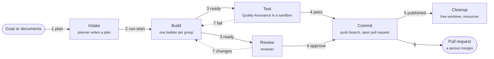
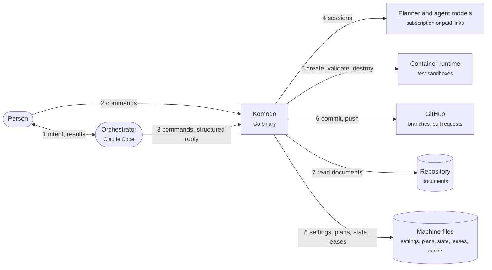
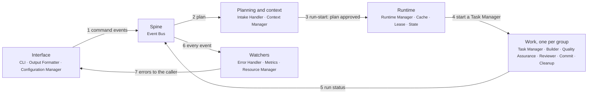
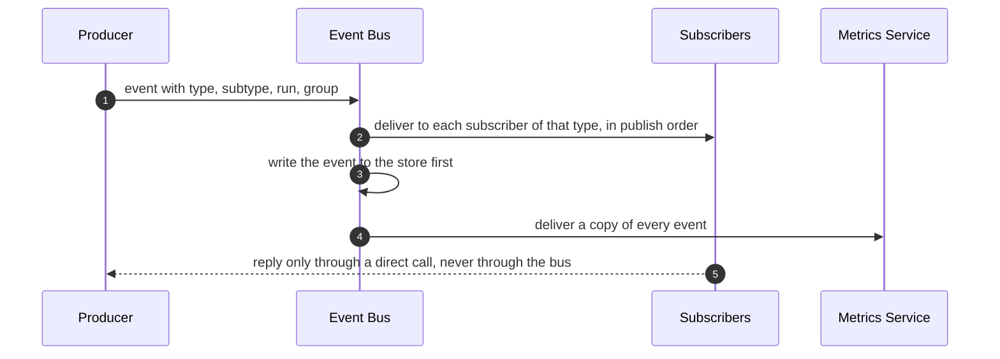
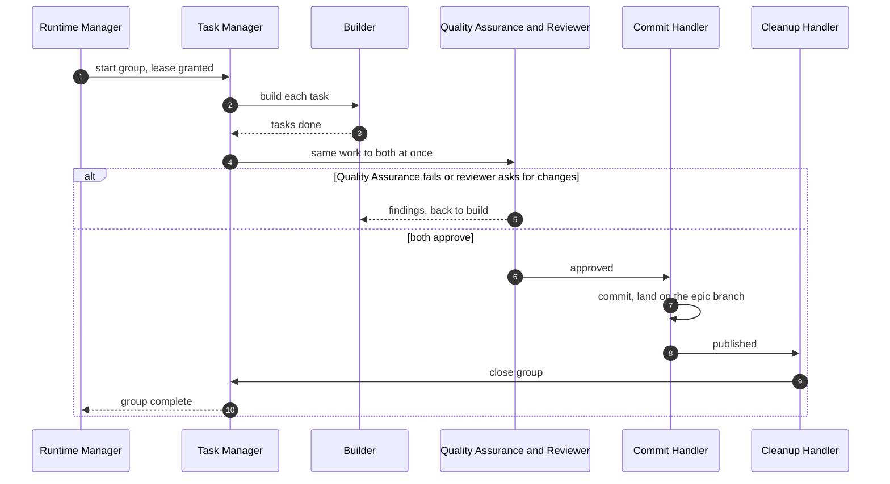

# Komodo — High-Level Design

## 0. Front Matter

This document is the high-level design of Komodo, a single Go program that runs model agents to plan, build, test, review and publish code. The [Low-Level Design](lld.md) holds the types, algorithms, limits and configuration keys. The domain architect owns this document. Its structure follows the owner's component diagram. An open decision is written as a TODO that names its [gap register](lld.md#appendix-b-gap-register) row, such as G-308.

## 1. Introduction and Goals

#### 1.1 Purpose

Komodo is one Go binary that turns a goal into reviewed, published code. It plans the work into task groups, runs each group through a fixed pipeline of agents inside a private copy of the repository, and publishes only work that passed the checks its risk level requires.

**📐 How work moves from a goal to published code**

#### 1.2 Goals and Non-Goals

Goals:
- One Go binary that uses only the standard library.
- One event bus that every part publishes to and listens on, using one event shape with a type and a subtype.
- One task manager per task group, which guards its agents and runs the pipeline from build to cleanup.
- A Quality Assurance agent and a reviewer that judge the builder's work side by side.
- One owner per kind of data: settings, context, cache, leases and runtime state each have exactly one manager.

Non-goals: per-repository agent definitions, third-party Go dependencies, a hosted service, and agents that push to git themselves.

#### 1.3 Quality Goals

| Priority | Goal | Scenario |
|---|---|---|
| 1 | Safety | An agent never writes outside its worktree, pushes to git, reads a secret or spends money without permission |
| 2 | Simplicity | Each component has one job, and each kind of data has one owner |
| 3 | Durability | A crash loses no committed work; each finished task is saved as a local commit |
| 4 | Cost control | Subscription links come first, every loop has a bound |
| 5 | Observability | Every event is recorded, so any run can be measured and explained |

## 2. Constraints

A constraint is a locked rule that the design cannot trade away. The owner set every constraint.

| Constraint | Consequence |
|---|---|
| Go, standard library only; every store is plain files | Nothing external to download at run time |
| Only the Configuration Manager reads and writes settings and the agent registry | Settings stay out of agent reach |
| Every event uses one schema with a type and a subtype | Any part can listen to any event without a private format |
| Runtime state passes only through the State Manager | One schema, checked before disk |

## 3. Context and Scope

Two callers drive Komodo: a person at a shell, and the orchestrator, a model chat session inside Claude Code that turns the person's intent into commands. Komodo reaches model providers, a container runtime for test sandboxes, and GitHub.

**📐 Who uses Komodo, and what Komodo reaches**

## 4. Solution Strategy

Each quality goal has a mechanism that code enforces. No model is trusted to behave.

| Goal | Strategy |
|---|---|
| Safety | The Task Manager checks every agent action against its permissions |
| Simplicity | 19 subsystems with one job each, joined by one event bus instead of point-to-point messages |
| Durability | Leases name exactly one owner per worktree; each finished task is saved as a local commit before approval |
| Cost control | The Resource Manager watches plan windows and spending, and the Cache Manager reuses context instead of re-sending it |
| Observability | The bus stores every event before delivering it; the Metrics Service turns them into figures |

Design principles: **one owner per data kind**, **announce on the bus, call for answers**, and **fail closed**.

## 5. Building Blocks

The harness has 19 subsystems in 5 layers, plus two adapters that the Task Manager uses: the model client and the test sandbox. Subsection 5.1 shows the layers and their hand-offs; 5.2 to 5.20 describe one subsystem each, and the [Low-Level Design](lld.md) holds one chapter per subsystem in the same order.

#### 5.1 Layers

The **Interface** layer is where commands enter and settings change; the **Watchers** span every layer.

**📐 How the 5 layers hand work to each other**

1. The CLI sends each command to the Runtime Manager, which broadcasts it as plan, run-start, run-stop or run-continue.
2. A plan command reaches the Intake Handler, which plans with context from the Context Manager.
3. The Intake Handler writes the plan and stops. `komodo run` approves and starts it.
4. The Runtime Manager starts one Task Manager per task group, with its lease, state and cache.
5. Each group's progress goes back onto the bus as run-status events.
6. The watchers receive every event.
7. The Error Handler prints errors to the caller through the CLI.

Besides these hand-offs, a subsystem calls another directly when it needs an answer, such as asking the Configuration Manager for a setting. Every subsystem also publishes events to the Event Bus and listens for the types it needs; [5.5](#55-event-bus) lists them.

#### 5.2 CLI

The CLI is the front door: every command a person or the orchestrator types enters here. It parses and validates the command, hands it to the Runtime Manager, the only part it talks to, and returns one structured reply. It owns 13 commands: install, config get and set, login, plan, run, stop, replay, update, clean, status, ui, abandon and doctor. Running a blocked group again with approve or deny answers it. There is no full-screen terminal mode. Detail: [chapter 1](lld.md#1-cli).

#### 5.3 Output Formatter

The Output Formatter turns the harness's structured messages into text a person reads, mechanically and with no model. The CLI hands it every reply and error. It owns the templates for each reply shape, so the same facts always print the same words. Detail: [chapter 2](lld.md#2-output-formatter).

#### 5.4 Configuration Manager

The Configuration Manager guards the harness settings and the agent registry, the list of agent roles with their models and permissions. It is the only subsystem allowed to read or change them; the CLI and the Runtime Manager ask it for values. It validates every change before writing. Detail: [chapter 3](lld.md#3-configuration-manager).

#### 5.5 Event Bus

The Event Bus is the spine: every subsystem publishes facts to it, and every subsystem subscribes to the types it needs, so parts never need to know who listens. Every event has the same shape: a type, a subtype, the run and group it belongs to, a time and a small body. The bus lives in memory inside the runtime and keeps the event store: it writes every event to the run's log before it delivers it, and replay reads that log. Detail: [chapter 4](lld.md#4-event-bus).

#### 5.6 Intake Handler

The Intake Handler is the Intake stage. It starts the planner agent, gives it context from the Context Manager, and turns existing documents such as an HLD or a product requirements document into a plan: one temporary file of task groups and tasks, kept outside the repository. When a plan passes its checks, the handler prints its path and id and stops until someone approves it. Detail: [chapter 5](lld.md#5-intake-handler).

#### 5.7 Context Manager

The Context Manager guards everything an agent may see beyond the code: skills (documents of standards), agent prompt templates, and connections to Model Context Protocol servers, the tool servers some agents may use. It switches each item on or off, decides which agents may use it, and assembles an agent's prompt from them. The Intake Handler and Runtime Manager ask it for context, and it reads its skill, template and connection files. Detail: [chapter 6](lld.md#6-context-manager).

#### 5.8 Runtime Manager

The Runtime Manager is the backbone. It runs every task group of a run in parallel or in order, as their dependencies allow, and starts one Task Manager per group. It owns the run as a whole: each group's state, lease and cache through their managers, escalations, timer extensions, timeouts and blocks, and each group's retry budget. Task Managers bring every need to it, and it produces most of the events on the bus. It runs as one background process per machine, started on demand ([7.1](#71-processes)). Before any group starts it creates the epic's branch. Detail: [chapter 7](lld.md#7-runtime-manager).

#### 5.9 Cache Manager

The Cache Manager keeps a local cache of things like frequent prompt responses, context and other information needed to improve performance and token efficiency. The Runtime Manager opens it and hands the Context Manager and each Task Manager a handle. It never returns a stored model answer in place of a new call. Detail: [chapter 8](lld.md#8-cache-manager).

#### 5.10 Lease Manager

The Lease Manager manages the local lease registry, the single source of truth for which task group and agent owns which worktree, the private checkout where a group works. It controls access to them and manages lease revocation and timeouts. The lease is released when its group closes. Detail: [chapter 9](lld.md#9-lease-manager).

#### 5.11 State Manager

The State Manager is the one place a task group's runtime state is read and written: its stage, counters, blocks and progress. Task Managers update it often through the Runtime Manager, and it checks every record against one schema before saving. It also keeps machine-wide records, such as the schedule queue, and is the only record crash recovery reads. Detail: [chapter 10](lld.md#10-state-manager).

#### 5.12 Task Manager

The Task Manager is the controller for one task group; the Runtime Manager starts one per group. It runs the pipeline from build to cleanup, talks to the Runtime Manager in both directions, and acts as the guard for its agents: every action an agent requests is checked against that agent's permissions before it runs. It owns the group's outbound model connections through the model client, which reaches subscription and paid links, and creates and destroys the group's test sandbox. It also creates the group's branch and worktree. Tests run in a Docker container per group; builder commands run in the operating-system sandbox. Detail: [chapter 11](lld.md#11-task-manager).

#### 5.13 Builder

The Builder is the engineering agent that writes the code for one task group, task by task, inside the group's worktree. It works only through the actions its Task Manager allows; the Commit Handler saves each finished task as a local commit. Its done result carries evidence: the commands it ran and their output. It hands finished work to Quality Assurance and Reviewer together and fixes what they return. Detail: [chapter 12](lld.md#12-builder).

#### 5.14 Quality Assurance

Quality Assurance checks the builder's new and changed code: test accuracy, that every acceptance criterion is met, and regressions. It validates inside the group's sandbox. Its turn starts with free checks in Go code, including build and lint; a failure returns to the Builder with no model call. Quality Assurance runs at every risk level and checks each item with its own run tool, scoring confidence from 0 to 100; Go never reruns it. A pass needs 80 or more, else the group returns to the Builder; a failed item blocks even without a command. A standing check enforces coverage: no change lowers whole-repository coverage below 90%, and each covers 90% of its added lines [TODO: how the planner brings a repository to 90% coverage ([G-321](lld.md#g-321))]. When the group is untestable, or it fails twice in a row, it fails open: the pull request carries a warning and no try is spent. The builder writes the tests; Go runs the deep checks. Detail: [chapter 13](lld.md#13-quality-assurance).

#### 5.15 Reviewer

The Reviewer is the final code check of the group's own changes, skipped at `low` and `med_low`. It reads them while Quality Assurance runs, and a group moves to publishing only when every judge that ran approves; otherwise the work returns to the Builder. Rules have six levels: `critical`, `high`, `med_high`, `medium`, `med_low` and `low`. Only the top three block, `medium` warns, and pre-existing issues never block; a block also needs the finding to carry the Reviewer's own proof (the command it ran and what it saw) with confidence 80 or more; Go never runs it. The Reviewer never fails open: its failure costs one try. Detail: [chapter 14](lld.md#14-reviewer).

#### 5.16 Commit Handler

The Commit Handler publishes approved work: it squashes each approved group onto the plan's feature branch locally, one at a time with a recheck after each, then pushes once and opens one pull request per plan, holding a plan summary, all changes and the changelog reference. A high or critical group blocks after it passes its checks with the question "land this risky change?": approving lands it on the feature branch and denying drops it, groups that depend on it wait, and other groups carry on. One `komodo run <plan id> --approve` answers every blocked group, including these. [TODO: epic pull request details while a risky group is blocked or dropped ([G-308](lld.md#g-308))]. Detail: [chapter 15](lld.md#15-commit-handler).

#### 5.17 Cleanup Handler

The Cleanup Handler runs after work is pushed. It removes the group's worktree, frees the group's internal resources, and tells the Task Manager to close the group, which ends it inside the Runtime Manager. When every group of a plan is closed, it deletes the plan's folder. Detail: [chapter 16](lld.md#16-cleanup-handler).

#### 5.18 Error Handler

The Error Handler is the global safety net: it catches every error and panic before it can crash the harness, records it, and sends it back to the original caller through the CLI. It listens for error events and receives resource errors from the Resource Manager. Detail: [chapter 17](lld.md#17-error-handler).

#### 5.19 Metrics Service

The Metrics Service listens to every event on the bus and turns them into run metrics: time per stage, per group and per run, tokens and cost, and general performance. Its records also help explain failures. Detail: [chapter 18](lld.md#18-metrics-service).

#### 5.20 Resource Manager

The Resource Manager watches agent resources for overages, such as a subscription plan's usage window or paid token costs, so work is not lost to a limit. It raises warnings and errors through the Error Handler. Detail: [chapter 19](lld.md#19-resource-manager).

## 6. Runtime

Four flows show the parts at work.

#### 6.1 One Event, Many Listeners

A fact is announced once and reaches every subscriber, so adding a listener changes no producer.

**📐 How one event travels**

#### 6.2 Task Group Lifecycle

**📐 How one task group passes through the pipeline**

1. The Runtime Manager starts a Task Manager once the group's dependencies are met and its lease is granted.
2. The Builder works through the tasks in the group's worktree.
3. Quality Assurance and Reviewer judge the same work at the same time; a failure returns the group to the Builder within its 3 tries; Quality Assurance failing open does not.
4. With the approvals its level requires, the Commit Handler lands the group on its epic's branch. The Cleanup Handler removes the worktree, frees resources and calls the Task Manager to close the group, which destroys the sandbox.

#### 6.3 Planning

1. `komodo plan` starts the Intake Handler with goal text or documents.
2. The Intake Handler gets context from the Context Manager and starts the planner agent.
3. The planner drafts task groups, tasks, file patterns, dependencies, definitions of done and acceptance criteria.
4. Go code checks the draft; a failure goes back to the same planner session a bounded number of times.
5. A passing plan is written to Komodo's home folder, and `komodo plan` prints its path and id and stops.
6. A person or the orchestrator may edit the plan, then starts it with `komodo run <plan id>`; the checks rerun, and a broken edit is refused. `run <plan id> <group>` with a prompt rewrites that group.

#### 6.4 Errors, Limits and Blocks

1. Any part that fails publishes an error event; the Error Handler records it and prints it to the caller through the CLI.
2. The Resource Manager raises a resource event before a plan window or spending limit is reached.
3. The Runtime Manager owns retries, timeouts and blocks for every group. A group that cannot continue without a person is blocked and announced with a run-status event; a person or the orchestrator continues it with `komodo run`. Each group has 3 tries in total, any mix of causes. A critical blocker (tooling failure, container crash, agent stalling mid-run) or a builder session timeout fails a try; a builder crash spends one unless a Komodo restart caused it. Failing checks never end a builder session; the builder works until it passes or its window ends. The failure that spends the last try holds the group for a fixed 60-minute window, in which a person at a terminal may grant one final try and enter its working time. Without that approval the group fails for good and is run again only from a fresh plan. Komodo's own faults spend no try. A breaker waits and then blocks after 4 blocker errors in a row from those faults or judge crashes, and the engine's own failure stops new sessions until a person runs `komodo run` from a terminal. Detail: [chapter 7](lld.md#7-runtime-manager).
4. After a crash, `komodo run` continues each group from its saved state.

## 7. Deployment

Komodo is one dependency-free file shared by every repository on a machine.

#### 7.1 Processes

The runtime is one background process per machine; commands reach it through a private local socket. Every other command is a short process.

#### 7.2 Platforms and Sandboxes

Komodo runs on macOS, Linux and Windows Subsystem for Linux 2. Test sandboxes use a container runtime such as Docker; without one, tests use the operating-system sandbox and the report says so.

#### 7.3 Install and Update

`komodo install` puts the binary on the machine and a short Komodo block into the repository's AGENTS.md, telling any host agent the harness is there; no agents or skills are copied into a host. `komodo update` downloads, verifies and swaps in a new signed binary, and a running process keeps the version it started with. `komodo login --{provider}` sets up model access for one provider. Detail: [chapter 1](lld.md#1-cli).

## 8. Crosscutting Concepts

#### 8.1 Data Ownership

Each kind of data has one owner, and every other part asks that owner.

| Data | Owner |
|---|---|
| Harness settings and agent registry | Configuration Manager |
| Skills, prompt templates, tool-server connections | Context Manager |
| Runtime cache | Cache Manager |
| Lease registry: who owns each worktree | Lease Manager |
| Removing worktrees | Cleanup Handler |
| Task group runtime state | State Manager |
| Events | Event Bus in flight; Metrics Service for the record |

#### 8.2 Models and Cost

Each agent role in the registry names its model and its chain of links, subscription first. The Task Manager opens every model connection through the model client, and the Resource Manager watches each link's usage. Dollars are measured by the Metrics Service.

#### 8.3 Security

Three fences hold every agent. The Task Manager checks every requested action against the agent's permissions and refuses by default; a refused action records an error event. Commands run in a sandbox with no network except what the task needs. The lease keeps each group inside its own worktree. Only the Commit Handler pushes, never to the main branch and never with force.

#### 8.4 Quality Gates

Go's free checks run first, so a failing build, lint, test or coverage floor costs no model call. Go then sets a risk level from the diff, which no agent can change; a changed exported Go declaration raises it to `med_high`. Quality Assurance runs at every level; the Reviewer skips `low` and `med_low`. [TODO: critical files and comment-only detection ([G-314](lld.md#g-314), [G-318](lld.md#g-318))]

## 9. Architecture Decisions

Each row names a decision, the alternative rejected and the reason.

| Decision | Chosen over | Because |
|---|---|---|
| 19 subsystems with one job each | 13 subsystems that each held several jobs | Each part can be read, built and tested alone |
| One event bus with a type and subtype per event | Point-to-point messages and per-group event files | Any part can listen without the producer knowing, and one schema serves every listener |
| One Task Manager per task group | One engine loop owning every group's details | A group's guard, agents and sandbox live in one place, and a failure stays in its group |
| Quality Assurance and Reviewer side by side, after free checks | Reviewer and Quality Assurance one after the other | One step judges the work twice at once, which shortens each group |
| A separate Commit Handler and Cleanup Handler | Ship doing landing and cleanup together | Publishing and freeing resources fail and retry independently |
| Error Handler, Metrics Service and Resource Manager as watchers | Error handling and metrics spread through every part | One place catches errors, one records, one watches limits |
| Only the Configuration Manager touches settings | Each part reading settings files | Settings stay consistent and out of agent reach |
| A lease registry as the single source of truth for worktree ownership | Locks spread across files | One answer to "who owns this worktree" |
| One runtime per machine, reached by a local socket | One per run, or none | Scheduled runs and every group share one owner |
| Recovery reads saved state; the bus stores every event before delivering it | A log kept by the Metrics Service | Replay has no gaps, and each record has one owner |
| Continue a group with `run` | Separate build, test and review commands | No stage runs out of order |
| One pull request per epic, one push per pull request | One pull request and one CI run per group | Groups land in order and CI runs once |

## 10. Quality Requirements

The scenarios for the other goals are in [1.3](#13-quality-goals).

| Attribute | Scenario | Measure |
|---|---|---|
| Performance | Help or a configuration read | Target under 50 milliseconds |

## 11. Risks, Debt and Roadmap

#### 11.1 Risks

- About 125,500 lines of Go, tests included, cover every subsystem today. Their tests run against a fake model, so no reply from a real model has been checked yet ([G-71](lld.md#g-71)).
- One runtime hosts every run, so its crash stops them all until `komodo run` continues them.

#### 11.2 Technical Debt

OpenAI's two links are built and tested against stand-ins; live calls wait for a later minor release ([G-20](lld.md#g-20)).

#### 11.3 Delivery Roadmap

| Phase | Scope | Exit proof |
|---|---|---|
| 1 | Design: this document and the low-level design, with every open decision answered | The owner approves the design |
| 2 | Spine and interface: Event Bus, CLI, Output Formatter, Configuration Manager, Error Handler, Metrics Service | `komodo config get` and an event round trip pass their tests |
| 3 | Runtime stores: State Manager, Lease Manager, Cache Manager | A lease, a state record and a cache entry survive a restart |
| 4 | Context and models: Context Manager, model client, model and tool checks | One agent session runs end to end |
| 5 | Pipeline: Runtime Manager, Task Manager, Builder, Quality Assurance, Reviewer, sandbox | One task group passes build, test and review |
| 6 | Publishing: Commit Handler, Cleanup Handler, Resource Manager, Intake Handler | A planned group is published and cleaned up |
| 7 | Install, update, dashboard and cutover | A clean machine installs and runs one plan |

#### 11.4 Open Decisions

Open decisions are the TODOs above, each linked to its row; the rest are build-time [gap register](lld.md#appendix-b-gap-register) rows.

## 12. Glossary

| Term | Meaning |
|---|---|
| Harness | The whole Komodo program: the `komodo` binary and everything it runs |
| Command | One `komodo` entry point, such as plan, run or stop |
| Orchestrator | A model chat session in Claude Code that drives Komodo by commands and never edits code |
| Agent | A model role with its own permissions: planner, builder, Quality Assurance or reviewer |
| Agent registry | The list of agent roles with their models, links and permissions |
| Session | One model conversation for one agent's job |
| Epic, task group, task | An epic holds task groups; a group holds a bounded set of tasks that ship together |
| Plan | The temporary `plan.md`: one epic of 1 or more task groups |
| Run | One execution of a plan's task groups, started by `komodo run` |
| Event | A fact with a type and a subtype, published on the Event Bus |
| Subscriber | A part that listens for one or more event types |
| Lease | The registry entry that names the one group owning a worktree |
| Worktree | A private git checkout where one group works |
| Sandbox | A sealed environment where agent commands run |
| Skill | A document of standards placed in an agent's context |
| Gap | A decision not yet made or a fact not yet verified, tracked as G-NN |

---

*End of the read. The appendices below are lookup tables.*

---

## Appendix A. Traceability

| Subsystem | Go package | Build phase |
|---|---|---|
| CLI | `internal/cli` | 2 |
| Output Formatter | `internal/format` | 2 |
| Configuration Manager | `internal/config` | 2 |
| Event Bus | `internal/bus` | 2 |
| Intake Handler | `internal/intake` | 6 |
| Context Manager | `internal/contextmgr` | 4 |
| Runtime Manager | `internal/engine` | 5 |
| Cache Manager | `internal/cache` | 3 |
| Lease Manager | `internal/lease` | 3 |
| State Manager | `internal/state` | 3 |
| Task Manager, model client, sandbox | `internal/task`, `internal/llm`, `internal/sandbox` | 4, 5 |
| Builder, Quality Assurance, Reviewer, Planner | `internal/agent` | 4, 5 |
| Commit Handler | `internal/commit` | 6 |
| Cleanup Handler | `internal/cleanup` | 6 |
| Error Handler | `internal/fault` | 2 |
| Metrics Service | `internal/metrics` | 2 |
| Resource Manager | `internal/resource` | 6 |

## Appendix B. References

| Reference | Use in this document |
|---|---|
| arc42 template, https://arc42.org/overview | Section structure |
| Design Docs at Google, https://www.industrialempathy.com/posts/design-docs-at-google/ | Goals and non-goals, decisions with rejected alternatives |
| Enterprise Integration Patterns, publish-subscribe channel, https://www.enterpriseintegrationpatterns.com/patterns/messaging/PublishSubscribeChannel.html | The Event Bus |
| Distributed leases with fencing tokens, https://hackernoon.com/building-distributed-leases-with-consensus-heartbeats-and-fencing-tokens | Lease with a rising fence number |
| OpenHands, https://arxiv.org/pdf/2407.16741 | Event stream as the agent's spine |
| Anthropic prompt caching, https://platform.claude.com/docs/en/build-with-claude/prompt-caching | Cache breakpoints and pricing |
| Anthropic rate limits, https://platform.claude.com/docs/en/api/rate-limits | Plan windows and limit classes |
| Docker Engine security, https://docs.docker.com/engine/security/ | Test sandbox isolation |
