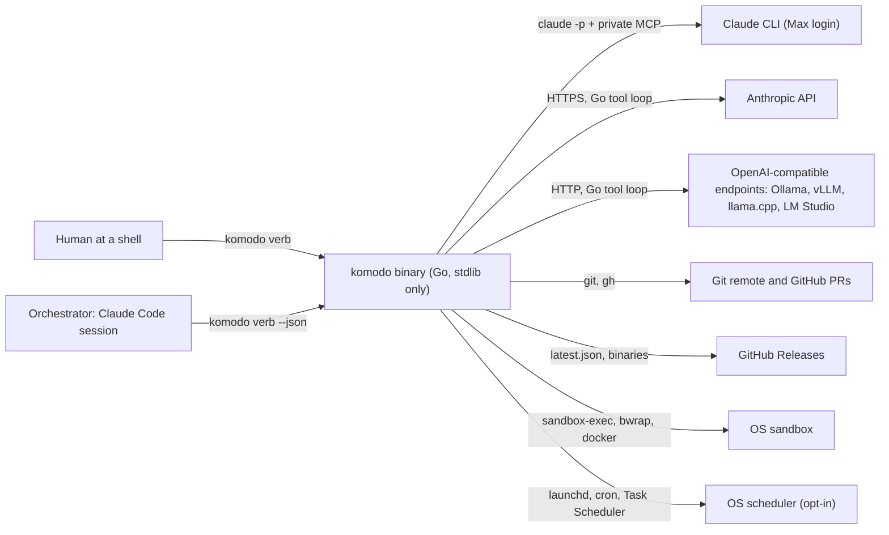
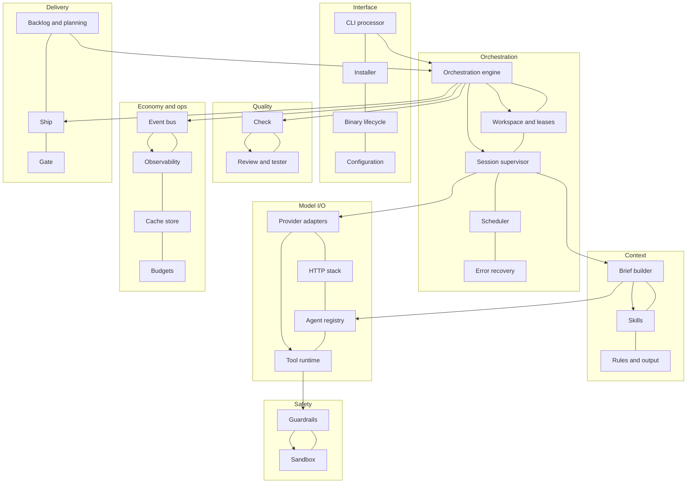
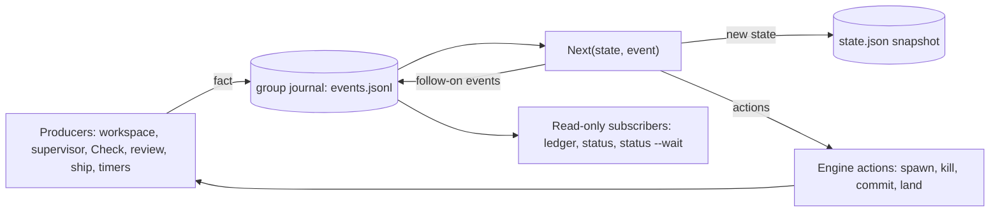
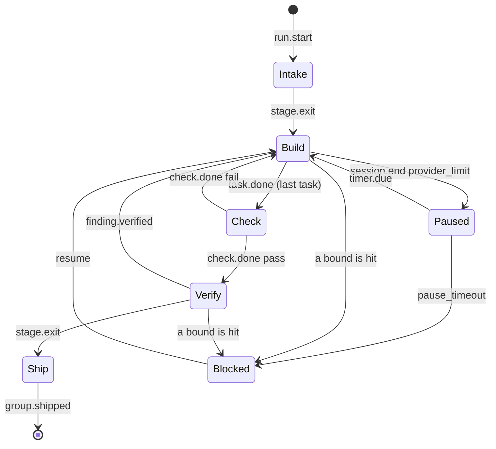
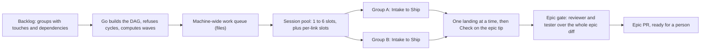
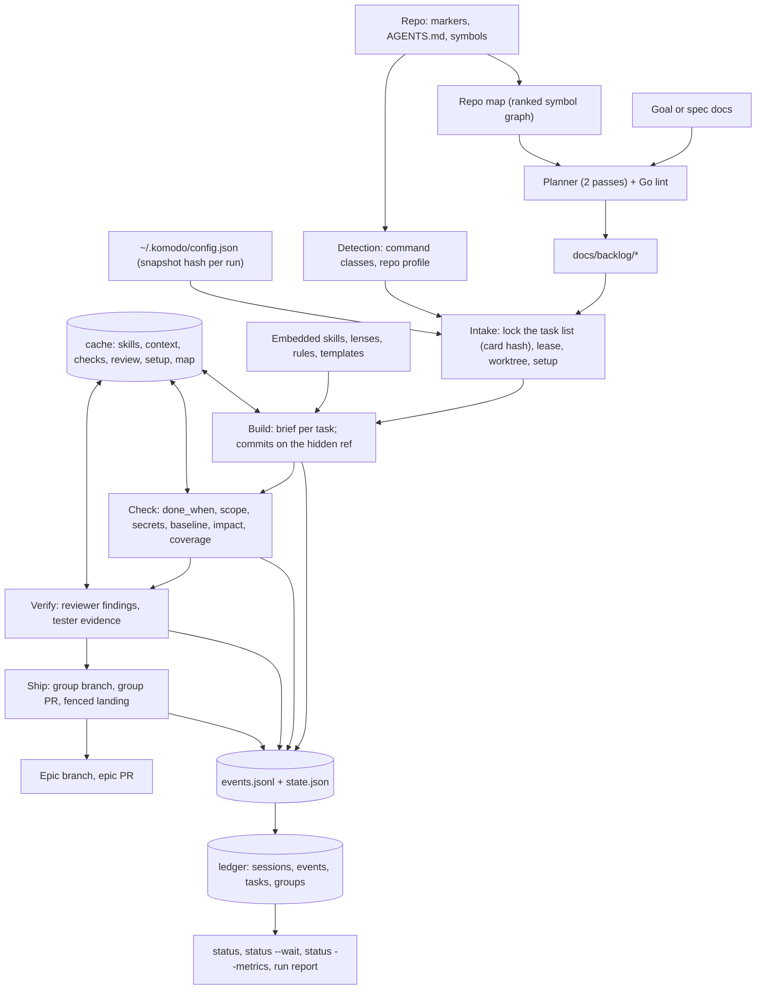
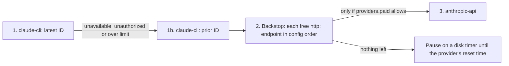

# Komodo 1.0.0-beta.6 — High-Level Design

## 0. Document control

| Field | Value |
|---|---|
| Document | High-Level Design (HLD) |
| System | Komodo 1.0.0-beta.6, standalone model-agnostic Go harness |
| Version | 0.1, draft |
| Status | Awaiting architecture sign-off by the domain architect |
| Date | 2026-10-09 |
| Source of truth | `PLAN.md` at commit `ba4ff823` on `feat/1.0.0-beta.6` |
| Companion | `docs/lld.md` (Low-Level Design) |
| Owner | Komodo domain architect (CEO) |
| Author | Technical lead |

**Placeholder convention.** Text in the form `[PENDING G-NN]` marks a fact the plan has not yet verified or a decision the owner has not yet confirmed. The gap register in `docs/lld.md` §34 lists every such item with the phase that closes it. No placeholder hides a proposal; each one stands in for content that is decided but not yet proven.

---

## 1. Purpose and scope

### 1.1 Purpose

This document describes the architecture of Komodo beta 6 at the level a domain architect needs to approve it: what the system is for, who uses it, what it is made of, how the parts cooperate at run time, what data it keeps, how it stays safe, and how it will be delivered.

### 1.2 In scope

- The single Go binary `komodo`, its 27 subsystems in 8 layers, and the cross-cutting security design.
- The two callers: an AI orchestrator (Claude Code today) and a human at a shell.
- The three model links that ship in beta 6: `claude-cli`, `anthropic-api`, and OpenAI-compatible `http:` endpoints (Ollama, vLLM, llama.cpp, LM Studio, local or on a server).
- Four platforms: macOS, Linux, WSL2, and native Windows (Docker required).

### 1.3 Out of scope (later minor version)

- The OpenAI execution path: `codex-cli` link, `openai-api` chain link, `.codex/` install. Beta 6 ships the interfaces and probe only; the links refuse with `not yet`.
- `komodo chat`, Komodo's own orchestrator front end.
- `orch agent`, ad hoc delegation outside the pipeline.
- Repo-defined hooks and agents, keychain-backed secrets, OpenTelemetry export, Docker on macOS and Linux, service-backed test runs.

---

## 2. Glossary

| Term | Meaning |
|---|---|
| Harness | The `komodo` binary: the engine that plans, builds, checks, reviews and ships code using AI model sessions as workers. |
| Orchestrator | The interactive AI session that drives the harness through CLI verbs. Claude Code in beta 6. It never edits code itself. |
| Worker, agent | A stateless model session with a private toolset. Seven agents exist: planner, architect, reviewer, builder, researcher, tester, scout. |
| Session | One fresh model conversation for one task. It has a brief, a tool server, a sandbox profile and a 60-minute wall clock. |
| Epic, group, task | The backlog hierarchy: an epic holds task groups; a group holds up to 8 tasks; a task names at most 5 files. |
| Stage | One of five pipeline steps a group moves through: Intake, Build, Check, Verify, Ship. Paused and Blocked are holding states. |
| Event | A typed fact the engine records, such as `task.done`. Thirty-two types exist. |
| Journal | The append-only event file per group. State is a replayable product of it. |
| `Next()` | The one pure function that turns (state, event) into (new state, actions, follow-on events). Nothing else changes group state. |
| Outbox | The journal entries `action.start` and `action.done` that bracket every side effect so a crash can replay it safely. |
| Epoch | An integer that rises on every stage entry. A session event carrying an older epoch is stale and ignored. |
| Lease | A per-group lock file on the machine, held from Intake to landing, renewed every 5 minutes, expiring 2 hours after the last renewal. |
| Fence | A monotonic integer beside the lease. Every git write carries it, and git's compare-and-swap refuses a stale holder. |
| Worktree | A detached git checkout per group under `~/.komodo/wt/`, where the builder works. |
| Hidden ref | `refs/komodo/groups/<group>`, where the engine saves every group commit. Never pushed, hidden from `git branch`. |
| Link | A way to reach a model: `claude-cli`, `anthropic-api`, `http:<name>`, and later `codex-cli`, `openai-api`. |
| Weight | An agent's model size: heavy, standard or light. Maps to Opus, Sonnet or Haiku on Claude links. |
| Chain | An agent's ordered list of links. Fixed in the agent's file, always ending in a free `http:` endpoint. |
| Backstop | The free open-source `http:` endpoint every chain ends in. Mandatory. |
| Cost class | `subscription`, `free` or `paid`, decided mechanically per link before each session. |
| Capacity profile | `{ctx, slots, cost_class, effort}` derived per link before each session; it sizes the brief and the pool take. |
| Brief | The prompt a worker receives: tools, role, repo context, standards, task. Assembled from 20 typed slots. |
| Slot | One named input to a brief, required or optional per agent. |
| Skill | A Markdown standards document embedded in the binary, preinjected by file globs or pulled on demand. |
| Lens | A reviewer rule catalog applied by file scope. Ten exist. |
| Finding | A reviewer claim with a rule ID, `file:line` and a quoted evidence line that Go verifies. |
| EARS | The acceptance-item grammar: `WHEN <event> THE SYSTEM SHALL <response>`, with `IF` and `WHILE` forms. |
| Check | The zero-token stage that reruns `done_when`, scope, secrets, impact tests, baseline diff and coverage. |
| Verify | The stage where the reviewer and the tester run at once on the same commit. |
| Pool slot | One of 1 to 6 machine-wide session slots that only builder, reviewer and tester sessions take. |
| Repo id | The normalized origin URL, or the git common dir path when there is no remote. Names worktrees, leases and caches. |
| Envelope | The JSON reply of every verb: `{v, ok, verdict, report, data, error}`. |
| Guard | The in-process, fail-closed check every tool call passes before it runs. |
| Sandbox | The OS-level confinement every `run` command executes in: seatbelt, bwrap or Docker. |

---

## 3. Business context and goals

### 3.1 Why a rewrite

The prototype used Claude Code itself as the engine, and the effort went into fighting hooks, settings, plugins and render drift:

| Symptom | Measured |
|---|---|
| One task group needed repeated fixes | 11 fix commits on TG-15.4 |
| Stale renders and stale binaries | TG-15.3 |
| The guard failed open and blocked the builder's own work | 187 refusals of the builder's own commands |
| Retries | Effectively unbounded |
| Spend cap | Always $0 |

Every prior alpha and beta, including the first beta 6 attempt, is treated as a failed prototype. The concepts carry forward; the code starts fresh in place with the prototype parked in `backups/` and tagged `prototype-final`.

### 3.2 Goals

| Goal | How the design meets it |
|---|---|
| 80% mechanical, 20% prompt | Any failure a guard row, parser or check can prevent is prevented in Go, not in prompt text. |
| Bounded loss | Any single failure (crash, kill, power loss, provider halt) loses at most one model turn and no committed edit. |
| Never pay by accident | A three-step billing check fails closed; paid links run only when `providers.paid` allows. |
| Open source as the backstop | Every agent chain ends in a free `http:` endpoint; Claude limits move work there, never to a paid link first. |
| One interface for human and AI | Both call the same CLI verbs; the AI gets a JSON envelope, the human gets formatted text. |
| Every loop has a counter | Attempts, repairs, retries, refusals, pauses and budgets each have a bound and a named final state. |
| Deterministic output | Models return codes and facts; Go templates render every word a person reads. |
| Standard library only | `go.mod` has no dependencies. |

### 3.3 Locked decisions

| Area | Decision |
|---|---|
| Repo and bridge | Rewrite in place. Claude Code talks to the harness through CLI subcommands with `--json`. No server process. |
| Isolation | Worktree plus guard plus OS sandbox. Each session gets a private MCP tool server; native tools are off. |
| Execution | One fresh session per task; a failed Check or Verify resumes it. Five stages. Declared fallback chain per agent. |
| Platforms | macOS, Linux, WSL2 (preferred on Windows), native Windows `.exe` with Docker. |
| Configuration | One machine file `~/.komodo/config.json`, changed only through `komodo config`. No repo layer, no per-run override. |
| Carry-over | Backlog tree, lint, release, worktree protections, subagent ledger, economy mode, all 34 `standards-*` skills. |
| Deleted | Eval, recall, plugins, standalone facets. |
| Docs | `AGENTS.md` is the source of truth; `CLAUDE.md` imports it. Specs restart from zero. |

### 3.4 Precedents

| Idea | Precedent |
|---|---|
| Pure decider, journaled side effects, replay | Temporal's workflow and activity split |
| Fencing tokens on leases, enforced by the resource | Distributed-lease practice |
| Event stream as the agent's spine | OpenHands |
| Minimal tool surface, no shell; sandbox with network off | SWE-agent's agent-computer interface; Codex CLI |
| Seatbelt on macOS, bwrap on Linux | Codex CLI |
| Full-jitter retries | AWS Architecture Blog |
| Ranked repo map for planning | Aider |
| EARS acceptance items | Kiro specs |
| Coverage bands 60/75/90 | Google Testing Blog |
| Headless sessions, resume, structured output | Claude Code 2.1.295 |

---

## 4. System context

### 4.1 Actors and external systems



| Actor or system | Role | Direction |
|---|---|---|
| Human at a shell | Installs, configures, updates, releases; may also run every shared verb | Calls in |
| Orchestrator | Refines intent, calls `plan`, `run`, `status --wait`, answers `scope`, relays reports | Calls in |
| Claude CLI | Runs worker sessions on the Max subscription via `claude -p` | Called out |
| Anthropic API | Runs worker sessions when a paid link is allowed | Called out |
| OpenAI-compatible endpoints | Run worker sessions as the free backstop, local or self-hosted | Called out |
| Git remote and GitHub | Receives group and epic branches; `gh` opens PRs; a person merges only the epic PR | Called out |
| GitHub Releases | Serves `latest.json` and signed binaries for self-update | Called out |
| OS sandbox | Confines every `run` command | Called out |
| OS scheduler | Fires `komodo jobs tick` every 5 minutes when installed with `--schedule` | Calls in |

### 4.2 Inputs and outputs

| Input | Form | Consumed by |
|---|---|---|
| A goal | `komodo plan <goal>` text, or `--from <spec>` documents (PRD, RFC, ticket export, `docs/` tree) | Planner, two passes |
| The repository | Markers (`go.mod`, `package.json`, …), `AGENTS.md`, the symbol graph | Detection, brief builder, repo map |
| The backlog | `docs/backlog/epic-N/tg-N.M/{TG.md, tsk-*.md}` | Intake, Build, Verify |
| Configuration | `~/.komodo/config.json` within built-in hard limits | Every verb, snapshotted per run |
| Provider state | `providers.json` from the install probe; `quota.json` reset timers | Chain selection, billing check |
| Decisions | `scope approve|deny`, `resume`, `abandon`, config writes | The engine |

| Output | Form | Produced by |
|---|---|---|
| A linted backlog | Files under `docs/backlog/`, written only if lint passes | Planner pass plus Go lint |
| Group commits | On the hidden ref, then a group branch `komodo/<epic>/<group>` | Build, Ship |
| Group PRs | Into the epic branch `komodo/<epic>`, merged by the engine (`ship.mode: group`) | Ship |
| The epic PR | Into the base branch, opened ready for a person to merge | Epic gate |
| Reports | The envelope's `report` text, `status`, the run report, `status --metrics` | Templates |
| Ledgers | `sessions.jsonl`, `events.jsonl`, `tasks.json`, `groups.json` | Observability subscriber |
| Signed releases | Tag, cross-built binaries, checksums, ed25519 signature, changelog | `komodo release` |

---

## 5. Logical architecture

### 5.1 Layers and components

Eight layers, 27 components, 11 Go packages. Each package holds the components of one layer; no package maps to a single component.

| Layer | Component | Responsibility | Package |
|---|---|---|---|
| Interface | CLI processor | One verb set, one envelope, five exit codes, pin check, 5-step pipeline | `cli` |
| Interface | Installer | Puts the binary on the machine and the Komodo block into a repo, idempotently, from a manifest | `host` |
| Interface | Binary lifecycle | Hourly release check, background download, verified hot swap, runs pinned to their version | `host`, `core` |
| Interface | Configuration | 33 flat keys plus agent and endpoint groups, hard limits, hash guard, audit log, command detection | `core` |
| Model I/O | Provider adapters | One interface over every link; chain and failover; billing check; measured context; model catalog | `provider` |
| Model I/O | HTTP stack | One client: TLS roots, proxy, SSE streaming, jittered retries, limit classes, host allowlists, redaction | `core` |
| Model I/O | Agent registry | Seven agents decoded once from `agent.json` and `prompt.md`; cross-checked at the gate | `agent` |
| Model I/O | Tool runtime | Tool registry, private MCP server, harness tool loop for API links, output caps, context compaction | `tools`, `provider` |
| Context | Skill loader | Indexed, hashed, size-bounded standards skills; preinject by glob, pull on demand | `agent` |
| Context | Rules and output contract | Orchestrator rules embedded; codes and facts rendered by Go templates per output profile | `agent` |
| Context | Brief builder | Stable five-part prefix, 20 slots, one ceiling per link at half its measured context | `agent` |
| Safety | Guardrails | Fail-closed in-process check on every tool call; rows are `policy.json` data with scopes | `safety` |
| Safety | Sandbox and process control | Seatbelt, bwrap or Docker around every `run`; process, memory, time and output caps; tree kill | `safety` |
| Orchestration | Orchestration engine | Pure `Next()`, `Drive` per group, five stages, DAG, queue, pool, convergence | `engine` |
| Orchestration | Workspace and leases | Worktree per group, lease with fence, hidden ref, shutdown, parent guard, sweep | `engine` |
| Orchestration | Session supervisor | Spawn, heartbeat, time warning, nudge, stop ladder, exit reasons | `engine` |
| Orchestration | Scheduler and job templates | Job templates, idempotent `jobs tick`, counters, overlap through the lease | `engine` |
| Orchestration | Error recovery | One row per failure: detector, action, bound, final state; outbox keys; startup sweep | `engine` |
| Quality | Check | Zero-token ground truth: `done_when`, scope, secrets, baseline, impact set, flake rule, coverage | `quality` |
| Quality | Review and evidence | Ten scoped lenses, verified findings, per-task verdicts, blind tester, precision ledger | `quality` |
| Economy and ops | Token and resource management | Budgets, prompt-cache breakpoints, headline cost metrics | `ops`, `agent` |
| Economy and ops | Cache store | Content-addressed, verified-on-read, LRU-bounded store outside every worktree | `core` |
| Economy and ops | Runtime observability | Session ledger, event log, lock-table views, scorecard, live `status` | `ops`, `cli` |
| Economy and ops | Event bus | Envelope, catalog, journal, in-order delivery, three read-only subscribers, wakes | `ops` |
| Delivery | Backlog and planning | Backlog grammar, lint, two-pass planner, Go-derived DAG, repo map, EARS items | `repo` |
| Delivery | Ship | Only writer of git: fenced landings, group and epic PRs, signed releases | `repo` |
| Delivery | Gate and self-checks | Build, structure, safety, events, docs drift, generated artifacts, timing; Komodo repo only | `repo`, `safety` |

### 5.2 Component diagram



### 5.3 Import direction

Imports flow one way: `cli` → `engine` → `quality` → `host` → `repo` → `provider` → `tools` → `ops` → `agent` → `safety` → `core`. A package may skip levels. Higher-level needs enter lower packages as parameters: the engine passes a session runner into `quality`, Check into `repo`, backlog lint into `tools`, and filled slots into `agent`. `komodo gate` refuses any import that points up.

### 5.4 Concepts to components

| Concept | Lives in |
|---|---|
| Agents | Agent registry: `agent.json` for what Go reads, `prompt.md` for what the model reads |
| Skills | Skill loader: indexed, preinjected or pulled, usable by external sessions |
| Rules | Rules and output contract: embedded in the binary; the output style is config |
| Hooks | Event bus: Go lifecycle events. Exactly three inline hooks exist; repo hooks wait for a later minor |
| Guards | Guardrails: checked in-process on every tool call, fail-closed |
| Commands | Configuration detects command classes; the tool runtime runs them; only Ship runs git writes |
| Plugins | Deleted. External MCPs become an opt-in allowlist per agent |

---

## 6. Runtime view

### 6.1 The event spine

Facts flow as events; one pure function decides. The mechanical parts publish what happened; `Next(state, event)` returns the new state, the actions to take and any follow-on events. Nothing else changes group state.



| Principle | Rule |
|---|---|
| The engine emits, never a model | A session's typed JSON becomes an event only after Go validates it. A killed session cannot report; a model can forget or invent. |
| Journal first | Each event is appended and fsynced to `runs/<group>/events.jsonl` before it is applied. `state.json` is a snapshot with the last `seq`; resume replays after it. |
| Subscribers are read-only | The ledger, `status --wait` wakes and `status --watch` react to events and never change state. |
| Coarse grain | Events fire per run, group, stage, session and task, never per model turn or token. |
| In-process and ordered | One bus per engine, synchronous, in `seq` order, no broker. Machine-wide state stays in files; each engine turns a change there into a local event. |
| Outside the bus | The guard, formatting after `edit`, and shutdown are direct code. They log an event afterward when they can. |
| Actions are journaled (the outbox) | `Drive` appends `action.start {id, kind}` before an action and `action.done` after. On replay a done action is skipped, a started one reruns, and every action is idempotent by a declared key. |
| One journal per group, one per run | Groups never read each other's journals; they meet only in the queue and the pool. |
| Epochs fence late events | Every spawn carries the stage's epoch. A session event with an older epoch is journaled `stale: true` and ignored. |
| A new type is a plan change | The catalog is a Go enum; the gate fails on an emitted type missing from it, or a listed type nothing emits. |

**Guarantees the tests pin:**

| Guarantee | How |
|---|---|
| Ordered, gap-free | One writer per journal; `seq` checked on append and replay |
| Durable before applied | Append, fsync, then `Next()`; a crash after the sync replays the event |
| Exactly-once state moves | A stage moves only in `Next()`, keyed by `seq`; stale-epoch events never move it |
| At-least-once actions, safe to repeat | Every action has an idempotency key |
| No lost wake | `status --wait` reads the journal tail after subscribing |
| Subscriber faults contained | A panicking subscriber is logged and dropped; state is untouched |

### 6.2 Group lifecycle

Five stages plus two holding states. Sessions run in Build and Verify, so Paused and Blocked can follow either.



| Stage | What happens | Tokens | Exit needs |
|---|---|---|---|
| Intake | Lint the group, hash its card, take the lease and fence, cut the worktree from the epic tip, run `commands.setup` with network on | 0 | lint pass, lease and fence taken, setup exit 0, task list locked |
| Build | One fresh builder session per task, in sequence, in the group worktree. After each task Go reruns its `done_when` and commits to the hidden ref | model | `task.done` for every task, each with `done_when` exit 0 and a commit |
| Check | Rerun every `done_when`, scope check, secret scan, impact-set tests, baseline diff, changed-line coverage | 0 | `check.done pass` |
| Verify | Reviewer (ten lenses, per-task verdicts) and tester (blind acceptance items) run at once on the same commit, the tester in its own throwaway worktree | model | reviewer `met` for every task and 0 blocking findings; tester `confirmed` for every task and item; 0 regressions |
| Ship | Merge the epic branch into the group branch, rerun Check, land with the fence, then Check on the epic tip | 0 | merge clean, Check passes, landing succeeds |
| Paused | A provider limit with no link left: the group returns its pool slot, keeps lease and worktree, waits on a disk timer. Wall clocks stop | 0 | the timer fires, or the pause cap ends it |
| Blocked | A bound was hit or a decision is needed. A person or the orchestrator runs `resume` | 0 | `resume`, `scope approve|deny`, or `abandon` |

**Back to Build.** A failed Check or Verify resumes the task's own builder session with only the verified findings. There is no separate Repair stage. Each return raises the task's attempt count and the stage epoch. `limits.repairs` (3) returns per group, then Blocked.

### 6.3 The Verify race

The reviewer and tester start under one epoch. The first verified failure makes `Next()` emit `cancel` for the other and enter Build under a new epoch. Whatever the cancelled session sends afterward carries the old epoch and is stale.

```mermaid
sequenceDiagram
  participant R as Reviewer (epoch 4)
  participant T as Tester (epoch 4)
  participant N as Next()
  T->>N: finding: item 3 failed, Go reran x2, still fails
  N->>N: Build, epoch 5; action cancel(R)
  R->>N: session.end done (epoch 4)
  N-->>R: journaled stale=true, ignored
```

| Case | Outcome |
|---|---|
| Reviewer fails first | Tester cancelled; back to Build with the reviewer's verified findings |
| Tester fails an item and Go's two reruns also fail | Reviewer cancelled; back to Build with the item |
| Tester fails an item but Go's two reruns pass | Tester restarts once with Go's output; reviewer keeps going |
| Go's two reruns split | Group blocks with `flaky` |
| Both pass | Both `session.end done` events needed; then `stage.exit` to Ship |
| Both fail in one tick | Handled in `seq` order; the second is already stale |
| An item has no command | It never cancels the reviewer |

### 6.4 Run order across groups



| Rule | Detail |
|---|---|
| A graph, not a list | Groups form a DAG from the backlog. A group with two dependencies joins after both land. |
| Start rule | A group starts only after every dependency has landed and Check has passed on the epic tip. |
| One queue | Ready work from every repo and every job waits in one machine-wide queue of create-only files. |
| Pick order | `priority: high` first, then fair share across repos, then the longest remaining chain weighted by task count, then most groups unblocked, then backlog ID order. |
| No waiting on siblings | A group goes from Build to Verify as soon as its own builder finishes. |
| Integration break | If Check fails on the epic tip after a landing, landings pause and the last-landed group goes back to Build in a new worktree cut from the tip. |
| Epic gate | After the last group lands, the reviewer and tester run once across the whole epic diff. A finding goes to the group that last changed its file; a finding with no file blocks the epic with `epic_gate`. |
| Abandoned dependency | Its dependents block with `dependency`, naming it. |

### 6.5 Session pool

| Rule | Detail |
|---|---|
| Who takes a slot | Builder, reviewer and tester sessions only, in runs and jobs alike. Planner and job sessions take none but still count against their link's limit. |
| Floor and ceiling | `limits.pool_min` (1) stays open while throttled; `limits.pool_max` (6) is the most at once; hard limit 16. |
| Per link | `limits.link_sessions.<link>` (3; loopback endpoints 1) across all repos. |
| Adapts | Grows by 1 after each clean session end while free memory covers one more `sandbox.max_mem_gb`; halves, never below the floor, on a rate-limit error or quota past `warn.quota_pct`. |
| Machine-wide | Pool and link slots are lock files under `~/.komodo/state/`, freed when their pid dies. Two engines coordinate only through files. |

### 6.6 One session, end to end

```mermaid
sequenceDiagram
  participant E as Engine (Drive)
  participant B as Brief builder
  participant P as Provider adapter
  participant M as Model session
  participant T as Tool runtime + guard + sandbox
  participant C as Check
  E->>P: capacity profile for the link (ctx, slots, cost_class, effort)
  E->>B: fill 20 slots; fit under half of ctx
  E->>P: billing check (fail closed), spawn with brief
  P->>M: claude -p with private MCP, or Go tool loop
  loop until a text-only reply
    M->>T: tool call
    T->>T: guard (fail-closed), sandbox for run
    T-->>M: capped result
  end
  M->>P: final call: result schema only
  P->>E: Go re-validates the result (1 re-prompt)
  E->>C: rerun done_when
  E->>E: commit to hidden ref with fence; journal task.done
```

| Step | Rule |
|---|---|
| Capacity profile | Context is measured, not typed: Models API `max_input_tokens`, Ollama `/api/ps`, or the endpoint's declared `ctx`. |
| Brief | Order is tools, role, repo context, standards, task. The brief must fit in half the measured context; over that, the next link in the chain that fits; none left, Blocked `context`. |
| Billing | `claude auth status --json` sets the cost class; the env is scrubbed of API keys; the first stream line must say `apiKeySource: "none"` or the session is killed before turn 1. |
| Tools | Only the agent's listed tools are advertised. Every call passes the guard; `run` executes in the sandbox with no shell and no network. |
| Result | The provider enforces the schema, then Go re-validates. One re-prompt, then the task fails. The agent's own gate (`done_when`, `lint_backlog`) runs next; two rejected results end the session with `check_fail`. |
| Commit | Every writing session ends in a WIP commit to the hidden ref by compare-and-swap with the fence. |

### 6.7 From goal to merged epic PR

1. The human or orchestrator runs `komodo plan <goal>`. The planner's heavy pass drafts groups, goals, `touches` and dependencies; Go lints. A standard-weight pass per group drafts tasks and EARS items in parallel; Go lints each. Files are written only when lint passes.
2. `komodo run` builds the DAG, enqueues wave-1 groups, returns the run id at once, and the engine continues detached.
3. The orchestrator runs `komodo status --wait` in the background and is woken on `group.blocked`, `group.paused`, `run.done` or `run.stopped`.
4. Each group moves Intake → Build → Check → Verify → Ship. A builder that needs a file outside its `files` list stops with `needs_scope`; the engine denies protected paths and paths another live group owns, and otherwise the orchestrator answers `scope approve|deny`.
5. Each landing is fenced. After each, Check runs on the epic tip. Dependents start as their dependencies land.
6. After the last group, the epic gate runs. The engine opens the epic PR into the base branch, ready for review.
7. A person merges the epic PR; `komodo sync` fetches, prunes worktrees and refreshes repo files.

---

## 7. Data view

### 7.1 Where data lives

| Location | Contents | Committed |
|---|---|---|
| `<repo>/AGENTS.md` | Repo rules plus the Komodo block (`komodo:begin min=<version>` … `komodo:end`) | Yes |
| `<repo>/CLAUDE.md` | `@AGENTS.md` import line | Yes |
| `<repo>/.claude/settings.json` | Two entries only: the `Bash(komodo *)` allow rule and a `SessionStart` hook running `komodo status` | Yes |
| `<repo>/docs/backlog/epic-N/tg-N.M/` | `TG.md` and `tsk-*.md`, the backlog grammar | Yes |
| `<git-common-dir>/komodo/` | Install manifest, run and group journals, snapshots, job state, session files, ledgers, cache | No |
| `~/.komodo/config.json` | The one config file, created on the first `komodo config` write | No |
| `~/.komodo/bin/`, `versions/` | Current binary copy and every installed version | No |
| `~/.komodo/jobs/` | Job templates | No |
| `~/.komodo/leases/<repo-id>/` | One lease and fence file per group, machine-wide | No |
| `~/.komodo/wt/<repo-id>/` | Detached worktrees per group | No |
| `~/.komodo/state/` | Provider probe, quota timers, pool and link slots, queue, wake files, fresh state, config hash and audit log | No |
| `~/.komodo/cache/lang/<repo-id>/` | Komodo's own language caches per repo, never the user's | No |

On Windows, `~/.komodo` is `%LOCALAPPDATA%\komodo`.

### 7.2 Data flow



### 7.3 Configuration model

| Layer | Where | Power |
|---|---|---|
| 1 Built-in | `embed/defaults.json`, `embed/policy.json` inside the signed binary | Defaults and hard limits |
| 2 Machine | `~/.komodo/config.json`, top level | Any value within the hard limits |

- The machine value wins within the hard limits. Every key exists out of the box; `--default` resets.
- One write path: `komodo config`, which needs a terminal, writes every pair or none, logs one audit row per changed key, and stores a SHA-256 of the file. A hand edit makes every verb refuse with `config_tampered` until `komodo config --accept`.
- Each run snapshots the effective config's hash into its `state.json`; edits mid-run do nothing to that run.
- Only two environment variables exist: `KOMODO_HOME` and `NO_COLOR`. Secrets are `env:` references only.
- Security rows are never config. The only guard tunable is `guard.refusal_limit`.

### 7.4 Cache

| Property | Rule |
|---|---|
| Keys | `sha256(inputs + binary version)`; only the hourly release check uses time |
| Location | `<git-common-dir>/komodo/cache/`, outside every worktree, so an agent cannot reach or poison it |
| Integrity | Verified on read; a mismatch deletes the entry |
| Bound | `cache.max_mb` (256) per repo, least recently used out first |
| Never cached | Build responses, because they are nondeterministic and have side effects |
| Kinds | skills, context (file slices, trims, diffs, briefs), checks, review findings, setup results, repo map and outline lint, test baseline |

### 7.5 Observability data

| Store | Contents |
|---|---|
| `ledger/sessions.jsonl` | One row per session: id, agent, task, link, model, measured context, capacity profile, tokens in/out/cached, USD, wall time, skill tokens, exit reason; `wait_until` and `wait_link` when paused |
| `ledger/events.jsonl` | A read-only copy of every group journal's events, plus fallbacks, skips and host subagent events |
| `ledger/tasks.json`, `ledger/groups.json` | Lock-table views rebuilt from the journals: who holds what |
| `sessions/<id>/` | `brief.md`, `request.json`, `stream.jsonl`, `messages.jsonl`, `result.json`, `out/` |
| `status --metrics` | Per agent and model over the retention window: first-pass rate, repairs per group, finding precision, tester false-fail rate, tokens and USD per accepted group, cache hit rate |

Retention is `ledger.retention_days` (30) or 100 MB per repo, oldest first; a journal of an open, paused or blocked group is never trimmed. Keys and secret matches are masked before anything is written. There is no OpenTelemetry export in beta 6; JSONL plus `events.schema.json` is the export.

---

## 8. Model and provider view

### 8.1 Links

| Link | Runs as | Auth | Tools via | Beta 6 |
|---|---|---|---|---|
| `claude-cli` | `claude -p` at the probed absolute path | The CLI's own login | Private MCP server | Ships |
| `anthropic-api` | HTTPS through the HTTP stack | `providers.keys.anthropic` | Go tool loop | Ships |
| `http:<name>` | OpenAI-compatible HTTP: Ollama, vLLM, llama.cpp, LM Studio | Optional `key` per endpoint | Go tool loop | Ships |
| `codex-cli` | `codex exec` | The CLI's own login | Private MCP server | `not yet` |
| `openai-api` | HTTPS | `providers.keys.openai` | Go tool loop | `not yet` |

### 8.2 Weights and models

| Weight | Agents | Claude latest → prior | Effort (API links) |
|---|---|---|---|
| Heavy | Planner, architect, reviewer | `claude-opus-5-5` → `claude-opus-5` | `high` |
| Standard | Builder, researcher | `claude-sonnet-5-5` → `claude-sonnet-5` | `medium` |
| Light | Tester, scout | `claude-haiku-5-5` → `claude-haiku-4-5` | `low` |

- Every current Claude ID is a 1M-token window with 128K max output; Haiku 4.5 is 200K. IDs are exact and pinned, never aliases.
- `fable` (Fable 5.1) is an opt-in heavy model by `komodo config agent <name> model=fable`, only when the probe lists it for the login. `[PENDING G-06]` whether a Max login exposes it to `claude -p`.
- Local recommended models per weight: Qwen3.6-27B, Gemma 4 31B, Nemotron 3 Nano. Their windows are measured, never typed.
- The default window for an unmeasured, uncatalogued model is 262,144.

### 8.3 The chain and failover



| Rule | Detail |
|---|---|
| Skip only on provider failure | A link is skipped only when unavailable, unauthorized or over its limit, never because a task failed. Each skip is a `provider.skip` event and a warning naming the model the task ran on. |
| The backstop is mandatory | Every chain must end in at least one free `http:` endpoint. `doctor` and `gate` refuse a chain without one. |
| Chains are fixed | In `agent.json`, never in config. `komodo config agent <name> model=…` picks the starting model; the rest of the chain follows in default order. An agent set to `-prev` falls back to the backstop, never forward. |
| Back to Claude | After the recorded reset time, new sessions start on `claude-cli` again; a task already on the backstop finishes there. |
| A model retired mid-run | `providers.json` is the only registry. A 404 fails that session start; the task's next session takes the prior link, then the backstop. |
| Context floor | `providers.ctx_floor` (262,144) applies to `http:` endpoints only. An endpoint below it fails `doctor` and is skipped with `ctx_below_floor`. Briefs are never shrunk to fit. |

### 8.4 Cost classes and the billing check

| Cost class | When | Runs? |
|---|---|---|
| `subscription` | `claude-cli` whose `auth status` says `authMethod: claude.ai` and a `pro`, `max`, `team` or `enterprise` plan | Always |
| `free` | An `http:` endpoint on loopback, or one marked `self_hosted: true` | Always |
| `paid` | `anthropic-api`, `openai-api`, `claude-cli` on any other login, or any other `http:` endpoint | Only as `providers.paid` allows: `never` (default), `fallback`, `allowed` |

Three mechanical checks, failing closed: the login is read before every `claude-cli` session; the worker environment is scrubbed of `ANTHROPIC_API_KEY`, `ANTHROPIC_AUTH_TOKEN`, `ANTHROPIC_BASE_URL` and `CLAUDE_CODE_USE_*`; and the first stream line must report `apiKeySource: "none"` or the session dies before its first turn with exit `billing`. `[PENDING G-02]` capturing that init line at probe time without spending a model turn.

### 8.5 Limits, pauses and warnings

Komodo adds no cost cap of its own; provider windows and spend limits are the provider's. USD is a beta metric. On a quota stop the next session starts on the next allowed link; only with no link left does the session pause with `wait_until` (reset time plus 1 minute) on disk and the link's reset time in machine-wide `quota.json`. `komodo resume` attempts every paused agent now; a refused attempt costs no model turn and re-pauses with the new reset time, or backs off 15, 30, then 60 minutes when none is given. Paused time stops the wall clocks; at `limits.pause_max_min` (360) the session is cancelled, its WIP commit kept, and the group blocks with `pause_timeout`. Three warnings never stop work: a window past `warn.quota_pct` (90), Max drawing overage credits, and a run past `warn.usd_per_run` (5).

---

## 9. Agent roster

| Agent | Weight | Tools | Writes | Pool slot | Purpose |
|---|---|---|---|---|---|
| Builder | Standard | `read`, `search`, `edit`, `write`, `run`, `skill` | Only the group's `files` and test siblings (B1) | Yes | Implements one task per session |
| Reviewer | Heavy | `read`, `search`, `skill`, `diff`, `git_read`, `run` (build, test, lint), `submit_finding` | None; `run` may write and the engine resets it | Yes | Lenses, verified findings, one verdict per task |
| Tester | Light | `read`, `search`, `run` (build and test only) | None; `run` may write and the engine resets it | Yes | Blind pass or fail per acceptance item, with evidence |
| Planner | Heavy | `read`, `search`, `skill`, `lint_backlog` | None; the harness writes files only if lint passes | No | Epic outline, then tasks and items per group |
| Architect | Heavy | `read`, `search`, `skill`, `web` (opt-in, GET) | None | No | Options plus a recommendation |
| Researcher | Standard | Same as architect | None | No | Findings with `file:line` |
| Scout | Light | `read`, `search` (paths only) | None | No | Runs on a local model when its chain allows |

No agent has git write tools, forge credentials or a shell. Only the engine runs worktree add and remove, the lease, `commands.setup`, git commit, push and branch, Check, the group PR, landing and release. No repo-defined agents exist in beta 6.

---

## 10. Security view

### 10.1 Threats and controls

| Threat | Stopped by |
|---|---|
| Agent escapes its worktree | Guard row G2 (containment, `..`, symlinks); the sandbox |
| Agent leaks or reads secrets | G4 (secret files and patterns); sandbox environment allowlist and home-folder read block; Check's secret scan; HTTP and ledger redaction |
| Agent pushes, merges or force-pushes | No git write tools; R1 (no class runs git); orchestrator rules O1 to O3; only Ship writes git |
| Tampered or stale binary | SHA-256 and ed25519 verification on every fresh; repo pin |
| Runaway cost or loops | Session supervisor, error recovery bounds, budgets |
| Poisoned cache | Cache outside worktrees, verified on read; Komodo-owned language caches per repo |
| Malicious external MCP | Opt-in allowlist per agent, off by default, no credentials |
| Stale engine lands over newer work | Fence enforced by git compare-and-swap; action idempotency keys |
| Prompt steering through a skill or repo text | Steering-phrase scan at the gate and in `doctor`; no rule text in prompts; the `text` policy row |
| Tampered config or binary at run time | Config hash guard; signatures; G3 protects both files |

### 10.2 Guard summary

Rules are data in `embed/policy.json` with scopes, read by the guard, the gate and the LLD roster tables. Every tool call is checked in-process before it runs; a refusal names the rule and the allowed alternative; the third refusal under one rule ends the session. `needs_scope` is the only refusal a person or the orchestrator can turn into an allow.

| Family | Rows | Binds to |
|---|---|---|
| G1 to G6 | Unlisted tool; worktree escape; protected paths; secret reads and secret-shaped writes; attribution trailers; the refusal limit | All agents (write rows bind to writers only) |
| R1 | Only declared command classes, as `{class, args[]}`, no shell | Any agent with `run` |
| B1 | Writes only to the group's `files` and test siblings; otherwise stop with `needs_scope` | Builder |
| O1 to O10 | Critical-ref writes, force pushes, hand merges, leased worktrees, stash, `gh pr`, faked terminals, human-only verbs, `--no-verify` | The orchestrator, as text in `AGENTS.md`; enforced on the harness side by verb refusals and the terminal check |

### 10.3 Sandbox summary

| OS | Sandbox | Shape |
|---|---|---|
| macOS | `sandbox-exec` (seatbelt) | Reads outside home allowed; inside home only the worktree, repo git dir, Komodo caches and toolchains; writes only to worktree, session temp and language caches; network denied except loopback |
| Linux, WSL | `bwrap` | `/` read-only; home an empty tmpfs with the same folders bound back; `--unshare-net`; `--die-with-parent`; refuses with the fix when user namespaces are blocked |
| Windows native | Docker (when WSL is absent) | `--network none`; only the worktree, session temp and language-cache volumes writable; with neither WSL nor Docker every work verb refuses |

The sandbox is `required` on every OS. Every `run` gets a 10-minute timeout, a 4 KB reply cap, 512 processes and 8 GB (cgroups or Docker; macOS has no cap and `doctor` says so), and a whole-tree kill. Intake runs `commands.setup` with network on; every `run` keeps it off. Loopback is always allowed.

### 10.4 Release integrity

Releases are signed with ed25519 by a key at `~/.komodo/release.key` (mode 0600) on the owner's machine, with one backup in a password manager. The current and next public keys are embedded in the binary; the `next` key is set at the first release so a leak is survivable by rotation. The bootstrap scripts verify SHA-256 over HTTPS; every later `fresh` verifies the ed25519 signature. Enterprise signing (KMS or keyless, rollback refusal) is a later minor, G-21.

---

## 11. Quality view

### 11.1 Four gates, three of them free

| Gate | Evidence | Tokens |
|---|---|---|
| Lint and coverage | Check; `check.patch_coverage` (80) on changed lines, blocking for Go, warning for other languages | 0 |
| Success | `done_when` rerun per task | 0 |
| Regression | Baseline diff at the base commit plus the impact set | 0 |
| Behaviour | The tester's blind pass over EARS acceptance items | Model |

### 11.2 Check (ground truth)

| Check | Rule |
|---|---|
| Baseline | Intake records the `test` class result at the base commit, cached by tree hash. A test that passed at base and fails at head is a regression and blocks; one failing at both is pre-existing and warns. |
| Impact set | Go repos run the tests of every package that imports a changed package; other languages run the full suite. The full suite always runs at the epic gate. |
| Flake rule | Any failing test is rerun twice alone; two more failures confirm it; a split reports `flaky` without blocking and is counted per repo. |
| Scope | Every changed file is in the group's `files` or is a test sibling. |
| Secrets | The diff is scanned for secret patterns. |
| Cache | Results are keyed by tree hash plus command; an unchanged tree skips the rerun. |

### 11.3 Review and the tester

- **Lenses are rule catalogs applied by scope.** Ten lenses; a lens runs only when a changed file matches its `applies`. Thorough mode runs every applicable lens in parallel plus a cold pass; economy runs one merged lens. `blocker` and `major` block; `minor` is reported and counted.
- **Standards compile to rules.** Each `- **Never` and `- **Always` line in a standards skill becomes a rule ID the reviewer cites.
- **Findings carry evidence.** A finding blocks only if Go finds its quoted line at `file:line` in the head or the diff. Failing findings are dropped and logged.
- **One verdict per task.** The reviewer returns `met`, `not_met` or `brief_incomplete` for every task ID exactly once; the tester returns `confirmed` or `not_confirmed` per task and pass or fail per item.
- **The tester is blind by construction.** Its sandbox profile cannot see the builder's worktree; its brief holds only engine facts from the backlog at the base commit.
- **Precision ledger.** Per rule and model: submitted, verified, fixed, disputed. `doctor` lists rules under 50% verified; a rule under 30% for 60 days is a plan change. `[PENDING G-16]` the catalogs' content, authored in phase 7.
- **Re-review** covers only the delta; cached findings cost 0 tokens. The tester reruns every item.

### 11.4 Gate and self-checks (Komodo's own repo)

`komodo gate` runs build, tests and cross-builds; import direction and strict decode of every agent file and job template; the guard table and prefix-hash pin; event catalog completeness; docs drift; the S-ID map; the "no silent gaps" rule; every generated artifact against its source; and timing targets. It must finish under 3 minutes locally; `--fast` skips cross-builds and timing. `[PENDING G-19]` the 10,000-event replay under 1 s and the 50 ms short-verb budget are targets, measured in phase 6.

---

## 12. Operations view

### 12.1 Install and bootstrap

- **Bootstrap:** `curl -fsSL <repo>/install.sh | sh` on macOS, Linux and WSL; `irm <repo>/install.ps1 | iex` on Windows. The scripts download, verify SHA-256 and run `komodo install --machine-only`.
- **Install is a manifest diff.** It computes the desired manifest, diffs it against `install.json`, applies only the differences, then runs `doctor install`. Rerunning makes 0 changes. Hand-edited owned files survive and are reported; `--force` overwrites.
- **Eight steps:** binary; PATH; provider probe (under 2 s, local checks only); `AGENTS.md` block; `CLAUDE.md` import; `.claude/settings.json` (two entries); manifest; optional OS schedule.
- **Never created:** a repo config folder, git hooks, `.codex/`, `~/.claude`, `~/.codex`, or any `.claude/` skill, rule or guard hook.

### 12.2 Self-update

Only `status`, the engine at run start and `fresh --check` fetch the 1 KB `latest.json`, at most hourly with a 1 s timeout. Any verb that sees a newer `latest` spawns one detached updater (one at a time via `fresh.lock`), which downloads to `versions/<v>/`, verifies SHA-256 and ed25519, and atomically replaces `bin/komodo`. Every new call gets the new binary; live runs keep their own version because the engine starts every child from `versions/<its v>/`. `fresh --restart-runs` checkpoints each run within 2 minutes and resumes it on the new binary at the cost of at most one repeated model turn. Background fresh never downgrades; `fresh --to <v>` and `install` may. Off switch: `fresh.auto: false` or `CI=true`. A repo pinned above the binary refuses every verb except `help`, `version`, `fresh`, `install` and `doctor`.

### 12.3 Health

`komodo doctor` checks the install, the sandbox, PATH, the provider catalog with each window's source, endpoint context against the floor, missing toolchain tools, hook drift, long-path settings on Windows, the Docker daemon, and the backlog grammar. `doctor --sandbox <cmd>` runs a command under the policy. `doctor --fix` is terminal-only.

### 12.4 Scheduling

There is no daemon. `komodo jobs tick` is idempotent and is one engine step: it enqueues due jobs, fires due pause timers and drives the pool once. `install --schedule` writes a launchd, cron or Task Scheduler entry every 5 minutes. A job template names an agent subset, brief slots and an interval, never limits. Overlap is prevented by the job's lease. No jobs ship by default; one example template exists.

### 12.5 Error recovery and the loss bound

Every failure has a detector, an action, a bound and a final state; nothing loops without a counter. The startup sweep kills orphans by pid file, frees expired leases, re-enqueues queue items with no lease and emits `session.end crash` for dead sessions. A crash is contained to its group. `resume` tries the provider's resume handle first; if that fails, a fresh session gets the brief, the WIP diff and the last summary, and the ledger logs `resume_lost`. Blocked never auto-retries; a group blocked 3 times for one reason is flagged `needs redesign`.

---

## 13. Interfaces

### 13.1 Command surface

| Tier | Who calls it | Verbs |
|---|---|---|
| Shared | Human and orchestrator | `help`, `version`, `doctor`, `sync`, `add backlog`, `add changelog`, `plan`, `run`, `status`, `skill`, `scope`, `resume`, `stop`, `abandon`, `jobs list|show|tick`, `cache stats`, `gate` (except `--install*`), `config` reads |
| Terminal-only | Human; refused without a controlling terminal | `install`, `uninstall`, `fresh`, `config` writes, `doctor --fix`, `jobs run|pause|resume`, `cache clear`, `gate --install`, `gate --install-hooks`, `release` |
| Internal | The engine | `internal tools`, `internal fresh-bg` |

Every verb: five processing steps (parse, validate, resolve, dispatch, render); a verb that fails before dispatch has made 0 writes; every writing verb is idempotent and takes `--dry-run`; every verb accepts `--input <file|->` as one JSON object with explicit flags winning.

### 13.2 Envelope and exit codes

`{v: 1, ok, verdict, report, data, error{code, reason, fix}}`. `report` is human text already formatted to `output.profile`, so the orchestrator relays it verbatim. Exit codes: 0 ok, 1 refused, 2 usage, 3 blocked, 4 internal. `--json` is on automatically without a terminal.

### 13.3 The orchestrator contract

Install writes a Komodo block into `AGENTS.md` that tells any host session: run `komodo help --json` first; your verbs are the shared set; `install`, `fresh`, config writes, `gate --install` and `release` belong to the person; run `status --wait` in the background; relay `report` verbatim. The rules O1 to O7, O9 and O10 and the output style follow in the same block. A Claude `SessionStart` hook runs `komodo status` so a new session sees state on line one.

---

## 14. Deployment view

| Platform | Binary | Sandbox | Notes |
|---|---|---|---|
| macOS | `komodo` | seatbelt | APFS clone for dependency copies; no process or memory cap |
| Linux | `komodo` | bwrap | cgroups caps when delegated; `[PENDING G-08]` private loopback per session; `[PENDING G-09]` reflink behaviour per filesystem |
| WSL2 | `komodo` (Linux side) | bwrap | Preferred on Windows; WSL and Windows each probe their own side |
| Windows native | `komodo.exe` | Docker | Full official image per detected language, else `sandbox.image`; `[PENDING G-10]` symlink and junction handling; `[PENDING G-11]` bind-mount copy time |

One binary, standard library only, cross-built for windows, linux and darwin at every gate. Install puts it at `~/.komodo/versions/<v>/komodo` and copies it to `~/.komodo/bin/komodo`. Multi-repo on one binary: each call resolves its repo from cwd or `-C`; the binary, config, Max quota and session pool are shared across repos.

---

## 15. Quality attributes

| Attribute | Target | Enforced by |
|---|---|---|
| Latency, short verbs | `help`, `version`, config reads, `skill` under 50 ms, no network, no repo scan beyond marker stats | Gate timing `[PENDING G-19]` |
| Latency, probe | Five checks in parallel under 2 s; a no-diff rerun under 1 s | Install |
| Latency, status | 1,000 ledger rows rendered under 100 ms; 50 runs under 10 ms | Incremental views |
| Latency, replay | 10,000 events under 1 s; resume bounded by 50 events from the snapshot | Gate `[PENDING G-19]` |
| Latency, gate | Under 3 minutes locally | Gate |
| Durability | At most one model turn and no committed edit lost on any single failure | Journal-first, outbox, WIP commits |
| Safety | No unsandboxed `run` on any OS; no paid call under `providers.paid: never` | Sandbox `required`; billing check |
| Cost | Cache hit rate per agent reported; under 50% on the API link over 20 sessions fails a fixture `[PENDING G-17]` | Prefix order, 4 cache breakpoints |
| Capacity | 6 sessions machine-wide, 3 per link, 1 per loopback endpoint by default; hard limits 16 and 8 | Pool and link slots `[PENDING G-04]`, `[PENDING G-07]` |
| Portability | Same behaviour on 3 OSes; cross-builds at every gate | Gate |

---

## 16. Delivery roadmap

| Phase | Wave | Scope | Exit proof |
|---|---|---|---|
| 1 | Design docs | `prd`, `hld`, `lld`, ADR 0001, epic-1 | Owner approves the docs; epic-1 lints in phase 2 |
| 2 | Foundations | CLI skeleton, configuration, HTTP stack, sandbox, cache, version, backlog lint, gate core; a `claude -p` plus MCP spike | Core tests pass on 3 OSes; `doctor backlog` passes on epic-1; the spike makes one MCP tool call |
| 3 | Model surface | Agent registry, skills, rules and output, guardrails | Guard table and strict decode pass |
| 4 | Model I/O | Provider adapters (`claude -p`, local, Anthropic API), tool runtime, brief builder | A fixture task finishes through `claude -p` and a local model |
| 5 | Runtime | Workspace, supervisor, observability, event bus | Timeout, idle and kill proofs pass with 0 orphans |
| 6 | Engine | Orchestration engine, error recovery, Check, budgets, ship | The fixture group lands on its epic branch |
| 7 | Quality and scale | Review and tester, scheduler, planner | Review catches the seeded bug; a job ticks once per window |
| 8 | Edges | Installer, fresh, release, docs drift | Fresh-repo smoke test on macOS and Windows |
| 9 | User docs and cutover | README, CONTRIBUTING, AGENTS/CLAUDE, CHANGELOG, templates, cutover | Docs-drift gate passes; `doctor install` finds 0 stale references |

Phases 2 to 6 are built by hand in plain Claude Code sessions. From phase 7, `komodo gate --install` places a dev build and beta 6 runs its own groups. The security lens is required for the installer, binary lifecycle, HTTP stack, tool runtime, guardrails, sandbox and ship; before phase 7 the owner reviews those groups by hand. Beta 5 retires before phase 2 by removing its hooks, skill overrides and skills from `~/.claude`.

---

## 17. Decisions and gaps

### 17.1 Decisions the owner made (2026-10-09)

| ID | Decision |
|---|---|
| G-01 | Signing key: local file plus one backup copy; `next` key set at the first release. Enterprise target G-21. |
| G-05 | `providers.json` is the only model registry; a 404 fails over through the chain. Enterprise target G-22. |
| G-15 | The orchestrator answers `scope approve` after two engine denials: protected paths and paths another live group owns. Enterprise target G-23. |

### 17.2 Defaults chosen by the design pass, awaiting the owner's confirmation

`fable` opt-in only; Haiku 5.5 as the light weight; `check.patch_coverage` 80 blocking for Go only; group wall hard limit 720; install flags trimmed to 8; B2 moved to lint; 10 lenses; EARS items; the two-pass planner; `--permission-prompts none` in the launch line; the 4 binary-lifecycle Vet lines; the shared Rust target directory per group.

### 17.3 Open gaps

Twenty gaps remain, each with a closing phase, listed in `docs/lld.md` §34. The ones that touch this document's claims are marked `[PENDING G-NN]` in place.

---

## Appendix A. Traceability

| Component | Plan ID | Package | Phase |
|---|---|---|---|
| CLI processor | S01 | `cli` | 2 |
| Installer | S02 | `host` | 8 |
| Binary lifecycle | S03 | `host`, `core` | 2, 8 |
| Configuration | S04 | `core` | 2 |
| Provider adapters | S05 | `provider` | 4 |
| HTTP stack | S06 | `core` | 2 |
| Agent registry | S07 | `agent` | 3 |
| Tool runtime | S08 | `tools`, `provider` | 4 |
| Skill loader | S09 | `agent` | 3 |
| Rules and output contract | S10 | `agent` | 3 |
| Brief builder | S11 | `agent` | 4 |
| Guardrails | S12 | `safety` | 3 |
| Sandbox and process control | S13 | `safety` | 2 |
| Orchestration engine | S14 | `engine` | 6 |
| Workspace and leases | S15 | `engine` | 5 |
| Session supervisor | S16 | `engine` | 5 |
| Scheduler and job templates | S17 | `engine` | 7 |
| Error recovery | S18 | `engine` | 6 |
| Check | S19 | `quality` | 6 |
| Review and evidence | S20 | `quality` | 7 |
| Token and resource management | S21 | `ops`, `agent` | 6 |
| Cache store | S22 | `core` | 2 |
| Runtime observability | S23 | `ops`, `cli` | 5 |
| Event bus | S24 | `ops` | 5 |
| Backlog and planning | S25 | `repo` | 2, 7 |
| Ship | S26 | `repo` | 6, 8 |
| Gate and self-checks | S27 | `repo`, `safety` | 2, 8 |
