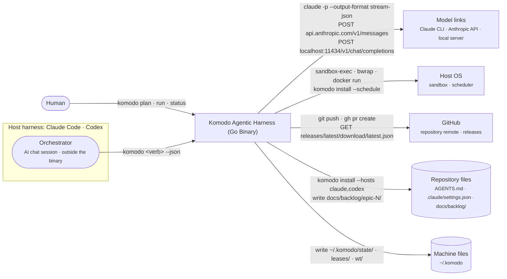
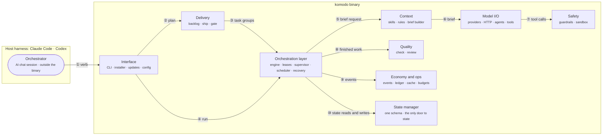
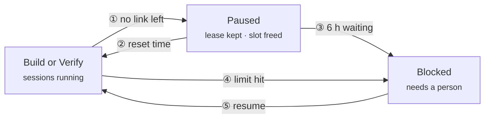
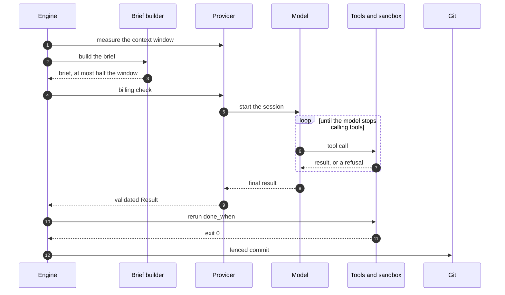
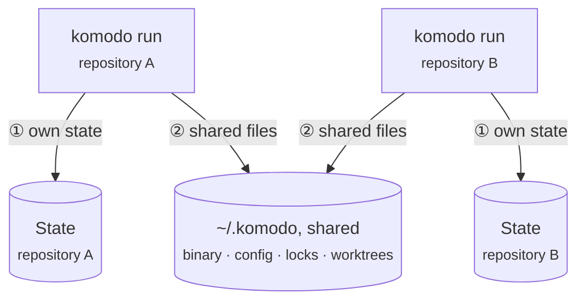

# Komodo 1.0.0-beta.6 — High-Level Design

## 0. Front matter

**Contents**

- [1. Introduction and goals](#1-introduction-and-goals)
- [2. Constraints](#2-constraints)
- [3. Context and scope](#3-context-and-scope)
- [4. Solution strategy](#4-solution-strategy)
- [5. Building blocks](#5-building-blocks)
- [6. Runtime](#6-runtime)
- [7. Deployment](#7-deployment)
- [8. Crosscutting concepts](#8-crosscutting-concepts)
- [9. Architecture decisions](#9-architecture-decisions)
- [10. Quality requirements](#10-quality-requirements)
- [11. Risks, debt and roadmap](#11-risks-debt-and-roadmap)
- [12. Glossary](#12-glossary)

**Owners and controls**
- **Owners:** domain architect (CEO) decides every gap and signs off per component; technical lead authors.
- **Controls:** 0.9, draft, awaiting sign-off; source of truth: the HLD and LLD together; patches only; no phase 2 code before sign-off.

**Revisions**

| Version | Date | Change |
|---|---|---|
| 0.1 | 2026-10-09 | First draft from `PLAN.md`; enterprise sections; placeholders for open gaps |
| 0.2 | 2026-10-11 | Repair stage references removed; `limits.repairs` renamed `limits.returns` |
| 0.3 | 2026-10-11 | 12 chapters, diagrams, lookup appendices; every element explained plainly |
| 0.4 | 2026-10-11 | State manager added as a core pillar: one state schema, the only door to runtime state |
| 0.5 | 2026-10-11 | Group state: a group's events, snapshots and replay become one unit inside the state manager |
| 0.6 | 2026-10-11 | "Journal" renamed to state: state events plus snapshots make up group state; `journal.truncated` is now `state.truncated` |
| 0.7 | 2026-10-12 | The plan file's remaining facts moved into the HLD and LLD, which are now the source of truth |
| 0.8 | 2026-10-12 | Token and USD tracking is opt-in: the `track.usage` setting is on in `economy` mode and off in `thorough` mode |
| 0.9 | 2026-10-12 | `komodo init` is a verb: `install` places the binary and sets up the repo, and `init` puts orchestrator skills and commands into the global Claude Code setup (G-28); the install scripts replace the name "bootstrap"; dashboard proof of concept tracked as G-27 |

**Related:** [docs/lld.md](lld.md), [docs/prd.md](prd.md), [ADR 0001](decisions/0001-standalone-harness.md), [Appendix B](#appendix-b-references) (references).

## 1. Introduction and goals

Komodo is one Go binary, `komodo`, that runs AI model sessions as workers to plan, build, check, review and ship code. It says what the harness is for, what drives its design, and its five ranked qualities. Without it, no decision can be judged. The owner reads it; the engine never does.

**📐 How work moves from the backlog to merged code**

```mermaid
flowchart LR
  BL[("Backlog<br><small>epic · task groups</small>")]:::store
  I["Intake<br><small>lint · lease · worktree</small>"]
  B["Build<br><small>one builder per task</small>"]:::core
  C["Check<br><small>tests and scans · 0 tokens</small>"]
  V["Verify<br><small>reviewer + tester</small>"]:::core
  SH["Ship<br><small>land on the epic branch</small>"]
  EG["Epic gate<br><small>reviewer + tester, whole epic</small>"]:::core
  PR(["Epic PR<br><small>a person merges</small>"]):::ok
  BL -->|"① komodo run"| I
  I -->|"② ready"| B
  B -->|"③ tasks done"| C
  C -->|"④ pass"| V
  V -->|"⑤ approved"| SH
  SH -->|"⑥ last group landed"| EG
  EG -->|"⑦ pass"| PR
  C -.->|"⑧ fail"| B
  V -.->|"⑧ findings"| B
```

**Reading the diagram.** This is the whole pipeline on one page; every other diagram zooms into one part of it.

1. **`komodo run`** takes ready task groups from the backlog. An epic is one feature; it splits into task groups of up to 8 tasks each.
2. **Intake** lints the group, takes its lease (a lock file only this group holds) and cuts a private git worktree. It spends 0 tokens.
3. **Build** runs one fresh builder session per task, one task after another. Go reruns each task's `done_when` command and commits.
4. **Check** reruns every test and scan in Go, at 0 tokens. A pass sends the group to Verify.
5. **Verify** runs the reviewer and the tester at once on the same commit. Both must approve.
6. **Ship** lands the group on the epic branch, one group at a time. When the last group lands, the epic gate starts.
7. **The epic gate** runs the reviewer and tester once over the whole epic. A pass opens the epic PR, the only PR a person merges.
8. **A failed Check or Verify** sends the task back to its own builder session with only the verified findings. After 3 returns (`limits.returns`) the group blocks.

A group can also wait. Paused waits for a provider limit to reset; Blocked waits for a person. Chapter 6 shows each stage, the waits and one session in detail.

**Scope.** This design covers the binary's 28 components and two callers: the orchestrator (see Glossary) and a person at a shell. It reaches three model links (see Glossary) on four platforms: macOS, Linux, WSL2 and native Windows. The OpenAI path and `komodo chat` wait for a later minor release.

**Business drivers.** Three drivers shape the design. Every loop carries a numeric bound, so no retry or fix cycle runs without limit. The guard fails closed, refusing input it cannot parse, and optional usage tracking of tokens and US dollars (`track.usage`) warns at $5 a run.

**Quality goals, in priority order**

1. **Safety:** a worker never writes outside its worktree, reads a secret, pushes to git or spends money without a decided setting.
2. **Durability:** a crash, kill or provider halt loses at most one model turn and no committed edit.
3. **Determinism:** the same facts render the same bytes; a stage moves only on evidence the engine produced.
4. **Cost control:** subscription and free links first, a cached prompt prefix, a bound on every loop.
5. **Portability:** one binary, the same behaviour on all four platforms.

**What matters**
- 80% mechanical, 20% prompt: whatever a guard row, parser or check can prevent, Go prevents.
- Never pay by accident: 0 paid calls under `providers.paid: never`.
- Models return codes and facts; Go templates render every word a person reads.
- One state schema, one door: every read and write of runtime state goes through the state manager, which validates it first.

**Lookup:** [LLD Appendix S](lld.md#appendix-s-hld-detail-tables-goals-building-blocks-decisions-quality-risks-roadmap) holds the stakeholder, requirements, goals and non-goals tables.

## 2. Constraints

A constraint is a locked rule the design cannot trade away. Owner-set; `komodo gate` (Komodo's self-check) enforces several.

| Constraint | Why |
|---|---|
| Go standard library only | Locked; nothing external to audit |
| No server; short verbs | A tick replaces a daemon |
| macOS, Linux, WSL2, Windows | One binary, same behaviour |
| One sandbox per OS: seatbelt, bwrap, Docker | Per-OS confinement |
| Only `komodo config` writes config | Auditable; no agent access |
| Claude Code: CLI verbs, `--json` only | One surface per host |
| No phase 2 code before sign-off | Owner approves first |
| `AGENTS.md` is the truth | `CLAUDE.md` imports it; no drift |
| Runtime state only through the state manager | One schema; checked before disk |

**What matters**
- Phases 2 to 6 are hand-built; the harness builds its own groups from phase 7.
- New event types or result codes are design changes: enum, schema, template, fixture.

## 3. Context and scope

This chapter draws Komodo's boundary: who calls in, what it calls, and what flows across. Outside it lie Claude, GitHub and the operating system; without it, responsibilities blur. Callers: a person at a shell, the orchestrator (see Glossary), the OS scheduler. Callees: models, git, GitHub, the sandbox.

**📐 Who uses Komodo, and what it reaches**

**Reading the diagram.** Two actors call in: the human at a shell, and the orchestrator, an AI chat session. The orchestrator runs inside a host harness, Claude Code today and Codex in a later version, and takes prompts from the human. Both actors run `komodo` verbs; the orchestrator adds `--json` and reads one JSON reply. Model sessions reach one of three links: the Claude CLI, the Anthropic API, or a local OpenAI-compatible server. Every command a model asks to run executes inside the OS sandbox: seatbelt on macOS, bwrap on Linux, Docker on Windows. `komodo install --schedule` registers a launchd, cron or Task Scheduler entry that runs `komodo jobs tick` every 5 minutes. Only the binary runs git: it pushes branches and opens pull requests, and the human merges the epic pull request. The binary fetches `latest.json` from GitHub Releases at most once an hour to find signed updates. `komodo install --hosts` writes the Komodo block into `AGENTS.md`, which Claude Code and Codex both read, plus a `SessionStart` hook in `.claude/settings.json`. Machine state lives under `~/.komodo`: locks, leases and worktrees.

Every verb returns a JSON envelope (a fixed reply shape) and an exit code 0 to 4. `claude -p` runs as a child process with a private MCP tool server only that session talks to. The Anthropic API and OpenAI-compatible `/v1` endpoints stream replies over HTTP. Git and `gh` are child processes; GitHub Releases serves `latest.json` and signed binaries. The OS scheduler fires `komodo jobs tick` every 5 minutes.

| Input or output | Form | Who |
|---|---|---|
| Goal (in) | `komodo plan <goal>` or `--from <spec>` | Planner, two passes |
| Backlog (in) | `docs/backlog/epic-N/tg-N.M/{TG.md, tsk-*.md}` | Intake, Build, Verify |
| Configuration (in) | `~/.komodo/config.json` within hard limits | Every verb; snapshotted per run |
| Group commits (out) | Hidden ref, then branch `komodo/<epic>/<group>` | Build, Ship |
| Epic PR (out) | Into the base branch; a person merges | Epic gate |
| Ledgers (out) | `sessions.jsonl`, `events.jsonl`, `tasks.json`, `groups.json` | Observability subscriber |

**What matters**
- Nothing else calls in.
- The orchestrator calls `plan`, `run` and `status --wait`, answers `scope`, relays reports and never edits code.
- A person merges only the epic PR; the engine merges group PRs under `ship.mode: group`.

## 4. Solution strategy

The design on one page: six bets, five tied to the chapter 1 quality goal each serves. The engine implements every line; no model is trusted to.

**What matters**
- Safety: minimal tool surface, no shell; fail-closed guard on every call; OS sandbox around every command; only the engine writes git.
- Durability: state-first events; one pure decider `Next()`; one state manager that validates every record before it reaches disk; group state keeping a group's events, snapshots and replay as one unit; recorded actions with idempotency keys; a WIP commit at every session end; epochs fence late events.
- Determinism: typed result schemas are enforced twice. Go templates render codes and facts against golden fixtures, and only the engine emits events.
- Cost control: each agent has a fixed chain ending in a free endpoint. A mechanical billing check, a cached prompt prefix and loop bounds cap spend.
- Portability: one binary cross-built at every gate; one sandbox backend per OS behind one interface; per-platform copy mechanics behind one "copy" verb.
- Technology: Go standard library only, with `claude -p` plus a private MCP server or a Go tool loop. State is append-only JSONL state files, snapshots and create-only claim files behind one state manager, one goroutine per group, rendered by Go `text/template`.

Every idea has a published precedent: Temporal's workflow and activity split, distributed-lease fencing tokens, OpenHands' event stream, Codex CLI's sandbox, Aider's repo map.

## 5. Building blocks

The parts list of the `komodo` binary; a building block is one piece with one job, and without this list nobody can say which piece does what. There are 28 components over 12 Go packages (source folders): 27 sit in 8 layers, one package per layer, and the 28th, the state manager, is a core pillar under all of them. A person reads it; the engine is itself one block.

**📐 How the eight layers work together**

**Reading the diagram.** The orchestrator sits outside the binary, in the host harness; a person at a shell stands in the same place. Either one runs a verb, which enters through the Interface layer. Planning verbs go to Delivery, which writes the backlog. Delivery hands ready task groups to the Orchestration layer, the engine inside the binary. The `run` verb starts the engine directly. The engine asks Context to build a brief for each model session. Context passes the brief to Model I/O, which talks to the model. Every tool call the model makes passes through Safety first. Finished work goes to Quality for checks and review. Every layer's events land in Economy and ops, which feeds `status`. Every read or write of runtime state goes through the state manager; the engine's arrow stands for all of them.

**Orchestrator and Orchestration layer are two different things.** The orchestrator asks for work; the Orchestration layer does it. The names are close because both coordinate, at different levels.

| | Detail |
|---|---|
| Orchestrator | An AI chat session, Claude Code today, running in the host harness outside the binary. It turns a person's intent into `komodo` verbs and relays each reply's `report`. It never edits code, runs git or drives a stage itself. |
| Orchestration layer | The `engine` package inside the `komodo` binary, one of the eight layers. It moves each task group through its five stages, spawns and watches model sessions, holds worktrees and leases, and runs git. Every state change goes through its pure `Next()` function. |
| Where they meet | Only at the Interface layer. The orchestrator calls verbs such as `plan`, `run` and `status --wait`. Each verb returns one JSON envelope, and `status` reports what the Orchestration layer has done. |

**The eight layers.** Interface (`cli`, `host`, `core`) holds the CLI processor with one verb set and envelope. It also holds the installer, the binary lifecycle (`fresh`) and configuration with 34 flat keys. Model I/O (`provider`, `tools`, `agent`, `core`): provider adapters over every link, the HTTP stack, agent registry and tool runtime with its private MCP server. Context (`agent`), what a model reads: skill loader, rules and output contract, brief builder filling 20 slots. Safety (`safety`), what a model may do: guardrails on every tool call and the sandbox around every `run`. Orchestration layer (`engine`), not the orchestrator: the engine with its pure `Next()`, workspace and leases, the session supervisor, the scheduler and error recovery. Quality (`quality`): Check, and review with the tester. Economy and ops (`ops`, `core`): budgets, the cache store, observability and the event bus. Delivery (`repo`, `safety`): backlog and planning, Ship, and the gate.

**The state manager, a core pillar.** The `state` package is the only code that reads or writes runtime state: state events, snapshots, leases, the queue, timers, the ledger and session files. Every record and event has one schema, and the manager fills in each record's standard fields and refuses any write that breaks the schema. It runs inside every `komodo` process, never as a separate server.

**Imports flow one way**, from `cli` down to `core`; a package may skip levels but never import upward. Higher-level needs arrive as parameters; `komodo gate` refuses any upward import.

**The seven agents.** An agent is a role a model session plays, with its own tools and limits. Weight is model size: heavy, standard or light (Opus, Sonnet, Haiku on Claude links).

| Agent | Weight | What it produces |
|---|---|---|
| Builder | Standard | One implemented task per session, committed to the hidden ref |
| Reviewer | Heavy | Verified findings from ten lenses and one verdict per task |
| Tester | Light | Blind pass or fail per acceptance item, with evidence |
| Planner | Heavy | Epic outline, then tasks and acceptance items per group |
| Architect | Heavy | Options plus a recommendation |
| Researcher | Standard | Findings with `file:line` |
| Scout | Light | Path-only findings, on a local model when its chain allows |

**What matters**
- No package maps to a single component, except `state`, which is the state manager alone.
- No package outside `state` writes a runtime state file; `komodo gate` refuses one that does.
- Only builder, reviewer and tester take a pool slot, one of the 1 to 6 machine-wide session slots.
- No agent has git write tools, forge credentials or a shell; only the engine runs git, setup, Check, PRs, landing and release.
- The registry decodes `agent.json` (what Go reads) and `prompt.md` (what the model reads) once, cross-checked at the gate.

**Lookup:** [LLD Appendix S](lld.md#appendix-s-hld-detail-tables-goals-building-blocks-decisions-quality-risks-roadmap) holds the component responsibility table and the agent roster (tools, writes, pool slot).

## 6. Runtime

This chapter shows the parts at work, in three walkthroughs. The event spine is how every change to a group's state travels. The group lifecycle is the five stages a task group passes through. One session end to end follows a single model conversation from spawn to commit. All three take the engine's view; a person or the orchestrator appears only where named.

**The event spine.** An event is a typed fact the engine records, such as `task.done`; 32 types exist, and producers (workspace, supervisor, Check, review, ship, timers) publish them. One pure function, `Next(state, event)`, turns each event into the new state, actions and follow-on events, and nothing else changes group state.

**Group state.** A group's events, its snapshots and replay are one unit inside the state manager, called group state. Every event is checked, appended and fsynced to `runs/<group>/events.jsonl`, the group's state events, before it is applied; `state.json` is a snapshot of the state at a `seq`, and `Load` replays the events after it. The engine's `Drive` loop uses 5 calls: `Open`, `Append`, `Snapshot`, `Load` and `Tail`, and `Next()` stays in the engine, passed to `Load` when it replays.

**Epochs and actions.** Every spawn carries the stage's epoch, an integer that rises on every stage entry, and a session event with an older epoch is kept as `stale: true` and ignored. Actions go through group state too: `action.start` before and `action.done` after, so a crash replays safely.

**📐 How one event changes a group's state**

**Reading the diagram.** Both stores belong to group state, so the state events and the snapshot are always written, checked and replayed by the same code.

1. **A producer**, such as the session supervisor, publishes a fact stamped with the stage's epoch, and `Drive`, the one goroutine for this group, receives it.
2. **`Append`** hands it to group state, which checks it, appends it to the group state and fsyncs before anything else.
3. **An event from an older epoch** is kept as stale and ignored.
4. **A current event goes to `Next()`**, a pure function that always gives the same answer for the same input.
5. **`Snapshot`** receives the new state after every event; group state writes `state.json` only every 50 events or on a stage change.
6. **`Next()` also returns actions**, each recorded before and after it runs, so a crash replays safely.
7. **Three subscribers** then read the event in order: the ledger, the wake file and `status --watch`. They write only their own records, never group state.

**The state manager.** Every part of the harness reads and writes state through one service, the state manager. A record is one saved piece of state, such as a group snapshot, a lease or a pause timer, and every record shares one schema and one header. The manager fills in the header and refuses any write that breaks the schema, so nothing invalid reaches disk.

**📐 How every part reaches state**

**Reading the diagram.**

1. **A group's `Drive` loop** appends each event, saves snapshots and, after a restart, loads its state, all through group state, the part of the manager that keeps them together. `Next()` still decides every change; the manager only stores and checks.
2. **The other writers** write their own kinds: the workspace its leases, the engine the queue and pool slots, the provider adapters the pause timers, the scheduler its job counters and the ledger its rows.
3. **Readers** such as `status`, `status --wait` and the startup sweep read through the same service, never the files directly.
4. **The manager fills in the header** (version, revision, time, writer) and checks types, required fields, allowed values and rules such as "no gaps in `seq`".
5. **A valid write is atomic:** a event line is appended and fsynced, a snapshot is written to a temp file and renamed, and a claim file is created only if it does not exist.
6. **An invalid write is refused** with `state_invalid` and the field that failed, and the file on disk is unchanged. A record that fails its check on read is moved aside as `.bad-*`, and its group blocks. A torn last event line, left by a crash mid-write, is only dropped, and the group continues.

**A group's lifecycle.** A group holds up to 8 tasks that ship together. It moves through Intake, Build, Check, Verify and Ship, with Paused and Blocked as holding states. Intake lints the group, takes the lease and fence, cuts the worktree and runs `commands.setup`. Build runs one fresh builder session per task; after each, Go reruns its `done_when` and commits to the hidden ref. Check reruns every `done_when`, the scope check, secret scan, impact-set tests, baseline diff and changed-line coverage, at 0 tokens. Verify runs the reviewer and tester together on the same commit. Ship merges the epic branch in, reruns Check, lands with the fence, then runs Check on the epic tip. A failed Check or Verify resumes the task's builder session with only the verified findings; after `limits.returns` (3) returns per group, the group blocks.

**📐 The five stages of a group**

**Reading the diagram.** Intake lints the group, takes its lease and cuts a worktree. Build runs one fresh builder session per task and commits each to a hidden ref. Check reruns every test and scan at 0 tokens and passes the group to Verify. The reviewer and tester approve the same commit together. Ship merges the epic branch in, reruns Check and lands the group. A failed Check or a blocking finding returns the task to its builder, at most 3 times per group.

Only Build and Verify run model sessions, so only they can stop to wait. Paused waits for a provider limit to reset; Blocked waits for a person.

**📐 When a group waits or stops**

**Reading the diagram.** With no model link left, the group pauses and frees its session slot. When the provider's reset time passes, the group returns to the stage it left. After 6 hours paused (`limits.pause_max_min`), the group blocks with `pause_timeout`. Hitting any loop bound, such as 3 returns, also blocks the group. A person or the orchestrator runs `resume` to send it back to Build.

Inside Build and Verify, a supervisor watches each session through its stream of output lines.

**📐 How the engine watches a running session**

**Reading the diagram.** The session starts under the stage's epoch. A session that finishes ends with `session.end done`. A session silent for `session_idle_min` gets a nudge. Any new output line returns it to Working. Still silent after a 5-minute grace, it is stopped. At 80 percent of its wall-clock limit the session gets a time warning. At the limit it is stopped: SIGINT, then SIGTERM after 30 s, then the whole process tree after 60 s.

**One session end to end.** The engine first derives the link's capacity profile, `{ctx, slots, cost_class, effort}`, with context measured rather than typed. The brief builder fills 20 slots in the order tools, role, repo context, standards, task; the brief must fit in half the measured context. The billing check runs, failing closed, then the provider spawns the model with a private MCP server or a Go tool loop. Every tool call passes the guard; `run` executes in the sandbox with no shell and no network. The final call returns the result schema only; Go re-validates it, with one re-prompt. The agent's own gate runs next, and the session ends in a WIP commit to the hidden ref by compare-and-swap with the fence.

**📐 One builder session, start to finish**

**Reading the diagram.** The engine measures the link's real context window. It asks the brief builder for a brief. The brief must fit in half the window, or the next link that fits is used. The billing check runs and fails closed. The provider starts the model session. The model calls a tool: read, search, edit, write or `run`. The guard checks the call and `run` executes in the sandbox, with replies capped at 4 KB. The model's final reply matches the result schema only. Go re-validates it, allowing one re-prompt. The engine reruns the task's `done_when` command in the sandbox. A failure goes back into the same session; two rejections end it. The engine commits to the hidden ref, guarded by the lease's fence.

**What matters**
- The engine emits events, never a model: a session's typed JSON becomes an event only after Go validates it.
- State first: append, fsync, then `Next()`; a crash after the sync replays the event.
- One door: the state manager is the only code that reads or writes state, and it refuses an invalid write before disk.
- One unit: group state keeps a group's events, snapshots and replay together; resuming a group is one `Load` call.
- Sessions run only in Build and Verify, so only those two stages can enter Paused or Blocked.
- Paused keeps the lease and worktree, returns the pool slot and waits on a timer record; wall clocks stop.
- Blocked never auto-retries; a person or the orchestrator runs `resume`, `scope approve|deny` or `abandon`.
- Two rejected results end a session with `check_fail`; every writing session ends in a WIP commit.

## 7. Deployment

Deployment is where `komodo` lives on a machine: one dependency-free file shared by every repository. A person installs it once; `fresh` updates it in the background. Without it, nobody could say what install changes or why a run survives an update.

| Platform | Sandbox | Notes |
|---|---|---|
| macOS | seatbelt | APFS clone for dependency copies; no process or memory cap |
| Linux | bwrap | cgroups caps when delegated; private loopback `[PENDING G-08]` |
| WSL2 | bwrap | Preferred on Windows; each side probes itself |
| Windows native | Docker | `komodo.exe`; one official image per detected language |

**📐 What one machine holds**

**Reading the diagram.** Each engine writes its state inside its own repository, under `<git-common-dir>/komodo`. Engines meet only through files in `~/.komodo`: the binary, config, locks and worktrees. A lock is a file the state manager creates exclusively, so two engines never take the same slot or group.

Three levels of files. Machine: the binary at `~/.komodo/versions/<v>/` and `bin/`, config, state (pool, link slots, queue, quota, leases), worktrees under `~/.komodo/wt/`. Repository: state files, sessions, ledger and cache under `<git-common-dir>/komodo/`. Session: sandboxed `run` commands, a private MCP tool server, own HOME and TMPDIR.

**What matters**
- One binary cross-built for windows, linux and darwin at every gate.
- Binary, config, Max quota and session pool are shared across repos.
- Install is an eight-step manifest diff; rerunning makes 0 changes.
- `init`, run by a person, puts Komodo's orchestrator skills and commands into the global Claude Code setup; how it writes there is open (LLD G-28).
- Self-update fetches the 1 KB `latest.json` at most hourly; live runs keep their version.

## 8. Crosscutting concepts

A crosscutting concept is a rule spanning many components rather than living in one. Six shape the design: data, models and cost, security, quality gates, operations and interfaces; the LLD holds every table. Without them, each component would store and spend its own way. The engine enforces all six; a person meets them as files, refusals and `status` output.

**Data.** Files are of two kinds. Committed files live in the repository. They are `AGENTS.md` with the Komodo block, `CLAUDE.md` with its import line, `.claude/settings.json` with two entries, and `docs/backlog/`. Machine files never ship: `~/.komodo/config.json`, state, leases, worktrees and language caches under `~/.komodo/`; per-repo state, sessions, ledger and cache under `<git-common-dir>/komodo/`. Configuration has two layers: built-in defaults with hard limits, and the machine file. Only `komodo config` writes its 34 flat keys; a hand edit makes every verb refuse until `config --accept`. The cache is keyed by `sha256(inputs + binary version)`, verified on read, bounded by `cache.max_mb` (256), outside every worktree.

**One state schema.** Every runtime file is a kind in one schema, `embed/state.schema.json`, which also holds the 32 event types, and the state manager is the only code that reads or writes those files. Six things stay outside it, each with its own single owner:

- **`config.json`:** its own schema and its own writer, `komodo config`.
- **The cache:** derived data, checked by hash on every read.
- **Git refs and worktrees:** guarded by git's own compare-and-swap.
- **Job templates:** files a person writes, decoded strictly.
- **The binaries and the signing key:** signed and verified by `fresh`; the key is a secret only `release` reads.
- **Session temp:** each session's own scratch folders, removed by the sweep.

**📐 How inputs become a brief, and results become history**

**Reading the diagram.** The backlog, `AGENTS.md` and skill bodies fill the brief's slots. The effective config and the measured context window cap the brief's size. The brief builder writes `brief.md` for the model session. The session returns a typed `Result` with output and, when `track.usage` is on, token usage. The engine sends the work to Check. The engine appends every event to the group state, through the state manager, before applying it. A subscriber copies events into the ledger, through the state manager. `status` and `status --metrics` read the ledger. The brief builder and Check reuse cached results keyed by a hash of their inputs.

**Models and cost.** A link is one way to reach a model; three ship: `claude-cli`, `anthropic-api` and `http:<name>`. Each agent has a weight and a fixed chain: `claude-cli` latest, then prior, each free `http:` backstop, then `anthropic-api` if `providers.paid` allows. A link is skipped only on provider failure, never because a task failed. Before every session, three mechanical checks that fail closed set the cost class: `subscription`, `free` or `paid`. With no link left, the session pauses on a timer record until the provider's reset time. At `limits.pause_max_min` (360) the group blocks with `pause_timeout`. Komodo adds no cost cap; USD is a beta metric that only warns, and only when `track.usage` is on.

**Usage tracking.** `track.usage` records the tokens and US dollars (USD) of each session. It takes `auto`, `on` or `off`; `auto`, the default, is on in `economy` mode and off in `thorough` mode. When it is off, the engine collects, writes and prints no token or USD data, and groups stay bounded by returns, attempts, retries and wall time.

**📐 Which model link a session gets**

**Reading the diagram.** Every chain starts at the Claude CLI on the Max subscription. If it is unavailable or over a limit, the next link is a free local model. A paid Anthropic API link follows only when `providers.paid` allows it. With no link left, the group pauses until the provider's reset time. Whichever link is chosen passes the billing check first, which fails closed. A pass sets the cost class and starts the session. A fail blocks the group, or kills a session that shows an API key before turn 1.

The agent's weight picks the model on Claude links.

| Weight | Agents | Model, then fallback |
|---|---|---|
| Heavy | planner, architect, reviewer | `claude-opus-5-5`, then `claude-opus-5` |
| Standard | builder, researcher | `claude-sonnet-5-5`, then `claude-sonnet-5` |
| Light | tester, scout | `claude-haiku-5-5`, then `claude-haiku-4-5` |

**Security.** Three fences hold every worker. The guard checks every tool call in-process before it runs. Its rows are data in `embed/policy.json`: G1 to G6 for every agent, R1 for `run` and B1 for the builder. The orchestrator rows are O1 to O7, O9 and O10. A refusal names the rule and the allowed alternative; the third refusal under one rule ends the session. The sandbox confines every `run` at OS level with seatbelt, bwrap or Docker. Its limits: network off except loopback, a 10-minute timeout, a 4 KB reply cap, 512 processes and 8 GB. The worktree, lease and fence keep a session inside its own group. Releases are signed with ed25519; every `fresh` verifies SHA-256 and the signature.

**Quality gates.** Four gates stand between build and landing; three cost 0 tokens. Lint and coverage: `check.patch_coverage` (80) on changed lines, blocking for Go. Success: every `done_when` rerun. Regression: a baseline recorded at the base commit plus the impact set; a failing test is rerun twice alone, and a split reports `flaky`. Behaviour: the tester's blind pass over EARS acceptance items (`WHEN <event> THE SYSTEM SHALL <response>`). The reviewer applies ten lenses, rule catalogs chosen by file scope; a finding blocks only if Go finds its quoted line at `file:line`. Each task gets one verdict from each. `komodo gate`, the self-check for Komodo's own repository, must finish under 3 minutes.

**Operations.** No daemon runs. `komodo jobs tick` is one idempotent engine step, fired every 5 minutes by launchd, cron or Task Scheduler when installed with `--schedule`. Every failure has a detector, an action, a bound and a final state. The startup sweep kills orphans, frees expired leases and re-enqueues lost queue items. A crash stays in its group and loses at most one model turn. `status` shows the pool, stages, budgets and blocks. `status --wait` blocks until the next wake event, as the orchestrator's background loop; `status --metrics` is the scorecard, with tokens and USD only when `track.usage` is on. The ledger keeps `ledger.retention_days` (30) or 100 MB per repo and never trims an open group's state.

**Interfaces.** Every verb runs five steps: parse, validate, resolve, dispatch, render; a failure before dispatch has made 0 writes. Verbs sit in three tiers: shared (person and orchestrator), terminal-only (`install`, `init`, `fresh`, config writes, `release`; refused without a controlling terminal) and internal (the engine). Every verb returns one envelope, `{v, ok, verdict, report, data, error}`, with exit codes 0 ok, 1 refused, 2 usage, 3 blocked, 4 internal. `report` arrives formatted; the orchestrator relays it verbatim. Install writes a Komodo block into `AGENTS.md` telling any host session its verbs and rules; a `SessionStart` hook runs `komodo status`.

**What matters**
- Two environment variables exist, `KOMODO_HOME` and `NO_COLOR`; secrets are `env:` references only.
- Every chain ends in a free `http:` endpoint; `doctor` and `gate` refuse one that does not.
- Security rows are never config; the only guard tunable is `guard.refusal_limit`.
- `needs_scope` is the only refusal a person or the orchestrator can turn into an allow.
- The sandbox is `required` on every OS; Intake's `commands.setup` runs with network on, every `run` with it off.

**Lookup:** [LLD Appendix S](lld.md#appendix-s-hld-detail-tables-goals-building-blocks-decisions-quality-risks-roadmap) and LLD appendices A to M hold the tables. They cover locations, config keys, links, models, threats, guard rows, sandbox shapes, gates, runbook, verbs and the envelope.

## 9. Architecture decisions

Index of the choices that shaped the design; DR-n numbers exist only here. The owner's three decisions of 2026-10-09 closed gaps G-01, G-05 and G-15 (a gap: an unverified fact or unconfirmed decision). Eleven rejected an alternative, kept with its reason in the LLD; DR-10 and DR-11 are the owner's own. Twelve design-pass defaults and four state-manager defaults await the owner's confirmation.

| ID | Decision | Component |
|---|---|---|
| G-01 | Local signing key plus one backup; `next` key at first release | S03 |
| G-05 | Sole model registry `providers.json`; 404 fails over through the chain | S05 |
| G-15 | Orchestrator answers `scope approve` after two engine denials | S19 |
| DR-1 | Every loop has a counter | S04, S18 |
| DR-2 | `claude -p` with pinned flags, never `--bare` | S05 |
| DR-3 | Fence enforced by git compare-and-swap | S15 |
| DR-4 | Measured context per session, never typed | S05 |
| DR-5 | Shared Rust target dir per group | S13 |
| DR-6 | Language caches owned by Komodo | S13 |
| DR-7 | Session caps via cgroups or Docker only | S13 |
| DR-8 | Machine-wide session pool, not per-repo lanes | S14 |
| DR-9 | No rule text in worker prompts | S10 |
| DR-10 | One state schema; the state manager is the only door to state | §1, S29 |
| DR-11 | Group state: events, snapshots and replay as one unit | §1, S29 |
| Defaults | 12 design-pass defaults: `fable` opt-in, Haiku 5.5 light, coverage 80, 10 lenses, EARS items, two-pass planner, 6 more | LLD Appendix S |
| State defaults | In-process, no daemon; 6 exclusions; quarantine, never repair; snapshot fields | S29 |

## 10. Quality requirements

A quality requirement is a scenario with a number a test can prove or fail. Without one, "fast" and "safe" are unverifiable; tests and `komodo gate` measure them.

**What matters**
- Performance: `help`, `version`, a config read or `skill` under 50 ms `[PENDING G-19]`; a 10,000-event state replays under 1 s.
- Durability: `kill -9` mid-run then resume repeats 0 paid sessions and loses at most one model turn.
- Durability: two engines racing to land one group make exactly 1 landing; the loser ends `lease.lost`.
- Consistency: a write missing a required field is refused and the file is unchanged; replaying a state file through the state manager rebuilds `state.json` byte for byte.
- Safety: a `run` writing outside the worktree, reading `~/.ssh` or reaching a public address is refused.
- Capacity: 6 sessions machine-wide, 3 per link, 1 per loopback endpoint `[PENDING G-04]`, `[PENDING G-07]`; cache hits ≥50% with `track.usage` on `[PENDING G-17]`.

## 11. Risks, debt and roadmap

A risk is an unproved assumption; debt is a known shortcut to repay later. A builder closes each risk with a spike, a small experiment answering one question; per-risk owners are `[UNKNOWN: not yet designed]`.

**Top risks**
- The probe cannot capture `system/init` without a model turn, so billing check 3 costs one. G-02, phase 4.
- A 24 GB machine cannot run Qwen3.6-27B at 262,144 context, so the default backstop fails. G-03, phase 4.
- bwrap has no private loopback per session, so two Verify suites collide on one port. G-08, phase 2.
- Lens catalogs are unwritten, so review quality is unproven. G-16, phase 7.
- One owner holds the signing key; one backup and the `next` key mitigate. G-21, enterprise trigger.

**Debt.** Global Claude Code hooks and skills on the owner's machine call verbs this binary does not have; hand edits remove them before phase 2. The OpenAI path refuses with `not yet` (G-20). Enterprise custody, registry and scope ownership wait for G-21 to G-23.

**Roadmap**
- Phase 1, design docs: prd, hld, lld, ADR 0001, epic-1.
- Phase 2, foundations: CLI, state manager, configuration, HTTP, sandbox, cache, lint, gate core.
- Phase 3, model surface: agent registry, skills, rules and output, guardrails.
- Phase 4, model I/O: providers, tool runtime, brief builder.
- Phases 5-6, runtime and engine: workspace, supervisor, events, engine, Check, ship.
- Phase 7, quality and scale: review, tester, scheduler, planner; the harness builds itself.
- Phases 8-9, edges and cutover: installer, fresh, release, docs.
- Build process: from phase 7 a builder takes each task in one fresh session and a tester takes each exit proof; an architect joins only for design questions still open when a group starts. Phases 2-6 are checked by `go vet`, `go test` and the gate core.
- Later minor version: the OpenAI path and `komodo chat` (Komodo's own chat front end, where an `orchestrator` agent drives the pipeline). Possible after that: Docker on macOS and Linux, `--global` install, OS-scheduled updates, keychain secrets and OpenTelemetry export.

**Lookup:** [LLD Appendix S](lld.md#appendix-s-hld-detail-tables-goals-building-blocks-decisions-quality-risks-roadmap) holds the risk, debt and roadmap tables.

## 12. Glossary

Eighteen newcomer terms; the LLD links here.

| Term | Meaning |
|---|---|
| Harness | The `komodo` binary; its AI-session workers plan, build, check, review, ship code. |
| Orchestrator | A Claude Code session; drives the harness by verbs, never edits code. |
| Orchestration layer | The `engine` package inside the binary; moves groups through stages. Not the orchestrator. |
| Agent | Model role with private tools; seven: planner, architect, reviewer, builder, researcher, tester, scout. |
| Session | Fresh model conversation per task: brief, tool server, sandbox profile, 60-minute wall clock. |
| Epic, group, task | Epic holds groups; group up to 8 tasks; task at most 5 files. |
| Stage | Intake, Build, Check, Verify or Ship; Paused and Blocked hold. |
| Event | Typed fact recorded before applying, like `task.done`; 32 types. |
| `Next()` | Sole pure function: (state, event) to (new state, actions, follow-on events). |
| State manager | Only code that reads or writes runtime state; one schema, checked before disk. |
| Group state | A group's events, snapshots and replay as one unit inside the state manager. |
| Epoch | Integer rising per stage entry; session events with an older one are stale. |
| Lease, fence | Per-group lock file renewed every 5 minutes; rising integer every git write carries. |
| Worktree | Detached git checkout per group under `~/.komodo/wt/`, where the builder works. |
| Link | Way to reach a model: `claude-cli`, `anthropic-api`, `http:<name>`; later `codex-cli`, `openai-api`. |
| Chain, backstop | Agent's ordered links ending in the backstop, a free `http:` endpoint. |
| Brief | Worker prompt from 20 typed slots: tools, role, repo context, standards, task. |
| Guard, sandbox | Fail-closed check on every tool call; OS confinement around every `run`. |

---

*End of the read. The appendices below are lookup tables; every row carries a plain-language line.*

---

## Appendix A. Traceability

#### Appendix A. Traceability

| Component | Component ID | Package | Phase |
|---|---|---|---|
| CLI processor | S01 | `cli` | 2 |
| Installer | S02 | `host` | 8 |
| Binary lifecycle | S03 | `host`, `core` | 2, 8 |
| Configuration | S04 | `core` | 2 |
| Provider adapters | S05 | `provider` | 4 |
| HTTP stack | S06 | `core` | 2 |
| Agent registry | S07 | `agent` | 3 |
| Tool runtime | S08 | `tools`, `provider` | 4 |
| Skill loader | S09 | `agent` | 3 |
| Rules and output contract | S10 | `agent` | 3 |
| Brief builder | S11 | `agent` | 4 |
| Guardrails | S12 | `safety` | 3 |
| Sandbox and process control | S13 | `safety` | 2 |
| Orchestration engine | S14 | `engine` | 6 |
| Workspace and leases | S15 | `engine` | 5 |
| Session supervisor | S16 | `engine` | 5 |
| Scheduler and job templates | S17 | `engine` | 7 |
| Error recovery | S18 | `engine` | 6 |
| Check | S19 | `quality` | 6 |
| Review and evidence | S20 | `quality` | 7 |
| Token and resource management | S21 | `ops`, `agent` | 6 |
| Cache store | S22 | `core` | 2 |
| Runtime observability | S23 | `ops`, `cli` | 5 |
| Event bus | S24 | `ops` | 5 |
| Backlog and planning | S25 | `repo` | 2, 7 |
| Ship | S26 | `repo` | 6, 8 |
| Gate and self-checks | S27 | `repo`, `safety` | 2, 8 |
| State manager | S29 | `state` | 2 |

---

## Appendix B. References

#### Appendix B. References

| Reference | Use in this document |
|---|---|
| arc42 template, https://arc42.org/overview | Section structure: introduction and goals, constraints, context, solution strategy, building blocks, runtime, deployment, cross-cutting views, decisions, quality requirements, risks |
| ISO/IEC/IEEE 42010:2022 | Stakeholders, concerns and views framing (§4.7 and the view sections) |
| Design Docs at Google, https://www.industrialempathy.com/posts/design-docs-at-google/ | Goals and non-goals, decisions with rejected alternatives |
| Temporal workflows, https://docs.temporal.io/workflows | Pure decider and recorded activities |
| Distributed leases with fencing tokens, https://hackernoon.com/building-distributed-leases-with-consensus-heartbeats-and-fencing-tokens | Fence enforced by the resource |
| OpenHands, https://arxiv.org/pdf/2407.16741 | Event stream as the agent's spine |
| Codex CLI security, https://developers.openai.com/codex/security | Sandbox shape per OS, network off by default |
| AWS exponential backoff and jitter, https://aws.amazon.com/blogs/architecture/exponential-backoff-and-jitter | Full-jitter retries |
| Aider repo map, https://github.com/pdavis68/RepoMapper | Ranked repo map |
| Kiro spec-driven development, https://verdent.ai/guides/agents/kiro-spec-driven-development | EARS acceptance items |
| Google Testing Blog on coverage, https://testing.googleblog.com/2020/08/code-coverage-best-practices.html | Coverage bands |
| Claude Code headless docs, https://code.claude.com/docs/en/headless | Session launch, resume, structured output, signals |
| Anthropic prompt caching, https://platform.claude.com/docs/en/build-with-claude/prompt-caching | Cache breakpoints and pricing |
| Anthropic rate limits, https://platform.claude.com/docs/en/api/rate-limits | Pool and link defaults, limit classes |
| Ollama FAQ, https://docs.ollama.com/faq | Context length and parallelism defaults |

---

## Appendix C. Full glossary

#### 2. Glossary

| Term | Meaning |
|---|---|
| Harness | The `komodo` binary: the engine that plans, builds, checks, reviews and ships code using AI model sessions as workers. |
| Orchestrator | The interactive AI session that drives the harness through CLI verbs. A Claude Code session. It never edits code itself. |
| Orchestration layer | The `engine` package inside the `komodo` binary, one of the eight layers. It moves each task group through its stages, runs sessions and runs git. It is not the orchestrator, which sits outside the binary and only calls verbs. |
| Worker, agent | A stateless model session with a private toolset. Seven agents exist: planner, architect, reviewer, builder, researcher, tester, scout. |
| Session | One fresh model conversation for one task. It has a brief, a tool server, a sandbox profile and a 60-minute wall clock. |
| Epic, group, task | The backlog hierarchy: an epic holds task groups; a group holds up to 8 tasks; a task names at most 5 files. |
| Stage | One of five pipeline steps a group moves through: Intake, Build, Check, Verify, Ship. Paused and Blocked are holding states. |
| Event | A typed fact the engine records, such as `task.done`. Thirty-two types exist. |
| State events | The append-only event file per group, `events.jsonl`. With the snapshot, it makes up group state, and replaying it rebuilds the state. |
| Group state | The part of the state manager that keeps a group's events, snapshots and replay as one unit. Its 5 calls are `Open`, `Append`, `Snapshot`, `Load` and `Tail`. |
| Snapshot | `state.json`: a group's state at one `seq`, written every 50 events or on a stage change, so a restart replays at most 50 events. |
| `Next()` | The one pure function that turns (state, event) into (new state, actions, follow-on events). Nothing else changes group state. |
| State manager | The in-process service that is the only code reading or writing runtime state. It fills in each record's header and refuses a write that breaks the state schema. |
| State schema | `embed/state.schema.json`: one schema for every state record and every event type, generated from Go structs at build. |
| Kind | One type of state record in the schema, such as `group`, `lease`, `timer` or `event`; each kind lists its writers, and the manager refuses any other. |
| Record header | The fields every record carries, set by the state manager: `v`, `kind`, `key`, `rev`, `ts`, `writer`. |
| Append, Replace, Claim, Remove | The state manager's 4 ways to write: add a event line, swap a snapshot by rename, create a file only if it does not exist, or delete a record after checking its owner and revision. |
| Quarantine | A record that fails its check on read is moved aside as `.bad-*`, and its group blocks with `state_invalid`. A torn last event line is dropped instead. |
| Outbox | The group state entries `action.start` and `action.done` that bracket every side effect so a crash can replay it safely. |
| Epoch | An integer that rises on every stage entry. A session event carrying an older epoch is stale and ignored. |
| Lease | A per-group lock file on the machine, held from Intake to landing, renewed every 5 minutes, expiring 2 hours after the last renewal. |
| Fence | A monotonic integer beside the lease. Every git write carries it, and git's compare-and-swap refuses a stale holder. |
| Worktree | A detached git checkout per group under `~/.komodo/wt/`, where the builder works. |
| Hidden ref | `refs/komodo/groups/<group>`, where the engine saves every group commit. Never pushed, hidden from `git branch`. |
| Link | A way to reach a model: `claude-cli`, `anthropic-api`, `http:<name>`, and later `codex-cli`, `openai-api`. |
| Weight | An agent's model size: heavy, standard or light. Maps to Opus, Sonnet or Haiku on Claude links. |
| Chain | An agent's ordered list of links. Fixed in the agent's file, always ending in a free `http:` endpoint. |
| Backstop | The free open-source `http:` endpoint every chain ends in. Mandatory. |
| Cost class | `subscription`, `free` or `paid`, decided mechanically per link before each session. |
| Capacity profile | `{ctx, slots, cost_class, effort}` derived per link before each session; it sizes the brief and the pool take. |
| Brief | The prompt a worker receives: tools, role, repo context, standards, task. Assembled from 20 typed slots. |
| Slot | One named input to a brief, required or optional per agent. |
| Skill | A Markdown standards document embedded in the binary, preinjected by file globs or pulled on demand. |
| Lens | A reviewer rule catalog applied by file scope. Ten exist. |
| Finding | A reviewer claim with a rule ID, `file:line` and a quoted evidence line that Go verifies. |
| EARS | The acceptance-item grammar: `WHEN <event> THE SYSTEM SHALL <response>`, with `IF` and `WHILE` forms. |
| Check | The zero-token stage that reruns `done_when`, scope, secrets, impact tests, baseline diff and coverage. |
| Verify | The stage where the reviewer and the tester run at once on the same commit. |
| Pool slot | One of 1 to 6 machine-wide session slots that only builder, reviewer and tester sessions take. |
| Repo id | The normalized origin URL, or the git common dir path when there is no remote. Names worktrees, leases and caches. |
| Envelope | The JSON reply of every verb: `{v, ok, verdict, report, data, error}`. |
| Guard | The in-process, fail-closed check every tool call passes before it runs. |
| Sandbox | The OS-level confinement every `run` command executes in: seatbelt, bwrap or Docker. |
| Gap | A fact the design has not verified or a decision not yet confirmed, tracked as `G-NN` in the gap register. |
| arc42 | The 12-section architecture documentation template this document's section set follows. |

---

## Appendix D. Document metadata

#### 3. Document metadata

#### 3.1 Owners

| Role | Who | Responsibility |
|---|---|---|
| Document owner | Komodo domain architect (CEO) | Approves the architecture; decides every open gap |
| Author | Technical lead | Keeps the document true to the design and the code |
| Reviewers | Domain architect, per component | Signs off component by component before phase 1 ends |

#### 3.2 Current controls

| Control | Value |
|---|---|
| Document | High-Level Design (HLD) |
| System | Komodo 1.0.0-beta.6, standalone model-agnostic Go harness |
| Version | 0.9, draft |
| Status | Awaiting architecture sign-off by the document owner |
| Date | 2026-10-09 |
| Source of truth | This HLD and `docs/lld.md` together; the retired `PLAN.md` stays readable in git at commit `dee89326` |
| Change control | Patches only, smallest span; a moved design decision adds a revision history row |
| Approval control | No phase 2 code starts until the owner has signed off every component |
| Gap control | Every `[PENDING G-NN]` tag resolves to one row in the gap register (`docs/lld.md` §39); the gate fails a tag with no closing task |

#### 3.3 Revision history

| Version | Date | Author | Change |
|---|---|---|---|
| 0.1 | 2026-10-09 | Technical lead | First draft from `PLAN.md`; enterprise section set; placeholders for open gaps |
| 0.2 | 2026-10-11 | Technical lead | Repair stage references removed; `limits.repairs` renamed `limits.returns`; the return to Build is the only loop after Check or Verify |
| 0.3 | 2026-10-11 | Technical lead | 12 chapters, diagrams, lookup appendices; every element explained plainly |
| 0.4 | 2026-10-11 | Technical lead | State manager added as a core pillar: one state schema, the only door to runtime state |
| 0.5 | 2026-10-11 | Technical lead | Group state: a group's events, snapshots and replay become one unit inside the state manager |
| 0.6 | 2026-10-11 | Technical lead | "Journal" renamed to state: state events plus snapshots make up group state; `journal.truncated` is now `state.truncated` |
| 0.7 | 2026-10-12 | Technical lead | The plan file's remaining facts moved into the HLD and LLD, which are now the source of truth |
| 0.8 | 2026-10-12 | Technical lead | Token and USD tracking is opt-in: the `track.usage` setting (`auto`, `on`, `off`) is on in `economy` mode and off in `thorough` mode; flat keys 33 to 34; per-provider-family usage metrics deferred (G-26) |
| 0.9 | 2026-10-12 | Technical lead | `komodo init` is a verb: `install` places the binary and sets up the repo, and `init` puts orchestrator skills and commands into the global Claude Code setup (G-28); the install scripts replace the name "bootstrap"; dashboard proof of concept tracked as G-27 |

#### 3.4 Related documents

| Document | Relationship |
|---|---|
| `docs/lld.md` | The Low-Level Design that details every component here |
| `docs/prd.md` | Product requirements, phase 1 deliverable |
| `docs/decisions/0001-standalone-harness.md` | First architecture decision record, phase 1 deliverable |
| Appendix B | External references |

**Placeholder convention.** Text in the form `[PENDING G-NN]` marks a fact the design has not yet verified or a decision the owner has not yet confirmed. No placeholder hides a proposal; each stands in for content that is decided but not yet proven.

---
