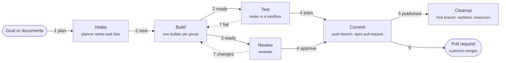
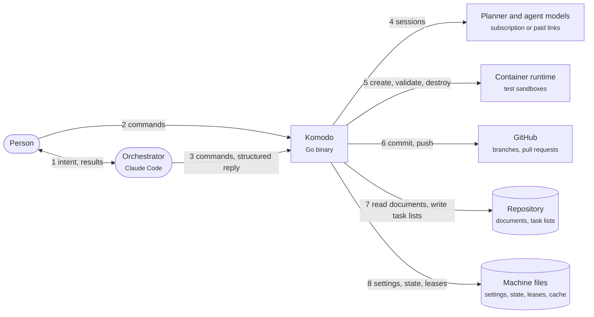
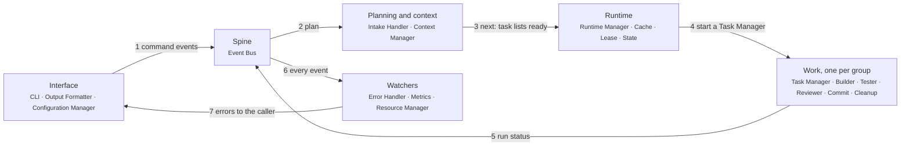
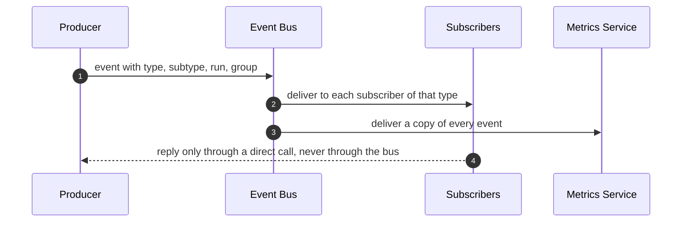
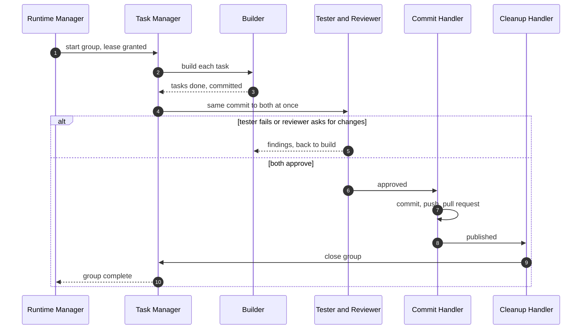

# Komodo — High-Level Design

## 0. Front Matter

This document is the high-level design of Komodo, a single Go program that runs model agents to plan, build, test, review and publish code. The [Low-Level Design](lld.md) holds the types, algorithms, limits and configuration keys. The domain architect owns this document. Its structure follows the owner's component diagram of 2026-10-14, which replaced the earlier 13-subsystem design; the earlier design stays readable at git tag `design/beta6-v1`. An open decision is written as a TODO that names its [gap register](lld.md#appendix-b-gap-register) row, such as G-201.

## 1. Introduction and Goals

#### 1.1 Purpose

Komodo is one Go binary that turns a goal into reviewed, published code. It plans the work into task groups, runs each group through a fixed pipeline of agents inside a private copy of the repository, and publishes only work that both a tester and a reviewer approved. A person merges the result.

**📐 How work moves from a goal to published code**

#### 1.2 Goals and Non-Goals

Goals:
- One Go binary that uses only the standard library, with every part reachable through one command line.
- One event bus that every part publishes to and listens on, using one event shape with a type and a subtype.
- One task manager per task group, which guards its agents and runs the pipeline from build to cleanup.
- A tester and a reviewer that judge the builder's work side by side, with tests run in a sandbox.
- One owner per kind of data: settings, context, cache, leases and runtime state each have exactly one manager.

Non-goals: per-repository agent definitions, third-party Go dependencies, a hosted service, and agents that push to git themselves.

#### 1.3 Quality Goals

| Priority | Goal | Scenario |
|---|---|---|
| 1 | Safety | An agent never writes outside its worktree, pushes to git, reads a secret or spends money without permission |
| 2 | Simplicity | Each component has one job, and each kind of data has one owner |
| 3 | Durability | A crash loses no committed work; how much in-flight work survives is [TODO: what survives a crash of the runtime ([G-202](lld.md#g-202))] |
| 4 | Cost control | Subscription links come first, every loop has a bound, and the Resource Manager watches spending |
| 5 | Observability | Every event is recorded, so any run can be measured and explained |

## 2. Constraints

A constraint is a locked rule that the design cannot trade away. The owner set every constraint.

| Constraint | Consequence |
|---|---|
| Go, standard library only; whether storage keeps this rule is [TODO: files or a database ([G-212](lld.md#g-212))] | Nothing external to download at run time |
| Only the Configuration Manager reads and writes settings and the agent registry | Settings stay out of agent reach |
| Every event uses one schema with a type and a subtype | Any part can listen to any event without a private format |
| Runtime state passes only through the State Manager | One schema, checked before disk |

## 3. Context and Scope

Two callers drive Komodo: a person at a shell, and the orchestrator, a model chat session inside Claude Code that turns the person's intent into commands. Komodo reaches model providers, a container runtime for test sandboxes, and GitHub.

**📐 Who uses Komodo, and what Komodo reaches**

| Neighbour | Direction | Description |
|---|---|---|
| Person | In | Installs, configures and updates Komodo; may run every command |
| Orchestrator | In | Runs plan, run, stop and status commands for the person and reads structured replies |
| Model providers | Out | Planner and agent sessions over subscription links first, paid programming interfaces when allowed |
| Container runtime | Out | Hosts one test sandbox per task group, created and destroyed by its task manager |
| GitHub | Out | Receives pushed branches and pull requests from the Commit Handler |

## 4. Solution Strategy

Each quality goal has a mechanism that code enforces. No model is trusted to behave.

| Goal | Strategy |
|---|---|
| Safety | The Task Manager checks every agent action against its permissions, and the Tester validates inside a sandbox |
| Simplicity | 19 subsystems with one job each, joined by one event bus instead of point-to-point messages |
| Durability | Leases name exactly one owner per branch and worktree; whether finished tasks are saved before approval is [TODO: saving work and git writes ([G-220](lld.md#g-220))] |
| Cost control | The Resource Manager watches plan windows and spending, and the Cache Manager reuses context instead of re-sending it |
| Observability | The Metrics Service records a copy of every event on the bus |

Design principles: **one owner per data kind**, **announce on the bus, call for answers**, and **fail closed**.

## 5. Building Blocks

The harness has 19 subsystems in 5 layers, plus two adapters that the Task Manager uses: the model client and the test sandbox. Subsection 5.1 shows the layers and their hand-offs; 5.2 to 5.20 describe one subsystem each, and the [Low-Level Design](lld.md) holds one chapter per subsystem in the same order.

#### 5.1 Layers

The **Interface** layer is where commands enter and settings change; the **Watchers** span every layer.

**📐 How the 5 layers hand work to each other**

1. The CLI turns a command into an event on the Event Bus; which command publishes which type is [TODO: event wiring ([G-217](lld.md#g-217))].
2. A plan command reaches the Intake Handler, which plans with context from the Context Manager.
3. The Intake Handler publishes next when task lists are ready; which part consumes next is [TODO: event wiring ([G-217](lld.md#g-217))].
4. The Runtime Manager starts one Task Manager per task group, with its lease, state and cache.
5. Each group's progress goes back onto the bus as run-status events.
6. The watchers receive every event: errors, metrics and resource use.
7. The Error Handler prints errors to the caller through the CLI.

Besides these hand-offs, a subsystem calls another directly when it needs an answer, such as asking the Configuration Manager for a setting. Every subsystem also publishes events to the Event Bus and listens for the types it needs; [5.5](#55-event-bus) lists them.

#### 5.2 CLI

The CLI is the front door: every command a person or the orchestrator types enters here. It parses and validates the command, starts the work through the Event Bus or a direct call, and returns one structured reply. It owns the command list: install, init, config get and set, plan, run, stop, replay, build, test, review, update and clean, with the flags help, list and all. Which earlier commands also survive, such as status, the `ui` dashboard and abandon, is [TODO: the final command list beside the diagram's 12 ([G-204](lld.md#g-204))]. What replay, build, test and review do is [TODO: their meaning and what their id names ([G-203](lld.md#g-203))]. A full-screen terminal mode is [TODO: whether the CLI gains one ([G-209](lld.md#g-209))]. Detail: [chapter 1](lld.md#1-cli).

#### 5.3 Output Formatter

The Output Formatter turns the harness's structured messages into text a person reads, mechanically and with no model. The CLI hands it every reply and error. It owns the templates for each reply shape, so the same facts always print the same words. Detail: [chapter 2](lld.md#2-output-formatter).

#### 5.4 Configuration Manager

The Configuration Manager guards the harness settings and the agent registry, the list of agent roles with their models and permissions. It is the only subsystem allowed to read or change them; the CLI and the Runtime Manager ask it for values. It validates every change before writing. Detail: [chapter 3](lld.md#3-configuration-manager).

#### 5.5 Event Bus

The Event Bus is the spine: every subsystem publishes facts to it, and every subsystem subscribes to the types it needs, so parts never need to know who listens. Every event has the same shape: a type, a subtype, the run and group it belongs to, a time and a small body. The main types are next and plan (intake), skill and mcp (context), run-start, run-stop and run-continue (commands), run-status, run-complete and run-failure (runtime), resource, and error. Where the bus lives is [TODO: how long the Runtime Manager runs and how a second command reaches it ([G-201](lld.md#g-201))], and whether events reach disk before broadcast is [TODO: which store recovery trusts ([G-202](lld.md#g-202))]. Detail: [chapter 4](lld.md#4-event-bus).

#### 5.6 Intake Handler

The Intake Handler is the Intake stage. It starts the planner agent, gives it context from the Context Manager, and turns existing documents such as an HLD or a product requirements document into task lists of task groups and tasks. When a plan passes its checks, the handler publishes the first next event, which moves the internal pointer to the next stage. Detail: [chapter 5](lld.md#5-intake-handler).

#### 5.7 Context Manager

The Context Manager guards everything an agent may see beyond the code: skills (documents of standards), agent prompt templates, and connections to Model Context Protocol servers, the tool servers some agents may use. It switches each item on or off, decides which agents may use it, and assembles an agent's prompt from them. The Intake Handler and Runtime Manager ask it for context, and it reads its skill, template and connection files. Detail: [chapter 6](lld.md#6-context-manager).

#### 5.8 Runtime Manager

The Runtime Manager is the backbone. It runs every task group of a run in parallel or in order, as their dependencies allow, and starts one Task Manager per group. It owns the run as a whole: each group's state, lease and cache through their managers, escalations, timer extensions, retries, timeouts and blocks. Task Managers bring every need to it, and it produces most of the events on the bus. It reads settings directly from the Configuration Manager. Detail: [chapter 7](lld.md#7-runtime-manager).

#### 5.9 Cache Manager

The Cache Manager keeps a local cache of things like frequent prompt responses, context and other information needed to improve performance and token efficiency. The Runtime Manager uses it for each task group. The rules for reusing a stored prompt response are [TODO: reuse rules ([G-208](lld.md#g-208))], and whether other parts call it directly is [TODO: cache callers ([G-221](lld.md#g-221))]. Detail: [chapter 8](lld.md#8-cache-manager).

#### 5.10 Lease Manager

The Lease Manager manages the local lease registry, the single source of truth for which task group and agent owns which branch and worktree, the private checkout where a group works. It controls access to them and manages lease revocation and timeouts. Who creates a group's branch and worktree is [TODO: saving work and git writes ([G-220](lld.md#g-220))]. Detail: [chapter 9](lld.md#9-lease-manager).

#### 5.11 State Manager

The State Manager is the one place a task group's runtime state is read and written: its stage, counters, blocks and progress. Task Managers update it often through the Runtime Manager, and it checks every record against one schema before saving. Detail: [chapter 10](lld.md#10-state-manager).

#### 5.12 Task Manager

The Task Manager is the controller for one task group; the Runtime Manager starts one per group. It runs the pipeline from build to cleanup, talks to the Runtime Manager in both directions, and acts as the guard for its agents: every action an agent requests is checked against that agent's permissions before it runs. It owns the group's outbound model connections through the model client, which reaches subscription and paid links, and creates and destroys the group's test sandbox. Where builder and tester commands run is [TODO: the sandbox split and whether Docker is required ([G-205](lld.md#g-205))]. Detail: [chapter 11](lld.md#11-task-manager).

#### 5.13 Builder

The Builder is the engineering agent that writes the code for one task group, task by task, inside the group's worktree. It works only through the actions its Task Manager allows; whether each finished task is saved before approval, and by whom, is [TODO: saving work and git writes ([G-220](lld.md#g-220))]. It hands finished work to the Tester and Reviewer together and fixes what they return. Detail: [chapter 12](lld.md#12-builder).

#### 5.14 Tester

The Tester checks the builder's new and changed code: test accuracy, that every task-list item is met, and regressions. It validates inside the group's sandbox, which its Task Manager creates. Whether free mechanical checks run first is [TODO: where the zero-cost checks run ([G-206](lld.md#g-206))]. Detail: [chapter 13](lld.md#13-tester).

#### 5.15 Reviewer

The Reviewer is the final code check. It reads the builder's change while the Tester runs, and the group moves to publishing only when both approve; otherwise the work returns to the Builder with their findings. Detail: [chapter 14](lld.md#14-reviewer).

#### 5.16 Commit Handler

The Commit Handler publishes approved work: it commits, pushes the group's branch and opens or updates its pull request. It is the only part that pushes. Whether each group gets its own pull request or lands on a shared epic branch is [TODO: where groups land ([G-210](lld.md#g-210))]. Detail: [chapter 15](lld.md#15-commit-handler).

#### 5.17 Cleanup Handler

The Cleanup Handler runs after work is pushed. It removes the group's redundant branches and worktree, frees the group's internal resources, and tells the Task Manager to close the group, which ends it inside the Runtime Manager. Detail: [chapter 16](lld.md#16-cleanup-handler).

#### 5.18 Error Handler

The Error Handler is the global safety net: it catches every error and panic before it can crash the harness, records it, and sends it back to the original caller through the CLI. It listens for error events and receives resource errors from the Resource Manager. Detail: [chapter 17](lld.md#17-error-handler).

#### 5.19 Metrics Service

The Metrics Service records a copy of every event on the bus and turns them into run metrics: time per stage, per group and per run, tokens and cost, and general performance. Its records also help explain failures. Detail: [chapter 18](lld.md#18-metrics-service).

#### 5.20 Resource Manager

The Resource Manager watches agent resources for overages, such as a subscription plan's usage window or paid token costs, so work is not lost to a limit. It raises warnings and errors through the Error Handler. Whether it may also pause work is [TODO: what happens at a plan or cost limit ([G-211](lld.md#g-211))]. Detail: [chapter 19](lld.md#19-resource-manager).

## 6. Runtime

Four flows show the parts at work.

#### 6.1 One Event, Many Listeners

A fact is announced once and reaches every subscriber, so adding a listener changes no producer.

**📐 How one event travels**

1. A producer, such as the Runtime Manager, publishes an event with its type and subtype.
2. The bus delivers it to every subscriber of that type, in the order it was published.
3. The Metrics Service receives a copy of every event.
4. A part that needs an answer calls the owner directly instead of waiting for an event.

#### 6.2 Task Group Lifecycle

**📐 How one task group passes through the pipeline**

1. The Runtime Manager starts a Task Manager once the group's dependencies are met and its lease is granted.
2. The Builder works through the tasks in the group's worktree.
3. The Tester and Reviewer judge the same commit at the same time; any failure returns the group to the Builder, a bounded number of times.
4. With both approvals, the Commit Handler commits and pushes, then hands over to the Cleanup Handler. It removes redundant branches and the worktree, frees resources and calls the Task Manager to close the group, which destroys the sandbox.

#### 6.3 Planning

1. `komodo plan` starts the Intake Handler with goal text or documents.
2. The Intake Handler gets context from the Context Manager and starts the planner agent.
3. The planner drafts task groups, tasks, file patterns, dependencies and acceptance items.
4. Go code checks the draft; a failure goes back to the same planner session a bounded number of times.
5. A passing plan is written as task lists, and the next event moves the internal pointer to the next stage.

#### 6.4 Errors, Limits and Blocks

1. Any part that fails publishes an error event; the Error Handler records it and prints it to the caller through the CLI.
2. The Resource Manager raises a resource event before a plan window or spending limit is reached.
3. The Runtime Manager owns retries, timeouts and blocks for every group. A group that cannot continue without a person is blocked and announced with a run-status event; a person or the orchestrator continues it with `komodo run`.
4. How a crash of the runtime itself is recovered is [TODO: what survives a crash ([G-202](lld.md#g-202))].

## 7. Deployment

Komodo is one dependency-free file shared by every repository on a machine.

#### 7.1 Processes

How long the runtime lives and how commands reach a live run is [TODO: one runtime per run, one per machine, or none ([G-201](lld.md#g-201))]. Every other command is a short process.

#### 7.2 Platforms and Sandboxes

Komodo runs on macOS, Linux and Windows Subsystem for Linux 2. Test sandboxes use a container runtime such as Docker; the fallback on a machine without one is [TODO: the sandbox split ([G-205](lld.md#g-205))].

#### 7.3 Install and Update

`komodo install` puts the binary on the machine and the Komodo block into a repository; `komodo init` sets up the orchestrator's skills in Claude Code. `komodo update` downloads, verifies and swaps in a new signed binary, and a running process keeps the version it started with.

## 8. Crosscutting Concepts

#### 8.1 Data Ownership

Each kind of data has one owner, and every other part asks that owner.

| Data | Owner |
|---|---|
| Harness settings and agent registry | Configuration Manager |
| Skills, prompt templates, tool-server connections | Context Manager |
| Runtime cache | Cache Manager |
| Lease registry: who owns each branch and worktree | Lease Manager |
| Removing redundant branches and worktrees | Cleanup Handler |
| Task group runtime state | State Manager |
| Events | Event Bus in flight; Metrics Service for the record |

#### 8.2 Models and Cost

Each agent role in the registry names its model and its chain of links, subscription first. The Task Manager opens every model connection through the model client, and the Resource Manager watches each link's usage. Dollars are measured by the Metrics Service.

#### 8.3 Security

Three fences hold every agent. The Task Manager checks every requested action against the agent's permissions and refuses by default. Commands run in a sandbox with no network except what the task needs. The lease keeps each group inside its own branch and worktree. Only the Commit Handler pushes, never to the main branch and never with force.

#### 8.4 Quality Gates

Work reaches publishing only when the Tester passes it and the Reviewer approves it. The free mechanical checks of the earlier design are [TODO: kept, and where ([G-206](lld.md#g-206))].

## 9. Architecture Decisions

Each row names a decision, the alternative rejected and the reason. The first group is the owner's redesign of 2026-10-14.

| Decision | Chosen over | Because |
|---|---|---|
| 19 subsystems with one job each | 13 subsystems that each held several jobs | Each part can be read, built and tested alone; the review found the old parts too heavy |
| One event bus with a type and subtype per event | Point-to-point messages and per-group event files | Any part can listen without the producer knowing, and one schema serves every listener |
| One Task Manager per task group | One engine loop owning every group's details | A group's guard, agents and sandbox live in one place, and a failure stays in its group |
| Tester and Reviewer side by side | Mechanical check, then reviewer and tester | One step judges the work twice at once, which shortens each group |
| A separate Commit Handler and Cleanup Handler | Ship doing landing and cleanup together | Publishing and freeing resources fail and retry independently |
| Error Handler, Metrics Service and Resource Manager as watchers | Error handling and metrics spread through every part | One place catches errors, one records, one watches limits |
| Only the Configuration Manager touches settings | Each part reading settings files | Settings stay consistent and out of agent reach |
| A lease registry as the single source of truth for branch and worktree ownership | Locks spread across files | One answer to "who owns this branch" |
| The earlier design's open questions | Defaults chosen without the owner | 18 owner decisions are pending: G-201 to G-214, G-216, G-217, G-220 and G-221 |

## 10. Quality Requirements

| Attribute | Scenario | Measure |
|---|---|---|
| Performance | Help or a configuration read | Target under 50 milliseconds |
| Safety | An agent command writes outside its worktree or reaches a public address | The sandbox refuses it |
| Safety | An agent asks for an action outside its permissions | The Task Manager refuses it and records an error event |
| Observability | Any finished run | Its time per stage, tokens and cost are reported from recorded events |
| Durability | The runtime is killed mid-run | No committed work is lost; the rest is [TODO: ([G-202](lld.md#g-202))] |

## 11. Risks, Debt and Roadmap

#### 11.1 Risks

- About 3,900 lines of Go exist today: the network client, cache store, file helpers and the dashboard proof of concept.
- A pub/sub bus inside one process is simple only while one process hosts the run; [G-201](lld.md#g-201) decides that.

#### 11.2 Technical Debt

The OpenAI path is scoped but not built (G-20).

#### 11.3 Delivery Roadmap

| Phase | Scope | Exit proof |
|---|---|---|
| 1 | Design: this document and the low-level design, with every open decision answered | The owner approves the design |
| 2 | Spine and interface: Event Bus, CLI, Output Formatter, Configuration Manager, Error Handler, Metrics Service | `komodo config get` and an event round trip pass their tests |
| 3 | Runtime stores: State Manager, Lease Manager, Cache Manager | A lease, a state record and a cache entry survive a restart |
| 4 | Context and models: Context Manager, model client, agent registry | One agent session runs end to end |
| 5 | Pipeline: Runtime Manager, Task Manager, Builder, Tester, Reviewer, sandbox | One task group passes build, test and review |
| 6 | Publishing: Commit Handler, Cleanup Handler, Resource Manager, Intake Handler | A planned group is published and cleaned up |
| 7 | Install, update, dashboard and cutover | A clean machine installs and runs one plan |

#### 11.4 Open Decisions

Each is a [gap register](lld.md#appendix-b-gap-register) row and a tab on the owner's decision page:

- Runtime lifetime and how commands reach it: [G-201](lld.md#g-201).
- What survives a crash, and who keeps the event record: [G-202](lld.md#g-202).
- Meaning of replay, build, test and review: [G-203](lld.md#g-203).
- Commands kept beside the diagram's 12: [G-204](lld.md#g-204).
- Where builder and tester commands run: [G-205](lld.md#g-205).
- Free mechanical checks: [G-206](lld.md#g-206).
- Scheduled jobs and the 3 extra agent roles: [G-207](lld.md#g-207).
- What the cache may reuse: [G-208](lld.md#g-208).
- A full-screen terminal mode: [G-209](lld.md#g-209).
- Where groups land: [G-210](lld.md#g-210).
- What happens at a plan or cost limit: [G-211](lld.md#g-211).
- Files or an embedded database for the cache and lease registry: [G-212](lld.md#g-212).
- Model links in beta 6: [G-213](lld.md#g-213).
- Outside tool servers for agents: [G-214](lld.md#g-214).
- Owner of machine-wide records such as provider reset times: [G-216](lld.md#g-216).
- Event wiring the diagram leaves unlabelled: [G-217](lld.md#g-217).
- Saving work and git writes before publishing: [G-220](lld.md#g-220).
- Which parts call the Cache Manager: [G-221](lld.md#g-221).

## 12. Glossary

| Term | Meaning |
|---|---|
| Harness | The whole Komodo program: the `komodo` binary and everything it runs |
| Command | One `komodo` entry point, such as plan, run or stop |
| Orchestrator | A model chat session in Claude Code that drives Komodo by commands and never edits code |
| Agent | A model role with its own permissions: planner, builder, tester or reviewer |
| Agent registry | The list of agent roles with their models, links and permissions |
| Session | One model conversation for one agent's job |
| Epic, task group, task | An epic holds task groups; a group holds a bounded set of tasks that ship together |
| Run | One execution of a plan's task groups, started by `komodo run` |
| Event | A fact with a type and a subtype, published on the Event Bus |
| Subscriber | A part that listens for one or more event types |
| Lease | The registry entry that names the one group owning a branch and worktree |
| Worktree | A private git checkout where one group works |
| Sandbox | A sealed environment where agent commands run |
| Skill | A document of standards placed in an agent's context |
| Gap | A decision not yet made or a fact not yet verified, tracked as G-NN |

---

*End of the read. The appendices below are lookup tables.*

---

## Appendix A. Traceability

| Subsystem | Go package | Build phase |
|---|---|---|
| CLI | `internal/cli` | 2 |
| Output Formatter | `internal/format` | 2 |
| Configuration Manager | `internal/config` | 2 |
| Event Bus | `internal/bus` | 2 |
| Intake Handler | `internal/intake` | 6 |
| Context Manager | `internal/contextmgr` | 4 |
| Runtime Manager | `internal/engine` | 5 |
| Cache Manager | `internal/cache` | 3 |
| Lease Manager | `internal/lease` | 3 |
| State Manager | `internal/state` | 3 |
| Task Manager, model client, sandbox | `internal/task`, `internal/llm`, `internal/sandbox` | 4, 5 |
| Builder, Tester, Reviewer, Planner | `internal/agent` | 4, 5 |
| Commit Handler | `internal/commit` | 6 |
| Cleanup Handler | `internal/cleanup` | 6 |
| Error Handler | `internal/fault` | 2 |
| Metrics Service | `internal/metrics` | 2 |
| Resource Manager | `internal/resource` | 6 |

## Appendix B. References

| Reference | Use in this document |
|---|---|
| arc42 template, https://arc42.org/overview | Section structure |
| Design Docs at Google, https://www.industrialempathy.com/posts/design-docs-at-google/ | Goals and non-goals, decisions with rejected alternatives |
| Enterprise Integration Patterns, publish-subscribe channel, https://www.enterpriseintegrationpatterns.com/patterns/messaging/PublishSubscribeChannel.html | The Event Bus |
| Distributed leases with fencing tokens, https://hackernoon.com/building-distributed-leases-with-consensus-heartbeats-and-fencing-tokens | Lease with a rising fence number |
| OpenHands, https://arxiv.org/pdf/2407.16741 | Event stream as the agent's spine |
| Anthropic prompt caching, https://platform.claude.com/docs/en/build-with-claude/prompt-caching | Cache breakpoints and pricing |
| Anthropic rate limits, https://platform.claude.com/docs/en/api/rate-limits | Plan windows and limit classes |
| Docker Engine security, https://docs.docker.com/engine/security/ | Test sandbox isolation |
