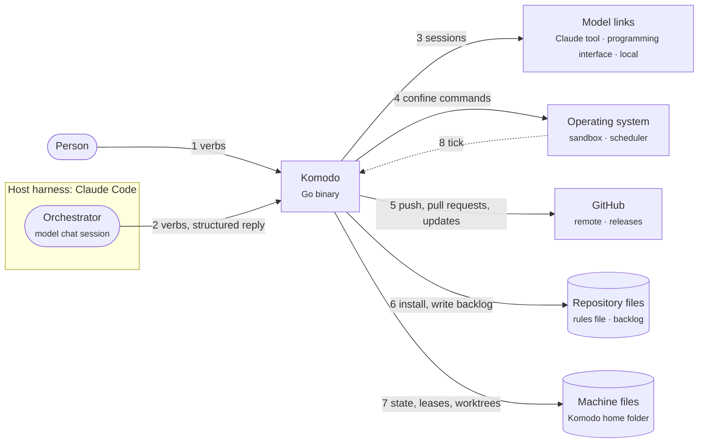
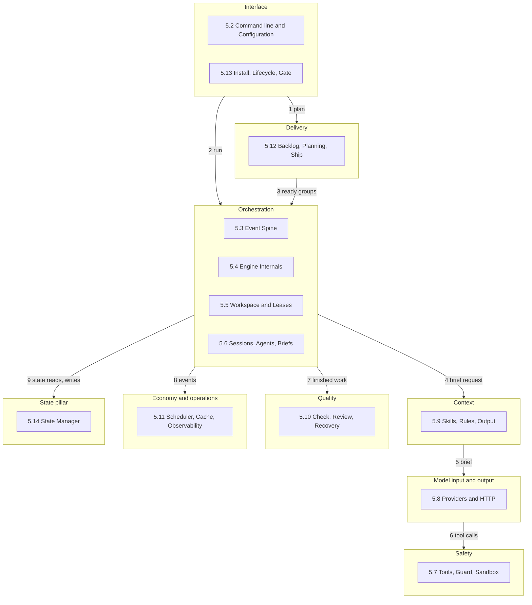
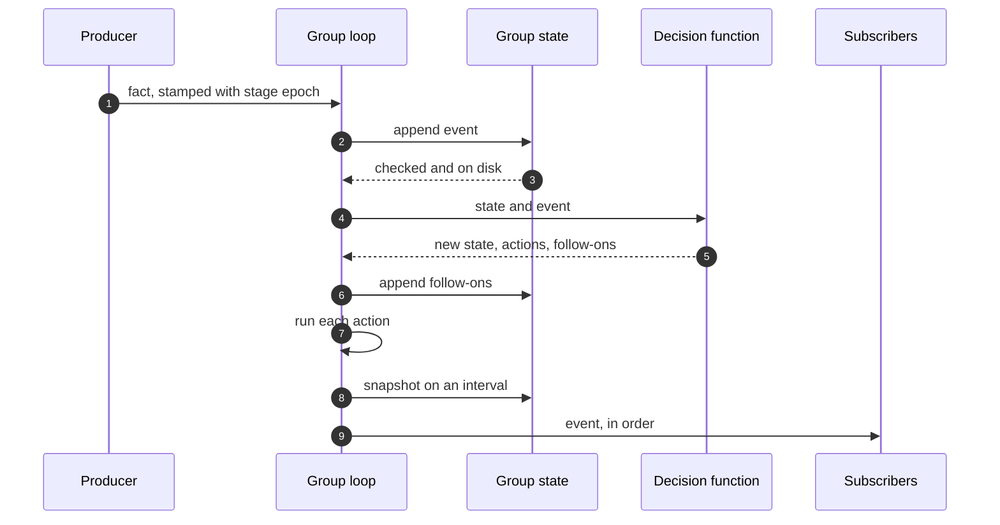
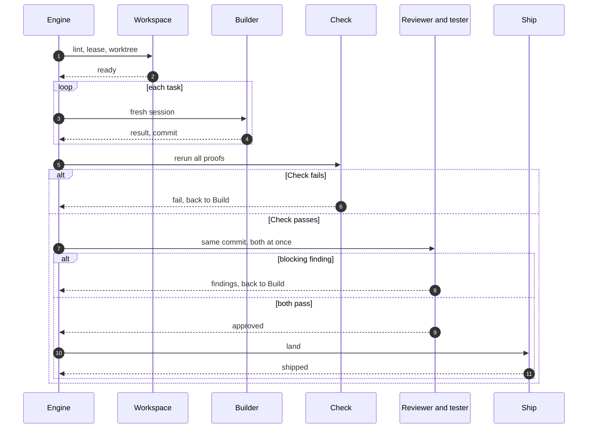

# Komodo — High-Level Design

## 0. Front Matter

This document is the high-level design of Komodo, a single Go program that starts model sessions as workers to plan, build, check, review and ship code. The [Low-Level Design](lld.md) holds the types, algorithms, limits and configuration keys. The domain architect owns this document, which is a draft awaiting sign-off. Every open item is a TODO placeholder that names its gap register rows, such as G-NN.

## 1. Introduction and Goals

#### 1.1 Purpose

Komodo is one Go binary that turns a goal into reviewed, merged code. The binary plans the work as a backlog, builds each task group in one fresh builder session that commits after each task, proves the result with mechanical checks and independent review, and lands the result on an epic branch. A person merges only the final epic pull request.

**📐 How work moves from backlog to merged code**

#### 1.2 Goals and Non-Goals

Goals:
- One Go binary that uses only the standard library and runs no server process.
- Stateless workers: one fresh model session per group for the builder, the reviewer and the tester, each with private tools inside a worktree, a guard and an operating-system sandbox.
- One verb set for a person and for the orchestrator, a model chat session that receives one structured reply per verb.
- Three model links (the Claude command-line tool, the Anthropic programming interface, OpenAI-compatible endpoints) on four platforms (macOS, Linux, Windows Subsystem for Linux 2, native Windows).

Non-goals: a cost cap owned by Komodo, per-run or per-repository configuration, repository-defined agents or hooks, third-party Go dependencies, and a long-running service.

#### 1.3 Quality Goals

| Priority | Goal | Scenario |
|---|---|---|
| 1 | Safety | A worker never writes outside its worktree, reads a secret, pushes to git, or spends money without permission |
| 2 | Durability | A crash loses at most one model turn and no committed edit |
| 3 | Determinism | The same facts render the same bytes |
| 4 | Cost control | The subscription link comes first, and every loop has a bound |
| 5 | Portability | One binary behaves the same on four platforms |

## 2. Constraints

A constraint is a locked rule that the design cannot trade away. The owner set every constraint, and holds the release signing key.

| Constraint | Consequence |
|---|---|
| Go, standard library only | Nothing external to download or audit |
| No server process | Every verb is a short process; a periodic tick replaces a daemon |
| One sandbox per operating system: Seatbelt, Bubblewrap, Docker | Docker is used on native Windows only |
| Only the config verb writes configuration | Settings stay out of agent reach |
| Runtime state passes only through the state manager | One schema, checked before disk |

## 3. Context and Scope

Two callers start work: a person at a shell, and the orchestrator, a model chat session inside a host harness such as Claude Code. Komodo runs no daemon, so the operating-system scheduler only fires a periodic tick.

**📐 Who uses Komodo, and what Komodo reaches**

| Neighbour | Direction | Description |
|---|---|---|
| Person at a shell | In | Installs, configures, updates and releases; may run every shared verb |
| Orchestrator | In | Turns the person's intent into plan and run verbs, waits, answers scope requests and never edits code |
| Model links | Out | Claude command-line tool on the subscription login, Anthropic programming interface when a paid link is allowed, OpenAI-compatible endpoints |
| Git remote and GitHub | Out | Receive group and epic branches and pull requests; GitHub Releases serves signed binaries |
| Operating-system sandbox | Out | Confines every command that a worker runs |

## 4. Solution Strategy

Each quality goal has a mechanism, and the engine implements every mechanism. No model is trusted to behave.

| Goal | Strategy |
|---|---|
| Safety | No shell, a fail-closed guard on every tool call, a sandbox around every command, and no git write tool for any worker |
| Durability | Events written before they apply, one pure decision function, and epochs that fence late events |
| Determinism | Typed result schemas, Go templates that render codes and facts, and events emitted only by the engine |
| Cost control | A fixed chain of links per agent, a mechanical billing check and a cached prompt prefix |
| Portability | One binary cross-built at every gate, with one sandbox backend per operating system |

Design principles: **mostly mechanical** (code prevents what code can), **never pay by accident** and **fail closed**.

## 5. Building Blocks

The harness, the `komodo` binary, has 13 subsystems that each have one job. Subsection 5.1 shows the layering, and 5.2 to 5.14 describe one subsystem each. The [Low-Level Design](lld.md) holds one chapter per subsystem. "Engine" means the orchestration engine of 5.4; the Go package `engine` is wider ([Appendix A](#appendix-a-traceability)).

**📐 Where the 13 subsystems sit, by layer**

#### 5.1 Layers and Import Order

The harness has nine groups: eight layers that each hold parts sharing one concern, and the state manager as a pillar under all of them. One import rule orders the 12 source folders, from top to bottom: cli, engine, quality, host, repo, provider, tools, ops, agent, safety, state, core. A folder imports only folders below it.

#### 5.2 CLI and Configuration

The command line is the only way to drive Komodo. Every verb parses, validates, resolves, dispatches and renders, then returns one structured reply and one of five exit codes. The subsystem owns the verb table and the settings (defaults, machine file, hard limits), and calls every other subsystem. Detail: [LLD chapter 1](lld.md#1-cli-and-configuration).

#### 5.3 Event Spine and State Machine

The event spine records every change to a task group as a typed event, and one pure decision function decides what each event means. Events reach disk before they apply, and epochs make late results harmless. The subsystem owns the event catalog and the five-stage rulebook; the state manager (5.14) stores the events. Detail: [LLD chapter 2](lld.md#2-event-spine-and-state-machine).

#### 5.4 Engine Internals

The engine runs task groups: it starts sessions, moves each group through its stages and lands finished work, with one loop per group. The subsystem owns that loop, the only writer of the group's events, plus the work queue, landing order and crash containment. It calls the workspace, sessions, check and ship. Detail: [LLD chapter 3](lld.md#3-engine-internals).

#### 5.5 Workspace and Leases

A workspace is a private git checkout where one group is built, and a lease is the lock file naming the run that owns the group. The subsystem owns the worktree, the lease, the fence number that rises on every take or takeover, and the hidden reference that saves progress and is never pushed. It talks to git through Ship's git wrapper and to the state manager. Detail: [LLD chapter 4](lld.md#4-workspace-and-leases).

#### 5.6 Sessions, Agents and Briefs

A session is one fresh model conversation for one task, an agent is its role, and a brief is its prompt. The subsystem owns the supervisor (spawn, watch, nudge, stop, resume), the registry of seven agent roles and the brief builder. It talks to providers, tools, skills and the engine. [TODO: how tokens are counted for the brief size check ([G-48](lld.md#g-48))] Detail: [LLD chapter 5](lld.md#5-sessions-agents-and-briefs).

#### 5.7 Tools, Guard and Sandbox

A tool is a named action that a model may request. The subsystem owns a few typed tools with no shell and no git write tool, the in-process guard that checks every call and fails closed, and the sandbox that bounds the processes, memory, time and output of every command. It serves sessions and providers. Detail: [LLD chapter 6](lld.md#6-tools-guard-and-sandbox).

#### 5.8 Providers and HTTP

A link is one way to reach a model provider, and an adapter starts, streams and resumes a session over it. The subsystem owns one adapter interface, each agent's chain of links with failover only when a provider is unavailable, unauthorized or over a limit (an endpoint below the context floor is skipped), the billing check, and the network client. [TODO: whether the brief builder or the provider router walks the chain ([G-69](lld.md#g-69))] Detail: [LLD chapter 7](lld.md#7-providers-and-http).

#### 5.9 Skills, Rules and Output

A skill is a document of standards placed before a session, and rules instruct the orchestrator. The subsystem owns the skill index, the rules built into the binary, and the output contract: models return codes and facts, and templates write every word a person reads. It feeds the brief builder and install. Detail: [LLD chapter 8](lld.md#8-skills-rules-and-output).

#### 5.10 Check, Review, Tester and Recovery

After a builder finishes, Check proves the work with ordinary tools at zero model cost, then Verify runs a reviewer and a blind tester side by side. The subsystem owns the proofs, scope requests, budgets and the failure table, which gives every failure a detector, action, bound and final state. A group's time fits one builder's limits, and the group may ask once for 100% more. [TODO: the group's wall time and how the extension is asked for ([G-238](lld.md#g-238))] Detail: [LLD chapter 9](lld.md#9-check-review-tester-and-recovery).

#### 5.11 Scheduler, Cache and Observability

The scheduler runs agents on a timer from job templates, one file per recurring job; each tick queues due jobs, fires expired timers and advances the session pool once. The subsystem owns the cache outside every worktree, the ledger built from events, and the status views. It talks to the operating-system scheduler and the event spine. Detail: [LLD chapter 10](lld.md#10-scheduler-cache-and-observability).

#### 5.12 Backlog, Planning, Ship and Release

The backlog is the epics, task groups and tasks that a repository holds. The subsystem owns the backlog grammar and lint, the planner flow, the dependency graph, ship (lands finished groups and opens pull requests at zero model cost) and release, which a person cuts. Agents never change a task list or a backlog file; a blocker against the task list goes to the orchestrator or a person. It owns every git write: one git wrapper holds the no-force and never-main rules, and the workspace, Build, the parent guard and the engine call it to write; read-only git commands stay outside it. It talks to the engine and GitHub. Detail: [LLD chapter 11](lld.md#11-backlog-planning-ship-and-release).

#### 5.13 Install, Binary Lifecycle and Gate

Install puts the binary on a machine, probes the providers and writes the orchestrator block into the repository. The subsystem owns the installer, the doctor health check, the update lifecycle (check, download, signature check, atomic swap), the signing-key policy, and the gate, a self-check for the Komodo repository only. Detail: [LLD chapter 12](lld.md#12-install-binary-lifecycle-and-gate).

#### 5.14 State Manager

The state manager is the one piece of code that reads and writes runtime state: events, snapshots, session files, leases, queue items, timers and ledgers. The subsystem owns one schema, four write primitives (append, replace, claim, remove) and group state, and it quarantines bad records. Settings, cache, git references and binaries stay with their owners. Detail: [LLD chapter 13](lld.md#13-state-manager).

## 6. Runtime

Five flows show the parts at work.

#### 6.1 Event Spine and Group State

An event, a typed fact such as "a task finished", changes a group's state only through one pure decision function.

**📐 How one event changes a group's state**

1. A producer reports a fact stamped with its stage epoch; the group loop marks the event stale when the epoch is older than the group's current stage.
2. The loop appends the event to group state, which checks the schema and forces the line to disk.
3. The pure decision function returns a new state, actions and follow-on events, and ignores stale events.
4. The loop appends the follow-ons and runs each action, recorded as started and then done under a key that makes a repeat harmless.
5. The loop snapshots on an interval, and three subscribers (ledger, wake file, live status) read each event in order.

#### 6.2 Group Lifecycle

A group holds a small bounded set of tasks that ship together, and passes five stages that each end only on evidence the engine produced.

**📐 How one group passes through the five stages**

1. The engine takes the group's lease as it picks the group from the queue; Intake then lints the group, cuts a worktree from the epic branch tip and runs the setup command, and the first session takes a pool slot after Intake.
2. Build starts one fresh builder session for the whole group; it works through the tasks in order, and after each task Go code reruns its completion command and commits to the hidden reference.
3. Check reruns every proof, such as completion commands, scope, secrets scan, affected tests and whole-repository coverage, at zero model cost.
4. Verify runs the reviewer and the tester on the same commit; a failed Check or a verified blocking finding returns the task to its builder.
5. Ship merges the epic branch into the group, reruns Check, lands the group with the fence and checks the epic branch tip; a failed tip check returns the group to Build.

#### 6.3 Pause, Block and Resume

Paused and Blocked are holding states, not stages. Paused waits for a provider limit to reset: the group frees its pool slot, keeps its lease and worktree, and a timer record fires at the reset time; past the pause cap it becomes Blocked. Blocked waits for a person or the orchestrator, never retries by itself, and wakes the orchestrator through the status-wait verb.

#### 6.4 Planning

Planning turns a goal into a linted backlog.

1. The plan verb takes goal text or specification documents, and the backlog subsystem gives the planner a repository map, a ranked list of the code's functions and types.
2. The planner drafts groups, file patterns, dependencies, tasks and acceptance items.
3. Go code lints the draft; failures return to the same planner session a bounded number of times, then the plan blocks.
4. A passing draft is written, one folder per group, and groups with overlapping patterns must be ordered.

#### 6.5 Crash Recovery

A crash loses at most one model turn and no committed edit, and stays inside the crashed group.

1. If the engine dies or stops its heartbeat, the parent guard kills the sessions, commits unsaved files as work in progress and frees the leases.
2. If the parent guard also died, the startup sweep at the next engine start kills orphans, frees dead leases and requeues unleased items.
3. The next engine loads each group's snapshot, replays later events (an event line cut short is dropped) and replays actions recorded as started but not done under their keys, so none happens twice.

## 7. Deployment

Komodo is one dependency-free file shared by every repository on a machine.

#### 7.1 Platforms and Sandboxes

The sandbox is Seatbelt on macOS, Bubblewrap on Linux and Windows Subsystem for Linux 2 (preferred on Windows), and Docker on native Windows.

#### 7.2 One Machine, Many Repositories

One engine runs per active run. Engines of different repositories meet only through files in the Komodo home folder (binaries, configuration, session pool, work queue, leases, worktrees); each repository keeps group state and cache in its git common directory.

#### 7.3 Install and Update

Install puts the binary on the machine and the Komodo block into a repository by following a manifest, so a rerun changes nothing and hand edits survive. Updates download in the background into versioned binary folders, so a running engine keeps its own version.

#### 7.4 Release

Only a person releases, on the owner's machine: the release verb tags the commit, cross-builds for Windows, Linux and macOS, signs the manifest with a local key (one backup copy, plus a second public key for rotation) and renders the changelog.

## 8. Crosscutting Concepts

A crosscutting concept is a rule that spans many components.

#### 8.1 Data and Configuration

Committed files live in the repository: the rules file with the Komodo block and the backlog folder. Machine files never ship: configuration, leases, worktrees and language caches under the Komodo home folder, and each repository's group state, ledgers and cache in its git common directory. Only the config verb writes the configuration file, and a hand edit makes every verb refuse until the owner accepts it.

#### 8.2 Models and Cost

Each agent has a weight (heavy: planner, architect, reviewer; standard: builder, researcher; light: tester, scout) and a fixed chain of links, with the subscription link first. A mechanical billing check that fails closed sets the cost class (subscription, free or paid) before every session. Komodo adds no cost cap; dollars are a warning-only metric.

#### 8.3 Security

Three fences hold every worker. The guard checks every tool call before it runs, names the allowed alternative in a refusal, and ends a session after repeated refusals. The sandbox confines every command, with the network off except loopback. The worktree and lease keep a session inside its own group. No agent holds forge credentials, a git write tool or a shell.

#### 8.4 Quality Gates

Four gates stand between build and landing: an 80% coverage floor over the whole repository in every language, a rerun of every completion command, tests of every affected package against a baseline, and judgement by the blind tester. The first three spend no model tokens. Separately, a reviewer finding blocks only when Go code finds its quoted line.

#### 8.5 Operations

The tick is one repeatable engine step, so no daemon runs. Every failure has a detector, an action, a bound and a final state. Status shows the pool, stages, budgets and blocks.

## 9. Architecture Decisions

Each row names a decision, the alternative rejected, and the reason. The first three rows are owner decisions of 2026-10-09.

| Decision | Chosen over | Because |
|---|---|---|
| Local signing key, one backup, a second public key | A cloud key service | One machine needs nothing bigger; a machine the owner does not own triggers it (G-21) |
| The install probe's model registry | A central model gateway | Needed at 3 or more machines, or 2 people sharing one cap (G-22) |
| The orchestrator answers scope requests | A named human per path | Needed at the first repository with 2 teams or customer data (G-23) |
| Events reach disk before they apply | Applying first | A group's place survives any crash |
| Only the engine emits events | Sessions reporting progress | A stage moves only on evidence the engine produced |
| Epochs stamped on events | Applying every event | A cancelled session's late result could move a stage twice |
| One loop per group owns its state | Shared state with locks | No locks to get wrong, and a crash stays in one group |
| A lease together with a fence number | A lease alone | A stalled holder could overwrite its successor; every save checks the fence in the same git transaction, and every push re-reads the fence file first |
| One machine-wide session pool | Per-repository lanes | Provider quotas and link limits are machine-wide |
| The state manager runs inside each process | A separate server | The harness runs no server; atomic file writes keep processes consistent |
| A counter and an end state on every loop | Unlimited retry with growing backoff | Unbounded retries burn tokens until someone notices |
| Claude launched in print mode, its non-interactive run, with pinned flags | Bare mode | Bare mode never reads the subscription login |

## 10. Quality Requirements

A quality requirement is a scenario with a number that a test can pass or fail.

| Attribute | Scenario | Measure |
|---|---|---|
| Performance | Help, version or a configuration read | Target under 50 milliseconds |
| Durability | The engine is killed mid-run, then resumed | No paid session repeats; at most one model turn is lost |
| Safety | A command writes outside the worktree or reaches a public address | The sandbox refuses it on every platform |
| Cost | 20 sessions on the Anthropic programming interface | At least 50% of prompt tokens come from the provider cache [TODO: the fixture that proves it needs real paid sessions ([G-17](lld.md#g-17))] |

## 11. Risks, Debt and Roadmap

A risk is an assumption the design has not proved; a builder closes each risk with a spike, a small experiment that answers one question.

#### 11.1 Risks

- The probe may not read a Claude session's first stream line without a model turn; a tool version lacking the field fails the link (G-02).
- The subscription window may drain faster than the per-link session limit assumes; the pool halves on a rate-limit error (G-07).

#### 11.2 Technical Debt

The OpenAI path is scoped but not built (G-20), and enterprise custody, registry and scope ownership are single-machine designs (G-21, G-22, G-23).

#### 11.3 Delivery Roadmap

The owner builds phases 2 to 6 by hand in plain Claude Code sessions; from phase 7 the harness builds its own groups.

| Phase | Scope |
|---|---|
| 1 | Design documents and the first epic |
| 2 | Foundations: command line, state manager, configuration, sandbox, cache, backlog lint, gate core |
| 3 | Model surface: agents, skills, rules, guardrails |
| 4 | Model input and output: providers, tools, briefs |
| 5 | Runtime: workspace, supervisor, observability, events |
| 6 | Engine: engine, recovery, Check, ship |
| 7 | Quality and scale: review, tester, scheduler, planner |
| 8 | Edges: installer, updates, release, the docs-drift check |
| 9 | User documents and cutover |

#### Open decisions

These 2 open items shape the architecture most; the Low-Level Design gap register holds the rest.

- [TODO: the shape of an agent's provider chain ([G-69](lld.md#g-69))]
- [TODO: how tool server events reach the engine ([G-42](lld.md#g-42))]

## 12. Glossary

| Term | Meaning |
|---|---|
| Harness | The whole Komodo program: the `komodo` binary and everything it runs |
| Verb | One `komodo` command, such as plan, run or status |
| Orchestrator | A model chat session that drives the harness by verbs and never edits code |
| Engine | The package that runs groups through their stages (`internal/engine`); never the whole program |
| Agent | A model role with private tools |
| Session | One fresh model conversation for one task |
| Brief | The prompt that a worker receives |
| Epic, group, task | An epic holds task groups; a group holds a bounded set of tasks |
| Stage | One of Intake, Build, Check, Verify and Ship |
| Paused, Blocked | Holding states: waiting for a provider reset, or for a person |
| Check, Verify | Check reruns proofs at zero model cost; Verify has the reviewer and tester judge one commit |
| Finding | A reviewer claim with a quoted evidence line that Go code verifies |
| Tick | One repeatable engine step fired by the operating-system scheduler |
| Parent guard | The parent process that cleans up if the engine dies |
| Event | A typed fact that the engine records before applying it |
| Group loop | The engine's goroutine, a lightweight Go thread, for one group |
| Decision function | The pure function from a state and an event to a new state and actions |
| State manager | The only code that reads or writes runtime state |
| Group state | A group's events, snapshots and replay as one unit |
| Epoch | An integer that rises on each stage entry; older events are stale |
| Lease | A per-group lock file held until the epic branch check passes after landing, or abandon |
| Fence | A rising integer beside the lease that refuses a stalled holder's git writes |
| Gap | A fact not yet verified or a decision not yet made, tracked as G-NN |

---

*End of the read. The appendices below are lookup tables.*

---

## Appendix A. Traceability

| Package | Components (build phase) |
|---|---|
| `cli` | CLI processor (2); Scheduler and job templates, in part (7); Runtime observability, in part (5) |
| `host` | Installer (8); Binary lifecycle, in part (2, 8) |
| `core` | Configuration (2); Network client (2); Cache store (2); Binary lifecycle, in part (2, 8) |
| `provider` | Provider adapters (4); Tool runtime, in part (4) |
| `tools` | Tool runtime, in part (4) |
| `agent` | Agent registry (3); Skill loader (3); Rules and output contract (3); Brief builder (4); Scheduler and job templates, in part (7); Token and resource management, in part (6) |
| `safety` | Guardrails (3); Sandbox and process control (2); Gate and self-checks, in part (2, 8) |
| `engine` | Orchestration engine (6); Workspace and leases (5); Session supervisor (5); Scheduler and job templates, in part (7); Error recovery (6) |
| `quality` | Check (6); Review and evidence (7) |
| `ops` | Token and resource management, in part (6); Runtime observability, in part (5); Event bus (5) |
| `repo` | Backlog and planning (2, 7); Ship (6, 8); Gate and self-checks, in part (2, 8) |
| `state` | State manager (2) |

## Appendix B. References

| Reference | Use in this document |
|---|---|
| arc42 template, https://arc42.org/overview | Section structure: introduction and goals, constraints, context, solution strategy, building blocks, runtime, deployment, crosscutting concepts, decisions, quality requirements, risks |
| ISO/IEC/IEEE 42010:2022 | Stakeholders, concerns and views framing ([Introduction and Goals](#1-introduction-and-goals)) |
| Design Docs at Google, https://www.industrialempathy.com/posts/design-docs-at-google/ | Goals and non-goals, decisions with rejected alternatives |
| Temporal workflows, https://docs.temporal.io/workflows | Pure decider and recorded activities |
| Distributed leases with fencing tokens, https://hackernoon.com/building-distributed-leases-with-consensus-heartbeats-and-fencing-tokens | Lease with a rising fence number |
| OpenHands, https://arxiv.org/pdf/2407.16741 | Event stream as the agent's spine |
| Codex CLI security, https://developers.openai.com/codex/security | Sandbox shape per operating system, network off by default |
| AWS exponential backoff and jitter, https://aws.amazon.com/blogs/architecture/exponential-backoff-and-jitter | Full-jitter retries |
| Aider repo map, https://github.com/pdavis68/RepoMapper | Ranked repository map |
| Kiro spec-driven development, https://verdent.ai/guides/agents/kiro-spec-driven-development | Structured acceptance items |
| Google Testing Blog on coverage, https://testing.googleblog.com/2020/08/code-coverage-best-practices.html | Coverage bands |
| Claude Code headless docs, https://code.claude.com/docs/en/headless | Session launch, resume, structured output, signals |
| Anthropic prompt caching, https://platform.claude.com/docs/en/build-with-claude/prompt-caching | Cache breakpoints and pricing |
| Anthropic rate limits, https://platform.claude.com/docs/en/api/rate-limits | Pool and link defaults, limit classes |
| Ollama FAQ, https://docs.ollama.com/faq | Context length and parallelism defaults |
