# Komodo — High-Level Design

## 0. Front Matter

### 0.1 Title and Owners

This document is the high-level design of Komodo, a single Go program that starts model sessions as workers to plan, build, check, review and ship code. The document states what each part is for, which systems the part talks to, and why the design has this shape. The [Low-Level Design](lld.md) holds the types, algorithms, limits and configuration keys.

| Role | Who | Responsibility |
|---|---|---|
| Document owner | Domain architect (the chief executive) | Approves the architecture and decides every open gap |
| Author | Technical lead | Keeps the document true to the design and the code |
| Reviewers | Domain architect, per component | Signs off one component at a time |

### 0.2 Controls

| Control | Value |
|---|---|
| Status | Draft, awaiting sign-off by the document owner |
| Source of truth | This document and the Low-Level Design together |
| Change control | Patches only, changing the smallest span of text |
| Approval control | No implementation code starts until the owner signs off every component |
| Gap control | Every open item is a placeholder that points to one row in the gap register of the Low-Level Design; the gate fails a placeholder with no closing task |

**Placeholder convention.** The text `[TODO: question (G-NN)]` marks a decision the owner has not made or a fact nobody has verified. The question is one plain sentence, and the gap identifier names the register row that tracks it. No placeholder hides a proposal.

### 0.3 Contents

- [1. Introduction and Goals](#1-introduction-and-goals)
- [2. Constraints](#2-constraints)
- [3. Context and Scope](#3-context-and-scope)
- [4. Solution Strategy](#4-solution-strategy)
- [5. Building Blocks](#5-building-blocks)
- [6. Runtime](#6-runtime)
- [7. Deployment](#7-deployment)
- [8. Crosscutting Concepts](#8-crosscutting-concepts)
- [9. Architecture Decisions](#9-architecture-decisions)
- [10. Quality Requirements](#10-quality-requirements)
- [11. Risks, Debt and Roadmap](#11-risks-debt-and-roadmap)
- [12. Glossary](#12-glossary)
- [Appendix A. Traceability](#appendix-a-traceability)
- [Appendix B. References](#appendix-b-references)

## 1. Introduction and Goals

### 1.1 Purpose

Komodo is one Go binary that turns a goal into reviewed, merged code. The binary plans the work as a backlog, builds each task in a fresh model session, proves the result with mechanical checks and independent review, and lands the result on an epic branch. A person merges only the final epic pull request.

This chapter states what the binary is for and what drives the design, so that every later choice can be judged against a written goal. The owner reads the chapter; the running program never does. The document follows arc42, a twelve-section template for architecture documents.

**📐 How work moves from backlog to merged code**
```mermaid
flowchart LR
  BL[("Backlog<br><small>epic · task groups</small>")]:::store
  I["Intake<br><small>lint · lease · worktree</small>"]
  B["Build<br><small>one builder per task</small>"]:::core
  C["Check<br><small>tests and scans · no tokens</small>"]
  V["Verify<br><small>reviewer + tester</small>"]:::core
  SH["Ship<br><small>land on epic branch</small>"]
  EG["Epic gate<br><small>whole-epic review</small>"]:::core
  PR(["Epic pull request<br><small>a person merges</small>"]):::ok
  BL -->|"1 run"| I
  I -->|"2 ready"| B
  B -->|"3 tasks done"| C
  C -->|"4 pass"| V
  V -->|"5 approved"| SH
  SH -->|"6 last group landed"| EG
  EG -->|"7 pass"| PR
  C -.->|"8 fail"| B
  V -.->|"8 findings"| B
```

The diagram shows the whole pipeline on one page. [Runtime](#6-runtime) zooms into each part.

### 1.2 Requirements

| Requirement | Statement |
|---|---|
| Engine | One Go binary, standard library only, no server process |
| Workers | Stateless model sessions: one fresh session per task, each with a private set of tools |
| Callers | A person and an orchestrator call the same verbs; the orchestrator receives one structured reply per verb |
| Pipeline | Five stages per task group: Intake, Build, Check, Verify, Ship |
| Isolation | A private worktree, a guard and an operating-system sandbox surround every worker |
| Models | A declared fallback chain per agent, always ending in a free open-source endpoint |
| Delivery | Fenced landings into an epic branch; a person merges only the epic pull request |
| Operations | Self-updating binary, one configuration file, no background daemon, an optional operating-system timer |

**In scope**
- The binary, its 28 components, and the security design that spans them.
- Two callers: the orchestrator (a chat session in Claude Code today) and a person at a shell.
- Three model links: the Claude command-line tool, Anthropic's web interface for models, and OpenAI-compatible endpoints, local or hosted.
- Four platforms: macOS, Linux, Windows Subsystem for Linux 2, and native Windows (Docker required).

**Deferred to a later minor version**
- The OpenAI execution path. The interfaces and the install probe exist; the OpenAI links refuse with the message "not yet" (G-20).
- Komodo's own chat front end, in which a built-in orchestrator agent drives the pipeline.
- Ad hoc delegation outside the pipeline, repository-defined hooks and agents, and secrets stored in the operating-system keychain.
- Metrics export to an external monitoring system, Docker as the sandbox on macOS and Linux, and test runs that need a database, Docker or a public host.
- A global install mode that sets up the orchestrator once for every repository.
- Scheduled updates run by the operating system: [TODO: design of operating-system-scheduled updates (G-89)].

**Non-goals**

| Non-goal | Reason |
|---|---|
| A cost cap owned by Komodo | Usage windows and spend limits belong to each provider; dollars are a warning-only metric |
| Per-run or per-repository configuration | One machine file keeps settings auditable and out of any agent's reach |
| Repository-defined agents, hooks or plugins | The embedded agents and three built-in hooks are enough |
| Third-party Go dependencies | Standard library only, by locked decision |
| A long-running service | Every verb is a short process; a periodic tick replaces a daemon |

### 1.3 Quality Goals

Five goals shape the architecture. When two goals conflict, the goal with the lower number loses.

| Priority | Goal | Scenario |
|---|---|---|
| 1 | Safety | A worker never writes outside its worktree, reads a secret, pushes to git, or spends money without a setting that allows it |
| 2 | Durability | A crash, kill, power loss or provider halt loses at most one model turn and no committed edit |
| 3 | Determinism | The same facts render the same bytes; a stage moves only on evidence the engine produced |
| 4 | Cost control | Subscription and free links come first, a stable prompt prefix is cached, and every loop has a bound |
| 5 | Portability | One binary behaves the same on all four platforms |

[Quality Requirements](#10-quality-requirements) turns each goal into a scenario with a number. [Solution Strategy](#4-solution-strategy) maps each goal to the mechanism that delivers it.

### 1.4 Stakeholders

| Stakeholder | Role | Concerns |
|---|---|---|
| Domain architect (owner) | Approves the architecture, decides gaps, cuts releases | A correct, cheap and safe design with enterprise upgrade paths |
| Human operator | Installs, configures and updates Komodo; merges epic pull requests | Repeatable install; updates never break a live run; status explains every block |
| Orchestrator | Plans, runs, waits and answers scope requests | One self-describing verb set; a report to relay verbatim; a wake-up instead of polling |
| Worker agents | Build, review, test, plan and research | A brief that fits the model; refusals that name the allowed alternative; no harness rules in the prompt |
| Repository owners | Own the code that Komodo changes | No commit outside the declared scope; the rules file stays the source of truth; no hooks added |
| Model providers | Anthropic and local endpoint operators | Rate and spend limits honoured; jittered retries; the subscription login never bypassed |
| Future maintainers | Build the harness in phases | One import direction, enforced; every generated file gated against its source |

## 2. Constraints

A constraint is a locked rule that the design cannot trade away. The owner set every constraint, and the self-check (the gate) enforces several.

### 2.1 Technical Constraints

| Constraint | Consequence |
|---|---|
| Go, standard library only | Nothing external to download or audit |
| No server process | Every verb is a short process; a run's engine continues detached; a periodic tick replaces a daemon |
| macOS, Linux, Windows Subsystem for Linux 2, native Windows | One binary with the same behaviour; the Windows Subsystem for Linux is preferred on Windows |
| One sandbox per operating system: Seatbelt, Bubblewrap, Docker | Docker is the sandbox on native Windows only |
| Only the config verb writes configuration | Settings are auditable and out of agent reach; no repository layer, no per-run override |
| Claude Code reaches Komodo through verbs with structured output | One surface per host; Komodo is never linked as a library |
| Claude models run through the Claude command-line tool on the subscription login; the web interface only when allowed | OpenAI's own tools wait for a later minor version |
| Worktree, guard and sandbox, plus a private tool server per session | The host's native tools are switched off |
| Runtime state passes only through the state manager | One schema; every write is checked before it reaches disk |

### 2.2 Organizational Constraints

| Constraint | Statement |
|---|---|
| Ownership | One owner approves the architecture and holds the release signing key |
| Approval gate | No implementation code starts until every component is signed off |
| Build model | The owner hand-builds the first phases in plain Claude Code sessions; the harness builds its own groups after review and the tester exist |
| Security review | The security lens is required for the installer, binary lifecycle, HTTP stack, tool runtime, guardrails, sandbox and ship; the owner reviews those groups by hand until the harness can |

### 2.3 Conventions

| Convention | Statement |
|---|---|
| Documentation | The rules file in each repository is the source of truth; the Claude Code file only imports the rules file |
| Output | Every word a person reads comes from a Go template; models return codes and facts |
| Events | A new event type or result code is a design change: enumeration, schema, template and test fixture change together |
| Gaps | A design section may not say "later" or "to be decided" without a gap register row |

## 3. Context and Scope

### 3.1 Business Context

This section draws the boundary of Komodo: who calls in, what Komodo calls, and what crosses the boundary. Two callers start work: a person at a shell, and the orchestrator, a model chat session that runs inside a host harness. The operating-system scheduler is a third party that only fires a periodic tick.

**📐 Who uses Komodo, and what Komodo reaches**
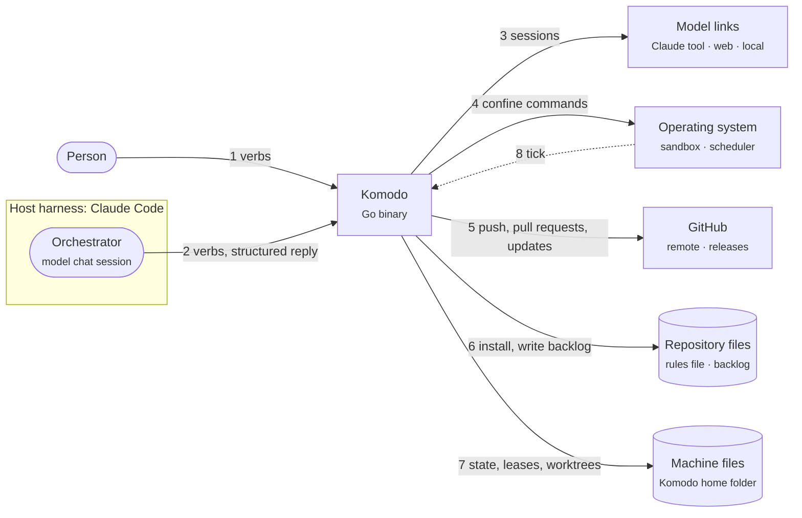

| Neighbour | Description |
|---|---|
| Person at a shell | Calls in. Installs, configures, updates and releases, and may run every shared verb |
| Orchestrator | Calls in. Turns the person's intent into plan and run verbs, waits, answers scope requests and relays reports; never edits code |
| Operating-system scheduler | Calls in. Fires the periodic tick when Komodo is installed with the schedule option |
| Claude command-line tool | Called out. Hosts one worker session at a time on the subscription login |
| Anthropic web interface | Called out. Hosts worker sessions when a paid link is allowed |
| OpenAI-compatible endpoints | Called out. Host the free backstop sessions, local or self-hosted |
| Git remote and GitHub | Called out. Receive group and epic branches and pull requests; a person merges only the epic pull request |
| GitHub Releases | Called out. Serves the update manifest and the signed binaries |
| Operating-system sandbox | Called out. Confines every command that a worker runs |

### 3.2 Technical Context

| Interface | Protocol | Direction |
|---|---|---|
| Verbs | Process invocation; one structured reply on standard output | Inbound |
| Claude command-line tool | Child process exchanging streamed lines of structured text, plus a private tool server over a pipe | Outbound |
| Anthropic web interface | Encrypted web requests with streamed replies and a structured final result | Outbound |
| OpenAI-compatible endpoints | Web requests with streamed replies; a probe measures the real context window | Outbound |
| Git and GitHub | Child processes; release downloads over encrypted web requests | Outbound |
| Operating-system sandbox | Wraps each worker command; never wraps the model client | Outbound |
| Operating-system scheduler | Starts the tick verb on a timer | Inbound |

Every verb returns one structured reply and an exit code from a small fixed set. Only the commands that a worker runs are sandboxed; the model client is not.

**Inputs**

| Input | Form | Consumed by |
|---|---|---|
| A goal | Text, or specification documents | Planner |
| The repository | Marker files, the rules file, a symbol graph | Detection, brief builder, repository map |
| The backlog | Markdown files per epic, group and task | Intake, Build, Verify |
| Configuration | The machine configuration file, within built-in hard limits; snapshotted per run | Every verb |
| Provider state | The install probe's registry of links; quota reset timers | Chain selection, billing check |
| Decisions | Scope answers, resume, abandon, configuration writes | The engine |

**Outputs**

| Output | Form | Produced by |
|---|---|---|
| A linted backlog | Files written only after lint passes | Planner plus Go lint |
| Group commits | A hidden reference, then a group branch | Build, Ship |
| Group pull requests | Into the epic branch, merged by the engine when the ship mode is group | Ship |
| The epic pull request | Into the base branch; a person merges | Epic gate |
| Reports | Text rendered from templates | Output templates |
| Ledgers | Session rows, event copies, task and group views | Observability |
| Signed releases | Tag, cross-built binaries, checksums, signature, changelog | The release verb |

### 3.3 Process Model

Komodo runs no daemon. A verb is a short process. The run verb starts a parent process, the parent guard, and the parent guard starts the engine detached, so the engine outlives the verb that launched the engine. The operating-system scheduler's tick is the only periodic trigger.

**📐 Which processes exist, and who restarts what**
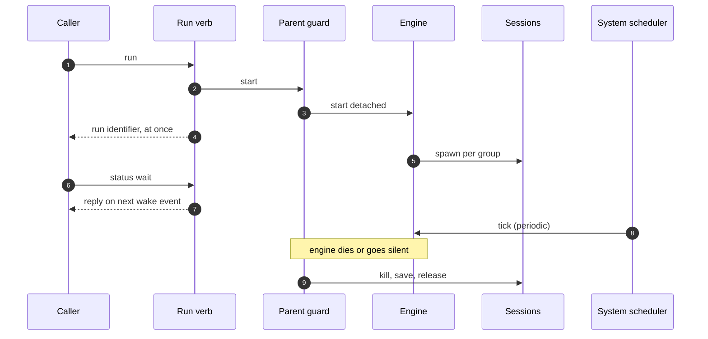

1. The caller runs the run verb. The verb prints the run identifier at once and exits.
2. The verb first starts the parent guard. The parent guard starts the engine as a detached process.
3. The engine spawns model sessions for ready groups and keeps working after the verb has returned.
4. The orchestrator waits in the background with the status-wait verb. The verb returns on the next wake event: a block, a pause, or the end of the run.
5. The tick is one repeatable engine step: queue the jobs that are due, fire the pause timers that have expired, and advance the session pool once. A tick with nothing due exits at once.
6. If the engine dies past its own error handler, or stops writing its heartbeat, the parent guard kills the model sessions, saves the work and frees the leases. [Crash Recovery](#66-crash-recovery) shows the full flow, and [Low-Level Design chapter 3](lld.md#3-engine-internals) holds the engine detail.

## 4. Solution Strategy

Each quality goal has a mechanism, and the engine implements every mechanism. No model is trusted to behave.

### 4.1 Strategy by Quality Goal

| Goal | Strategy |
|---|---|
| Safety | A minimal tool surface with no shell; a fail-closed guard on every tool call; an operating-system sandbox around every command; only the engine writes git |
| Durability | State-first events; one pure decider; one state manager that validates every record before disk; recorded actions with repeat-safe keys; a work-in-progress commit at every session end; epochs that fence late events |
| Determinism | Typed result schemas checked twice; Go templates render codes and facts against golden fixtures; only the engine emits events |
| Cost control | A fixed chain per agent ending in a free endpoint; a mechanical billing check; a stable prompt prefix that the provider caches; a bound on every loop |
| Portability | One binary cross-built at every gate; one sandbox backend per operating system behind one interface; per-platform copy mechanics behind one copy operation |

### 4.2 Design Principles

- **Mostly mechanical.** Whatever a guard rule, parser or check can prevent, Go code prevents. The prompt carries only what code cannot do.
- **Never pay by accident.** Under the strictest paid-provider setting, no paid call happens, and a billing check that fails closed runs before every session.
- **Models return codes and facts.** Go templates render every word that a person reads.
- **Every loop has a counter.** Each repeat has a bound and a named end state (see [Design Decisions](#92-design-decisions)).
- **One state schema, one door.** Every read and write of runtime state passes through the state manager (see [One State Schema](#82-one-state-schema)).
- **Fail closed.** A guard that cannot parse its input refuses the input.

### 4.3 Technology Choices

| Choice | Decision |
|---|---|
| Language | Go, standard library only |
| Model transports | The Claude command-line tool with a private tool server; a Go tool loop for web-protocol links |
| State | One schema behind one in-process state manager; append-only event files, atomic snapshots and create-only claim files |
| Concurrency | One goroutine (a lightweight Go thread) per group owns that group's state; state shared across groups lives in files with operating-system atomicity, written through the state manager |
| Caching | A content-addressed store verified on read; provider prompt caching by prefix order |
| Rendering | Go templates with a small fixed set of helper functions and golden fixtures |

### 4.4 Precedents

Every core idea has a published precedent, so a reviewer can check how the idea behaved elsewhere. Nothing in the running system depends on this table.

| Idea | Precedent | Used in |
|---|---|---|
| Pure decider, recorded side effects, replay | Temporal's workflow and activity split | Engine; group state |
| Fencing tokens enforced by the resource | Distributed-lease practice | Workspace and leases |
| Event stream as the agent's spine | OpenHands | The event model every component shares |
| Minimal tool surface without a shell; sandbox with the network off | SWE-agent; Codex CLI | Tool runtime; sandbox |
| Seatbelt on macOS, Bubblewrap on Linux | Codex CLI | Sandbox |
| Full-jitter retries | AWS Architecture Blog | HTTP stack |
| Ranked repository map for planning | Aider | Backlog and planning |
| Structured acceptance items | Kiro specifications | Backlog and planning |
| Coverage bands | Google Testing Blog | Configuration; Check |
| Headless sessions, resume, structured output | Claude Code | Providers; supervisor; recovery |

## 5. Building Blocks

The building blocks are the 13 subsystems of the harness, which is the `komodo` binary, and each subsystem has one job. Page 5.1 shows how the source code is layered, and pages 5.2 to 5.14 describe one subsystem each, in the order of the chapters of the low-level design. In this chapter "engine" always means the engine package that drives task groups, and "orchestrator" means the chat session, driven by a model, outside the binary that issues verbs.

**📐 Where the 13 subsystems sit, by layer**
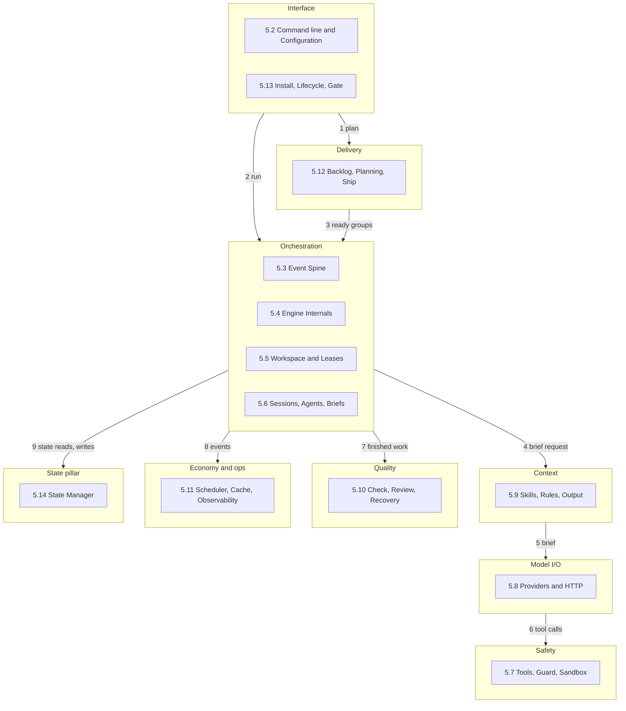
**Reading the diagram.** Each box is a page of this chapter, placed in the layer that holds most of its parts. Some subsystems reach into other layers, and page 5.1 lists the exact split. In every Interactions table, "Out" means the subsystem on the page sends or calls, "In" means it receives, and "Both" means each.

### 5.1 Layers and Import Order

**Summary.** The harness is built in nine groups: eight layers, each holding parts that share one concern, and the state manager as a pillar under all of them. The layer map shows where a concern lives, and one import rule keeps the source folders in a strict order. The rule prevents two folders from depending on each other in a circle, which would make a change impossible to test alone.

**Responsibilities**
- The layer map: nine groups that hold the 28 components, each component in exactly one layer.
- The import order: 12 source folders ranked in one list, where a folder may import only folders ranked below it.
- The parameter rule: a folder that needs something from a higher folder receives it as a parameter, such as the session runner that the engine hands to the quality checks.
- The mapping from layers to folders, which is many to many: the Interface layer spans three folders, and one folder serves two layers.
- The concept index, which says where agents, skills, rules, hooks, guards, commands and plugins live.

**Out of scope**
- Running the import check on every change: the gate in [5.13](#513-install-binary-lifecycle-and-gate).
- The contents of each layer: the subsystem pages 5.2 to 5.14.

| Layer | Components | Pages |
|---|---|---|
| Interface | Command line, config, installer, lifecycle | 5.2, 5.13 |
| Delivery | Backlog, Ship, gate | 5.12, 5.13 |
| Orchestration | Engine, leases, supervisor, jobs, recovery | 5.3 to 5.6, 5.10, 5.11 |
| Context | Skills, rules, brief builder | 5.6, 5.9 |
| Model I/O | Providers, network client, agents, tool runtime | 5.6, 5.7, 5.8 |
| Safety | Guard, sandbox | 5.7 |
| Quality | Check, review and tester | 5.10 |
| Economy and ops | Events, cache, ledger, budgets | 5.3, 5.10, 5.11 |
| State pillar | State manager | 5.14 |

| Concept | Lives in | Page |
|---|---|---|
| Agents | Agent registry, two files per agent | [5.6](#56-sessions-agents-and-briefs) |
| Skills | Skill loader, readable by outside sessions | [5.9](#59-skills-rules-and-output) |
| Rules | Rules and output contract, built in | [5.9](#59-skills-rules-and-output) |
| Hooks | Event bus, plus three inline hooks | [5.3](#53-event-spine-and-state-machine) |
| Guards | Guardrails, checked on every call | [5.7](#57-tools-guard-and-sandbox) |
| Commands | Detected by config, run by tool runtime | [5.2](#52-cli-and-configuration), [5.7](#57-tools-guard-and-sandbox) |
| Plugins | None; outside tool servers are opt-in | [5.7](#57-tools-guard-and-sandbox) |

The three inline hooks run before a tool call, after a file edit and at the end of a session. Every other happening is an event on the bus.

**📐 Which source folder may import which**
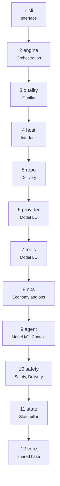
**Reading the diagram.** An arrow means "may import". A folder may skip levels but never import a folder ranked above it.

**Interactions**

| Neighbour | Direction | What flows |
|---|---|---|
| [Gate](#513-install-binary-lifecycle-and-gate) | Out | The import order, which the gate checks on every run |
| [Engine](#54-engine-internals) | Out | The session runner handed down to the quality checks |
| [State manager](#514-state-manager) | In | Every layer that keeps state reaches the pillar the same way |

**Key scenario: an upward import is refused**

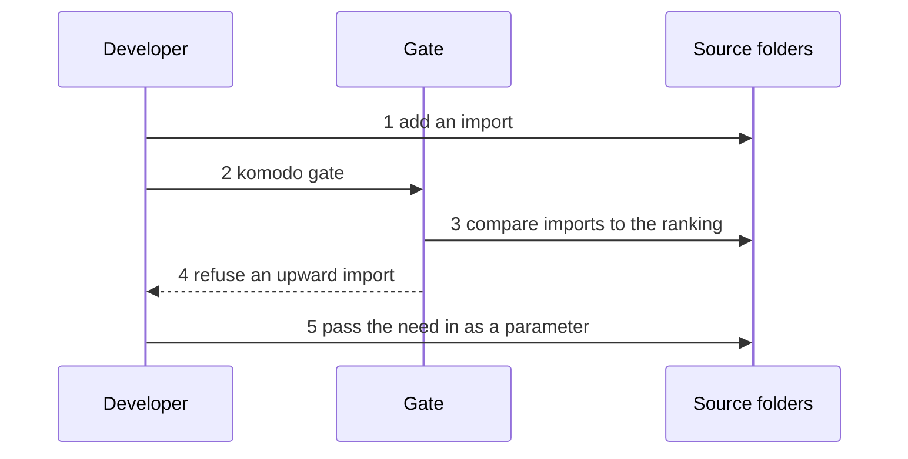

1. A developer adds an import from one source folder to another.
2. The developer runs `komodo gate`, which builds, tests and checks structure for the Komodo repository.
3. The gate compares every import with the ranked list of folders.
4. An import that points to a higher-ranked folder makes the gate refuse the change.
5. The developer removes the import, and the higher folder hands the needed value down as a parameter.

**Rationale and alternatives**
- One-way imports with needs passed down as parameters, chosen over free imports, because folders could otherwise depend on each other in a circle.
- The state manager is a pillar under all layers and not a ninth layer, because every layer that keeps state reaches it the same way.

**Detail.** [LLD chapter 0](lld.md#0-front-matter-and-code-structure)

### 5.2 CLI and Configuration

**Summary.** The command line is the only way to drive Komodo. A person or the orchestrator types a verb, and every verb passes through the same five steps and ends with one structured reply and one exit code. Configuration is the settings store, with built-in defaults and hard limits that every other subsystem reads.

**Responsibilities**
- The verb table, with parsing, validation, dispatch and rendering for every command.
- The reply shape, called the envelope, and the five exit codes: ok, refused, usage error, blocked and internal error.
- Three guards that run before a verb: the repo pin, the terminal check and the settings hash guard.
- The settings: built-in defaults, the machine file, hard limits on every key, and the audit log of changes.
- Command detection: which setup, build, test, lint and format commands a repository has.

**Out of scope**
- Doing the work of a verb: the subsystem that owns the verb, such as the engine ([5.4](#54-engine-internals)) for run.
- Turning codes and facts into words: the templates in [5.9](#59-skills-rules-and-output).
- Writing the audit rows to disk: the state manager ([5.14](#514-state-manager)).

**📐 Who calls the command line, and where verbs go**
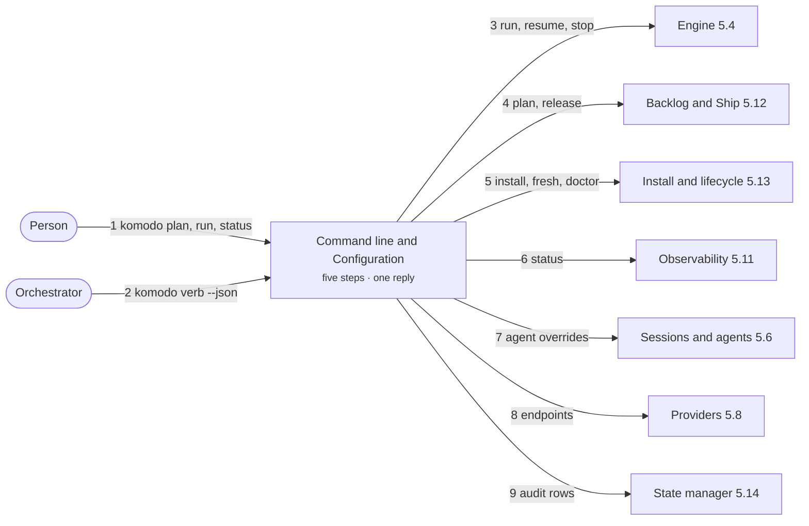

**Interactions**

| Neighbour | Direction | What flows |
|---|---|---|
| Person and orchestrator (outside) | Both | Verbs in; one reply and an exit code out |
| [Engine](#54-engine-internals) | Out | Run, resume and stop verbs; a settings snapshot for each run |
| [Backlog and Ship](#512-backlog-planning-ship-and-release) | Out | Plan and release verbs |
| [Install and lifecycle](#513-install-binary-lifecycle-and-gate) | Both | Install, fresh and doctor verbs; the repo pin check |
| [Observability](#511-scheduler-cache-and-observability) | Out | Status verbs, answered from the ledger |
| [Sessions and agents](#56-sessions-agents-and-briefs) | Out | Per-agent model and limit overrides |
| [Providers](#58-providers-and-http) | Out | Endpoint settings and whether paid links are allowed |
| [State manager](#514-state-manager) | Out | Audit rows written by the config verb |

**Key scenario: one verb from typing to reply**

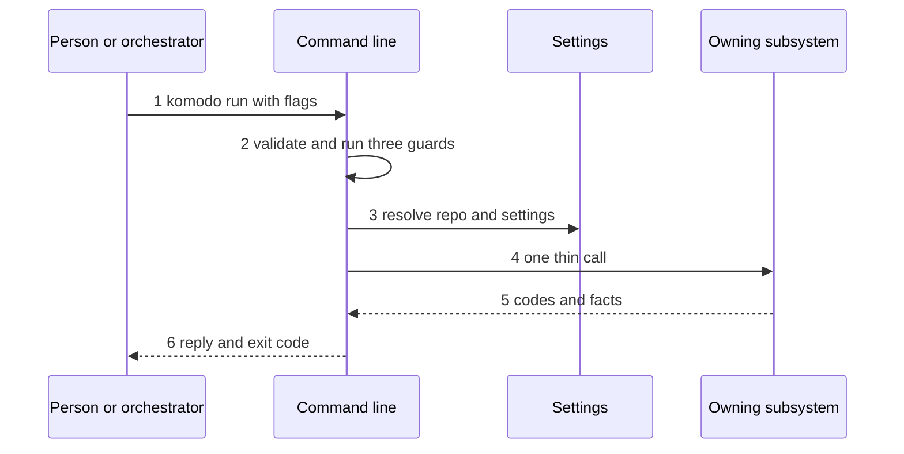

1. The caller types a verb with flags. Structured input passed with the input flag merges under explicit flags, and explicit flags win.
2. Validation checks types and flag names, then runs the guards. The repo pin refuses every verb except help, version, fresh, install and doctor when the repository's instruction file demands a newer binary. The terminal check refuses terminal-only verbs without a controlling terminal. The settings hash guard refuses every verb after a hand edit of the settings file.
3. Resolution finds the repository from the working folder or the repository flag and builds the effective settings from the built-in defaults and the machine file. The machine value wins within the hard limits.
4. Dispatch makes one thin call into the subsystem that owns the verb. A verb that fails before this step has made zero writes, and the dry-run flag prints each write without making it.
5. The owning subsystem returns codes and facts.
6. Rendering turns the codes and facts into a report through templates, and the reply carries the report and one exit code.

**Rationale and alternatives**
- [TODO: the reason a hand edit of the settings file makes every verb refuse until accepted is not recorded (G-76)]
- [TODO: whether the fixed upper bound on a group's total run time is confirmed by the owner (G-77)]

**Detail.** [LLD chapter 1](lld.md#1-cli-and-configuration)

### 5.3 Event Spine and State Machine

**Summary.** The event spine records every change to a task group as a typed event, and one pure decision function decides what each event means. A group's place survives a crash because each event reaches disk before it is applied, and nothing else can move a group between stages. Without the spine, a stage could move twice, a late result from a cancelled session could rewrite history, and a crash could lose the group's place.

**Responsibilities**
- The event envelope and the fixed catalog of event types, each with its contract.
- The decision function and the stage rulebook: five stages, the two waits (Paused and Blocked) and the reasons a group blocks.
- The group state that the decision function reads, and the epochs that let a late event be ignored. [TODO: which counters the group state holds (G-81)]
- The list of side-effect actions that the decision function can order, each with an idempotency key. [TODO: which subsystem owns the outbox of recorded actions (G-78)]
- Delivery of every applied event, in order, to three subscribers that never change group state.

**Out of scope**
- Writing and replaying the event files: the state manager ([5.14](#514-state-manager)).
- The loop that calls the decision function for each group: the engine ([5.4](#54-engine-internals)).
- Reporting the facts that become events: the sessions, check, tools, providers and workspace subsystems named in the table below.

**📐 How facts reach the decision function**
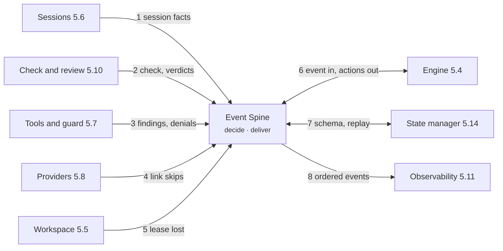

**Interactions**

| Neighbour | Direction | What flows |
|---|---|---|
| [Engine](#54-engine-internals) | Both | Each event in; new state and ordered actions out |
| [State manager](#514-state-manager) | Both | Event types become the schema; replay runs through the decision function |
| [Sessions](#56-sessions-agents-and-briefs) | In | Session start, idle, warning and end; task claims |
| [Check, review, tools, guard](#510-check-review-tester-and-recovery) | In | Check results, findings, refused tool calls |
| [Providers](#58-providers-and-http) | In | Link skips and limit warnings |
| [Workspace](#55-workspace-and-leases) and [Ship](#512-backlog-planning-ship-and-release) | In | Lease lost; task list locked and released |
| [Scheduler and recovery](#511-scheduler-cache-and-observability) | In | Job and timer facts; the notice of a dropped cut-short line |
| [Observability](#511-scheduler-cache-and-observability) | Out | Ordered events for the ledger, the wake file and the live view |

**Key scenario: one event from producer to subscribers**

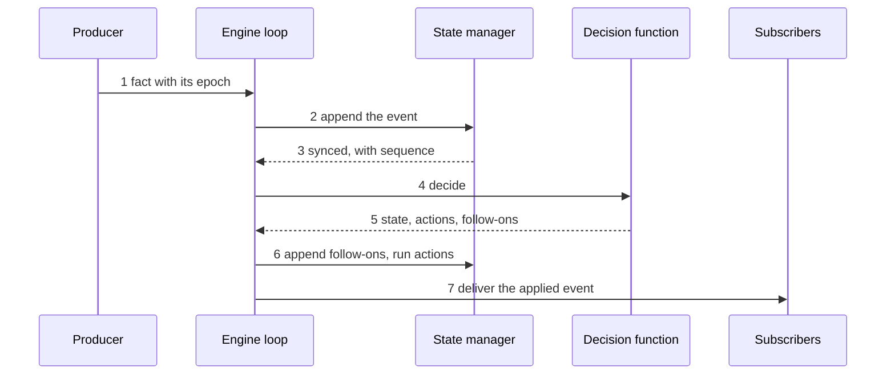

1. A producer hands the engine loop a fact, stamped with the epoch that its session started under.
2. The loop marks the event stale when its epoch is older than the group's current stage, and appends it through the state manager.
3. The state manager stamps a sequence number, a time and a checksum, validates the line against the schema, writes it and waits until the line is on disk.
4. The loop calls the decision function. The function reads and writes nothing, and it ignores a stale event.
5. The function returns the new state, the actions to run and any follow-on events.
6. The loop appends each follow-on event in order, then runs each action between a start line and a done line, and hands the new state to the snapshot call, which writes on a fixed interval or at a stage change.
7. The bus delivers the applied event to the three subscribers in sequence order.

**Rationale and alternatives**
- Epochs, chosen over applying every event that arrives, because a cancelled Verify session's late result could otherwise move the stage twice.
- Only the engine emits events, never a model, chosen over letting a session report its own progress, because a stage must move only on evidence that the engine produced.
- Events written to disk before they are applied, chosen over applying first, because a group's place then survives any crash.
- [TODO: the fields of each event type's payload (G-24)]
- [TODO: the stage moves that the transition table lacks (G-31)]
- [TODO: whether the engine loop keeps waiting for subscribers after delivering an event (G-29)]

**Detail.** [LLD chapter 2](lld.md#2-event-spine-and-state-machine)

### 5.4 Engine Internals

**Summary.** The engine runs task groups. It starts model sessions, moves each group through its stages and lands finished work, with one loop per group so that many groups, repositories and runs can share one machine. Without the engine nothing would start, two groups could write the same state file, and no group would land.

**Responsibilities**
- The per-group loop, which is the only writer of its group's events: the loop calls the decision function and runs the actions that the function orders.
- The run: the dependency graph of groups, the work queue and the order in which ready groups are picked.
- Landing order and epic coordination: groups land one at a time, each followed by a check of the epic branch tip, and then the epic gate runs once over the whole epic.
- Crash containment: a crash in one group blocks that group alone, and the parent guard (a small parent process) stops the agents and repeats the save if the engine itself dies.
- The machine-wide pool of session slots. [TODO: which subsystem owns the session pool (G-78)]

**Out of scope**
- Deciding what an event means: the event spine ([5.3](#53-event-spine-and-state-machine)).
- Spawning and watching sessions: [5.6](#56-sessions-agents-and-briefs).
- Writing state files: the state manager ([5.14](#514-state-manager)).

**📐 What the engine starts, and what starts it**
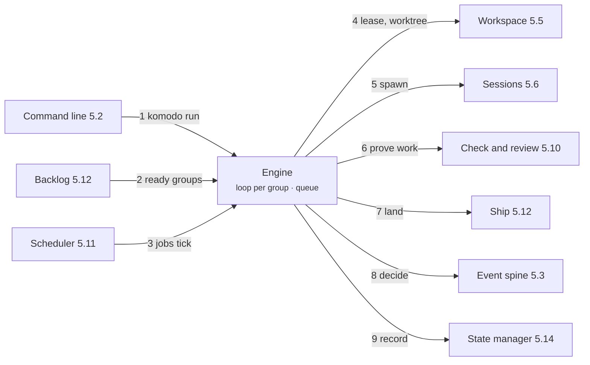

**Interactions**

| Neighbour | Direction | What flows |
|---|---|---|
| [Event spine](#53-event-spine-and-state-machine) | Both | Each event in; new state and ordered actions back |
| [State manager](#514-state-manager) | Both | Group events and snapshots; queue and slot claims |
| [Workspace](#55-workspace-and-leases) | Out | A lease and a worktree for each group |
| [Sessions](#56-sessions-agents-and-briefs) | Both | Spawn orders and filled brief slots; session facts back |
| [Check and review](#510-check-review-tester-and-recovery) | Both | Finished work to prove; verdicts back |
| [Backlog and Ship](#512-backlog-planning-ship-and-release) | Both | Ready groups in; landing orders out |
| [Scheduler](#511-scheduler-cache-and-observability) | In | Due jobs and timers; one pool drive for each tick |
| [Command line](#52-cli-and-configuration) | In | Run, resume, stop and scope answers |

**Key scenario: a ready group runs and lands**

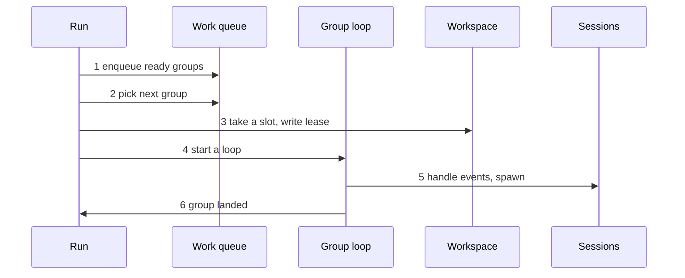

1. The run builds the dependency graph from the backlog, and each group whose dependencies have landed becomes a queue file.
2. The run picks the next group by priority, fair share across repositories, longest remaining chain, most groups unblocked and backlog order.
3. Taking a slot from the session pool deletes the queue file and writes the group's lease. A crash between the two leaves an item that the startup sweep handles.
4. The run starts a loop for the group. The loop opens the group's state, loads the last snapshot and replays the events after it, then reruns any open actions before it accepts a new event.
5. For each event, the loop saves it, asks the decision function what to do, records and runs each action, writes a snapshot and notifies the subscribers.
6. A group lands only after every dependency has landed and the check on the epic tip has passed. After the last landing, the reviewer and the tester run once over the whole epic.

**Rationale and alternatives**
- A machine-wide session pool, chosen over per-repository lanes, because provider quota and link limits are machine-wide and lanes could not see each other.
- One loop per group that owns the group's state, chosen over shared state with locks, because there are then no locks to get wrong inside a group and a crash stays in one group.
- [TODO: whether the group loop keeps running or exits while its group is Paused or Blocked (G-29)]
- [TODO: the reason groups land one at a time is not recorded (G-79)]

**Detail.** [LLD chapter 3](lld.md#3-engine-internals)

### 5.5 Workspace and Leases

**Summary.** A workspace is a private git checkout where one task group is built, and a lease is the lock that says which run owns the group. The lease and its fence number give each group its own folder and let only one run change the folder or the group's saved progress. Without the lease, two runs could edit one folder, and without the fence, a stalled holder could overwrite its successor.

**Responsibilities**
- The worktree for each group, cut from the epic branch tip, and its removal after it goes unused.
- The lease: a lock file that names the run owning the group and is renewed while held.
- The fence: a number that rises on every take or takeover and rides on every git write.
- The hidden ref that saves a group's progress: git hides it from branch listings, and Komodo never pushes it.
- Takeover of a stale lease, so that exactly one run wins, and clean shutdown: stop the agents, save work in progress and free the leases.

**Out of scope**
- The parent guard that repeats the shutdown when the engine dies: the engine ([5.4](#54-engine-internals)).
- The startup sweep after a power loss. [TODO: which subsystem owns the startup sweep (G-78)]
- Writing lease files to disk: the state manager ([5.14](#514-state-manager)).

**📐 How a lease and a fence guard a group's work**
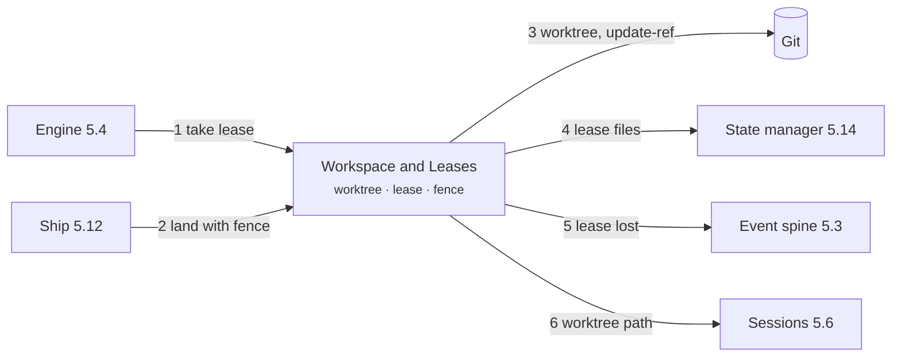

**Interactions**

| Neighbour | Direction | What flows |
|---|---|---|
| [Engine](#54-engine-internals) | Both | Lease and worktree on group start; the parent guard triggers the same shutdown |
| [Event spine](#53-event-spine-and-state-machine) | Out | The lease-lost fact |
| [State manager](#514-state-manager) | Out | Lease files: claimed, renewed, removed |
| Git (outside) | Out | Worktree cuts and fenced reference updates |
| [Ship](#512-backlog-planning-ship-and-release) | In | The fence, checked on every landing |
| [Sessions](#56-sessions-agents-and-briefs) | Out | The worktree where each session works |

**Key scenario: a stalled holder is stopped**

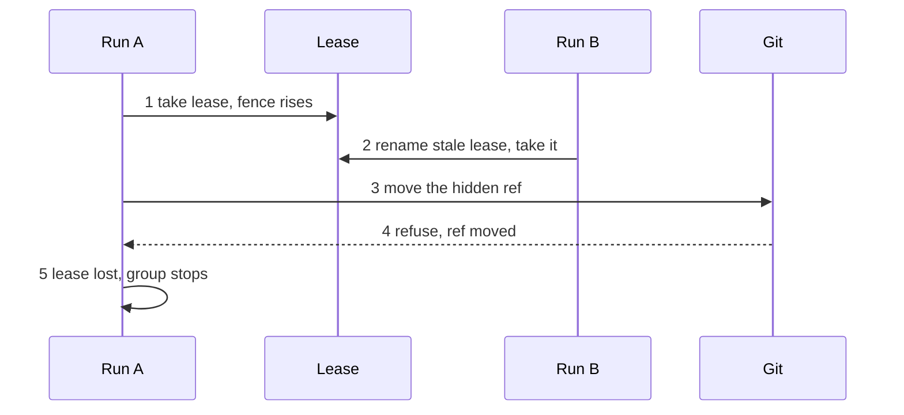

1. Run A takes the lease by creating the lock file, and the fence number rises.
2. Run A stalls. Run B finds the lease stale or its holder dead, renames the old file with a stale suffix so that only one run wins, and takes the lease with a higher fence.
3. Run A resumes and tries to move the hidden ref with git's update command, which names the value A expects the ref to hold.
4. Git refuses the update with a failure exit when the ref no longer holds that value.
5. Run A emits the lease-lost event, and the decision function stops the group.

**Rationale and alternatives**
- The fence enforced by git's own compare-and-swap, chosen over rereading the ref before each push, because a reread leaves a window between the read and the write.
- A lease together with a fence, chosen over a lease alone, because a stalled holder could otherwise overwrite its successor.

**Detail.** [LLD chapter 4](lld.md#4-workspace-and-leases)

### 5.6 Sessions, Agents and Briefs

**Summary.** A session is one fresh model conversation that does one task, an agent is the role the session plays, and a brief is the prompt the session receives. This subsystem starts, watches and stops sessions, defines the seven agent roles and assembles each brief in a fixed order. Without the supervisor a stuck session would hold a slot forever, without the registry a session could start with the wrong tools, and without the brief builder each prompt would be written by hand.

**Responsibilities**
- The session supervisor: spawn, liveness watch, time warning, nudge, the stop ladder and one exit reason for every end.
- Resume: continue the provider's conversation when possible, otherwise start a fresh session with the saved work.
- The agent registry: seven roles (planner, architect, reviewer, builder, researcher, tester and scout), each with a weight, tools, limits and role text.
- The brief builder: five parts, most stable first, filled from named slots, with a size check against half of the link's measured context.
- Token counting for the brief gate. [TODO: how tokens are counted for the brief gate (G-82)]

**Out of scope**
- Choosing the link and talking to the model: providers ([5.8](#58-providers-and-http)).
- Running tools and confining commands: [5.7](#57-tools-guard-and-sandbox).
- Choosing which skills fit a brief: [5.9](#59-skills-rules-and-output).

**📐 What a session needs before it starts**
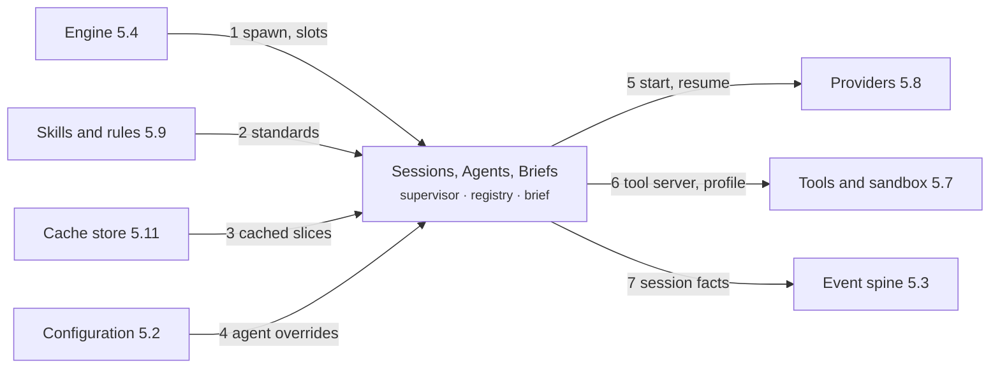

**Interactions**

| Neighbour | Direction | What flows |
|---|---|---|
| [Engine](#54-engine-internals) | Both | Spawn orders and filled slots in; session facts out |
| [Event spine](#53-event-spine-and-state-machine) | Out | Session start, idle, warning and end |
| [Providers](#58-providers-and-http) | Both | Start or resume on a link; the stream and the result back |
| [Tools, guard, sandbox](#57-tools-guard-and-sandbox) | Out | A private tool server and a sandbox profile for each session |
| [Skills and rules](#59-skills-rules-and-output) | In | The standards chosen for each brief |
| [Check and review](#510-check-review-tester-and-recovery) | In | Verified findings that go into later briefs |
| [Cache store](#511-scheduler-cache-and-observability) | Both | Cached skill bodies and file slices |
| [Configuration](#52-cli-and-configuration) | In | Per-agent model and limit overrides |

**Key scenario: one session from brief to exit**

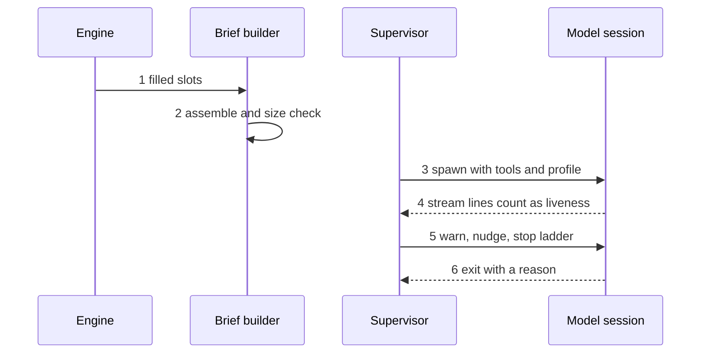

1. The engine hands the brief builder the filled slots for the session.
2. The builder assembles five parts in order (tool definitions, role, repository context, standards, task) and writes the brief once to the session folder. A brief that exceeds half of the link's measured context goes to the next link that fits, and then to Blocked.
3. The supervisor starts the private tool server and the sandbox profile, then spawns the session on the chosen link.
4. Any output line or tool call counts as a sign of life, and one timer checks the wall-clock allowance, the idle time and the time warning.
5. Near the end of its allowance the session receives one fixed line that names the minutes left. After a period of silence the supervisor sends one nudge, allows a grace period, and then stops the session: first an interrupt signal, then a terminate signal, then a kill of the whole process tree.
6. Every end records exactly one exit reason in the session's result file, and the supervisor reports it as a session-end event.

**Rationale and alternatives**
- A brief built with its stable parts first, chosen over an arbitrary order, because a repeated prefix then hits the provider's prompt cache.
- [TODO: the reason an oversized brief moves to the next link and is never trimmed is not recorded (G-83)]

**Detail.** [LLD chapter 5](lld.md#5-sessions-agents-and-briefs)

### 5.7 Tools, Guard and Sandbox

**Summary.** A tool is a named action that a model may request, such as reading a file or running a test command. The tool runtime carries each request to Go, the guard checks the request first and refuses when unsure, and the sandbox confines every command at the operating-system level. Without these three, a model could only talk, or it could read secrets, escape its worktree and call home.

**Responsibilities**
- The tool set and each agent's tool list: a few typed tools, no shell and no git write tool.
- The private tool server for the Claude command-line link, and the same tools through Go's own loop for links that use a programming interface.
- The cap on tool replies, with the full output kept on disk.
- The guard: an in-process check of every call, with rules held as data, that fails closed and ends a session on repeated refusals.
- The sandbox around every run command, with limits on processes, memory, time and output, and the language caches that Komodo owns apart from the user's.

**Out of scope**
- Starting sessions and giving them a tool server: [5.6](#56-sessions-agents-and-briefs).
- Talking to the model: providers ([5.8](#58-providers-and-http)).
- Writing the facts that a finding or a denial produces as events: the event spine ([5.3](#53-event-spine-and-state-machine)).

**📐 How a tool call reaches the machine**
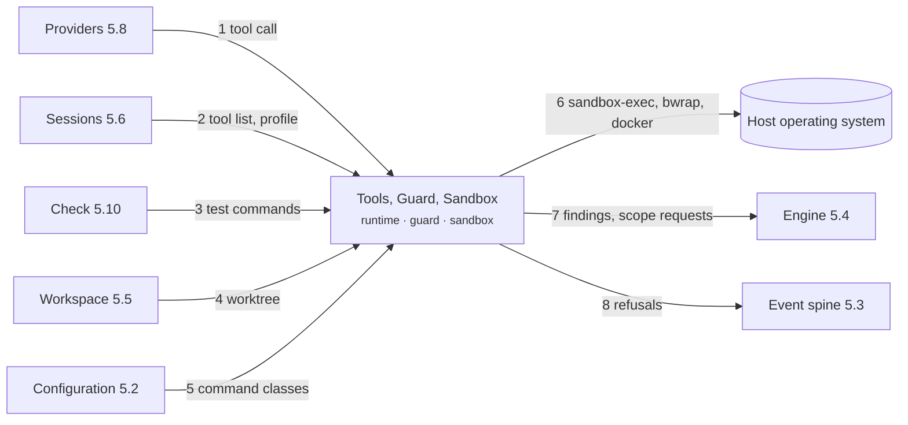

**Interactions**

| Neighbour | Direction | What flows |
|---|---|---|
| [Providers](#58-providers-and-http) | Both | The model's tool calls in; capped results back |
| [Sessions](#56-sessions-agents-and-briefs) | In | A tool list and a sandbox profile for each session |
| [Engine](#54-engine-internals) | Out | Findings and scope requests. [TODO: how the tool server's events reach the engine (G-42)] |
| [Event spine](#53-event-spine-and-state-machine) | Out | Refused-call facts |
| [Configuration](#52-cli-and-configuration) | In | The guard's one tunable and the detected command classes |
| [Check](#510-check-review-tester-and-recovery) | In | Test and build commands run inside the sandbox |
| [Workspace](#55-workspace-and-leases) | In | The one worktree a session may write |
| Host operating system (outside) | Out | Seatbelt, bwrap or Docker around each command |

**Key scenario: one tool call**

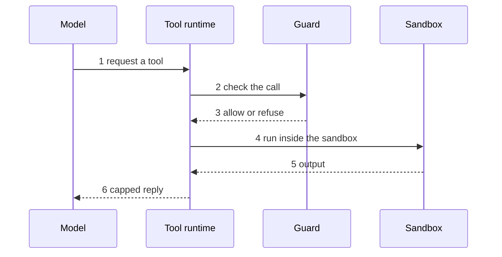

1. The model requests a tool through the private tool server, or through Go's own loop on links that use a programming interface.
2. The runtime confirms that the tool is on the agent's list, then passes the call to the guard.
3. The guard refuses a call it cannot parse, a tool it does not know and any guard error, because it fails closed. A refusal names the rule and the allowed alternative, and the third refusal under one rule ends the session.
4. For a run command, the sandbox wraps the command in the operating system's confinement: seatbelt on macOS, bwrap on Linux, Docker on native Windows. The command gets no network except loopback, and limits on processes, memory, time and output.
5. The command finishes, or the sandbox kills the whole process tree on a timeout.
6. Every tool except read returns a capped reply, and the full output goes to a log file in the session folder.

**Rationale and alternatives**
- Session caps through control groups or Docker only, chosen over the per-user process limit, because that limit counts every process the user runs and made forking fail on a busy Mac.
- Language caches owned by Komodo, chosen over the user's own caches, because agent code could plant files that the user's own builds later run.
- A shared Rust build folder for each group, chosen over copying the build output to the tester, because a copy would be rebuilt anyway. [TODO: a test that confirms a copied build folder rebuilds (G-12)]

**Detail.** [LLD chapter 6](lld.md#6-tools-guard-and-sandbox)

### 5.8 Providers and HTTP

**Summary.** A provider is a service that runs a model, a link is one way to reach a provider, and an adapter starts, streams and resumes a session over a link. One network client sits under every web call, and it handles retries, streaming, allowed hosts and secret redaction. Without them each subsystem would carry provider quirks, and a stray programming-interface key could bill the wrong account.

**Responsibilities**
- One adapter interface over every link: probe, start, resume, and a final typed result with usage and a resume handle.
- Each agent's fixed chain of links and the failover along it, which happens only when a provider is unavailable, unauthorized or over a limit, never because a task failed.
- The billing check before each session, which sets a cost class (subscription, free or paid) and counts an unknown login as paid.
- The measured context window for each session, and the model catalog that maps agent weights to exact models.
- The pause when no link is left, and the network client with jittered retries, streaming, host allowlists and secret redaction.

**Out of scope**
- Which models an agent prefers: the agent registry ([5.6](#56-sessions-agents-and-briefs)).
- Running the tools that a model asks for: [5.7](#57-tools-guard-and-sandbox).
- Resuming a paused group when its timer is due: the scheduler ([5.11](#511-scheduler-cache-and-observability)) and the engine ([5.4](#54-engine-internals)).

**📐 How a session reaches a model**
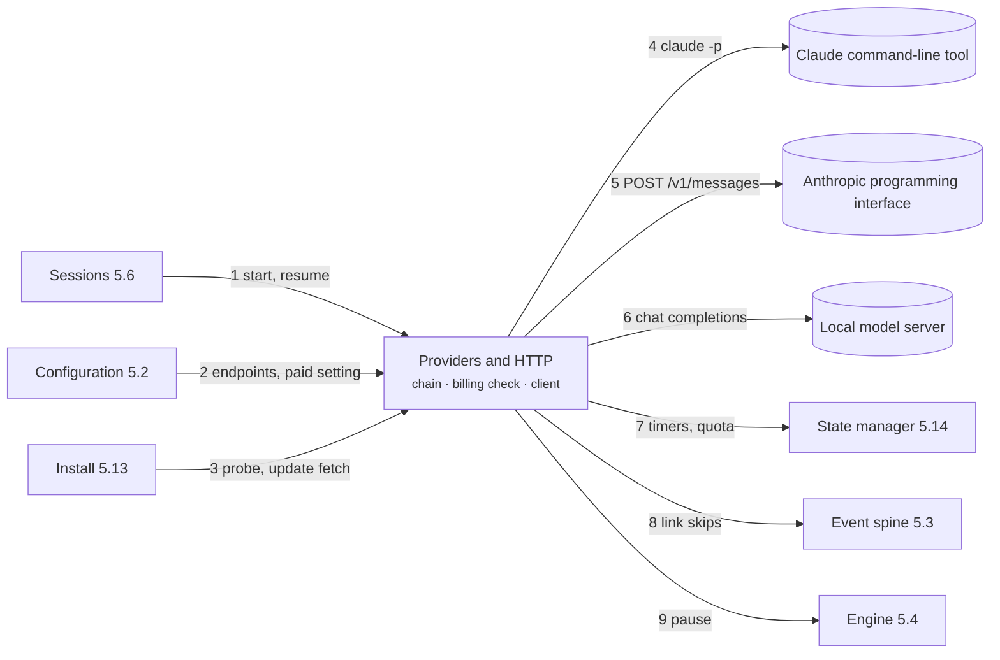

**Interactions**

| Neighbour | Direction | What flows |
|---|---|---|
| [Sessions](#56-sessions-agents-and-briefs) | Both | Start or resume in; stream and result out; the agent's link chain in |
| [Tools](#57-tools-guard-and-sandbox) | Both | The model's tool calls; capped results back |
| [Engine](#54-engine-internals) | Out | Measured context, cost class, and the pause when no link is left |
| [Event spine](#53-event-spine-and-state-machine) | Out | Link skips and limit warnings |
| [State manager](#514-state-manager) | Out | Timer records, the quota record and the provider list |
| [Configuration](#52-cli-and-configuration) | In | Endpoint settings and whether paid links are allowed |
| [Install and lifecycle](#513-install-binary-lifecycle-and-gate) | In | The install probe and the updater's downloads |
| Model services (outside) | Out | Claude command-line tool, Anthropic programming interface, local model servers |

**Key scenario: a session starts, a link fails over, and a pause follows**

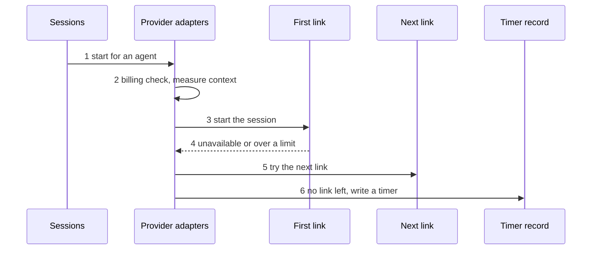

1. A session asks to start for an agent, and the adapter takes the agent's fixed chain of links.
2. Before the session starts, the billing check gives the link a cost class and fails closed, and the adapter measures the link's real context window. A link below the context floor is skipped.
3. The adapter starts the session and streams its output. The final answer is forced into the agent's result schema, and Go validates it again.
4. When the link is unavailable, unauthorized or over a limit, the adapter reports a skip event with the reason.
5. The adapter tries the next link in the chain, which ends in a free local endpoint.
6. When no link is left, the group pauses. The adapter writes a timer record with the time to wait until, and the reset time goes to the quota record. A pause that outlasts its cap makes the group Blocked.

**Rationale and alternatives**
- Claude launched with pinned flags, chosen over the bare mode, because bare mode reads only a programming-interface key and never the subscription login.
- Context measured for each session, chosen over a typed number per model, because a larger typed window than the real one lets a server cut the prompt silently.
- One model registry written by the install probe, with a model-not-found response failing over down the chain, chosen over a central model gateway, which waits for more machines or two people sharing one cap.

**Detail.** [LLD chapter 7](lld.md#7-providers-and-http)

### 5.9 Skills, Rules and Output

**Summary.** A skill is a document of standards or workflow steps placed before a model session, rules are the instructions for the orchestrator, and the output contract fixes how every line a person reads is produced. Together they choose each session's standards, keep rule text out of worker prompts and turn checked facts into words. Without them workers would get the wrong standards, orchestrator rules would leak into briefs, and model prose would reach the person unchecked.

**Responsibilities**
- The skill index: standards and workflow skills, hashed and size-bounded, loaded only from an agent's allow list when the skill's file patterns match the group's files.
- The orchestrator rules, built into the binary and written into the repository's orchestrator block by install.
- The output contract: models return only codes and facts, and templates render the same bytes on every run.
- The five places where rules are enforced: the guard, the result schema, Check and review, the comments standard and the orchestrator block.
- The no-leak rule: no rule text ever enters a worker's brief. [TODO: how tokens are counted for the skill size bound (G-82)]

**Out of scope**
- Placing a skill in a brief: the brief builder ([5.6](#56-sessions-agents-and-briefs)).
- Writing the orchestrator block into a repository: install ([5.13](#513-install-binary-lifecycle-and-gate)).
- Enforcing a rule at the moment of a tool call: the guard ([5.7](#57-tools-guard-and-sandbox)).

**📐 Where skills and rules go**
```mermaid
flowchart LR
  CA["Cache store 5.11"]
  CF["Configuration 5.2"]
  GT["Gate 5.13"]
  SK["Skills, Rules, Output<br><small>index · rules · templates</small>"]:::core
  BB["Brief builder 5.6"]
  TL["Tools 5.7"]
  RV["Check and review 5.10"]
  IL["Install 5.13"]
  CL["Command line 5.2"]
  OR(["Orchestrator"]):::actor
  CA -->|"1 skill bodies"| SK
  CF -->|"2 output style"| SK
  GT -->|"3 skill checks"| SK
  SK -->|"4 skills for a brief"| BB
  SK -->|"5 skill pulls"| TL
  SK -->|"6 reviewer rule identifiers"| RV
  SK -->|"7 rules block text"| IL
  SK -->|"8 rendered report"| CL
  SK -->|"9 komodo skill get"| OR
```

**Interactions**

| Neighbour | Direction | What flows |
|---|---|---|
| [Brief builder](#56-sessions-agents-and-briefs) | Out | The skills chosen for each brief |
| [Tools](#57-tools-guard-and-sandbox) | Out | On-demand skill pulls by a session |
| [Check and review](#510-check-review-tester-and-recovery) | Out | Reviewer rule identifiers built from skill lines |
| [Cache store](#511-scheduler-cache-and-observability) | Both | Skill bodies cached by hash |
| [Command line](#52-cli-and-configuration) | Both | Rendered reports; the output style setting |
| [Install](#513-install-binary-lifecycle-and-gate) | Out | Rules text for the repository's orchestrator block |
| [Gate](#513-install-binary-lifecycle-and-gate) | In | Checks on skill size, steering phrases and golden outputs |
| Orchestrator (outside) | Out | Rules it reads; skills it lists and fetches |

**Key scenario: from skill to report line**

```mermaid
sequenceDiagram
  participant L as Skill loader
  participant B as Brief builder
  participant M as Model session
  participant T as Templates
  participant P as Person
  L->>B: 1 skills that match
  B->>M: 2 brief without rule text
  M-->>T: 3 codes and facts
  T->>T: 4 escape and render
  T-->>P: 5 report line
```

1. The loader selects a skill only when it is on the agent's allow list, its file patterns match the group's files and its markers exist. Skills marked always load first, then the others by name.
2. The brief builder places the skills in the standards part of the brief. No rule text enters the brief, and a brief over its size ceiling never drops a skill.
3. The session returns only codes and facts, checked against the agent's result schema.
4. Go escapes the facts, then renders them through the template for the configured output profile, and applies line wrapping and colour.
5. The person reads the rendered line. Model prose is never rendered.

**Rationale and alternatives**
- No rule text in worker prompts, chosen over rules in the prompt files, because the harness enforces rules where it acts and a prompt rule is only advice.
- Skills, rules and templates compiled into the binary, chosen over reading them from the repository, because a planted file could otherwise change what a worker sees.
- Models return codes and facts while templates write the words, chosen over rendering model prose, because the same facts must render the same bytes.

**Detail.** [LLD chapter 8](lld.md#8-skills-rules-and-output)

### 5.10 Check, Review, Tester and Recovery

**Summary.** When a builder finishes, Check proves the work with ordinary tools at zero model cost, and Verify then runs a reviewer and a blind tester side by side. Error recovery is the single table of every failure, with its detector, action, bound and final state. Without these, a model's own word would be the only proof, and a loop could run forever.

**Responsibilities**
- Check: each task's success command rerun, the file scope, a secrets scan, regressions against a baseline, impact tests and changed-line coverage.
- Review: ten lenses of review rules, findings that count only when Go finds their quoted evidence, and one verdict for every task.
- The tester: a blind pass over acceptance items in its own worktree, with reruns before a failure counts.
- Scope requests: a builder asks for files outside its list, the engine denies protected paths, and the orchestrator answers the rest.
- The failure table, with the final state of every failure. [TODO: who owns each limit counter: retries, returns and success-command failures (G-81)] [TODO: which subsystem owns the startup sweep (G-78)]

**Out of scope**
- Running the commands inside confinement: the sandbox ([5.7](#57-tools-guard-and-sandbox)).
- Moving a group between stages after a verdict: the event spine ([5.3](#53-event-spine-and-state-machine)).
- Saving check results: the cache store ([5.11](#511-scheduler-cache-and-observability)).

**📐 What proves a group's work**
```mermaid
flowchart LR
  EN["Engine 5.4"]
  OR(["Orchestrator"]):::actor
  CR["Check, Review, Recovery<br><small>Check · Verify · failure table</small>"]:::core
  SB["Sandbox 5.7"]
  CA["Cache store 5.11"]
  SE["Sessions 5.6"]
  SP["Event spine 5.3"]
  SM["State manager 5.14"]
  EN -->|"1 group to prove"| CR
  OR -->|"2 scope answer"| CR
  CR -->|"3 run tests"| SB
  CR -->|"4 saved results"| CA
  CR -->|"5 reviewer, tester"| SE
  CR -->|"6 verdict facts"| SP
  CR -->|"7 reload on resume"| SM
```

**Interactions**

| Neighbour | Direction | What flows |
|---|---|---|
| [Engine](#54-engine-internals) | Both | Finished work in; check results, verdicts and blocks out |
| [Event spine](#53-event-spine-and-state-machine) | Out | Check, finding and verdict facts; the dropped-line notice |
| [Sandbox](#57-tools-guard-and-sandbox) | Out | Test and build commands, run confined |
| [Sessions](#56-sessions-agents-and-briefs) | Both | Reviewer and tester sessions; verified findings for builders |
| [Cache store](#511-scheduler-cache-and-observability) | Both | Check results and the test baseline, saved by tree hash |
| [State manager](#514-state-manager) | Both | Group reload on resume; failure records |
| Orchestrator (outside) | Both | Scope questions out; approve or deny back |

**Key scenario: from finished build to a verdict**

```mermaid
sequenceDiagram
  participant E as Engine
  participant C as Check
  participant R as Reviewer
  participant T as Tester
  participant B as Builder
  E->>C: 1 run Check
  C-->>E: 2 pass
  E->>R: 3 start Verify
  E->>T: 3 start Verify
  R-->>E: 4 verified finding
  E->>B: 5 back to Build
```

1. Check reruns each task's success command, confirms that every changed file is in the group's file list or is a test beside one, scans the diff for secrets, runs the impact tests, compares results with the baseline and measures coverage.
2. A test that passed at the base commit and fails now is a regression and blocks. A test that fails in both only warns. A failure sends the group back to Build.
3. After a pass, the reviewer and the tester start together on the same commit and under the same epoch.
4. A finding counts only when Go finds the quoted evidence at the cited line. The first verified blocking finding cancels the tester.
5. The group returns to Build under a new epoch when the reviewer's session ends, carrying every verified finding. Output from the cancelled session carries the old epoch and is recorded as stale.
6. When both sessions end done, the group exits to Ship. Every other failure follows its row in the failure table to a bound and a final state, and Blocked never retries by itself.

**Rationale and alternatives**
- A counter on every loop, chosen over unlimited retries with growing waits, because unbounded retries burn tokens until someone notices.
- The orchestrator answers scope requests after the engine has denied protected paths and paths that another live group owns, chosen over a named human for each path, which waits for the first repository with two teams or customer data.
- [TODO: the reason for ten review lenses is not recorded (G-84)]

**Detail.** [LLD chapter 9](lld.md#9-check-review-tester-and-recovery)

### 5.11 Scheduler, Cache and Observability

**Summary.** The scheduler runs agents on a timer from job templates, with no daemon. The cache store keys each result by a fingerprint of its inputs so that nothing is computed twice, and observability is the ledger and the live status view, both built from each group's events. Without these, timed work needs a person, work repeats, and a run is a black box.

**Responsibilities**
- Job templates and the repeatable jobs tick: the tick enqueues due jobs, fires due timers and drives the session pool once.
- Job overlap protection and job failure handling, with a Blocked wake after repeated failures.
- The cache store: content-addressed, verified on read, size-bounded and kept outside every worktree.
- The ledger: session, group and task tables built from events by a subscriber.
- The status views: pool, stages, budgets, blocks, the live wait and a scorecard for each agent and model.

**Out of scope**
- Delivering events to the ledger: the event spine ([5.3](#53-event-spine-and-state-machine)).
- Resuming a paused group after its timer fires: the engine ([5.4](#54-engine-internals)).
- Registering the operating-system timer: install ([5.13](#513-install-binary-lifecycle-and-gate)).

**📐 How jobs, cache and the ledger connect**
```mermaid
flowchart LR
  OS[("Operating system timer")]:::ext
  IL["Install 5.13"]
  SP["Event spine 5.3"]
  BC["Briefs, skills, Check"]
  SC["Scheduler, Cache, Observability<br><small>jobs · cache · ledger</small>"]:::core
  EN["Engine 5.4"]
  SM["State manager 5.14"]
  CL["Command line 5.2"]
  OR(["Orchestrator"]):::actor
  OS -->|"1 jobs tick"| SC
  IL -->|"2 install --schedule"| SC
  SP -->|"3 ordered events"| SC
  BC -->|"4 cache lookups"| SC
  SC -->|"5 due jobs, timers"| EN
  SC -->|"6 ledger rows"| SM
  SC -->|"7 status views"| CL
  SC -->|"8 status --wait wake"| OR
```

**Interactions**

| Neighbour | Direction | What flows |
|---|---|---|
| Operating system timer (outside) | In | A periodic tick that starts one job step |
| [Install](#513-install-binary-lifecycle-and-gate) | In | Registration of the operating-system timer |
| [Engine](#54-engine-internals) | Out | Due jobs and timers; one pool drive for each tick |
| [Event spine](#53-event-spine-and-state-machine) | Both | Job facts out; ordered events in for the ledger |
| [State manager](#514-state-manager) | Both | Job state, ledger rows and the wake file |
| [Briefs, skills, Check](#510-check-review-tester-and-recovery) | Both | Cached skill bodies, file slices and check results |
| [Command line](#52-cli-and-configuration) | Out | Status views read from the ledger |
| Orchestrator (outside) | Out | A wake when a group blocks, pauses or the run ends |

**Key scenario: one jobs tick**

```mermaid
sequenceDiagram
  participant T as Operating system timer
  participant J as Jobs tick
  participant M as State manager
  participant E as Engine
  T->>J: 1 komodo jobs tick
  J->>M: 2 read job state, queue, timers
  J->>M: 3 enqueue due jobs
  J->>E: 4 fire due timers
  J->>E: 5 drive the pool once
```

1. The operating-system timer runs the tick command at a fixed interval.
2. The tick reads the job state file, the work queue and the timer records through the state manager. When nothing is due, the tick ends at once.
3. The tick enqueues each job whose interval has elapsed. A job run is named after its template and never preempts a group.
4. The tick fires each timer whose wait-until time has passed, which resumes the paused group.
5. The tick drives the session pool once and exits. A running job holds a lease named after the job, which prevents overlap.
6. A job failure retries with growing waits and then makes the job Blocked, which wakes the orchestrator's status wait.

**Rationale and alternatives**
- The cache kept outside every worktree, chosen over a folder inside the repository, because an agent could then reach it.
- [TODO: the reason recurring work uses the operating-system timer and not a daemon is not recorded (G-85)]
- [TODO: the reason job overlap is prevented through the job's lease is not recorded (G-86)]

**Detail.** [LLD chapter 10](lld.md#10-scheduler-cache-and-observability)

### 5.12 Backlog, Planning, Ship and Release

**Summary.** The backlog is the set of epics, task groups and tasks that a repository holds. The planner drafts them from a goal, and Go lints every draft before saving it. Ship lands finished groups into git and opens pull requests at zero model cost, and release cuts a signed version.

**Responsibilities**
- The backlog grammar and lint: size bounds, dependency cycles, overlapping files and the acceptance-item sentence form.
- The planner flow in two passes, with lint failures returned to the planner a bounded number of times.
- The dependency graph derived from each group's file patterns, and the repository map used for planning.
- Ship, the only writer of git: commits, branches, pushes, merges, fenced landings, and group and epic pull requests.
- Release: a signed version that a person cuts on the owner's machine.

**Out of scope**
- Running the groups once ready: the engine ([5.4](#54-engine-internals)).
- Holding the fence that a landing carries: the workspace ([5.5](#55-workspace-and-leases)).
- Updating a machine to a new release: the binary lifecycle ([5.13](#513-install-binary-lifecycle-and-gate)).

**📐 From goal to merged epic pull request**
```mermaid
flowchart LR
  CL["Command line 5.2"]
  WS["Workspace 5.5"]
  BP["Backlog, Planning, Ship<br><small>lint · planner · landing</small>"]:::core
  SE["Planner sessions 5.6"]
  EN["Engine 5.4"]
  CK["Check 5.10"]
  SP["Event spine 5.3"]
  GH[("GitHub")]:::ext
  LC["Binary lifecycle 5.13"]
  CL -->|"1 komodo plan, run"| BP
  WS -->|"2 fence"| BP
  BP -->|"3 draft, lint"| SE
  BP -->|"4 ready groups"| EN
  BP -->|"5 check around landing"| CK
  BP -->|"6 lock facts"| SP
  BP -->|"7 git push, gh pr create"| GH
  BP -->|"8 signed release"| LC
```

**Interactions**

| Neighbour | Direction | What flows |
|---|---|---|
| [Command line](#52-cli-and-configuration) | In | Plan, run and release verbs |
| [Sessions](#56-sessions-agents-and-briefs) | Both | Planner sessions, with a lint tool for the planner |
| [Engine](#54-engine-internals) | Both | Ready groups and the graph out; landing orders in |
| [Workspace](#55-workspace-and-leases) | In | The fence, checked on every landing |
| [Check](#510-check-review-tester-and-recovery) | Out | Check rerun around each landing |
| [Event spine](#53-event-spine-and-state-machine) | Out | Task list locked and released |
| GitHub (outside) | Out | Pushes, pull requests and releases |
| [Binary lifecycle](#513-install-binary-lifecycle-and-gate) | Out | Signed releases that the updater fetches |

**Key scenario: from goal to epic pull request**

```mermaid
sequenceDiagram
  participant P as Person
  participant L as Planner and lint
  participant E as Engine
  participant S as Ship
  participant G as GitHub
  P->>L: 1 komodo plan goal
  L->>L: 2 two linted passes
  P->>E: 3 komodo run
  E->>S: 4 land groups one at a time
  S->>G: 5 epic pull request
  P->>G: 6 merge
```

1. A planner session on a heavy-weight model drafts the groups, their file patterns and their dependencies. Go lints the draft and writes files only when lint passes.
2. A session on a standard-weight model for each group then drafts tasks and acceptance items, and Go lints each pass. After repeated lint failures the group blocks with a lint reason.
3. The run verb builds the dependency graph from the file patterns and enqueues the first wave of groups.
4. Ship lands groups on the epic branch one at a time, each keyed by group, fence and merge base. A stale fence refuses the push.
5. After the last group lands and the epic gate passes, the engine opens the epic pull request, which is the only pull request that targets the base branch.
6. A person merges the epic pull request, and the sync verb follows.

**Rationale and alternatives**
- Acceptance items in a fixed sentence form, chosen over free text, because free text could not be checked by lint or run by the tester.
- Planning in two linted passes, chosen over one session writing the whole epic, because one session leaves no lint between passes.
- Only Ship writes git, chosen over agents with git tools, because a model could otherwise push to a shared branch.

**Detail.** [LLD chapter 11](lld.md#11-backlog-planning-ship-and-release)

### 5.13 Install, Binary Lifecycle and Gate

**Summary.** Install puts the binary on a machine, probes which providers answer and writes the repository instructions that tell a model-driven chat session it is the orchestrator. The binary lifecycle keeps the binary current with no daemon, and the gate is the self-check for the Komodo repository only. Without these, every repository needs hand setup, machines drift across versions, and the documents part from the binary.

**Responsibilities**
- The installer: idempotent steps driven by a manifest, so a rerun changes nothing and hand edits survive.
- The orchestrator block in the repository and the repo pin that names the minimum binary.
- The binary lifecycle: the periodic update check, the background download, the checksum and signature check, and the atomic swap.
- The signing-key policy: a local key with one backup, and a second public key that allows rotation.
- The gate: build, tests, cross-builds, import order, guard table, event catalog, documentation drift and timing, for the Komodo repository only.

**Out of scope**
- The everyday health check for any repository, called doctor: the command line ([5.2](#52-cli-and-configuration)).
- Choosing the rules text in the orchestrator block: [5.9](#59-skills-rules-and-output).
- Cutting a release: Ship and release ([5.12](#512-backlog-planning-ship-and-release)).

**📐 How Komodo gets installed and kept current**
```mermaid
flowchart LR
  CL["Command line 5.2"]
  GH[("GitHub Releases")]:::ext
  RU["Rules 5.9"]
  IL["Install, Lifecycle, Gate<br><small>install · fresh · gate</small>"]:::core
  HO[("Repository and host files")]:::ext
  PR["Providers 5.8"]
  SC["Scheduler 5.11"]
  SM["State manager 5.14"]
  CL -->|"1 komodo install, fresh"| IL
  GH -->|"2 latest.json, binary"| IL
  RU -->|"3 block text"| IL
  IL -->|"4 AGENTS.md block"| HO
  IL -->|"5 probe"| PR
  IL -->|"6 install --schedule"| SC
  IL -->|"7 manifest"| SM
```

**Interactions**

| Neighbour | Direction | What flows |
|---|---|---|
| [Command line](#52-cli-and-configuration) | In | Install, fresh and doctor verbs; the pin check |
| [Providers](#58-providers-and-http) | Both | The provider probe; the network client for the update check |
| [Rules](#59-skills-rules-and-output) | In | Rules text for the orchestrator block |
| [Scheduler](#511-scheduler-cache-and-observability) | Out | The operating-system timer, when installed with a schedule |
| [State manager](#514-state-manager) | Both | The install manifest; the gate's check of state writes |
| GitHub Releases (outside) | In | The update check; signed binaries |
| Host harness (outside) | Out | The orchestrator block and a start-of-session hook |
| Every subsystem | Out | Gate self-checks on imports, events, guard rows and documents |

**Key scenario: one background update**

```mermaid
sequenceDiagram
  participant T as Trigger
  participant F as Fresh
  participant G as GitHub Releases
  participant B as Binary folders
  T->>F: 1 at a fixed interval
  F->>G: 2 fetch latest.json
  G-->>F: 3 newer version
  F->>G: 4 download in background
  F->>F: 5 verify checksum and signature
  F->>B: 6 swap, keep running versions
```

1. A session start, a run start or the fresh check flag triggers the check, at a fixed interval. Background updates never downgrade, and they stay off when configured off or when running in continuous integration.
2. The lifecycle fetches the small latest.json file from GitHub Releases.
3. When a newer version exists, a detached process starts under a lock file.
4. The detached process downloads the new binary.
5. The process verifies the checksum and the signature, which both must pass.
6. The process swaps the launcher into place atomically. Runs in progress keep the version they started on, and cleanup removes old versions.

**Rationale and alternatives**
- A local signing key plus one backup, chosen over cloud key signing, because one machine needs nothing bigger. The bigger answer waits for the first machine that the owner does not own.
- Versioned binary folders with runs pinned to their own version, chosen over replacing the binary in place, because an update could otherwise change a running engine's binary mid-run.

**Detail.** [LLD chapter 12](lld.md#12-install-binary-lifecycle-and-gate)

### 5.14 State Manager

**Summary.** The state manager is the one piece of code that reads and writes the harness's runtime state: events, snapshots, leases, queue items, timers, session files and ledgers. Every record has one schema, and the manager fills in and checks each record before it touches disk. Without the manager, many parts would write their own files by their own rules, and a crash or an upgrade could leave those files disagreeing.

**Responsibilities**
- The one schema for every record kind and every event type, generated from the Go types.
- The four write primitives: append a line, replace a file whole, create a file exclusively, and remove with a revision check.
- Group state: a group's events, snapshots and replay as one unit, and the only way to write or replay them.
- Filling in each record's standard fields, refusing any write that breaks the schema or an invariant, and quarantining a bad record that fails its check on read.
- Six exclusions that stay with their own owners: settings, the cache, git refs, job templates, binaries and session scratch folders. [TODO: how machine-shared files are locked (G-80)]

**Out of scope**
- Deciding what an event means: the event spine ([5.3](#53-event-spine-and-state-machine)).
- The loop that calls the manager for each group: the engine ([5.4](#54-engine-internals)).
- The record of open actions. [TODO: which subsystem owns the outbox of recorded actions (G-78)]

**📐 Who writes through the state manager**
```mermaid
flowchart LR
  EN["Engine 5.4"]
  WS["Workspace 5.5"]
  PR["Providers 5.8"]
  SC["Scheduler 5.11"]
  RC["Recovery 5.10"]
  SM["State Manager<br><small>schema · group state · primitives</small>"]:::core
  DK[("State files on disk")]:::store
  GT["Gate 5.13"]
  SP["Event spine 5.3"]
  EN -->|"1 events, snapshots"| SM
  WS -->|"2 leases"| SM
  PR -->|"3 timers, quota"| SM
  SC -->|"4 counters, ledger"| SM
  RC -->|"5 reload on resume"| SM
  SM -->|"6 append, rename, claim"| DK
  SM -->|"7 no outside writers"| GT
  SM <-->|"8 schema, replay"| SP
```

**Interactions**

| Neighbour | Direction | What flows |
|---|---|---|
| [Engine](#54-engine-internals) | Both | Events and snapshots in; replay out through the decision function |
| [Event spine](#53-event-spine-and-state-machine) | Both | Event types in as the schema; replay applies the decision function |
| [Workspace](#55-workspace-and-leases) | In | Lease files |
| [Providers](#58-providers-and-http) | In | Timer and quota records |
| [Scheduler and observability](#511-scheduler-cache-and-observability) | Both | Job counters and ledger rows in; status reads out |
| [Error recovery](#510-check-review-tester-and-recovery) | Both | Group reload on resume out |
| [Command line](#52-cli-and-configuration) | Both | Settings audit rows in; the schema served by the help verb |
| [Gate](#513-install-binary-lifecycle-and-gate) | In | A check that no other folder writes state paths |

**Key scenario: one write through the manager**

```mermaid
sequenceDiagram
  participant W as Writer
  participant M as State manager
  participant D as Disk
  W->>M: 1 record body
  M->>M: 2 fill in standard fields
  M->>M: 3 check writer, schema, invariants
  M->>D: 4 write by primitive
  D-->>M: 5 durable
  M-->>W: 6 done or refused
```

1. A writer sends only the body of a record. Event lines carry the event envelope instead.
2. The manager fills in the version, kind, key, revision, time and writer.
3. The manager checks that the writer is on the kind's writer list, then checks the schema and the invariants. A write that fails a check never reaches disk and returns an invalid-state error.
4. The manager picks one of four primitives by kind: an append is synced before it returns, a replace is renamed into place, a claim creates a file whole or not at all, and a removal deletes only after the writer and revision check.
5. On read, a record that fails its check is moved aside with a bad suffix, and its group blocks. A last event line cut short by a crash is the exception: the manager drops it with one truncated event, and replay continues.

**Rationale and alternatives**
- Group state keeps a group's events, snapshots and replay as one unit, chosen over separate owners, because a snapshot is valid only with the events behind it and one owner keeps their rules from drifting apart.
- The manager runs inside each `komodo` process, chosen over a separate server, because the harness runs no server process, and two processes stay consistent through atomic file writes.
- Bad records are quarantined, chosen over automatic repair, because repair could hide corruption.

**Detail.** [LLD chapter 13](lld.md#13-state-manager)

## 6. Runtime

This chapter shows the parts at work as eleven flows. Flows 6.1 to 6.3 cover how state changes, flows 6.4 to 6.7 cover how work moves from a goal to an epic pull request, and flows 6.8 to 6.11 cover one model session and the state it touches. Each flow has a one-sentence introduction, a sequence diagram and numbered steps, and links to the [Low-Level Design](lld.md) chapter that holds the data shapes, limits and configuration keys.

### 6.1 Event Spine and Group State

An event, a typed fact such as "a task finished", changes a group's state only through one pure decision function ([Low-Level Design chapter 2](lld.md#2-event-spine-and-state-machine)).

**📐 How one event changes a group's state**
```mermaid
sequenceDiagram
  autonumber
  participant P as Producer
  participant D as Group loop
  participant G as Group state
  participant N as Decision function
  participant S as Subscribers
  P->>D: fact, stamped with stage epoch
  D->>G: append event
  G-->>D: checked and on disk
  alt older epoch
    D->>D: keep as stale, ignore
  else current epoch
    D->>N: state and event
    N-->>D: new state, actions, follow-ons
  end
  D->>G: snapshot
  D->>D: run each action
  D->>S: event, in order
```

1. A producer reports a fact stamped with the epoch of the stage whose session produced the fact. The epoch is an integer that rises each time the group enters a stage.
2. The group loop, the one goroutine that owns this group's state, asks group state to append the event. Group state checks the event against the schema and forces the line to disk before anything else happens.
3. An event from an older epoch stays on disk marked stale and changes nothing, so a late result from a cancelled session cannot move the stage twice.
4. A current event goes to the decision function, which has no side effects and returns the same answer for the same input.
5. The group loop writes a snapshot, so that a restart replays only the events after the latest snapshot.
6. Each action, such as starting a session or committing, is recorded as started before the action runs and as done after the action finishes. Every action has a key that makes a repeat harmless, so a crash between the two records replays safely.
7. Three subscribers read the event in order: the ledger, the wake file that wakes the status-wait verb, and the live status view. Subscribers write only their own records and never change group state.

Group state is a group's event file and its snapshots, with the replay of both, kept together as one unit inside the state manager. Producers are the workspace, the session supervisor, the tool runtime, the guard, Check, review, ship, the scheduler and the engine itself. Three details are open: [TODO: which counters the snapshot must hold (G-32)] [TODO: payload structure of each event type (G-24)] [TODO: layout of a record's header and body (G-30)].

### 6.2 Group Lifecycle

A group holds a small bounded set of tasks that ship together, and the group passes through five stages that each end only on evidence the engine produced ([Low-Level Design chapter 2](lld.md#2-event-spine-and-state-machine), [Low-Level Design chapter 3](lld.md#3-engine-internals)).

**📐 How one group passes through the five stages**
```mermaid
sequenceDiagram
  autonumber
  participant E as Engine
  participant W as Workspace
  participant B as Builder
  participant C as Check
  participant V as Reviewer and tester
  participant S as Ship
  E->>W: lint, lease, worktree
  W-->>E: ready
  loop each task
    E->>B: fresh session
    B-->>E: result, commit
  end
  E->>C: rerun all proofs
  alt Check fails
    C-->>E: fail, back to Build
  else Check passes
    E->>V: same commit, both at once
    V-->>E: verdicts
  end
  E->>S: land
  S-->>E: shipped
```

1. Intake lints the group's backlog files, takes the lease and fence, cuts a worktree from the epic branch tip, and runs the repository's setup command.
2. Build starts one fresh builder session per task, one task after another, in the group's worktree. After each task, Go code reruns the task's completion command and commits to the hidden reference.
3. Check reruns every completion command, the scope check, the secret scan, the tests of every package that the change affects, the comparison with the baseline, and the coverage of changed lines. Check spends no model tokens.
4. A failed Check, or a verified blocking finding from Verify, returns the task to its own builder session with only the verified findings. Each return raises the task's attempt count and the stage epoch.
5. Verify starts the reviewer and the tester at once on the same commit. The tester works in its own throwaway worktree and does not see the builder's reasoning.
6. Ship merges the epic branch into the group branch, reruns Check, lands the group with the fence, and runs Check on the epic branch tip ([Landing, Ship Mode and Epic Gate](#67-landing-ship-mode-and-epic-gate)).

| Stage | Model sessions | Exit condition |
|---|---|---|
| Intake | None | Lint passes, lease and fence taken, setup command succeeds, task list locked |
| Build | Builder, one per task | Every task has a passing completion command and a commit |
| Check | None | Every mechanical proof passes |
| Verify | Reviewer and tester | The reviewer meets every task with no blocking finding; the tester confirms every task and item; no regression |
| Ship | None | Merge is clean, Check passes, landing succeeds |

### 6.3 Pause, Block and Resume

A group waits in one of two holding states that are not stages: Paused waits for a provider limit to reset, and Blocked waits for a person or the orchestrator ([Low-Level Design chapter 2](lld.md#2-event-spine-and-state-machine)).

**📐 When a group waits or stops**
```mermaid
sequenceDiagram
  autonumber
  participant X as Session
  participant E as Group loop
  participant T as Timer record
  participant H as Person or orchestrator
  X->>E: provider limit, no link left
  E->>E: pause, keep lease and worktree
  E->>T: write reset time
  alt reset time passes
    T->>E: timer fires
    E->>X: resume stage
  else pause cap reached
    T->>E: pause timeout
    E->>E: block
  end
  E-->>H: wake event, blocked
  H->>E: resume, scope answer or abandon
```

1. A model session hits a provider limit and no allowed link remains in the agent's chain, so the group pauses.
2. The paused group returns its pool slot, keeps its lease and worktree, and waits on a timer record stored on disk. Wall-clock limits stop counting while the group is paused.
3. When the provider's reset time passes, the timer fires and the group returns to the stage that the group left. The live engine fires the timer; when the engine is gone, the startup sweep, the tick or the status verb fires the timer.
4. A group that stays paused past the pause cap becomes Blocked with the reason "pause timeout".
5. A group also becomes Blocked when any loop bound is spent, or when a decision is needed, such as a builder asking for a file outside the group's scope.
6. A Blocked group never retries by itself. The status-wait verb wakes the orchestrator when a group blocks.
7. A person or the orchestrator then runs resume, answers the scope request, or abandons the group.

Loop bounds that can block a group are the returns per group, the attempts per task, the retries per session, the wall-clock time per group and per session, the pause cap, and the refusals under one guard rule. [TODO: which component owns each counter (G-81)]

Two points in the design text disagree and stay open:
- The older text says only Build and Verify can block, because only those two stages run model sessions. The transition table in the Low-Level Design lets every stage enter Blocked. [TODO: which stages can enter Blocked (G-31)]
- The older text says resume returns the group to Build. The transition table says resume returns the group to the stage that the group left. [TODO: the stage that resume returns to (G-31)]

### 6.4 Planning

Planning turns a goal into a linted backlog through two planner passes, and Go code lints each pass before any file is written ([Low-Level Design chapter 11](lld.md#11-backlog-planning-ship-and-release)).

**📐 How a goal becomes a backlog**
```mermaid
sequenceDiagram
  autonumber
  participant C as Caller
  participant E as Engine
  participant P1 as Planner, heavy pass
  participant L as Go lint
  participant P2 as Planner, per group
  participant F as Backlog files
  C->>E: plan with goal
  E->>P1: goal, repository map
  P1-->>E: groups, patterns, dependencies
  E->>L: lint outline
  L-->>E: pass
  par each group
    E->>P2: group goal
    P2-->>E: tasks, acceptance items
  end
  E->>L: lint each group
  L-->>E: pass
  E->>F: write files
  E->>E: check graph
```

1. The caller runs the plan verb with goal text, or with specification documents such as a product requirements document or a ticket export.
2. The engine builds the repository map, a ranked list of the code's functions and types, and gives the map to the planner.
3. The heavy planner pass drafts the epic outline: the groups, each group's goal, the file patterns that the group touches, and the dependencies between groups.
4. Go code lints the outline. A failed lint goes back into the same planner session a bounded number of times, and then the plan blocks with the reason "lint".
5. One standard-weight planner session per group drafts the group's tasks and acceptance items. These sessions run in parallel, and Go code lints each result the same way.
6. The engine writes the backlog files, one folder per group under the epic folder, only when lint passes.
7. The backlog check confirms the grammar, the isolation of groups in the same wave, the size bounds and the form of each acceptance item. The engine then derives the dependency graph from the file patterns, requires groups with overlapping patterns to be ordered, and refuses a cycle.

Two choices here await the owner: [TODO: whether planning runs in two passes with a lint between the passes (G-96)] [TODO: the grammar of acceptance items (G-95)].

### 6.5 Run and Epic Coordination

A run takes every group of an epic from the backlog to landed code, while the orchestrator waits and answers only when a group blocks ([Low-Level Design chapter 3](lld.md#3-engine-internals)).

**📐 How an epic's groups are scheduled and landed**
```mermaid
sequenceDiagram
  autonumber
  participant O as Orchestrator
  participant R as Run goroutine
  participant Q as Work queue
  participant P as Session pool
  participant G as Group loops
  participant L as Landing
  O->>R: run
  R->>Q: queue ready groups
  R-->>O: run identifier
  Q->>P: next item, when a slot frees
  P->>G: lease, Intake, start
  G->>L: group finished
  L->>L: Check on epic tip
  L->>Q: dependents become ready
  L->>G: last group landed, epic gate
  G-->>O: wake event
```

1. The run verb builds the dependency graph from the backlog, refuses cycles, computes the waves of groups that can run together, queues the groups whose dependencies have landed, and prints the run identifier at once.
2. Ready groups of every repository and due scheduled jobs wait in one machine-wide work queue made of files. When a session slot frees, the engine takes the next item: priority first, then fairness across repositories, then the longest remaining chain of dependent work.
3. Taking an item removes the queue file and writes the group's lease. Intake runs, and the group loop takes over.
4. Groups progress independently. A group moves from Build to Verify as soon as its own builder finishes, whatever other groups are doing.
5. Landings happen one at a time. Each landing is followed by a Check run on the epic branch tip, which spends no model tokens, and a dependent group starts only after every group that it depends on has landed and Check has passed on the tip.
6. When Check fails on the tip, landings pause and the last-landed group returns to Build in a new worktree cut from the tip; after the bound is spent, the group blocks with the reason "integration". When a group is abandoned, every group that depends on the abandoned group blocks with the reason "dependency" and names the abandoned group.
7. After the last landing, the epic gate runs ([Landing, Ship Mode and Epic Gate](#67-landing-ship-mode-and-epic-gate)).

The session pool is the machine-wide set of slots that builder, reviewer and tester sessions take. The pool grows after clean session endings and shrinks when a provider reports a rate limit, and a separate per-link limit also applies. Three points are open: [TODO: the stage move from Ship back to Build when the epic tip breaks (G-31)] [TODO: what counts as the end of a run (G-31)] [TODO: which component owns the session pool (G-78)].

### 6.6 Crash Recovery

Every failure is bounded: any single failure loses at most one model turn and no committed edit, and a crash stays inside the group that crashed ([Low-Level Design chapter 4](lld.md#4-workspace-and-leases), [Low-Level Design chapter 9](lld.md#9-check-review-tester-and-recovery)).

**📐 How the harness recovers after the engine dies**
```mermaid
sequenceDiagram
  autonumber
  participant E as Engine
  participant P as Parent guard
  participant S as Sessions
  participant W as Startup sweep
  participant G as Group state
  Note over E: dies or goes silent
  P->>S: kill, by process file
  P->>G: save work, snapshot
  P->>P: free leases
  Note over P,W: if the parent also died
  W->>S: kill orphans
  W->>W: free dead leases, re-queue
  E->>G: next engine loads snapshot
  G-->>E: replay later events
```

1. The engine dies past its own error handler (a forced kill, an out-of-memory kill or a fatal Go error) or stops writing its heartbeat.
2. The parent guard kills every model session by the process files that the sessions left.
3. The parent guard commits each worktree's unsaved files as a work-in-progress commit, writes group snapshots and frees the leases. These are the same steps as a clean shutdown.
4. When the parent guard died too, or the machine lost power, the startup sweep runs at the next engine start. The sweep kills orphaned processes, frees dead leases, removes leftover files and worktrees that no live lease holds, and returns queue items that have no lease to the queue.
5. The sweep records a crash-ended event for each session that died without reporting, so the engine can retry the task.
6. The next engine loads each group's snapshot and replays the events after the snapshot. A last event line cut short by the crash fails its checksum and is dropped.
7. Every action recorded as started but not as done replays under its key, so a commit or a session start never happens twice.

| Failure | Who recovers | Result |
|---|---|---|
| Engine process killed | Parent guard | Sessions killed, work saved, leases freed |
| Parent guard and engine both dead, or power loss | Startup sweep | Orphans killed, dead leases freed, lost queue items restored |
| Engine killed while a group is paused | Tick, status verb or sweep | The timer record on disk fires after the reset time |
| Panic inside one group loop | Engine | Only that group blocks, with the reason "crash" |
| A record that fails its check on read | State manager | The record is set aside and its group blocks |

Three points are open: [TODO: which component owns the startup sweep (G-78)] [TODO: which component owns the action record, called the outbox (G-78)] [TODO: the checksum algorithm (G-99)].

### 6.7 Landing, Ship Mode and Epic Gate

Ship is the only stage in which the engine, never a model, writes to git, and the ship mode setting decides how a finished group joins the epic branch ([Low-Level Design chapter 11](lld.md#11-backlog-planning-ship-and-release)).

**📐 How a group lands and the epic reaches a person**
```mermaid
sequenceDiagram
  autonumber
  participant E as Engine
  participant Gi as Git and GitHub
  participant C as Check
  participant R as Reviewer and tester
  participant H as Person
  E->>Gi: merge epic branch into group branch
  E->>C: rerun Check
  E->>Gi: land with fence
  alt ship mode group
    E->>Gi: open group pull request, merge at once
  else ship mode epic
    E->>Gi: merge group branch with merge commit
  end
  E->>C: Check on epic tip
  E->>R: epic gate, whole diff
  R-->>E: verdicts
  E->>Gi: open epic pull request
  H->>Gi: review and merge
  H->>E: sync
```

1. Ship merges the epic branch into the group branch and reruns Check.
2. Landing moves the hidden reference with git's compare-and-swap, carrying the fence. A holder with a stale fence is refused, and the engine records a lost lease.
3. With the ship mode setting `group`, the engine opens a pull request into the epic branch, marked ready because GitHub refuses to merge a draft, and merges the pull request at once; the pull request is the record of the group. With the setting `epic`, the engine merges the group branch directly into the epic branch and keeps a merge commit. After every landing, Check runs on the epic branch tip.
4. After the last landing, the epic gate starts the reviewer and the tester once over the whole epic diff, and the full test suite runs.
5. Each finding goes to the group that last changed the finding's file, and that group returns to Build. A finding that names no file blocks the whole epic with the reason "epic gate".
6. When the epic gate passes, the engine opens one pull request from the epic branch into the base branch. The pull request is keyed by epic and head commit, so the engine never opens a duplicate.
7. A person reviews and merges the epic pull request, then runs the sync verb to fetch, prune worktrees and refresh repository files.

Only the engine writes git, and no agent holds forge credentials.

### 6.8 One Builder Session

A session is one fresh model conversation for one task, and the session ends in a result that Go code validates ([Low-Level Design chapter 5](lld.md#5-sessions-agents-and-briefs), [Low-Level Design chapter 7](lld.md#7-providers-and-http)).

**📐 One builder session, start to finish**
```mermaid
sequenceDiagram
  autonumber
  participant E as Engine
  participant B as Brief builder
  participant P as Provider
  participant M as Model
  participant T as Tools and sandbox
  participant G as Git
  E->>P: measure context window
  E->>B: build brief
  B-->>E: brief within window share
  E->>P: billing check
  P->>M: start session
  loop until final result
    M->>T: tool call
    T-->>M: result or refusal
  end
  M-->>P: final result
  P-->>E: validated result
  E->>T: rerun completion command
  T-->>E: success
  E->>G: fenced commit
```

1. The engine measures the real context window of the chosen link. The window is measured, never typed ([Design Decisions](#92-design-decisions)).
2. The brief builder assembles a brief from typed slots in a fixed order: tools, role, repository context, standards, task. The brief must fit within a fixed share of the measured window, or the engine uses the next link that fits.
3. The billing check runs and fails closed.
4. The provider starts the model with a private tool server, or the engine runs a Go tool loop for links that use plain web requests.
5. Every tool call passes the guard. Commands run in the sandbox with no shell and no network, and reply sizes are capped.
6. The model's final call returns only the result schema. Go code validates the result again and allows one re-prompt.
7. The engine reruns the task's completion command in the sandbox. A failure goes back into the same session, and repeated rejection ends the session. A passing session ends with a work-in-progress commit to the hidden reference, guarded by the lease's fence.

The engine, never a model, emits events: a session's typed result becomes an event only after Go code validates the result. Two points are open: [TODO: how events from the tool server reach the engine (G-42)] [TODO: how tokens are counted for the brief size check (G-82)].

### 6.9 Supervising a Session

The supervisor, the engine code that starts, watches and stops each session, treats every output line of a session as a sign of life ([Low-Level Design chapter 5](lld.md#5-sessions-agents-and-briefs)).

**📐 How the engine watches a running session**
```mermaid
sequenceDiagram
  autonumber
  participant S as Supervisor
  participant X as Session
  S->>X: spawn under stage epoch
  X-->>S: output lines
  Note over S,X: silent too long
  S->>X: nudge
  alt session speaks again
    X-->>S: output line
  else grace period ends
    S->>X: interrupt, terminate, kill tree
  end
  Note over S,X: most of the time limit used
  S->>X: time warning line
  Note over S,X: time limit reached
  S->>X: interrupt, terminate, kill tree
```

1. The supervisor spawns the session under the current stage epoch.
2. Each output line counts as a heartbeat, and a session that finishes ends with the reason "done".
3. A session that stays silent past the idle limit receives a nudge, one line asking the session to report or stop. Any new output line returns the session to normal.
4. A session that stays silent past the grace period is stopped.
5. When the session has used most of its wall-clock limit, the supervisor injects a finish-now line.
6. At the limit, the supervisor stops the session with an escalating ladder: an interrupt signal, then a terminate signal after a delay, then a kill of the whole process tree after a longer delay.

### 6.10 Model Link Selection

A link is one way to reach a model, each agent has a fixed chain of links, and every chain ends in a free endpoint ([Low-Level Design chapter 7](lld.md#7-providers-and-http)).

**📐 Which model link a session gets**
```mermaid
sequenceDiagram
  autonumber
  participant S as Session
  participant C as Chain
  participant B as Billing check
  participant L as Link
  S->>C: needs a model
  C-->>S: Claude tool, subscription
  Note over C: unavailable or over limit
  C-->>S: free local model
  Note over C: unavailable
  C-->>S: paid web interface, only if allowed
  S->>B: chosen link
  alt check passes
    B->>L: start session, set cost class
  else check fails
    B-->>S: refuse, block or kill
  end
```

1. Every chain starts at the Claude command-line tool on the subscription login.
2. When that link is unavailable or over a limit, the next link is a free local model.
3. A paid link follows only when the paid-provider setting allows paid links.
4. When no link remains, the group pauses until the provider's reset time ([Pause, Block and Resume](#63-pause-block-and-resume)).
5. The engine skips a link only because of a provider failure, never because a task failed.
6. Whichever link the chain yields passes the billing check, which sets the cost class (subscription, free or paid) and fails closed.
7. A failing check blocks the group, or kills a session that shows a paid key before its first turn.

### 6.11 Reaching Runtime State

Every part of the harness reads and writes runtime state through the state manager, never through the files directly ([Low-Level Design chapter 13](lld.md#13-state-manager)).

**📐 How a part reads or writes state**
```mermaid
sequenceDiagram
  autonumber
  participant A as Writer or reader
  participant M as State manager
  participant F as State files
  A->>M: write request
  M->>M: fill header, check schema
  alt valid
    M->>F: atomic write
    M-->>A: done
  else invalid
    M-->>A: refused, files unchanged
  end
  A->>M: read request
  M->>F: read, check
  M-->>A: record
```

1. The group loop writes group state: events, snapshots and loads. The decision function still decides every change; the state manager only stores and checks.
2. Other writers write their own record kinds: the workspace writes leases, the engine writes the queue and pool slots, provider adapters write pause timers, the scheduler writes job counters, and the ledger writes its rows.
3. Readers such as the status verb and the startup sweep read through the same service.
4. The manager fills in each record's standard header and checks types, required fields, allowed values and rules such as "no gaps in the event sequence".
5. A valid write is atomic: an event line is appended and forced to disk, a snapshot is written to a temporary file and renamed, and a claim file is created only if the file does not exist yet.
6. An invalid write is refused with the reason "state invalid" and the failing field, and the file on disk is unchanged.
7. A record that fails its check on read is moved aside and its group blocks, while a last event line cut short by a crash is dropped and the group continues.
## 7. Deployment

Deployment describes where Komodo lives on a machine: one dependency-free file shared by every repository. A person installs the file once, and the update flow replaces the file in the background without disturbing live runs.

### 7.1 Platforms and Sandboxes

| Platform | Sandbox | Notes |
|---|---|---|
| macOS | Seatbelt | The filesystem clones dependency folders instantly; the platform offers no process or memory cap |
| Linux | Bubblewrap | Resource caps apply when the system delegates them; [TODO: whether Bubblewrap gives each session a private loopback network address (G-08)] |
| Windows Subsystem for Linux 2 | Bubblewrap | Preferred on Windows; the Windows side and the Linux side each probe themselves |
| Native Windows | Docker | A Windows executable; one official container image per detected language |

### 7.2 One Machine, Many Repositories

One machine runs one engine per active run. Engines of different repositories meet only through files in the Komodo home folder.

**📐 What one machine holds**
```mermaid
flowchart TB
  EA["Engine<br><small>repository A</small>"]:::core
  EB["Engine<br><small>repository B</small>"]:::core
  JA[("State<br><small>repository A</small>")]:::store
  HOME[("Komodo home folder, shared<br><small>binary · config · locks · worktrees</small>")]:::store
  JB[("State<br><small>repository B</small>")]:::store
  EA -->|"1 own state"| JA
  EA -->|"2 shared files"| HOME
  EB -->|"2 shared files"| HOME
  EB -->|"1 own state"| JB
```

| Level | What the level holds | Shared by |
|---|---|---|
| Machine | The binary versions, the configuration file, the session pool, link slots, work queue, quota timers, leases, worktrees | Every repository on the machine |
| Repository | Group state, session transcripts, the ledger and the cache, inside the git common directory | Every worktree of that repository |
| Session | Sandboxed commands, a private tool server, a private home and temporary folder | One session |

A lock is a file that the state manager creates exclusively, so two engines never take the same pool slot or the same group. [TODO: how machine-shared files such as the group ledger and the quota file are locked (G-80)]

### 7.3 Install and Update

The install verb puts the binary on the machine and the Komodo block into a repository, and the update flow keeps the binary current without a daemon ([Low-Level Design chapter 12](lld.md#12-install-binary-lifecycle-and-gate)).

**📐 How an update reaches a machine**
```mermaid
sequenceDiagram
  autonumber
  participant V as Any verb
  participant F as Update flow
  participant R as GitHub Releases
  participant M as Machine
  V->>F: check, rate limited
  F->>R: fetch update manifest
  R-->>F: version, checksums, signature
  F->>R: download binary
  F->>F: verify checksum and signature
  F->>M: place in versioned folder
  M-->>V: next run uses new version
```

1. A verb triggers the update check. The check contacts GitHub Releases at most once an hour.
2. The update flow fetches a small manifest that lists the version, download addresses, checksums and a signature.
3. The update flow downloads the new binary in the background.
4. The update flow verifies the checksum and the signature before anything is replaced.
5. The binary lands in a versioned folder, and a live run keeps the version that the run started with.
6. The next run starts on the new version.

Install follows a manifest: the verb computes the wanted file list, compares the list with the previous install record, applies only the differences, and then runs the install health check. Rerunning install makes no change, and a hand-edited file that Komodo owns survives and is reported. Install is refused without a terminal, so an agent's shell cannot run install.

Two items are open: [TODO: how the init verb writes Komodo's orchestrator skills and commands into the global Claude Code setup (G-28)] [TODO: the four update behaviours of hot swap, check points, restart window and prerelease flag (G-98)].

### 7.4 Release

Release is an act that only a person performs, on the owner's machine. The release verb sets the version, tags the commit, cross-builds the binary for Windows, Linux and macOS, writes checksums, signs the manifest and renders the changelog. The private signing key lives on the owner's machine with one backup copy, and a second public key is embedded from the first release so that a leaked key can be rotated ([Owner Decisions](#91-owner-decisions)).

## 8. Crosscutting Concepts

A crosscutting concept is a rule that spans many components instead of living in one. Seven concepts shape the design: data, state, models and cost, security, quality gates, operations and interfaces. The [Low-Level Design](lld.md) holds every table that backs these concepts.

### 8.1 Data and Configuration

Files are of two kinds. Committed files live in the repository: the rules file with the Komodo block, the Claude Code file with its import line, the Claude Code settings file with two entries, and the backlog folder. Machine files never ship: the configuration file, state, leases, worktrees and language caches under the Komodo home folder, and per-repository state, sessions, ledger and cache inside the git common directory.

- **Configuration has two layers:** built-in defaults with hard limits, and the machine file. Only the config verb writes the machine file; a hand edit makes every verb refuse until the owner accepts the edit.
- **The cache** is keyed by a fingerprint of the inputs and the binary version, verified on every read, bounded in size, and kept outside every worktree.
- **Environment:** two environment variables exist, one for the home folder and one to disable colour. Secrets are stored only as references to environment variable names.

**📐 How inputs become a brief, and results become history**
```mermaid
flowchart LR
  IN[("Inputs<br><small>backlog · rules · skills</small>")]:::store
  CFG[("Config<br><small>limits · links</small>")]:::store
  BB["Brief builder"]:::core
  SES["Model session"]:::ext
  ENG["Engine<br><small>decision function</small>"]:::core
  CHK["Check"]
  J[("State")]:::store
  LED[("Ledger")]:::store
  ST(["Status"]):::actor
  CA[("Cache")]:::store
  IN -->|"1 content"| BB
  CFG -->|"2 size limit"| BB
  BB -->|"3 brief"| SES
  SES -->|"4 result"| ENG
  ENG -->|"5 verify"| CHK
  ENG -->|"6 events"| J
  J -->|"7 copy"| LED
  LED -->|"8 read"| ST
  BB -.->|"9 reuse"| CA
  CHK -.->|"9 reuse"| CA
```

1. The backlog, the rules file and the skill bodies fill the slots of the brief.
2. The effective configuration and the measured context window cap the brief's size.
3. The brief builder writes the brief for the model session.
4. The session returns a typed result.
5. The engine sends the work to Check.
6. The engine appends every event to group state through the state manager before applying the event.
7. A subscriber copies events into the ledger, through the state manager.
8. The status verbs read the ledger.
9. The brief builder and Check reuse cached results.

### 8.2 One State Schema

Every runtime file is a record kind in one schema, which also lists every event type, and the state manager is the only code that reads or writes those files ([Reaching Runtime State](#611-reaching-runtime-state)). Six things stay outside the schema, and each has a single owner:

- **The configuration file:** its own schema and its own writer, the config verb.
- **The cache:** derived data, verified by fingerprint on every read.
- **Git references and worktrees:** guarded by git's own compare-and-swap.
- **Job templates:** files that a person writes, decoded strictly.
- **The binaries and the signing key:** signed and verified by the update flow; the key is a secret that only the release verb reads.
- **Session temporary folders:** each session's own scratch folders, removed by the startup sweep.

New event types and result codes are design changes (see [Conventions](#23-conventions)). [TODO: payload structure of each event type (G-24)]

### 8.3 Models and Cost

A link is one way to reach a model. Three ship: the Claude command-line tool, Anthropic's web interface and web-protocol endpoints that follow the OpenAI request format. Each agent has a weight and a fixed chain of links; [Model Link Selection](#610-model-link-selection) shows how a session gets a link.

| Weight | Agents | Model family on Claude links |
|---|---|---|
| Heavy | Planner, architect, reviewer | Opus |
| Standard | Builder, researcher | Sonnet |
| Light | Tester, scout | Haiku |

- **The chain** lists the Claude command-line tool at the latest model and then the prior model, each free endpoint, and the paid web interface last, only if the paid-provider setting allows. Every chain ends in a free endpoint, and the doctor and gate checks refuse a chain that does not.
- **Cost class** (subscription, free or paid) is set by three mechanical checks that fail closed before every session.
- **No link left:** the session pauses on a timer record until the provider's reset time.
- **Cost cap:** Komodo adds none. Dollars are a warning-only metric.
- **Usage tracking** records tokens and US dollars per session when switched on. When switched off, the engine collects, writes and prints no token or dollar data, and groups stay bounded by returns, attempts, retries and wall-clock time.

Two choices await the owner: [TODO: whether the Fable model is available only by opt-in on heavy agents (G-90)] [TODO: whether Haiku 5.5 is the light-weight model (G-91)].

### 8.4 Security

Three fences hold every worker.

1. **The guard** checks every tool call inside the engine process before the call runs. The guard's rules are data, not configuration. A refusal names the rule and the allowed alternative, and the third refusal under one rule ends the session. The only guard setting a person may tune is the refusal limit, and a scope request is the only refusal that a person or the orchestrator can turn into an allow.
2. **The sandbox** confines every command at the operating-system level with Seatbelt, Bubblewrap or Docker. The network is off except loopback, and time, reply size, process count and memory are bounded. The sandbox is required on every operating system. Intake's setup command runs with the network on, and every worker command runs with the network off.
3. **The worktree, lease and fence** keep a session inside its own group.

Releases are signed, and the update flow verifies the checksum and the signature each time. Only the engine runs git writes, and no agent holds forge credentials or a shell.

[TODO: the guard's inputs: test-sibling rules per language, the secret patterns, the glob grammar and the content of the system prompt file (G-100)]

### 8.5 Quality Gates

Four gates stand between build and landing, and three of the four spend no model tokens.

1. **Lint and coverage:** changed lines must meet a coverage floor, which blocks Go groups. [TODO: whether the coverage floor blocks only Go groups (G-92)]
2. **Success:** Check reruns every completion command.
3. **Regression:** Check records a baseline at the base commit and runs the tests of every affected package. A failing test is rerun twice alone, and a split result is reported as flaky.
4. **Behaviour:** the tester judges acceptance items blind, and the reviewer applies rule catalogs called lenses, chosen by file scope. A finding blocks only if Go code finds its quoted line at the stated file and line number. Each task gets one verdict from each of the two.

The gate command, Komodo's self-check for its own repository, runs the build, structure, safety, event, state-write and documentation checks. [TODO: the number of reviewer lenses (G-84)] [TODO: how backlog-card protection is enforced, by lint or by a guard row (G-94)]

### 8.6 Operations

- **No daemon.** The tick is one repeatable engine step fired by the operating-system scheduler. A failed scheduled job backs off and is blocked after repeated failures.
- **Every failure has four parts:** a detector, an action, a bound and a final state.
- **The startup sweep** kills orphans, frees expired leases and returns lost queue items to the queue ([Crash Recovery](#66-crash-recovery)).
- **Status** shows the pool, stages, budgets and blocks. The status-wait verb blocks until the next wake event and serves as the orchestrator's background loop.
- **The scorecard** reports first-pass rate, finding precision and cost per accepted group. Token and dollar lines appear only when usage tracking is on.
- **The ledger** keeps a retention period or size cap per repository and never trims the state of an open group.

### 8.7 Interfaces

Every verb runs five steps: parse, validate, resolve, dispatch and render. A failure before dispatch has made no writes.

- **Three tiers:** shared verbs for a person and the orchestrator, terminal-only verbs (install, init, update, configuration writes, release) that refuse to run without a controlling terminal, and internal verbs that only the engine uses.
- **One reply:** every verb returns one structured reply with a version, a success flag, a verdict, a report, data and an error, plus an exit code from a small fixed set. The report arrives already formatted, and the orchestrator relays the report verbatim.
- **Install** writes the Komodo block into the rules file, which tells any host session its verbs and rules, and adds a session-start hook that runs the status verb.

## 9. Architecture Decisions

Each row names a decision, the alternative that the sources record as rejected, the reason, and the cost. A placeholder that starts with TODO and ends with the gap identifier G-87 marks a reason, an alternative or a cost that no source records.

### 9.1 Owner Decisions

The owner decided these on 2026-10-09 and 2026-10-11. Three of them close gaps G-01, G-05 and G-15, and each of the three has a single-machine answer now and a named enterprise target for later.

| Decision | Chosen over | Because | Costs |
|---|---|---|---|
| Release signing key is a local file plus one backup copy, and a second public key is set at the first release (G-01) | A cloud key service or keyless signing, deferred to G-21 | Single-machine answer now; the bigger answer is triggered when the first machine that the owner does not own runs the update flow, and the second key lets a leaked key rotate | One owner holds the key, so losing the key or the machine blocks releases |
| The model registry written by the install probe is the only registry, and a 404 reply from a retired model fails over down the chain (G-05) | A central model gateway with retirement dates and 30-day warnings, deferred to G-22 | Single-machine answer now; the gateway is triggered at 3 or more machines, or when 2 people share one cap | [TODO: cost not recorded (G-87)] |
| The orchestrator answers a scope request after the engine denies two classes: protected paths and paths that another live group owns (G-15) | A named human per path, from ownership rows in the guard data, deferred to G-23 | Single-machine answer now; named owners are triggered by the first repository with 2 teams or customer data | [TODO: cost not recorded (G-87)] |
| One state schema for every record and event, served by one in-process state manager that is the only way to read or write runtime state | [TODO: rejected alternative not recorded (G-87)] | The manager fills in and checks every record before the record reaches disk, so nothing invalid is stored | Six kinds of data stay outside the schema (see [One State Schema](#82-one-state-schema)) |
| Group state keeps a group's events, snapshots and replay as one unit | [TODO: rejected alternative not recorded (G-87)] | The same code writes, checks and replays both stores | [TODO: cost not recorded (G-87)] |

### 9.2 Design Decisions

| Decision | Chosen over | Because | Costs |
|---|---|---|---|
| Every loop has a counter and a named end state | Temporal's default of unlimited retry with growing backoff | Unbounded retries burn tokens until someone notices | A blocked group never retries by itself; a person or the orchestrator must resume |
| The Claude tool starts in print mode with every flag pinned | Bare mode | Bare mode reads only a paid key and never the subscription login, which would turn free work into paid calls | The probe must record each tool version, and a version without the needed field fails the link at probe time |
| The fence is enforced by git's compare-and-swap | Rereading the reference before each push | A reread leaves a window between the read and the write in which another engine can land | [TODO: cost not recorded (G-87)] |
| The engine measures each session's context window | A typed context size per model | A typed window larger than the real one lets a server cut the prompt silently | [TODO: cost not recorded (G-87)] |
| Komodo owns the language caches under its home folder | The user's own npm, Cargo, Go and pip caches | Agent code could plant files that the user's own builds later run | [TODO: cost not recorded (G-87)] |
| Session process and memory caps use Linux resource groups or Docker only | The per-user process limit | The per-user limit counts every process the user runs; on a Mac running 607 processes, a limit of 512 made process creation fail | macOS has no equivalent cap, and the doctor check says so |
| One machine-wide session pool | Per-repository lanes | Provider quotas and link limits are machine-wide, and separate lanes could not see each other's use | [TODO: cost not recorded (G-87)] |
| No rule text in worker prompts | Rules in the core prompt and in each agent definition | The harness enforces rules where the harness acts; a prompt rule is only advice | [TODO: cost not recorded (G-87)] |

### 9.3 Open Decisions From the Design Pass

The design pass chose each value below so the design could proceed. The owner has not confirmed any of the values, so none of them is a decision yet. The third column records the alternative and the reason as the sources state them.

| Topic | Open decision | Alternative and reason in the sources |
|---|---|---|
| Fable model | [TODO: whether Fable is available only by opt-in on heavy agents (G-90)] | As the default heavy model, Fable at $10 per million input tokens would replace Opus 5.5 at $4 and raise cost about 2.5 times |
| Light weight model | [TODO: whether Haiku 5.5 is the light-weight model (G-91)] | Haiku 4.5 has a 200,000-token window and allows smaller briefs; Haiku 5.5 has a 1,000,000-token window |
| Coverage floor | [TODO: whether the changed-line coverage floor blocks only Go groups (G-92)] | Blocking every language: reason not recorded |
| Group time limit | [TODO: the hard cap on a group's wall-clock time (G-77)] | Without a cap, a group could run for days on a stuck provider |
| Install flags | [TODO: whether install has 8 flags (G-93)] | Keeping 13 flags: one host flag replaces 4, and offline mode follows from an unreachable manifest |
| Backlog-card protection | [TODO: whether a builder is kept from its own backlog cards by lint instead of a guard row (G-94)] | A guard row would refuse at tool time instead of lint time |
| Reviewer lens count | [TODO: the number of reviewer lenses (G-84)] | A different count would change which concerns get a dedicated pass |
| Acceptance item grammar | [TODO: whether acceptance items use the form "when an event happens, the system shall respond" (G-95)] | Free-text items could be neither linted nor run by the tester |
| Planner passes | [TODO: whether planning runs in two passes (G-96)] | One session writing the whole epic would have no lint between passes |
| Launch permission flag | [TODO: whether the Claude launch line turns permission prompts off (G-97)] | Alternative not recorded |
| Binary lifecycle | [TODO: the four update behaviours: hot swap, check points, restart window, prerelease flag (G-98)] | Without them, an update could change a running engine's binary, or a beta could be invisible to the updater |
| Rust build folder | [TODO: whether builder and tester share one Rust build folder per group (G-12)] | Copying the build folder to the tester worktree rebuilds anyway, because Rust fingerprints are keyed by package path; the spike G-12 has to prove this |

### 9.4 Other Open Items

| Topic | Open decision | Where it appears |
|---|---|---|
| Tool server events | [TODO: how events from the tool server reach the engine (G-42)] | [One Builder Session](#68-one-builder-session) |
| Shared file locking | [TODO: how machine-shared files are locked (G-80)] | [One Machine, Many Repositories](#72-one-machine-many-repositories) |
| Counter ownership | [TODO: which component owns each counter (G-81)] | [Pause, Block and Resume](#63-pause-block-and-resume) |
| Token counting | [TODO: how tokens are counted for the brief size check (G-82)] | [One Builder Session](#68-one-builder-session) |
| Sweep, outbox and pool owners | [TODO: which components own the startup sweep, the action record and the session pool (G-78)] | [Crash Recovery](#66-crash-recovery) |
| Stage moves | [TODO: which stages can block, where resume returns, and the stage move from Ship to Build (G-31)] | [Pause, Block and Resume](#63-pause-block-and-resume) |
| Event and record shapes | [TODO: event payload structure (G-24) and record header and body layout (G-30)] | [Event Spine and Group State](#61-event-spine-and-group-state) |

## 10. Quality Requirements

A quality requirement is a scenario with a number that a test can pass or fail. The test suite and the gate command measure these.

### 10.1 Quality Tree

| Quality goal | Attributes the goal owns |
|---|---|
| Safety | Containment, secret handling, git write control, billing control, resistance to prompt steering |
| Durability | State integrity, replay, fencing, orphan control, lease expiry |
| Determinism | Schema enforcement, template rendering, event catalog completeness, generated-file gates |
| Cost control | Chain order, cache prefix, budgets, pool adaptation, warnings |
| Portability | Sandbox per operating system, copy mechanics per filesystem, path and line-ending handling, cross-builds |

### 10.2 Quality Scenarios

| Attribute | Scenario | Measure |
|---|---|---|
| Performance | A person runs help, version, a configuration read or a skill lookup | Under 50 milliseconds, no network. [TODO: timing not yet measured (G-19)] |
| Performance | Install reruns the provider probe | Five checks in parallel under 2 seconds; a rerun with no change under 1 second |
| Performance | Status renders a repository with 1,000 ledger rows, or 50 runs | Under 100 milliseconds; under 10 milliseconds |
| Performance | The engine replays 10,000 state events | Under 1 second. [TODO: timing not yet measured (G-19)] |
| Performance | The gate command runs locally | Under 3 minutes |
| Durability | The engine is killed without warning mid-run and resumed | No paid session repeats; at most one model turn and no committed edit is lost |
| Durability | Two engines race to land one group | Exactly one landing; the loser ends with a lost lease |
| Consistency | A write misses a required field | The state manager refuses the write and the file is unchanged |
| Consistency | State files are replayed through the state manager | The snapshot rebuilds byte for byte |
| Safety | A command writes outside the worktree, reads the secure-shell key folder or reaches a public address | The sandbox refuses it on every operating system |
| Safety | A paid key is set in the environment beside a subscription login | The session runs on the subscription with no paid key; zero paid calls |
| Cost | 20 web-interface sessions of one agent with usage tracking on | At least 50% of prompt tokens come from the provider cache. [TODO: needs real sessions (G-17)] |
| Capacity | Default limits | 6 sessions machine-wide, 3 per link, 1 per loopback endpoint; hard limits 16 and 8. [TODO: whether the local model server allows more than 1 (G-04)] [TODO: the real subscription window (G-07)] |
| Portability | Every gate run | Cross-builds for Windows, Linux and macOS succeed; the fixture group ships on macOS and Windows |

## 11. Risks, Debt and Roadmap

A risk is an assumption the design has not proved, and debt is a known shortcut to repay later. A builder closes each risk with a spike, a small experiment that answers one question. [TODO: the owner of each risk (G-88)]

### 11.1 Risks

| Risk | If the risk happens, and the mitigation in the design | Closed by |
|---|---|---|
| The probe cannot read the first stream line of a Claude session without a model turn | Billing check 3 costs one turn per probe; the probe records one line per tool version, and a version without the field fails the link | [TODO: spike in phase 4 (G-02)] |
| A 24 GB machine cannot run Qwen3.6-27B at a 262,144-token window | The default free backstop is unusable on small machines; the floor is a configuration value and the doctor check names the failing endpoint | [TODO: spike in phase 4 (G-03)] |
| The local model server answers 1 request per model | Local sessions stay at 1 per link and the backstop serializes; the doctor check reads the parallelism setting and names the fix | [TODO: spike in phase 4 (G-04)] |
| The subscription's 5-hour window drains faster than 3 sessions per link assumes | More pauses than planned; the pool halves on a rate-limit error and the ledger measures the real window | [TODO: measurement in phase 7 (G-07)] |
| Bubblewrap gives no private loopback address per session | Two Verify test suites collide on a fixed port on Linux; macOS's per-repository test lock exists as the fallback | [TODO: spike in phase 2 (G-08)] |
| Copy mechanics differ per filesystem | Tester worktrees are slow or broken on ext4, NTFS or Docker; a copy over 60 seconds warns and the doctor check reports the mechanism | [TODO: spikes in phase 2 (G-09, G-10, G-11, G-12)] |
| The list of prompt-steering phrases is incomplete | A skill or addendum steers a worker; the list is data and doctor warnings tune the list | [TODO: tuning in phase 3 (G-13)] |
| A nudge cannot reach a turn stuck inside a tool call | An idle session runs to its wall-clock limit; the grace period and the limit bound the loss | [TODO: proof accepts a late nudge in phase 5 (G-14)] |
| The reviewer's lens catalogs are not yet written | Review quality depends on content that does not exist; the precision ledger flags rules verified under 50% | [TODO: authoring in phase 7 (G-16)] |
| The prompt cache hit rate stays under 50% on the web interface | Cost per group rises; prefix order and four cache breakpoints are designed for caching and a fixture measures the rate | [TODO: measurement in phase 7 (G-17)] |
| Repository-map patterns are unproven for TypeScript, Python and Rust | Planner briefs for those languages are weaker; Go uses the exact parser and other languages use tunable pattern files | [TODO: spike in phase 7 (G-18)] |
| Timing targets are unmeasured | Short verbs or replay run slower than designed; the gate times them from phase 6 | [TODO: gate timing (G-19)] |
| One owner holds the signing key | Losing the key or the machine blocks releases; one backup and the second public key mitigate | G-21 at the enterprise trigger |

### 11.2 Technical Debt

| Debt | Statement | Retirement |
|---|---|---|
| Komodo entries in the owner's global Claude settings | Global hooks, 36 skill overrides and 5 skills call verbs that this binary lacks; the binary answers them with exit code 2 | The owner removes them by hand before phase 2; the install health check confirms zero Komodo hooks at phase 9 |
| The OpenAI path is scoped but not built | The OpenAI command-line link and web-interface link refuse with "not yet" | A later minor version (G-20) |
| Enterprise custody, registry and scope ownership | Signing, model identifiers and scope approval are single-machine designs today | G-21, G-22 and G-23 at their triggers |

### 11.3 Delivery Roadmap

The roadmap lists the order in which the harness is built. Each component is one task group in the first epic, or two if the component exceeds about 8 tasks, and groups in one wave have no dependencies on each other.

| Phase | Wave and scope | Exit proof |
|---|---|---|
| 1 | Design documents: product requirements, this design, the Low-Level Design, the first architecture decision record, the first epic | The owner approves the documents; the epic lints in phase 2 |
| 2 | Foundations: command-line skeleton, state manager, configuration, web client, sandbox, cache, version check, backlog lint, gate core, a spike that calls one tool through the private tool server | Core tests pass on 3 operating systems; the backlog check passes on the first epic; the spike makes one tool call |
| 3 | Model surface: agent registry, skills, rules and output, guardrails | The guard table renders from its data and every agent file decodes strictly |
| 4 | Model input and output: provider adapters, tool runtime, brief builder | A fixture task finishes through the Claude tool and a local model |
| 5 | Runtime: workspace, supervisor, observability, event bus | Timeout, idle and kill proofs pass with zero orphan processes |
| 6 | Engine: orchestration engine, error recovery, Check, budgets, ship | The fixture group lands on its epic branch |
| 7 | Quality and scale: review and tester, scheduler, planner | Review catches a deliberately seeded bug; a scheduled job ticks once per window |
| 8 | Edges: installer, update flow, release, documentation-drift check | A fresh repository on macOS and Windows passes a smoke test, and install in this repository turns on the orchestrator hooks |
| 9 | User documents and cutover | The documentation-drift gate passes and the install health check finds zero stale references |

**Build process.** The owner builds phases 2 to 6 by hand in plain Claude Code sessions, with no Komodo hooks, so the checks are the Go vet tool, the test suite and the gate core. From phase 7, the gate command installs a development build and the harness builds its own groups: a builder takes each task in one fresh session, and a tester takes each exit proof. An architect session runs only for design questions still open when a group starts. Before phase 2, the owner removes Komodo hooks, skill overrides and skills from the global Claude settings.

## 12. Glossary

Architecture terms used across this document and the [Low-Level Design](lld.md). Code names appear in code formatting.

### 12.1 Product and Roles

| Term | Meaning |
|---|---|
| Harness | The `komodo` binary; starts model sessions as workers that plan, build, check, review and ship code |
| Orchestrator | A chat session in a host such as Claude Code; drives the harness by verbs and never edits code |
| Orchestration layer | The architecture layer that holds the engine; not the orchestrator |
| Engine | The Go package that moves groups through stages, spawns and watches sessions, holds worktrees and leases, and runs git; one engine process runs per run |
| Verb | One subcommand of the binary, such as run or status |
| Envelope | The structured reply of every verb: version, success flag, verdict, report, data and error |
| Agent | A model role with private tools; seven exist: planner, architect, reviewer, builder, researcher, tester, scout |
| Weight | An agent's model size: heavy, standard or light |
| Session | One fresh model conversation for one task, with a brief, a private tool server and a sandbox profile |
| Supervisor | The engine code that starts, watches and stops sessions |
| Brief | The prompt that a worker receives, assembled from typed slots in a fixed order |
| Pool slot | One of the machine-wide session slots that builder, reviewer and tester sessions take |

### 12.2 Pipeline

| Term | Meaning |
|---|---|
| Epic, group, task | An epic holds task groups; a group holds a bounded set of tasks; a task names a bounded set of files |
| Stage | One of Intake, Build, Check, Verify and Ship |
| Paused, Blocked | Holding states: Paused waits for a provider reset, Blocked waits for a person or the orchestrator |
| Check | The stage that reruns proofs mechanically and spends no model tokens |
| Verify | The stage in which the reviewer and the tester judge the same commit |
| Lens | A reviewer rule catalog applied by file scope |
| Finding | A reviewer claim with a rule identifier and a quoted evidence line that Go code verifies |
| Epic gate | The reviewer and tester pass over the whole epic after the last group lands |
| Tick | One repeatable engine step fired by the operating-system scheduler |
| Parent guard | The small parent process that starts the engine and cleans up if the engine dies |
| Startup sweep | The cleanup pass that runs at engine start: kills orphans, frees dead leases, returns lost queue items |

### 12.3 State and Events

| Term | Meaning |
|---|---|
| Event | A typed fact that the engine records before applying it |
| Drive | The engine's goroutine for one group; the only code that changes that group's records |
| `Next()` | The pure function that turns a state and an event into a new state, actions and follow-on events |
| State manager | The only code that reads or writes runtime state; one schema, checked before disk |
| Group state | A group's events, snapshots and replay as one unit inside the state manager |
| Epoch | An integer that rises on each stage entry, except a return from Paused; events with an older epoch are stale |
| Lease | A per-group lock file held from Intake until landing or abandon |
| Fence | A rising integer beside the lease that every git write carries; git's compare-and-swap refuses a stale holder |
| Worktree | A detached git checkout per group, where the builder works |
| Hidden reference | The git reference where the engine saves every group commit; never pushed |

### 12.4 Models and Safety

| Term | Meaning |
|---|---|
| Link | One way to reach a model: the Claude command-line tool, the Anthropic web interface, or an OpenAI-compatible endpoint |
| Chain | An agent's ordered list of links, ending in a free endpoint |
| Backstop | The free open-source endpoint that every chain ends in |
| Cost class | Subscription, free or paid, decided mechanically before each session |
| Guard | The fail-closed check that every tool call passes before the call runs |
| Sandbox | The operating-system confinement around every worker command |
| Gap | A fact the design has not verified or a decision the owner has not made; tracked as G-NN in the gap register |

---

*End of the read. The appendices below are lookup tables.*

---

## Appendix A. Traceability

| Component | Package | Phase |
|---|---|---|
| CLI processor | `cli` | 2 |
| Installer | `host` | 8 |
| Binary lifecycle | `host`, `core` | 2, 8 |
| Configuration | `core` | 2 |
| Provider adapters | `provider` | 4 |
| HTTP stack | `core` | 2 |
| Agent registry | `agent` | 3 |
| Tool runtime | `tools`, `provider` | 4 |
| Skill loader | `agent` | 3 |
| Rules and output contract | `agent` | 3 |
| Brief builder | `agent` | 4 |
| Guardrails | `safety` | 3 |
| Sandbox and process control | `safety` | 2 |
| Orchestration engine | `engine` | 6 |
| Workspace and leases | `engine` | 5 |
| Session supervisor | `engine` | 5 |
| Scheduler and job templates | `engine` | 7 |
| Error recovery | `engine` | 6 |
| Check | `quality` | 6 |
| Review and evidence | `quality` | 7 |
| Token and resource management | `ops`, `agent` | 6 |
| Cache store | `core` | 2 |
| Runtime observability | `ops`, `cli` | 5 |
| Event bus | `ops` | 5 |
| Backlog and planning | `repo` | 2, 7 |
| Ship | `repo` | 6, 8 |
| Gate and self-checks | `repo`, `safety` | 2, 8 |
| State manager | `state` | 2 |

## Appendix B. References

| Reference | Use in this document |
|---|---|
| arc42 template, https://arc42.org/overview | Section structure: introduction and goals, constraints, context, solution strategy, building blocks, runtime, deployment, crosscutting concepts, decisions, quality requirements, risks |
| ISO/IEC/IEEE 42010:2022 | Stakeholders, concerns and views framing ([Stakeholders](#14-stakeholders)) |
| Design Docs at Google, https://www.industrialempathy.com/posts/design-docs-at-google/ | Goals and non-goals, decisions with rejected alternatives |
| Temporal workflows, https://docs.temporal.io/workflows | Pure decider and recorded activities |
| Distributed leases with fencing tokens, https://hackernoon.com/building-distributed-leases-with-consensus-heartbeats-and-fencing-tokens | Fence enforced by the resource |
| OpenHands, https://arxiv.org/pdf/2407.16741 | Event stream as the agent's spine |
| Codex CLI security, https://developers.openai.com/codex/security | Sandbox shape per operating system, network off by default |
| AWS exponential backoff and jitter, https://aws.amazon.com/blogs/architecture/exponential-backoff-and-jitter | Full-jitter retries |
| Aider repo map, https://github.com/pdavis68/RepoMapper | Ranked repository map |
| Kiro spec-driven development, https://verdent.ai/guides/agents/kiro-spec-driven-development | Structured acceptance items |
| Google Testing Blog on coverage, https://testing.googleblog.com/2020/08/code-coverage-best-practices.html | Coverage bands |
| Claude Code headless docs, https://code.claude.com/docs/en/headless | Session launch, resume, structured output, signals |
| Anthropic prompt caching, https://platform.claude.com/docs/en/build-with-claude/prompt-caching | Cache breakpoints and pricing |
| Anthropic rate limits, https://platform.claude.com/docs/en/api/rate-limits | Pool and link defaults, limit classes |
| Ollama FAQ, https://docs.ollama.com/faq | Context length and parallelism defaults |
