## 0. Front Matter and Code Structure

**Contents**

- [0. Front matter and code structure](#0-front-matter-and-code-structure)
- [1. CLI and configuration](#1-cli-and-configuration)
- [2. Event spine and state machine](#2-event-spine-and-state-machine)
- [3. Engine internals](#3-engine-internals)
- [4. Workspace and leases](#4-workspace-and-leases)
- [5. Sessions, agents and briefs](#5-sessions-agents-and-briefs)
- [6. Tools, guard and sandbox](#6-tools-guard-and-sandbox)
- [7. Providers and HTTP](#7-providers-and-http)
- [8. Skills, rules and output](#8-skills-rules-and-output)
- [9. Check, review, tester and recovery](#9-check-review-tester-and-recovery)
- [10. Scheduler, cache and observability](#10-scheduler-cache-and-observability)
- [11. Backlog, planning, ship and release](#11-backlog-planning-ship-and-release)
- [12. Install, binary lifecycle and gate](#12-install-binary-lifecycle-and-gate)
- [13. State manager](#13-state-manager)
- [T. Verification and cutover](#t-verification-and-cutover)
- [Appendices A to S (lookup tables)](#appendix-a-document-metadata-conventions-code-structure-and-data-locations)

**Owners and controls**
- Owner: the Komodo domain architect (CEO), who decides every open gap; author: the technical lead; reviewers: per component.
- Komodo 1.0.0-beta.6; awaiting sign-off; source of truth: this LLD and `docs/hld.md` together.
- Patches only; no phase 2 code before sign-off; every `[PENDING G-NN]` tag has one row in [Appendix O](#appendix-o-gap-register).

**Related documents:** [docs/hld.md](hld.md) (the High-Level Design), `docs/prd.md` and `docs/decisions/0001-standalone-harness.md` (phase 1 deliverables, not yet written), [Appendix Q](#appendix-q-component-traceability). Terms: the HLD Glossary.

**Code structure.** Komodo is one Go program, the `komodo` binary: 12 packages, about 90 files. A package is a folder of Go code that owns one layer, such as the engine or the guard. Imports run one way, so there are no cycles. Everything a model reads is compiled in, so a planted file cannot change what a worker sees. The gate (`komodo gate`, the self-check) refuses an import that points up.

**📐 Package dependency map**
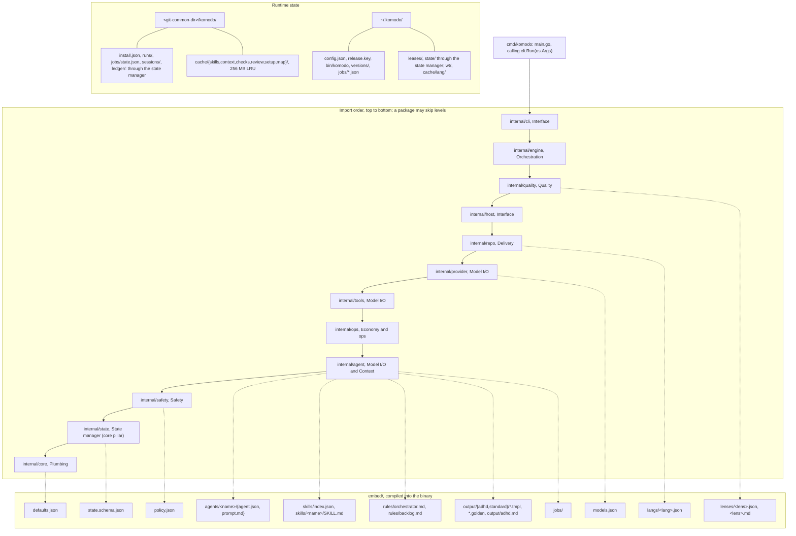
**Reading the diagram.** `cmd/komodo` calls `cli.Run(os.Args)`; the 12 `internal` packages below import only downward and may skip levels. Dotted arrows show which package reads which `embed/` asset, all compiled into the binary. Runtime state splits between `<git-common-dir>/komodo/` and `~/.komodo/`; only `internal/state` reads or writes it, so its boxes say "through the state manager" instead of drawing an arrow.

**What matters**
- `cmd/komodo` is one file, `main.go`, calling `cli.Run(os.Args)`; `go.mod` lists no modules.
- Import order, top down: `cli`, `engine`, `quality`, `host`, `repo`, `provider`, `tools`, `ops`, `agent`, `safety`, `state`, `core`; a file splits at about 600 lines.
- `embed/` holds the 7 agents, 5 workflow skills plus 34 `standards-*`, 10 lenses, `defaults.json`, `policy.json`, `models.json` and the generated `state.schema.json`.
- Per-repo state lives under `<git-common-dir>/komodo/` (state files, sessions, ledger, 256 MB cache); machine state under `~/.komodo/` (config, leases, worktrees).
- Every runtime state file except the 6 exclusions in [Outside the manager (Appendix C)](#outside-the-manager) is read and written only through the state manager ([State manager (Appendix C)](#state-manager)).

**Lookup:** [Appendix A](#appendix-a-document-metadata-conventions-code-structure-and-data-locations) holds the package, embedded asset, runtime state and conventions tables.

## 1. CLI and Configuration

The command-line interface turns a typed `komodo <verb>` into one call into the package that owns the work and prints one JSON envelope. Configuration is the audited settings file that every package reads. What the subsystem is for and who it talks to: [HLD 5.2](hld.md#52-cli-and-configuration).

### 1.1 Scope and Concepts

**Owns:**
- The verb table, the five-step pipeline every verb runs, the envelope, the exit codes, the tiers and the repo pin check.
- `help` and `help --json`, generated at build, and the verb contract written into the repo's `AGENTS.md` block.
- The configuration file `~/.komodo/config.json`: two layers, strict decode, hard limits, the write path, the hash guard and the audit log.
- The 34 flat keys, the agent and endpoint sections, the two environment variables, command detection and the capacity profile.

**Does not own:**
- The work behind each verb. Runs and stages belong to [Engine Internals](#3-engine-internals), `install`, `fresh`, `doctor` and `gate` to [Install, Binary Lifecycle and Gate](#12-install-binary-lifecycle-and-gate), `jobs` and `cache` to [Scheduler, Cache and Observability](#10-scheduler-cache-and-observability), and `plan`, `add` and `release` to [Backlog, Planning, Ship and Release](#11-backlog-planning-ship-and-release).
- Turning codes and facts into report text, which is [Skills, Rules and Output](#8-skills-rules-and-output).
- Reading and writing state files, which is the [State Manager](#13-state-manager).
- Measuring a link's context window and billing, which is [Providers and HTTP](#7-providers-and-http).

**Concepts**

- **Verb:** a `komodo` subcommand such as `run`. Each verb has one row in the verb table.
- **Tier:** who may call a verb. Shared verbs are for a person or the orchestrator, terminal-only verbs for a person at a controlling terminal, internal verbs for the engine.
- **Orchestrator:** the AI session that drives the work through verbs and never edits code. [Glossary](hld.md#12-glossary).
- **Envelope:** the JSON reply `{v, ok, verdict, report, data, error}` that every verb prints when no terminal is attached.
- **Repo pin:** the `min=` version in the Komodo block of the repo's `AGENTS.md`. A binary older than the pin refuses most verbs.
- **Effective config:** the built-in layer overlaid with the machine layer `~/.komodo/config.json`, after strict decode and hard-limit checks.
- **Hard limit:** the largest or smallest value the built-in layer allows for a key. The machine layer cannot pass a hard limit.
- **Flat key:** a dotted setting name such as `limits.pool_max`, stored at the top level of `config.json`.
- **Section:** one of the two nested objects in `config.json`, `agents.<name>` and `endpoints.<name>`.
- **Command class:** one of `setup`, `build`, `test`, `lint`, `format` or `git-read`, detected from marker files.
- **Capacity profile:** the record `{ctx, slots, cost_class, effort}` the engine derives for a link before each session.

### 1.2 Package Layout

| File | Holds |
|---|---|
| `cmd/komodo/main.go` | One file; calls `cli.Run(os.Args)` and exits with the code returned |
| `internal/cli/cli.go` | Verb table, parse, validate, resolve, dispatch, render, envelope, exit codes, pin check |
| `internal/cli/help.go` | `help` text, `help --json` and the `komodo` skill, generated at build and embedded |
| `internal/cli/work.go` | `run`, `status`, `stop`, `resume`, `abandon` |
| `internal/cli/plan.go` | `plan`, `skill`, `scope` |
| `internal/cli/jobs.go` | `jobs` |
| `internal/cli/setup.go` | `install`, `uninstall`, `fresh`, `doctor`, `sync`, `version` |
| `internal/cli/config.go` | The `config` verb: reads, writes, `--default` and `--accept` |
| `internal/cli/repo.go` | `add`, `gate`, `release`, `cache` |
| `internal/cli/internal.go` | `internal tools` and `internal fresh-bg` |
| `internal/core/config.go` | `config.json`, the agent and endpoint sections, hard limits, the audit log |
| `internal/core/detect.go` | Repo profile and command classes |
| `internal/core/version.go` | Embedded version and semantic-version comparison, used by the pin check |
| `internal/core/fs.go` | Atomic file writes |
| `embed/defaults.json` | Built-in default of every key |
| `embed/policy.json` | Guard rows with scopes and steering phrases |

`init` has no file in this layout. The flags of `init` and how `init` writes into the global Claude Code setup are open: [TODO: where the `init` verb lives and what it writes (G-28)].

`embed/defaults.json` and `embed/policy.json` both appear as the home of hard limits in different places of the design. One passage says `defaults.json` holds the default of every setting and `policy.json` the hard limits and the guard rules; the file map says `defaults.json` holds defaults and hard limits together. [TODO: which embedded file holds each key's hard limit, and the layout of both files (G-119)]

Imports run downward only: `cli` sits above every other package and may import any of them; `core` is the lowest and imports no Komodo package. Each verb file holds thin wrappers that call into the owning package, never the logic itself.

**📐 Where the command-line code sits**
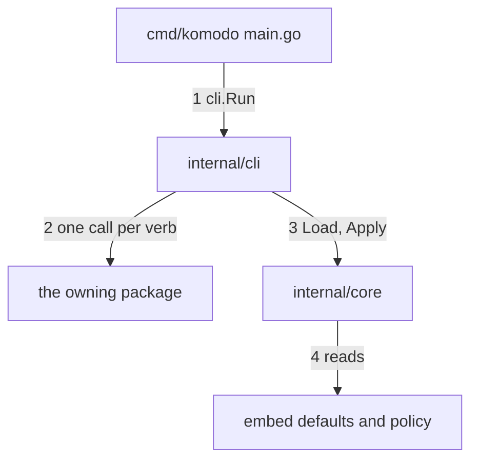

**Entry points**

| Flow | Starts at |
|---|---|
| Process start | `cli.Run(args []string) int` in `internal/cli/cli.go` |
| The five steps | `parse`, `validate`, `resolve`, `dispatch`, `render` in `internal/cli/cli.go` |
| Config read, once per process | `Store.Load` in `internal/core/config.go` |
| Config write | `Store.Apply`, called by the handler in `internal/cli/config.go` |
| Hand-edit check | `Store.Verify`, called by `validate` |
| Command detection | `core.Detect` in `internal/core/detect.go` |

### 1.3 Data Model

#### Envelope and exit codes

Every verb that runs without a terminal, or with `--json`, prints exactly one `Envelope`, `{v: 1, ok, verdict, report, data, error{code, reason, fix}}`, and nothing else. When `ok` is false the `error{code, reason, fix}` object is set and `error.fix` names the resolving command. The handler returns a `Result`; the render step turns the `Result` into the envelope and the exit code.

```go
// internal/cli/cli.go

// Envelope is the one JSON reply every verb prints under --json.
type Envelope struct {
	V       int        `json:"v"`
	OK      bool       `json:"ok"`
	Verdict string     `json:"verdict"`
	Report  string     `json:"report"`
	Data    any        `json:"data"`
	Error   *ErrorBody `json:"error,omitempty"`
}

// ErrorBody explains a refusal or failure; a caller branches on Code.
type ErrorBody struct {
	Code   string `json:"code"`
	Reason string `json:"reason"`
	Fix    string `json:"fix"`
}

// Outcome classifies a finished verb; its value is the process exit code.
type Outcome int

const (
	OutcomeOK       Outcome = 0 // the verb did what was asked
	OutcomeRefused  Outcome = 1 // Komodo declined on purpose
	OutcomeUsage    Outcome = 2 // the command line was wrong
	OutcomeBlocked  Outcome = 3 // the verb reports a blocked state
	OutcomeInternal Outcome = 4 // Komodo itself failed
)

// Result is what a handler returns; render turns Code and Facts into the report.
type Result struct {
	Outcome Outcome
	Verdict string         // one line, first line of the report
	Code    string         // reason code from the closed code list; empty on plain success
	Facts   map[string]any // values the report template prints
	Data    any            // the verb's typed result, placed in Envelope.Data
	Reason  string         // set when Outcome is not OutcomeOK
	Fix     string         // the command or change that resolves it
}
```

| Field | Type | Meaning |
|---|---|---|
| `v` | int | Envelope version, 1; a change to the shape raises the number |
| `ok` | bool | `true` when the verb did what was asked |
| `verdict` | string | One line summing up the outcome |
| `report` | string | Human text already laid out for `output.profile`; the orchestrator relays the text verbatim |
| `data` | object | The verb's typed result; `{}` when the verb returns none |
| `error` | `{code, reason, fix}` | Present only when `ok` is `false`; `code` is the word a caller branches on, `reason` explains the failure and `fix` names the resolving command |

| Exit | Outcome | Meaning |
|---|---|---|
| 0 | `OutcomeOK` | The verb succeeded |
| 1 | `OutcomeRefused` | A terminal-only verb without a terminal, a pinned repo, a tampered config, a locked group or a value over its limit |
| 2 | `OutcomeUsage` | An unknown verb or flag or a bad value; an unknown flag's message names the closest real flag |
| 3 | `OutcomeBlocked` | The verb reports a blocked state |
| 4 | `OutcomeInternal` | Komodo itself failed |

[TODO: which situations exit 3 rather than 1, and which failures exit 4 (G-116)]

[TODO: the `error.code` values for a pin refusal, a missing terminal, a usage error, an over-limit value and an unknown key; the closed code list has `config_tampered` and `locked` but no code for these (G-116)]

[TODO: the `report` text and `data` shape of each verb, and the schema `help --json` prints for each result (G-115)]

A verb that refused, as printed under `--json` after a hand edit of `config.json`; exit code 1.

```json
{
  "v": 1,
  "ok": false,
  "verdict": "Refused: config.json was hand-edited",
  "report": "[TODO: report text (G-115)]",
  "data": {},
  "error": {
    "code": "config_tampered",
    "reason": "config.json was hand-edited",
    "fix": "komodo config --accept"
  }
}
```

A verb that succeeded, `komodo run tg-1.2 --json`; exit code 0.

```json
{
  "v": 1,
  "ok": true,
  "verdict": "Run started for tg-1.2",
  "report": "[TODO: report text (G-115)]",
  "data": {
    "[TODO: key name of the run id (G-115)]": "the run id"
  }
}
```

**Versioning.** A reader branches on `v`. The only version is 1; the design does not say what a caller does with a larger `v`.

#### Verb table

The verb table is the one place that parse, validate, `help --json` and the docs-drift gate check read.

```go
// internal/cli/cli.go

// Tier says who may call a verb.
type Tier int

const (
	TierShared   Tier = iota // a person or the orchestrator
	TierTerminal             // a person at a controlling terminal only
	TierInternal             // the engine only; listed by help --all
)

// FlagSpec describes one verb flag for parsing, help and the docs-drift check.
type FlagSpec struct {
	Name    string // long name without dashes, such as "dry-run"
	Short   string // one-letter form; empty when none
	Kind    string // bool, string, int or duration
	Default string // text form of the default; empty when none
	Help    string // one line shown by help
}

// Verb is one row of the verb table.
type Verb struct {
	Name          string // "run", "config", "internal tools"
	Summary       string // one line shown by help
	Tier          Tier
	Flags         []FlagSpec         // verb-specific flags; global flags are added by parse
	NeedsTerminal func(c *Call) bool // nil when the verb never needs a terminal
	PinExempt     bool               // runs even when the repo pin is above this binary
	Run           Handler
}

// GlobalFlags holds the flags every verb accepts.
type GlobalFlags struct {
	JSON    bool
	Dir     string // -C: act on the repo at this path
	Input   string // --input: file path, or "-" for standard input
	Quiet   bool
	Verbose bool
	NoColor bool
	DryRun  bool
}

// RepoRef names the repo a verb acts on.
type RepoRef struct {
	ID   string // normalized origin URL, or the git common dir path with no remote
	Root string
}

// Call is everything a handler needs, filled by the first three steps.
type Call struct {
	Verb        *Verb
	Args        []string      // positional arguments after flag parsing
	Flags       *flag.FlagSet // the verb's parsed flags
	Global      GlobalFlags
	Repo        RepoRef // zero value when the verb needs no repo
	Config      *core.Effective
	HasTerminal bool
	Stdout      io.Writer
}

// Handler is one verb's thin call into the package that owns the work.
type Handler func(c *Call) Result
```

`PinExempt` is `true` for exactly 5 verbs: `help`, `version`, `fresh`, `install` and `doctor`. `NeedsTerminal` is set for each terminal-only form in the [tier table](#14-interfaces): `config` calls that write, `doctor --fix`, `jobs run|pause|resume`, `cache clear`, `gate --install` and `gate --install-hooks`.

[TODO: the keys of the `--input` JSON object for positional arguments such as a group id or a goal (G-115)]

#### Configuration files

`~/.komodo/config.json` is created by the first `komodo config` write; before that the built-in defaults apply. On Windows the folder is `%LOCALAPPDATA%\komodo`, and `KOMODO_HOME` replaces the folder everywhere.

| Top-level key | Holds |
|---|---|
| A dotted key such as `limits.pool_max` | One flat key; the value's type is that key's type in the [flat key table](#18-config) |
| `agents` | An object keyed by agent name; each value is an agent section |
| `endpoints` | An object keyed by endpoint name; each value is an endpoint section |

A `config.json` in which a person has set three flat keys and one agent section; every value is within its hard limit.

```json
{
  "output.profile": "standard",
  "limits.pool_max": 4,
  "cache.max_mb": 512,
  "agents": {
    "reviewer": {
      "model": "sonnet",
      "session_wall_min": 90,
      "retries": 3
    }
  }
}
```

```go
// internal/core/config.go

// Layer names where a setting's value came from.
type Layer int

const (
	LayerBuiltIn Layer = 1 // embed/defaults.json
	LayerMachine Layer = 2 // ~/.komodo/config.json
)

// Kind is the value type of a flat key.
type Kind int

const (
	KindString Kind = iota
	KindEnum        // one of KeySpec.Enum
	KindBool
	KindInt
	KindNumber   // integer or decimal, such as warn.usd_per_run
	KindDuration // such as 1h or 10m
	KindPath     // a file path
	KindEnvRef   // env:NAME, never a secret value
)

// KeySpec is one row of the built-in registry: a flat key, its default and its hard limit.
type KeySpec struct {
	Name    string
	Kind    Kind
	Default any      // nil when Derived is set
	Enum    []string // allowed values for KindEnum
	Min     any      // hard minimum; nil when none
	Max     any      // hard maximum; nil when none
	MaxKey  string   // another key that caps this one, such as limits.pool_max
	Derived string   // names the rule when the default is computed per group
	Family  bool     // the name ends in a link name, such as limits.link_sessions.claude-cli
}

// Setting is one resolved value and the layer that set it.
type Setting struct {
	Value  any
	Source Layer
}

// AgentSettings is the agents.<name> section; nil fields fall back to the flat keys.
type AgentSettings struct {
	Model          string `json:"model,omitempty"`
	SessionWallMin *int   `json:"session_wall_min,omitempty"`
	SessionIdleMin *int   `json:"session_idle_min,omitempty"`
	Retries        *int   `json:"retries,omitempty"`
}

// EndpointSettings is the endpoints.<name> section; its keys are described in Providers and HTTP.
type EndpointSettings struct {
	URL        string            `json:"url"`
	Models     map[string]string `json:"models,omitempty"` // weight to model name
	Ctx        int               `json:"ctx,omitempty"`
	Key        string            `json:"key,omitempty"` // env:NAME reference only
	SelfHosted bool              `json:"self_hosted,omitempty"`
	FirstByteS int               `json:"first_byte_s,omitempty"`
}

// Effective is the merged config every package reads; a run pins Hash in its state.json.
type Effective struct {
	Flat      map[string]Setting
	Agents    map[string]AgentSettings
	Endpoints map[string]EndpointSettings
	Hash      string
}
```

**Versioning.** `config.json` carries no version field in the design. A reader decodes `config.json` strictly, so a key the running binary does not know is an error that names the closest known key; a file written by a newer binary with a new key therefore fails to load on an older one. [TODO: whether `config.json` gets a version field and how a newer file is treated (G-119)]

#### Audit log and hash

```go
// internal/core/config.go

// Change is one key moving from an old value to a new one.
type Change struct {
	Key string
	Old any
	New any
}

// Batch is one successful write: every change from one `komodo config` call.
type Batch struct {
	ID      string
	Time    time.Time
	Changes []Change
}
```

| Audit field | Meaning |
|---|---|
| time | When the batch was written |
| batch id | Groups the rows of one call |
| key | The flat key or section key that changed |
| old value | The value before the write |
| new value | The value after the write |

`state/config.log` (the full path is `~/.komodo/state/config.log`) holds one row per changed key; `state/config.sha` holds the SHA-256 checksum of `config.json`. Both are the state kind `config_audit`, written with `Append` and `Replace` ([State Manager](#13-state-manager)). `config --accept` logs one row.

[TODO: the line format of `config.log`, the encoding of the checksum in `config.sha`, the batch id format and the shape of the `--accept` row (G-119)]

[TODO: the algorithm and input of the effective-config hash a run pins (G-30)]

#### Command detection

```go
// internal/core/detect.go

// Class is one kind of command the engine and the agents' run tool execute.
type Class string

const (
	ClassSetup   Class = "setup"
	ClassBuild   Class = "build"
	ClassTest    Class = "test"
	ClassLint    Class = "lint"
	ClassFormat  Class = "format"
	ClassGitRead Class = "git-read" // git status, diff, log and show; always on
)

// Command is one detected command, run without a shell.
type Command struct {
	Class  Class
	Argv   []string
	Marker string // the file that produced it; "Makefile" when a target won
}

// CommandSet is the detected commands of one repo and the hash they are cached under.
type CommandSet struct {
	Commands   []Command
	MarkerHash string // hash of the marker files; the cache key
}
```

| Marker | `setup` | `build` | `test` | `lint` | `format` |
|---|---|---|---|---|---|
| `go.mod` | `go mod download` | `go build ./...` | `go test ./...` | `go vet ./...` | `gofmt -l .` |
| `package.json` | `npm ci` | `npm run build` | `npm test` | `npm run lint` | `npm run format` |
| `Cargo.toml` | `cargo fetch` | `cargo build` | `cargo test` | `cargo clippy` | `cargo fmt --check` |
| `pyproject.toml` | none | none | `pytest` | `ruff check` | `ruff format --check` |
| `Makefile` | `make setup` | `make build` | `make test` | `make lint` | `make fmt` |

A marker with no entry for a class leaves that class empty: `pyproject.toml` has no `setup` or `build`, `pytest` tests, and `ruff` lints and checks formatting.

#### Capacity profile

```go
// package core; file placement open

// CapacityProfile is what the engine knows about one link before a session starts.
type CapacityProfile struct {
	Ctx       int    // measured context window in tokens
	Slots     int    // concurrent sessions allowed on the link (limits.link_sessions.<link>)
	CostClass string // subscription, free or paid, from the billing check
	Effort    string // high, medium or low, from the agent's weight
}
```

[TODO: which package defines `CapacityProfile` and the mapping from an agent's weight to `Effort` (G-122)]

### 1.4 Interfaces

#### Go entry points

```go
// internal/cli/cli.go

// Run parses args, runs one verb and returns the process exit code.
func Run(args []string) int

// Renderer is what the render step needs from the output package.
type Renderer interface {
	Report(profile string, code string, facts map[string]any) string
}
```

The renderer's real signature is owned by [Skills, Rules and Output](#8-skills-rules-and-output); this interface states only what the command-line code needs from the output package.

```go
// internal/core/config.go

// ErrTampered means config.json no longer matches the checksum in state/config.sha.
var ErrTampered = errors.New("config.json was edited outside komodo config")

// LimitError reports a value over its hard limit, naming the key, the value and the limit.
type LimitError struct {
	Key   string
	Value any
	Limit any
}

// UnknownKeyError reports a key outside the registry and names the closest one.
type UnknownKeyError struct {
	Key     string
	Closest string
}

// Error describes the exceeded limit.
func (e *LimitError) Error() string

// Error names the unknown key and the closest known one.
func (e *UnknownKeyError) Error() string

// ResetScope says what a --default reset covers.
type ResetScope int

const (
	ScopeKey      ResetScope = iota // one flat key
	ScopeAgent                      // one agent section
	ScopeEndpoint                   // one endpoint section; lists each change, asks for y
	ScopeFile                       // the whole file; lists each change, asks for y
)

// ResetTarget names what a --default reset covers.
type ResetTarget struct {
	Scope ResetScope
	Name  string
}

// Store reads and writes the machine config file; only the config verb writes.
type Store interface {
	// Verify compares config.json with state/config.sha; ErrTampered on mismatch.
	Verify() error
	// Load merges the built-in and machine layers with strict decode and hard-limit checks.
	Load() (*Effective, error)
	// Registry lists every built-in flat key.
	Registry() []KeySpec
	// Apply checks every change against the registry and writes all of them or none.
	Apply(changes []Change) (Batch, error)
	// PlanReset returns the changes that put a target back to its built-in value.
	PlanReset(t ResetTarget) ([]Change, error)
	// Accept rehashes config.json after a hand edit and records the acceptance.
	Accept() (Batch, error)
}

// Int returns the integer value of a flat key.
func (e *Effective) Int(key string) int

// String returns the string value of a flat key.
func (e *Effective) String(key string) string

// Bool returns the boolean value of a flat key.
func (e *Effective) Bool(key string) bool

// TrackUsage resolves track.usage: auto is on under economy mode and off under thorough mode.
func (e *Effective) TrackUsage() bool

// LinkSessions returns the session slots of a link: 3, or 1 for a loopback endpoint, unless set.
func (e *Effective) LinkSessions(link string, loopback bool) int

// SessionWallMin returns an agent's wall-time limit; the agent section beats the flat key.
func (e *Effective) SessionWallMin(agent string) int

// SessionIdleMin returns an agent's silence limit; the agent section beats the flat key.
func (e *Effective) SessionIdleMin(agent string) int

// Retries returns how many times a timed-out or idle session restarts for the same task.
func (e *Effective) Retries(agent string) int

// GroupWallMin returns the wall-time limit of a group with the given task count.
func (e *Effective) GroupWallMin(tasks int) int
```

```go
// internal/core/detect.go

// MarkerFiles are the files command detection looks for, in table order.
var MarkerFiles = []string{"go.mod", "package.json", "Cargo.toml", "pyproject.toml", "Makefile"}

// Detect reads the marker files under root and returns the repo's commands.
func Detect(root string) (CommandSet, error)

// For returns the detected commands of one class.
func (s CommandSet) For(class Class) []Command
```

| Method | An error means | The caller does |
|---|---|---|
| `Store.Verify` | `ErrTampered`: the checksum differs; or the files cannot be read | `validate` exits 1 with `config_tampered` and the fix `komodo config --accept` |
| `Store.Load` | A key is outside the registry, a value has the wrong type or a value is over a hard limit | `resolve` exits 1 naming the key, and the closest key or the limit |
| `Store.Apply` | `UnknownKeyError`, `LimitError` or a type error on one pair | The verb exits with a refusal and nothing is written, so the file and the audit log are unchanged |
| `Store.PlanReset` | The target names no known key, agent or endpoint | The verb refuses; for endpoint and file scopes the verb lists each change and waits for a typed `y` |
| `Store.Accept` | The file cannot be hashed | The verb exits with a failure and the guard stays tripped |
| `Detect` | A marker file cannot be read | The caller fails; an empty set is not an error, and `run` refuses naming `MarkerFiles` |

[TODO: the exit code and `error.code` for an unknown key, a type error and a failed read; see the exit-code gap (G-116)]

[TODO: how the `model` hard limit, a probed model, is checked when a value is written, since `core` cannot import the state manager that holds the probe result (G-119)]

| Caller | Calls | When |
|---|---|---|
| `cli.validate` ([1.5](#15-behaviour)) | `Store.Verify` | Every verb except `config --accept` |
| `cli.resolve` | `Store.Load`, then `Detect` for verbs that need commands | Once per process |
| The `config` handler | `Registry`, `Apply`, `PlanReset`, `Accept` | Config writes, after the terminal check |
| Engine ([Engine Internals](#3-engine-internals)) | `Effective` accessors and `Hash` | At run start; the hash is saved in the group's `state.json` |
| Engine | `CapacityProfile` derivation | Before each session starts |
| Brief builder ([Sessions, Agents and Briefs](#5-sessions-agents-and-briefs)) | `CapacityProfile.Ctx` | Sizing every prompt |
| Check and the `run` tool ([Tools, Guard and Sandbox](#6-tools-guard-and-sandbox)) | `CommandSet.For` | Running a class of command |
| `komodo gate` | The verb table against `help --json` | Every gate run |

#### Global flags

| Flag | Meaning | Default |
|---|---|---|
| `--json` | Print only the envelope | On when there is no terminal |
| `-C <path>` | Act on the repo at that path; the repo id is resolved from that path | The current folder |
| `--input <file\|->` | The verb's arguments as one JSON object, from a file or from standard input (`-`); an explicit flag wins over the same key | none |
| `-q`, `-v` | Less or more human text in `report`; long forms `--quiet` and `--verbose` | none |
| `--no-color` | Plain text; the `NO_COLOR` variable does the same | `output.color` |
| `-h`, `--help` | Same as `komodo help <verb>`; at any level of `config`, the flag lists the keys below that level | none |
| `--dry-run` | On every writing verb: print each write, make none; `install --dry-run` prints a table of file, action (`write | keep | prune`) and reason | none |

#### Tiers

| Tier | Who calls it | Verbs |
|---|---|---|
| Shared | A person or the orchestrator | `help`, `version`, `doctor`, `sync`, `add backlog`, `add changelog`, `plan`, `run`, `status`, `skill`, `scope approve|deny`, `resume`, `stop`, `abandon`, `jobs list|show|tick`, `cache stats`, `gate` without `--install*`, `config` reads |
| Terminal-only | A person; refused with exit 1 without a controlling terminal | `install`, `init`, `uninstall`, `fresh`, `config` writes, `doctor --fix`, `jobs run`, `jobs pause`, `jobs resume`, `cache clear`, `gate --install`, `gate --install-hooks`, `release` |
| Internal | The engine | `internal tools`, `internal fresh-bg` |

Agent shells have no controlling terminal: Claude Code's Bash tool cannot open `/dev/tty`. No host hook enforces tiers; every host gets the same `AGENTS.md` rules and verbs, and orchestrator rule O7 forbids faking a terminal although nothing enforces the rule.

#### Verbs

| Verb | Flags |
|---|---|
| `help [verb]` | `--all` |
| `version` | `--check` |
| `install` | `--repo-only`, `--machine-only`, `--hosts claude,codex`, `--no-path`, `--from <file>`, `--project`, `--schedule`, `--force` |
| `uninstall` | `--repo-only`, `--machine-only` |
| `init` | [TODO: flags of `init` (G-28)] |
| `fresh` | `--check`, `--to <version>`, `--restart-runs` |
| `doctor [install\|backlog]` | `--fix`, `--sandbox <cmd>` |
| `config [agent\|endpoint <name>] <key>[=<value>]…` | `--all`, `--default`, `--accept` |
| `sync` | `--no-fetch` |
| `add backlog` | `--task`, `--group`, `--epic`, `--to <id>`, `--files <globs>`, `--done-when <text>` |
| `add changelog` | `--entry <text>`, `--kind added\|changed\|fixed\|removed` |
| `plan <goal>` | `--from <spec>`, `--epic <N>` |
| `run [group]` | `--stage <stage>` |
| `status [run]` | `--watch`, `--wait blocked\|done\|any`, `--timeout <dur>` (9m), `--session <id>`, `--explain`, `--backlog`, `--metrics`, `--all` |
| `skill list\|get` | `list --agent <name>`, `get <name> --section <heading>` |
| `scope approve\|deny <group>` | `--paths <list>`, `--reason <text>` |
| `resume <run>` | `--from <stage>` |
| `stop <run>` | none |
| `abandon <run>` | `--reason <text>`, `--keep-worktree` |
| `jobs list\|show\|run\|pause\|resume\|tick` | `<id>`; `run --ignore-window` |
| `cache stats\|clear` | `--kind skills\|context\|checks\|review\|lang`, `--all` |
| `gate` | `--only <check>`, `--fast`, `--install`, `--install-hooks` |
| `release <version>` | `--notes-file <path>` |

**Help, version and installation**
- **`help [verb]`:** Prints the verb list, or one verb's flags and examples, from text generated at build and embedded, so `help` answers under 50 ms and changes nothing. `help --json` lists every verb, flag, type, default and result schema and marks the terminal-only verbs; the `AGENTS.md` block tells the orchestrator to run `help --json` first. `--all` also shows the internal tier.
- **`version`:** Prints the running version, the binary's path, the latest release Komodo knows of from `state/fresh.json` and the repo pin from `AGENTS.md`. `version` makes no network call and changes nothing. [TODO: what `--check` adds (G-117)]
- **`install`:** A person at a terminal runs `install`. `install` places the binary under `~/.komodo/versions/` and `bin/`, adds the path entry, probes providers, writes the Komodo block into `AGENTS.md`, the `@AGENTS.md` line into `CLAUDE.md` and two entries into `.claude/settings.json`, records the manifest and optionally an operating-system schedule entry; the steps are in [Install, Binary Lifecycle and Gate](#12-install-binary-lifecycle-and-gate). `install` diffs the wanted file list against `install.json`, applies only the differences, runs `doctor install` and fails when any check errors. A rerun makes 0 changes, a hand-edited owned file survives and is reported, and `install` never writes a config file.
- **`install` flags:** `--repo-only` writes only files inside the repo; `--machine-only` only the machine parts, which is what `install.sh` runs; `--hosts claude,codex` overrides host detection; `--no-path` skips the path step; `--from <file>` installs that binary file; `--project` also adds `docs/{prd,hld,lld}.md`, `CHANGELOG.md` and a pull request template; `--schedule` adds a launchd, cron or Task Scheduler entry that runs `komodo jobs tick` every 5 minutes; `--force` overwrites hand-edited owned files.
- **`uninstall`:** A person runs `uninstall`. `uninstall` reads the manifest and removes every file or settings entry `install` owns, in reverse, plus the repo's language cache. `--repo-only` and `--machine-only` limit the removal.
- **`init`:** A person at a terminal runs `init`, typically once after `install`. `init` puts Komodo's orchestrator skills and commands (`run`, `plan`, `respond`, `komodo`) into the global Claude Code setup; the 7 worker agents stay inside the binary because worker sessions load no user settings. [TODO: how `init` writes there, as a Claude Code plugin or as plain files with a machine manifest (G-28)]
- **`fresh`:** A person runs `fresh`. `fresh` downloads the newest release to `versions/<v>/`, verifies the SHA-256 checksum and the ed25519 signature, and atomically replaces `bin/komodo`; live runs keep their own version. `--check` fetches the 1 KB `latest.json` now, one of only three places that do. `--to <version>` installs a named version and may downgrade. `--restart-runs` signals each live run to save its work within 2 minutes and resumes the run on the new binary, at the cost of at most one repeated model turn. A pinned repo names `fresh` in the fix line `run komodo fresh`; `fresh.auto` set to `false` or `CI=true` turns background updates off.

**Health and configuration**
- **`doctor [install|backlog]`:** Anyone runs `doctor`, including the orchestrator, and `doctor` still runs when the repo is pinned above the binary. `doctor` prints each check's result with a fix line and changes nothing except refreshing the provider probe in `state/providers.json`. With no argument, `doctor` runs both halves. `install` runs `doctor` at the end; phase 2 requires `doctor backlog` to pass on epic-1; cutover requires `doctor install` to find 0 stale references. `--fix` is terminal-only; `doctor --sandbox <cmd>` runs one command under the sandbox policy to show what a worker's `run` would see. [TODO: what `--fix` fixes (G-117)]
- **`doctor install` checks:**
  - The installed files against the manifest, the path entry and the sandbox, by running each detected command's `--version` inside the sandbox to prove the toolchain folders work.
  - The provider catalog as a table of weight, link, model identifier, window and the source of the window; each `http:` endpoint's context against `providers.ctx_floor`, where an Ollama server left at 4,096 fails and the fix `OLLAMA_CONTEXT_LENGTH=262144` is named; `OLLAMA_NUM_PARALLEL`; and that every agent's chain ends in a free backstop.
  - A missing or bad custom certificate file; shell syntax in detected commands; missing Docker tools and that the Docker daemon runs Linux containers; Windows long paths; the copy mechanism for tester worktrees; and that macOS has no process or memory cap.
  - Steering phrases or broken block markers in the repo's `AGENTS.md`; stale `~/.claude` files naming verbs missing from `help --json`; old Komodo hooks and shadowing binaries; and 3 background update failures in a row.
  - The cost class of each link, reviewer rules under 50% verified, and whether a lighter model's first-pass rate beats the standard one.
- **`doctor backlog` checks** (`komodo doctor backlog`) the files under `docs/backlog/` against the lint table in [Backlog, Planning, Ship and Release](#11-backlog-planning-ship-and-release): file shape, `files`, `done_when` and dependencies; that groups in one wave share no files; no protected path and no `docs/backlog/**` path in `files`; sizing of 5 files and 300 lines per task, 8 tasks per group and chains of 4; graph shape and cycles; the EARS form of acceptance items (the Easy Approach to Requirements Syntax); and case-colliding paths.
- **`config [agent|endpoint <name>] <key>[=<value>]…`:** Reads are shared; writes need a person at a terminal, so no session can change its own settings. `komodo config mode limits.returns` prints each value and which layer set each; an agent or endpoint name alone lists its keys. `komodo config mode=economy limits.returns=4` sets every pair or none, refuses an unknown key (naming the closest match) or a value over its hard limit, appends one audit row per changed key and rewrites `state/config.sha`. `agent <name>` and `endpoint <name>` address one agent's or one model server's keys. `--all` alone prints JSON of every key with value, default, limit and source; after a key, `--all` lists that key's valid values. `--default` resets a key, an agent, a group or the whole file; endpoint and whole-file resets list each change and need a typed `y`. `--accept` rehashes `config.json` after a hand edit. One call reads or writes, never both. [TODO: what "a group" means as a `--default` target (G-119)]
- **`sync`:** Anyone runs `sync` after a person merged the epic pull request. `sync` fetches from the remote, prunes worktrees whose work has landed and refreshes the repo files, which is `install --repo-only` plus fetch and prune. `sync` also rewrites the `AGENTS.md` block after `config output.profile=standard`. `--no-fetch` skips the fetch.

**Backlog and planning**
- **`add backlog`:** Anyone runs `add`. `add` adds one task, group or epic file under `docs/backlog/`, which is where out-of-scope work gets parked. `--task <text>`, `--group <title>` or `--epic <title>` says what to add, `--to <id>` names the parent, `--files <globs>` lists the files the work may touch and `--done-when <text>` gives the check that proves a task done. `add` refuses with `locked` and the run id while that group is in a run. A repeat with the same task reports `0 changes`.
- **`add changelog`:** Anyone runs `add`. `add` adds one line to the `Unreleased` section of `CHANGELOG.md`; `--entry <text>` is the line and `--kind` files the line under added, changed, fixed or removed. [TODO: Komodo's code standards forbid an `Unreleased` section, so what `add changelog` writes is undecided (G-118)]
- **`plan <goal>`:** Anyone runs `plan`, usually the orchestrator; `plan` costs model tokens. A heavy pass drafts the epic outline (groups, goals, file globs, dependencies), then one standard pass per group drafts that group's tasks and acceptance items, in parallel. Go lints every draft; a failing draft goes back into its session twice, then the plan blocks with `lint`. A bad plan writes 0 files. `--from <spec>` feeds any document set as input; `--epic <N>` adds or amends only unlocked groups in an existing epic.

**Runs**
- **`run [group]`:** Anyone runs `run`, usually the orchestrator. `run <group>` starts one group. `run` builds the dependency graph from the backlog, queues every group whose dependencies have landed, prints the run id at once and leaves the engine running detached under a small parent guard; the stages are in [Event Spine and State Machine](#26-state-and-transitions). `run` refuses, naming the dependency, a group whose dependency outside this run has not landed; `run` refuses, naming the holder, a group another run holds; and `run` refuses, naming the marker files that `run` looked for, a repo with no detected commands. `--stage <stage>` runs one stage only. Typical use: `komodo run tg-1.2`, then `komodo status --wait` in the background, where `--wait` returns on the next wake event.
- **`status [run]`:** Anyone runs `status`; a Claude `SessionStart` hook runs `status` so a new session sees state on line one. `status` prints the version, live runs, the session pool, each group's stage, the group graph (dependencies and which groups touch which files), budgets, blocked groups with their reason, the model and cost class of each running session, and warnings, and ends with `Verbs: komodo help`. `status` is one of three places that may fetch `latest.json`, at most hourly, and `status` fires due pause timers.
- **`status` flags:** `--watch` redraws live. `--wait blocked|done|any` blocks until the next wake event (`group.blocked`, `group.paused`, `run.done`, `run.stopped`; `any` adds `stage.enter`). `--timeout <dur>` caps that wait at 9 minutes by default, because Claude Code's Bash tool stops at 2 minutes by default and 10 at most. `--session <id>` prints a session's stream tail and result. `--explain` prints the last 10 events with reasons. `--metrics` prints the scorecard of first-pass rate, returns, finding precision, cache hit rate and, when `track.usage` is on, tokens and US dollars per accepted group. [TODO: what `--backlog` and `--all` print (G-117)]
- **`skill list|get`:** Anyone runs `skill`, including a Claude Code session outside a run. `list` prints the embedded skill index, a map read under 50 ms; `get <name>` prints a skill's body and `--section <heading>` one section; `komodo skill get run|plan|respond|komodo` returns the workflow for each job. `skill` changes nothing. [TODO: the filter `list --agent <name>` applies (G-117)]
- **`scope approve|deny <group>`:** The orchestrator usually answers; a person can. A builder that needs a file outside its group's `files` stops with status `needs_scope`, the group blocks and `status --wait` wakes the orchestrator. `approve` adds the paths to `files` (action `scope_change`, logged in the ledger) and the engine resumes the same session with the answer; `deny` resumes the session with the refusal. `--paths <list>` names the paths and `--reason <text>` the reason. The engine denies by itself, without asking, when a path is protected or belongs to another live group. One request per task.
- **`resume <run>`:** Anyone runs `resume`, because Blocked never retries by itself. `resume` replays the state events after the snapshot through group state's `Load`, retakes the lease or refuses naming the new holder, rebuilds a removed worktree from the hidden ref, and continues each session from the provider's resume handle; if that fails `resume` starts a fresh session with the brief, the uncommitted diff and the last summary, logging `resume_lost`. Paused agents attempt now; a refused attempt costs no turn and re-pauses. [TODO: what `--from <stage>` does beyond its name (G-117)]
- **`stop <run>`:** Anyone runs `stop`. `stop` performs the clean shutdown a signal does: stop each agent (30 s each), commit unsaved work in every worktree to its hidden ref, free the leases, write `state.json` and exit; after 60 s the rest is force-killed. `stop` writes `run.stopped`, and `resume <run>` continues later.
- **`abandon <run>`:** Anyone runs `abandon` to drop a run for good. `abandon` stops the run, frees its leases and task-list lock, clears any pause timer, deletes the hidden ref and keeps the evidence (state files, ledger rows, session folders). Groups that depended on the abandoned run block with `dependency`, naming the run. `--reason <text>` records why; by default the sweep removes a worktree with no live lease and no unsaved work. [TODO: what `--keep-worktree` keeps (G-117)]

**Scheduling, cache, gate and release**
- **`jobs list|show|run|pause|resume|tick`:** `list`, `show` and `tick` are shared; `run`, `pause` and `resume` need a person. A job template is a JSON file naming an agent subset, brief slots and an interval, such as a nightly review; none ship by default. `list` and `show <id>` read `embed/jobs/` and `~/.komodo/jobs/`. `tick` is one idempotent engine step with no daemon: `tick` queues due jobs, fires due pause timers and drives the pool once; with nothing due `tick` exits under 50 ms with no network call. The entry from `install --schedule` calls `jobs tick` every 5 minutes, and Claude Code `/loop` also works but spends a model turn per tick. A due job starts a run named `job-<name>-<n>` that `status --wait` can take. [TODO: what `run <id> --ignore-window`, `pause <id>` and `resume <id>` do beyond their names (G-117)]
- **`cache stats|clear`:** `stats` is shared and `clear` needs a person. The cache is the content-addressed store under `<git-common-dir>/komodo/cache/` plus the language caches under `~/.komodo/cache/lang/`. `stats` prints size and hit rate for this repo and `--all` the machine total across repos. `clear` purges entries; `--kind skills|context|checks|review|lang` limits the purge to one kind, where `lang` is the language caches.
- **`gate`:** Anyone runs `gate`, in the Komodo repo only; `gate` is Komodo's self-check before a change is accepted, and the checks are in [Install, Binary Lifecycle and Gate](#12-install-binary-lifecycle-and-gate). `gate` covers `go vet`, tests and cross-builds for Windows, Linux and macOS, import direction, comment lint, strict decode of every `agent.json` and job template, the guard table, event catalog completeness, docs drift (a verb missing from `README.md` or the `komodo` skill, a broken decision link, a package named in this document that does not exist), component maps, no silent gaps, generated artifacts matching their sources and timing (short verbs under 50 ms, the gate under 3 minutes). Checks run in parallel by package, with cross-builds last. `--fast` skips cross-builds and timing. `--install` places a dev build at `~/.komodo/bin/komodo` and `--install-hooks` installs git hooks in the Komodo repo; both need a person. [TODO: what `--only <check>` selects beyond its name (G-117)]
- **`release <version>`:** A person runs `release`, on the owner's machine, in the Komodo repo only. `release` sets the version, tags, cross-builds the binaries, writes checksums, signs them with `~/.komodo/release.key` (ed25519) and publishes a release whose `latest.json` every `fresh` reads; betas publish as normal releases with `beta` in the version. [TODO: what `--notes-file <path>` supplies (G-117)]

**Internal tier** (`komodo internal <verb>`), listed only in `help --all`:

| Verb | Called by | Does |
|---|---|---|
| `internal tools --agent <a> --session <id>` | The engine, for each `claude -p` worker session | The private tool server for one session, speaking the Model Context Protocol over standard input and output; advertises only that agent's tools, such as `read`, `edit` and `run`, passes every call through the guard, starts in under 100 ms and dies with its session |
| `internal fresh-bg` | Any verb, only when `state/fresh.json` shows a newer release | The detached updater: downloads to `versions/<v>/komodo.part`, verifies SHA-256 and the ed25519 signature, renames the file into place, swaps `bin/komodo` and deletes versions no run uses; never downgrades, logs failures silently to `state/fresh.log` and allows one at a time through `state/fresh.lock` |

#### Orchestrator contract

`install` writes a Komodo block into the repo's `AGENTS.md` between `komodo:begin min=<version>` and `komodo:end`. The block, rendered from `embed/rules/orchestrator.md` ([Skills, Rules and Output](#8-skills-rules-and-output)), tells any host session:

- Run `komodo help --json` first; the session learns the surface from the binary, not from memory.
- The session's verbs are the shared set: `plan`, `run`, `status`, `skill`, `scope`, `add`, `stop`, `resume`, `abandon`, `sync`, `doctor`, `gate`, `jobs tick` and config reads.
- `install`, `fresh`, config writes, `gate --install` and `release` belong to the person and refuse without a terminal; the session hands the command to the person.
- Run `status --wait` in the background, so the session reacts to a Blocked group without polling.
- Relay `report` verbatim; rewriting text that is already in the output style only loses information.
- Orchestrator rules O1 to O7, O9 and O10 and the output style follow in the same block.

A Claude `SessionStart` hook, written to `.claude/settings.json` by `install`, runs `komodo status` when a session opens, so the first line a new session sees is the live state.

### 1.5 Behaviour

#### Walkthrough

A person in a terminal sets two keys with `komodo config mode=economy limits.returns=4`, the two-pair form of `komodo config key=value`: `komodo config k=v k2=v2` sets every pair or none.

**📐 One config write, from the terminal to disk**
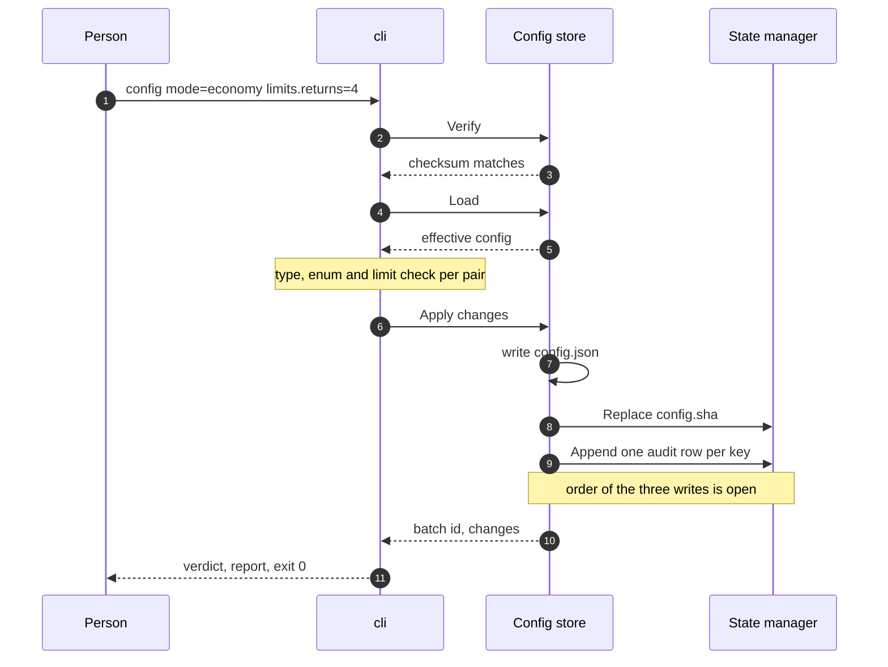

1. **Parse:** `Run` selects the `config` row of the verb table. The two words with `=` are positional arguments.
2. **Validate:** the pin check passes. Because the call contains `=`, `NeedsTerminal` returns `true` and the process has a controlling terminal. `Store.Verify` finds the checksum matching.
3. **Resolve:** `Store.Load` returns the effective config once for the process.
4. **Dispatch:** the handler looks up `mode` and `limits.returns` in `Registry`, accepts `economy` as a member of the `mode` enum and `4` as at most the hard limit 5 of `limits.returns`, and compares each with the current value.
5. **Apply:** both values differ from the current ones, so `Apply` receives two changes and writes the file, the checksum and two audit rows under one batch id.
6. **Render:** the result carries the batch id and the two changes. The report lists them and the process exits 0.
7. **Repeat:** running the same line again produces no changes and reports `0 changes`; no audit row is written.

[TODO: the order of the three writes in step 5 and what a crash between them leaves behind (G-119)]

#### Algorithms

**📐 The five steps and where a refusal leaves**
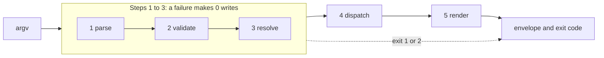

**Pipeline.** Every verb takes the same five steps; a failure in steps 1 to 3 has made 0 writes, and `--dry-run` applies from step 4.

1. **Parse.** `parse` finds the verb in the verb table, builds a `flag.FlagSet` with Go's standard `flag` package from the global flags and the verb's `Flags`, and parses the rest of `argv`. An unknown flag is a usage error that names the closest known flag. With `--input <file|->`, the JSON object is read from the file or from standard input (`-`) and each key is applied as if typed, except where the same flag is on the command line, which wins. `-h` and `--help` run `help <verb>` for the verb.
2. **Validate.** `validate` runs these checks in order and returns the first refusal:
   1. Pin check: when `PinExempt` is `false` and the repo pin is above the running version, refuse with exit 1 and the fix `run komodo fresh`.
   2. Types and enums of every flag value; a failure is a usage error with exit 2.
   3. Terminal check: when `NeedsTerminal(c)` returns `true` and the process has no controlling terminal, refuse with exit 1.
   4. Hash guard: `Store.Verify`; on `ErrTampered` refuse with `config_tampered`, except for `config --accept`.
3. **Resolve.** `resolve` takes the repo id from the working folder or `-C`, calls `Store.Load` once and, for a verb that needs commands, calls `Detect`. The repo id is the normalized origin address such as `github.com/rdevitto86/komodo-agentic-harness-coding`; with no remote the id is the git common directory path, so every worktree of a repo shares one id. The id names worktrees, leases and caches, never config.
4. **Dispatch.** `dispatch` calls the handler with the filled `Call`. The handler makes one thin call into the owning package, such as `engine` for `run`, and never opens state files itself. With `--dry-run` the owning package prints each write the verb would make and makes none.
5. **Render.** `render` passes `Result.Code` and `Result.Facts` through the template set for `output.profile` into `report`. `render` prints the envelope when `--json` is on, which is automatic with no terminal, and plain text otherwise, then returns the exit code of `Result.Outcome`.

[TODO: the distance measure and cutoff behind "closest known flag or key", what is said when nothing is close, and whether an unknown agent name is refused (G-121)]

[TODO: how the pin check and repo resolution behave for a verb run outside a git repository, and whether `help` and `version` are exempt from the hash guard (G-121)]

[TODO: how the terminal check works on native Windows (G-121)]

**Pin check.**
1. Read the repo's `AGENTS.md` and find the line `komodo:begin min=<version>`.
2. Compare the version with the embedded version by semantic-version order.
3. When the pin is higher and the verb is not exempt, return a refusal with exit 1.
4. The exempt verbs are `help` (to see the verb list and the fix line), `version`, `fresh` (the fix itself), `install` (`install` can place a binary with `--from`) and `doctor` (to diagnose before updating).

**Effective config.**

**📐 How the two layers become one config**
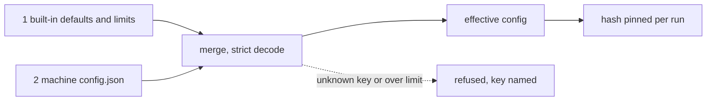

1. Read the built-in defaults and hard limits from the embedded files. Every key has a value there, so no key is ever missing.
2. Read `config.json` if the file exists; absent means the built-in layer alone applies.
3. Decode strictly: each top-level key must be a registry key, a member of the `limits.link_sessions.<link>` family, `agents` or `endpoints`; otherwise fail naming the closest key.
4. Check each value against its `Kind`, its `Enum`, its `Min`, `Max` and `MaxKey`; fail naming the key, the value and the limit.
5. Take the machine value where present and the built-in value elsewhere, and record the `Layer` that set each.
6. Compute `Hash` of the result. A run saves the hash in `runs/<group-id>/state.json`; edits made during a run do nothing to that run. The hash is also the prefix of every cache key, so a config change never serves a stale brief or check.

**Config write.**
1. Refuse a call that mixes reads (`key`) and writes (`key=value`).
2. For each pair, find the `KeySpec`, parse the value to its `Kind` and check enum membership, the `env:` form for `KindEnvRef`, the hard limits and `MaxKey`. An agent or endpoint call checks the section's keys the same way.
3. Drop a pair whose value equals the effective value.
4. When any pair fails, return its error and write nothing: a call sets every pair or none.
5. With `--dry-run`, print the changes and stop.
6. Call `Store.Apply` with the remaining changes. `Apply` writes `config.json`, rewrites `state/config.sha` and appends one audit row per changed key under one batch id. `~/.komodo/**` is protected by guard row G3, so no model session can reach any of these files.

**Reset.** `--default` calls `PlanReset` for a key, an agent, an endpoint or the whole file, then follows the write path with the planned changes. For an endpoint or the whole file the verb first lists each change and waits for a typed `y`.

**Accept.** `config --accept` runs the terminal check, calls `Store.Accept`, which rehashes `config.json` into `state/config.sha`, and logs one audit row. `config --accept` is the one call the hash guard lets through.

**Command detection.**

**📐 From marker files to commands**
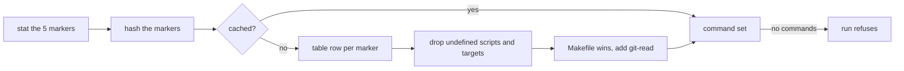

1. Run `stat` on each file in `MarkerFiles`; a cold repo costs one `stat` per marker.
2. Hash the marker files; a cached `CommandSet` under that hash is returned as is.
3. Otherwise take the row of the [marker table](#13-data-model) for each marker present.
4. Keep only what exists: an npm script or a make target is used only when the file defines it, and `npm ci` needs a lockfile.
5. When the Makefile defines a target for a class, that target wins over the detected command.
6. Add `git-read`, which is always on: `git status`, `diff`, `log` and `show`.
7. Commands run without a shell, so shell syntax in one fails `doctor`. Each runs in the sandbox, except `git-read` under Docker, which runs on the host.
8. `setup` belongs to the engine: Intake runs `setup` once per worktree with the network on, and no agent can run `setup`.
9. With no detected commands, `run` refuses and names the markers that `run` looked for; read-only agents still run.

[TODO: how commands combine when a repo has two markers, such as `go.mod` and `package.json` (G-122)]

**Capacity profile.** Before each session the engine derives the record for the link the next session will use:
1. `ctx` is the context window measured for the link ([Providers and HTTP](#7-providers-and-http)).
2. `slots` is `limits.link_sessions.<link>`.
3. `cost_class` comes from the billing check of the link.
4. `effort` comes from the agent's weight.

The brief builder sizes every prompt from `Ctx`, the engine takes a slot from `Slots`, and budgets cache by the whole profile. Swapping Claude for a local or an OpenAI link changes the profile and never the engine.

**Short verbs.** `help`, `version`, config reads and `skill` answer under 50 ms with no network and no repo scan beyond marker stats. `help` reads embedded, build-time text. `version` reads the embedded version and `state/fresh.json`. Config reads parse the file once per process. The `skill` index is embedded at build, so `skill list` is a map read, and bodies come from the cache. `help --json` and the `komodo` skill are generated at build and embedded. The 50 ms budget is a target until the gate measures it. [TODO: confirm the 50 ms budget by gate timing (G-19)]

**Concurrency.** Each verb is one process. Config is parsed once per process and read-only after that, and a run reads the snapshot that run pinned at start. [TODO: locking when two processes write `config.json`, `config.sha` and `config.log` at once, or one reads while another writes (G-120)]

### 1.6 State

Only the config file guard has state. A verb itself holds none: every run of `Run` starts clean.

**📐 The config file guard**
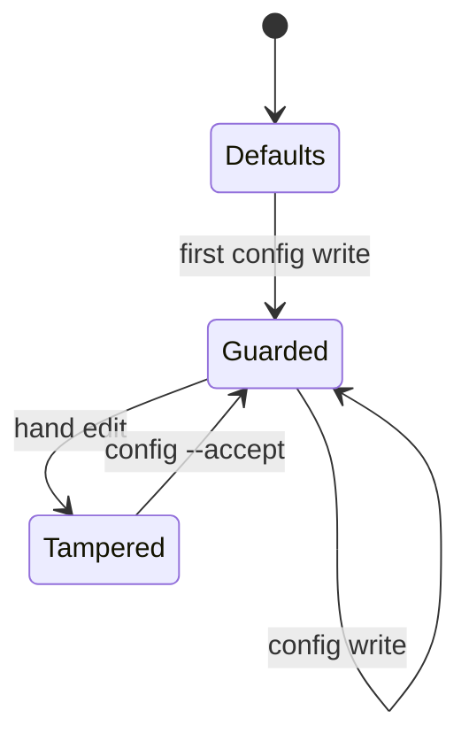

| State | Event | Next | True afterwards |
|---|---|---|---|
| Defaults | `config` write | Guarded | `config.json` exists; `state/config.sha` matches the file; one audit row per changed key |
| Guarded | `config` write | Guarded | The file, the checksum and the audit log changed together, or none of them |
| Guarded | Hand edit of `config.json` | Tampered | The checksum no longer matches; Komodo wrote nothing |
| Tampered | Any verb except `config --accept` | Tampered | Exit 1 with `config_tampered`; 0 writes |
| Tampered | `config --accept` | Guarded | The checksum matches the edited file; one audit row logged |

- **Defaults:** `config.json` does not exist; the built-in layer applies.
- **Guarded:** `config.json` matches the checksum in `state/config.sha`.
- **Tampered:** the checksum differs; every verb refuses.

[TODO: the state when `config.json` exists with no `state/config.sha`, when the checksum exists with no file, and when the file is deleted (G-119)]

### 1.7 Invariants and Failures

**Invariants**
1. The pin check runs before every other check, so an old binary never acts on a repo that needs a newer one.
2. A verb that fails in steps 1 to 3 has made 0 writes.
3. Every writing verb is idempotent: a repeat with the same arguments reports `0 changes`.
4. `config.json` is written only by `komodo config`, which needs a terminal, so no model session changes its own settings.
5. A `komodo config` call writes every pair or none, and writes one audit row per changed key.
6. A run's effective config is the snapshot pinned at the run's start; later edits do not reach the run.
7. A secret is never in config or logs: key settings are `env:NAME` references.
8. Security rows are never config. The only guard setting is `guard.refusal_limit`.
9. Tiers are enforced by the terminal check alone; no host hook enforces them.

**Failures**

| Situation | Detection | Behaviour |
|---|---|---|
| Unknown verb or flag, or a bad value | `parse`, `validate` | Exit 2; an unknown flag names the closest real flag |
| Repo pinned above the binary | Pin check | Only `help`, `version`, `fresh`, `install`, `doctor` run; every other verb exits 1 with the fix `run komodo fresh` |
| Hand-edited `config.json` | `Store.Verify` | Every verb refuses `config_tampered` until `config --accept` |
| Terminal-only verb without a terminal | `NeedsTerminal` | Exit 1; the verb does not run, so `komodo install` and `komodo config providers.paid=allowed` change nothing |
| Config write with an unknown key | `Store.Apply` | Refused naming the closest key; nothing is written |
| Config write over a hard limit | `Store.Apply` | Refused naming the key, the value and the limit; the file is unchanged |
| One bad pair out of several | `Store.Apply` | Nothing is written for any pair |
| A call that reads and writes | `config` handler | Refused: one call reads or writes, never both |
| `--default` on an endpoint or the whole file without a typed `y` | `config` handler | No change is written |
| `run` with no detected commands | `Detect` returns an empty set | `run` refuses and names the marker files it looked for; read-only agents still run |
| `add backlog` on a group that is in a run | Handler | Refused with `locked` and the run id |
| `--input` unreadable or not a JSON object | `parse` | [TODO: exit code and message (G-115)] |

Shell syntax in a detected command, and a missing or bad file named by `http.ca_bundle`, are reported by `doctor`, not refused by the pipeline.

### 1.8 Config

The 34 flat keys: 25 here, and 9 provider keys in [Providers and HTTP](#78-configuration-and-constants). A value outside the hard limit is refused.

| Key | Type | Default | Hard limit | Effect |
|---|---|---|---|---|
| `output.profile` | enum | `adhd` | none | Text layout for everything a person reads: `adhd` (verdict first, bold labels, tables for data lists, at most 5 bullets and 3 options, turn-end headings in order) or the plainer `standard`. Facts and codes are the same under both, and no repo setting or flag changes a template. After a change, `komodo sync` rewrites the rules block in `AGENTS.md`. |
| `output.turn_end_summary` | bool | `true` | none | Turns the 4 fixed headings at the end of every report on or off. [TODO: which 4 headings (G-122)] |
| `output.color` | enum | `auto` | none | `auto` decides from the terminal, `on` forces colour, `off` removes colour. Applied only when text is rendered, so facts never change. |
| `mode` | enum | `thorough` | none | `economy` or `thorough`. `thorough` runs every reviewer lens that applies plus a cold pass; `economy` runs one merged lens at reduced depth. `mode` sets the `auto` default of `track.usage` and never changes which model runs. |
| `track.usage` | enum | `auto` | none | `auto`, `on` or `off`; `auto` is on in `economy` mode and off in `thorough` mode. Behaviour below the table. |
| `fresh.auto` | bool | `true` | none | Background self-update. When `true`, a verb that sees a newer release spawns a detached updater; live runs keep their own version. |
| `fresh.interval` | duration | `1h` | ≥ 10m | How long the release manifest is cached; the check is one 1 KB fetch on the few verbs that already touch the network. |
| `limits.pool_min` | int | 1 | `limits.pool_max` | Session slots the machine-wide pool keeps open after a rate-limit error shrinks the pool, so work never stops entirely. |
| `limits.pool_max` | int | 6 | 16 | The most builder, reviewer and tester sessions at once across all repos; further ready groups queue. |
| `limits.group_wall_min` | int | tasks × `limits.session_wall_min` + 2 × `limits.session_wall_min` | 720 | Wall-clock minutes per group, excluding paused time; a 4-task group gets 360. |
| `limits.group_tokens` | int | 2,000,000 | 10,000,000 | Tokens per group: input, output and cache writes; cache reads are reported only. A runaway-loop bound used only when `track.usage` is on; reaching the cap blocks the group with `budget`. |
| `limits.task_attempts` | int | 6 | 10 | Model attempts per task: fresh sessions, re-prompts, gate feedback and "continue". The default covers 2 fresh sessions with 2 re-prompts each; reaching the cap blocks the group with `attempts`. |
| `limits.session_wall_min` | int | 60 | 120 | Wall time per session, with the clock stopped while paused. A warning comes at 80% and the session stops at the cap. |
| `limits.session_idle_min` | int | 10 | 30 | Minutes of silence, with no stream line and no running tool, before the engine nudges. After the nudge and a 5-minute grace the session stops as `idle`. |
| `limits.returns` | int | 3 | 5 | Returns from Check or Verify to Build before the group blocks; each return is one more builder pass with the findings. |
| `guard.refusal_limit` | int | 3 | 5 | Refusals under one guard rule before the session ends. The only tunable security value. |
| `check.patch_coverage` | int | 80 | 100 | Percent of changed lines tests must cover for Check to pass. Blocks for Go; only warns for other languages until their coverage tools are detected. |
| `sandbox.network` | enum | `deny` | none | Network access for commands of the run class (build, test, lint, format); loopback is always allowed. Intake's `setup` runs with network on regardless. [TODO: the values besides `deny` (G-122)] |
| `sandbox.max_procs` | int | 512 | 2048 | Most processes one session's commands may start. Enforced through control groups on Linux and Docker on Windows; macOS has no limit and `doctor` says so. |
| `sandbox.max_mem_gb` | int | 8 | 32 | Memory cap in gigabytes for one session's commands; the pool also uses the cap to decide whether free memory covers one more session. |
| `sandbox.image` | string | detected | none | Docker image for native Windows. Detected from the language marker; a Makefile-only repo or one with 2 language markers must set this key. |
| `sandbox.lang_cache_gb` | int | 10 | 50 | Size cap for a repo's language caches under `~/.komodo/cache/lang/`. Over the cap, or after 30 days unused, the startup sweep deletes the whole cache and the next Intake refills the cache. |
| `cache.max_mb` | int | 256 | 4096 | Size cap for a repo's content cache of skills, context, checks, review, setup and map entries; the least recently used entries go first. |
| `ledger.retention_days` | int | 30 | 365 | Days of session and event ledger rows kept before the oldest are trimmed; 100 MB per repo is the other bound. The state file of a group that is open, paused or blocked is never trimmed. |
| `ship.mode` | enum | `group` | none | `group` opens a pull request per group into the epic branch and the engine merges the pull request at once; `epic` merges the group straight into the epic branch with `--no-ff`. |

**`track.usage` on and off**
- **On:** the ledger records tokens and US dollars, `status --metrics` reports them, `warn.usd_per_run` can warn and `limits.group_tokens` caps each group.
- **Off:** the engine does not collect, write or print any token or dollar figure; returns, attempts, retries and session and group wall time still bound a group.
- The figures exist only to debug cost and track metrics; the token cap is the one decision that reads them.

[TODO: the group wall limit when the derived default exceeds the hard limit 720 (G-122)]

**Agent section** (`komodo config agent <name> …`): 4 keys per agent, such as `komodo config agent reviewer model=sonnet`, or with all three settable keys, `komodo config agent reviewer model=sonnet session_wall_min=90 retries=3`, which stores the `agents.reviewer` object in the [example](#13-data-model).

| Key | Default | Hard limit | Effect |
|---|---|---|---|
| `model` | The agent's weight: `opus`, `sonnet` or `haiku` | A probed model | The model the agent starts on. `opus` is the latest in the line and `opus-prev` the prior; `<endpoint>:<model>` names an open-source model on a configured endpoint; `fable` is an opt-in heavy model. `model` beats `mode`, and the chain still ends in the free backstop. |
| `session_wall_min` | `limits.session_wall_min` | 120 | Wall-clock limit for this agent's sessions; beats the flat key |
| `session_idle_min` | `limits.session_idle_min` | 30 | Silence limit before a nudge for this agent; beats the flat key |
| `retries` | 2 | 3 | Restarts of a session that timed out or went idle for the same task, within `limits.task_attempts` |

**Provider and endpoint keys.** The 9 flat keys that configure providers, link sessions, pauses and warnings, and the endpoint section `endpoints.<name>` with its keys `url`, `models`, `ctx`, `key`, `self_hosted` and `first_byte_s`, are owned by [Providers and HTTP](#78-configuration-and-constants).

**Environment variables.** Only these configure Komodo; every other setting is a `komodo config` key.

| Variable | Effect |
|---|---|
| `KOMODO_HOME` | Another home folder instead of `~/.komodo`, such as `KOMODO_HOME=/tmp/k komodo doctor`; tests and continuous-integration jobs set it |
| `NO_COLOR` | Plain text without colour codes, such as `NO_COLOR=1 komodo status` |

`CI=true` turns background `fresh` off.

**Layers**

| Layer | Where | Power |
|---|---|---|
| 1 Built-in | `embed/defaults.json`, `embed/policy.json`, compiled into the signed binary | Defaults and hard limits; changes only with a release, and `--default` resets a key to the built-in value |
| 2 Machine | `~/.komodo/config.json`: flat keys at the top, `agents.<name>` and `endpoints.<name>` sections | Any value within the hard limits; shared by every repo on the machine |

### 1.9 Proof Cases

**Unit**
- **Exit codes:** each `Outcome` value maps to the exit code in the table: 0, 1, 2, 3 and 4.
- **Strict decode:** a `config.json` holding an unknown key fails to load and names the closest known key.
- **Limits:** `komodo config limits.returns=9` is refused, naming the key and the limit 5, and the file is unchanged.
- **All or none:** a call with 1 bad pair out of 3 writes nothing; a good call logs 1 audit row per changed key.
- **Tracking:** `track.usage=auto` resolves on under `economy` and off under `thorough`; `on` and `off` override the mode.
- **Detection:** a fixture repo with each marker file yields the commands of that marker's row; the fixture repo yields 6 classes including `git-read`.
- **Makefile precedence:** a repo with `go.mod` and a Makefile that defines `test` returns `make test` for the `test` class.
- **Missing scripts:** a `package.json` without a `lint` script yields no `lint` command.

**Component**
- **Golden output:** each verb has a golden `--json` test that compares its output with a stored copy.
- **Unknown flag:** an unknown flag exits 2 and names the closest matching flag.
- **Help against the table:** the gate fails when `help --json` and the verb tables disagree.
- **Terminal check:** with no controlling terminal, `komodo install` and `komodo config providers.paid=allowed` exit 1.
- **Input merge:** `--input` with a flag that disagrees uses the flag.
- **Idempotence:** a repeated `add backlog` with the same task reports `0 changes`.
- **Short verbs:** `help`, `version` and `skill list` each answer under 50 ms in the gate.
- **Pin:** a repo whose `AGENTS.md` has `min=` above the binary refuses `status` with exit 1 and `run komodo fresh`, while `help`, `version`, `fresh`, `install` and `doctor` run.
- **Hash guard:** a hand edit to `config.json` makes `komodo status` exit 1 with `config_tampered`.
- **Accept:** `config --accept` restores a hand-edited `config.json` and logs 1 audit row.
- **Discovery:** `config --all` names a default, a limit and a source for every key.
- **Agent models:** `agent builder model --all` lists only probed models above the context floor.
- **Capacity profile:** a session on a 262,144-token endpoint and one on Opus 5.5 get different brief ceilings and the same engine path, and the ledger records both profiles.

### 1.10 Open Gaps

Each id has a row in the [gap register](#appendix-o-gap-register); the rows are not copied here.

**Blocks building**
- G-115: report text and data shape per verb, the run id key, the `help --json` result schema and the `--input` key names.
- G-116: the conditions for exit 3 and exit 4, and the `error.code` values for command-line refusals.
- G-118: what `add changelog` writes, since Komodo's code standards forbid an `Unreleased` section.
- G-119: config file layouts, write order and crash behaviour, the writer of the checksum and the log, the probed-model check and the `--default` group target.
- G-120: locking for concurrent writers of the config files.
- G-121: validate details: the closest-match rule, an unknown agent name, running outside a repo, guard exemptions and the Windows terminal check.
- G-122: config values and placement: the turn-end headings, the `sandbox.network` values, the `CapacityProfile` package and effort mapping, two-marker commands and the derived group wall cap.
- G-28: how `komodo init` writes into the global Claude Code setup.
- G-30: the format of the effective-config hash and the other file formats left open.

**Can wait**
- G-117: flag behaviour not yet designed for `version --check`, `doctor --fix`, `status --backlog` and `--all`, `skill list --agent`, `resume --from`, `abandon --keep-worktree`, `jobs run --ignore-window`, `jobs pause` and `resume`, `gate --only` and `release --notes-file`.
- G-19: the 50 ms short-verb budget is a target until the gate measures it.
- G-27: the dashboard, and whether a model change can reach a running run, since config is pinned at run start.

## 2. Event Spine and State Machine

The event spine records every change to a task group as a typed event, and one pure function, `Next()`, decides what each event means. A group's position survives any crash because its events reach disk before they are applied, and no code path other than `Next()` can move a stage. This chapter specifies the event format, the decision function, the stage rulebook, the outbox that makes side effects safe to repeat, and the bus that tells readers what happened.

**Guarantees the tests pin**

| Guarantee | How |
|---|---|
| Ordered, gap-free | One writer per group state; `sequence` checked on append and replay |
| Durable before applied | Append, fsync (forcing the write onto the disk), then `Next()`; a crash after the sync replays the event |
| Exactly-once state moves | A stage moves only in `Next()`, keyed by `sequence`; stale-epoch events never move it |
| At-least-once actions, safe to repeat | Every action has an idempotency key |
| No lost wake | `status --wait` reads the state tail after subscribing |
| Subscriber faults contained | A panicking subscriber is logged and dropped; state is untouched |

### 2.1 Scope

**Owns:** the event envelope and the 35-type catalog, each type's data struct and contract (`Spec`), `Next()` and its transition table, the group `State` that `Next()` reads, the outbox's 10 action kinds, epochs, block reasons, and delivery to the 3 bus subscribers.

**Does not own:** writing and replaying files, which is group state in the state manager ([State Manager](#13-state-manager)); the `Drive` loop that calls `Next()` ([Engine Internals](#3-engine-internals)); and the producers that report facts, such as the session supervisor, the guard and Check.

What this subsystem is for, and who it talks to, is in the HLD: [Event Spine and State Machine](hld.md#event-spine-and-state-machine).

### 2.2 Package Layout

| File | Holds |
|---|---|
| `internal/state/kinds.go` | `Event`, `Type`, `Reason`, `Stage`, `ID`, `Action`, `ActionKind`, `Spec`, `Register`, `SpecOf` and one data struct per event type; the `event` kind registration the schema is generated from |
| `internal/engine/stage.go` | `State`, `Limits`, `Next()`, the `transitions` slice, the `Spec` values registered from it, epochs |
| `internal/engine/engine.go` | `Drive`, the caller of `Next()` ([Engine Internals](#3-engine-internals)) |
| `internal/ops/bus.go` | `Subscriber`, in-order delivery to the ledger, the wake file and the `status --watch` renderer |
| `embed/state.schema.json` | Generated at build from the kind registry; the gate fails when it disagrees with the Go types |

The envelope, data structs, actions and contracts sit in `internal/state` because the state manager validates every `Append` against them, and `state` may not import a package above it. `bus.go` delivers events and holds no type definitions.

### 2.3 Data Model

**Envelope.** Every event line, group or run, is one `Event`. `Drive` fills `stage` and `stale`; group state's `Append` fills `sequence`, `timestamp` and `checksum`; the producer fills the rest.

```go
// Type names one of the 35 catalog entries, such as "session.end".
type Type string

// Reason is one value of the closed reason list: block, exit and skip reasons.
type Reason string

// ID is a UUID version 7 in its text form; groups keep a readable name beside it.
type ID string

// Stage is where a group is; the last two are holding states.
type Stage string

const (
	Intake  Stage = "intake"
	Build   Stage = "build"
	Check   Stage = "check"
	Verify  Stage = "verify"
	Ship    Stage = "ship"
	Paused  Stage = "paused"
	Blocked Stage = "blocked"

	NoStage Stage = "none"  // a group before its first line; never written to an event
	ToPrior Stage = "prior" // in a Transition's To: the stage in State.Prior; never written
	Keep    Stage = ""      // in a Transition's To: the stage does not change
)

// Event is one line of runs/<group-id>/events.jsonl or runs/<run>.jsonl.
type Event struct {
	Version   int       `json:"version"`           // always 1
	Sequence  uint64    `json:"sequence"`          // gap-free per file, stamped by Append
	Timestamp time.Time `json:"timestamp"`         // the engine's clock, RFC 3339 in UTC, whole seconds
	Run       ID        `json:"run"`
	Group     ID        `json:"group,omitempty"`   // on every group event
	Session   ID        `json:"session,omitempty"` // on session and task events only
	Stage     Stage     `json:"stage,omitempty"`   // on every group event; never on run.* or job.*
	Epoch     uint32    `json:"epoch"`             // the stage epoch the producer was spawned under
	Stale     bool      `json:"stale"`             // set by Drive when Epoch is older than the current
	Type      Type      `json:"type"`
	Reason    Reason    `json:"reason,omitempty"`  // one value of the closed reason list
	Data      Payload   `json:"data"`              // the one struct registered for Type
	Checksum  uint32    `json:"checksum"`          // CRC-32 of the line without this field, written last
}

// UnmarshalJSON reads type first, then decodes data into the struct the registry returns for it.
func (e *Event) UnmarshalJSON(b []byte) error

// Payload is implemented by exactly one data struct per event type.
type Payload interface{ EventType() Type }
```

| Field | Rule |
|---|---|
| `version` | Envelope version, 1 |
| `sequence` | Checked on every append and every replay, so a missing line is detected |
| `timestamp` | When the engine saw the fact, such as `2026-10-11T15:31:00Z`; never a model's claim |
| `run`, `group`, `session` | UUIDs ([Naming and identifiers (Appendix A)](#naming-and-identifiers)) |
| `stage` | `intake`, `build`, `check`, `verify`, `ship`, `paused` or `blocked`; required on group events, forbidden on `run.*` and `job.*`; lets `status` and the ledger group events by stage without replaying |
| `epoch`, `stale` | `Drive` alone sets `stale`, because it holds the current epoch; a stale event is written and ignored by `Next()` ([Behaviour](#25-behaviour)) |
| `type`, `reason`, `data` | `type` picks the one `data` struct allowed, so a `session.end` line can only carry a `session.end` body |
| `checksum` | `Append` marshals a copy of the envelope that has no `Checksum` field, takes CRC-32 (IEEE polynomial, Go's `crc32.ChecksumIEEE`) of those bytes, and replaces the closing `}` with `,"checksum":N}`, N in decimal |

The build generates one JSON Schema from the envelope and the registry, with one branch per type, no extra fields allowed, and an enum for every `reason`. The state manager checks every `Append` against it and `komodo help --json` serves its event part as `events`. The fields of each type's data struct are open `[PENDING G-24]`, and the envelope's `id`, `class`, `cause` and `corr` fields wait on the requests and single-write decisions `[PENDING G-29]`.

**Example.** A `session.end` line, spread over lines for reading; on disk it is one compact line.

```json
{
  "version": 1,
  "sequence": 12,
  "timestamp": "2026-10-12T15:31:12Z",
  "run": "0192e4c5-6f00-7a21-8c3b-2d9e0f1a4b57",
  "group": "0192e4c5-7a10-7d3e-9b2f-6c1d8e4a5f30",
  "session": "0192e4c6-1d40-7b85-a2f3-8c6e1d0b9a47",
  "stage": "build",
  "epoch": 2,
  "stale": false,
  "type": "session.end",
  "reason": "schema_fail",
  "data": {},
  "checksum": 1957802145
}
```

Two more lines from the same file, a `stage.enter` and a `group.blocked`:

```json
{"version":1,"sequence":7,"timestamp":"2026-10-12T15:20:03Z","run":"0192e4c5-6f00-7a21-8c3b-2d9e0f1a4b57","group":"0192e4c5-7a10-7d3e-9b2f-6c1d8e4a5f30","stage":"build","epoch":2,"stale":false,"type":"stage.enter","data":{},"checksum":526820511}
{"version":1,"sequence":31,"timestamp":"2026-10-12T16:02:45Z","run":"0192e4c5-6f00-7a21-8c3b-2d9e0f1a4b57","group":"0192e4c5-7a10-7d3e-9b2f-6c1d8e4a5f30","stage":"build","epoch":2,"stale":false,"type":"group.blocked","reason":"attempts","data":{},"checksum":4251528637}
```

#### Catalog (35 types)

The catalog is a fixed Go enum in 8 families, registered with the state manager as the `event` kind. The gate fails on an emitted type missing from it, or a listed type nothing emits. Model sessions never emit events; a session's typed JSON becomes an event only after Go validates it.

| Type | Emitted by | When, and what `Next()` does with it |
|---|---|---|
| `run.start` | Engine | `komodo run` starts a run; every ready group enters Intake |
| `run.done` | Engine | The run finished; wakes `status --wait`. What counts as finished is `[UNKNOWN: not yet designed]` `[PENDING G-31]` |
| `run.stopped` | Shutdown | A signal or `stop <run>`, after agents stop, work is WIP-committed and leases are freed; wakes `status --wait` |
| `group.paused` | Engine | A provider limit left no allowed link; `status` shows the link and the resume time |
| `group.blocked` | Engine | A bound ran out or a decision is needed, with a [block reason](#block-reasons) |
| `group.cancelled` | Engine, workspace, ship | Trigger `[UNKNOWN: not yet designed]` `[PENDING G-31]` |
| `group.shipped` | Engine (`Next()` follow-on) | Merge clean, Check passed on the epic tip, landing succeeded; ends the group |
| `lease.lost` | Workspace | A git write with a stale fence was refused: another run took the group; `Next()` stops it |
| `stage.enter` | Engine | A group enters a stage; the epoch rises; a snapshot is written; wakes `status --wait any` |
| `stage.exit` | Engine (`Next()` follow-on) | Intake's or Verify's gate is met ([State and Transitions](#26-state-and-transitions)) |
| `session.start` | Supervisor | A session is spawned with its brief; fires with `task.claimed` |
| `session.idle` | Supervisor | No stream line and no running tool for `limits.session_idle_min`; the supervisor nudges, then stops the session ([Sessions, Agents and Briefs](#5-sessions-agents-and-briefs)) |
| `session.timewarn` | Supervisor | The session neared its wall clock; the supervisor injects a finish-now line |
| `session.end` | Supervisor | The session ended with an exit reason ([Exit reasons (Appendix F)](#exit-reasons)); `Next()` orders a commit, a retry, a pause or a block; a writing session's end orders a WIP commit |
| `task.claimed` | Supervisor | With `session.start`; the task moves from queued to claimed in the lock table |
| `task.released` | Supervisor, recovery | With `session.end`, or reason `crash` when the startup sweep finds the session dead |
| `task.done` | Engine (`Next()` follow-on) | The `commit` action ran `done_when` with exit 0 and the result is on the hidden ref |
| `task.retry` | Engine | Another attempt after a schema-invalid result, a failed gate, a cut-off reply, 3 refusals under one rule or a failed `done_when`; counts toward `limits.task_attempts` |
| `check.done` | Check | Pass or fail after the zero-token checks |
| `finding.submit` | Tools | A reviewer's `submit_finding` passed validation: a known rule ID, a `file:line` and a quoted evidence line |
| `finding.verified` | Review | Go found the quoted evidence at that line in the head or the diff; unverified findings are dropped and logged |
| `tool.denied` | Guard | A tool call was refused inline; 3 refusals under one rule end the session |
| `timer.due` | Scheduler, engine, sweep, `status` | A paused group's `wait_until` passed; the live engine sleeps until the earliest one |
| `job.due` | Scheduler | A job's interval elapsed at a `jobs tick`; the job is enqueued as its own run |
| `job.fail` | Scheduler | A job run failed; it backs off and is Blocked after 3 failures |
| `lock.taken` | Intake | Backlog files hashed into `card_hash`; edits, re-plans and new tasks are refused with `locked` |
| `lock.released` | Ship, abandon | The task list is editable again |
| `action.start` | `Drive` | Before a side effect, with its `id` and `action` |
| `action.done` | `Drive` | After the side effect completes |
| `state.truncated` | Recovery | Replay dropped a last line whose checksum failed; at most one event lost |
| `provider.skip` | Provider adapters | A link was skipped, with `{from, to, reason}`: unavailable, unauthorized, over its limit or `ctx_below_floor` |
| `limit.warn` | Provider adapters | A window passed `warn.quota_pct`, Max began drawing paid overage, or spend passed `warn.usd_per_run` with `track.usage` on; never stops work |
| `lease.taken` | Workspace | Machine log only: a `Claim` on a lease succeeded |
| `pool.slot.taken` | Session pool | Machine log only: a session took a machine-wide slot |
| `queue.enqueued` | Work queue | Machine log only: a ready group or due job was queued |

**Families:** Run (3), Group (5: the 4 `group.*` plus `lease.lost`), Stage (2), Session (4), Work (11), Ledger (5: `lock.*`, `action.*`, `state.truncated`), Provider (2), Machine (3).

**Machine-wide records.** Leases, pool slots, the work queue and jobs keep the state manager's create-only `Claim`, `Replace` and `Remove`, which make two processes agree. Each successful write also appends a typed event to a machine log under `~/.komodo/state/events/`, one file per process so each file has one writer; file naming is `[UNKNOWN: not yet designed]` `[PENDING G-30]`. An event that affects a group, such as a lost lease, also goes into that group's own events for `Next()`, and `status` merges the machine logs by `timestamp`.

#### Contracts

Each type registers a `Spec` beside its data struct. `Drive` checks every `Next()` result against the triggering type's `Spec`; a violation blocks the group with reason `contract`.

The values come from this chapter, not from code: `Producers` is the catalog's Emitted by column, `Stages`, `Emits` and `Orders` are the union of that type's rows in the transition and in-stage tables ([State and Transitions](#26-state-and-transitions)), and `Wakes` is the wake list ([Behaviour](#25-behaviour)). The gate fails when a registered `Spec` disagrees with those tables, and `help --json` serves them.

```go
// Spec is the contract registered for one event type.
type Spec struct {
	Producers []string     // components allowed to emit it
	Stages    []Stage      // stages that accept it; any other is refused
	Emits     []Type       // events Next may emit in response
	Orders    []ActionKind // actions Next may order in response
	Wakes     bool         // wakes status --wait
}

// SpecOf returns the contract registered for a type.
func SpecOf(t Type) Spec

// Register binds a type to its one data struct and its contract; called from init in kinds.go and stage.go.
func Register(t Type, data func() Payload, spec Spec)
```

Whether a `Spec` also names the event's class (fact, request or outcome) is open `[PENDING G-29]`.

#### The State Struct

`State` is what `Next()` reads and returns, and what the snapshot stores. The record header around it on disk belongs to the state manager ([Group snapshot (Appendix C)](#group-snapshot)).

```go
// State is one group's position and every counter Next reads; it is the snapshot body.
type State struct {
	Run         ID             `json:"run"`
	Group       ID             `json:"group"`
	Stage       Stage          `json:"stage"`
	Prior       Stage          `json:"prior"`        // the stage a Paused or Blocked group returns to
	Epoch       uint32         `json:"epoch"`
	Fence       uint64         `json:"fence"`
	Sequence    uint64         `json:"sequence"`     // the last line appended, and applied
	ConfigHash  string         `json:"config_hash"`  // pins the Limits for this run
	Tasks       []TaskState    `json:"tasks"`
	ActionsOpen []OpenAction   `json:"actions_open"` // ordered by Next, not yet done; Drive runs them after Load
	Resume      ResumeRef      `json:"resume"`
	Pause       PauseState     `json:"pause"`
	Block       BlockState     `json:"block"`
	Returns     int            `json:"returns"`      // returns to Build so far
	Verify      VerifyProgress `json:"verify"`       // reviewer and tester results in this epoch
	FailureHash string         `json:"failure_hash"` // the last failure's fingerprint, for flap detection
	Blocks      map[Reason]int `json:"blocks"`       // blocks per reason
	WallUsedS   int64          `json:"wall_used_s"`  // seconds worked, excluding Paused and Blocked
	TokensUsed  int64          `json:"tokens_used"`  // with track.usage on, against limits.group_tokens
}

// TaskState is one task's claim and attempt count.
type TaskState struct {
	ID       string `json:"id"`
	State    string `json:"state"`    // queued, claimed, done, returned or blocked
	Attempts int    `json:"attempts"`
	Retries  int    `json:"retries"`  // session timeouts and idle stops, against the agent's retries
	Session  ID     `json:"session,omitempty"`
}

// ResumeRef is how the group's last session can be continued.
type ResumeRef struct {
	Session ID     `json:"session,omitempty"`
	Handle  string `json:"handle,omitempty"`
	Link    string `json:"link,omitempty"`
}

// PauseState copies the timer record of a Paused group.
type PauseState struct {
	Until time.Time `json:"until,omitzero"`
	Link  string    `json:"link,omitempty"`
}

// BlockState names why and when a Blocked group stopped.
type BlockState struct {
	Reason Reason    `json:"reason,omitempty"`
	At     time.Time `json:"at,omitzero"`
}

// Limits are the bounds Next enforces, read from the effective config pinned by ConfigHash.
type Limits struct {
	Returns      int // limits.returns
	TaskAttempts int // limits.task_attempts
	PauseMaxMin  int // limits.pause_max_min
	GroupTokens  int // limits.group_tokens; 0 when track.usage is off
	Retries      int // the task's agent's retries, from its agent.json
}
```

Slices and maps in `State` are never nil: the constructor and `Load` set them empty, so they marshal as `[]` and `{}`. `Returns`, `Verify`, `FailureHash`, `Blocks`, `WallUsedS`, `TokensUsed` and each task's `Retries` keep a crash from resetting a loop limit; with `Prior`, they are the default pending the owner `[PENDING G-32]`. The fields of `VerifyProgress`, the task id format and the `config_hash` format are `[UNKNOWN: not yet designed]` `[PENDING G-30]`.

**Example.** The body of `runs/<group-id>/state.json` at sequence 50, group tg-1.2.

```json
{
  "run": "0192e4c5-6f00-7a21-8c3b-2d9e0f1a4b57",
  "group": "0192e4c5-7a10-7d3e-9b2f-6c1d8e4a5f30",
  "stage": "build",
  "prior": "",
  "epoch": 2,
  "fence": 3,
  "sequence": 50,
  "config_hash": "[UNKNOWN: not yet designed] [PENDING G-30]",
  "tasks": [
    {"id": "[UNKNOWN: not yet designed] [PENDING G-30]", "state": "claimed", "attempts": 1, "retries": 0, "session": "0192e4c6-1d40-7b85-a2f3-8c6e1d0b9a47"}
  ],
  "actions_open": [],
  "resume": {"session": "0192e4c6-1d40-7b85-a2f3-8c6e1d0b9a47", "handle": "0192e4c6-1d40-7b85-a2f3-8c6e1d0b9a47", "link": "claude-cli"},
  "pause": {},
  "block": {},
  "returns": 1,
  "verify": {},
  "failure_hash": "",
  "blocks": {},
  "wall_used_s": 2460,
  "tokens_used": 0
}
```

#### Actions

`Next()` orders actions; it never performs one. Each ordered action also enters `State.ActionsOpen` in the same `Next()` call, so a crash before its `action.start` still reruns it. Each kind declares an idempotency key, and the gate fails a kind missing from this table.

```go
// ActionKind names one side effect Drive may perform.
type ActionKind string

// ActionStart is the data of action.start; Drive picks Session for a spawn before it runs.
type ActionStart struct {
	Action
	Session ID `json:"session,omitempty"` // spawn only: the session UUID, recorded before the spawn
}

// ActionDone is the data of action.done; result fields are [UNKNOWN: not yet designed] [PENDING G-24].
type ActionDone struct {
	Action
}

// OpenAction is an action Next ordered that has no action.done yet.
type OpenAction struct {
	Action
	Started bool `json:"started"` // an action.start line exists
}

// Action is one side effect Next orders, recorded by action.start and action.done.
type Action struct {
	ID   string          `json:"id"`     // sha256 of decimal sequence, NUL, kind, NUL, args JSON; 64 lowercase hex digits
	Kind ActionKind      `json:"action"`
	Args json.RawMessage `json:"args"`   // per-kind struct [UNKNOWN: not yet designed] [PENDING G-30]
}
```

| Action | Idempotency key | Safe to repeat because |
|---|---|---|
| `spawn` | The session UUID `Drive` records in `action.start` before spawning | A live UUID is a no-op; a dead one restarts the session; replay reads the UUID from disk, so `Next()` stays pure |
| `wip_commit`, `commit` | `(group, fence, tree hash)` | The hidden ref moves by compare-and-swap; an identical tree writes nothing |
| `cancel` | Session UUID | Killing a dead process is a no-op |
| `setup` | `(group, lockfile hash)` | Reruns are cached and the sandbox makes them pure |
| `check` | `(tree hash, command)` | Results are cached by that key |
| `land` | `(group, fence, merge base)` | A landed merge commit already exists; the fence refuses a stale lander |
| `open_pr` | `(epic, head SHA)` | `gh` finds the existing PR for that head first |
| `scope_change` | `(group, sorted paths)` | Adding a path twice is one path |
| `notify` | Event `sequence` | A wake is a file touch |

- **`spawn`:** starts a session with its brief, tool server and sandbox profile.
- **`wip_commit`:** runs at every writing session's end; **`commit`** runs when a task is done. Both write the hidden ref.
- **`cancel`:** SIGINT, then SIGTERM after 30 s, then a whole-tree kill. Used when the first verified Verify finding makes the tester pointless, and when a pause hits its cap.
- **`setup`:** runs the detected `setup` command in Intake, network on, cached by lockfile hash.
- **`open_pr`:** opens the epic's PR, or the group's under `ship.mode: group`, with `gh`.

The two lines `Drive` writes around one spawn:

```json
{"version":1,"sequence":13,"timestamp":"2026-10-12T15:31:13Z","run":"0192e4c5-6f00-7a21-8c3b-2d9e0f1a4b57","group":"0192e4c5-7a10-7d3e-9b2f-6c1d8e4a5f30","stage":"build","epoch":2,"stale":false,"type":"action.start","data":{"id":"9f2c4e1ab7d05e36c18f4a2b9e7d6c0538a1f4e2d9b7c6a5e4f3d2c1b0a99887","action":"spawn","args":{}},"checksum":328441067}
{"version":1,"sequence":14,"timestamp":"2026-10-12T15:31:15Z","run":"0192e4c5-6f00-7a21-8c3b-2d9e0f1a4b57","group":"0192e4c5-7a10-7d3e-9b2f-6c1d8e4a5f30","stage":"build","epoch":2,"stale":false,"type":"action.done","data":{"id":"9f2c4e1ab7d05e36c18f4a2b9e7d6c0538a1f4e2d9b7c6a5e4f3d2c1b0a99887","action":"spawn","args":{}},"checksum":1635847319}
```

### 2.4 Interfaces

```go
// Result is everything one event decides.
type Result struct {
	State   State
	Actions []Action // run by Drive, each wrapped in action.start and action.done
	Emit    []Event  // follow-on events, appended before the actions run
	Refused bool     // no transition row matched; Drive logs it and State is unchanged
}

// Next applies one event to one group's state; it reads nothing, writes nothing and never fails.
func Next(s State, e Event, l Limits) Result

// Transition is one row of the stage and in-stage tables in State and Transitions.
type Transition struct {
	From   []Stage                          // nil means any stage
	On     Type
	When   func(State, Event, Limits) bool  // the condition column; nil means always
	To     Stage                            // a stage, Keep or ToPrior
	Apply  func(State, Event, Limits) State // the Sets column
	Orders []ActionKind
	Emits  []Type
}

// Subscriber receives each applied event in sequence order and writes only its own records.
type Subscriber func(e Event) error
```

| Caller | Calls | Gets |
|---|---|---|
| `Drive` ([Engine Internals](#3-engine-internals)) | `Next(state, event, limits)` for every line it appends | `Result` |
| Group state's `Load` ([State Manager](#13-state-manager)) | An `apply` function `Drive` passes in, wrapping `Next`, for each line after the snapshot | The rebuilt `State` and the follow-ons missing at the tail |
| State manager | The `Register` registry, to build and enforce the schema | One data struct per `type` |
| `Drive` | `SpecOf(type)` after every `Next()` | The contract the result must meet |
| Event bus | Each of the 3 `Subscriber`s, after `Next()` | `error`; one error or panic drops that subscriber for the run |
| `komodo gate` | Every type through `Next()`, every action kind against the table | Pass or fail |

### 2.5 Behaviour

**📐 One event, from producer to subscribers**
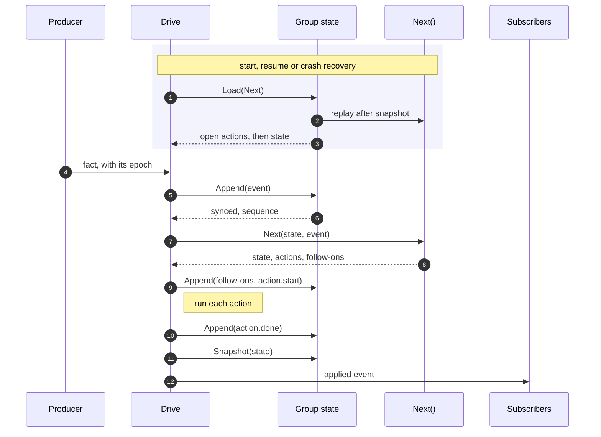

**Reading the diagram.**
1. On start, resume or after a crash, `Drive` calls group state's `Load` with an `apply` function that wraps `Next()`. A new group's file is empty; `Drive` appends a copy of the run's `run.start`, with the group's id, as its first line.
2. `Load` reads `state.json` and passes every line after its `sequence` through `apply`, in order.
3. Replay discards each result's `Actions`, which `ActionsOpen` already holds. It keeps a queue of each result's `Emit`, as `Drive` does live: every follow-on must be the next line on disk. Follow-ons still queued at the end of the file never reached disk; `Load` returns them and `Drive` appends them first.
4. `Drive` runs every action in `State.ActionsOpen`, started or not, under its idempotency key, before it applies any new event.
5. A producer hands `Drive` a fact stamped with the epoch its session started under.
6. `Drive` sets `stage` and `stale`, then calls `Append`, which stamps `sequence`, `timestamp` and `checksum`, validates the line against the schema and syncs it; it returns only once the line is on disk.
7. `Drive` calls `Next()`, which touches nothing on disk; a stale event changes nothing.
8. `Drive` puts the follow-on events in a first-in, first-out queue and appends and applies each in turn, its own follow-ons joining the back, before any action runs. Each follow-on carries the epoch current when it is appended.
9. For each action, which `Next()` already put in `ActionsOpen`, `Drive` appends and applies `action.start` (for a spawn, with the session UUID it picked), runs the action, then appends and applies `action.done`, which removes it.
10. Because every appended line is applied, `State.Sequence` is always the last line on disk, and `Snapshot` can write it on [its interval](#28-configuration-and-constants).
11. The bus hands each applied event to the 3 subscribers, in `sequence` order.

**Epochs.** Entering a stage raises the epoch, and every spawn carries the current one. `Drive` marks an event `stale: true` when its epoch is older than the current stage's, and `Next()` ignores it, so a cancelled Verify session's late result cannot move the stage twice. Paused and Blocked are not stages: entering or leaving Paused never changes the epoch, so a Verify sibling that kept running stays live and its `session.end done` counts toward Ship. Leaving Blocked on `resume` re-enters a stage and raises it.

**Replay and the cut-short line.**
1. `Load` reads `runs/<group-id>/state.json`; a snapshot is refused unless its `sequence` is the group state's last.
2. Replay costs at most one snapshot interval of lines, within the [replay target](#28-configuration-and-constants) `[PENDING G-19]`.
3. A last line whose checksum fails was cut short by a crash: it is dropped and one `state.truncated` is emitted.
4. A failing line before the last is a bad record: it is moved aside and the group blocks `state_invalid` ([Checks: populate and validate (Appendix C)](#checks-populate-and-validate)).

**Files.** `runs/<group-id>/events.jsonl` holds one group's events and `runs/<run>.jsonl` holds one run's `run.*` events, appended and read through the same group state calls with no snapshot. Groups never read each other's files; they meet only in the work queue and the session pool.

**Concurrency.**
- **One writer per file:** a group's `Drive` goroutine is the only writer of its events and snapshot; the run goroutine is the only writer of `run.*` events.
- **`Next()` takes no locks:** it is pure, so table tests call it directly.
- **Coarse grain:** events fire per run, group, stage, session and task, never per model turn or token; the in-session tool loop is plain code.
- **Outside the bus:** the guard check before a tool call, formatting after `edit`, and shutdown are direct code, and log an event afterward when they can. They are the 3 inline hooks; repo-owned hooks arrive in a later minor and will be subscribers, never gates.
- **Bus delivery:** one bus per engine process, no broker; `Next()` is the one decider, and subscribers write only their own derived records, never a group's events or snapshot. Today `Drive` delivers synchronously, in `sequence` order, within the [per-subscriber limit](#28-configuration-and-constants), and logs an overrun in the run report; the ledger batches its appends per tick. Whether `Drive` keeps waiting for subscribers is open `[PENDING G-29]`.

**Wakes.** The wake subscriber is never dropped: a failed touch is retried on the next event, and `status --wait` also reads `Tail` on [a backstop interval](#28-configuration-and-constants), so a failed touch delays a wake but never loses it. `group.blocked`, `group.paused`, `run.done` and `run.stopped` wake `status --wait`; `--wait any` also wakes on `stage.enter`. The wake subscriber touches `~/.komodo/state/wake/<run>`; the waiter watches that file, then reads the state tail through group state's `Tail`, so an event between subscribing and watching is still seen.

### 2.6 State and Transitions

**📐 Group stages**
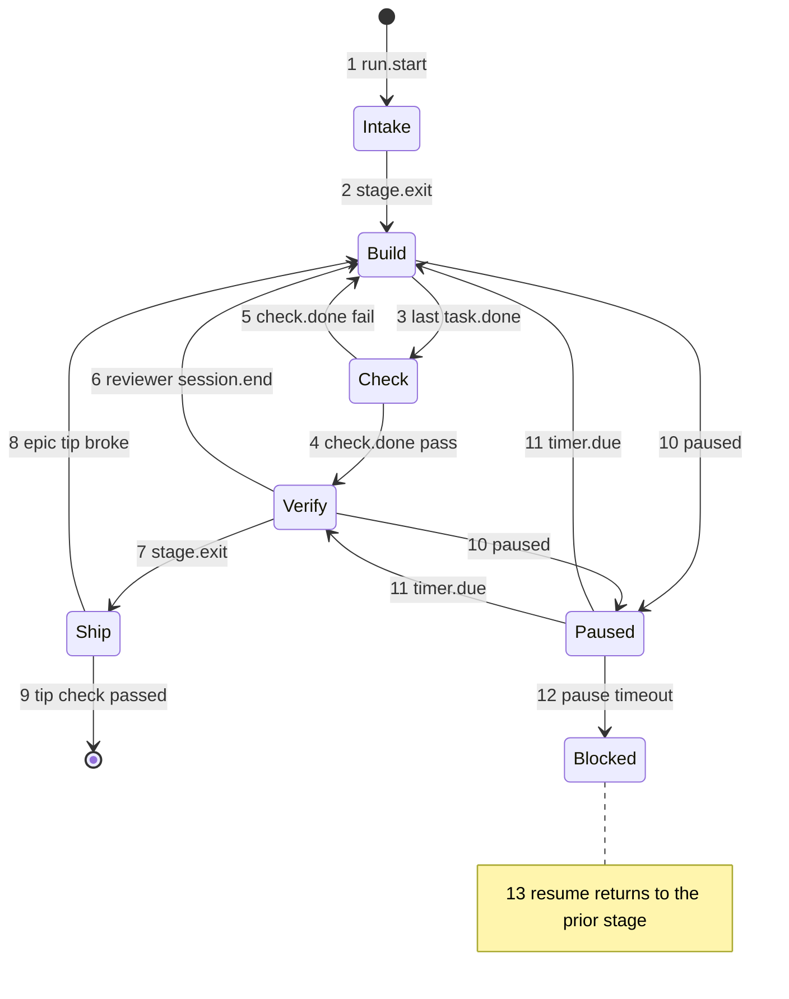

**Reading the diagram.** Numbers match the rows below. Every stage can also enter Blocked when a bound runs out (row 14), and abandon, a lost lease and cancel end a group from any stage (rows 17-19); they are left off the drawing.

**The table is code.** Both tables below are one Go slice of `Transition`. For each event, `Next()` applies the first matching in-stage row, then the first matching stage-move row against the updated state; either may be absent. An event that matches neither is refused and logged, never dropped. The build draws the diagram from the slice and the gate checks every registered `Spec` against it.

**Stage moves.** A row that changes the stage emits `stage.enter` for the new stage, or `group.paused`, `group.blocked` or `group.shipped` when the target is Paused, Blocked or the end; the in-stage rows then apply those follow-ons.

| # | From | Event | Condition | To | Sets; orders; emits |
|---|---|---|---|---|---|
| 1 | none | `run.start` | The group's first line | Intake | emits `stage.enter` |
| 2 | Intake | `stage.exit` | | Build | emits `stage.enter` |
| 3 | Build | `task.done` | The last task's `done_when` exit 0 and a commit on the hidden ref | Check | emits `stage.enter` |
| 4 | Check | `check.done` pass | | Verify | emits `stage.enter` |
| 5 | Check | `check.done` fail | `Returns` under `limits.returns` | Build | `Returns` + 1; emits `stage.enter` |
| 6 | Verify | Reviewer `session.end` | A verified blocking finding, a `not_met` task, an item that failed Go's two reruns, or a recorded tester failure; `Returns` under the limit | Build | `Returns` + 1; orders `cancel` for a live tester; emits `stage.enter` |
| 7 | Verify | `stage.exit` | | Ship | emits `stage.enter` |
| 8 | Ship | `check.done` fail on the epic tip | `Returns` under the limit; a fresh worktree is cut from the tip `[PENDING G-31]` | Build | `Returns` + 1; emits `stage.enter` |
| 9 | Ship | `check.done` pass on the epic tip | Landed with the fence | end | orders `open_pr` under `ship.mode: group`; emits `group.shipped`, `lock.released` |
| 10 | Build, Verify | `session.end` reason `paused` | No allowed link left | Paused | `Prior` = stage; emits `group.paused`; the in-stage `session.end` row has already set `Resume` and ordered `wip_commit` |
| 11 | Paused | `timer.due` | Reason is not `pause_timeout`; the reset time passed | `Prior` | orders `spawn` from the resume handle; the epoch is kept; back in Verify with both results passed, emits `stage.exit` |
| 12 | Paused | `timer.due` reason `pause_timeout` | `limits.pause_max_min` reached | Blocked | orders `cancel`; WIP commit kept; emits `group.blocked` |
| 13 | Blocked | `resume` command `[PENDING G-29]` | | `Prior` `[PENDING G-31]` | emits `stage.enter`, whose row orders the spawn |
| 14 | Any stage | The event that spends a bound's last unit | See the [block reasons](#block-reasons) | Blocked | `Prior` = stage; orders `wip_commit` when a writer was live; emits `group.blocked` |
| 15 | Blocked | `scope approve` or `scope deny` command `[PENDING G-29]` | | Build | orders `scope_change` on approve; emits `stage.enter`, whose row orders the spawn |
| 16 | Paused | `resume` command `[PENDING G-29]` | Sooner than the timer | `Prior` | orders `spawn` from the resume handle |
| 17 | Any stage | `abandon` command `[PENDING G-29]` | Lease freed, evidence kept; dependents block `dependency` `[PENDING G-31]` | end | orders `cancel`; emits `lock.released` |
| 18 | Any stage | `lease.lost` | Another run took the group; no landing `[PENDING G-31]` | end | orders `cancel` |
| 19 | Any stage | `group.cancelled` | Trigger `[UNKNOWN: not yet designed]` `[PENDING G-31]` | end | orders `cancel` |

- **Row 14 is a shape, not one row.** Each bound has a twin of the row that spends it, with the limit reached and `To` = Blocked: rows 5, 6 and 8 at `limits.returns`, `task.retry` at `limits.task_attempts`, and so on through the [block reasons](#block-reasons).
- **Returns** raise the epoch through `stage.enter` and give the builder every verified finding in one return. On a Verify return the tester is cancelled at the first verified blocking finding, and the reviewer finishes.
- **Rows 8 and 12-19** are the default for moves the rulebook did not have, pending the owner `[PENDING G-31]`.
- **Rows 11, 13 and 16** use `ToPrior`; row 1's `From` is `NoStage`.
- **Commands are not catalog types yet.** `resume`, `scope approve|deny` and `abandon` arrive as events whose type names, and route into `Drive`, wait on the commands decision `[PENDING G-29]`; they are outside the 35.

**In-stage rows.** These change `State`, order actions or emit follow-ons without moving the stage.

| Event | Stages | Sets; orders; emits |
|---|---|---|
| `stage.enter` | Any | `Epoch` + 1; entering Verify clears `Verify`; orders by stage: Intake `setup`; Build `spawn` for the first open task, from its resume handle when one is set, with the findings on a return; Check one `check` per command; Verify `spawn` for the reviewer and the tester; Ship `land` |
| `lock.taken` | Intake | Lock recorded |
| `action.done` for `setup` | Intake | Exit 0 with the lock taken emits `stage.exit`; a non-zero exit is `[UNKNOWN: not yet designed]` `[PENDING G-31]` |
| `session.start`, `task.claimed` | Build, Verify | Task `claimed` with its session |
| `session.end` of a writing session | Build | `Resume` set; `TokensUsed` grows by the session's usage when `track.usage` is on; exit `done` orders `commit`, any other exit `wip_commit`; a timeout or idle stop adds 1 to the task's `Retries` |
| `action.done` for `commit` | Build | The commit action ran `done_when` first; exit 0 emits `task.done`, a failure emits `task.retry` (fields `[PENDING G-24]`) |
| `task.done`, not the last task | Build | Task `done`; orders `spawn` for the next task |
| `task.retry` | Build | Task `Attempts` + 1; orders `spawn` |
| `task.released` | Build, Verify | Task back to `queued`, or `blocked` with reason `crash` |
| `finding.submit` | Verify | Claim recorded in `Verify` |
| `finding.verified` | Verify | Verified finding recorded; the first blocking one orders `cancel` for the tester |
| Reviewer or tester `session.end` that passes | Verify, and Paused with `Prior` = Verify | Result recorded; in Verify with both passed and 0 regressions, emits `stage.exit` |
| Tester `session.end` that fails | Verify, and Paused with `Prior` = Verify | Failure recorded; it returns with the reviewer's end (row 6) |
| `action.done` for `check` | Check, Ship | Result recorded; the last command's result emits one `check.done`, pass only if every command passed |
| `land` `action.done` | Ship | Orders `check` on the epic tip |
| `group.paused` | Paused | `Pause` set |
| `group.blocked` | Blocked | `Block` set; `Blocks[reason]` + 1 |
| `group.shipped`, `lock.released` | end | None |
| `action.start`, `action.done` | Any | The open action is marked started, then removed |
| `session.idle`, `session.timewarn`, `tool.denied`, `provider.skip`, `limit.warn`, `state.truncated` | Any | None; recorded for the ledger |

| State | Waits on | Pool slot | Lease and worktree | Wall clocks | Ends by |
|---|---|---|---|---|---|
| Paused | A timer record (`wait_until`) under `~/.komodo/state/timers/` | Returned | Kept | Stopped | The timer, `resume`, or `pause_max_min` |
| Blocked | A person or the orchestrator | Returned | Kept (sweep skips `needs_scope`) | Stopped | `resume`, `scope approve|deny`, `abandon` |

In Verify, a sibling session that was not paused keeps running while the group is Paused.

#### Block reasons

A fixed enum on `group.blocked`, named in `status`. A group that blocks [too often](#28-configuration-and-constants) for one reason is flagged `needs redesign`.

| Reason | Set when | A person then |
|---|---|---|
| `no_provider` | Every link in the chain was unavailable or unauthorized at a session boundary | Fixes the provider or login |
| `pause_timeout` | Paused for `limits.pause_max_min`; the session was cancelled | Waits for the provider |
| `paid_refused` | The billing check found only a paid link, or a subscription link with the wrong login, and `providers.paid` forbids it; killed before the first turn | Changes `providers.paid` or the login |
| `regression` | A test that passed at the base fails, and returns are spent | Reviews the failing output |
| `epic_gate` | The final pass over the whole epic found a problem with no file to send back | Decides |
| `tester` | The tester failed an item twice that Go's reruns pass; a harness fault, not the builder's | Checks the item |
| `flaky` | Go's two reruns of one item disagreed | Fixes the test |
| `dependency` | A dependency was abandoned | Re-plans or reruns it |
| `integration` | Check failed on the epic tip after landing, and returns are spent | Reviews the integration failure |
| `needs_scope` | The builder needs a file outside `files`; WIP kept; the orchestrator answers after 2 engine denials (G-15) | Runs `scope approve|deny` |
| `attempts` | A task used all `limits.task_attempts` | Looks at why it keeps failing |
| `context` | The brief exceeds half the context of every link in the chain | Shrinks the task or adds a larger endpoint |
| `merge_conflict` | Landing conflicted and the one automatic merge did not resolve it | Resolves the conflict |
| `budget` | With `track.usage` on, the group used `limits.group_tokens`; never occurs with tracking off | Raises the cap or splits the group |
| `crash` | The group's `Drive` panicked; other groups kept running | Runs `resume`, which replays through `Load` |
| `lint` | The planner's outline failed backlog lint 3 times; whether an Intake lint failure uses it is `[UNKNOWN: not yet designed]` `[PENDING G-31]` | Fixes it with `doctor backlog` |
| `brief` | The reviewer reported `brief_incomplete`; a harness fault | Fixes the brief inputs |
| `contract` | A `Next()` result broke its type's `Spec` | Reads the named type and rule |
| `state_invalid` | The state manager refused a write or moved a bad record aside as `.bad-*`; names kind, key and field | Inspects the record |
| (unnamed) | A session's `retries` after timeouts or idle stops, `limits.returns` on findings, a flap (the same failure hash or a zero-diff return), or 3 job failures; `reason` is empty and `data` names the counter `[PENDING G-24]` | Runs `resume` |

Every row ends with `resume` unless the last column says otherwise.

### 2.7 Failures

| Failure | Detected by | Action | Lost | Shown |
|---|---|---|---|---|
| Crash mid-`Append` | Checksum fails on the last line at `Load` | Drop the line, emit `state.truncated` | At most 1 event, never applied | The group resumes |
| Bad line before the last | Checksum or schema at `Load` | Move aside as `.bad-*`, block `state_invalid` | Nothing; the record is kept | `doctor`, `status` |
| Crash between `action.start` and `action.done` | Open action in the snapshot or after it | Rerun under its idempotency key | Nothing; a commit happens once | Nothing |
| Late result from a cancelled session | Epoch older than the current | Write with `stale: true`; `Next()` ignores it | Nothing | Ledger only |
| Event with no transition row | `Next()` returns `Refused` | Log it; state unchanged | Nothing | Ledger |
| Result breaks its `Spec` | `Drive`'s contract check | Block `contract` | Nothing | `status` |
| Subscriber error or panic | The bus | Drop that subscriber for the run; the wake subscriber is retried instead | Its derived records stop | Run report |
| `Drive` panics | The engine's recover | Block that group `crash`; others continue | Nothing on disk | `status`, run report |

### 2.8 Configuration and Constants

**Keys read into `Limits`:** `limits.returns`, `limits.task_attempts`, `limits.pause_max_min`, `limits.group_tokens`, `track.usage` ([Flat keys (34) (chapter 1)](#1-cli-and-configuration)), plus each agent's `retries` from its `agent.json`.

| Constant | Value |
|---|---|
| Snapshot interval | Every 50 events, and on every stage change |
| Replay target | 10,000 events under 1 s `[PENDING G-19]` |
| Subscriber limit | 5 ms each |
| Wake backstop | `status --wait` reads `Tail` every 5 s |
| Blocks before `needs redesign` | 3 for one reason |

### 2.9 Proof Cases

- `Next()` has table tests for every stage and event pair, `Paused` and `Blocked`.
- The 4 Verify orderings (reviewer fails first, tester fails first, both pass, both fail in one tick) each move the stage exactly once.
- Replaying a group's state rebuilds its `state.json` exactly.
- `kill -9` between `action.start commit` and `action.done`, then `resume`, runs the commit again exactly once and yields 1 commit.
- `kill -9` after an event is appended and before its first `action.start`, then `resume`, still runs the ordered action once.
- A last event line cut short by a crash replays with one `state.truncated`.
- A fixture `group.blocked` wakes `status --wait`.
- An event emitted between a waiter's subscribe and its first watch still wakes it.
- A subscriber that panics leaves group state unchanged, and the other 2 keep running.
- An emitted type missing from the catalog fails the gate.

### 2.10 Open Gaps

| Gap | Open here |
|---|---|
| G-19 | The 10,000-event replay target is unmeasured |
| G-24 | The fields of each event type's data struct |
| G-29 | Envelope `id`, `class`, `cause`, `corr`; command type names and how they reach `Drive`; whether an event and its follow-ons are one disk write (the tail append in Behaviour is the default); bus delivery timing |
| G-30 | Machine log file names; `Action.Args`; `VerifyProgress`; the `config_hash` and task id formats |
| G-31 | Transition rows 8 and 12-19, the `run.done` condition, the `group.cancelled` trigger, `lint` at Intake |
| G-32 | The crash-safe counters in `State`, `TokensUsed` and each task's `Retries` included |

---


## 3. Engine Internals

The engine runs task groups: it starts model sessions, moves each group through its stages, orders groups against each other and lands finished work on the epic branch. It is the package that calls the decision function of [chapter 2](#2-event-spine-and-state-machine) and performs the side effects that function orders. Design and reasons are in [HLD 5.4](hld.md#54-engine-internals).

**Guarantees the tests pin**

| Guarantee | How |
|---|---|
| One writer per group | A single `Drive` goroutine writes a group's state; no mutex exists inside a group |
| No lost event | A session's event channel holds 256 events; a full channel blocks the session, it never drops an event |
| Faults stay inside one group | Every goroutine starts through one panic-catching helper; a panic in one `Drive` blocks that group only |
| Machine-wide limits hold | Queue items, pool slots, link slots and leases are files created exclusively or renamed into place |
| Landings are serial | One landing at a time, each followed by a zero-token Check on the epic tip |

### 3.1 Scope and Concepts

**Owns:**
- The `Drive` loop that runs one group from its first event to its end.
- The run goroutine and run order: the dependency graph as the engine consumes it, group readiness, serial landing, the integration break and the epic gate.
- The machine-wide work queue and its pick order.
- The machine-wide session pool and the per-link session slots.
- The shutdown sequence and the parent guard.
- The stage drivers `intake.go`, `build.go` and `verify.go`.

**Does not own:**
- `Next()`, `State`, `Limits`, the transition table and the 35 event types ([Event Spine and State Machine](#2-event-spine-and-state-machine)).
- Group state files, `Claim`, `Replace` and `Remove` ([State Manager](#13-state-manager)).
- Worktrees, leases, fences and the hidden reference ([Workspace and Leases](#4-workspace-and-leases)).
- Starting, watching and stopping one model session ([Sessions, Agents and Briefs](#5-sessions-agents-and-briefs)).
- The startup sweep and the Check, review and tester logic ([Check, Review, Tester and Recovery](#9-check-review-tester-and-recovery)).
- Job templates and the `jobs tick` verb ([Scheduler, Cache and Observability](#10-scheduler-cache-and-observability)).
- Building the dependency graph from the backlog, and the git landing operations ([Backlog, Planning, Ship and Release](#11-backlog-planning-ship-and-release)).

The purpose of the subsystem, and who it talks to, is in the HLD: [Engine Internals](hld.md#54-engine-internals).

**Concepts**
- **Drive:** the goroutine, a lightweight Go thread, that runs one group. It is the only code that changes that group's records.
- **Run goroutine:** the goroutine of one `komodo run` launch. It builds the dependency graph, enqueues ready groups and collects finished `Drive`s.
- **Queue item:** a create-only file naming one ready group or one due job.
- **Pool slot:** one of the machine-wide places for builder, reviewer and tester sessions. A link slot is a separate per-link limit.
- **Wave:** a set of groups that can run together.
- **Landing:** merging a finished group into the epic branch. The epic tip is the newest commit of that branch.
- **Integration break:** a failed Check on the epic tip after a landing.
- **Epic gate:** one reviewer and tester pass over the whole epic diff after the last landing.
- **Parent guard:** the small process that starts the engine and repeats the shutdown save if the engine dies.

Group, epic and lease are defined in the [glossary](hld.md#12-glossary).

### 3.2 Package Layout

| File | Holds |
|---|---|
| `internal/engine/engine.go` | `Drive`: the per-group loop that appends events, calls `Next()` and runs the ordered actions |
| `internal/engine/queue.go` | Work queue files under `~/.komodo/state/queue/`, the pick order, fair share across repositories |
| `internal/engine/pool.go` | Session pool and per-link slots, the floor, the ceiling, growth and shrinkage |
| `internal/engine/intake.go` | Intake: lint the group's backlog cards, hash them, take the lease, cut the worktree from the epic tip |
| `internal/engine/build.go` | Build: one session per task, resumed with the findings on a return |
| `internal/engine/verify.go` | Verify: reviewer and tester at once; cancels the tester on the first verified finding |
| `internal/engine/shutdown.go` | The catch-all shutdown sequence and the parent guard |

Files of the same package that other chapters own:

| File | Chapter |
|---|---|
| `stage.go`, `limits.go` | [Event Spine and State Machine](#2-event-spine-and-state-machine) |
| `worktree.go` | [Workspace and Leases](#4-workspace-and-leases) |
| `session.go` | [Sessions, Agents and Briefs](#5-sessions-agents-and-briefs) |
| `schedule.go` | [Scheduler, Cache and Observability](#10-scheduler-cache-and-observability) |
| `recover.go` | [Check, Review, Tester and Recovery](#9-check-review-tester-and-recovery) |

**Entry points**

| Flow | Starts at |
|---|---|
| One group's life | `Drive.RunGroup` in `engine.go` |
| Choosing the next queue item | `Pick` in `queue.go` |
| Pool growth and shrinkage | `GrowPool` and `HalvePool` in `pool.go` |
| Start rule | `Startable` in the run goroutine's file |
| Stopping a run | The shutdown sequence in `shutdown.go` |

The names are working names. `[TODO: confirm the exported names of the engine's functions; the design fixes behaviour, not names (G-35)]`

The dependency graph is built in `internal/repo/graph.go` (waves and longest chain, [chapter 11](#11-backlog-planning-ship-and-release)); the engine imports it, as the import order allows. `[TODO: the file that holds the run goroutine, run-order readiness, the landing gate, the epic gate and the panic-catching helper; the design's file map names none (G-35)]`

### 3.3 Data Model

#### Engine constants

```go
const (
	EventBuffer      = 256              // capacity of a group's event channel
	LeaseRenewEvery  = 5 * time.Minute  // how often a group's Drive renews its lease
	AgentStopGrace   = 30 * time.Second // time shutdown allows each session to stop
	ShutdownDeadline = 60 * time.Second // after this, sessions still alive are killed
	GuardSilenceMax  = 10 * time.Minute // heartbeat silence after which the parent guard acts
)
```

#### Queue item

Ready work waits as one create-only file per group or job at `~/.komodo/state/queue/<repo-id>.<kind>.<id>.json`. How a repository identifier becomes a file name is `[TODO: repository identifier to file name mapping (G-30)]`.

```go
// ItemKind says whether a queue item is a task group or a scheduled job.
type ItemKind string

const (
	KindGroup ItemKind = "group"
	KindJob   ItemKind = "job"
)

// Priority orders queue items; a group's TG.md may set high, everything else is normal.
type Priority string

const (
	PriorityHigh   Priority = "high"
	PriorityNormal Priority = "normal"
)

// QueueItem is the body of one queue file.
type QueueItem struct {
	Kind       ItemKind  `json:"kind"`
	Repo       string    `json:"repo"`
	ID         string    `json:"id"`
	Priority   Priority  `json:"priority"`
	EnqueuedAt time.Time `json:"enqueued_at"`
}
```

| Field | Type | Rule |
|---|---|---|
| `kind` | string | `group` for a ready group, `job` for a due scheduled job |
| `repo` | string | The repository the item belongs to; fair share counts each job as its own repository |
| `id` | string | The group identifier, or the job name |
| `priority` | string | `high` is set by `priority: high` in the group's `TG.md`; jobs are `normal` |
| `enqueued_at` | time | When the item was queued `[TODO: timestamp format (G-30)]` |

**Versioning.** Each record carries the schema version `v` in its header. A newer binary reads an older version by running a registered migration step in memory. How a reader treats a record written by a newer binary is `[TODO: forward-version handling in the state manager (G-30)]`.

The state manager wraps the body in its six-field record header (`v`, `kind`, `key`, `rev`, `ts`, `writer`); the layout of header and body is `[TODO: how a record's header and body share one file (G-30)]`. The body alone:

```json
{
  "kind": "group",
  "repo": "github.com/rdevitto86/komodo-agentic-harness-coding",
  "id": "0192e4c5-7a10-7d3e-9b2f-6c1d8e4a5f30",
  "priority": "normal",
  "enqueued_at": "[TODO: timestamp format (G-30)]"
}
```

#### Slot files

Pool slots live under `~/.komodo/state/pool/` and link slots under `~/.komodo/state/links/`. Each slot is a lock file tagged with the process identifier of its holder; the slot is free again when that process dies.

```go
// SlotFile is the body of a pool or link slot lock file.
type SlotFile struct {
	Pid int `json:"pid"` // process identifier of the holder
}
```

| Field | Type | Rule |
|---|---|---|
| `pid` | integer | The holder's process identifier; the slot is free when that process is dead |

Versioning follows the same record header as the queue item.

`[TODO: slot file names, the rest of the body, and where the pool's current ceiling is stored (G-33)]`

#### Drive

```go
// Drive owns one group: it is the only writer of that group's events and snapshot.
type Drive struct {
	Group  state.ID                // the group this Drive runs
	State  state.GroupState[State] // group state: Open, Append, Snapshot, Load, Tail
	Limits Limits                  // the bounds Next enforces, pinned by the config hash
	Events chan state.Event        // fed by session goroutines, capacity EventBuffer
}
```

| Field | Rule |
|---|---|
| `Group` | Identifier of the one group; a second `Open` of the same group in one process is refused |
| `State` | The calls of [Group state](#13-state-manager); `Next()` is passed into `Load` as the replay function |
| `Limits` | Read once from the effective configuration that `State.ConfigHash` pins |
| `Events` | A session goroutine sends the facts of its session; a full channel blocks the sender |

`Drive` is in memory only. Its durable form is the group state of [chapter 2](#2-event-spine-and-state-machine), whose snapshot body is `State`.

How a typed command such as `resume` reaches `Drive` is `[TODO: command transport into Drive (G-29)]`.

#### Dependency graph, as consumed

The run goroutine reads, per group: its dependencies, its `touches` globs, its task count and its backlog position. The graph also yields waves (sets of groups that can run together) and the longest chain. The types are defined by `internal/repo/graph.go` ([chapter 11](#11-backlog-planning-ship-and-release)).

```go
// Candidate is one queue item with the three facts the tie-break rules read.
type Candidate struct {
	Item        QueueItem
	ChainWeight int // longest remaining chain, weighted by task count
	Unblocks    int // groups unblocked by landing this one
	Order       int // position in backlog ID order; lower is earlier
}
```

`[TODO: exact definition of ChainWeight (whether the group's own tasks count) and Unblocks, and the key that gives Order (G-41)]`

#### Run flags

`komodo run` takes one flag, `--stage <stage>`, which runs a single stage. The flags `--mode`, `--set`, `--max-parallel`, `--budget-tokens`, `--detach` and `--until` do not exist. The run always detaches, and limits come only from `komodo config`.

### 3.4 Interfaces

The design names `Drive`, `Next()`, the group state calls and the pick order. The exported names and signatures below are the working shape of those parts. `[TODO: confirm the exported names and signatures of the engine's functions; the design fixes behaviour, not names (G-35)]`

```go
// RunGroup opens a group, replays it, reruns open actions, then loops until the group ends or ctx is cancelled.
func (d *Drive) RunGroup(ctx context.Context) error

// Pick returns the queue item to take next, applying the five pick rules.
func Pick(ready []Candidate, lastRepo string) (Candidate, bool)

// GrowPool returns the pool size after one clean session end.
func GrowPool(size, ceiling int, freeMemGB, sessionMemGB float64) int

// HalvePool returns the pool size after a rate-limit error or quota warning, never below the floor.
func HalvePool(size, floor int) int

// Startable reports whether a group may start: every dependency landed and Check passed on the epic tip.
func Startable(dependencies []string, landed map[string]bool, tipChecked bool) bool
```

`lastRepo` is the repository served by the previous pick; where that value is stored is `[TODO: round-robin cursor storage (G-34)]`.

**Failure behaviour of each function**

| Function | On failure |
|---|---|
| `RunGroup` | `Open` refused (the group is already open in this process, or the process does not hold the lease): the `Drive` does not start. A refused `Append` is `state_invalid` and the group blocks; a bad line before the last during `Load` is moved aside as `.bad-*` and the group blocks `state_invalid`. An action that fails is `[TODO: action failure policy (G-40)]` |
| `Pick` | Returns `false` when no item is ready; nothing is taken |
| `GrowPool` | Cannot fail; returns the size unchanged when memory does not cover one more session or the ceiling is reached |
| `HalvePool` | Cannot fail; returns the floor when halving would go below it |
| `Startable` | Cannot fail; returns `false` while any dependency is unlanded or the tip's Check has not passed |

| Caller | Call | When |
|---|---|---|
| Run goroutine | `Startable`, then `Claim` on a queue file | A dependency lands, or the epic tip's Check passes |
| `komodo jobs tick` | `Claim` on a queue file | A job is due |
| Engine, when a pool slot frees | `Pick`, `Remove` on the queue file, `Claim` on the lease | The pool has a free slot and a queue item is ready |
| Session goroutine | Send on `Drive.Events` | Each fact a session produces |
| `Drive` | `Open`, `Load`, `Append`, `Snapshot` (group state); `Next()`; `SpecOf` | Every event |
| `Drive` | `Replace` on the lease | Every `LeaseRenewEvery` |
| `Drive` | `GrowPool` after a clean session end; `HalvePool` after a rate-limit error or a quota warning | The session's end or the warning is applied |
| `komodo stop <run>`, signal, `fresh --restart-runs` | The shutdown sequence | Operator or operating system asks the run to stop |

#### Refusals

`komodo run <group>` refuses, with the reason named, when a dependency outside the run has not landed (the message names that dependency). A dependency cycle in the backlog is refused outright when the graph is built. The other two refusals of the verb (a group another run holds; a repository with no detected commands) belong to [CLI and Configuration](#1-cli-and-configuration).

### 3.5 Behaviour

#### Walkthrough

An epic holds group A, which has no dependency, and group B, which depends on A.

**📐 Two groups through the engine**
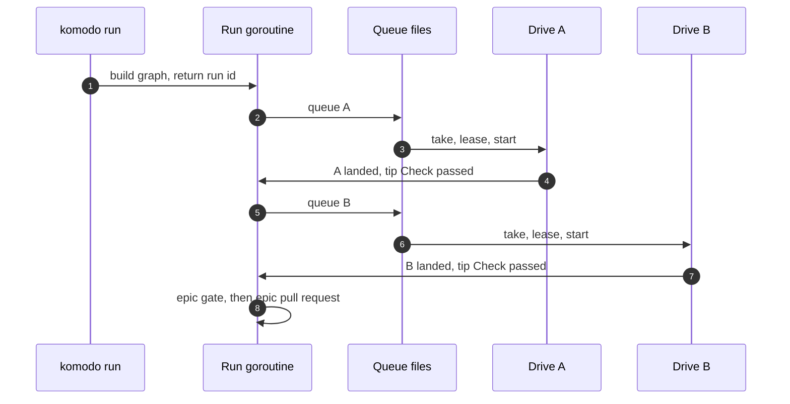

1. `komodo run` builds the dependency graph from the backlog, enqueues the groups whose dependencies have landed (group A), prints the run identifier at once and leaves the engine running detached under the parent guard.
2. The run goroutine creates the queue file for A. B stays out of the queue because its dependency has not landed.
3. When a pool slot frees, the engine picks A, deletes its queue file, writes its lease and starts `Drive` A.
4. `Drive` A moves A through Intake, Build, Check, Verify and Ship, appending events and running the actions that `Next()` orders.
5. A lands, alone, and Check runs on the epic tip with zero model tokens. The tip passes.
6. The run goroutine sees that B's dependency has landed and the tip's Check passed, and creates the queue file for B. The engine takes it the same way as A's.
7. B lands and the tip's Check passes.
8. After the last landing the reviewer and the tester run once over the whole epic diff. `[TODO: epic gate events and the epic pull request step (G-37)]`
9. A person merges only the epic pull request.

#### Algorithms

**Ownership and concurrency**

**📐 Who owns which state**
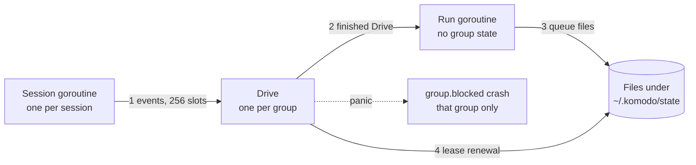

Rules:
1. The `Drive` goroutine is the only writer of its group's events and snapshot. No mutex exists inside a group, and two groups never contend.
2. A session goroutine turns its session's stream into events and sends them on `Drive.Events`. When the channel is full the sender waits; no event is dropped.
3. Facts that groups share (queue, pool slots, link slots, leases, `quota.json`) are files under `~/.komodo/state/`, created exclusively or renamed into place, written through `Claim`, `Replace` and `Remove`. Two engines on one machine coordinate only through these files.
4. The run goroutine builds the dependency graph, enqueues ready groups and collects finished `Drive`s. It holds no group state.
5. Every goroutine starts through one panic-catching helper. A panic in one `Drive` emits `group.blocked crash` (the event `group.blocked` with reason `crash`) for that group alone; the run and the other groups continue. `[TODO: the transition that moves a group to Blocked on a crash (G-31)]`

**The Drive loop**

**📐 Drive from start to end**
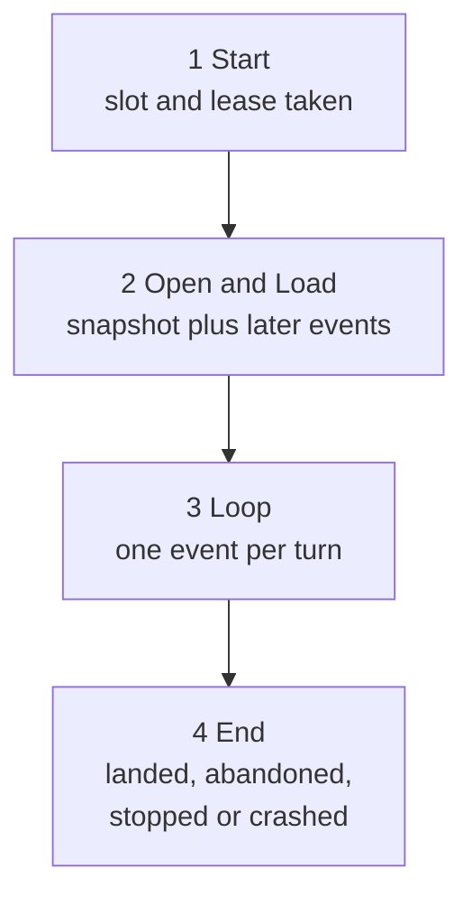

1. A ready group takes a free pool slot and its lease; the engine hands the group to a new `Drive`.
2. `Drive` calls `Open`, which makes it the group's only writer, then `Load`, which reads the last snapshot, replays the events saved after it and returns the state. `Drive` reruns the state's open actions.
3. `Drive` waits on three sources: events from the group's sessions, the group's pause timer (which fires at the timer record's `wait_until` time), and its lease renewal every `LeaseRenewEvery`. It takes one event at a time and runs one turn for it.
4. `Drive` ends when the group lands or is abandoned, when the run stops, or when it crashes. The run goroutine collects a finished `Drive`.

One turn:
1. `Drive` takes the next event from its channel.
2. `Drive` calls `Append`: the state manager stamps `sequence`, `timestamp` and `checksum`, validates the line against the schema and syncs it to disk. `Drive` has already set `stage` and `stale`.
3. `Drive` calls `Next()`. It returns the new state, the actions to run and any follow-on events; a stale event changes nothing.
4. `Drive` appends the follow-on events, then an `action.start` line for each action.
5. `Drive` runs each action, such as starting a session or making a commit. Pushing and opening a pull request run beside the loop, so a slow network never holds it.
6. `Drive` appends `action.done` for each finished action, so a restart skips it.
7. `Drive` hands the new state to `Snapshot`, which writes `state.json` every 50 events or on a stage change.
8. The event bus hands the event to its 3 listeners: the ledger, the wake file and the `status --watch` screen.

Chapter 2 draws the same path as a sequence diagram ([One event, from producer to subscribers](#25-behaviour)).

Open parts of the loop:
- `[TODO: whether Drive keeps running or exits while its group is Paused or Blocked (G-29)]`
- `[TODO: whether steps 2 to 4 become a single disk write (G-29)]`
- `[TODO: whether step 8 waits for each listener (G-29)]`
- `[TODO: what Drive does when an action fails, or when a lease renewal is refused (G-40)]`
- `[TODO: how a paused group's time since pause is kept, for the pause cap (G-40)]`

**Taking work from the queue**

**📐 From a ready group to a running Drive**
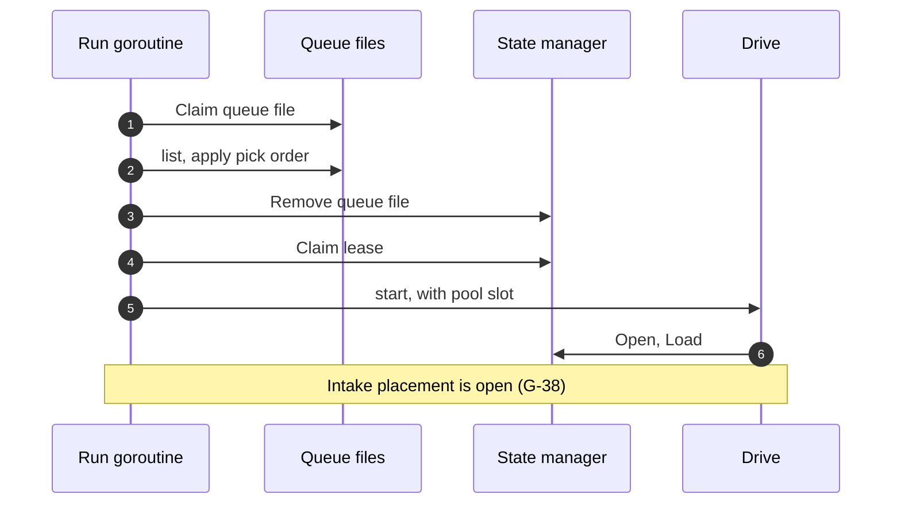

1. When a dependency lands and Check passes on the epic tip, the run goroutine creates one queue file for each newly ready group. `komodo jobs tick` creates one for each due job.
2. When a pool slot frees, the engine lists the queue and applies the pick order below.
3. The engine takes the chosen item: it deletes the queue file, then writes the lease. A crash between the two steps leaves an item for the startup sweep to re-enqueue. `[TODO: the sweep cannot see an item whose file is already deleted and whose lease is not yet written (G-34)]`
4. The engine starts the group's `Drive`. Intake runs just before the group's first session takes a slot, and the next ready group's Intake starts while the current group's first session loads, so a slot never sits idle longer than one `setup` run. `[TODO: where Intake sits between the slot, the lease and the first Drive event (G-38)]`

`[TODO: which process takes an item when queue items from several repositories are ready, and what happens when the winner belongs to another repository (G-34)]`

**Pick order**

When a slot frees, the engine applies these rules in order:

1. Items with `priority: high` go first.
2. Fair share across repositories: when 2 or more repositories have ready items, take them round-robin. Each job counts as its own repository.
3. The longest remaining chain, weighted by task count.
4. The most groups unblocked.
5. Backlog ID order.

Rules 3 to 5 break ties among items of the repository chosen by rule 2.

**The session pool**

**📐 How the pool size changes**
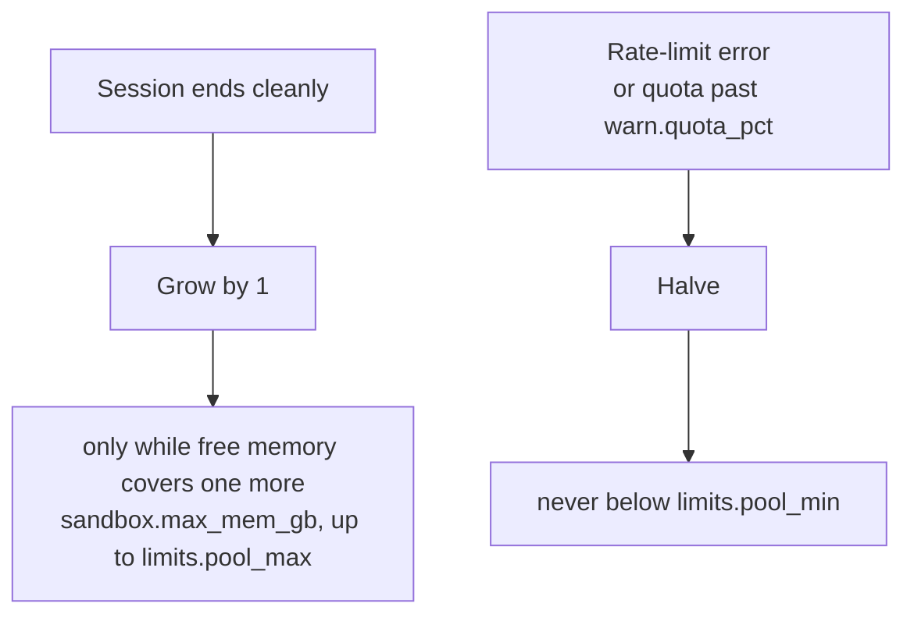

| Rule | Detail |
|---|---|
| Slot takers | Builder, reviewer and tester sessions (`pool_slot: true`). Planner and job sessions take no pool slot, but count against the link limit |
| Floor and ceiling | The pool holds 1 to 6 slots by default: `limits.pool_min` stays open while throttled; `limits.pool_max` is the most sessions at once; the hard limit is 16 |
| Link slot | `limits.link_sessions.<link>` sessions per link (for example `claude-cli`) across all repositories; loopback endpoints get 1; the hard limit is 8 |
| Files | Pool and link slots are lock files; the operating system frees one when its holding process dies |
| Taking | A session takes a pool slot before it starts and returns it when it ends; a Paused or Blocked group holds none |

Open parts of the pool:
- `[TODO: whether `OLLAMA_NUM_PARALLEL` above 1 lets the local link exceed 1 (G-04)]`
- `[TODO: slot file names, the order in which a session takes its pool slot and its link slot, and whether a session waits or fails when none is free (G-33)]`
- `[TODO: where the adapted pool size lives when two engines share a machine (G-33)]`
- `[TODO: what counts as a clean session end, and how free memory is measured on each operating system (G-33)]`

**Run order and convergence**

**📐 When a group may start**
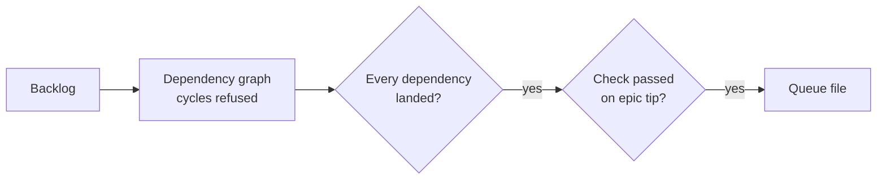

Rules:
1. The graph is built from every group's dependencies and `touches` globs. A cycle is refused. Waves and the longest chain are computed; the longest chain also feeds the pick order.
2. A group starts only after every dependency has landed and Check has passed on the epic tip.
3. A group with 2 or more dependencies starts after all of them land.
4. `run <group>` refuses when a dependency outside the run has not landed, and names it. `[TODO: how the engine learns that a dependency outside the run has landed (G-35)]`
5. When a dependency is blocked, its dependents show `waiting on <group>` in `komodo status`; groups that do not depend on it keep running.
6. When a dependency is abandoned, its dependents block with reason `dependency`, naming the abandoned group. `[TODO: confirm the abandon transition and the dependents' block (G-31)]`
7. Inside a group, tasks run one after another in the group's worktree, with one builder at a time. Independent tasks belong in separate groups.
8. A group moves on from Build as soon as its own builder finishes, whatever the other groups do.

**Landing and the integration break**

**📐 One landing, then the tip check**
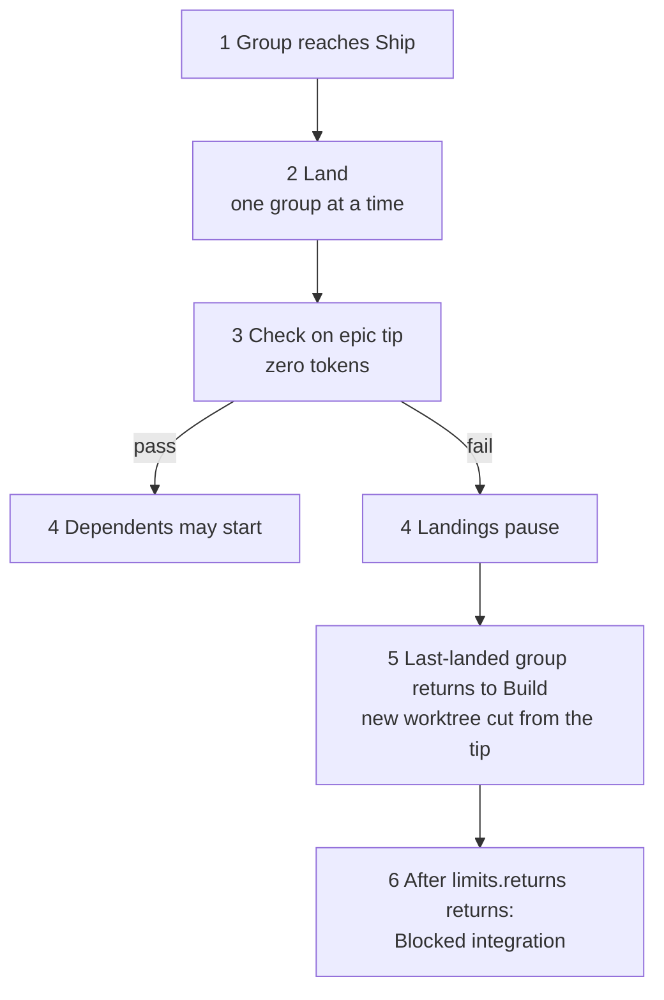

1. Finished groups land one at a time. Each landing is followed by Check on the epic tip, which costs 0 tokens.
2. When that Check fails, landings pause and the last-landed group returns to Build in a new worktree cut from the tip. It has `limits.returns` returns; after that it blocks with reason `integration`. `[TODO: confirm the return from Ship to Build and the new worktree (G-31)]`
3. `[TODO: how one-at-a-time landing is enforced between engine processes, and what holds the gate from the landing until the tip's Check finishes (G-36)]`
4. `[TODO: when paused landings resume, in particular after a group blocks with reason integration (G-36)]`

**The epic gate**

**📐 After the last landing**
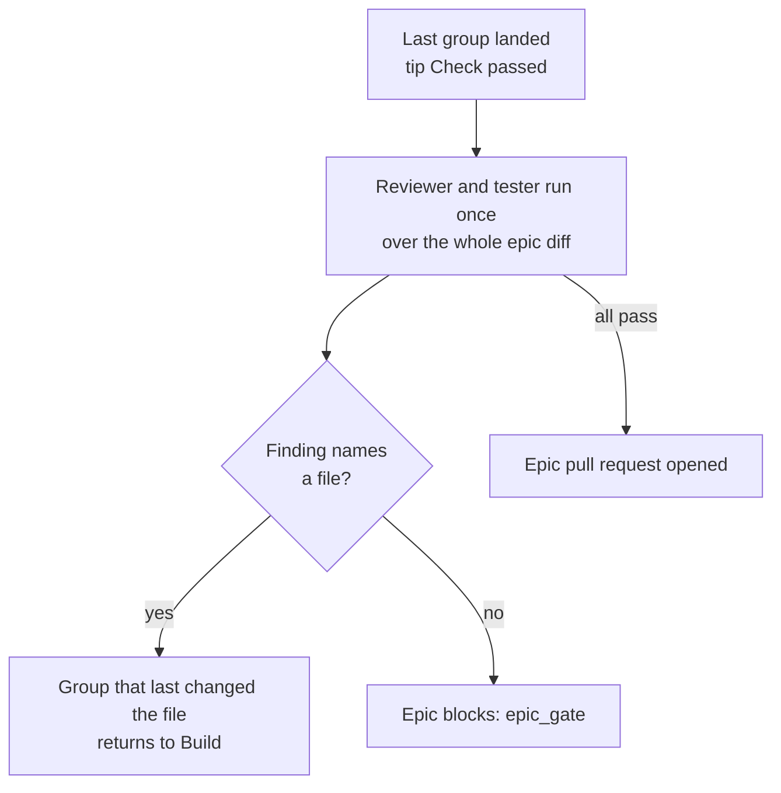

1. After the last landing, the reviewer and the tester each run once over the whole epic diff.
2. A finding goes to the group that last changed its file; that group returns to Build.
3. A finding with no file blocks the whole epic with reason `epic_gate`. A person then merges only the epic pull request.
4. `[TODO: how epic gate sessions and findings are recorded as events, how a landed group re-enters Build, which counter bounds the returns, how the group that last changed a file is found, and when the epic pull request is opened and run.done is written (G-37)]`

**Shutdown and the parent guard**

**📐 Stopping a run, and the guard's repeat of it**
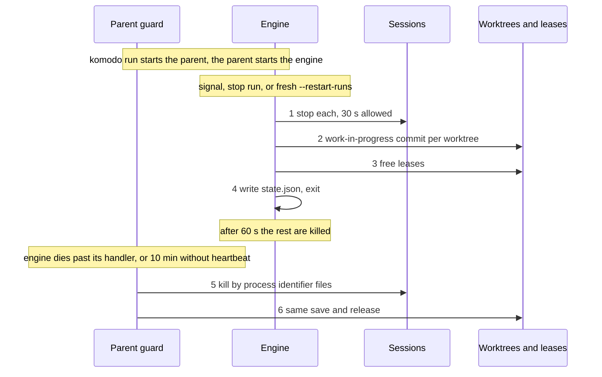

1. The sequence starts on any operating-system signal, on `stop <run>` or on `fresh --restart-runs`, which updates the binary and moves live runs to it.
2. The engine stops each session (30 seconds each), makes a work-in-progress commit of every worktree, frees the leases, writes `state.json` and exits. After 60 seconds, anything still alive is killed.
3. Shutdown is direct code outside the event bus. It writes `run.stopped` when it can.
4. `komodo run` first starts a small parent process, the parent guard, which then starts the engine.
5. If the engine dies past its own handler (`kill -9`, an out-of-memory kill, a Go fatal error) or writes no heartbeat for 10 minutes, the parent kills the sessions by their process identifier files and runs the same save and release.
6. Power loss is left to the startup sweep ([chapter 9](#9-check-review-tester-and-recovery)).

`[TODO: the parent guard's entry point, how the engine writes its heartbeat, and where the process identifier files live (G-39)]`

### 3.6 State

The engine keeps no state of its own beyond files and the group state of [chapter 2](#2-event-spine-and-state-machine). The three machine-visible states are the group's `Drive`, the pool size and landing.

**📐 Drive lifecycle**
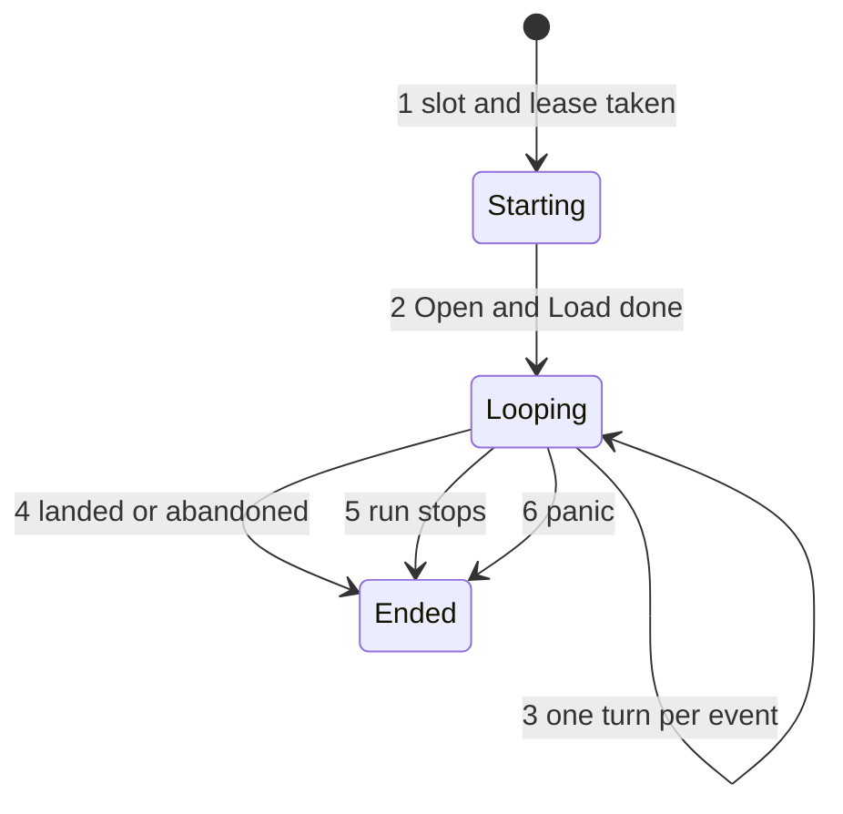

| State | Waits on | Pool slot | Lease and worktree | Ends by | True after the move |
|---|---|---|---|---|---|
| Starting | `Open`, `Load`, open actions | Held for the first session | Lease written, worktree cut | `Load` returns the state | This `Drive` is the group's only writer; the open actions have run |
| Looping | Session events, the pause timer, the lease renewal | Held while a session runs | Kept; lease renewed every 5 minutes | Landing, abandon, run stop, panic | Every applied event is on disk before its effects run |
| Paused or Blocked | `[TODO: whether Drive loops or exits while the group waits (G-29)]` | Returned | Kept | The timer, `resume`, `scope approve` or `scope deny`, or `abandon` | The group holds no pool slot and keeps its lease and worktree |
| Ended | Nothing | Returned | Released on landing or abandon | The run goroutine collects the `Drive` | The group's records are final for this run |

| Pool event | Effect |
|---|---|
| Session ends cleanly | Size grows by 1 while free memory covers one more `sandbox.max_mem_gb`, up to `limits.pool_max` |
| Rate-limit error from a provider | Size halves, never below `limits.pool_min` |
| Quota past `warn.quota_pct` | Size halves, never below `limits.pool_min` |

**📐 Landings**
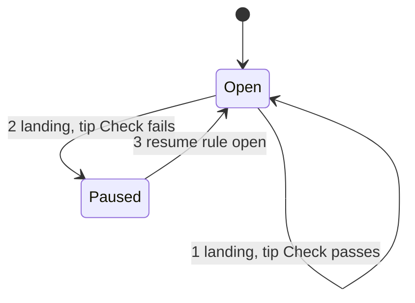

| Landing state | Event | Next | True after the move |
|---|---|---|---|
| Open | A group lands and the tip's Check passes | Open | Dependents of that group may start |
| Open | A group lands and the tip's Check fails | Paused | No group lands; the last-landed group is back in Build |
| Paused | `[TODO: resume conditions (G-36)]` | `[TODO: next state (G-36)]` | `[TODO: (G-36)]` |

### 3.7 Invariants and Failures

**Invariants**
1. A group has exactly one writer inside a process, its `Drive`; other processes are kept out by the lease and its fence.
2. An event is appended and synced to disk before `Next()` runs on it.
3. An action's `action.start` line is on disk before the action runs, and its `action.done` line follows.
4. A queue file is deleted before the lease is written.
5. A group starts only after every dependency has landed and Check has passed on the epic tip.
6. Landings happen one at a time, each followed by Check on the epic tip.
7. Shutdown stops sessions, then commits work in progress, then frees leases, then writes `state.json`; a lease is never freed while a session is alive or work is unsaved.
8. The pool never shrinks below `limits.pool_min` and never exceeds `limits.pool_max`.
9. Intake runs just before the group's first session takes a slot.

**Failures**

| Situation | Detected by | Behaviour |
|---|---|---|
| Crash between the queue file's deletion and the lease write | The startup sweep | The sweep re-enqueues an item that has no lease `[TODO: the sweep's view of a deleted item (G-34)]` |
| Session event channel full | The sending session goroutine | The sender waits; no event is dropped |
| Panic inside one `Drive` | The panic-catching helper | `group.blocked` with reason `crash` for that group alone; the run and other groups continue |
| Rate-limit error or quota past `warn.quota_pct` | The provider adapters report it | The pool halves, never below `limits.pool_min` |
| A dependency is blocked | The run goroutine | Dependents show `waiting on <group>`; unrelated groups keep running |
| A dependency is abandoned | `komodo abandon` on a group other groups depend on | Dependents block with reason `dependency`, naming it `[TODO: (G-31)]` |
| `run <group>` with an unlanded dependency outside the run | The graph | The verb refuses and names the dependency |
| Check fails on the epic tip after a landing | The Check on the tip | Landings pause; the last-landed group returns to Build; after `limits.returns`, Blocked `integration` `[TODO: (G-31)]` |
| A finding with no file at the epic gate | The epic gate | There is no group to send it to, so the whole epic blocks with `epic_gate` |
| Engine dies past its handler (`kill -9`, out-of-memory kill, Go fatal error) | The parent guard | The parent kills the sessions by process identifier files, saves and releases |
| No heartbeat for 10 minutes | The parent guard | Same as above |
| Sessions alive 60 seconds into shutdown | The shutdown sequence | The remaining sessions are killed |
| Power loss | The next engine start | Left to the startup sweep |

### 3.8 Config

| Key | Type | Default | Effect |
|---|---|---|---|
| `limits.pool_min` | integer | 1 | Pool slots kept open while throttled; cannot exceed `limits.pool_max` |
| `limits.pool_max` | integer | 6 | Most builder, reviewer and tester sessions at once across all repositories; hard limit 16 |
| `limits.link_sessions.<link>` | integer | 3; loopback endpoints 1 | Most concurrent sessions on one link across all repositories; hard limit 8 |
| `sandbox.max_mem_gb` | integer | 8 | Read here: the pool grows only while free memory covers one more of it |
| `warn.quota_pct` | integer | 90 | Read here: a provider window past this percent halves the pool |
| `limits.returns` | integer | 3 | Read here: returns to Build after an integration break; counter ownership is `[TODO: (G-32)]` |

`--stage` is the only flag of `komodo run`; its form is `--stage <stage>`.

### 3.9 Proof Cases

**Unit level** (pure functions, no files)
- With 2 slots and 3 ready groups, the `priority: high` group starts first.
- With 2 repositories and `limits.pool_max` 2, 4 ready groups start in alternating repository order.
- A rate-limit error halves the pool, never below the floor.
- `run` on a group with an unlanded dependency refuses and names it.

**Component level** (the engine with mocks that match documented provider behaviour; no live provider tests)
- The fixture group runs all 5 stages and ships.
- A crash between taking a queue item and writing its lease leaves an item the sweep re-enqueues.
- A seeded bug fails Verify, cancels the tester and resumes the builder.
- With `limits.pool_max` 2 and 4 ready groups, 2 sessions run and the rest queue.
- A group whose dependency is Blocked waits while an unrelated group runs.
- A crash inside one group's `Drive` blocks only that group with reason `crash`; a second group keeps running.
- While a `Drive` runs, its group's lease renewal time moves forward every 5 minutes.
- A landing that breaks Check on the epic tip sends the last-landed group back to Build.

### 3.10 Open Gaps

**Blocks building**

| Gap | Open here |
|---|---|
| [G-29](#appendix-o-gap-register) | Whether `Drive` stays alive while Paused or Blocked; command transport; single disk write; listener waiting |
| [G-31](#appendix-o-gap-register) | Return from Ship to Build, abandon, dependents' block, crash block, and the other stage moves the table lacks |
| G-33 | Pool and link slot files, ceiling storage, acquisition order, clean end, free memory |
| G-34 | Queue take crash window, multi-repository pick, round-robin cursor |
| G-35 | Run goroutine file, exported function names, outside-run dependency status |
| G-36 | Serial landing across processes, landing gate span, landing resume |
| G-37 | Epic gate events, returns, file-to-group lookup, epic pull request, `run.done` |
| G-38 | Intake placement relative to slot, lease and first event |
| G-39 | Parent guard entry point, heartbeat, process identifier file location |
| G-40 | Drive action failure, lease renewal refusal, pause start time |
| G-41 | Chain weight, unblocked count and backlog order key |

**Can wait**

| Gap | Open here |
|---|---|
| [G-04](#appendix-o-gap-register) | Whether `OLLAMA_NUM_PARALLEL` above 1 lets `local` exceed 1 session |
| [G-30](#appendix-o-gap-register) | Queue and slot file layout, timestamp format, repository identifier to file name, forward-version handling |
| [G-32](#appendix-o-gap-register) | Which counters the snapshot holds, including `Returns` |

## 4. Workspace and Leases

The workspace gives each task group its own git checkout and a lock saying one run owns it, and it keeps the group's saved work on a hidden git reference that survives a crash. The purpose of the subsystem and who it talks to are in [HLD 5.5](hld.md#55-workspace-and-leases).

**Guarantees the tests pin**

| Guarantee | How |
|---|---|
| One run owns a group | The lease file is created only if absent; the operating system lets exactly one run create it |
| A stale holder cannot overwrite its successor | The hidden reference moves by compare-and-swap (the update succeeds only if the reference still holds the value the caller last read) |
| No unsaved edit is lost on release | A lease is never freed while a session lives or the worktree holds unsaved work |
| A crash leaves nothing locked | The parent guard or the startup sweep frees the lease, and the group resumes from its hidden reference |

### 4.1 Scope and Concepts

**Owns:**
- The worktree of each group, under `~/.komodo/wt/`: cutting it, removing it when idle, rebuilding it, and the tester's throwaway worktree.
- The lease and the fence beside it, under `~/.komodo/leases/`: taking, renewing, taking over and releasing.
- The hidden reference `refs/komodo/groups/<group-id>`: moving it with `git update-ref` and the fence, and deleting it.
- The startup sweep's actions on worktrees, leases and language caches. The sweep's owning file is `[TODO: whether the startup sweep lives in worktree.go or recover.go (G-68)]`.

**Does not own:**
- The shutdown sequence and the parent guard that repeats it: [Shutdown and the parent guard](#35-behaviour).
- The work queue, the session pool, `Drive` and the order in which a group takes its slot: [Engine Internals](#3-engine-internals).
- `Claim`, `Replace` and `Remove`, and the record header: [State Manager](#13-state-manager).
- Copying dependencies into the tester's worktree, and the sandbox around it: [Tools, Guard and Sandbox](#6-tools-guard-and-sandbox).
- Committing a task, pushing, opening pull requests and landing: [Backlog, Planning, Ship and Release](#11-backlog-planning-ship-and-release).
- The `lease.lost` event type and the stage moves it causes: [Event Spine and State Machine](#2-event-spine-and-state-machine).

**Concepts**

| Term | Meaning in this chapter |
|---|---|
| Workspace | The worktree of one group plus its lease, fence and hidden reference |
| Worktree | A separate git checkout under `~/.komodo/wt/<repo-id>/<group>/`, cut detached (on no branch) from the epic branch tip |
| Lease | The create-only lock file `~/.komodo/leases/<repo-id>/<group-id>.json` naming the run that owns one group |
| Fence | A counter in `<group-id>.fence` that rises on every take or takeover; every git write on behalf of the group carries it |
| Hidden reference | `refs/komodo/groups/<group-id>`, the commit that holds the group's saved work; never pushed, hidden from `git branch` |
| Work-in-progress commit | A commit of a worktree's unfinished edits, written so the hidden reference holds them |
| Takeover | Another run taking a group whose lease is expired or whose holder process is dead |
| Repo id | The normalized origin URL, or the git common directory path when there is no remote ([glossary](hld.md#12-glossary)) |

### 4.2 Package Layout

The code is in `internal/engine/`. Files of that package that other chapters own are listed so the boundary is visible.

```
internal/
├── engine/
│   ├── worktree.go    # cut, rebuild, save and remove worktrees; lease take, renew, release; hidden reference moves
│   ├── intake.go      # Intake stage driver (chapter 3)
│   ├── shutdown.go    # shutdown and parent guard (chapter 3)
│   └── recover.go     # startup sweep and crash resume (chapter 9)
├── repo/
│   └── git.go         # git wrapper: every git command the workspace runs (chapter 11)
├── state/             # Claim, Replace, Remove for the lease and fence kinds (chapter 13)
└── quality/
    └── qa.go          # the tester session uses the tester worktree (chapter 9)
```

The design lists the startup sweep under both `worktree.go` ("detached cut, sweep, lease") and `recover.go` ("startup sweep"). That conflict is `[TODO: which file owns the sweep (G-68)]`.

On disk, this chapter writes under the machine folder `~/.komodo/` (on Windows `%LOCALAPPDATA%\komodo`):

```
~/.komodo/
├── leases/<repo-id>/<group-id>.json        # the lease, create-only
├── leases/<repo-id>/<group-id>.fence       # the fence counter
├── wt/<repo-id>/<group>/                   # the group's worktree, detached
└── cache/lang/<repo-id>/                   # language caches the sweep deletes when over the cap or unused
```

The hidden reference sits in the repository's own git directory, not under `~/.komodo/`. Where a lease file renamed aside is kept, and its full name, is `[TODO: stale file location and name (G-60)]`.

**Entry points**

| Flow | Starts in | Called by |
|---|---|---|
| Take the lease and fence | `Leases.Take` | The engine when it takes a queue item; `resume` |
| Cut the worktree | `Worktrees.Cut` | Intake |
| Renew the lease | `Leases.Renew` | `Drive`, every five minutes |
| Move the hidden reference | `HiddenRefs.Move` | `Drive`, after each group commit |
| Save and release | `Worktrees.Save`, then `Leases.Release` | Shutdown, the parent guard, landing, `abandon` |
| Remove an idle worktree | `Worktrees.Save`, then `Worktrees.Remove` | `[TODO: which actor runs the three-day idle removal (G-66)]` |
| Rebuild a worktree | `Worktrees.Rebuild` | `resume` |
| Startup sweep | `Sweeper.Sweep` | The engine at start |

The function names in this chapter are a working shape: `[TODO: confirm the exported names and signatures of the workspace functions; the design fixes behaviour, not names (G-58)]`.

### 4.3 Data Model

#### Workspace constants

```go
const (
	LeaseExpiry     = 2 * time.Hour         // age of the last renewal after which a lease counts as dead
	WorktreeIdle    = 72 * time.Hour        // unused time after which a worktree is saved and removed (3 days)
	LangCacheIdle   = 30 * 24 * time.Hour   // unused time after which a repo's language cache is deleted
	SweepScans      = 4                     // scans the startup sweep runs in parallel
	SweepBudget     = 2 * time.Second       // time the sweep must finish in with 20 dead runs
	StalePrefix     = ".stale-"             // name prefix of a lease file renamed aside in a takeover
	HiddenRefPrefix = "refs/komodo/groups/" // hidden reference name is this prefix plus the group id
	ExitRefMoved    = 128                   // exit code of git update-ref when the reference moved
)
```

The renewal period, five minutes, is `LeaseRenewEvery` in [Engine Internals](#3-engine-internals). None of these values has a configuration key: the configuration chapter lists no key for them.

#### Lease

The lease file `~/.komodo/leases/<repo-id>/<group-id>.json` holds the run, process id, host, clone path, fence, and the taken and renewed times. A scheduled job takes a lease named `job-<name>` with a fence the same way; its file path is `[TODO: the lease file path of a job (G-60)]`.

```go
// Fence is the counter that rises on every take or takeover of a group's lease.
type Fence uint64

// Lease is the body of one lease file: the run that owns a group and when it last proved it is alive.
type Lease struct {
	Run       ID        `json:"run"`        // run that holds the group
	PID       int       `json:"pid"`        // process id of the engine that holds it
	Host      string    `json:"host"`       // machine the holder runs on
	ClonePath string    `json:"clone_path"` // clone the run started from
	Fence     Fence     `json:"fence"`      // fence value this holder took
	TakenAt   time.Time `json:"taken_at"`   // when the holder took the lease
	RenewedAt time.Time `json:"renewed_at"` // when the holder last renewed it
}

// Expired reports whether the last renewal is older than LeaseExpiry.
func (l Lease) Expired(now time.Time) bool { return now.Sub(l.RenewedAt) > LeaseExpiry }
```

| Field | Type | Rule |
|---|---|---|
| `run` | string | The run identifier; a second `run` on the group is refused and names it |
| `pid` | integer | Process id; a dead process makes the lease dead before the expiry |
| `host` | string | Machine name; how it is used when the holder runs elsewhere is `[TODO: whether liveness is checked only when host matches (G-63)]` |
| `clone_path` | string | The clone the run started from; the sweep removes a lease whose clone path is gone |
| `fence` | integer | The fence value written at take or takeover |
| `taken_at`, `renewed_at` | time | Rewritten at renewal: `renewed_at` only; `[TODO: timestamp format (G-30)]` |

A lease file as the state manager stores it:

```json
{
  "run": "0198f3a2-6c1e-7b44-9d0a-3f5e1c2b7a10",
  "pid": 48213,
  "host": "devbox-1",
  "clone_path": "/Users/dev/src/shop",
  "fence": 3,
  "taken_at": "2026-10-13T09:14:02Z",
  "renewed_at": "2026-10-13T09:34:02Z"
}
```

The key names other than `pid`, `taken_at` and `renewed_at` are a working shape: `[TODO: the lease file's key names and the layout of record header and body in one file (G-30)]`. The six-field record header (`v`, `kind`, `key`, `rev`, `ts`, `writer`) belongs to the state manager. Versioning: a newer binary reads an older `v` by a registered migration step in memory ([State Manager](#13-state-manager)).

#### Fence file

`<group>.fence` (the file `<group-id>.fence` beside the lease) holds one monotonic integer, written with `Replace`. It is incremented on every take or takeover and never falls. The file's text format and its value on the first take are `[TODO: fence file body and first value (G-60)]`.

#### Hidden reference

```go
// HiddenRef returns the hidden reference name of a group.
func HiddenRef(g ID) string { return HiddenRefPrefix + string(g) }
```

Each reference update carries a reflog message `fence=<n>`, for example `fence=3`. The reference is never pushed and is deleted when the group lands or is abandoned.

#### Worktree

```go
// Worktree is one checkout the engine owns.
type Worktree struct {
	Group  ID     // group the checkout belongs to
	Path   string // ~/.komodo/wt/<repo-id>/<group>/
	Tester bool   // true for the tester's throwaway checkout
}
```

Every worktree lives outside every clone, so no path contains `.git`, and one place serves every clone of the repository. On Windows the worktree folder names are short hashes, to stay under the 260-character path limit (`MAX_PATH`). What the hash covers, and whether other platforms use the group name, is `[TODO: worktree folder naming (G-64)]`.

#### Events and machine log lines

| Event | Written by | When |
|---|---|---|
| `lease.lost` | Workspace, into the group's events | A git write with a stale fence was refused; `Next()` stops the group |
| `lease.taken` | Workspace, machine log only | A `Claim` on a lease succeeded |
| `session.end` with reason `crash` | The startup sweep | A session died without reporting |
| `run.stopped` | Shutdown | After agents stop, work is saved and leases are freed |

The payload of `lease.lost` is `[TODO: event payload struct (G-24)]`. The machine log file name is `[TODO: machine log file naming (G-30)]`.

**📐 How are the on-disk pieces related?**
```mermaid
flowchart TB
  TIP["Epic branch tip"] -->|"1 worktree add --detach"| WT["Worktree: wt/repo-id/group"]
  LF["Lease: group-id.json"] --- FF["Fence: group-id.fence"]
  LF -->|"2 owns"| WT
  FF -->|"3 carried by every write"| REF["Hidden ref: refs/komodo/groups/group-id"]
  WT -->|"4 commits move"| REF
  REF -->|"5 rebuilds"| WT
```

**Reading the diagram.** The lease says who owns the worktree. The fence number rides on every move of the hidden reference. A removed worktree is rebuilt from that reference.

### 4.4 Interfaces

The design names behaviours, not signatures: `[TODO: confirm names and signatures (G-58)]`. The shapes below are the working form. Errors are shared by all three interfaces.

```go
var (
	ErrLeased     = errors.New("group is leased by another run") // Take: a live holder exists
	ErrLeaseLost  = errors.New("lease lost: a newer fence took the group")
	ErrRefMoved   = errors.New("hidden reference moved") // git update-ref exited 128
	ErrUnsaved    = errors.New("worktree holds unsaved work")
	ErrAgentsLive = errors.New("sessions are still running")
)

// HeldError carries the live holder, so the caller can name it to the person.
type HeldError struct{ Holder Lease }

func (e HeldError) Error() string { return "group is leased by run " + string(e.Holder.Run) }
func (e HeldError) Unwrap() error { return ErrLeased }
```

#### Leases

```go
// Leases takes, renews and frees the lease and fence of one group.
type Leases interface {
	// Take claims the lease and raises the fence; a live holder gives HeldError.
	Take(ctx context.Context, group ID, run ID) (Lease, error)
	// Renew rewrites renewed_at; ErrLeaseLost means another run took the group.
	Renew(ctx context.Context, group ID, held Lease) (Lease, error)
	// Release removes the lease; ErrUnsaved or ErrAgentsLive refuses.
	Release(ctx context.Context, group ID, held Lease) error
	// Holder reads the lease; the bool is false when the group has none.
	Holder(ctx context.Context, group ID) (Lease, bool, error)
}
```

| Method | Error means | Caller does |
|---|---|---|
| `Take` with `HeldError` | A live run holds the group | `run` refuses and names the holder; `resume` refuses and names the new holder |
| `Take`, other error | The state manager could not write | `[TODO: what the engine does when the write fails (G-63)]` |
| `Renew` with `ErrLeaseLost` | Another run took the group | `[TODO: what Drive does when a renewal is refused (G-63)]` |
| `Release` with `ErrUnsaved` | Edits are not yet in the hidden reference | Save first, then release |
| `Release` with `ErrAgentsLive` | A session is still running | Stop the sessions first |

#### Worktrees

```go
// Worktrees creates, saves and removes the checkouts of a group.
type Worktrees interface {
	// Cut runs git worktree add --detach from the epic tip commit.
	Cut(ctx context.Context, group ID, tip string) (Worktree, error)
	// CutTester cuts the tester's throwaway checkout at the same commit.
	CutTester(ctx context.Context, group ID, commit string) (Worktree, error)
	// Rebuild recreates a removed worktree from the group's hidden reference.
	Rebuild(ctx context.Context, group ID) (Worktree, error)
	// Save writes a work-in-progress commit and moves the hidden reference to it.
	Save(ctx context.Context, w Worktree, f Fence) (commit string, err error)
	// Remove deletes the folder; it refuses a worktree with unsaved work.
	Remove(ctx context.Context, w Worktree) error
}
```

| Method | Error means | Caller does |
|---|---|---|
| `Cut` | git refused, for example a path that is too long on Windows | `[TODO: Intake failure handling (G-31)]`; `doctor` names the long-path fix |
| `Save` with `ErrRefMoved` | A newer fence moved the reference | The caller emits `lease.lost` |
| `Rebuild` | The hidden reference is missing | `[TODO: behaviour when the reference is gone (G-66)]` |
| `Remove` with `ErrUnsaved` | Unsaved work remains | Save first; the sweep keeps such a worktree |

The steps inside `Save`, such as what is staged, are `[TODO: work-in-progress commit contents (G-67)]`.

#### Hidden references

```go
// HiddenRefs moves and deletes a group's hidden reference with the fence.
type HiddenRefs interface {
	// Move runs git update-ref -m fence=<n> <ref> <new> <old>; ErrRefMoved on exit 128.
	Move(ctx context.Context, group ID, f Fence, oldID, newID string) error
	// Delete removes the reference when the group lands or is abandoned.
	Delete(ctx context.Context, group ID) error
}
```

A refused `Move` is how a stale holder learns it lost the group. The caller emits `lease.lost` and `Next()` stops the group.

#### The sweep

```go
// Sweeper cleans what dead runs left behind.
type Sweeper interface {
	// Sweep runs the four scans in parallel; it never deletes unsaved work.
	Sweep(ctx context.Context) error
}
```

#### Callers

| Caller | Call | When |
|---|---|---|
| Engine | `Leases.Take` | A queue item is taken `[TODO: order against the pool slot and Intake (G-59)]` |
| Intake | `Worktrees.Cut` | The group's first stage |
| `Drive` | `Leases.Renew` | Every five minutes |
| `Drive` | `HiddenRefs.Move` | After each group commit |
| Verify | `Worktrees.CutTester`, `Remove` | Start and end of Verify |
| `resume` | `Leases.Take`, `Worktrees.Rebuild` | A person or the orchestrator resumes a run |
| Shutdown | `Worktrees.Save`, `Leases.Release` | See [Shutdown and the parent guard](#35-behaviour) |
| Landing, `abandon` | `Leases.Release`, `HiddenRefs.Delete` | The group lands or is abandoned |
| Verbs | `Leases.Holder` | A verb that would touch a worktree refuses when a live lease exists |

### 4.5 Behaviour

#### Walkthrough

One group from its lease to its landing.

**📐 One group's workspace from lease to landing**
```mermaid
sequenceDiagram
  autonumber
  participant E as Engine
  participant L as Lease and fence
  participant G as Git
  participant R as Hidden ref
  E->>L: Take, fence raised
  E->>G: worktree add --detach
  E->>G: commit a task
  E->>R: update-ref with fence
  E->>L: Renew every 5 min
  E->>G: tester worktree, then removal
  E->>L: Release at landing
  E->>R: Delete at landing
```

1. The group receives its lease and fence. The order against the pool slot and Intake is in [Order of pool slot, lease and Intake](#4-workspace-and-leases).
2. Intake lints the group, hashes its cards to lock the task list, and cuts the worktree: `git worktree add --detach <path> <epic tip>`, about 1 s. It then runs `commands.setup` with network on.
3. After each task the engine commits and moves the hidden reference by compare-and-swap with the fence. A refused move ends in `lease.lost`.
4. `Drive` renews the lease every 5 minutes while the group is in any held state.
5. During Verify the tester gets a throwaway worktree at the same commit; it is removed when Verify ends.
6. On shutdown the worktree is saved and the lease freed: [Shutdown and the parent guard](#35-behaviour). `resume` retakes the lease and rebuilds a removed worktree from the hidden reference.
7. On landing or abandon the lease is released and the hidden reference deleted.

#### Algorithms

##### Order of pool slot, lease and Intake

The design states the order in four places, and they disagree.

| Where | What it says |
|---|---|
| Engine Internals, queue and pool | Taking a pool slot deletes the queue file, then writes the lease |
| Engine Internals, pool | Intake runs just before the group's first session takes a slot |
| Intake stage row | Intake takes the lease and fence, then cuts the worktree |
| Lease, held | The lease is held from Intake until landing or abandon |

`[TODO: the order of queue-file deletion, pool slot, lease, Intake and worktree cut, and which of the four statements holds (G-59)]`

##### Take a lease

1. Claim `leases/<repo-id>/<group-id>.json`. The file is created only if absent; the operating system lets exactly one run create it.
2. If the claim succeeds, the fence rises and `lease.taken` is appended to the machine log.
3. If the file exists, read it. A holder that is live (renewed within two hours and its process alive) gives `HeldError`, and the caller refuses naming the holder.
4. If the lease is stale or its holder is dead, rename the old file aside with the `.stale-` prefix. Only one run can rename it, so only one run wins; the loser's rename fails and it re-reads.
5. The winner claims a new file; the fence rises.

When the fence is raised relative to the claim, the full stale file name, and how a dead holder is detected are `[TODO: take and takeover step order, stale file name, holder liveness check (G-60)]`.

**📐 Two runs race for one stale lease**
```mermaid
sequenceDiagram
  autonumber
  participant A as Run A
  participant B as Run B
  participant F as Lease folder
  A->>F: read lease, renewal 2 h old
  B->>F: read lease, renewal 2 h old
  A->>F: rename aside to .stale-*
  B->>F: rename aside fails
  A->>F: claim new lease
  B->>F: claim fails, holder named
```

##### Renew a lease

1. Every 5 minutes `Drive` rewrites the lease with a new `renewed_at` through `Replace`. Whether `Drive` keeps running, and so keeps renewing, while a group is Paused or Blocked is `[TODO: Drive during Paused and Blocked (G-29)]`.
2. A lease whose last renewal is more than 2 hours old counts as dead.

The `rev` check of `Replace` refuses a write over a changed record. What `Drive` does with the refusal is `[TODO: renewal refusal handling (G-63)]`.

##### Move the hidden reference

1. Read the reference's current commit as `old`. Git accepts the all-zero object id as `old` to mean the reference must not exist yet.
2. Run `git update-ref -m "fence=<n>" refs/komodo/groups/<group-id> <new> <old>`, the compare-and-swap form `git update-ref <ref> <new> <old>`.
3. Exit 0: the reference moved, and the reflog line records the fence.
4. Exit 128, `cannot lock ref`: the reference no longer holds `old`. Emit `lease.lost`; `Next()` stops the group.

Git compares only the old commit id; it does not read the fence. A scratch repository showed two further facts: a reflog line is written for a reference under `refs/komodo/` only when the update passes `--create-reflog` (or `core.logAllRefUpdates=always` is set), and `git branch` lists no such reference. Two design points follow, both open: `[TODO: how the reflog is enabled for hidden references (G-62)]` and `[TODO: what compares the fence number itself for the hidden reference, push, landing and scope change, given that git compares only the commit id (G-61)]`.

**📐 Two engines race to move one reference**
```mermaid
sequenceDiagram
  autonumber
  participant O as Old holder
  participant R as Hidden ref
  participant N as New holder
  N->>R: update-ref new, old
  R-->>N: exit 0
  O->>R: update-ref new, old
  R-->>O: exit 128, cannot lock ref
  O->>O: emit lease.lost
```

##### Release a lease

The lease is freed in exactly these ways:

| Path | By | When |
|---|---|---|
| Landing or abandon | The engine | The group ends |
| Clean shutdown | The engine | After work is saved |
| Crash | The parent guard | After it kills the sessions and saves |
| Both died | The startup sweep | The holder process is dead, or the renewal is over two hours old |

**📐 May the lease be freed?**
```mermaid
flowchart TB
  A{"Sessions still running?"} -->|"yes"| X["Refuse: ErrAgentsLive"]
  A -->|"no"| B{"Unsaved edits?"}
  B -->|"yes"| S["Save: WIP commit, move ref"]
  S --> F["Free the lease"]
  B -->|"no"| F
```

##### Save work and remove an idle worktree

1. `Save` makes a work-in-progress commit of the worktree's edits and moves the hidden reference to it with the fence.
2. A worktree unused for three days is saved this way, then its folder is removed. `resume` rebuilds it from the hidden reference with `git worktree add --detach`.

How "unused" is measured, whether a still-leased worktree may be removed, and which actor does it are `[TODO: idle removal trigger, measure and lease interaction (G-66)]`.

##### Tester worktree

1. At the start of Verify the engine cuts a throwaway worktree at the same commit as the builder's. It shares the builder's git object store, so no objects are downloaded.
2. Dependencies are copied into it by the sandbox chapter's copy rules ([Tools, Guard and Sandbox](#6-tools-guard-and-sandbox)).
3. The folder is removed when Verify ends.

The tester worktree's path, and whether the cut is in `worktree.go` or `qa.go`, are `[TODO: tester worktree path and owning file (G-65)]`.

##### Windows settings

Each worktree sets `core.longpaths`, `core.filemode false` and `core.autocrlf false`, so git does not report every file as changed. `doctor` warns when the Windows long-path switch is off. How the settings are applied to one worktree only is `[TODO: per-worktree git settings mechanism (G-64)]`.

##### Startup sweep

The engine runs the sweep each time it starts. Four scans run in parallel and must finish under 2 s with 20 dead runs.

**📐 What does the startup sweep clean?**
```mermaid
flowchart TB
  S["Sweep at engine start"] --> A["Scan 1: orphans and leases"]
  S --> B["Scan 2: dead runs' resources"]
  S --> C["Scan 3: queue and sessions"]
  S --> D["Scan 4: language caches"]
```

| Scan | Actions |
|---|---|
| 1 | Kills orphans by pid file; frees dead leases; deletes `.stale-*` lease files |
| 2 | Removes dead runs' tester worktrees, Docker containers, session temp |
| 3 | Re-enqueues queue items with no lease; emits `session.end crash` for dead sessions |
| 4 | Deletes a repo's language cache over `sandbox.lang_cache_gb` or unused 30 days |

Further actions the design lists without naming a scan: deleting leases whose clone path is gone; removing Docker images and worktree folders whose clone is gone; removing worktrees with no live lease and no unsaved work. `[TODO: which scan runs each unplaced action, and where the pid files live (G-68)]`

Rules the sweep keeps:
- It never deletes a worktree with unsaved work.
- It never deletes a language cache while the repository holds a lease.
- A dead lease is one whose holder process is dead or whose last renewal is over two hours old.

#### Concurrency and locking

1. Each group's state is owned by its `Drive`, which renews the lease; no mutex exists inside a group ([Engine Internals](#3-engine-internals)).
2. Two processes agree through the create-only file and the rename of a stale file; no in-memory lock crosses processes.
3. The hidden reference serializes its own writers through git's compare-and-swap.
4. The sweep frees only leases that are dead and removes only worktrees with no live lease and no unsaved work.

### 4.6 State

#### The lease

| State | Meaning | Moves on |
|---|---|---|
| Absent | No lease file | `Take` makes it Held |
| Held | Live holder, renewed within two hours | `Renew` stays Held; a dead process or two hours without renewal makes it Stale; `Release` makes it Absent |
| Stale | Expired or holder dead | A takeover renames it aside and makes a new Held; the sweep frees it |

**📐 How does a lease change state?**
```mermaid
stateDiagram-v2
  [*] --> Absent
  Absent --> Held: Take
  Held --> Held: Renew
  Held --> Stale: no renewal 2 h or holder dead
  Stale --> Held: takeover
  Stale --> Absent: sweep frees
  Held --> Absent: Release
```

After each move: `Held` means exactly one run may write the group's worktree and hidden reference, with the current fence. `Stale` means any run may start a takeover, and the old holder's next reference move is refused.

The lease is held from Intake until landing or abandon, through the states "queued, checking, verifying, paused and blocked". `[TODO: those names do not match the stage names Intake, Build, Check, Verify, Ship, Paused and Blocked (G-59)]` A Paused or Blocked group gives back its pool slot and keeps its lease and worktree; who renews the lease during a long pause is open with `[TODO: Drive during Paused and Blocked (G-29)]`.

#### The worktree

| State | Meaning | Moves on |
|---|---|---|
| Absent | No folder | `Cut` makes it Present |
| Present | Folder cut and in use | Three idle days: saved and removed; shutdown: saved |
| Saved | Folder removed, work on the hidden reference | `Rebuild` on `resume` makes it Present |

### 4.7 Invariants and Failures

#### Invariants

1. The lease file is created only if absent, so at most one run holds a group.
2. The fence never falls; it rises on every take or takeover.
3. An expired or dead lease is renamed aside before a new lease is claimed.
4. Work is saved to the hidden reference before the lease is freed, and the lease is never freed while a session lives.
5. Only the engine writes worktrees and the hidden reference; verbs refuse a leased worktree, and rule O4 (an orchestrator row, text in `AGENTS.md`) forbids editing, resetting or removing one by hand.
6. Every hidden-reference move is a compare-and-swap, and the reference is never pushed.
7. A worktree with unsaved work is never removed.

#### Failures

| Situation | Detection | Behaviour |
|---|---|---|
| Two engines on one group | `Claim` finds the file; or git exits 128 on landing | Exactly one holder; the loser's landing is refused and ends in `lease.lost` |
| Second `komodo run` on a leased group | `HeldError` from `Take` | `komodo run` refuses and names the holder |
| Engine dies past its handler | Parent guard, or the sweep | The parent guard kills sessions, saves, frees leases; the sweep handles power loss |
| Stalled holder wakes after a takeover | Exit 128 on its next reference move | `lease.lost`; `Next()` stops the group |
| Lease expired, holder process alive | Renewal older than two hours | Another run may take over; the old holder is refused when it writes |
| Release requested with edits unsaved | `Release` returns `ErrUnsaved` | Save first |
| Lease whose clone path is gone | The sweep | The lease is deleted |
| Windows long paths off | `doctor` | `doctor` warns and names the fix; worktree folder names are short hashes |
| Worktree unused three days | Idle measure `[TODO (G-66)]` | Saved to the hidden reference and removed; `resume` rebuilds it |

### 4.8 Config

No configuration key belongs to this chapter. The lease expiry, the idle time and the sweep limits are constants in [Workspace constants](#workspace-constants).

| Key | Type | Default | Effect here |
|---|---|---|---|
| `sandbox.lang_cache_gb` | integer | 10 GB (hard limit 50) | The sweep deletes a repo's whole language cache over this size; the next Intake refills it. The key is owned by [Tools, Guard and Sandbox](#6-tools-guard-and-sandbox) |

### 4.9 Proof Cases

Component tests use a temporary directory and a temporary git repository; no network and no live provider.

#### Unit and component

- A second `run` on a leased group refuses with the holder named.
- 2 runs racing for one lease yield exactly 1 holder.
- 2 engines racing to land one group make exactly 1 landing, and the loser's state ends in `lease.lost`.
- A `kill -9` of the engine mid-run leaves 0 orphan agents and 0 unsaved edits.
- Sweep never deletes a worktree with unsaved work.
- A lease renewed 2 h 1 min ago is taken over; the old file is renamed with the `.stale-` prefix and the fence rises by 1.
- `update-ref` with a stale old commit exits 128, and the caller emits `lease.lost`.
- A worktree unused for 3 days is saved and removed, and `resume` rebuilds it from the hidden reference.
- A language cache over `sandbox.lang_cache_gb` is deleted by the sweep, and one in a repository that holds a lease is kept.

### 4.10 Open Gaps

#### Blocks building

| Gap | Open here |
|---|---|
| G-58 | Exported names and signatures of the workspace functions |
| G-59 | Order of queue-file deletion, pool slot, lease and Intake; the "queued, checking, verifying" names |
| G-60 | Take and takeover step order, stale file name, fence file body, job lease path |
| G-61 | What compares the fence number, given git compares only the commit id |
| G-63 | Holder liveness across hosts; renewal refusal; failed `Take` |
| [G-29](#appendix-o-gap-register) | Whether `Drive` runs, and renews, while a group is Paused or Blocked |
| [G-31](#appendix-o-gap-register) | Intake failure handling and the stage move on a lost lease |
| [G-30](#appendix-o-gap-register) | Lease file key names, record layout, machine log file name |

#### Can wait

| Gap | Open here |
|---|---|
| G-62 | Reflog enabling for hidden references |
| G-64 | Worktree folder naming; per-worktree git settings |
| G-65 | Tester worktree path and owning file |
| G-66 | Idle removal trigger and measure; missing hidden reference at `resume` |
| G-67 | Work-in-progress commit contents |
| G-68 | Sweep owner file, scan placement, pid file location |
| [G-24](#appendix-o-gap-register) | `lease.lost` payload |

## 5. Sessions, Agents and Briefs

This chapter specifies how the engine starts, watches and stops one model session, which 7 agents exist and how their files are read, and how the prompt for a session, the brief, is assembled and sized. The purpose and the interactions of the subsystem are in the HLD: [HLD 5.6](hld.md#56-sessions-agents-and-briefs).

### 5.1 Scope and Concepts

**Owns:**
- The session supervisor: it starts a session, watches its liveness, injects two fixed lines, stops it, and records one exit reason.
- The agent registry: the 7 compiled-in agents, each defined by an `agent.json` file for Go and a `prompt.md` file for the model.
- The brief builder: the 5 parts and 20 slots of a brief, the fixed assembly order, and the size ceiling.

**Does not own:**
- Provider adapters, the capacity profile, the billing check, link failover and the launch line of `claude`: [Providers and HTTP](#7-providers-and-http).
- The tool runtime, the private tool server, the guard and the sandbox: [Tools, Guard and Sandbox](#6-tools-guard-and-sandbox).
- Which skills match a task, the orchestrator rules and the output templates: [Skills, Rules and Output](#8-skills-rules-and-output).
- The events a session produces, the `Next()` decision function and the `Drive` loop that calls this chapter: [Event Spine and State Machine](#2-event-spine-and-state-machine) and [Engine Internals](#3-engine-internals).
- What Check, the reviewer and the tester do with a finished session: [Check, Review, Tester and Recovery](#9-check-review-tester-and-recovery).

**Concepts**

| Term | Meaning in this chapter |
|---|---|
| Session | One fresh model conversation that does one task. Komodo picks its unique identifier before the start; its folder is `sessions/<id>/`. |
| Agent | A role a session plays, such as builder or reviewer, with its own tools, weight and limits. 7 exist; none can be defined by a repository. |
| Weight | An agent's model size: heavy, standard or light. It maps to Opus, Sonnet or Haiku on Claude links. |
| Link, chain | One way to reach a model, and the ordered list of links an agent tries ([Providers and HTTP](#7-providers-and-http)). |
| API link | A link where Go code calls the model over the network instead of running `claude`: `anthropic-api` and `http:<name>`. |
| Brief | The prompt a session receives: 5 parts in a fixed order, the last part built from the slots. |
| Slot | One named hole in the `# Brief` template of `prompt.md`; 20 exist. The engine fills each once. |
| Ceiling | The largest brief a link accepts: half of the link's measured context window. |
| Resume handle | The provider's identifier of a saved conversation: a session identifier on `claude-cli`, the saved `messages.jsonl` on API links. |
| Exit reason | The one word recorded in `result.json` and on the `session.end` event when a session ends. 15 exist. |
| Nudge | The one fixed line injected into a silent session, asking for a status report or a stop. |
| Pool slot | One of the machine-wide places for builder, reviewer and tester sessions ([Engine Internals](#3-engine-internals)). |

### 5.2 Package Layout

| File | Holds |
|---|---|
| `internal/engine/session.go` | The session supervisor: spawn, heartbeat, time warning, nudge and kill |
| `internal/agent/agent.go` | The `agent.json` struct, the strict load and the registry |
| `internal/agent/brief.go` | Slots, the stable prefix and the size check |
| `internal/agent/trim.go` | Clipping, signature trimming, diff trimming and sanitizing |
| `embed/agents/<name>/agent.json` | What Go reads about one of the 7 agents |
| `embed/agents/<name>/prompt.md` | What the model reads: role text and the `# Brief` template |

Files this chapter reads or calls but does not own:

| File | Used for |
|---|---|
| `embed/policy.json` | The guard row identifiers that `guard` entries must match |
| `embed/models.json` | The Claude context windows behind the ceiling table |
| `internal/agent/skills.go` | The skills that fill the `standards` slot |
| `internal/core/detect.go` | The `repo_profile` slot: languages and command classes |
| `internal/repo/repomap.go` | The `repo_map` slot: the ranked symbol graph |
| `internal/safety/proc_unix.go`, `proc_windows.go` | Process groups on Unix, Job Objects on Windows |

`agent` sits below `repo`, `provider` and `tools` in the import order, so filled slot values, the measured context and the chain reach it as parameters ([Front Matter and Code Structure](#0-front-matter-and-code-structure)). The supervisor lives in `engine`, which may call all of them.

**📐 Which parts take part in one session**
```mermaid
flowchart LR
  EMB["embed/agents"] -->|"1 decode once"| REG["Agent registry"]
  REG -->|"2 role, slot lists"| BB["Brief builder"]
  BB -->|"3 brief"| SUP["Session supervisor"]
  SUP -->|"4 Start, Resume"| PRV["Provider adapter"]
  PRV -->|"5 stream lines"| SUP
  SUP -->|"6 session events"| DRV["Drive"]
```

**Entry points**

| Flow | Starts in | Called by |
|---|---|---|
| Decode the 7 agents once per process | `internal/agent/agent.go` | A verb, the engine and `gate` ask for an agent by name |
| Assemble and size a brief | `internal/agent/brief.go` | The engine, before each session |
| Start, watch and stop a session | `internal/engine/session.go` | `Drive`, running the `spawn` and `cancel` actions |
| Resume a session | `internal/engine/session.go` | `Drive`, running `spawn` from a resume handle |

### 5.3 Data Model

Go type and function names in this chapter are working names; the field sets, limits and rules come from the design. [TODO: the owner confirms the Go shapes of the registry, the brief builder and the supervisor, which this chapter derives from the described behaviour (G-101)]

#### Agent files

Each agent is two files under `embed/agents/<name>/`, compiled into the binary. The Go reader decodes `agent.json` once per process.

```go
// Weight is an agent's model size; it picks the model per link and the effort level on API links.
type Weight string

const (
	Heavy    Weight = "heavy"
	Standard Weight = "standard"
	Light    Weight = "light"
)

// Limits are one agent's session clocks in minutes and its restart count.
type Limits struct {
	WallMin int `json:"wall_min"` // most minutes a session may run
	IdleMin int `json:"idle_min"` // minutes of silence before the nudge
	Retries int `json:"retries"`  // fresh sessions after a timeout or idle stop
}

// Skills lists the skills an agent may pull and the ones injected into every brief.
type Skills struct {
	Allow  []string `json:"allow"`
	Always []string `json:"always"`
}

// Slots lists the brief slots an agent must receive and those it may receive.
type Slots struct {
	Required []string `json:"required"`
	Optional []string `json:"optional"`
}

// Agent is the decoded agent.json of one agent.
type Agent struct {
	V          int             `json:"v"`           // schema version, 1
	Weight     Weight          `json:"weight"`      // heavy, standard or light
	Chain      []string        `json:"chain"`       // links in order; ends in a free http: endpoint
	Tools      []string        `json:"tools"`       // the only tools advertised to the session
	RunClasses []string        `json:"run_classes"` // the only classes the run tool may execute
	Guard      []string        `json:"guard"`       // policy.json row identifiers beyond the inherited ones
	Limits     Limits          `json:"limits"`
	Skills     Skills          `json:"skills"`
	Slots      Slots           `json:"slots"`
	Result     json.RawMessage `json:"result"`    // JSON Schema of the final call
	PoolSlot   bool            `json:"pool_slot"` // takes a machine-wide session slot
}
```

| Field | Type | Rule |
|---|---|---|
| `v` | int | Schema version, 1; an older file fails `gate` |
| `weight` | `heavy\|standard\|light` | Picks the model per link and the API `effort`: `high`, `medium`, `low` |
| `chain` | `[]string` | Links in order; must end in a free `http:` endpoint |
| `tools`, `run_classes` | `[]string` | The only tools advertised (rule G1) and the only `run` classes (rule R1) |
| `guard` | `[]string` | Row IDs from `policy.json` beyond the inherited ones |
| `limits` | `{wall_min, idle_min, retries}` | Time and retries only; no turn or token caps |
| `skills` | `{allow, always}` | `allow` lists the skills the agent may pull; `always` lists the ones injected into every brief |
| `slots` | `{required, optional}` | The brief slots the agent must and may receive |
| `result` | JSON Schema | The final call's schema; `code` fields are enums drawn from the code list ([Skills, Rules and Output](#8-skills-rules-and-output)) |
| `pool_slot` | bool | True for builder, reviewer and tester |

The builder's `agent.json`, read by Go before a session starts:

```json
{
  "v": 1,
  "weight": "standard",
  "chain": ["claude-cli", "http:local"],
  "tools": ["read", "search", "edit", "write", "run", "skill"],
  "run_classes": ["build", "test", "lint", "format"],
  "guard": ["R1", "B1"],
  "limits": {"wall_min": 60, "idle_min": 10, "retries": 2},
  "skills": {
    "allow": ["standards-comments", "[TODO: the other skills the builder may pull (G-108)]"],
    "always": ["standards-comments"]
  },
  "slots": {
    "required": ["repo_profile", "group", "tasks", "files", "file_contents"],
    "optional": ["repo_context", "standards", "diff", "checks", "findings", "scope_answer", "specs"]
  },
  "result": {"$id": "[TODO: the builder's result schema (G-108)]"},
  "pool_slot": true
}
```

The builder's `prompt.md`: role text first, then a `# Brief` template whose `{{slots}}` the engine fills once.

```markdown
# Role

You are the builder. Read neighbouring code, make the smallest change, test what you change. When you are finished, stop and summarize.

# Brief

{{repo_context}}
{{repo_profile}}
{{standards}}
{{group}}
{{tasks}}
{{files}}
{{file_contents}}
{{diff}}
{{checks}}
{{findings}}
{{scope_answer}}
{{specs}}
```

`prompt.md` holds `# Role` text, never a rule, then a `# Brief` template with `{{slots}}`. Role text says how to do the job: read neighbours, make the smallest change, test what you change. The orchestrator rules and the output contract live in [Skills, Rules and Output](#8-skills-rules-and-output). The agent files and their reader ship in one binary, so a reader never meets a newer `v` than it was built for; an older `v` fails `gate`.

#### The 7 agents

| Agent | Weight | Pool slot |
|---|---|---|
| Planner | heavy | No |
| Architect | heavy | No |
| Reviewer | heavy | Yes |
| Builder | standard | Yes |
| Researcher | standard | No |
| Tester | light | Yes |
| Scout | light | No |

On Claude links heavy runs Opus, standard runs Sonnet and light runs Haiku; on API links the weight also sets `effort`. The exact model identifiers and the fallback to the prior version are in [Providers and HTTP](#7-providers-and-http). `pool_slot` is true for the 3 agents that take one of the 1 to 6 machine-wide session slots; the other 4 run outside the pool.

| Agent | Tools | Writes |
|---|---|---|
| Builder | `read`, `search`, `edit`, `write`, `run`, `skill` | Only the group's `files` and test siblings (rule B1) |
| Reviewer | `read`, `search`, `skill`, `diff`, `git_read`, `run` (build, test, lint), `submit_finding` | None; `run` may write and the engine resets it |
| Tester | `read`, `search`, `run` (build and test only) | None; `run` may write and the engine resets it |
| Planner | `read`, `search`, `skill`, `lint_backlog` | None; the harness writes files only if lint passes |
| Architect | `read`, `search`, `skill`, `web` (opt-in, read-only GET request) | None |
| Researcher | Same as architect | None |
| Scout | `read`, `search` (paths only) | None |

| Agent | Purpose |
|---|---|
| Builder | Implements one task per session |
| Reviewer | Applies lenses, produces verified findings, gives one verdict per task |
| Tester | Gives a blind pass or fail per acceptance item, with evidence |
| Planner | Writes the epic outline, then tasks and items per group; runs on `komodo plan` |
| Architect | Proposes options plus a recommendation; detail goes to `<session>/out/` |
| Researcher | Answers factual questions about the code, citing `file:line` |
| Scout | Reads and searches paths; runs on a local model when its chain allows |

No agent has git write tools, forge credentials or a shell. Only the engine runs worktree add and remove, the lease, `commands.setup`, git commit, push and branch, Check, the group pull request, landing and release. No repo-defined agents exist; they wait for a later minor version. [TODO: when the engine runs the architect and the researcher, and when it runs the scout outside job templates (G-109)]

#### The brief

A brief has 5 parts, ordered so the parts that change least come first and provider caches reuse the prefix.

| Part | Source | Changes when | Cache |
|---|---|---|---|
| 1 Tool definitions | `agent.json` `tools` | The agent changes | 1-hour breakpoint |
| 2 Role | `prompt.md` `# Role` | The agent changes | With part 1 |
| 3 Repo context | `AGENTS.md` minus the Komodo block, at the base commit | The repo's base commit changes | 1-hour breakpoint |
| 4 Standards | Skills, `always` first, then by name | The task's file types change | 5-minute breakpoint |
| 5 Task | The slots | Every task | 5-minute breakpoint |

Prompt caching on the `anthropic-api` link uses at most 4 `cache_control` breakpoints in prefix order: tools plus role, repo context, standards, task ([Providers and HTTP](#7-providers-and-http)). No timestamps, identifiers or unsorted maps appear before part 5. No harness rules appear in any part.

```go
// Slot names one hole in the # Brief template.
type Slot string

const (
	RepoContext  Slot = "repo_context"
	RepoProfile  Slot = "repo_profile"
	Standards    Slot = "standards"
	Group        Slot = "group"
	Tasks        Slot = "tasks"
	Files        Slot = "files"
	FileContents Slot = "file_contents"
	Diff         Slot = "diff"
	Checks       Slot = "checks"
	Findings     Slot = "findings"
	ScopeAnswer  Slot = "scope_answer"
	Lens         Slot = "lens"
	Callers      Slot = "callers"
	Specs        Slot = "specs"
	Goal         Slot = "goal"
	Layout       Slot = "layout"
	Backlog      Slot = "backlog"
	RepoMap      Slot = "repo_map"
	Baseline     Slot = "baseline"
	LensRules    Slot = "lens_rules"
)

// Values holds the filled text of each slot; a missing or empty entry is an empty slot.
type Values map[Slot]string

// Part is one of the 5 brief parts, in assembly order.
type Part int

const (
	PartTools Part = iota + 1
	PartRole
	PartRepoContext
	PartStandards
	PartTask
)

// Brief is the assembled prompt, one text per part.
type Brief struct {
	Agent string
	Parts [5]string
}
```

An empty required slot fails the brief before any model runs. An empty optional slot renders `none`. Slots fill in one pass, so a filled value is never expanded again: a value containing `{{task}}` stays literal. The gate fails an unfilled or unknown slot in `prompt.md`.

| Slot | Filled from | Required for | Optional for |
|---|---|---|---|
| `repo_context` | `AGENTS.md` at base, Komodo block stripped | None | All except scout |
| `repo_profile` | Detection: languages, command classes | Builder, reviewer, tester, planner | Architect, researcher |
| `standards` | Skills | None | Builder, reviewer, tester, architect, researcher |
| `group` | Backlog at base: id, title, goal | Builder, reviewer, tester | None |
| `tasks` | Backlog at base: id, title, card, `done_when` per task | Builder, reviewer, tester | None |
| `files` | The group's `files` list | Builder, reviewer | None |
| `file_contents` | Each file in `files` at base; `new file` if absent | Builder | None |
| `diff` | Base to the builder's head | Reviewer | Builder (on return), tester |
| `checks` | Check results: command, exit code, failing blocks | Reviewer | Builder (on return), tester |
| `findings` | Open reviewer findings | None | Builder (on return), reviewer (re-review) |
| `scope_answer` | The `scope` answer | None | Builder (on resume) |
| `lens` | Lens text | Reviewer | None |
| `callers` | Go callers of changed symbols (`go/packages`) | None | Reviewer |
| `specs` | Spec anchors and decisions the tasks cite | None | Builder, reviewer, planner, architect, researcher |
| `goal` | The request | Planner, architect, researcher, scout | None |
| `layout` | Repo tree, paths only | Planner, architect, researcher, scout | None |
| `backlog` | Existing epics and groups | None | Planner |
| `repo_map` | Ranked symbol graph fitted to 10% of the ceiling | Planner, architect, researcher | Reviewer |
| `baseline` | Tests failing at the base commit | None | Tester |
| `lens_rules` | The applicable lenses' rule catalogs | Reviewer | None |

An agent named in neither column never receives the slot; the scout receives only `goal` and `layout`. [TODO: whether `repo_context` and `standards` are two of the 20 slots rendered into parts 3 and 4, or slots in part 5 that repeat those parts; the slot list and the five-part table both name them, and the `# Brief` template places `repo_profile` between them (G-106)]

**Ceiling per link.** A brief has no per-slot cap. Its only ceiling is half the link's measured context, read before each session.

| Link | Context | Brief ceiling |
|---|---|---|
| Claude Opus 5.5, Sonnet 5.5, Haiku 5.5, Fable 5.1 | 1M | 500K |
| Claude Haiku 4.5 (the light fallback) | 200K | 100K |
| OpenAI GPT-5.5 API (later minor) | 1M | 500K |
| OpenAI GPT-5.5 Codex (later minor) | 400K | 200K |
| Local floor: Qwen3.6-27B, Kimi K2.6 class | 262,144 | 131K |

Over the ceiling, the brief goes to the next link in the chain that fits; none left, Blocked `context`. Nothing is cut to fit.

#### The session folder

One folder per session under `sessions/<id>/`. The supervisor writes the brief, the request and the result.

| File | Written by | Holds |
|---|---|---|
| `brief.md` | Supervisor, once | The prompt the model received |
| `request.json` | Supervisor | How the session was launched |
| `stream.jsonl` | Observability | The model's raw output stream |
| `messages.jsonl` | The tool runtime's API loop | Every turn on API links, for resume |
| `result.json` | Supervisor | The exit reason and the result |
| `out/` | The tool runtime | Full tool outputs that were cut to 4 KB in the reply |

[TODO: the fields of `request.json` and `result.json`, and the arguments of the `spawn` action (G-30)] [TODO: which parts `brief.md` holds, and who writes and what `system.md` and `mcp.json` hold in the same folder (G-107)]

The resume handle of the group's last session is stored in `state.json` as `ResumeRef`, with the session, handle and link ([Event Spine and State Machine](#23-data-model)).

**The two injected lines.** The engine computes the number of minutes in the first line.

```text
Finish the current task and stop; 12 minutes remain
Report status or stop now; the harness will ask for your result
```

### 5.4 Interfaces

#### Agent registry

The registry decodes the 7 agents once per process and never rereads `embed/`. Cross-checks that need the guard rows and the tool registry receive them as parameters, because `agent` sits below `safety` and `tools` in the import order.

```go
// Known holds the names the registry checks agent files against.
type Known struct {
	GuardRows map[string]bool // row identifiers in policy.json
	Tools     map[string]bool // tools registered in the tool runtime
}

// Registry holds the decoded agents.
type Registry struct{ agents map[string]Agent }

// Load decodes every embed/agents/<name>/agent.json strictly and cross-checks the 7 agents.
func Load(fsys fs.FS, known Known) (*Registry, error)

// Agent returns the named agent; false means the name is not one of the 7.
func (r *Registry) Agent(name string) (Agent, bool)
```

| Call | Error | What it means and what the caller does |
|---|---|---|
| `Load` | Unknown field in an `agent.json` | `DisallowUnknownFields` rejects it; `gate` fails and the binary does not ship |
| `Load` | Two agents share a `result` `$id` | `gate` fails |
| `Load` | A `guard` row absent from `policy.json` | `gate` fails |
| `Load` | A `tools` entry not registered in the tool runtime | `gate` fails |
| `Load` | A `chain` with no free `http:` endpoint, or a `v` older than 1 | `gate` fails |
| `Agent` | `false` | A verb refuses; no repo-defined agents exist |

#### Brief builder

The builder fills the template from values the caller produced, assembles the 5 parts and reports the size. The caller supplies the token counter.

```go
// Counter returns the token count of a text.
type Counter func(text string) int

// Builder assembles briefs from the registry's agents.
type Builder struct{ reg *Registry }

// Build fills the agent's template from v and assembles the 5 parts.
func (b *Builder) Build(agent string, v Values) (Brief, error)

// Tokens returns the size of all 5 parts, counted with count.
func (br Brief) Tokens(count Counter) int

// Ceiling returns the largest brief a link of this measured context accepts.
func Ceiling(ctx int) int { return ctx / 2 }

// Candidate is one link of the agent's chain with its measured context.
type Candidate struct {
	Link string
	Ctx  int
}

// ErrContext means no link in the chain has a ceiling that holds the brief.
var ErrContext = errors.New("brief exceeds half the measured context of every link in the chain")

// Place returns the first candidate, in chain order, whose ceiling holds the brief.
func (br Brief) Place(chain []Candidate, count Counter) (Candidate, error)

// EmptySlotError names the required slot that had no value.
type EmptySlotError struct{ Slot Slot }

// Error returns the failure with the slot named.
func (e EmptySlotError) Error() string { return "required slot " + string(e.Slot) + " is empty" }
```

| Call | Error | What it means and what the caller does |
|---|---|---|
| `Build` | `EmptySlotError` | A required slot is empty; no model runs and the task fails with the slot named |
| `Build` | Unknown agent | The name is not in the registry; a programming error |
| `Place` | `ErrContext` | No link holds the brief; the group is Blocked `context` and nothing is cut |

[TODO: how tokens are counted for the ceiling check (G-104)] [TODO: whether the brief builder or the provider router walks the chain to the next link that fits; the design says the brief builder, while Providers and HTTP derives a router call that takes the brief's token count (G-114)]

#### Session supervisor

The supervisor reads a provider stream until its result and applies the clocks. The types `provider.Stream`, `provider.Event`, `provider.Result` and `provider.StopLevel` belong to [Providers and HTTP](#7-providers-and-http).

```go
// Timer and ladder constants of one session.
const (
	TickEvery   = 15 * time.Second // one timer per session checks wall, idle and the warning
	WarnPercent = 80               // share of the wall limit that triggers the time warning
	IdleGrace   = 5 * time.Minute  // time a nudged session has before the stop ladder
	TermAfter   = 30 * time.Second // from SIGINT to SIGTERM
	KillAfter   = 60 * time.Second // to the whole-tree kill
)

// SessionLimits are the resolved clocks of one session.
type SessionLimits struct {
	Wall time.Duration
	Idle time.Duration
}

// Clocks is everything one timer tick reads about a session.
type Clocks struct {
	Started      time.Time     // when the session was spawned
	PausedFor    time.Duration // time the group spent Paused, excluded from wall
	LastLine     time.Time     // last stream line or tool call
	RetryUntil   time.Time     // end of a retry delay announced by an api_retry line
	ToolsRunning int           // tool calls in flight
	Warned       bool          // the time-warning line was sent
	NudgedAt     time.Time     // zero until the nudge was sent
}

// TickAction is what one timer tick decides.
type TickAction int

const (
	TickNone        TickAction = iota
	TickWarn                   // inject the time-warning line
	TickNudge                  // inject the nudge and start the grace
	TickStopTimeout            // climb the stop ladder, exit reason timeout
	TickStopIdle               // climb the stop ladder, exit reason idle
)

// Tick decides what one timer tick does; it reads the clocks and touches nothing else.
func (c *Clocks) Tick(now time.Time, lim SessionLimits) TickAction

// Supervise reads one stream to its Result, injecting lines and stopping the session as the clocks decide.
func Supervise(ctx context.Context, s provider.Stream, lim SessionLimits, c *Clocks) (provider.Result, state.Reason, error)
```

| Caller | Call | When |
|---|---|---|
| `Drive` | `spawn` action | Build and Verify order a session; the session identifier is recorded in `action.start` first |
| `Drive` | `spawn` action from a resume handle | A pause ends, `resume` runs, or a `needs_scope` answer arrives |
| `Drive` | `cancel` action | The first verified Verify finding, a pause past `limits.pause_max_min`, or `abandon` |
| Supervisor | `Provider.Start`, `Provider.Resume` | Spawn and resume |
| Supervisor | `Stream.Next`, `Stream.Inject`, `Stream.Stop` | Reading lines, the time warning and nudge, the stop ladder |
| Supervisor | Events `session.start`, `task.claimed`, `session.idle`, `session.timewarn`, `session.end`, `task.released` | Each is a fact handed to `Drive` ([Event Spine and State Machine](#2-event-spine-and-state-machine)) |

Failure behaviour: `Supervise` returns the exit reason it recorded and an error only when the stream or the stop ladder itself fails. [TODO: the signature and arguments of the `spawn` and `cancel` entry points (G-30)] [TODO: the data of each `session.*` event (G-24)] [TODO: how the tool server's events, such as a tool call starting and ending, reach the engine so `ToolsRunning` and the heartbeat are known (G-102)] [TODO: how `SessionLimits` is resolved from `agent.json` `limits`, the flat `limits.session_*` keys and `agents.<name>` (G-112)]

### 5.5 Behaviour

#### Walkthrough

One builder session for one task, from the `spawn` action to the commit. The builder runs on `claude-cli` with Sonnet 5.5, whose 1M window gives a 500K ceiling.

**📐 One session, end to end**
```mermaid
sequenceDiagram
  autonumber
  participant E as Engine
  participant B as Brief builder
  participant P as Provider adapter
  participant M as Model session
  participant T as Tools and guard
  participant K as Check
  E->>P: capacity profile
  E->>B: fill slots, size brief
  B-->>E: brief within 500K
  E->>P: billing check, Start
  P->>M: claude -p, private tool server
  loop until a text-only reply
    M->>T: tool call
    T-->>M: capped result
  end
  M->>P: final call, result schema
  P-->>E: Result, re-validated by Go
  E->>K: rerun done_when
  E->>E: commit to hidden ref, task.done
```

1. `Drive` runs the `spawn` action for the task. The session identifier was recorded in `action.start` before this step, so a repeated spawn with a live identifier does nothing ([Event Spine and State Machine](#2-event-spine-and-state-machine)).
2. The engine asks the provider adapter for the link's capacity profile `{ctx, slots, cost_class, effort}`. Context is measured: the Models API `max_input_tokens`, Ollama's `/api/ps`, or the endpoint's declared `ctx`.
3. The brief builder fills the builder's slots, assembles the 5 parts and sizes the brief against half the measured context. A brief of up to 500K tokens is accepted.
4. The engine runs the billing check, which fails closed, and starts the session. The supervisor writes `brief.md` once, records `request.json`, and emits `session.start` together with `task.claimed`.
5. The adapter runs `claude -p` with the private tool server; on an API link, Go runs the tool loop. Every call passes the guard first, and `run` executes in the sandbox with no shell and no network.
6. The model works until it replies with text only. The supervisor meanwhile reads each stream line as a heartbeat.
7. The model makes one final call that returns only the result schema. The provider enforces the schema, Go re-validates it, and one re-prompt is allowed before the task fails.
8. The agent's own gate runs: `done_when` for a builder, `lint_backlog` for a planner. Two rejected results end the session with `check_fail`.
9. A writing session ends with a work-in-progress commit to the hidden ref, by compare-and-swap with the fence. The supervisor writes `result.json` and emits `session.end` with the exit reason. [TODO: whether the session-end work-in-progress commit is the inline `session.end` hook or the `wip_commit` action that `Next()` orders when it handles `session.end` (G-113)]
10. Check reruns `done_when`, the `commit` action writes the hidden ref and `Next()` records `task.done` ([Check, Review, Tester and Recovery](#9-check-review-tester-and-recovery)).

#### Algorithms

**Load the registry**
1. Read `embed/agents/<name>/agent.json` for each of the 7 names.
2. Decode with `DisallowUnknownFields`; an unknown field fails.
3. Check that no two agents share a `result` `$id`, every `guard` row exists in `policy.json`, and every `tools` entry is registered.
4. Check that each `chain` ends in a free `http:` endpoint and each `v` is current.
5. Check that `prompt.md` has no unfilled or unknown slot.
6. Keep the decoded agents for the process lifetime.

**Assemble and size a brief**

**📐 How a brief is assembled and placed**
```mermaid
flowchart TB
  A["1 Tool definitions"] --> B["2 Role"]
  B --> C["3 Repo context"]
  C --> D["4 Standards"]
  D --> E["5 Task slots"]
  E --> F{"Within half the context?"}
  F -->|"yes"| G["brief.md written once"]
  F -->|"no"| H{"Another link fits?"}
  H -->|"yes, next link"| F
  H -->|"none left"| I["Blocked context"]
```

1. Take the agent from the registry and read its required and optional slot lists.
2. For each required slot with no value, fail with the slot named. For each empty optional slot, render `none`.
3. Fill the `# Brief` template in one pass. Never expand a filled value.
4. Build part 3 from `AGENTS.md` at the group's base commit with the Komodo block removed. It extends the harness per repo and is never a harness rule; the harness enforces its own limits regardless.
5. Build part 4 from the skills: `always` first, then by name, matched to the task's file types.
6. Keep timestamps, identifiers and unsorted maps out of parts 1 to 4, so two sessions of one agent share every prefix byte; a Go task and a TypeScript task in one repo share every byte up to the standards.
7. Size the brief and compare it with `Ceiling` of the link's measured context. Over it, move once to the next link in the chain that fits; none left, Blocked `context`. Nothing is cut to fit.
8. Hand the brief to the supervisor, which writes it once to `<session>/brief.md` and pipes it from there, so a retry never rebuilds it.

Trimming shrinks size without dropping facts: Go signature trimming, delta-only diffs on re-review, and stripped terminal color codes and build noise. Briefs are assembled from cache slices, never by rereading files. The `repo_map` slot is fitted to 10% of the ceiling by dropping the lowest-ranked symbols.

**Context rules**
- Reviewer context comes from the engine only: the task list at the base commit, `done_when`, spec anchors, the diff, Check results and prior findings. Never builder prose.
- Tester context comes from the engine only: the task list and acceptance items at the base commit, the diff, Check results and allowed commands. A restart adds Go's rerun of the disputed item.
- Callers: Go finds them with `go/packages`; other languages find callers with `search`.
- Repo context is read from the base commit, so a builder that edits `AGENTS.md` in its worktree cannot change its own guidance.

**Run the timer**

**📐 What one timer tick decides**
```mermaid
flowchart TB
  T["Every 15 s"] --> P{"Group paused?"}
  P -->|"yes"| N0["Clocks stand still"]
  P -->|"no"| W{"Wall limit reached?"}
  W -->|"yes"| S1["Stop ladder: timeout"]
  W -->|"no"| H{"80% of wall, not warned?"}
  H -->|"yes"| W1["Inject time warning"]
  H -->|"no"| I{"Silent past idle limit?"}
  W1 --> I
  I -->|"no"| E0["Wait for next tick"]
  I -->|"yes, not nudged"| NG["Inject nudge, start grace"]
  I -->|"yes, grace over"| S2["Stop ladder: idle"]
```

Liveness is events, never pings. A session is alive while its stream produces lines, while a tool call runs, or until the `retry_delay_ms` of an `api_retry` line has passed. On API links the network stream-idle timer is the heartbeat. The nudge is injected through the open standard input of `claude -p --input-format stream-json`, or added to the next API turn.

1. One timer per session wakes every 15 s. A warning, nudge or kill therefore lands at most 15 s late.
2. While the group is Paused, wall and idle clocks stop; skip the tick.
3. If wall used has reached the wall limit, climb the stop ladder with reason `timeout`.
4. If wall used has reached 80% and no warning was sent, inject the time-warning line once.
5. If the session has been silent for the idle limit with no running tool, and was not nudged, inject the nudge and start the 5-minute grace.
6. If it was nudged, the grace is over and no stream line arrived, climb the stop ladder with reason `idle`.
7. A stream line or tool call at any point resets the idle clock.

A nudge cannot reach a model turn that is stuck inside a tool call. Delivery in that case is best effort, decided in G-14, and the proof accepts a late nudge. [TODO: whether a session that speaks after the nudge and goes silent again gets a second nudge (G-110)]

**Stop a session**

**📐 How the stop ladder escalates**
```mermaid
flowchart LR
  A["1 SIGINT: ends turn, keeps result"] -->|"after 30 s"| B["2 SIGTERM"]
  B -->|"after 60 s"| C["3 Whole-tree kill"]
```

1. Send `SIGINT`, the interrupt signal. It ends the current turn and keeps its result.
2. After 30 s, if the session is alive, send `SIGTERM`, the terminate signal.
3. After 60 s, kill the whole process tree. [TODO: whether the 60 s counts from the `SIGINT` or from the `SIGTERM` (G-111)]
4. On API links, cancel the request context once the current tool call returns.
5. Each session runs in its own process group on Unix or Job Object on Windows, so killing the group ends every child process the model started.
6. Write `result.json` with the exit reason, including the partial result of a turn that `SIGINT` ended, and emit `session.end`.

**Resume a session**

**📐 How resume continues or restarts**
```mermaid
flowchart TB
  R["resume or scope answer"] --> H{"Provider handle works?"}
  H -->|"yes"| C["Same conversation continues"]
  H -->|"no"| F["Fresh session"]
  F --> L["Ledger logs resume_lost"]
```

1. A person or the orchestrator runs `resume <run>`, or a paused group's timer fires. Read the resume handle from `state.json`.
2. On `claude-cli`, run `--resume <uuid>` with `CLAUDE_CODE_RESUME_INTERRUPTED_TURN=1` and the return input on standard input. On API links, replay the saved `messages.jsonl`.
3. If the resume fails, start a fresh session with the brief, the work-in-progress diff and the last builder `summary`, and log `resume_lost` in the ledger.
4. When a paused group's timer fires, the same steps run from the handle. A `resume` before the provider's reset time is refused at 0 turns and the session pauses again ([Providers and HTTP](#7-providers-and-http)).

### 5.6 State

A session moves through the states below. Its exit reason is fixed when it enters Stopping or Ended, and `status` shows it to a person.

**📐 Session states**
```mermaid
stateDiagram-v2
  direction LR
  [*] --> Alive: spawn
  Alive --> Silent: no line, no tool
  Silent --> Alive: line or tool call
  Silent --> Nudged: idle limit
  Nudged --> Alive: stream line
  Nudged --> Stopping: grace over
  Alive --> Stopping: wall limit, cancel
  Alive --> Paused: group paused
  Paused --> Alive: timer due
  Alive --> Ended: result, halt, crash
  Stopping --> Ended: ladder done
  Ended --> [*]: result.json written
```

| State | Event | Next | True after |
|---|---|---|---|
| Alive | Stream line or tool call | Alive | The idle clock restarted |
| Alive | 80% of wall used | Alive | One time-warning line injected, once |
| Alive | No line and no running tool | Silent | The idle clock runs |
| Silent | Idle limit reached | Nudged | One nudge injected; the 5-minute grace runs |
| Nudged | Stream line | Alive | The session recovered |
| Nudged | Grace over | Stopping | Reason `idle` |
| Alive | Wall limit reached | Stopping | Reason `timeout` |
| Alive | `cancel` action | Stopping | Reason `cancelled` or `pause_timeout` |
| Alive | Group paused | Paused | Wall and idle clocks stopped |
| Paused | `timer.due` | Alive | Clocks run again |
| Alive | Valid result, refusal, budget, provider halt, billing, crash | Ended | The reason is fixed |
| Stopping | `SIGINT`, `SIGTERM` or kill finished | Ended | No child process remains |
| Ended | Reason `paused` | Alive (resumed) | The provider's handle is tried first |
| Ended | Reason `timeout` or `idle` | Alive (fresh session) | A new session for the task, up to the agent's `retries` |

After `Ended`, `Next()` decides the group's move from the exit reason ([Event Spine and State Machine](#26-state-and-transitions)). [TODO: which component counts a timeout or idle stop against the agent's `retries` (G-103)]

#### Exit reasons

| Reason | Set when | The engine then |
|---|---|---|
| `done` | The session finished and returned a valid result | Records the task done; the group's stage continues |
| `needs_scope` | A builder asked for a file outside its list (rule B1) | Makes a work-in-progress commit, keeps the lease, blocks the group `needs_scope`; `scope approve` or `scope deny` answers and the same session resumes |
| `check_fail` | The result failed the agent's gate twice: `done_when` for a builder, `lint_backlog` for a planner | Counts a task attempt and retries the task |
| `no_result` | The reply was cut at the output limit and one "continue" did not finish it, or the conversation outgrew the link's context | Counts a task attempt and retries the task |
| `schema_fail` | The final result broke the result schema after the one allowed re-prompt | Counts a task attempt and retries the task |
| `timeout` | The wall limit was hit and the ladder stopped the session | Starts a fresh session, up to the agent's `retries` |
| `idle` | The session stayed silent past the nudge and 5 minutes of grace | Starts a fresh session, up to the agent's `retries` |
| `refusals` | The guard refused the same rule 3 times in one session (rule G6) | Retries the task |
| `budget` | `limits.group_tokens` was spent; applies only when `track.usage` is on | Stops and blocks the group `budget` |
| `provider` | The provider reported a rate limit or billing error on its retry line and the chain still has an allowed link | Keeps the resume handle; the next session starts on the next allowed link, usually the free backstop |
| `billing` | The first stream line showed a paid API key instead of the subscription login | Kills the session before its first turn; blocks the group `paid_refused` |
| `paused` | A provider limit halted the session, no other link is left, and a resume handle exists | Waits on a disk timer until the provider's reset time, then resumes on its own |
| `pause_timeout` | The session stayed paused longer than `limits.pause_max_min` (360 minutes) | Cancels it, keeps its work-in-progress commit, blocks the group `pause_timeout` |
| `cancelled` | The engine killed it on purpose: the tester after the first verified Verify finding, or `abandon` | Acts by cause; Build restarts after a Verify failure |
| `crash` | The session died without reporting and the startup sweep found it dead | The sweep records the reason and releases the task so it can run again |

### 5.7 Invariants and Failures

**Invariants**
1. The session identifier is chosen by Komodo and recorded before the spawn, so the resume handle is known before the session ends.
2. The brief is written once to `<session>/brief.md` before the model starts; a retry never rebuilds it.
3. Liveness is events, never pings: no heartbeat message is ever sent to a session.
4. Every session ends with exactly one of the 15 exit reasons, in `result.json` and on the `session.end` event.
5. Parts 1 to 4 of a brief hold no timestamps, identifiers or unsorted maps, and no part holds a harness rule.
6. A brief over the ceiling is never cut; it moves to another link or blocks `context`.
7. A reviewer's or tester's brief holds 0 bytes of the builder's prose.
8. Wall and idle clocks do not run while the group is Paused.

**Failures: session supervisor**

| Situation | Detected by | Behaviour |
|---|---|---|
| Session silent past the idle limit | Timer tick | Nudge, 5-minute grace, ladder, reason `idle`; fresh session up to `retries` |
| Wall limit reached | Timer tick | Ladder, reason `timeout`; fresh session up to `retries` |
| Nudge to a turn stuck in a tool call | Best effort | May land late; the proof accepts it (G-14) |
| Orphan child processes | Process group or Job Object kill | Killing the group ends every child; Windows Job Objects have no proof case and are unproven |
| Provider limit with a link left | `api_retry` line | Reason `provider`; next session on the next allowed link |
| Provider limit, no link left | Provider layer | Reason `paused`; disk timer until the reset time |
| Resume handle fails | Resume error | Fresh session with the brief, the work-in-progress diff and the last `summary`; ledger logs `resume_lost` |
| Session died without a report | Startup sweep ([Check, Review, Tester and Recovery](#9-check-review-tester-and-recovery)) | Reason `crash`; task released |

[TODO: which component owns the session pool slots (G-105)]

The pause cap, an early `resume` before the provider reset and a planted `CLAUDE.md` are owned by [Providers and HTTP](#7-providers-and-http).

**Failures: registry and brief builder**

| Situation | Detected by | Behaviour |
|---|---|---|
| Unknown field in `agent.json` | Strict decode | `gate` fails |
| Unfilled or unknown slot in `prompt.md` | `gate` | `gate` fails |
| Empty required slot | `Build` | Brief fails with the slot named |
| Brief exceeds half the measured context | `Place` | Next link that fits; none left, Blocked `context`; nothing is trimmed |
| A steering phrase in the repo's `AGENTS.md` | `doctor` | `doctor` warns; the brief still loads |
| Broken Komodo block markers in `AGENTS.md` | `doctor` | The whole addendum is dropped from briefs; `doctor` reports it |
| The builder edits `AGENTS.md` mid-run | Base commit read | Its next brief still carries the base-commit text |

### 5.8 Configuration and Constants

| Key | Type | Default | Effect |
|---|---|---|---|
| `limits.session_wall_min` | int | 60 min, hard limit 120 min | Most minutes one session runs; warning at 80% |
| `limits.session_idle_min` | int | 10 minutes, hard limit 30 min | Minutes of silence before the nudge; a 5-minute grace follows |
| `limits.task_attempts` | int | 6, hard limit 10 | Model attempts per task; every `retries` restart counts |
| `limits.pause_max_min` | int | 360, hard limit 1,440 | Longest a session stays paused |
| `limits.group_tokens` | int | 2,000,000, hard limit 10,000,000 | Token cap; applies only when `track.usage` is on |
| `agents.<name>.model` | string | The weight's model | Where the agent's chain starts; the chain itself is fixed |
| `agents.<name>.session_wall_min` | int | The flat key, hard limit 120 | Beats the flat key for this agent |
| `agents.<name>.session_idle_min` | int | The flat key, hard limit 30 | Beats the flat key for this agent |
| `agents.<name>.retries` | int | 2, hard limit 3 | Fresh sessions after a timeout or idle stop, inside `limits.task_attempts` |

`komodo config` refuses a value above a hard limit. The chain is fixed in `agent.json`, never in config; `komodo config agent <name>` may change the model and the limits only. In the command, the per-agent keys are written `session_wall_min` and `session_idle_min`, without the `limits.` prefix. The keys are defined in [CLI and Configuration](#1-cli-and-configuration); `komodo config agent` is the verb group that sets the per-agent keys. This command stores the section below in `~/.komodo/config.json`:

```sh
komodo config agent reviewer model=sonnet session_wall_min=90 retries=3
```

```json
{
  "agents": {
    "reviewer": {
      "model": "sonnet",
      "session_wall_min": 90,
      "retries": 3
    }
  }
}
```

| Constant | Value |
|---|---|
| Timer interval | 15 s per session |
| Time warning | 80% of wall |
| Nudge grace | 5 minutes |
| Stop ladder | `SIGINT`, `SIGTERM` after 30 s, whole-tree kill after 60 s |
| Brief ceiling | Half the link's measured context |
| `repo_map` size | 10% of the ceiling |
| Cache breakpoints | At most 4; 1 hour before 5 minutes |
| Pool slots | 1 to 6 per machine |
| Slots per brief | 20 |
| Agents | 7 |

### 5.9 Proof Cases

**Unit**
- `Tick` with a fixture session silent past the idle limit returns `TickNudge`, then `TickStopIdle` after the grace.
- An empty required slot fails with the slot named.
- A slot value containing `{{task}}` stays literal.
- An `agent.json` with an unknown field fails to decode.

**Component (mock provider)**
- A forced hang ends with `idle` after the nudge and grace.
- A forced long task ends with `timeout`, leaving 0 orphan processes.
- A `SIGINT` stop during a tool call yields a `result.json` with the turn's partial result and no orphan.
- A faked provider halt exits `paused` with a resume handle in `state.json`.

**Gate**
- An unknown field, an unfilled slot or an unknown slot fails `gate`.
- An `agent.json` chain without a free endpoint fails `gate`.
- A `guard` row ID absent from `policy.json` fails `gate`.
- A `tools` entry absent from the tool runtime's registry fails `gate`.
- The fixture prefix hashes the same across 2 runs.

**Brief content**
- A reviewer's first pass renders `findings` as `none`.
- A reviewer brief holds 0 bytes of the builder's `summary`.
- A Go task and a TypeScript task in one repo share every prefix byte up to the standards.
- An agent override above a hard limit is refused by `komodo config`.
- A fixture brief over half the measured context moves to the next link that fits; with none left the group blocks `context` and no text is cut.
- A fixture `AGENTS.md` with broken Komodo block markers leaves the addendum out of every brief and `doctor` reports it.
- A builder that edits `AGENTS.md` in its worktree gets its next brief with the base-commit text.
- A steering phrase in the repo's `AGENTS.md` makes `doctor` warn and the brief still loads.

### 5.10 Open Gaps

**Blocks building**

| Gap | Open here |
|---|---|
| G-30 | The fields of `request.json` and `result.json`, and the arguments of the `spawn` action |
| G-101 | The Go shapes of the registry, the brief builder and the supervisor |
| G-102 | How the tool server's events reach the engine |
| G-104 | How tokens are counted for the ceiling check |
| G-106 | Whether `repo_context` and `standards` are slots, parts or both |
| G-108 | Each agent's result schema and the builder's second allowed skill |
| G-112 | How `agent.json` `limits`, the flat keys and `agents.<name>` combine |
| G-114 | Who walks the chain when a brief is over the ceiling |

**Can wait**

| Gap | Open here |
|---|---|
| G-14 | A nudge reaching a turn stuck in a tool call; decided as best effort, proof in phase 5 |
| G-24 | The data of the `session.*` events |
| G-32 | The crash-safe counters, the per-task retry count included |
| G-103 | Which component counts a timeout or idle stop against `retries` |
| G-105 | The owner of the session pool slots |
| G-107 | What `brief.md`, `system.md` and `mcp.json` hold |
| G-109 | When the engine runs the architect, the researcher and the scout |
| G-110 | A second nudge after a recovery |
| G-111 | The start point of the 60 s kill |
| G-113 | Whether the session-end commit is a hook or an action |
| G-17 | The 50% prompt-cache hit fixture needs real API sessions |
| G-18 | `repo_map` patterns for TypeScript, Python and Rust |
| G-20 | The OpenAI links in the ceiling table wait for a later minor version |

See [Gap register](#appendix-o-gap-register) for the rows; the `G-NEW` rows are proposed in the chapter hand-off.

## 6. Tools, Guard and Sandbox

The tool runtime hands each session its tools, the guard checks every tool call before it runs, and the sandbox confines every `run` command. The purpose and the interactions are in [HLD 5.7](hld.md#57-tools-guard-and-sandbox).

**Guarantees the tests pin**

| Guarantee | How |
|---|---|
| Fails closed | Unparsable input, an unknown tool or a guard error is a refusal |
| Least tools | Only the tools in the agent's `agent.json` are advertised and callable (guard row G1) |
| No shell | `run` takes `{class, args[]}`; Go starts the class's command plus the arguments directly |
| Confined commands | Every `run` command starts inside the sandbox; the policy is `required` on every operating system |
| Bounded replies | Every tool except `read` returns at most 4 KB; the full output is on disk under `<session>/out/` |
| Fixed hooks | Exactly three inline hooks exist, all Go: `tool.pre`, `tool.post`, `session.end` |

### 6.1 Scope

**Owns:** the 11 tools and their output caps; the tool registry; the Model Context Protocol server that serves tools to `claude-cli` sessions; the tool dispatch used by the harness tool loop on API links; the guard and the policy rows; the sandbox backends and process control; language caches; the reset after read-only sessions; the tester's dependency copy; the Docker backend.

**Does not own:** `agent.json`, the launch line and `system.md` ([Sessions, Agents and Briefs](#5-sessions-agents-and-briefs)); the provider adapters and schema enforcement per link ([Providers and HTTP](#7-providers-and-http)); Check, review, scope requests and recovery ([Check, Review, Tester and Recovery](#9-check-review-tester-and-recovery)); worktree and lease creation ([Workspace and Leases](#4-workspace-and-leases)); writing state events ([State Manager](#13-state-manager)).

**Concepts**

| Term | Meaning |
|---|---|
| Tool | A named action a session may request, such as `read` or `run` |
| Tool server | The process `komodo internal tools` that serves tools to one `claude-cli` session over standard input and output, using the Model Context Protocol |
| API link | A link where the harness itself sends requests to the provider's application programming interface, with no Claude Code process. The other kind is `claude-cli` |
| Guard | The in-process check every tool call passes before the tool runs |
| Row | One guard rule stored as data in `embed/policy.json`, named by an identifier such as `G3` |
| Writer, runner | A writer is an agent with `edit` or `write`; a runner is an agent with `run` |
| Command class | A named command, such as build, test or lint, that a repository declares and `run` starts |
| Sandbox | The operating-system confinement around every `run` command |
| Test sibling | The matching test file of a file in the group's `files` |
| Hook | Code the harness runs at a fixed point in a session; three exist |

### 6.2 Package Layout

| File | Holds |
|---|---|
| `internal/tools/tools.go` | The registry; binds the tools listed in `agent.json` to one session |
| `internal/tools/mcp.go` | The Model Context Protocol server over standard input and output, started as `komodo internal tools --agent --session` |
| `internal/tools/files.go` | `read`, `search`, `edit`, `write`, and the repeat-read check |
| `internal/tools/run.go` | `run` |
| `internal/tools/git.go` | `diff`, `git_read` |
| `internal/tools/submit.go` | `submit_finding`, `lint_backlog`, the final result call |
| `internal/tools/extra.go` | `skill`, `web` |
| `internal/safety/guard.go` | `Check`: allow or refuse; fail closed; the refusal limit |
| `internal/safety/rows.go` | Loads the G, R, B and O rows from `embed/policy.json` |
| `internal/safety/paths.go` | Path containment, symlinks, secret files |
| `internal/safety/shell.go` | Tokenizing, chains and a git classifier. [TODO: what this file does when `run` starts no shell (G-53)] |
| `internal/safety/table.go` | Renders the guard table for the gate |
| `internal/safety/proc.go` | `run`, the timeout, the output cap, the heartbeat. [TODO: what the heartbeat reports and to whom (G-53)] |
| `internal/safety/proc_unix.go` | Process groups for the whole-tree kill |
| `internal/safety/proc_windows.go` | Job Objects for the whole-tree kill |
| `internal/safety/sandbox.go` | The backend interface; the profile built from `agent.json` |
| `internal/safety/sandbox_darwin.go` | Seatbelt on macOS |
| `internal/safety/sandbox_linux.go` | `bwrap` on Linux and Windows Subsystem for Linux |
| `internal/safety/sandbox_docker.go` | Docker on native Windows |
| `internal/core/fs.go` | Atomic writes and the glob matcher the guard calls |
| `embed/policy.json` | The guard rows with scopes, and the steering phrases |
| `internal/provider/loop.go` | The harness tool loop for API links, owned by [Providers and HTTP](#7-providers-and-http); its tool steps are in [Behaviour](#65-behaviour) |

The registry binds only tools listed in `agent.json`. The guard reads only data from `embed/policy.json`; no rule is Go code.

**Entry points**

| Flow | Function where it starts |
|---|---|
| A tool request from a model | `Bound.Dispatch` in `internal/tools/tools.go` |
| Tool server start on `claude-cli` | The `internal tools` verb, which runs the server in `internal/tools/mcp.go` |
| One guard decision | `Guard.Check` in `internal/safety/guard.go` |
| Loading the rows | `internal/safety/rows.go`, once per process |
| A `run` command | `Backend.Command` in `internal/safety/sandbox.go`, called from `internal/tools/run.go` |
| Sandbox set-up for a worktree | `Backend.Prepare`, called at Intake |
| Reset after read-only sessions | The engine, after the last reviewer or tester session of a worktree ends |

### 6.3 Data Model

#### Policy row

One row is one guard rule. `safety/rows.go` loads the rows and nothing more; the gate renders the roster tables from the same file and fails on drift.

```go
// RowID names a policy row, such as "G3" or "B1".
type RowID string

// Patterns is one glob or a list of globs; JSON accepts either form.
type Patterns []string

// UnmarshalJSON reads a string or an array of strings.
func (p *Patterns) UnmarshalJSON(b []byte) error

// Row is one guard rule as stored in embed/policy.json.
type Row struct {
	ID          RowID    `json:"id"`          // G1..G6, R1, B1, O1..O10
	Scope       string   `json:"scope"`       // agent name, writers, runners, all or orchestrator
	Kind        string   `json:"kind"`        // tool, path, run or text
	Pattern     Patterns `json:"pattern"`     // what matches; home-relative globs expand at load
	Action      string   `json:"action"`      // refuse, or warn on text rows
	Message     string   `json:"message"`     // template id of the refusal line
	Alternative string   `json:"alternative"` // template id of the allowed alternative
}
```

| Field | Values | Meaning |
|---|---|---|
| `id` | `G1`…`G6`, `R1`, `B1`, `O1`…`O10` | The row named in a refusal |
| `scope` | Agent names, or `writers`, `runners`, `all`, `orchestrator` | Who the row binds: `writers` have `edit` or `write`, `runners` have `run` |
| `kind` | `tool`, `path`, `run`, `text` | What the check reads: a tool name, a path argument, a `run` class, or text the agent writes |
| `pattern` | Glob or list | What matches; `~/.komodo/**` style globs expand at load. [TODO: the glob grammar, including what `**` matches (G-45)] |
| `action` | `refuse`, `warn` | `warn` only for `text` rows: on the orchestrator, and in the steering-phrase list for a repo addendum (a skill gets `refuse`) |
| `message`, `alternative` | Template IDs | The refusal line and the allowed alternative. [TODO: the template IDs and their text (G-30)] |

**Example.** Row G3 refuses writes to protected paths for every writer.

```json
{
  "id": "G3",
  "scope": "writers",
  "kind": "path",
  "pattern": [
    ".git",
    ".git/config",
    ".git/hooks",
    "bin/komodo",
    "~/.komodo/**",
    "~/.claude/settings*.json",
    ".claude/settings*.json",
    "embed/policy.json",
    "docs/prd.md"
  ],
  "action": "refuse",
  "message": "[TODO: refusal template id and text (G-30)]",
  "alternative": "[TODO: alternative template id and text (G-30)]"
}
```

#### Policy file

`embed/policy.json` is compiled into the binary. It holds the guard rows with their scopes and the steering phrases.

| Part | Holds |
|---|---|
| Rows | The `G`, `R`, `B` and `O` rows, one object each, in the shape above |
| Steering phrases | The phrases the gate and `doctor` scan for; a `text` row holds the list |

Versioning: [TODO: the exact top-level layout of `embed/policy.json`, whether it carries a version number, and how a reader treats an older or newer file (G-57)]. The call logs under `<session>/out/` hold the full output of one call; [TODO: the log layout and its versioning (G-57)].

#### Rows

The rows every agent inherits (guard rows G1 to G6), the run row and the builder row:

| ID | Refuse | Scope |
|---|---|---|
| G1 | A tool not in the agent's set; the server does not list it either | all |
| G2 | Reads or writes outside the session worktree, including `..` paths and symlink escapes | all |
| G3 | Writes to protected paths: `.git` (file or folder), `.git/config`, `.git/hooks`, `bin/komodo`, `~/.komodo/**`, `~/.claude/settings*.json`, `.claude/settings*.json`, `embed/policy.json`, `docs/prd.md`. Memory (`~/.claude/projects/*/memory/`) and plans (`~/.claude/plans/`) are never blocked | writers |
| G4 | Reads of secret files (`.env*` except `.env.example`, `.env.sample`, `.env.template`; `*.pem`; `id_rsa*`, `id_dsa*`, `id_ecdsa*`, `id_ed25519*`; `*.key`), or written content matching a secret pattern. [TODO: the secret content patterns (G-44)] | reads all; writes writers |
| G5 | Attribution trailers or session links in any text the agent writes. [TODO: the patterns that identify a trailer or a session link (G-44)] | writers |
| G6 | The `guard.refusal_limit` (3rd) refusal under the same rule; ends the session | all |
| R1 | Any command class not declared; `run` takes `{class, args[]}` | runners |
| B1 | Writes outside the group's `files` and test siblings; the refusal says to stop with result status `needs_scope`. [TODO: the test-sibling rules per language (G-43)] | builder |

The orchestrator rows are text in `AGENTS.md`, valid on any host. The harness backs them on its own side: its verbs refuse leased worktrees and critical refs, and human-only verbs need a terminal. Row O8 was removed, so the numbering skips it.

| ID | Refuse |
|---|---|
| O1 | Commit, push, merge, delete or force on `main`, `master`, `release/*`, or any critical ref |
| O2 | Force push, `--force-with-lease`, `+refspec` |
| O3 | Merging into the epic branch by hand |
| O4 | Editing, resetting or removing a worktree the harness has leased |
| O5 | `git stash`; use a work-in-progress commit |
| O6 | `gh pr create` and `gh pr merge`; the engine opens the epic pull request |
| O7 | Faking a terminal (`script`, `expect`, `unbuffer`) to run a human-only verb |
| O9 | A human-only verb or any `internal` verb |
| O10 | `--no-verify` on any git command |
| plus | G3, G4, G5 |

Human-only verbs are `install`, `uninstall`, `fresh`, config writes, `gate --install`, `release` and `doctor --fix`. Row O7 has no enforcement beyond its text.

**Rows per agent.** Each agent's rows compile from the rows its scope selects plus the row IDs in its `agent.json` `guard` list. The scout's compiled table has 4 rows and the builder's has 8.

Three facts of `run` have their own tests and are not guard rows:

- No shell: pipes, chains and `sh -c` cannot happen.
- No network: the sandbox denies it.
- No git writes: no command class runs git.

Row B2, a builder's own backlog files, is a lint fact: `doctor backlog` refuses a group whose `files` list `docs/backlog/**`.

#### Tool call and reply

`run` takes a class and an argument list. Go starts the class's command with those arguments, and starts no shell.

```go
// RunArgs is the argument object of the run tool.
type RunArgs struct {
	Class string   `json:"class"` // a command class declared in the agent's run_classes
	Args  []string `json:"args"`  // passed to the class's command as separate arguments
}

// Reply is what the model receives for one tool call.
type Reply struct {
	Text    string // at most 4 KB, except for read
	LogPath string // <session>/out/<call>.log; set when Text was capped
}
```

A `run` request and a capped reply:

```json
{"class": "test", "args": ["./internal/safety/..."]}
```

| Field | Rule |
|---|---|
| `class` | One of the agent's `run_classes`; any other class is refused by row R1 |
| `args` | Reach the command as literal strings; an argument of `&&` chains nothing |
| `Text` | The head and the tail of the output are kept when it exceeds 4 KB. [TODO: how many bytes the head and the tail each keep (G-47)] |
| `LogPath` | The capped reply names this path; the model can `read` the full output there |

[TODO: the argument names and result shape of every tool except `run` (G-47)]

#### Sandbox profile

A profile lists what the commands of one worktree may read, write and reach. The sandbox renders it once per worktree and reuses it.

```go
// Profile is what the commands of one worktree may read, write and reach.
type Profile struct {
	Worktree    string   // working directory; writable
	GitDir      string   // the repository's git directory; readable
	SessionTemp string   // the session's HOME and TMPDIR; writable
	LangCache   string   // ~/.komodo/cache/lang/<repo-id>; writable
	Toolchains  []string // toolchain folders; read-only
	MaxProcs    int      // sandbox.max_procs
	MaxMemGB    int      // sandbox.max_mem_gb
	Network     bool     // true only for Intake's setup command
}
```

| Field | Rule |
|---|---|
| `Worktree` | The session's own worktree. The tester's profile lists only its own worktree, never the builder's under `~/.komodo/wt/` |
| `GitDir` | The repository's git directory |
| `SessionTemp` | A private `HOME` and `TMPDIR` per session, so two sessions never share a temporary directory |
| `LangCache` | Komodo's own cache for the repository; `GOCACHE`, `GOMODCACHE`, `npm_config_cache`, `CARGO_HOME` and `PIP_CACHE_DIR` point here |
| `Toolchains` | `~/.rustup` and the folders holding each detected command's binary |
| `MaxProcs`, `MaxMemGB` | 512 processes and 8 GB per session by default; enforced where the platform allows |
| `Network` | Off for every `run`; on only for `commands.setup` at Intake. Loopback is always allowed |

[TODO: the rendered profile text for seatbelt and `bwrap`, and the value of `PATH` in the command environment (G-49)]

The command environment holds only `PATH`, `HOME` (the session's temporary directory), `TMPDIR`, `LANG`, `RUSTUP_HOME` and the cache variables.

#### Sandbox per operating system

| Operating system | Sandbox | Profile |
|---|---|---|
| macOS | `sandbox-exec` (seatbelt) | Reads allowed outside home; inside home only the worktree, the repo's git dir, Komodo's caches and toolchain folders; writes only to the worktree, session temp and language caches; network denied except loopback; no process or memory cap, and `doctor` says so |
| Linux, WSL | `bwrap` | `/` read-only; home an empty tmpfs with the worktree, git dir, caches and toolchains bound back; worktree, session temp and language caches writable; `/tmp` tmpfs; `--unshare-net`; `--die-with-parent`; cgroups caps when delegated; when user namespaces are blocked every work verb refuses and names the fix |
| Windows native | Docker when WSL is absent | `--network none`; only the worktree, session temp and language-cache volumes writable; `--pids-limit` and `--memory`; with neither WSL nor Docker every work verb refuses and names both |

Values that hold on every operating system:

| Value | Setting |
|---|---|
| `run` timeout | 10 min per command |
| Processes / memory | 512 / 8 GB per session |
| Policy | `required` on every operating system |
| Loopback | Always allowed |
| Profile reuse | Rendered once per worktree; Docker keeps one container per worktree alive |

#### Docker image and runtime

| Rule | Detail |
|---|---|
| Image | The full official image per detected language: `golang:<go directive>`, `node:<.nvmrc, else lowest engines major, else current LTS>`, `rust:<rust-toolchain channel, else stable>`, `python:<.python-version, else lowest requires-python, else latest>`. Makefile-only or 2-language repos need `sandbox.image`. Intake pulls it and the ledger records its digest |
| Tools | Rust setup adds `clippy` and `rustfmt` before `cargo fetch`; Python setup is `uv sync` with a `uv.lock`, else `pip install -e .[dev]` when a `dev` extra exists, else `doctor` names the missing tools |
| Runtime | One container per worktree made at Intake with the caps, the worktree at `/work`, a named cache volume per repo; setup with network on, then disconnected; each `run` is a `docker exec`; after setup the container is saved as an image in the background and the tester's container starts from it |
| Kill | A timeout or kill ends the command's process group inside the container; the container restarts only if that fails |
| Host side | `git-read` runs on the host; worktrees cut with `core.autocrlf=false`; `doctor` checks the daemon runs Linux containers |

The official images lack `clippy`, `rustfmt`, `pytest` and `ruff`, so setup installs them. Killing `docker exec` alone would leave the command running, which is why the kill targets the process group inside the container. `git-read` runs on the host because the worktree's `.git` file holds a Windows path. The worktree is a bind mount, so the image saved after setup never holds `node_modules`; [TODO: whether a Docker volume per worktree is faster than the bind mount (G-25)].

#### Language caches

- Language caches are Komodo's own: `~/.komodo/cache/lang/<repo-id>/`. They are never the user's `~/.npm`, `~/.cargo/registry`, Go or pip caches.
- Toolchain folders are read-only. `doctor` runs each command's `--version` in the sandbox.
- `sandbox.lang_cache_gb` caps the cache at 10 (hard limit 50). The startup sweep deletes a repo's whole cache when it is over the cap or unused for 30 days, and never while the repo holds a lease. `cache clear --kind lang` and `uninstall` remove it.
- The per-user process limit is never used, because it counts every process the user runs.

#### Tester copy

The tester works in its own throwaway worktree at the same commit. Dependencies are copied in by the mechanism for the platform.

| Platform | Mechanism | Status |
|---|---|---|
| macOS APFS | `cp -cR` (clonefile); 1.2 GB with pnpm symlinks cloned in 0.00 s | proven 2026-10-08 |
| Linux | `cp -R --reflink=auto`; reflink on btrfs, XFS, ZFS; byte copy on ext4 | [TODO: behaviour per filesystem (G-09)] |
| Windows NTFS | Go byte copy, junctions and symlinks recreated; `core.symlinks false` | [TODO: symlink and junction handling (G-10)] |
| Windows Docker | The host copies; the tester's container binds the copy at `/work` | [TODO: copy time for 1 GB (G-11)] |

| Language | What the tester gets |
|---|---|
| Go | Nothing is copied |
| Node | `node_modules` is copied with its symlinks kept |
| Rust | One `CARGO_TARGET_DIR` per group under the language cache. [TODO: whether a copied `target/` is reused or rebuilt (G-12)] |
| Python | `uv sync` reruns |
| Makefile-only | `make setup` reruns |

A changed lockfile reruns setup instead of copying. Symlinks are copied as links and never followed. A link resolving outside the worktree is dropped and logged. A `.venv` is never copied. Check adds a case-collision lint on every operating system.

### 6.4 Interfaces

#### Tool catalogue

| Tool | Rule |
|---|---|
| `read` | 2,000 lines per call, line ranges; repeat read of an unchanged file returns "unchanged since your last read (N lines)"; a second read in a row returns full content |
| `search` | Go walker with `.gitignore` applied and a 1 MB per-file cap; never scans `node_modules` or `target/` |
| `edit` | Exact, unique search-and-replace; a miss returns the closest lines; the reply shows the edited lines after `tool.post` formats them |
| `write` | New files only; an existing file is refused with "use `edit`" |
| `run` | `{class, args[]}`; Go runs the class's command plus args directly, no shell; inside the sandbox; 10-min timeout |
| `diff`, `git_read` | Reviewer only; read-only git |
| `skill` | Any allowlisted skill or `<name>#<section>` |
| `submit_finding` | Rule ID, `file:line`, quoted evidence; unknown rule ID refused |
| `lint_backlog` | Planner only |
| `web` | Architect and researcher, opt-in, GET only, allowlist |
| External MCPs | Opt-in allowlist per agent, no credentials. [TODO: where the allowlist lives and how a server is mounted beside the Komodo server (G-54)] |

- `read` takes line ranges, so the 2,000-line cap costs one `ReadAt`, not a read of the whole file.
- `edit` and `write` stay separate tools: `edit` changes an existing file and `write` creates a new one.
- There is no `check_task` or `submit_result` tool, because the engine gates the final result itself.
- `run` returns only the capped result to the model; the full log stays at the named path.
- `submit_finding`: Go checks that the quote is at that `file:line`; a finding whose quote is not found is dropped and logged.
- `lint_backlog`: the engine lints the plan again and writes files only if lint passes.
- Every tool except `read` caps its reply at 4 KB, head and tail kept. [TODO: the unchanged-file test for `read`, the output shape of `search` and the number of closest lines `edit` returns (G-47)]

#### Tools per agent

| Agent | Tools | Run classes |
|---|---|---|
| Builder | `read`, `search`, `edit`, `write`, `run`, `skill` | declared classes |
| Reviewer | `read`, `search`, `skill`, `diff`, `git_read`, `run`, `submit_finding` | build, test, lint |
| Tester | `read`, `search`, `run` | build, test |
| Planner | `read`, `search`, `skill`, `lint_backlog` | — |
| Architect | `read`, `search`, `skill`, `web` | — |
| Researcher | `read`, `search`, `skill`, `web` | — |
| Scout | `read`, `search` (paths only) | — |

The builder writes only inside its group's `files` (row B1). The reviewer and tester have no write tool. The scout's every write is refused, and it runs on a local model when its chain allows. No agent has a git write tool, so no class runs git.

#### Go surface

```go
// Tool is one named action a session may request.
type Tool interface {
	Name() string
	Call(ctx context.Context, args json.RawMessage) (Reply, error)
}

// Registry holds every tool Go knows.
type Registry struct { /* tools by name */ }

// NewRegistry builds a registry over all tools.
func NewRegistry(all []Tool) *Registry

// Bound is the registry narrowed to one session's tools and guard.
type Bound struct { /* listed tools, guard */ }

// Bind attaches the tools listed in agent.json to one session, and fails on a listed tool that is not registered.
func (r *Registry) Bind(listed []string, g *Guard) (*Bound, error)

// Advertised returns the names of the tools the session may see.
func (b *Bound) Advertised() []string

// Dispatch runs the guard, then the tool, and returns a capped reply; a refusal is a reply.
func (b *Bound) Dispatch(ctx context.Context, name string, args json.RawMessage) Reply
```

```go
// Call is one tool request as the guard sees it.
type Call struct {
	Tool string          // tool name as requested
	Args json.RawMessage // arguments exactly as received
}

// Verdict is the guard's decision for one call.
type Verdict struct {
	Allowed     bool
	Row         RowID  // the refusing row; empty when allowed
	Message     string // the refusal line naming the row
	Alternative string // what the model may do instead
	EndSession  bool   // true on the refusal that reaches guard.refusal_limit
}

// Binding is what the guard needs from an agent and its group.
type Binding struct {
	Agent      string
	Tools      []string
	RunClasses []string
	Guard      []RowID  // rows beyond the inherited ones
	Worktree   string   // absolute path of the session worktree
	Files      []string // the group's files globs; builder only
}

// Guard holds the rows compiled for one session.
type Guard struct { /* matcher, refusal counts per row */ }

// NewGuard compiles the rows that bind this agent into one matcher.
func NewGuard(rows []Row, b Binding, refusalLimit int) (*Guard, error)

// Check decides one call; unparsable input, an unknown tool or an internal error is a refusal, never an allow.
func (g *Guard) Check(c Call) Verdict
```

```go
// Command is one process to start: the class's command plus the model's arguments.
type Command struct {
	Argv    []string
	Env     []string
	Timeout time.Duration
}

// Backend is one sandbox mechanism: seatbelt, bwrap or Docker.
type Backend interface {
	// Name returns the mechanism name shown by doctor.
	Name() string
	// Check returns an error that names the fix when the mechanism cannot run here.
	Check() error
	// Prepare renders the profile once per worktree; Docker also creates the container.
	Prepare(ctx context.Context, p Profile) error
	// Command wraps one command so that it starts inside the sandbox.
	Command(ctx context.Context, p Profile, c Command) (*exec.Cmd, error)
	// Release removes what Prepare created.
	Release(ctx context.Context, p Profile) error
}
```

**Failure behaviour per method**

| Method | What a failure means | What the caller does |
|---|---|---|
| `Registry.Bind` | A listed tool is not registered, so the agent definition is broken | The gate fails the build; the registry check of `agent.json` catches it before any run |
| `Bound.Advertised` | Cannot fail | Sends the list to the model |
| `Bound.Dispatch` | Cannot fail: a refusal or a tool failure comes back as reply text. [TODO: the reply shape of a tool failure (G-47)] | Returns the reply to the model; a refusal counts toward `guard.refusal_limit` |
| `NewGuard` | The rows cannot be compiled for this agent | The session does not start. [TODO: how a failed session start is reported (G-56)] |
| `Guard.Check` | Cannot fail: a parse failure or internal error is a refusal | Refuses the call; when `EndSession` is true the session ends with exit reason `refusals`. [TODO: how that reaches the supervisor (G-42)] |
| `Backend.Check` | The sandbox cannot run on this machine | Every work verb refuses and names the fix |
| `Backend.Prepare` | The profile cannot be rendered or the container cannot be created | [TODO: whether the work verb refuses or the session fails (G-56)] |
| `Backend.Command` | The command cannot be wrapped | [TODO: the reply shape of a failed `run` (G-47)] |
| `Backend.Release` | The profile or container could not be removed | Nothing; the startup sweep removes the Docker containers and images of dead runs |

| Caller | Call | When |
|---|---|---|
| Session supervisor ([Sessions, Agents and Briefs](#5-sessions-agents-and-briefs)) | Starts `komodo internal tools --agent --session` | Start of every `claude-cli` session |
| Harness tool loop (`internal/provider/loop.go`) | `Bound.Dispatch` | Each tool request on an API link |
| Intake | `Backend.Prepare`, then `commands.setup` with `Profile.Network` true | Once per worktree |
| Every `run` | `Backend.Command` | Each command a session starts |
| Engine, after the last read-only session | Reset of changed tracked files | A reviewer or tester session ends |
| `doctor` | `Backend.Check`; each detected command's `--version` in the sandbox | Install and health checks |
| `gate` | The guard table rendered by `safety/table.go` | Gate run in the Komodo repo; fails on drift from `embed/policy.json` |
| Startup sweep | Deletes language caches, Docker containers and images of dead runs | Machine startup |

Errors are text, not sentinel values: `Check` on a backend returns the refusal text that names the fix, and a guard refusal is a `Verdict` the registry turns into a reply.

### 6.5 Behaviour

#### Walkthrough

A builder session on a `claude-cli` link edits a file in its group's `files`, runs the tests, and then asks to edit a file outside `files`.

1. The supervisor starts `komodo internal tools --agent --session` with `--strict-mcp-config`. The registry binds the builder's six tools: `read`, `search`, `edit`, `write`, `run`, `skill`.
2. The model requests `edit` on a file inside the group's `files`. The `tool.pre` hook runs the guard; no row refuses, so the edit runs.
3. After the edit, the `tool.post` hook formats the file, and the reply shows the edited lines. [TODO: which command formats the file and what happens when formatting fails (G-50)]
4. The model requests `run` with `{"class": "test", "args": ["./internal/safety/..."]}`. Row R1 finds `test` among the builder's `run_classes`.
5. The sandbox backend wraps the command. It runs in the worktree with the allowlisted environment, and prints 40 KB. The reply keeps 4 KB and names `<session>/out/<call>.log`, which holds the full output.
6. The model requests `edit` on a file that is neither in `files` nor a test sibling. Row B1 refuses and tells the builder to stop with result status `needs_scope`. The refusal counts once toward `guard.refusal_limit`.
7. The refusal is logged afterwards as `tool.denied`. [TODO: how the tool server's events reach the engine (G-42)]
8. The builder ends with `needs_scope`. The `session.end` hook makes the work-in-progress commit.

**📐 How does one tool call travel?**
```mermaid
sequenceDiagram
  participant M as model session
  participant S as tool server
  participant G as guard
  participant T as tool function
  participant B as sandbox
  M->>S: 1 tool request
  S->>G: 2 tool.pre check
  G-->>S: 3 allow or refusal
  S->>T: 4 call
  T->>B: 5 run only
  B-->>T: 6 output
  T-->>S: 7 capped reply
  S-->>M: 8 reply
  Note over S: event report to the engine is a TODO
```

#### Algorithms

##### Tool call and binding

1. At session start the registry binds the tools listed in `agent.json` to the session. A tool not in the list is neither advertised nor callable (row G1).
2. On `claude-cli`, the tool server talks to Claude Code over standard input and output. It starts in under 100 ms because it reads nothing from disk, and it dies with its session. [TODO: how the server learns its worktree, the group's `files`, the command classes and the Model Context Protocol revision without reading disk (G-56)]
3. On an API link, the harness tool loop calls the same tool functions in the engine process.
4. The `tool.pre` hook runs the guard in-process before the tool runs.
5. A refusal returns a reply naming the row and the allowed alternative. An allow runs the tool function.
6. The reply is capped; the full output goes to `<session>/out/<call>.log`, and the capped reply names the path.
7. A validated `submit_finding` becomes `finding.submit`. [TODO: how the tool server's events reach the engine (G-42)]
8. The hook `session.end` makes the work-in-progress commit. No model, repository or host hook runs inside a worker.

##### Guard check

The guard reads four kinds of input, one per row kind. Each agent's rows compile into a matcher once per session. A check is a map lookup plus at most 8 glob tests and takes under 50 µs. Path containment results are cached per session.

**📐 Which input does each guard row read?**
```mermaid
flowchart LR
  C["tool request"] --> P["parse arguments"]
  P --> K["tool name"]
  P --> PA["path arguments"]
  P --> RC["run class"]
  P --> TX["written text"]
  K --> G1["G1 tool set"]
  PA --> G2["G2 containment"]
  PA --> G3["G3 protected paths"]
  PA --> G4["G4 secret files"]
  PA --> B1["B1 files and siblings"]
  RC --> R1["R1 declared class"]
  TX --> G4C["G4 secret content"]
  TX --> G5["G5 attribution"]
```

- Input the guard cannot parse, an unknown tool, or an error inside the guard is a refusal.
- Each refusal counts against its row for the session. The refusal that reaches `guard.refusal_limit` ends the session with exit reason `refusals`, and the task retries in a fresh session (row G6).
- `needs_scope` (row B1) is the only refusal a person or the orchestrator can turn into an allow. The builder stops with result status `needs_scope`, naming the paths; scope requests are handled in [Check, Review, Tester and Recovery](#9-check-review-tester-and-recovery).
- [TODO: the order in which rows are tested when one call breaks several, and so which row a refusal names (G-51)]
- [TODO: how a pattern in a home-anchored row such as `~/.komodo/**` is matched against a path inside the session worktree, which sits under `~/.komodo/wt/` (G-51)]
- [TODO: when the path containment cache is invalidated after a `run` creates a symlink (G-51)]
- [TODO: whether `search`, `diff` and `git_read` hide the contents of secret files (G-52)]
- [TODO: the content of `system.md`, which must not hold rule text (G-46)]

##### Harness tool loop

The loop runs on API links. It is the harness's copy of what Claude Code does inside `claude -p`.

1. Tools stay on `auto`: the model reasons and calls tools freely, and thinking stays on.
2. A text-only reply ends the work. No nudge is sent.
3. One final call returns only the agent's result schema, by each link's own mechanism ([Providers and HTTP](#7-providers-and-http)).
4. The engine checks the result: the schema first (1 re-prompt), then the agent's own gate, `done_when` for a builder or `lint_backlog` for a planner. A failure goes back into the same session with its output; 2 rejected results end it with `check_fail`.
5. A reply cut off at the output limit gets "continue" once, then the session ends with `no_result`.

No result tool exists mid-session: the result always comes from the final call, on every link. `prompt.md` tells the model to stop and summarize when it is finished.

**Context limit.** The loop counts tokens every turn against the link's measured context. At 80%, old tool outputs shrink to one-line stubs, and their full text stays in `<session>/out/`. If the conversation is still over the context, the session ends with `no_result`, and nothing past the context is sent. [TODO: how tokens are counted each turn, and the stub text and order (G-48)]

**📐 How does the loop reach a result?**
```mermaid
flowchart TB
  A["1 send, tools on auto"] --> B{"2 tool request?"}
  B -->|"yes"| C["run tool, add reply"]
  C --> A
  B -->|"text only"| D["3 final call, result schema"]
  D --> E{"4 schema valid?"}
  E -->|"no, once"| D
  E -->|"yes"| F{"4 agent gate passes?"}
  F -->|"no, first"| A
  F -->|"no, second"| X["check_fail"]
  F -->|"yes"| Y["result accepted"]
```

##### Host facts

The tool server is built against Claude Code 2.1.295.

| Host setting | Value | Consequence |
|---|---|---|
| `MCP_TOOL_TIMEOUT` | about 28 hours by default | A standard-input server has no per-request timer, so the sandbox's 10-minute `run` timeout is the only one that fires |
| `MAX_MCP_OUTPUT_TOKENS` | 25,000 by default; warns past 10,000 | The 4 KB cap stays far below both |
| `MCP_TIMEOUT` | 30 s | The server must answer `initialize` inside 30 s; it answers in under 100 ms. [TODO: what the engine does when the server does not answer in time (G-56)] |
| `CLAUDE_CODE_RETRY_WATCHDOG` | never set in the worker environment | The supervisor reads `system/api_retry` lines instead |
| `system/api_retry` | `rate_limit` or `billing_error` | The engine ends the session with reason `provider`, keeps its resume handle, and the provider layer fails over or pauses |

##### Run

1. Row R1 checks that the class is in the agent's `run_classes`. Anything else is refused and the model is told which classes exist.
2. Go builds the command from the class's detected command plus the arguments. No shell sits between the tool and the command, so shell syntax in an argument is a literal string.
3. The backend wraps the command: seatbelt, `bwrap` or `docker exec`. The model client itself is never sandboxed.
4. The command starts in the worktree with the environment allowlist from the [profile](#sandbox-profile).
5. After 10 minutes the whole process tree is killed; Docker kills the process group inside the container.
6. The output is capped at 4 KB for the reply; the full output goes to the log.

**📐 How does a run command start and stop?**
```mermaid
sequenceDiagram
  participant T as run tool
  participant P as process control
  participant W as sandbox wrapper
  participant C as command
  T->>P: 1 class and args
  P->>W: 2 command, environment, limits
  W->>C: 3 start inside sandbox
  C-->>P: 4 output
  P-->>T: 5 capped output, log on disk
  Note over P,C: after 10 minutes the whole tree is killed
```

Three layers contain a command, from the weakest to the strongest:

1. Tool surface: there is no native Bash or Edit tool, so there is no shell.
2. Process limits: the worktree as working directory; the environment allowlist; a timeout; an output cap; process and memory caps; whole-tree kill.
3. Operating-system sandbox: wraps every `run` command from the tool server, never the model client.

The boundary is the sandbox. Builders write tests and `run` them, so any code can run; the guard's row R1 limits command names only.

##### Read-only agents' run

The reviewer and the tester have no write tools, but their `run` may write the worktree so tests work.

1. A reviewer or tester session runs commands that write build output into its worktree.
2. After the last read-only session in a worktree ends, the engine resets changed tracked files and fails that review.
3. The engine removes new untracked files that are not gitignored.
4. Ignored build output stays.

##### Tester sandbox

1. The tester's profile lists only its own worktree, the git directory, caches and toolchains. The builder's worktree under `~/.komodo/wt/` is outside that list, so even an exact path is unreadable by the sandbox, not by the guard.
2. Reviewer and tester run tests on one commit at the same time. Linux `bwrap --unshare-net` and Windows Docker `--network none` give each session a private loopback. [TODO: whether `bwrap --unshare-net` gives each session a private loopback (G-08)]
3. macOS has no network namespace, so the `test`-class runs of the two Verify sessions serialize through one per-repo lock file. [TODO: the lock file path and the waiting rule (G-55)]
4. Each session has its own `TMPDIR` and `HOME`.
5. Service-backed tests fail at the base commit too, so the baseline marks them pre-existing and they warn. An item may declare `needs: network | docker | service:<name>`; the tester skips it with reason `env` and a ⚠️ line.
6. The copy time counts against Verify's wall time. Over 60 s warns, and `doctor` reports the mechanism.

**📐 What does the tester receive per language?**
```mermaid
flowchart TB
  L{"lockfile changed?"} -->|"yes"| S["rerun setup in tester worktree"]
  L -->|"no"| M["copy by language"]
  M --> GO["Go: nothing"]
  M --> NODE["Node: node_modules"]
  M --> RUST["Rust: shared target dir"]
  M --> PY["Python: uv sync"]
  M --> MK["Makefile only: make setup"]
```

### 6.6 State

The guard counts refusals per row for the life of one session. Row G6 ends the session when a count reaches `guard.refusal_limit`.

**📐 How does a session reach the refusal limit?**
```mermaid
stateDiagram-v2
  [*] --> Counting: session starts
  Counting --> Counting: refusal below the limit
  Counting --> Ended: refusal reaches the limit
  Ended --> [*]: exit reason refusals
```

| State | Event | Next state | True after the move |
|---|---|---|---|
| Counting | Refusal under a row, count below `guard.refusal_limit` | Counting | That row's count is one higher; the model receives the refusal line |
| Counting | Refusal under a row, count reaches `guard.refusal_limit` | Ended | The session ends with exit reason `refusals`; the task retries in a fresh session |
| Counting | Allowed call | Counting | Counts unchanged; the tool function ran |

A Docker container lives as long as its worktree.

**📐 What states does the Docker container pass through?**
```mermaid
stateDiagram-v2
  [*] --> Created: Intake, caps, worktree at /work
  Created --> SetupOnline: setup runs, network on
  SetupOnline --> Offline: network disconnected
  Offline --> Offline: each run is docker exec
  Offline --> Saved: image saved in background
  Saved --> TesterStarted: tester container from image
  Offline --> Removed: sweep of a dead run
```

| State | Event | Next state | True after the move |
|---|---|---|---|
| Created | `commands.setup` starts | SetupOnline | The container has network access and the worktree at `/work` |
| SetupOnline | Setup ends | Offline | The network is disconnected |
| Offline | `run` | Offline | The command ran through `docker exec`; the container is unchanged |
| Offline | Setup finished and the image is saved | Saved | An image of the container exists; it does not hold `node_modules` |
| Saved | Verify starts the tester | TesterStarted | The tester's container started from the saved image |
| Offline, Saved | The run is dead and the startup sweep runs | Removed | The container and its image are deleted |

The read-only worktree reset follows the four steps of [Read-only agents' run](#6-tools-guard-and-sandbox).

### 6.7 Failures

**Invariants.** These hold at all times.

1. Every tool call passes `tool.pre` before its tool function runs; a refused call never reaches a tool function.
2. A refusal never turns into an allow: unparsable input, an unknown tool and a guard error all refuse.
3. A tool is callable only when `agent.json` lists it, and only listed tools are advertised.
4. No `run` command starts outside the sandbox; a missing sandbox makes the work verb refuse instead.
5. Network is off for every `run`. Only `commands.setup` at Intake runs with network on, and no agent can run it.
6. No agent has a git write tool, and no command class runs git.
7. No guard row is Go code; the only tunable is `guard.refusal_limit`.
8. Exactly three inline hooks exist: `tool.pre`, `tool.post`, `session.end`.
9. The sandbox wraps `run` commands only; the model client is never sandboxed.
10. Language caches are Komodo's own; the user's own caches are never writable from a command.
11. The tester's profile never lists the builder's worktree.
12. Every reply except `read` is at most 4 KB.

**Failure table**

| Situation | Detection | Behaviour |
|---|---|---|
| Tool input cannot be parsed, tool is unknown, guard errors | The guard returns a refusal | The call is refused, and logged afterwards as `tool.denied` |
| A tool not in the agent's set | Row G1 | Refused naming G1 and the allowed tools; the server does not advertise it either |
| Third refusal under one rule | Row G6 | The session ends with exit reason `refusals`; the task retries in a fresh session |
| `write` on an existing file | `write` | Refused with "use `edit`" |
| `edit` search text not found | `edit` | The reply shows the closest lines |
| A finding's quote is not at its `file:line` | `submit_finding` | Dropped and logged; does not block |
| Reply cut off at the output limit | Harness tool loop | "continue" once, then the session ends `no_result` |
| Conversation over the link's context after stubbing | Harness tool loop | The session ends `no_result`; nothing past the context is sent |
| Two rejected results | Harness tool loop | The session ends `check_fail` |
| `system/api_retry` with `rate_limit` or `billing_error` | Supervisor reading the stream | The session ends with reason `provider`; resume handle kept; the provider layer fails over or pauses |
| `run` past 10 min | Process control | The whole process tree is killed; under Docker, the process group inside the container |
| A `run` argument of `&&` | By construction | Reaches the command as a literal string; nothing chains |
| Native Windows with neither Windows Subsystem for Linux nor Docker | `Backend.Check` | Every work verb refuses and names both |
| Linux with user namespaces blocked | `Backend.Check` | Every work verb refuses and names the fix |
| macOS has no process or memory cap | Platform | `doctor` says so |
| A reviewer's test edits a tracked file | After the last read-only session | The engine resets the file; that review fails |
| Two Verify sessions bind one fixed port | Both run `test` | Private loopback on Linux and Docker; serialized `test` runs on macOS |
| A test needs a database or public host | Fails at base and head | Pre-existing; warns, never blocks; `needs:` items skip with `env` |
| A symlink resolves outside the worktree | Tester copy | Dropped at copy time and logged |
| The builder changed a lockfile | Tester copy | Setup reruns for the tester instead of copying |
| Copy exceeds 60 s | Verify wall-time accounting | A warning; `doctor` reports the mechanism |

### 6.8 Config

| Key | Type | Default | Effect |
|---|---|---|---|
| `guard.refusal_limit` | integer | 3 (hard limit 5) | Refusals under one rule before the session ends; the only guard tunable |
| `sandbox.network` | string | `deny` | Network for run-class commands; loopback is always allowed. [TODO: the values other than `deny` (G-49)] |
| `sandbox.max_procs` | integer | 512 (hard limit 2048) | Processes per session; cgroups on Linux, Docker on Windows, no cap on macOS |
| `sandbox.max_mem_gb` | integer | 8 (hard limit 32) | Memory per session; the pool also uses it to decide whether free memory covers one more session |
| `sandbox.image` | string | detected | Docker image for native Windows; required for Makefile-only or 2-language repos |
| `sandbox.lang_cache_gb` | integer | 10 (hard limit 50) | Language cache size per repo |

Security rows are never config. These values are fixed in code:

| Value | Setting |
|---|---|
| `read` | 2,000 lines per call |
| `search` | 1 MB per-file cap |
| Reply cap | 4 KB for every tool except `read` |
| `run` timeout | 10 min |
| Compaction | Old tool outputs shrink at 80% of the link's measured context |
| Tool server start | Under 100 ms |
| Guard check | At most 8 glob tests, under 50 µs |
| Copy warning | Over 60 s |

### 6.9 Proof Cases

Component cases run real commands in the platform's sandbox. Unit cases use fixtures and mocks of documented provider behaviour; no case calls a live provider.

#### Unit level

**Tool runtime**
- A builder calling `submit_finding` is refused because the tool isn't listed for it.
- A reviewer calling `edit` is refused.
- `write` on an existing file is refused.
- A faked `api_retry` line with `error: rate_limit` ends the session with reason `provider`, and the next session starts on the backstop.
- A 40 KB `run` output leaves its full log at the named path.
- On each API link, a fixture model that stops with text gets 1 final call and a schema-valid result.
- On each API link, a builder whose `done_when` fails continues in the same session.
- A fixture session that passes 80% of `ctx` stubs old outputs and never sends past `ctx`.
- A `run` arg of `&&` reaches the command as a literal string.

**Guardrails**
- The guard table test covers every row for every agent, and malformed input is refused.
- Verbs given a critical ref or a leased worktree refuse.
- The scout's rendered table has 0 write rows.
- A `policy.json` row edited without regenerating `lld.md` fails `gate`.
- A group whose `files` list `docs/backlog/**` fails `doctor backlog`.

#### Component level

**Tool runtime**
- The Model Context Protocol server exits within 2 s of its session.

**Sandbox and process control**
- On macOS and Linux, a `run` that writes outside the worktree fails.
- On macOS and Linux, the tester's `read` of the builder's worktree path is refused by the sandbox, not the guard.
- A `node_modules` tree with a pnpm symlink copies with the link intact on all 3 operating systems, and a link pointing outside the worktree is dropped.
- Two Verify sessions binding one fixed port both pass on Linux and run one after the other on macOS.
- A test that needs a database fails at base and head, and the group lands with a warning.
- Two files differing only by case fail Check on macOS.
- `go test` binding `127.0.0.1` passes.
- `go build` in a fresh worktree passes after Intake's setup.
- On native Windows, a `run` that writes outside the worktree fails under Docker.
- On native Windows with neither Windows Subsystem for Linux nor Docker, a work verb refuses and names both.
- On every operating system, a `run` that connects to a public address fails.
- On every operating system, `env` in a `run` shows only the allowed variables.
- On every operating system, a `run` that sleeps past 10 min dies with its whole tree, under Docker too.
- On every operating system, a reviewer's test that edits a tracked file is reset and the review fails.
- On every operating system, a `run` that reads `~/.ssh` or writes your `~/.cargo/registry` fails.

### 6.10 Open Gaps

Gap rows live in the [gap register](#appendix-o-gap-register); numbers marked G-NEW are assigned by the lead.

#### Blocks building

- G-42: how the tool server's events reach the engine.
- G-43: the test-sibling rules per language.
- G-44: the secret content patterns and the attribution patterns.
- G-45: the glob grammar.
- G-46: the content of `system.md`.
- G-47: tool arguments, results and reply mechanics.
- G-48: token counting and the context stub format.
- G-49: sandbox profile text and environment values.
- G-51: row order and home-anchored matching inside the worktree.
- G-56: tool server start-up inputs and failures.
- G-57: the layout and versioning of `embed/policy.json`.
- [G-24](#appendix-o-gap-register): the data of `tool.denied` and `finding.submit`.
- [G-30](#appendix-o-gap-register): refusal message and alternative templates.

#### Can wait

- [G-08](#appendix-o-gap-register), [G-09](#appendix-o-gap-register), [G-10](#appendix-o-gap-register), [G-11](#appendix-o-gap-register), [G-12](#appendix-o-gap-register), [G-25](#appendix-o-gap-register): sandbox spikes.
- [G-13](#appendix-o-gap-register): the steering-phrase list.
- G-50: the `tool.post` formatting step.
- G-52: secret files reachable through `search`, `diff`, `git_read`.
- G-53: the role of `safety/shell.go` and the heartbeat in `safety/proc.go`.
- G-54: external tool server allowlist.
- G-55: the macOS test lock file.

## 7. Providers and HTTP

The provider package starts, streams and resumes one model session on one link, and the shared HyperText Transfer Protocol (HTTP) client carries every network call. A link is one way to reach a model, such as the `claude` command-line program or an HTTP endpoint. This chapter specifies the adapter interface, the stream-event shape, link selection and failover, the billing check, measured context, provider limits with pause and resume, and the HTTP client. What each part is for, and who it talks to, is in the High-Level Design: [High-Level Design 5.8](hld.md#58-providers-and-http).

**Guarantees the tests pin**

| Guarantee | How |
|---|---|
| No unintended spend | The billing check runs before every session and fails closed; an unknown login counts as `paid` |
| Failover only on provider failure | A link is skipped when unavailable, unauthorized, over a limit or below the context floor, never because a task failed |
| No silently cut prompt | The window is measured, not typed; a brief is never shrunk to fit |
| One final answer shape | Every link forces the final answer into the agent's result schema; Go validates it again |
| No secret in any output | The HTTP client redacts keys and every `env:` value from logs, ledger rows and error text |

### 7.1 Scope

**Owns:** the `Provider` interface and its adapters (`claude-cli`, `anthropic-api`, `http:<name>`, and the refusing stubs `codex-cli` and `openai-api`), the stream-event shape, link selection and failover, the billing check, the model catalog and measured context, provider limits with the pause timer and `quota.json`, and the shared HTTP client in `internal/core/http.go`.

**Does not own:** the session supervisor that reads the stream, injects lines and runs the stop ladder ([Sessions, Agents and Briefs](#5-sessions-agents-and-briefs)); the tool registry, the private Model Context Protocol (Model Context Protocol) tool server and the rules of the tool loop ([Tools, Guard and Sandbox](#6-tools-guard-and-sandbox)); the install-time probe run and `doctor` output ([Install, Binary Lifecycle and Gate](#12-install-binary-lifecycle-and-gate)); the capacity-profile record and the configuration file ([command-line interface and Configuration](#1-cli-and-configuration)); and the file primitives behind timers and `quota.json` ([State Manager](#13-state-manager)).

**Concepts**

- **Link:** one way to reach a model: the `claude` command-line program, the Anthropic endpoint, or a named OpenAI-compatible endpoint.
- **Chain:** the ordered list of links one agent may use, fixed in its `agent.json`.
- **Backstop:** a free `http:` endpoint, local or self-hosted, that every chain must contain; work moves there when Claude is unavailable or limited.
- **Weight:** an agent's size class, `heavy`, `standard` or `light`, which selects the model on each link.
- **API link (application programming interface link):** a link where Go sends requests to the model over HTTP and runs the tool loop itself: `anthropic-api` and `http:<name>`.
- **Cost class:** `subscription`, `free` or `paid`, assigned to a link by the billing check before each session.
- **Measured context:** the window in tokens a link really runs with, read from the provider ([Measured context](#7-providers-and-http)).
- **Resume handle:** the provider's identifier of a saved conversation, kept so a halted session can continue.
- **Skip:** the decision to pass over a link, recorded as a `provider.skip` event with a reason.

### 7.2 Package Layout

| File | Holds |
|---|---|
| `internal/provider/provider.go` | `Provider`, `Link`, `Session`, `Stream`, `Event`, `Result`, `Usage`, the error values, `Router` (selection and failover), the model catalog loader, limit recording and timer writing |
| `internal/provider/billing.go` | Cost class per link, the environment scrub, the first-line check; fails closed |
| `internal/provider/loop.go` | The tool loop for API links and the schema re-validation ([Harness tool loop (API links)](#65-behaviour) holds its rules) |
| `internal/provider/claude.go` | `claude-cli`: launch line, stream-json parsing, resume, `claude` path search |
| `internal/provider/codex.go` | `codex-cli`: refuses with `not yet` |
| `internal/provider/anthropic.go` | `anthropic-api`: Messages requests with `cache_control`, structured outputs, effort |
| `internal/provider/openai.go` | `http:<name>` endpoints, local or hosted; `openai-api` refuses with `not yet` |
| `internal/core/http.go` | HTTP client, server-sent events (SSE) reader, retry, host allowlist, redaction |
| `embed/models.json` | Default model per weight and link, Claude windows and prices |

Runtime files this chapter reads or writes:

| Path | Written by | Holds |
|---|---|---|
| `~/.komodo/state/providers.json` | The probe | Per link: availability, path, version, login, exact model identifiers, measured context |
| `~/.komodo/state/quota.json` | `Router.RecordLimit` | Reset time per limited link, shared by every repository on the machine |
| `~/.komodo/state/timers/<repo-id>.<group>.json` | `Router.WriteTimer` | One timer per paused group |
| `~/.komodo/state/links/` | Session start | One slot claim per running session on a link |
| `sessions/<id>/` | Supervisor and adapters | `brief.md`, `system.md`, `mcp.json`, `request.json`, `stream.jsonl`, `messages.jsonl`, `result.json`, `out/` |

**Entry points**

| Flow | Starts at |
|---|---|
| Choosing a link before a session | `Router.Select` |
| Starting or resuming a session | `Provider.Start`, `Provider.Resume` (`claude.go`, `anthropic.go`, `openai.go`) |
| Recording a provider limit and pausing | `Router.RecordLimit`, `Router.WriteTimer` |
| Checking a link at `install`, `doctor` and `fresh` | `Provider.Probe` |
| Any network request | `Client.Do`, `Client.Stream` in `internal/core/http.go` |

The import order lets `provider` import `tools`, `ops`, `agent`, `safety`, `state` and `core`, and nothing above. `internal/core` therefore cannot import `provider` types: the HTTP client returns its own `LimitSignal` and `provider` converts it ([Import order](#import-order)).

### 7.3 Data Model

#### Links and the chain

A link is named by a string: `claude-cli`, `anthropic-api`, `codex-cli`, `openai-api`, or `http:<name>` for the endpoint `<name>` in configuration. Three links run; `codex-cli` and `openai-api` refuse with `not yet` [TODO: the OpenAI path, deliberately left to a later minor version (G-20)].

```go
// Link names one way to reach a model: "claude-cli", "anthropic-api", "http:<name>".
type Link string

const (
	ClaudeCLI    Link = "claude-cli"
	AnthropicAPI Link = "anthropic-api"
	CodexCLI     Link = "codex-cli"  // refuses: not yet
	OpenAIAPI    Link = "openai-api" // refuses: not yet
)

// HTTPLink returns the link name of the configured endpoint, "http:<name>".
func HTTPLink(endpoint string) Link { return Link("http:" + endpoint) }

// IsHTTP reports whether the link is an `http:<name>` endpoint.
func (l Link) IsHTTP() bool { return strings.HasPrefix(string(l), "http:") }

// Weight is the agent's size class; agent.json decodes it (Sessions, Agents and Briefs).
type Weight = agent.Weight
```

| Link | Runs as | Authentication | Tools through | Status |
|---|---|---|---|---|
| `claude-cli` | `claude -p` at the probed absolute path | The program's own login | Private Model Context Protocol server | runs |
| `anthropic-api` | encrypted HTTP through the HTTP client | `providers.keys.anthropic` | Go tool loop | runs |
| `http:<name>` | OpenAI-compatible HTTP: Ollama, vLLM, llama.cpp, LM Studio | Optional `key` per endpoint | Go tool loop | runs |
| `codex-cli` | `codex exec` | The program's own login | Private Model Context Protocol server | `not yet` |
| `openai-api` | encrypted HTTP | `providers.keys.openai` | Go tool loop | `not yet` |

**Chain.** Each agent has an ordered chain of links, fixed in `agent.json` and never reordered by a configuration key. Two descriptions of the chain's shape exist in the design and the owner has not chosen between them.

[TODO: the shape of an agent's provider chain. Option 1 (failover description and High-Level Design): the order is claude-cli with the latest model identifier then the prior identifier, every free http: endpoint in configuration order as the backstop, then anthropic-api only when providers.paid allows. Option 2 (agent.json field table): the chain is a list of links that must end in a free http: endpoint, as in the example ["claude-cli", "http:local"]. (G-69)]

An agent `model` override (`komodo config agent <name> model=…`) puts that model's link first, and the chain's remaining links follow in their usual order. The values are `opus`, `sonnet` or `haiku` (latest of the line), `opus-prev` (prior), `<endpoint>:<model>` and the opt-in `fable`.

#### Session and Input

`Session` is everything an adapter needs to run one session; the supervisor builds it after link selection. `Input` is the one new user message sent when a session resumes.

```go
// Session is one model session an adapter runs.
type Session struct {
	ID      string          // session UUID chosen by Komodo, passed as --session-id
	Dir     string          // sessions/<id>/: brief.md, system.md, mcp.json, out/
	Agent   string          // agent name, such as "builder"
	Link    Link            // the selected link
	Model   string          // exact pinned model ID for the weight on this link
	Profile CapacityProfile // ctx, slots, cost_class and effort measured for this session
	Schema  json.RawMessage // the agent's result schema for the final call
	Tools   ToolHost        // bound tool functions; used by API links only
}

// Input is the new user message sent on resume, such as a scope answer.
type Input struct {
	Text string // written to standard input (claude-cli) or appended as the next turn (API links)
}
```

| Field | Source of the value |
|---|---|
| `ID` | The supervisor picks the unique identifier before spawn, so the resume handle is known before the session ends |
| `Dir` | `<session>/brief.md` is written once and piped from there; `system.md` and `mcp.json` sit beside it |
| `Model` | Catalog or `providers.json` identifier for the agent's weight; an agent `model` override beats it |
| `Profile` | `{ctx, slots, cost_class, effort}`, defined in [Capacity profile per link](#1-cli-and-configuration) |
| `Schema` | The `result` field of `agent.json` |
| `Tools` | The registry's functions bound to this session ([Tools, Guard and Sandbox](#6-tools-guard-and-sandbox)) |

[TODO: the working directory and base environment of the claude process, and the signature of ToolHost (G-71)] [TODO: the owner confirms these Go shapes, which this chapter derives from the cited facts (G-70)]

#### Stream and Event

`Stream` yields the session's events in order. Every event is a liveness signal for the supervisor: any stream line or tool call restarts the idle clock.

```go
// StopLevel is one rung of the stop ladder the supervisor climbs.
type StopLevel int

const (
	Interrupt StopLevel = iota // ends the turn, keeps its result (SIGINT; API links: cancel after the current tool call)
	Terminate                  // SIGTERM after 30 s
	Kill                       // whole process tree after 60 s
)

// Stream delivers one session's events and accepts injected lines.
type Stream interface {
	// Next blocks for the next event and returns io.EOF after the Result event.
	Next(ctx context.Context) (Event, error)
	// Inject sends one line to the live session: the time warning or the nudge.
	Inject(line string) error
	// Stop applies one rung of the stop ladder.
	Stop(level StopLevel) error
	// Close releases the process or connection; it is safe to call twice.
	Close() error
}
```

```go
// EventKind classifies a stream event.
type EventKind string

const (
	EventInit      EventKind = "init"       // first line: claude-cli system/init
	EventOutput    EventKind = "output"     // any other model output line or API chunk
	EventRetry     EventKind = "retry"      // claude-cli system/api_retry
	EventRateLimit EventKind = "rate_limit" // claude-cli rate_limit_event
	EventHeadroom  EventKind = "headroom"   // API rate-limit headers read on a response
	EventResult    EventKind = "result"     // the final event
)

// Event is one parsed stream line; exactly one payload field is set by Kind.
type Event struct {
	Kind      EventKind
	Raw       json.RawMessage // the line as received, appended to stream.jsonl
	Init      *Init
	Retry     *Retry
	RateLimit *RateLimit
	Headroom  *Headroom
	Result    *Result
}

// Init carries the fields the billing check reads from the first line.
type Init struct {
	APIKeySource string // "none" on a subscription login
}

// Retry is a system/api_retry line.
type Retry struct {
	Category     string // rate_limit, overloaded, billing_error or max_output_tokens
	RetryDelayMS int    // the supervisor treats the session alive until this delay passes
}

// RateLimit is a rate_limit_event line.
type RateLimit struct {
	IsUsingOverage bool // true when Max draws paid overage credits
}

// Headroom is the remaining share of one rate-limit window after a response.
type Headroom struct {
	Name        string    // the * in anthropic-ratelimit-*-remaining
	Remaining   int64     // value of the -remaining header
	ResetAt     time.Time // value of the -reset header
	PercentLeft float64   // remaining as a percent of the window
}
```

| Event kind | Produced by | Consumer reads |
|---|---|---|
| `init` | `claude-cli` first line | `Init.APIKeySource` must be `none` ([Billing check](#7-providers-and-http)) |
| `retry` | `claude-cli` | Categories `rate_limit` and `billing_error` end the session with reason `provider`; the delay extends liveness |
| `rate_limit` | `claude-cli` | `IsUsingOverage` raises one `limit.warn` |
| `headroom` | `anthropic-api` | `PercentLeft` below `100 − warn.quota_pct` raises `limit.warn` before any 429 |
| `output` | Both | Liveness only; on API links each chunk is the heartbeat |
| `result` | Both | The session's end |

[TODO: which claude-cli stream lines map to output, which field of the result line carries the structured answer, which field of rate_limit_event carries the reset time, and what --verbose switches on (G-71)] [TODO: which rate-limit headers carry the window total that PercentLeft needs, since only -remaining and -reset are named (G-72)]

#### Result, Usage and ResumeHandle

```go
// Usage counts tokens and cost; it is nil in Result unless track.usage is on.
type Usage struct {
	TokensIn   int     // tokens sent to the model
	TokensOut  int     // tokens the model returned
	CacheRead  int     // tokens served from the provider cache
	CacheWrite int     // tokens written to the provider cache
	USD        float64 // metered cost; zero on a subscription link
	USDEquiv   float64 // notional cost: claude-cli total_cost_usd on a subscription
}

// ResumeHandle names a saved session so a later Resume can continue it.
type ResumeHandle struct {
	Link  Link   // the link that made the handle
	Kind  string // "session_id" (claude-cli) or "messages_file" (API links)
	Value string // the session UUID, or the path of sessions/<id>/messages.jsonl
}

// Result is what a session stream ends with.
type Result struct {
	Output json.RawMessage // the final answer, shaped by the agent's result schema
	Usage  *Usage
	Handle ResumeHandle
}
```

| Field | Rule |
|---|---|
| `Output` | Produced by the final call ([Schema enforcement per link](#7-providers-and-http)); Go validates it again against `Session.Schema` |
| `Usage` | Collected only when `track.usage` is on; metered links ledger `USD`, subscription sessions ledger `USDEquiv` |
| `Handle` | `claude-cli`: the `--session-id` unique identifier; API links: the saved `messages.jsonl` |

#### Limits and errors

An adapter reports a provider limit as a typed error so the engine can fail over or pause.

```go
// Sentinel errors an adapter returns; the engine maps them to skips, blocks or exit reasons.
var (
	ErrUnavailable  = errors.New("link unavailable")
	ErrUnauthorized = errors.New("link not logged in")
	ErrModelGone    = errors.New("model not found (HTTP 404)")
	ErrBilling      = errors.New("first line shows a paid API key")
	ErrNotYet       = errors.New("link not built")
)

// LimitKind names which provider cap was hit.
type LimitKind string

const (
	LimitWindow LimitKind = "window" // the 5-hour window
	LimitWeekly LimitKind = "weekly" // the weekly cap
	LimitModel  LimitKind = "model"  // a per-model cap
	LimitSpend  LimitKind = "spend"  // enforced_spend_limit_reached
	LimitQuota  LimitKind = "quota"  // a quota error in a response body
)

// LimitError reports a halted session or a refused start; ResetAt is zero when the provider gave none.
type LimitError struct {
	Link    Link
	Kind    LimitKind
	ResetAt time.Time
	Handle  *ResumeHandle // set when a running session was halted
}

// Error implements the error interface.
func (e *LimitError) Error() string { return "provider limit on " + string(e.Link) }
```

#### Probe result and the model catalog

The probe records one `ProbeResult` per link in `providers.json`; the exact model identifiers written there are the only model registry.

```go
// ProbeResult is what Probe records for one link.
type ProbeResult struct {
	Link      Link
	OK        bool
	Reason    string            // why the link is unusable, when OK is false
	Path      string            // claude-cli: absolute path of the claude program
	Version   string            // claude-cli: program version
	Auth      AuthStatus        // claude-cli: parsed `claude auth status --json`
	InitLine  json.RawMessage   // claude-cli: one system/init line per program version
	Models    map[Weight]string // exact IDs per weight
	Ctx       int               // measured context in tokens
	CtxSource string            // "models_api", "catalog", "default", "ollama_ps" or "endpoint"
	Ollama    bool              // true when GET /api/version answered
}

// AuthStatus holds the two login fields the billing check reads.
type AuthStatus struct {
	AuthMethod       string `json:"authMethod"`       // "claude.ai" on a subscription login
	SubscriptionType string `json:"subscriptionType"` // pro, max, team or enterprise
}
```

[TODO: the key names of providers.json and quota.json, and the layout of a record's header and body (G-30)] [TODO: the CtxSource strings, since the design says only that the source travels in session.start (G-70)]

`embed/models.json` holds about 10 entries.

```go
// CatalogEntry is one model in embed/models.json.
type CatalogEntry struct {
	ID       string  `json:"id"`
	Weight   string  `json:"weight"`           // heavy, standard or light
	Tier     string  `json:"tier"`             // latest, prior or local
	Window   int     `json:"window,omitempty"` // context tokens; absent for local models, which are measured
	MaxOut   int     `json:"max_out,omitempty"`
	PriceIn  float64 `json:"price_in_usd_per_m"`
	PriceOut float64 `json:"price_out_usd_per_m"`
}
```

| `CatalogEntry` field | Meaning |
|---|---|
| `id` | Exact pinned model identifier |
| `weight` | `heavy`, `standard` or `light` |
| `tier` | `latest`, `prior` or `local` |
| `window`, `max_out` | Context and maximum output tokens; absent for local models, whose window is measured |
| `price_in_usd_per_m`, `price_out_usd_per_m` | United States dollars per million tokens |

```json
[
  {"id": "claude-opus-5-5", "weight": "heavy", "tier": "latest", "window": 1000000, "max_out": 128000, "price_in_usd_per_m": 4, "price_out_usd_per_m": 20},
  {"id": "claude-opus-5", "weight": "heavy", "tier": "prior", "window": 1000000, "max_out": 128000, "price_in_usd_per_m": 4, "price_out_usd_per_m": 20},
  {"id": "claude-haiku-4-5", "weight": "light", "tier": "prior", "window": 200000, "price_in_usd_per_m": 0.1, "price_out_usd_per_m": 0.5}
]
```

[TODO: the JavaScript Object Notation (JSON) key names of models.json (G-30)]

| Weight | Agents | Latest | Prior | Window | Price per million tokens, in / out |
|---|---|---|---|---|---|
| Heavy | Planner, architect, reviewer | `claude-opus-5-5` | `claude-opus-5` | 1M, 128K out | $4 / $20 |
| Standard | Builder, researcher | `claude-sonnet-5-5` | `claude-sonnet-5` | 1M, 128K out | $2 / $10 |
| Light | Tester, scout | `claude-haiku-5-5` | `claude-haiku-4-5` | 1M; Haiku 4.5 200K | $0.10 / $0.50 |
| Heavy, opt-in | `fable` (Fable 5.1) | none | none | 1M | $10 / $50 |
| Local | Qwen3.6-27B, Gemma 4 31B, Nemotron 3 Nano | none | none | measured | free |

Every current Claude identifier is a pinned snapshot with a 1M-token window and 128K maximum output, except Haiku 4.5 at 200K; Komodo uses the exact identifier and never an alias. A person opts into `fable` per agent with `komodo config agent <name> model=fable`, and it applies only when the probe lists it for the login. [TODO: whether a Max login exposes claude-fable-5-1 to claude -p (G-06)] [TODO: which weight each local model serves (G-75)]

#### Timer and quota records

A paused group has one timer record, written with `Replace` and removed when it fires.

```json
{
  "wait_until": "2026-10-12T21:31:00Z",
  "wait_link": "claude-cli"
}
```

| Field | Meaning |
|---|---|
| `wait_until` | The latest provider reset time among the group's halted sessions, plus 1 min; each halted session's ledger row keeps a copy |
| `wait_link` | The link whose reset the group waits for |

`quota.json` stores one reset time per limited link, so every repository on the machine skips that link until the time passes. [TODO: locking for machine-shared files such as quota.json (G-74)]

```go
// Timer is the body of a timers/<repo-id>.<group>.json record.
type Timer struct {
	WaitUntil time.Time `json:"wait_until"`
	WaitLink  Link      `json:"wait_link"`
}

// NewTimer returns the timer for halted sessions whose links reset at the given times.
func NewTimer(link Link, resets []time.Time) Timer {
	var latest time.Time
	for _, r := range resets {
		if r.After(latest) {
			latest = r
		}
	}
	return Timer{WaitUntil: latest.Add(time.Minute), WaitLink: link}
}
```

#### On-disk formats and versioning

| File | Layout | Reader and versions |
|---|---|---|
| `timers/<repo-id>.<group>.json` | A state-manager record: header fields `v`, `kind`, `key`, `rev`, `ts`, `writer`, then the body `wait_until`, `wait_link` | A newer binary reads an older `v` by running a registered migration step in memory ([State Manager](#13-state-manager)). [TODO: how the header and body sit in one file (G-30)] |
| `quota.json`, `providers.json` | State-manager records written with `Replace` | Same rule. [TODO: the key names of both files (G-30)] |
| `embed/models.json` | A JSON array of `CatalogEntry` objects, compiled into the binary | Read only by the binary that embeds it, so no version mismatch arises. [TODO: the key names (G-30)] |
| `sessions/<id>/stream.jsonl` | The stream lines exactly as received, appended in order | Appended by observability |
| `sessions/<id>/messages.jsonl` | One saved turn per line on API links | [TODO: the line layout (G-72)] |

#### HTTP client types

```go
// Caller identifies who is making a request, and so which hosts it may reach.
type Caller string

const (
	CallerProvider Caller = "provider" // its own endpoint only
	CallerWeb      Caller = "web"      // the allowlist, GET only
	CallerUpdater  Caller = "updater"  // the release host only
)

// Options tunes one client for one caller.
type Options struct {
	Caller     Caller
	Hosts      []string      // hosts the caller may reach
	SelfHosted bool          // allows plain http:// to a non-loopback host, with a warning
	FirstByte  time.Duration // overrides the 60 s default (300 s on loopback); from first_byte_s
}

// LimitSignal is returned instead of a retry when the response says the cap is reached.
type LimitSignal struct {
	Status     int           // HTTP status, normally 429
	Code       string        // error.details.error_code, such as enforced_spend_limit_reached
	RetryAfter time.Duration // zero when the header is absent
}

// Error implements the error interface.
func (s *LimitSignal) Error() string { return "provider limit reached" }
```

### 7.4 Interfaces

```go
// Provider is implemented once per link; the engine treats every link the same way.
type Provider interface {
	// Link returns the link this adapter serves.
	Link() Link
	// Probe checks the link is reachable and records its path, version and login; no model turn.
	Probe(ctx context.Context) (ProbeResult, error)
	// Profile measures the link's capacity profile for a weight.
	Profile(ctx context.Context, w Weight) (CapacityProfile, error)
	// Start begins one model session and returns the stream of its events.
	Start(ctx context.Context, s Session) (Stream, error)
	// Resume continues a saved session from its handle, sending the new input.
	Resume(ctx context.Context, s Session, in Input) (Stream, error)
}
```

| Method | Error | Meaning and what the caller does |
|---|---|---|
| `Probe` | `ErrUnavailable`, `ErrUnauthorized` | Program missing, endpoint silent or logged out; the probe records the link as unusable with the reason, and `doctor` names the fix |
| `Profile` | `ErrUnavailable`, `ErrUnauthorized` | `Router.Select` skips the link |
| `Start` | `ErrUnavailable`, `ErrUnauthorized` | `Router.Select` skips the link at the next boundary |
| `Start` | `ErrModelGone` | HTTP 404: this session start fails once; the task's next session takes the prior model identifier, then the backstop |
| `Start`, `Stream.Next` | `ErrBilling` | The first line shows a paid key: the supervisor kills the session before turn 1, exit reason `billing`, group Blocked `paid_refused` |
| `Start`, `Stream.Next` | `*LimitError` | A provider cap: the router records the reset; the next session takes the next allowed link, or pauses when none is left |
| `Start`, `Resume` | `ErrNotYet` | `codex-cli` and `openai-api` refuse with `not yet` |
| `Resume` | any other error | A failed resume gets a fresh session with the brief, the work-in-progress diff and the last builder `summary`; the ledger logs `resume_lost` |
| `Stream.Next` | `io.EOF` | Normal end, after the `result` event |
| `Stream.Inject`, `Stop`, `Close` | [TODO: error values and whether a closed stream accepts a call (G-70)] | |

```go
// Quota is the machine-wide record of limited links.
type Quota interface {
	ResetAt(l Link) (time.Time, bool) // when the link's limit lifts; false when not limited
	Record(l Link, reset time.Time) error
}

// Store is the state manager subset the router writes timers and slot claims through.
type Store interface {
	Replace(kind, key string, body any, rev int) (int, error)
	Claim(kind, key string, body any) error
	Remove(kind, key string, rev int) error
}

// SelectRequest is what the engine asks for before each session.
type SelectRequest struct {
	Chain       []Link // the agent's links in order
	Weight      Weight
	Model       string // agent model override, empty for none
	BriefTokens int    // size of the assembled brief
}

// Skip records one link passed over, emitted as provider.skip {from, to, reason}.
type Skip struct {
	From, To Link
	Reason   string // ctx_below_floor, or the provider reason
}

// Selection is the chosen link and every skip on the way to it.
type Selection struct {
	Link    Link
	Model   string
	Profile CapacityProfile
	Skips   []Skip
}

// Router chooses links and records limits.
type Router struct {
	Providers map[Link]Provider
	Quota     Quota
	Store     Store
	Paid      PaidMode
}

// Select returns the first link in the chain that can serve the session now.
func (r *Router) Select(ctx context.Context, req SelectRequest) (Selection, error)

// RecordLimit stores the link's reset time in quota.json so every repository skips it.
func (r *Router) RecordLimit(ctx context.Context, e *LimitError) error

// WriteTimer writes the paused group's timer record.
func (r *Router) WriteTimer(ctx context.Context, repoID, group string, t Timer) error
```

```go
// PaidMode is the providers.paid setting.
type PaidMode string

const (
	PaidNever    PaidMode = "never"
	PaidFallback PaidMode = "fallback"
	PaidAllowed  PaidMode = "allowed"
)

// Cost classes assigned by the billing check.
const (
	CostSubscription = "subscription"
	CostFree         = "free"
	CostPaid         = "paid"
)

// Classify returns the cost class of a link from its login or endpoint; unknown means paid.
func Classify(l Link, auth AuthStatus, ep Endpoint) string

// Scrub returns env without the variables that would make claude prefer an API key.
func Scrub(env []string) []string

// CheckInit fails with ErrBilling unless the first stream line reports apiKeySource "none".
func CheckInit(i Init) error

// Errors Select returns when no link can serve the session.
var (
	ErrNoProvider  = errors.New("every link unavailable or unauthorized")
	ErrPaidRefused = errors.New("only a paid link remains and providers.paid forbids it")
	ErrContext     = errors.New("the brief exceeds half the context of every link")
	ErrPaused      = errors.New("every remaining link is over its limit")
)
```

`ErrPaused` wraps the `LimitError` values that emptied the chain, so the caller can write the timer.

| `Router` method | Error | Caller does |
|---|---|---|
| `Select` | `ErrNoProvider` | Group Blocked `no_provider`; a person fixes the provider or login |
| `Select` | `ErrPaidRefused` | Group Blocked `paid_refused`, naming the config key to change |
| `Select` | `ErrContext` | Group Blocked `context`; a person shrinks the task or adds a larger endpoint |
| `Select` | `ErrPaused` | Session pauses ([Limits, pauses and warnings](#7-providers-and-http)) |
| `RecordLimit`, `WriteTimer` | state manager error | [TODO: what the engine does when quota.json or a timer cannot be written (G-74)] |
| `Client.Do` | `*LimitSignal` | The adapter converts it to a `*LimitError` |
| `Client.Do` | other error after 4 attempts | The adapter fails the request; a second dropped stream fails the session |

The endpoint type is the configuration record described in [7.8 Configuration and Constants](#78-configuration-and-constants):

```go
// Endpoint is one configured `http:` server.
type Endpoint struct {
	Name       string
	URL        string            // the server's /v1 base
	Models     map[Weight]string // a model per weight
	Ctx        int               // context tokens; required for non-Ollama servers
	Key        string            // env:NAME reference, optional
	SelfHosted bool
	FirstByteS int
}
```

HTTP client calls:

```go
// Client is the one HTTP client under every network call of a process.
type Client struct { /* one http.Transport per process */
}

// NewClient builds a client for one caller.
func NewClient(opt Options) *Client

// Do sends a request with the retry rules and returns the response, or a *LimitSignal.
func (c *Client) Do(ctx context.Context, req *http.Request) (*http.Response, error)

// Stream sends a request and returns a reader over its server-sent events.
func (c *Client) Stream(ctx context.Context, req *http.Request) (*SSEReader, error)

// SSEReader yields one server-sent event at a time without buffering the body.
type SSEReader struct { /* body and line scanner */
}

// Next returns the next event's data, or io.EOF at the end of the stream.
func (r *SSEReader) Next() (data []byte, err error)
```

| Caller | Call | When |
|---|---|---|
| Engine (`Drive` through the supervisor) | `Router.Select` | Before every session and at every session boundary |
| Supervisor | `Provider.Start`, `Resume`, then `Stream.Next`, `Inject`, `Stop` | Spawn, `resume`, `needs_scope` answers, time warning, nudge, stop ladder |
| Engine | `Router.RecordLimit`, `Router.WriteTimer` | A session halted by a provider limit with no link left |
| Installer, `doctor`, `fresh` | `Provider.Probe` | `install`, `doctor`, `fresh` |
| Engine | `Provider.Profile` | Before each session, to fill `Session.Profile` |
| Anthropic and OpenAI-compatible adapters | `Client.Do`, `Client.Stream` | Every model request |
| `web` tool and the background updater | `NewClient` with their `Caller` | Fetches within their host allowlist |

### 7.5 Behaviour

#### Walkthrough

One builder session at the standard weight, whose `claude-cli` link reaches its 5-hour window and whose group then pauses.

**📐 What happens between selection and the first turn**
```mermaid
sequenceDiagram
  autonumber
  participant S as Supervisor
  participant R as Router
  participant P as Provider
  participant M as Model
  S->>R: Select(chain, weight, brief tokens)
  R->>P: Profile(weight)
  P-->>R: ctx, slots, cost class, effort
  R-->>S: Selection with skips
  S->>P: Start(Session)
  P->>M: launch line or request
  M-->>P: first stream line
  P-->>S: init event, then output events
  P-->>S: result event
```

1. The supervisor calls `Select` with the builder's chain, weight `standard` and a 120,000-token brief. `quota.json` has no entry for `claude-cli`, the probe record is usable, `claude auth status --json` reports `claude.ai` on a `max` plan, so the cost class is `subscription`.
2. `Profile` returns `{ctx: 1,000,000 from the catalog, slots: 3, cost_class: subscription, effort: medium}`. The brief fits within half the context, so `Select` returns `claude-cli` with `claude-sonnet-5-5`.
3. The session claims a slot under `~/.komodo/state/links/`, and `session.start` records the context and its source.
4. `Start` scrubs the environment, spawns `claude` with the launch line and pipes the brief as one stream-json user message. The first line, `system/init`, says `apiKeySource: "none"`, so the session continues.
5. Later a `system/api_retry` line with category `rate_limit` arrives. The session ends with reason `provider`, keeping its resume handle, and `Router.RecordLimit` stores the reset time in `quota.json`.
6. The task's next `Select` skips `claude-cli` because `quota.json` holds a future reset time, emits `provider.skip`, and starts the session on the backstop `http:local` if its measured context is at or above `providers.ctx_floor`.
7. With no link left, the session instead exits `paused`, `Router.WriteTimer` writes `wait_until` (reset plus 1 min) and `wait_link: claude-cli`, and `status` shows `paused: provider_limit · claude-cli · resumes 15:31 (in 2h 14m)`.
8. When the timer fires, `Provider.Resume` continues from the saved handle, or is refused at 0 model turns and re-pauses.

#### Algorithms

##### Link selection and failover

`Router.Select` walks the chain in order and returns the first link that can serve the session. It never skips a link because a task failed.

**📐 Which link serves the next session**
```mermaid
flowchart TD
  A["1 next link in the chain"] --> B{"2 limited in quota.json?"}
  B -->|"yes: skip"| A
  B -->|"no"| C{"3 probe says usable?"}
  C -->|"no: skip"| A
  C -->|"yes"| D{"4 cost class allowed?"}
  D -->|"no: skip"| A
  D -->|"yes"| E{"5 context at or above floor?"}
  E -->|"no: skip"| A
  E -->|"yes"| F{"6 brief within half context?"}
  F -->|"no: next that fits"| A
  F -->|"yes"| G["7 start the session"]
```

1. Take the next link from `SelectRequest.Chain`. With an agent `model` override the model's link comes first.
2. If `quota.json` holds a reset time still in the future for the link, skip it as over its limit.
3. If the probe record in `providers.json` marks the link unavailable or unauthorized, skip it.
4. Compute the cost class ([Billing check](#7-providers-and-http)). Under `providers.paid: never` a `paid` link is removed from the chain. Under `fallback` a `paid` link runs only after every `subscription` and `free` link has been skipped. Under `allowed` a `paid` link runs in its chain position.
5. For an `http:` link, skip it with `ctx_below_floor` when its measured context is below `providers.ctx_floor`. The floor applies to `http:` endpoints only.
6. If the brief exceeds half the measured context, take the next link that fits ([Brief builder](#5-sessions-agents-and-briefs)). Nothing is cut to fit.
7. Return the link, the model identifier and the profile, plus one `Skip` per skipped link.

Each `Skip` becomes a `provider.skip {from, to, reason}` event, handed to `Drive` as a fact by the supervisor ([Event Spine and State Machine](#2-event-spine-and-state-machine)), and a warning naming the model the task actually ran on.

When no link remains, `Select` returns one of the errors in [Interfaces](#74-interfaces). Pause is chosen when every remaining link is over a limit.

[TODO: which error wins when some links are over a limit and others unavailable (G-73)]

Rules that hold on every walk:

- A model retired mid-run returns HTTP 404. That session start fails with `ErrModelGone`; the task's next session takes the prior model identifier, then the backstop. The cost is one failed start per retirement. `providers.json` is the only model registry.
- Any Claude limit (5-hour window, weekly cap or per-model cap) moves the next session to the backstop. After the recorded reset time, new sessions return to `claude-cli`; a task already on the backstop finishes there.
- An agent set to a `-prev` model falls back to the backstop, never forward to the latest model.
- An endpoint's `models` map gives a model per weight; a missing weight uses the nearest weight's model. [TODO: which weight is nearest when two are equally near (G-75)]
- The backstop is mandatory: `doctor` and `gate` refuse a chain without a free `http:` endpoint, and `install` warns when no endpoint answers.
- Dateless model identifiers from the 4.6 generation on are pinned snapshots, so an exact identifier is as stable as an alias.

##### Session start

1. The router measures the context ([Measured context](#7-providers-and-http)) and derives `{ctx, slots, cost_class, effort}`: `slots` from `limits.link_sessions.<link>`, `cost_class` from the billing check, `effort` from the agent's weight.
2. The session claims one slot on the link under `~/.komodo/state/links/`.
3. `session.start` records the measured context and its source.
4. `Start` launches the process or sends the first request. On `claude-cli` the brief is piped as one stream-json user message; on API links it is the first user turn.
5. Events flow until `EventResult`; `Next` then returns `io.EOF`.

##### The `claude-cli` adapter

Launch line, one flag per line:

```sh
<probed path> -p --output-format stream-json --input-format stream-json --verbose \
  --session-id <uuid> \
  --model <weight → model> \
  --system-prompt-file <session>/system.md \
  --tools "" \
  --mcp-config <session>/mcp.json --strict-mcp-config \
  --permission-mode dontAsk \
  --permission-prompts none \
  --allowedTools mcp__komodo \
  --setting-sources "" \
  --json-schema <agent result schema>
# brief: one stream-json user message on standard input; stdin stays open, closed after the result
```

| Flag | Effect |
|---|---|
| `-p` | Print mode: takes a prompt and exits instead of opening an interactive chat |
| `--output-format stream-json` | One JSON line per event, so the supervisor reads heartbeats, retry lines and the result without parsing prose |
| `--input-format stream-json` | Lets the engine write JSON messages to standard input during the session; the time warning and the nudge use it |
| `--verbose` | [TODO: what this flag switches on; the launch line always passes it (G-71)] |
| `--session-id <uuid>` | Komodo picks the identifier, so the resume handle exists before the session ends |
| `--model` | The exact pinned model identifier for the agent's weight |
| `--system-prompt-file` | Replaces Claude Code's default system prompt with Komodo's file |
| `--tools ""` | Switches off every native tool, so only Komodo's tools exist |
| `--mcp-config … --strict-mcp-config` | Points to this session's private tool server and forbids every other Model Context Protocol server from the person's settings |
| `--permission-mode dontAsk` | A tool call nothing allows is denied outright, since nobody is watching |
| `--permission-prompts none` | Tells the model a denied call will not be retried by asking (Claude Code 2.1.259 or later) |
| `--allowedTools mcp__komodo` | Allows calls to Komodo's tool server and nothing else; without it the same call is denied |
| `--setting-sources ""` | Loads no settings, hooks or `CLAUDE.md` from the person or the repository; tested on 2.1.291: 0 hooks fired and a planted `CLAUDE.md` was ignored |
| `--json-schema` | Forces the final answer into the agent's result schema |

`--bare` is never used: it reads only an API key and never the Max login. The adapter pins each needed flag instead of relying on a default.

**Resume.** The same line with `--resume <uuid>` and `CLAUDE_CODE_RESUME_INTERRUPTED_TURN=1` continues a saved session, with the new input on standard input.

**Stream facts.**

- The first line is `system/init`.
- `system/api_retry` lines carry the category `rate_limit`, `overloaded`, `billing_error` or `max_output_tokens`. `rate_limit` and `billing_error` end the session with reason `provider`, keeping its resume handle; `max_output_tokens` means the reply hit its output limit.
- Piped standard input is capped at `10 MB` (10 megabytes); a 500K-token brief is about `2 MB` (2 megabytes).
- Model Context Protocol servers get `MCP_TIMEOUT` 30 s to answer `initialize`.
- `SIGINT` ends a turn and keeps its result; `SIGTERM` leaves it unfinished with exit code 143, so the stop ladder sends `SIGINT` first.

**Finding `claude`.**

1. `exec.LookPath("claude")`, which finds `claude.exe` on Windows.
2. Then `~/.local/bin/claude`, `%USERPROFILE%\.local\bin\claude.exe`, `/opt/homebrew/bin/claude`, `/usr/local/bin/claude`, in that order.
3. Never a file under `~/.local/share/claude/versions/`: Claude's updater deletes those copies.
4. Never read credentials: the login state comes only from `claude auth status --json`.
5. Windows `komodo.exe` and Windows Subsystem for Linux `komodo` each probe their own side.

##### API links

On `anthropic-api` and `http:<name>`, `Start` runs the tool loop in `loop.go` over the HTTP client and emits the same events as `claude-cli`. The loop's rules are in [Harness tool loop (API links)](#65-behaviour). The adapter owns the final call, which differs per link:

| Link | Final call |
|---|---|
| `claude-cli` | `--json-schema` on the launch line |
| `codex-cli` | `--output-schema`; not built |
| `anthropic-api` | Structured outputs (`output_config.format`) with thinking left on; Opus 5.5 and Sonnet 5.5 refuse a forced `tool_choice` with HTTP 400, so none is sent |
| `openai-api` | No tools, `response_format: json_schema` with `strict: true`; not built |
| Ollama and other `http:` | No tools, the schema as `response_format`; Ollama has no `tool_choice` |

- Every link ends the same way: tools on `auto`, a text-only reply ends the work, one final call returns the result schema, and Go validates it again.
- Effort per weight on API links is fixed per agent: heavy `high`, standard `medium`, light `low`. A change of effort or thinking invalidates the prompt cache.
- Ollama `keep_alive` is set to the run's remaining wall time, so the server keeps the model loaded instead of unloading it after its 5-minute default.
- The `anthropic-api` adapter marks the brief with `cache_control` breakpoints. [TODO: how the brief builder passes its breakpoints to the adapter, and the request and response mapping of the Messages and OpenAI-compatible interfaces: paths, authentication headers, tool-call encoding and event names (G-72)]
- Response caching never applies to model calls.

##### Billing check

The check gives each link a cost class before every session and fails closed: any doubt counts as `paid`.

| Cost class | When | Runs |
|---|---|---|
| `subscription` | `claude-cli` with `authMethod: claude.ai` and `subscriptionType` in `pro`, `max`, `team`, `enterprise` | Always |
| `free` | `http:` on loopback, or `self_hosted: true` | Always |
| `paid` | `anthropic-api`, `openai-api`, `claude-cli` on any other login, any other `http:` | Per `providers.paid` |

| `providers.paid` | Effect |
|---|---|
| `never` (default) | Paid links are removed from every chain; the run blocks with `paid_refused`, naming the key |
| `fallback` | A paid link runs only after every subscription and free link is skipped; `anthropic-api` is in the chain only under `providers.paid: fallback` or `allowed` |
| `allowed` | Paid links run in chain order |

**📐 How a claude-cli session proves it is not on an API key**
```mermaid
flowchart LR
  A["1 auth status"] --> B["2 scrub env"] --> C["3 spawn claude"] --> D{"4 apiKeySource none?"}
  D -->|"yes"| E["session runs"]
  D -->|"no"| F["kill before turn 1, exit billing"]
```

1. Before each `claude-cli` session run `claude auth status --json` (0.1 s, cached 60 s per process). It sets the cost class; a logged-out or unknown login is `paid`.
2. Remove `ANTHROPIC_API_KEY`, `ANTHROPIC_AUTH_TOKEN`, `ANTHROPIC_BASE_URL` and every `CLAUDE_CODE_USE_*` from the worker environment. `CLAUDE_CODE_OAUTH_TOKEN` stays: it is a subscription token. Claude Code in `-p` mode would prefer a present key over the login.
3. Read the first stream line. `system/init` must say `apiKeySource: "none"`, else the session is killed before turn 1 and exits with reason `billing`, which blocks the group `paid_refused`.

The `apiKeySource` field is present in the Claude Code binary but absent from its headless documentation. The probe records one `system/init` line per program version and fails the link at probe time when a version lacks the field, rather than killing every session. [TODO: capturing the init line at probe time without spending a model turn (G-02)]

##### Measured context

The engine measures the window each session really runs with, in tokens, and never uses a typed number except to lower it.

| Link | Source |
|---|---|
| `claude-cli`, `anthropic-api` | Models API `max_input_tokens`, else the `embed/models.json` entry, else the default window 262,144 |
| Ollama | `/api/ps` `context_length` for the loaded model; an unloaded model is first loaded with an empty request; a typed `ctx` only lowers it |
| Other `http:` servers | The endpoint's `ctx`, required |

- Ollama is detected at the probe by `GET /api/version` on the endpoint's host; an answer means `/api/ps` is usable.
- An endpoint below `providers.ctx_floor` fails `doctor`, which names the fix `OLLAMA_CONTEXT_LENGTH=262144`, and is skipped at run time with `provider.skip` reason `ctx_below_floor`.
- The default 262,144 applies to any model neither measured nor in the catalog. A window smaller than the real one only shrinks briefs; a larger one would let a server cut the prompt. The catalog therefore lists every pinned model whose window is under the default.
- Model IDs come from the Models API `line` field when an Anthropic key resolves, else the catalog. The probe refreshes them on `install`, `doctor` and `fresh` and writes the exact identifiers to `providers.json`, so a run never changes model mid-way.
- A line with no current model moves its weight up one line, and `doctor` warns. `doctor` prints the catalog with each window's source.
- [TODO: whether a `24 GB` (24 gigabyte) machine runs Qwen3.6-27B at a 262,144-token context (G-03)]

##### Limits, pauses and warnings

Komodo adds no cost cap of its own: the provider's windows and spend limits are the only caps. A provider halt moves the next session to the next allowed link, and only with no link left does the session pause.

**📐 From a provider limit to a resumed session**
```mermaid
sequenceDiagram
  autonumber
  participant P as Provider
  participant R as Router
  participant F as State files
  participant E as Engine
  P-->>R: LimitError with reset time
  R->>F: quota.json: link reset time
  R->>F: timer: wait_until, wait_link
  E->>E: sleep until earliest wait_until
  E->>P: Resume(handle, input)
  P-->>E: stream, or refused at 0 turns
```

1. The adapter returns a `LimitError` when a stream line or an HTTP response reports a cap.
2. The router records the link's reset time in `quota.json` (`RecordLimit`).
3. With no link left, the session exits `paused`, keeping its resume handle, and the router writes the group's timer with `NewTimer` (`WriteTimer`). The ledger row keeps a copy of `wait_until`.
4. The live engine sleeps until the earliest `wait_until`. With no live engine, the startup sweep, `jobs tick` or `status` finds the due timer.
5. `Resume` runs from the handle. If the provider still refuses, no model turn is spent and the session re-pauses on the new reset time, or backs off 15, 30, then 60 min when none is given. [TODO: the wait after the third refused attempt (G-73)]
6. A session paused longer than `limits.pause_max_min` (360) is cancelled, its work-in-progress commit is kept, and the group blocks `pause_timeout`. Paused time stops the wall clocks.

`resume` from a person attempts every paused agent at once. `abandon` clears the timer. `status` shows `paused: provider_limit · claude-cli · resumes 15:31 (in 2h 14m)`.

Warnings never stop work. They appear under ⚠️ Warnings in the run report, in `status` and `status --wait`, and as `limit.warn`:

- A window past `warn.quota_pct` (90 percent).
- A `rate_limit_event` with `isUsingOverage: true`: Max is drawing paid overage credits.
- With `track.usage` on, a run's metered spend past `warn.usd_per_run` (5 United States dollars).

With `track.usage` on, metered links ledger `usd`; subscription sessions ledger Claude Code's `total_cost_usd` as the notional `usd_equiv`. With it off, no dollar figure is recorded.

##### HTTP client behaviour

The client sends every request through one `http.Transport` per process, with keep-alive and HTTP/2 to hosted links.

**📐 How one request is retried**
```mermaid
flowchart LR
  A["1 send"] --> B{"2 outcome"}
  B -->|"success"| C["return"]
  B -->|"retry class"| D["3 sleep, then send again"]
  D --> A
  B -->|"limit"| E["4 return LimitSignal"]
  B -->|"4 attempts used"| F["fail"]
```

1. Send the request. Connect times out at 10 s and the first byte at 60 s; loopback endpoints get 300 s, and an endpoint may set its own `first_byte_s`.
2. Classify the outcome. Retry classes: connection reset, 408, 429 with `retry-after` of at most 60 s, 500, 502, 503, 504 and Anthropic 529 `overloaded`.
3. Sleep `random(0, min(30 s, 1 s × 2^attempt))` (full jitter), or the `retry-after` value when present, then send again. At most 4 attempts.
4. Return a `LimitSignal`, without retrying, for a 429 with `error.details.error_code: enforced_spend_limit_reached` and no `retry-after`, a 429 with `retry-after` over 60 s, or a quota error in the body. The provider layer fails over or pauses.

Streaming rules:

- A streamed reply is read as server-sent events, one line at a time, never buffering the whole body.
- A stream idle for 90 s on a hosted link, or 300 s on loopback and `self_hosted` links, counts as dead. The supervisor's idle timer reads this value.
- A stream that drops mid-answer gets 1 retry from the start with the partial text discarded; a second failure fails the session.
- On every response the client reads `anthropic-ratelimit-*-remaining` and `-reset`; below `100 − warn.quota_pct` percent remaining it raises `limit.warn` before any 429.

Connection and safety rules:

- The client trusts the system roots plus the certificate file (Privacy-Enhanced Mail format) named by `http.ca_bundle`, honours `HTTPS_PROXY` and `NO_PROXY`, keeps no cookies and never proxies loopback.
- Plain `http://` is allowed to loopback, or to a `self_hosted` endpoint with a ⚠️ warning; everything else needs encrypted HTTP.
- A redirect is followed only to the same host. A non-streamed body over `8 MB` (8 megabytes) is refused.
- Host allowlist per caller: providers reach their endpoint, `web` reaches only its allowlist with `GET`, the updater reaches only the release host.
- Redaction: API keys and every `env:` value never reach logs, ledger rows or error text.
- Users of the client: `anthropic.go`, `openai.go`, the `web` tool and `internal fresh-bg`. `claude -p` and `codex` keep their own networking.

##### Concurrency and locking

- One `http.Transport` serves the whole process, so a 4-task group shares one encrypted connection pool.
- The result of `claude auth status --json` is cached for 60 s per process.
- Link slots are claim files under `~/.komodo/state/links/`, so `limits.link_sessions.<link>` holds across every repository on the machine.
- `quota.json` is shared by every repository; its write path uses `Replace`. [TODO: locking for machine-shared files such as quota.json (G-74)]
- A timer record has one writer, the engine of its group, and is removed by whoever fires it.

### 7.6 State

**Link state** is derived from three records and holds no memory of its own: the probe record in `providers.json`, the reset time in `quota.json`, and the run's billing result.

| State | Held by | Enters on | Leaves on |
|---|---|---|---|
| Usable | `providers.json` probe `OK` | Probe succeeds | Probe fails; limit; billing refusal |
| Limited | `quota.json` reset time | `LimitError` recorded | The reset time passes |
| Refused for the run | The run's billing result | The billing check finds a paid or wrong-login link | The run ends |
| Unusable | `providers.json` probe not `OK` | Probe fails (missing program, no login, no answer) | The next successful probe |

**Session pause state:**

**📐 States of a session across a provider limit**
```mermaid
stateDiagram-v2
  [*] --> Running
  Running --> Paused: LimitError, no link left
  Running --> Running: LimitError, next link allowed
  Paused --> Running: timer fires, Resume accepted
  Paused --> Paused: Resume refused at 0 turns
  Paused --> Cancelled: limits.pause_max_min
  Cancelled --> [*]: Blocked pause_timeout
```

| State | `LimitError` | Timer fires | `resume` | `limits.pause_max_min` passes | `abandon` |
|---|---|---|---|---|---|
| Running | Next allowed link, else Paused | Not applicable | Not applicable | Not applicable | Cancelled |
| Paused | Timer rewritten with the new reset | Resume from the handle | Resume now | Cancelled, Blocked `pause_timeout` | Timer cleared |
| Cancelled | Not applicable | Not applicable | Not applicable | Not applicable | Not applicable |

### 7.7 Invariants and Failures

**Invariants.** These ordering and ownership rules always hold:

- The billing check completes before the first model turn: the cost class is set before `Start`, the environment is scrubbed before `claude` spawns, and the init line is checked before turn 1.
- `claude auth status --json` is the only source of login state; no code opens the keychain or a credentials file.
- A run keeps the model identifiers written to `providers.json` by the probe; no identifier changes mid-run, and `providers.json` is the only model registry.
- A link is skipped only because it is unavailable, unauthorized, over a limit or below the context floor, never because a task failed on it.
- A brief is never shrunk to fit a window: it goes to the next link that fits, or the group blocks `context`.
- The resume handle exists before the session ends, because Komodo picks the session unique identifier before spawn.
- Pause state is on disk (timer record and `quota.json`), so a killed engine loses no wait.
- No API key and no `env:` value reaches a log, a ledger row or an error text.

**Failures**

| Situation | Detection | Behaviour |
|---|---|---|
| Model ID returns 404 mid-run | HTTP status 404 at session start | That start fails once; the task's next session takes the prior identifier, then the backstop |
| Ollama left at 4,096 context | Measured context below `providers.ctx_floor` | `doctor` fails it and names `OLLAMA_CONTEXT_LENGTH=262144`; the engine skips the link with `provider.skip` |
| Paid link under `providers.paid: never` | Billing check | Link removed from the chain; if nothing is left, Blocked `paid_refused` naming the key |
| `ANTHROPIC_API_KEY` set with a Max login | Environment scrub, then the init line | Variables removed; the init line must say `apiKeySource: none` or the session dies before turn 1 |
| Max draws overage credits | `rate_limit_event` with `isUsingOverage: true` | One warning; the session finishes |
| Pause exceeds `limits.pause_max_min` | Timer age against the cap | Session cancelled, work-in-progress commit kept, Blocked `pause_timeout` |
| `resume` before the provider reset | Provider refuses the resumed turn | Every paused agent attempts, is refused at 0 turns and re-pauses with the new reset |
| `kill -9` on a paused engine | `wait_until` on disk | `jobs tick` or `status` after `wait_until` resumes the run |
| A planted `CLAUDE.md`, user hook or auto-memory file | `--setting-sources ""` | 0 effect on a worker |
| `claude` not found or logged out | Probe | Link marked unusable with a reason; `doctor` names the fix |
| Init line lacks `apiKeySource` for a program version | Probe | The link fails at probe time |
| Stream drops mid-answer | Connection closes before the final event | 1 retry from the start; a second drop fails the session |
| 429 with `enforced_spend_limit_reached` or `retry-after` over 60 s | Response status and header | `LimitSignal`; failover or pause, no retry |
| Non-loopback `http://` endpoint without `self_hosted` | Client scheme check | Refused; classed `paid` under `providers.paid: never` |
| Redirect to another host, or body over `8 MB` (8 megabytes) | Client | Refused |
| `http.ca_bundle` missing or malformed | `doctor` | `doctor` fails |

### 7.8 Configuration and Constants

| Key | Type | Default | Hard limit | Effect |
|---|---|---|---|---|
| `providers.paid` | enum | `never` | none | `never` removes paid links from every chain and blocks with `paid_refused` if nothing else is left; `fallback` runs a paid link only after every subscription and free link is skipped; `allowed` runs paid links in chain order. |
| `warn.usd_per_run` | number | 5 | none | Prints a warning when a run's metered US dollars pass this value. `warn.usd_per_run` never stops work, and applies only when `track.usage` is on. |
| `warn.quota_pct` | int | 90 | none | Warns when a provider window, such as the Max 5-hour or weekly window, passes this percent used. `warn.quota_pct` also halves the session pool so the window is not drained. |
| `providers.keys.anthropic` | env ref | `env:ANTHROPIC_API_KEY` | `env:` only | Names the environment variable holding the Anthropic key. The key value is never stored in config or logs. |
| `providers.keys.openai` | env ref | `env:OPENAI_API_KEY` | `env:` only | The same rule for the OpenAI key reference. The OpenAI link itself is recorded as `not yet` until a later minor. |
| `providers.ctx_floor` | int | 262144 | none | The smallest context window, in tokens, an `http:` endpoint may have. A server below the floor fails `doctor` and is skipped with a `provider.skip` event, because briefs are never shrunk to fit. The default catches Ollama's 4,096. |
| `http.ca_bundle` | path | none | A PEM file path | Extra trusted certificates added to the system roots for HTTPS calls to model servers. A missing or bad file fails `doctor`. |
| `limits.link_sessions.<link>` | int | 3; loopback endpoints 1 | 8 | The most concurrent sessions per link across all repos. Ollama serves 1 request per model unless `OLLAMA_NUM_PARALLEL` is raised, so `doctor` reads the variable and names the fix. |
| `limits.pause_max_min` | int | 360 | 1,440 | The longest a session stays paused on a provider limit. At the cap, up to 24 hours, the session is cancelled, its work-in-progress commit is kept and the group blocks with `pause_timeout`. |

Per-endpoint keys, set with `komodo config endpoint <name> …`:

| Key | Effect |
|---|---|
| `url` | The server's `/v1` base address, such as `http://localhost:11434/v1`; the endpoint is used only when the probe answers |
| `models` | A model name per weight, `heavy`, `standard` or `light`; a missing weight uses the nearest listed one |
| `ctx` | Context window in tokens. Required for non-Ollama servers, since Komodo cannot measure the window; on Ollama the key is optional and can only lower the measured number. The brief builder sizes every prompt to half of that window. |
| `key` | An `env:NAME` reference to an API key the server needs; optional, and the value is never stored or logged |
| `self_hosted` | Marks a non-loopback server as free; without the key, a non-loopback endpoint is refused under `providers.paid: never` |
| `first_byte_s` | Seconds to wait for the first byte of a reply, overriding the default of 60 s, or 300 s on loopback |

The default configuration has one endpoint, `local`, at `http://localhost:11434/v1`, used only when it answers the probe.

```json
{
  "endpoints": {
    "local": {
      "url": "http://localhost:11434/v1",
      "models": { "[TODO: which weight the default local model serves (G-75)]": "Qwen3.6-27B" }
    }
  }
}
```

`limits.link_sessions.local` above 1 depends on Ollama's `OLLAMA_NUM_PARALLEL` (Ollama serves 1 request per model unless it is raised); `doctor` reads it and names the fix. [TODO: whether raising OLLAMA_NUM_PARALLEL lets the local link run more than one session (G-04)] [TODO: the real Max 5-hour window against link_sessions.claude-cli 3 (G-07)]

**Constants**

| Constant | Value |
|---|---|
| Connect / first byte | 10 s / 60 s; loopback 300 s |
| Stream idle | 90 s hosted; 300 s loopback and `self_hosted` |
| Retry attempts | 4 |
| Backoff | `random(0, min(30 s, 1 s × 2^attempt))`; `retry-after` replaces it |
| `retry-after` limit | 60 s; over it the response is a limit |
| Stream drop | 1 retry from the start |
| Body cap (non-stream) | `8 MB` (8 megabytes) |
| Default window | 262,144 tokens |
| `claude auth status --json` | 0.1 s, cached 60 s per process |
| Resume backoff | 15, 30, then 60 min |
| `wait_until` | Latest reset plus 1 min |
| Piped standard input cap | `10 MB` (10 megabytes) |
| `MCP_TIMEOUT` | 30 s |

### 7.9 Proof Cases

Component tests use mocks that match documented provider behaviour: a fake `claude` program, a fixture Ollama and a fake HTTP server. No test calls a live provider.

#### Unit

- Retry sleeps over 100 runs stay within [0, 30 s] and are not identical.
- A fixture Ollama reporting 262,144 takes a brief of 131,072 tokens and refuses 131,073.
- An Ollama endpoint with `ctx: 65536` set and 262,144 measured sizes briefs to 32,768 tokens and logs both numbers.
- With no API key, Haiku 4.5 on `claude-cli` sizes to its 200K catalog window and is not skipped by the floor.
- A Claude identifier missing from the catalog sizes to 262,144.
- A non-loopback endpoint without `self_hosted` is refused as `paid` under `providers.paid: never`.
- A chain with no free `http:` endpoint fails `gate`.
- A missing link refuses with its reason.
- Plain `http://` to a non-loopback host without `self_hosted` is refused.
- Redirects to a new host are refused.

#### Component: provider adapters

- With `ANTHROPIC_API_KEY` set and a Max login, a `claude-cli` session runs on `apiKeySource: none`, and 0 `anthropic-api` calls are made.
- With `providers.paid: never` and a faked Max 100% stop, the group pauses, writes its `timer` record (the ledger row keeps a copy), makes 0 paid calls, and resumes when the timer fires.
- `resume` before the reset attempts every paused agent, is refused, and re-pauses with the new reset time and 0 model turns.
- `kill -9` on a paused engine, then `jobs tick` after `wait_until`, resumes the run.
- On the Claude API, a session with thinking on gets a schema-valid final call through structured outputs, with thinking still on.
- A worker launched with the `claude-cli` launch line completes a Model Context Protocol tool call, and with `--allowedTools` removed the same call is denied.
- A planted auto-memory file has 0 effect on a worker session.
- A planted user hook and a planted `CLAUDE.md` have 0 effect on a worker session, with tools on.
- A faked Max stop past `limits.pause_max_min` cancels the session, keeps its work-in-progress commit, and blocks with `pause_timeout`.
- A faked init line with `apiKeySource: "ANTHROPIC_API_KEY"` is killed before turn 1 and exits `billing`.
- A faked `isUsingOverage: true` event raises one warning and the session finishes.
- A fixture Ollama whose `/api/ps` reports `context_length: 4096` is skipped with `ctx_below_floor`.
- `doctor` prints one catalog row per weight and link, each naming its window's source.
- A faked Max 5-hour limit moves the next session to the backstop endpoint, and 0 `anthropic-api` calls are made.
- A forced quota error on link 1 records a `provider.skip` and finishes on link 2 when link 2 is not paid.

#### Component: HTTP client

- A fake server answering 429 then 200 succeeds on attempt 2.
- A 429 carrying `enforced_spend_limit_reached` and no `retry-after` returns a limit after 1 attempt.
- A 529 is retried.
- A 429 with `Retry-After: 3600` returns a limit after 1 attempt.
- A stream cut mid-answer succeeds on the retry, and a stream cut twice fails the session.
- A planted key and an `env:` endpoint key never appear in any log.
- A server signed by a test certificate authority fails without `http.ca_bundle` and passes with it.

### 7.10 Open Gaps

**Blocks building**

| Gap | Open here |
|---|---|
| G-69 | The shape of an agent's provider chain: two conflicting descriptions |
| G-70 | Owner confirmation of the derived Go shapes of `Session`, `Stream`, `Event`, `Input`, `ResumeHandle` and `LimitError`, and the error values of `Inject`, `Stop` and `Close` |
| G-71 | `claude-cli` details: process working directory, result line field, reset-time field, `--verbose`, the tool host signature |
| G-72 | Request and response mapping of the Messages and OpenAI-compatible interfaces, the `messages.jsonl` line layout, rate-limit totals, the cache breakpoint hand-off |
| G-73 | Which error `Select` returns in a mixed chain, and the wait after the third refused resume |
| G-74 | Locking for `quota.json` across repositories, and the reaction to a failed write of `quota.json` or a timer |
| [G-02](#appendix-o-gap-register) | Capturing the `system/init` line at probe time without a model turn |
| [G-30](#appendix-o-gap-register) | Key names of `providers.json`, `quota.json` and `models.json` |

**Can wait**

| Gap | Open here |
|---|---|
| G-75 | Nearest-weight tie for an endpoint with a missing weight; which weight each local model serves |
| [G-03](#appendix-o-gap-register) | A `24 GB` (24 gigabyte) machine running Qwen3.6-27B at 262,144 context |
| [G-04](#appendix-o-gap-register) | `OLLAMA_NUM_PARALLEL` above 1 and `limits.link_sessions.local` |
| [G-06](#appendix-o-gap-register) | Whether a Max login exposes `claude-fable-5-1` to `claude -p` |
| [G-07](#appendix-o-gap-register) | The real Max 5-hour window against `link_sessions.claude-cli` 3 |
| [G-20](#appendix-o-gap-register) | The `codex-cli` link, `openai-api` chain and `.codex/` install |

Decided: [G-05](#appendix-o-gap-register), `providers.json` is the registry and a 404 fails over.

## 8. Skills, Rules and Output

A skill is a Markdown file of standards or workflow steps put before a model session. The loader picks each session's skills. The output contract fixes where rules are enforced and how every line a person reads is rendered. Without them, workers would get wrong standards, orchestrator rules would leak into briefs, and model prose would reach the person unchecked. The engine does all of it.

**📐 Skills, rules and output: skill injection by glob and the template pipeline**
```mermaid
flowchart TD
  %% Legend: solid = loads into the brief; dashed = gate check or refusal
  SRC["embed/skills/ only; the repo's .claude/ is never read"]
  IDX["embed/skills/index.json: SHA-256 per skill, verified on read"]
  IX["Index: 34 standards-* plus komodo, plan, run, respond, release"]
  AL["skills.allow: the only set an agent can be given or pull"]
  ALW["always: builder and reviewer preinject standards-comments"]
  FILES["the group's files"]
  MK["markers: AndroidManifest.xml, *.xcodeproj, cdk.json, samconfig.toml"]
  PRE["Preinject: globs match a file in files and markers exist; no cap"]
  ORD["Order: always first, then name order"]
  HDR["## Standards: #lt;name#gt; (#lt;sha8#gt;)"]
  PULL["skill tool or komodo skill get: #lt;name#gt;#35;#lt;section#gt;"]
  BIG["A brief over the ceiling: the next link, else Blocked context"]
  GATE["the gate: frontmatter v: 1, 6,000 tokens per skill, steering scan"]
  RID["reviewer rule IDs std.#lt;skill#gt;.#lt;n#gt;"]
  SRC --> IDX --> IX
  IX --> PRE
  AL --> PRE
  ALW --> PRE
  FILES --> PRE
  MK --> PRE
  PRE --> ORD --> HDR
  AL --> PULL --> HDR
  HDR -. "never drops a skill" .-> BIG
  IX -. "Never and Always lines compile to" .-> RID
  GATE -.-> IX
```
```mermaid
flowchart LR
  %% Legend: solid = the render order; dashed = gate check or re-prompt
  subgraph EN["Where rules are enforced"]
    E1["Tool calls: The guard"]
    E2["Results: The result schema"]
    E3["Work: Check and review"]
    E4["Comments: The standards-comments skill"]
    E5["The orchestrator: O1 to O7, O9, O10 in the AGENTS.md block"]
  end
  CODE["the agent's code from the code list"]
  FACTS["facts: SHA, ref, task ID"]
  FC["fact checks: SHA in repo, path in diff or worktree, task ID exists"]
  RP["the schema re-prompt"]
  ESC["escape: fact strings as literal code spans"]
  TPL["Go text/template, missingkey=error, a 6-function map"]
  T1["needs.#lt;code#gt;, pr_body, finding.#lt;lens#gt;, options, commit"]
  T2["status, run_report, report.#lt;verb#gt;, error.#lt;code#gt;"]
  WRAP["wrap at 80 columns"]
  COL["output.color"]
  ENV["Envelope report, relayed verbatim"]
  GOLD["embed/output/#lt;profile#gt;/#lt;name#gt;.golden"]
  STR["agent/render.go: one Go struct per template"]
  OTH["Code other: Needs a decision; details in #lt;path#gt;"]
  NL["No leaks: no rule text enters any worker brief"]
  CODE --> FC
  FACTS --> FC
  FC -. "a failed fact" .-> RP
  FC --> ESC --> TPL --> WRAP --> COL --> ENV
  T1 --> TPL
  T2 --> TPL
  STR -. "the gate fails an unmatched field" .-> TPL
  GOLD -. "rendered under both profiles, bytes compared" .-> TPL
  CODE -. "Unlisted cases" .-> OTH
  NL -.-> ENV
```
**Reading the diagram.** The first block loads `embed/skills/` by `index.json` hash (a content fingerprint), preinjecting by `skills.allow`, globs and markers. The second lists five enforcement points, then renders checked facts by escape, template, wrap and colour. Golden fixtures gate each template; the envelope carries no rule text.

The index holds 34 `standards-*` skills plus `komodo`, `plan`, `run`, `respond` and `release`, all from `embed/skills/`; the repo's `.claude/` is never read. A skill loads only from the agent's `skills.allow` list, when its globs match the group's `files` and its markers exist. `- **Never` and `- **Always` lines compile into reviewer rule IDs. Rules are enforced in five places: the guard, the result schema, Check and review, `standards-comments`, and the `AGENTS.md` block. No rule text enters a worker brief. Every line a person reads comes from an `embed/output/` template fed checked facts; model prose is never rendered.

**What matters**
- Skills load `always` first, then by name; a brief over the ceiling never drops a skill.
- The gate fails a skill over 6,000 tokens, with an unknown frontmatter key, or with one of 6 steering phrases like `ignore previous`.
- Templates use Go `text/template` with `missingkey=error` and 6 functions; facts are checked, then escaped.
- Every code in every agent schema needs a template and a golden fixture (stored expected output that a test compares against) under both profiles; a new code is a design change.
- `claude-cli` workers start with `--setting-sources ""`; a worker `agent.json` listing `run`, `plan`, `respond` or `komodo` fails the gate.

**Lookup:** [Appendix I](#8-skills-rules-and-output) holds the skill, rule, output and no-leak tables.


#### Skill loader


**In plain terms.** A skill is a Markdown file of coding standards, such as `standards-go`, compiled into the Komodo binary. The loader decides which skills each session receives and verifies none was tampered with. It exists so a builder editing Go sees the Go standards without anyone listing them by hand. Without it briefs would carry no standards, or carry text a repo planted. The brief builder calls it before every session; agents pull more with the `skill` tool.

| Rule | Detail |
|---|---|
| Index | Keyed on name, file globs and repo markers; covers 34 `standards-*` plus `komodo`, `plan`, `run`, `respond`, `release`; embedded at build |
| Source | `embed/skills/` only; the repo's `.claude/` is never read |
| Allowlist | An agent's `skills.allow` is the only set it can be given or pull; `always` names preinjects (builder and reviewer: `standards-comments`) |
| Preinject | A skill loads when its globs match a file in the group's `files` and its markers exist; no count or token cap |
| Pull | The `skill` tool and `komodo skill get` return any allowlisted skill or `<name>#<section>`; bodies from the cache; no pull limit |
| Markers | `standards-ui-mobile` needs `AndroidManifest.xml` or `*.xcodeproj`; `standards-aws` needs `cdk.json`, `samconfig.toml` or an AWS provider in `*.tf`; `standards-cicd` drops `**/Makefile` |
| Order | `always` first, then name order, so the prefix is byte-identical across runs |
| Too big | A brief over the ceiling never drops a skill; the task goes to the next link, else Blocked `context` |
| Frontmatter | Strict, `v: 1`: `name`, `description`, `globs`, `markers`, `sections`; the gate fails an unknown key, duplicate heading, or a `sections` entry with no heading |
| Size | 6,000 tokens per skill; the gate names any over it; with `track.usage` on, skill tokens per session go to the ledger |
| Integrity | `embed/skills/index.json` has a SHA-256 (a standard content fingerprint) per skill; verified on read; each renders under `## Standards: <name> (<sha8>)` |
| Steering scan | The gate fails a skill, and `doctor` warns on a repo addendum, containing a `text`-row phrase: `ignore previous`, `you are now`, `system prompt`, `disregard`, `komodo config`, `komodo install`. The addendum still loads with the warning. `[PENDING G-13]` the list is 6 entries by judgment |
| Standards to rules | `- **Never` and `- **Always` lines compile to reviewer rule IDs `std.<skill>.<n>`; an edit without the regenerated list fails the gate |

**What each one does**
- **Index:** A lookup of every skill by name, the file patterns it applies to and the repo files it requires. It is built into the binary, so listing skills is a map read.
- **Source:** Skills come only from the binary's `embed/skills/`. A repo's `.claude/` folder is ignored, so a repo cannot plant one.
- **Allowlist:** `skills.allow` in `agent.json` lists the skills an agent may ever receive. `always` names those injected into every brief; builder and reviewer always get `standards-comments`.
- **Preinject:** A skill joins the brief when its globs match a file in the group's `files` and its markers exist in the repo. Every match loads; nothing is capped.
- **Pull:** During a session an agent asks for a skill, or one section of it, by name. Bodies come from the cache store; pulls are unlimited.
- **Markers:** Some skills need proof the repo uses the technology: mobile standards need an Android manifest or Xcode project, AWS standards an AWS config file. `standards-cicd` no longer matches every Makefile.
- **Order:** Skills render `always` first, then alphabetically, so the brief prefix is identical across runs and the provider cache hits.
- **Too big:** When a brief exceeds the link's ceiling, no skill is dropped. The task moves to the next link in the chain, or blocks with `context`.
- **Frontmatter:** Each skill opens with a strict header of five fields. The gate (the build-time self-check) rejects unknown keys, duplicate headings or a section name with no heading.
- **Size:** A skill holds at most 6,000 tokens; the gate names any larger. With `track.usage` on, the ledger records skill tokens per session.
- **Integrity:** An index file stores a SHA-256 hash (a content fingerprint) per skill, checked on every read. Each skill renders under a heading with its short hash, so a finding cites the exact version.
- **Steering scan:** Skills and the repo's `AGENTS.md` addendum are scanned for prompt-injection phrases. A skill with one fails the gate; an addendum only warns and still loads. The 6-phrase list is a judgment call, pending G-13.
- **Standards to rules:** Each `- **Never` and `- **Always` line becomes a reviewer rule ID. Editing a skill without regenerating that list fails the gate.
- **`standards-*` (34):** One skill per language, framework or concern, such as `standards-go` and `standards-comments`; preinjected by file type.
- **`komodo`:** The orchestrator's guide to the verb list, generated at build and embedded; never given to a worker.
- **`plan`:** The orchestrator's skill for planning epics and backlog work; never given to a worker.
- **`run`:** The orchestrator's skill for running groups, including `run --stage`; never given to a worker.
- **`respond`:** The orchestrator's skill for answering PR threads with `komodo threads` and `komodo gate`; never given to a worker.
- **`release`:** The orchestrator's skill around the human-only `release` verb. Its contents are [UNKNOWN: not yet designed].

**Example**

One entry in `embed/skills/index.json`, generated at build, for the mobile UI standards skill. The key names are illustrative; the index format is open (G-30).

```json
{
  "name": "standards-ui-mobile",
  "globs": [
    "[UNKNOWN: not yet designed]"
  ],
  "markers": [
    "AndroidManifest.xml",
    "*.xcodeproj"
  ],
  "sections": [
    "[UNKNOWN: not yet designed]"
  ],
  "sha256": "[UNKNOWN: not yet designed]"
}
```

#### Rules and output contract


**In plain terms.** This section says where each harness rule is enforced and how every line a person reads is produced. Rules live in code paths, never in prompts: the guard, the result schema, Check and review. Output is rendered by Go templates from codes and facts the models return, so the same facts give the same bytes. Without it, prompts would carry rules a model can ignore and reports would differ per run. The engine owns it; the orchestrator relays the rendered report.

#### Where rules are enforced

**In plain terms.** Each kind of rule has exactly one enforcer, and none of them is a prompt. This table maps a rule target to the code that enforces it. It exists so a worker cannot talk its way past a rule it never saw. A designer adding a rule picks its row here first.

| Rule target | Enforcer |
|---|---|
| Tool calls | The guard; a refusal names the rule and the allowed alternative |
| Results | The result schema; each field's description states the allowed outcomes |
| Work | Check and review |
| Comments | The `standards-comments` skill, preinjected for builder and reviewer |
| The orchestrator | O1 to O7, O9, O10 as text in the `AGENTS.md` block, rendered from `embed/rules/orchestrator.md` |

**What each one does**
- **Tool calls:** The guard checks every tool call before it runs. A refusal tells the model which rule applied and what it may do instead.
- **Results:** The final result schema lists the allowed outcomes per field, so a model picks a code instead of writing prose.
- **Work:** Check, the engine's build, test and lint run (lint is an automatic rule check), and the reviewer judge the diff after the fact.
- **Comments:** Comment style is a skill the builder and reviewer always receive, not a guard row.
- **The orchestrator:** The interactive session has no hook; its rules are text in the `AGENTS.md` block rendered from `embed/rules/orchestrator.md`.

No rule text enters any worker brief. Role text in `prompt.md` is not a rule.

#### Output mapping (`embed/output/`)

**In plain terms.** Every human-readable output is a Go template fed by typed facts, picked from `embed/output/`. A template is fixed text with holes; a fact is a value the engine checked, such as a SHA. This table maps each thing a person reads to its facts and template name. Without it each code path would format its own text and reports would drift.

| What a person reads | Facts from | Template |
|---|---|---|
| Block or escalation | The agent's `code` plus facts (SHA, ref, task ID) | `needs.<code>` |
| PR body | The engine: diff stat, tasks closed, Check results, finding codes | `pr_body` |
| Reviewer finding on a PR | `{severity, lens, rule, file, line}` | `finding.<lens>` |
| Architect or researcher result | `{recommend, options[{id, name}]}`; detail in `<session>/out/` | `options` |
| `status` and run report | `state.json` and the ledger | `status`, `run_report` |
| Envelope `report` and errors | The verb's `data`; `{code}` | `report.<verb>`, `error.<code>` |
| Commit message | `<type>: <task title>` from the backlog | `commit` |
| Waking event in `status --wait` | The event | `event.<type>` |

**What each one does**
- **Block or escalation:** When a group blocks or a model escalates, the agent returns a code and facts; the `needs.<code>` template renders the line a person reads.
- **PR body:** The engine, not a model, fills the epic PR body with the diff stat, closed tasks, Check results and finding codes.
- **Reviewer finding on a PR:** A finding is five facts rendered by a template per lens; a lens is one review perspective (see Glossary).
- **Architect or researcher result:** These agents return a recommendation and option IDs; the long text stays in the session's `out/` folder.
- **`status` and run report:** Rendered from `state.json`, the engine's snapshot, and the ledger; never from model text.
- **Envelope `report` and errors:** Every verb's JSON envelope carries a `report` line and errors keyed by code, each with its own template.
- **Commit message:** Built as `<type>: <task title>` from the backlog card; no model writes commit text.
- **Waking event in `status --wait`:** When the orchestrator waits on an event, that event renders through `event.<type>` into one line.
- **Layout by profile:** `embed/output/{adhd,standard}/` hold one template set each, with the same facts and codes. Under `adhd` a report has the verdict on line one, bold labels, tables for data lists, at most 5 bullets and 3 options, and the turn-end headings in order (`output.turn_end_summary`). `output.color` is applied at render time only.

#### Template pipeline

**In plain terms.** The pipeline is the fixed sequence that turns facts into text, the same for every template. It exists so a template cannot compute, read files or be reshaped by a fact containing Markdown. Without it a path holding a newline could break a report's layout. The gate verifies every step at build time.

| Step | Rule |
|---|---|
| Engine | Go `text/template`, `missingkey=error`, a 6-function map: `code`, `n`, `plural`, `dur`, `path`, `table`; nothing else |
| Typed facts | One Go struct per template in `agent/render.go`; the gate fails a template field with no struct field and a struct field no template uses |
| Order | Facts → fact checks (SHA in repo, path in diff or worktree, task ID exists; a failed fact gets the schema re-prompt) → escape (fact strings as literal code spans) → template → wrap at 80 columns → `output.color` |
| Tables | Over 5 rows: top 5 plus one line `N more: <what>`; a cell over 45 characters moves to a labeled line below |
| Golden fixtures | `embed/output/<profile>/<name>.golden` per template; the gate renders each under both profiles and compares bytes |
| Unlisted cases | Code `other` renders one fixed line, "Needs a decision; details in `<path>`" |
| Model prose | Prose fields such as the builder `summary` feed briefs, the ledger and `<session>/out/`; no template renders them |

**What each one does**
- **Engine:** Go's standard `text/template`, a missing field is an error, and only six helper functions exist. A template cannot call anything else.
- **Typed facts:** Each template has one Go struct; the gate fails a template using a field the struct lacks, or a struct field no template uses.
- **Order:** Facts are checked against the repo first, then escaped as code spans, rendered, wrapped at 80 columns and colored. A bad fact re-prompts the model.
- **Redaction and attribution checks:** Secret redaction (G4) and the attribution-trailer check (G5) run on the rendered text, after the template has filled in the facts.
- **Tables:** A rendered table shows at most 5 rows plus one overflow line; a cell over 45 characters moves to a line below the table.
- **Golden fixtures:** Each template has a stored expected output per profile; the gate renders and compares bytes, so any output change is a visible diff.
- **Unlisted cases:** Code `other` renders one fixed sentence pointing to a file; the model's own text goes in that file.
- **Model prose:** Prose a model writes, like the builder `summary`, feeds later briefs and the ledger only; no person-facing template prints it.

#### Code list

**In plain terms.** The code list is the closed set of short identifiers a model or the engine may return to say what happened. A code is one word like `regression`, never a sentence. Each code has a schema enum (a fixed list of allowed values) entry, a template and a fixture, so adding one is a design change. Without the list a model could invent an outcome nobody can render or route.

The codes are `branch_missing`, `cancelled`, `paused`, `integration`, `epic_gate`, `dependency`, `flaky`, `tester`, the tester's `pass`, `fail`, `env`, `wrong_command`, `real_failure`, and `config_tampered`, `locked`, `regression`, `lint`, `disputed`, `crash`. The list starts from the previous binary's real blocks and escalations, PR #335's `branch_missing` among them. A new code is a design change: schema enum, template and fixture together. Every event `reason` is a code from this list. The gate checks that every code in every agent schema has a template in both profiles.

**What each one does**
- **`branch_missing`:** A code from the previous binary's real blocks and escalations (PR #335). Its exact trigger is [UNKNOWN: not yet designed].
- **`cancelled`:** A session or run stopped on purpose; also a session exit reason.
- **`paused`:** A session halted by a provider limit with a resume handle; it resumes on a ledger timer, not by a person.
- **`integration`:** Check failed on the epic tip after a landing; landings pause and the last-landed group returns to Build.
- **`epic_gate`:** The epic-wide review produced a finding with no file to blame, so the epic blocks.
- **`dependency`:** A group's dependency was abandoned, so the group stops and names it.
- **`flaky`:** Go's two reruns of a test split, one pass and one fail. A split acceptance item blocks the group; a plain flaky test only reports.
- **`tester`:** The tester disputed an item twice against Go's reruns; a harness fault that does not count against the builder.
- **`pass`:** Tester, per acceptance item: the item's command passed, with evidence.
- **`fail`:** Tester, per acceptance item: the command failed, with evidence.
- **`env`:** Tester, per item: skipped because it needs a network, Docker or service the sandbox lacks.
- **`wrong_command`:** Tester restart reason: the first run used the wrong command.
- **`real_failure`:** Tester restart reason: the tester holds the failure is genuine despite Go's reruns.
- **`config_tampered`:** `config.json` was hand-edited; every verb refuses until `komodo config --accept`.
- **`locked`:** A write to a group's task list while a run holds it; the refusal names the run ID.
- **`regression`:** A test that passed at the base commit fails at head; the group returns to Build naming the test.
- **`lint`:** A planner draft failed backlog lint twice, so the plan blocks.
- **`disputed`:** A builder result code rejecting a finding by file and line; it feeds the precision ledger.
- **`crash`:** The startup sweep found a dead session or claimed task; emitted as its exit reason.

#### No leaks

**In plain terms.** No leaks means the harness's own rules and skills never reach a worker, and a run cannot rewrite its own guidance. A worker is any model agent other than the orchestrator. This table lists each leak path and its guard. Without it a builder could read orchestrator rules, or edit `AGENTS.md` and change its next brief.

| Path | Guard |
|---|---|
| Orchestrator rules into a worker | A brief holds only role text, repo context, skills and the task; the addendum strips the Komodo block; broken block markers drop the whole addendum and `doctor` reports it |
| Orchestrator skills into a worker | The gate fails a worker `agent.json` listing `run`, `plan`, `respond` or `komodo` |
| Host auto-load | `claude-cli` workers start with `--setting-sources ""`; API links send only the brief |
| A run changing its own guidance | The addendum is read from the base commit; config, settings files and `policy.json` are G3 |

**What each one does**
- **Orchestrator rules into a worker:** A brief has four kinds of content and none is a rule. The repo's `AGENTS.md` loses its Komodo block; broken markers drop the whole addendum and `doctor` says so.
- **Orchestrator skills into a worker:** The gate refuses any worker `agent.json` that allowlists `run`, `plan`, `respond` or `komodo` (lists any of them as permitted).
- **Host auto-load:** Claude CLI workers start with settings sources disabled, so host-level memory and hooks never load; API links get only the brief.
- **`codex-cli` workers:** When the `codex-cli` link ships in a later minor, its workers must also load no `AGENTS.md`.
- **A run changing its own guidance:** The addendum is read from the base commit, so a worktree edit waits for the next run; config and policy files are protected by G3.

---

| A steering phrase in a skill | Fails the gate |
**Skill loader ([Skill loader (Appendix I)](#skill-loader))**
- A builder editing `*.go` gets `standards-go` preinjected.
- A planted `ignore previous instructions` line in a skill fails `gate`.
- The same line in the fixture repo's `AGENTS.md` makes `doctor` warn, and the brief still loads.
- A skill of 6,001 tokens fails `gate`.
- A skill body edited after build fails the hash (a content fingerprint) check and is refused.
- A backend `*.kt` in a repo without `AndroidManifest.xml` gets `standards-kotlin` but not `standards-ui-mobile`.
- A `.tsx` handler gets all 5 matching skills in the same order on 2 runs.
- A planted `.claude/skills/standards-go/SKILL.md` changes nothing.
- The index rebuilds only when its key changes.

**Rules and output contract ([Rules and output contract (Appendix I)](#rules-and-output-contract))**
- A fixture `status` with 10 runs renders a table and passes its template test.
- A template referencing an unknown fact fails `gate` at build, not at run time.
- A 7-row table renders 5 rows and one overflow line.
- `state.schema.json` lists 35 event types, and the gate fails when the enum (a fixed list of allowed values) gains one.
- A builder brief holds 0 lines from `embed/rules/`.
- A planted `AGENTS.md` line outside the block reaches the brief under Repo rules.
- The same line inside a block with a missing end marker reaches no brief.
- A builder whose `files` list `AGENTS.md` edits it, and its next brief in the same run still carries the base-commit text.
- A fixture escalation returning `{code: branch_missing, sha: ffcf41e9}` renders the same bytes on 2 runs under `adhd`.
- A schema code with no template fails `gate`.
- A fact path containing a newline and `## x` renders as one literal code span.
- A fact SHA absent from the repo gets 1 re-prompt.


## 9. Check, Review, Tester and Recovery

Once a builder (the model session that edits code) finishes, the harness proves the work in two stages. Check costs zero tokens: ordinary tools rerun each task's `done_when` command, confirm the builder stayed inside its files and scan for secrets. They also measure coverage and compare tests with the base commit. Verify runs two model sessions side by side. The reviewer reads the diff against lenses, catalogs of review rules; the tester tries the acceptance items blind. Error recovery is the table of every failure with its detector, action and bound. Without these, a model's own word would be the only proof and a loop could run forever.

**📐 Check, review, tester and recovery: four gates, the Verify race and failure routing**
```mermaid
flowchart TD
  %% Legend: solid = the pass path; dashed = return to Build or a block
  B["Build"]
  C1["done_when rerun in the sandbox"]
  C2["Scope: every changed file in files or a test sibling"]
  C3["Secrets"]
  C4["Coverage: check.patch_coverage 80"]
  C5["Baseline: passed at base, fails at head is regression"]
  C6["Impact set"]
  C7["Flake rule: rerun twice alone"]
  C8["Case collision"]
  R["Reviewer: lenses in parallel plus a cold pass; submit_finding"]
  GV["Go finds the quote at file:line; failing findings dropped"]
  T["Tester: acceptance items from TG.md with run"]
  GR["Go reruns its command twice"]
  CAN["Next() emits cancel for the other; Build under a new epoch"]
  FL["Blocked flaky"]
  TB["Blocked tester: a second dispute"]
  SH["Ship: land, then Check on the epic tip"]
  IN["Blocked integration"]
  EG["Epic gate: reviewer and tester once over the whole epic diff"]
  EGB["Blocked epic_gate"]
  PR["Epic PR"]
  NS["Blocked needs_scope: scope approve or deny"]
  B --> CK
  subgraph CK["Check"]
    C1 --> C2 --> C3 --> C4 --> C5 --> C6 --> C7 --> C8
  end
  B -. "status needs_scope, 1 request per task" .-> NS
  NS -. "scope_answer slot" .-> B
  CK -. "done_when fails: Agent retries (2)" .-> B
  CK -. "Regression: limits.returns (3)" .-> B
  CK --> V
  subgraph V["Verify: one epoch"]
    R --> GV
    T --> GR
  end
  GV -. "blocker and major block" .-> CAN
  GR -. "both fail" .-> CAN
  CAN -. "limits.returns (3)" .-> B
  GR -. "A split" .-> FL
  GR -. "reruns pass: restart the tester once" .-> T
  T -. "env, wrong_command, flaky or real_failure" .-> TB
  V -- "Both pass" --> SH
  SH -. "Check fails on the epic tip" .-> IN
  SH --> EG
  EG -. "the group that last changed each file" .-> B
  EG -. "a finding with no file" .-> EGB
  EG --> PR
```
```mermaid
flowchart LR
  %% Legend: edge label = Bound; target = Then. Loss bound: one model turn
  subgraph HS["HTTP stack"]
    F1["Transient HTTP"]
    F2["Stream dropped mid-answer"]
  end
  subgraph PV["Provider"]
    F3["Provider unavailable or unauthorized"]
    F4["Provider quota or spend limit"]
  end
  subgraph BC["Billing check"]
    F5["Paid link not allowed"]
  end
  subgraph TR["Tool runtime"]
    F6["Schema-invalid result"]
    F7["Result fails the agent's gate"]
    F8["Reply cut off at the output limit"]
  end
  subgraph SV["Supervisor"]
    F9["Timeout or idle"]
  end
  subgraph GD["Guard"]
    F10["3 refusals under one rule"]
  end
  subgraph CK["Check"]
    F11["done_when fails"]
    F12["Regression against the baseline"]
  end
  subgraph RV["Review"]
    F13["Epic gate fails"]
    F14["Go's reruns split"]
  end
  subgraph EN["Engine"]
    F15["A dependency is abandoned"]
    F16["Check fails on the epic tip after a landing"]
  end
  subgraph RC["Recovery"]
    F17["Flap: same failure hash or zero-diff return"]
    F18["Any model attempt on a task"]
  end
  subgraph BB["Brief builder"]
    F19["Brief over half the measured context"]
  end
  subgraph SP["Ship"]
    F20["Landing conflicts with the epic branch"]
  end
  subgraph BU["Budgets"]
    F21["Budget spent"]
  end
  SF["Session fails"]
  TRY["Task retry"]
  BL["Blocked"]
  NP["Blocked no_provider"]
  PT["Paused; at the cap Blocked pause_timeout"]
  PR["Blocked paid_refused"]
  RG["Blocked regression"]
  EG["Blocked epic_gate"]
  FK["Blocked flaky"]
  DP["Blocked dependency"]
  IG["Blocked integration"]
  AT["Blocked attempts"]
  CX["Blocked context"]
  MC["Blocked merge_conflict"]
  BG["Blocked budget"]
  F1 -- "3" --> SF
  F2 -- "1" --> SF
  F3 -- "Chain length" --> NP
  F4 -- "limits.pause_max_min" --> PT
  F5 -- "1" --> PR
  F6 -- "1" --> TRY
  F7 -- "2" --> TRY
  F8 -- "1" --> TRY
  F9 -- "Agent retries (2) per task" --> BL
  F10 -- "3" --> TRY
  F11 -- "Agent retries (2) per task" --> BL
  F12 -- "limits.returns (3) per group" --> RG
  F13 -- "limits.returns (3)" --> EG
  F14 -- "0" --> FK
  F15 -- "0" --> DP
  F16 -- "limits.returns (3)" --> IG
  F17 -- "1" --> BL
  F18 -- "limits.task_attempts (6)" --> AT
  F19 -- "1" --> CX
  F20 -- "1" --> MC
  F21 --> BG
```
**Reading the diagram.** The first runs Build through Check's eight steps, Verify, landing Check and epic gate to the PR. A verified finding cancels the tester; Build reopens under a new epoch when the reviewer ends. The second routes failures from detector, by bound, to Blocked reason.

A test that passed at base and fails at head is a regression and blocks naming the test; one failing at both only warns. For Go, Check tests every package importing a changed package; other languages run the full `test` class, and the epic gate runs everything. A builder needing a file outside its `files` stops with `needs_scope`, and the engine makes a WIP commit. The engine denies protected paths and paths another live group owns; otherwise the orchestrator answers `scope approve|deny`.

The reviewer runs 10 lenses; `correctness`, `readiness` and `quality` always apply, the rest when the diff triggers them. Thorough mode runs every applicable lens in parallel plus a cold pass; economy runs one merged lens. Each verdict is `met`, `not_met` or `brief_incomplete` per task ID, exactly once. The tester works in its own throwaway worktree at the same commit, blind to the builder. It reports pass or fail per acceptance item and `confirmed | not_confirmed` per task.

Both Verify sessions start under one epoch. The first verified blocking finding cancels the tester; the group returns to Build under a new epoch when the reviewer's session ends, with every verified finding. Later output from the cancelled session carries the old epoch and is recorded `stale=true`. Both passing needs both `session.end done` events, then `stage.exit` to Ship. Recovery's 26 failure rows share one loss bound: any failure loses at most one model turn and no committed edit. A crash stays in its group, and Blocked never auto-retries.

**What matters**
- Check blocks on a regression, coverage under `check.patch_coverage` 80 for Go, a secret, or a file outside `files`. A failing test reruns twice alone; a split reports `flaky` without blocking.
- `blocker` and `major` findings block, `minor` are counted; a finding counts only when Go finds its quoted evidence at the stated `file:line`.
- A tester failure counts only after Go's two reruns also fail. Passing reruns restart the tester once; a second dispute blocks `tester`, a split blocks `flaky`.
- Bounds: `limits.returns` 3 per group, `limits.task_attempts` 6 per task, agent `retries` 2, and a group wall hard limit of 720 min.
- Prompt caching uses at most 4 `cache_control` breakpoints in prefix order: tools plus role, repo context, standards, task.

**Lookup:** [Appendix J](#appendix-j-check-review-tester-error-recovery-and-budgets) holds the Check, scope, lens, review, tester, failure, recovery, budget and caching tables.

## 10. Scheduler, Cache and Observability

The scheduler runs agents on a timer from a job template: a JSON file of agents, slots and interval. The cache store keys results by input hash (a content fingerprint), so nothing is computed twice. Observability is the ledger, two tables rebuilt from the group state, and `status` reading it. Without them, timed work needs a person, work repeats, and a run is a black box.

**📐 Scheduler, cache and observability: the jobs tick, the cache store and the ledger views**
```mermaid
flowchart TD
  %% Legend: solid = data path; dashed = refusal, retry or block
  CR["launchd, cron or Task Scheduler from install --schedule, every 5 minutes"]
  LP["Claude Code /loop, at the cost of a model turn per tick"]
  TPL["{name, agents[], slots{}, every} in embed/jobs/ or ~/.komodo/jobs/"]
  TICK["jobs tick: idempotent, one engine step; nothing due exits under 50 ms"]
  E1["enqueue due jobs: job.due"]
  E2["fire due timer records: wait_until passed"]
  E3["drive the pool once"]
  Q["Queue: same queue as groups, priority: normal, never preempts a group"]
  RUN["Run id job-#lt;name#gt;-#lt;n#gt;"]
  LS["lease job-#lt;name#gt; with a fence"]
  CNT["jobs/state.json: attempt, next_at, last_fail_hash, running"]
  JF["job.fail: Retries 3, backoff 30 s, 2 m, 8 m ±20%"]
  BLK["Blocked, which wakes status --wait"]
  LED["Ledger rows and report"]
  ST["status --watch: pool, stages, budgets, blocks, the group graph"]
  SW["status --wait: blocks until the next wake event"]
  SX["status --explain: the last 10 events with reasons"]
  SM["status --metrics: scorecard per agent and model"]
  CR --> TICK
  LP --> TICK
  TPL --> TICK
  TICK --> E1 --> Q
  TICK --> E2
  TICK --> E3
  Q --> RUN --> LS
  LS -. "the next tick's queue item is refused as a duplicate" .-> TICK
  RUN --> CNT
  RUN -. "Scheduled job fails" .-> JF
  JF -. "then" .-> BLK
  RUN --> LED
  LED --> ST
  LED --> SW
  LED --> SX
  LED --> SM
  subgraph CS["Cache store: sha256(inputs + binary version)"]
    K1["Check result: Tree hash + command"]
    K2["Setup result: Lockfile hash + language"]
    K3["Test baseline: Epic tip tree hash + test command"]
    K4["Review findings: Lens + diff + prompt hash + model"]
    K5["LRU under cache.max_mb 256 per repo; one stat per lookup"]
  end
```
```mermaid
classDiagram
  %% Ledger views, counters and the job template as a data model
  class GroupRow {
    group
    run
    stage
    epoch
    fence
    lock card_hash taken_at
    lease pid renewed_at
    moves on lock.taken stage.enter lease.lost lock.released
  }
  class TaskRow {
    task
    group
    state
    session
    attempts
    claimed_at
    moves on task.claimed task.released task.done task.retry
  }
  class JobsState {
    attempt
    next_at
    last_fail_hash
    running
  }
  class JobTemplate {
    name
    agents
    slots
    every
    Minimum interval 5 min
  }
  class Scorecard {
    first-pass rate
    returns per group
    finding precision
    tester false-fail rate
    tokens and USD per accepted group, if tracked
    cache hit rate per kind
  }
  GroupRow "1" --> "*" TaskRow : group
  JobTemplate --> JobsState : jobs tick
  GroupRow --> Scorecard : ledger.retention_days
  TaskRow --> Scorecard : ledger.retention_days
```
**Reading the diagram.** The first runs scheduler or `/loop` through `jobs tick` to a `job-<name>-<n>` run. Ledger rows feed four `status` views; three failures block; keys are `sha256(inputs + binary version)`. The second maps group and task rows, jobs state, template and scorecard, whose token and USD line needs the `track.usage` setting ([Flat keys (34) (chapter 1)](#1-cli-and-configuration)).

`jobs tick` is one idempotent (safe to repeat with the same result) step: enqueue due jobs, fire due timer records (`wait_until`), drive the pool once. Nothing due: under 50 ms; it reads only `jobs/state.json`, the queue and the timer records, all through the state manager. Each job run is `job-<name>-<n>` and never preempts a group. Every cache key is `sha256(inputs + binary version)`; a lookup is one `stat`. The group row names lock and lease holders; the task row tracks `queued → claimed → done | returned | blocked`. `status --metrics` scores agents and models by first-pass rate, finding precision and USD per accepted group.

**What matters**
- A job template is `{name, agents[], slots{}, every}` in `embed/jobs/` or `~/.komodo/jobs/`; minimum interval 5 min.
- A running job holds lease `job-<name>`; 3 retries at 30 s, 2 m, 8 m ±20%, then Blocked wakes `status --wait`.
- The cache is LRU (least recently used goes first) under `cache.max_mb` 256 per repo; build responses are never cached.
- Intake locks the task list by `card_hash`; edits to a locked group refuse `locked` until landing or abandon.
- `status` on 1,000 rows renders under 100 ms.

**Lookup:** [Appendix K](#appendix-k-scheduler-cache-store-and-observability) holds the scheduler, cache and ledger tables.

## 11. Backlog, Planning, Ship and Release

The backlog is the Markdown files under `docs/backlog/`. An epic holds task groups, and a group holds tasks that name files. The planner, a model session, drafts those files from a goal; Go lints every draft (checks it automatically against the rules) before saving. Ship is the last stage: the engine commits, merges and opens pull requests with 0 model tokens. Release is a person-only act that cuts a signed version. Without these, builders would get oversized or colliding work and a model could push to a shared branch.

**📐 Backlog, planning, ship and release: from goal to merged epic PR**
```mermaid
flowchart TD
  %% Legend: solid = the goal-to-PR path; dashed = lint return or refusal
  G["komodo plan #lt;goal#gt;"]
  RM["repo_map: symbol graph, 10% of the brief ceiling, cached by tree hash"]
  P1["Pass 1, heavy: groups, goals, touches, dependencies"]
  L1["Go lints; a failure goes back into the session, 2 times"]
  LB["Blocked lint"]
  P2["Pass 2, standard, one session per group: tasks and EARS items"]
  L2["Go lints each the same way"]
  WR["writes files only if lint passes: docs/backlog/epic-N/tg-N.M/"]
  DL["komodo doctor backlog: Grammar, Wave isolation, Sizing, Graph, EARS"]
  DAG["DAG from touches: overlapping globs must be ordered; cycles refused"]
  RUN["komodo run: enqueues wave-1 groups, returns the run id at once"]
  ST["Intake, Build, Check, Verify, Ship"]
  LAND["land keyed (group, fence, merge base); one landing at a time"]
  SM1["ship.mode group: a PR into the epic branch, merged by the engine"]
  SM2["ship.mode epic: --no-ff merge straight into the epic branch"]
  TIP["Check on the epic tip; Dependents start as their dependencies land"]
  EG["the epic gate"]
  EPR["Epic PR into the base, keyed (epic, head SHA)"]
  ME["a person merges it"]
  SY["komodo sync: fetches, prunes worktrees and refreshes repo files"]
  REL["Release: version, tag, cross-built binaries, ed25519 signature"]
  KEY["~/.komodo/release.key mode 0600; the next public key at first release"]
  G --> P1
  RM --> P1
  P1 --> L1
  L1 -. "a failure" .-> P1
  L1 -. "then" .-> LB
  L1 --> P2 --> L2
  L2 -. "a failure" .-> P2
  L2 --> WR --> DL --> DAG --> RUN --> ST --> LAND
  LAND --> SM1
  LAND --> SM2
  SM1 --> TIP
  SM2 --> TIP
  TIP -. "next wave" .-> ST
  TIP --> EG --> EPR --> ME --> SY
  KEY --> REL
```
```mermaid
classDiagram
  %% 31.1 Backlog grammar with the doctor backlog sizing bounds
  class Epic["docs/backlog/epic-N/"]
  class TG["tg-N.M/TG.md"] {
    subsystem a component name or none
    touches globs
    priority high or normal
    files
    dependencies
    acceptance items
    at most 8 tasks
  }
  class Task["tsk-*.md"] {
    card
    done_when
    estimate_lines
    at most 5 files and 300 estimated lines
  }
  class EARS["acceptance item"] {
    WHEN event THE SYSTEM SHALL response
    IF or WHILE
    cmd
    needs
  }
  class Branch["komodo/epic/group"] {
    epic branch komodo/epic
    only the epic PR targets the base branch
  }
  Epic "1" *-- "*" TG
  TG "1" *-- "1..8" Task
  TG "1" *-- "*" EARS
  TG "1" --> "1" Branch : run
```
**Reading the diagram.** The first follows `komodo plan` through two linted passes and the DAG (a graph of dependencies with no loops) to `komodo run`, landings and tip Check. The epic gate opens the epic PR, a person merges, `komodo sync` follows. The second is backlog grammar, sizing bounds, branch names.

`komodo plan <goal>` runs a heavy pass that drafts groups, `touches` globs and dependencies. A standard pass per group then drafts tasks and EARS acceptance items. Go lints each pass, writing files only on a pass. `komodo run` builds the dependency graph from `touches` and enqueues wave-1 groups. The orchestrator waits in `komodo status --wait` for a block, a pause or the run's end. After the last group the epic gate runs and the engine opens the epic PR for a person to merge. Only the harness writes git, and no agent holds forge credentials.

**What matters**
- Lint refuses a task over 5 files or 300 lines, or a group over 8 tasks; a chain over 4 groups only warns. A cycle or wave-mates sharing `files` also fail.
- An acceptance item reads `WHEN <event> THE SYSTEM SHALL <response>`; one without `SHALL` fails.
- Lint failures go back into the planner session 2 times, then Blocked `lint`.
- Branches are `komodo/<epic>/<group>` and `komodo/<epic>`; only the epic PR targets the base branch.
- Landings are keyed `(group, fence, merge base)`, one at a time; a stale fence refuses to push.
- Releases are signed with `~/.komodo/release.key`, mode 0600, on the owner's machine.

**Lookup:** [Appendix L](#appendix-l-backlog-planning-ship-and-release) holds the backlog, planner, ship and release tables.

## 12. Install, Binary Lifecycle and Gate

`komodo install` places the binary and probes which providers answer. It also writes the repo files that tell an AI session it is the orchestrator. The binary lifecycle keeps `komodo` current with no daemon. The gate, `komodo gate`, is Komodo's own test suite, Komodo repo only. Without them each repo needs hand setup, machines drift across versions, and docs part from the binary. A person runs `install` and `fresh` in a terminal; the orchestrator may not.

**📐 Install, binary lifecycle and gate: install steps, fresh, sign, verify and self-checks**
```mermaid
flowchart TD
  %% Legend: solid = step order; dashed = conditional or on rerun
  BS["Install script: install.sh or install.ps1; SHA-256 against latest.json"]
  MO["komodo install --machine-only"]
  SRC["Binary source: --from, else the latest release if newer, verified"]
  S1["1 Binary: ~/.komodo/versions/#lt;v#gt;/komodo, then ~/.komodo/bin/komodo"]
  S2["2 PATH: symlink into ~/.local/bin, else ~/.zshrc or ~/.bashrc"]
  S3["3 Provider probe: ~/.komodo/state/providers.json; under 2 s, in parallel"]
  S4["4 AGENTS.md: the komodo:begin ... komodo:end block; inside a git repo"]
  S5["5 CLAUDE.md: the @AGENTS.md import line; Claude detected"]
  S6["6 .claude/settings.json: Bash(komodo *) allow rule, SessionStart hook"]
  S7["7 Manifest: #lt;git-common-dir#gt;/komodo/install.json, v: 1"]
  S8["8 OS schedule: komodo jobs tick every 5 min; --schedule only"]
  SM["compute the desired manifest, diff against install.json"]
  DI["doctor install"]
  DR["--dry-run: file, action (write, keep, prune), reason"]
  UN["uninstall is the manifest in reverse; sync is install --repo-only"]
  P1["claude-cli: Absolute path, version, claude auth status --json"]
  P2["anthropic-api: The key reference resolves"]
  P3["http:#lt;name#gt;: GET #lt;url#gt;/models within 1 s; GET /api/version"]
  CP["the capacity profile's source, until install, doctor or fresh"]
  HK["SessionStart hook runs komodo status"]
  BS --> MO --> SRC --> SM
  SM --> S1 --> S2 --> S3 --> S4 --> S5 --> S6 --> S7 --> S8 --> DI
  SM -.-> DR
  SM -.-> UN
  S3 --> P1
  S3 --> P2
  S3 --> P3
  P1 --> CP
  P2 --> CP
  P3 --> CP
  S6 --> HK
```
```mermaid
flowchart LR
  %% Legend: solid = the fresh path; dashed = refusal, failure or downgrade
  C1["1 Check: latest.json, 1 s timeout; once per fresh.interval (1 h)"]
  WHO["only status, the engine at run start and fresh --check"]
  FJ["state/fresh.json: latest"]
  C2["2 Spawn: internal fresh-bg detached, only if newer"]
  LK["state/fresh.lock, created exclusively, stale after 10 min"]
  C3["2b Download: versions/#lt;v#gt;/komodo.part; verify SHA-256 and ed25519"]
  KEYS["current and next public keys embedded"]
  C4["3 Swap: atomically replace bin/komodo; Windows renames .exe to .old"]
  C5["4 Use: every new call gets the new binary"]
  C6["5 Pin: children start from versions/#lt;its v#gt;/komodo, never bin/"]
  C7["6 Cleanup: delete versions neither current, previous, nor live"]
  FL["state/fresh.log; after 3 failures in a row status and doctor say so"]
  OFF["fresh.auto: false, or CI=true"]
  DOWN["fresh --to #lt;v#gt; and install may downgrade; background fresh never"]
  RR["--restart-runs: checkpoint at the next safe point; exit reason restart"]
  PIN["komodo:begin min=#lt;v#gt;: below it, verbs refuse"]
  WHO --> C1 --> FJ --> C2 --> LK --> C3 --> C4 --> C5 --> C6 --> C7
  KEYS --> C3
  C3 -. "Failure: Silent" .-> FL
  OFF -.-> C2
  DOWN -.-> C3
  RR -.-> C6
  PIN -.-> C1
  subgraph GT["komodo gate, Komodo repo only; under 3 min locally"]
    G1["Build and test: go vet, tests, cross-builds for windows, linux, darwin"]
    G2["Structure: Import direction, comment lint, strict decode of agent.json"]
    G3["Safety: The guard table and the prefix-hash pin"]
    G4["Events: every emitted type in the catalog; every type has an emitter"]
    G9["State: no package outside state writes a state path"]
    G5["Docs drift, Maps, No silent gaps: every PENDING tag names a task"]
    G6["Generated artifacts: roster tables, state.schema.json, fixtures"]
    G7["Timing: Short verbs under 50 ms; a 10,000-event replay under 1 s"]
    G8["--install places a dev build at ~/.komodo/bin/komodo"]
  end
  C4 -. "--install" .-> G8
```
**Reading the diagram.** The first runs an install script into `komodo install --machine-only`, diffs `install.json` and applies eight steps to `doctor install`. The second, one fresh: check `latest.json`, spawn under `fresh.lock`, download, verify, swap, pin, cleanup. Gate checks sit beside; `--install` places a dev build.

Install runs 8 steps: binary, PATH, provider probe, `AGENTS.md` block, `CLAUDE.md` import line, `.claude/settings.json` rules, manifest and, with `--schedule`, an OS timer. It diffs against the manifest `<git-common-dir>/komodo/install.json`, so a rerun makes 0 changes. The `AGENTS.md` block, between `komodo:begin` and `komodo:end` markers, tells the session it is the orchestrator and names its verbs. It says run `komodo status` first and relay the envelope's `report` verbatim; its `min=` value is the repo pin. The lifecycle fetches a 1 KB `latest.json`, downloads a newer binary in the background, verifies SHA-256 (a standard content fingerprint) and ed25519, and swaps `bin/komodo` atomically. Live runs keep their version. The gate builds, tests and cross-builds, then checks events, state writes, docs drift and silent gaps.

**What matters**
- The binary lives at `~/.komodo/versions/<v>/komodo`, copied to `~/.komodo/bin/komodo`; the probe writes `~/.komodo/state/providers.json`.
- Install never creates git hooks, `.codex/`, `~/.claude`, `~/.codex`, or any `.claude/` skill, rule or hook.
- A binary below the `min=` pin refuses verbs with `run komodo fresh`; `fresh.auto: false` or `CI=true` turns updates off.
- The update check runs at most once per `fresh.interval` (1 h); background fresh never downgrades.
- The gate fails a `[PENDING G-NN]` tag with no backlog task; short verbs run under 50 ms, a 10,000-event replay under 1 s.

**Lookup:** [Appendix M](#appendix-m-installer-binary-lifecycle-gate-and-deployment) holds the install, lifecycle and gate tables.

## 13. State Manager

The state manager is the one piece of code that reads and writes the harness's runtime state: state events, snapshots, leases, queue items, timers, session files and ledgers. Every record and every event has one schema, and the manager fills in and checks each record before it touches disk. Without it, 12 parts would each write their own files by their own rules, and a crash or an upgrade could leave those files disagreeing.

It is a Go service inside the `komodo` process, started once per process; there is no separate server. Two `komodo` processes on one machine stay consistent through the manager's atomic file writes, never through a shared process. Locks are per record key, so groups never wait on each other.

**📐 How every part reaches state through the state manager**
```mermaid
flowchart LR
  DR["Drive and Next()<br><small>decides every group change</small>"]:::core
  OW["Other writers<br><small>12 subsystems: workspace · providers · scheduler · sweep · ledger</small>"]
  RD(["Readers<br><small>status · wait · sweep · views</small>"]):::actor
  M["State manager<br><small>one schema · populate · validate</small>"]:::core
  AP["Append<br><small>state files · streams · logs</small>"]
  RP["Replace<br><small>snapshots · counters · views</small>"]
  CL["Claim and Remove<br><small>queue · leases · slots · timers</small>"]
  F[("Runtime state on disk<br><small>repo git folder · ~/.komodo</small>")]:::store
  BAD["Refused or moved aside<br><small>state_invalid · .bad-*</small>"]:::bad
  DR -->|"① Append · Snapshot, through group state"| M
  OW -->|"② Append · Replace · Claim · Remove"| M
  RD -->|"③ Get · List · Tail · Watch"| M
  M -->|"④ state"| AP
  M -->|"④ snapshot"| RP
  M -->|"④ create-only or delete"| CL
  AP -->|"⑤ fsync"| F
  RP -->|"⑤ temp file, fsync, rename"| F
  CL -->|"⑤ create, rename aside or delete"| F
  M -.->|"⑥ a check fails"| BAD
```
**Reading the diagram.**

1. `Drive`, the one loop per group, sends each event and each new snapshot to the manager through group state, its module for a group's events and snapshots; `Next()` has already decided the change.
2. Every other writer sends its own records: leases from the workspace, timers and quota from the providers, counters from the scheduler, re-enqueued items and freed leases from the startup sweep, rows from the ledger.
3. Readers such as `status`, `status --wait` and the startup sweep read through the same manager.
4. The manager fills in each record's envelope, checks it against the one schema and its invariants, then picks one of four write primitives by kind.
5. Each primitive writes atomically: an append is synced before it returns, a snapshot is renamed into place, a create-only record exists whole or not at all, and a removal deletes only after the writer and `rev` check.
6. A write that fails a check never reaches disk and returns `state_invalid`; a record that fails its check on read is moved aside as `.bad-*`, and its group blocks. A last event line cut short by a crash is the exception: it is dropped with one `state.truncated`, and replay continues.

**Group state.** A group's events, its snapshots and replay belong together, so they live in one module of the state manager, `state/groupstate.go`, called group state. The snapshot is only valid with the events behind it, and replay needs both, so one owner keeps their rules from drifting apart. `Next()` stays in the engine and pure; group state stores and replays, and never decides.

**📐 How a group's events and snapshots stay together**
```mermaid
flowchart LR
  DR["Drive<br><small>one per group</small>"]:::core
  RS(["Resume<br><small>recovery · komodo resume</small>"]):::actor
  RD(["Readers<br><small>status --wait · subscribers</small>"]):::actor
  GS["Group state<br><small>Open · Append · Snapshot · Load · Tail</small>"]:::core
  EV[("Events<br><small>events.jsonl</small>")]:::store
  SN[("Snapshot<br><small>state.json</small>")]:::store
  NX["Next()<br><small>passed in by the engine</small>"]
  DR -->|"① Append"| GS
  DR -->|"② Snapshot after Next()"| GS
  RS -->|"③ Load(Next)"| GS
  RD -->|"④ Tail(sequence)"| GS
  GS -->|"⑤ fsync, then return"| EV
  GS -->|"⑥ every 50 events or a stage change"| SN
  GS -.->|"⑦ replay the events after the snapshot"| NX
```
**Reading the diagram.**

1. `Drive` opens the group once with `Open`, which makes it the group's only writer, then appends each event with `Append`. `action.start` and `action.done` go through the same call.
2. After every `Next()`, `Drive` hands the new state to `Snapshot`.
3. On a crash or a `komodo resume`, recovery calls `Load` and passes in `Next()`.
4. `status --wait` and the subscribers read new events with `Tail`, from a sequence number onward.
5. `Append` stamps `sequence`, `timestamp` and `checksum` (`Drive` has already set `stage` and `stale`), checks the event, appends it to `events.jsonl` and syncs it before returning.
6. `Snapshot` writes `state.json` only every 50 events or on a stage change, and refuses a state whose `sequence` is not the last appended.
7. `Load` reads the snapshot, replays every later line through the `apply` function `Drive` passes, drops a last line cut short by a crash with one `state.truncated`, and returns the state; `Drive` then runs its `ActionsOpen` before any new event ([Behaviour](#25-behaviour)).

**What matters**
- One schema: every record kind and all 35 event types are Go structs; the build generates `embed/state.schema.json`, and `help --json` serves it as `state`.
- Every record carries `v`, `kind`, `key`, `rev`, `ts` and `writer`, all set by the manager; a caller supplies only the body. Event lines carry the event envelope instead ([Envelope (Appendix C)](#23-data-model)).
- Each kind lists its writers; the manager refuses any other. A group's records accept writes only from that group's `Drive`.
- Six things stay outside under their own owners' rules: `config.json`, the cache, git refs and worktrees, job templates, the binaries and session temp.
- The gate fails any package other than `state` that writes a runtime state path.
- Group state is the only way to write or replay a group's events and snapshots; `Next()` is passed into `Load`, so `state` never imports `engine`.

**Lookup:** [Appendix C](#appendix-c-event-model-state-machine-event-bus-and-state-manager) holds the envelope, primitives, kinds, checks, reads, exclusions, the group snapshot fields, group state's calls and the 12 proofs ([State manager (Appendix C)](#state-manager)).

## T. Verification and Cutover

Seven end-to-end checks prove the whole system. Every phase passes `go run ./cmd/komodo gate` and cross-builds for windows, linux and darwin. A full run is `komodo install`, `komodo run tg-fixture` on a local model and `komodo status --wait done`, with the group landed per `ship.mode`. A `kill -9` mid-run then `resume` replays the group state with 0 repeated paid sessions. Two engines on one group make exactly 1 landing; the loser ends in `lease.lost`. A pre-existing failing test lands; a seeded regression blocks with `regression`. `README.md` on macOS and Windows reaches a shipped fixture group; a scheduled `tick` with 3 forced failures ends Blocked. The security lens is required for the installer, binary lifecycle, HTTP, tools, guard, sandbox and ship, even in economy mode.

Host cleanup matters: global Claude Code hooks call `~/.komodo/bin/komodo`, the install path. The binary answers `komodo guard` with exit 2, a block to Claude Code. Before phase 2, by hand: remove the `Bash(python -m komodo:*)` rule, the 3 Komodo hooks and the 36 `skillOverrides` from `~/.claude/settings.json`. Delete the 5 Komodo skills under `~/.claude/skills/` and fix the 5 stale lines in `~/.claude/AGENTS.md`. Phase 7 runs `komodo gate --install`, phase 8 `komodo install` here; phase 9 confirms 0 shadowing binaries and 0 Komodo hooks.

---

*End of the read. The appendices below are lookup tables; every row carries a plain-language line.*

---

## Appendix A. Document Metadata, Conventions, Code Structure and Data Locations

#### Document metadata


#### Owners

| Role | Who | Responsibility |
|---|---|---|
| Document owner | Komodo domain architect (CEO) | Approves the architecture; decides every open gap |
| Author | Technical lead | Keeps the document true to the design and the code |
| Reviewers | Domain architect, per component | Signs off component by component before phase 1 ends |

#### Current controls

| Control | Value |
|---|---|
| Document | Low-Level Design (LLD) |
| System | Komodo 1.0.0-beta.6, standalone model-agnostic Go harness |
| Status | Awaiting architecture sign-off by the document owner |
| Date | 2026-10-09 |
| Source of truth | This LLD and `docs/hld.md` together; the retired `PLAN.md` stays readable in git at commit `dee89326`; `drafts/README.md` at commit `fdf4f61f` for brief slots |
| Change control | Patches only, smallest span |
| Approval control | No phase 2 code starts until the owner has signed off every component |
| Gap control | Every `[PENDING G-NN]` tag resolves to one row in the gap register (`docs/lld.md` [Gap register (Appendix O)](#gap-register)); the gate fails a tag with no closing task |

#### Related documents

| Document | Relationship |
|---|---|
| `docs/hld.md` | The High-Level Design this document details |
| `docs/prd.md` | Product requirements, phase 1 deliverable |
| `docs/decisions/0001-standalone-harness.md` | First architecture decision record, phase 1 deliverable |
| Appendix B | External references |

**Placeholder convention.** Text in the form `[PENDING G-NN]` marks a fact the design has not yet verified or a decision the owner has not yet confirmed. No placeholder hides a proposal; each stands in for content that is decided but not yet proven.

#### Introduction


**In plain terms.** This section says what this document is for and how to find your way in it. Komodo is one program, the `komodo` binary, also called the harness (see Glossary). It uses AI model sessions as workers to plan, build, check, review and ship code. A person or an orchestrator (an interactive AI session, Claude Code, that types `komodo` commands) drives it. Without this section a reader would not know which parts of the document apply to them.

#### Purpose

**In plain terms.** This document is the build contract: it fixes the exact files, data shapes, rules, limits and failure handling that the code must follow. The HLD (high-level design) says what each part is for; this LLD (low-level design) says how each part works inside. The reviewer is one of the seven model workers; its `spec` lens is a rule set that compares a code change against the section it cites. Without this document, builders and reviewers would have nothing precise to check against.

This document specifies how each component of Komodo is built: its files, schemas, algorithms, limits, failure handling and edge cases. It is the implementation contract for phases 2 to 9 and the source the reviewer's `spec` lens checks a diff against.

#### Scope

**In plain terms.** This section says what the document covers and what it leaves out. It covers every building block the HLD names, down to file paths, field tables, state changes, command lines and numbers. Work planned for a later minor version is mentioned only when a current interface must already leave room for it. Those two cases are the OpenAI links (ways to reach OpenAI models) and enterprise key custody (where the release signing key lives).

Every component in the HLD's building block view, at the level of file paths, field tables, state transitions, command lines and numeric limits. Items deferred to a later minor version appear only where a current interface must already account for them (the OpenAI links, enterprise custody targets).

#### How to read this document

**In plain terms.** Different people need different parts of this document. The table below maps four kinds of reader to the sections they should open first. A component is one building block of Komodo, such as the installer or the cache. A task group is a set of up to 8 backlog tasks that one builder session works through. Without this map a reader would have to read all 39 sections to find the one that matters.

| Reader | Start at |
|---|---|
| Owner reviewing a component | The component's section ([Component traceability (Appendix Q)](#component-traceability) maps components to sections), then [Edge cases (Appendix N)](#edge-cases) |
| Builder of a task group | The component's section, [Code structure (Appendix A)](#code-structure), [Gate and self-checks (`komodo gate`, Komodo repo only) (Appendix M)](#gate-and-self-checks-komodo-gate-komodo-repo-only) gate checks |
| Reviewer applying the `spec` lens | The section a task cites, plus [Error recovery (Appendix J)](#error-recovery) error recovery for the row it touches |
| Operator diagnosing a run | [Group state machine (Appendix C)](#26-state-and-transitions), [Error recovery (Appendix J)](#error-recovery), [Runtime observability (Appendix K)](#runtime-observability), [Edge cases (Appendix N)](#edge-cases) |

**What each one does**
- **Owner reviewing a component:** The person who owns Komodo and signs off on a design. They read the section for that component, then [Edge cases (Appendix N)](#edge-cases), the list of odd situations and what happens in each. [Component traceability (Appendix Q)](#component-traceability) gives each component's section number.
- **Builder of a task group:** The builder model session that edits code for one group of tasks. It reads the component's section, the code layout in [Code structure (Appendix A)](#code-structure), and the self-check list in [Gate and self-checks (`komodo gate`, Komodo repo only) (Appendix M)](#gate-and-self-checks-komodo-gate-komodo-repo-only) that its change must pass.
- **Reviewer applying the `spec` lens:** The reviewer model session checking a change against this document. It reads the section the task names, plus the row in [Error recovery (Appendix J)](#error-recovery) that says how the failure it touches is detected and bounded.
- **Operator diagnosing a run:** A person or the orchestrator working out why a run stopped. They read [Group state machine (Appendix C)](#26-state-and-transitions) (the stages a group moves through), [Error recovery (Appendix J)](#error-recovery) (every failure and its outcome), [Runtime observability (Appendix K)](#runtime-observability) (what `status` and the ledgers show) and [Edge cases (Appendix N)](#edge-cases).

#### Relationship to the HLD

**In plain terms.** Two documents describe Komodo. The HLD explains the purpose of each part and how the parts work together; this one explains the inside of each part. When both describe the same mechanism, this document holds the numbers and the HLD holds the reasons. If the two disagree, that is a bug in the documents, and both get fixed.

The HLD states what each component is for and how the components cooperate. This document states how each one works inside. Where both describe the same mechanism, this document carries the numbers and the HLD carries the rationale; a conflict between them is a defect to fix in both.

#### Design constraints and conventions


**In plain terms.** This section lists the rules the code must obey and the naming habits the document uses. A constraint is a rule the design may not break, such as "no outside libraries". A convention is a shared way of writing names and IDs so every part of the system agrees. The builder follows them, and the gate (Komodo's own self-check command, `komodo gate`) refuses code that breaks the checkable ones.

#### Constraints

**In plain terms.** These eight rules bound how Komodo is built. They keep the binary self-contained, keep the code layout predictable, and make every state change replayable after a crash. The builder sessions obey them while writing code, and the gate checks the ones a program can check. Without them the code would sprawl, depend on outside packages, and lose state on a crash.

| Constraint | Statement |
|---|---|
| Dependencies | Standard library only; `go.mod` lists no modules |
| Packages | One package per layer, 12 in all; a new package needs a new layer |
| Files | A file splits at about 600 lines; `_test.go` sits beside its source; about 90 files |
| Imports | One downward order, enforced by the gate; higher needs enter as parameters |
| Embedded assets | Everything a model reads compiles into the binary with `//go:embed`; nothing is parsed from disk at run time |
| Strict decoding | Every JSON the binary reads from its own assets uses `DisallowUnknownFields` and a schema version `v` |
| Side effects | Every engine action is recorded and idempotent (safe to repeat with the same result) by a declared key; nothing else changes group state |
| Security rows | Never configuration; the only tunable is the refusal count |

**What each one does**
- **Dependencies:** Komodo is written in Go and uses only Go's built-in standard library. `go.mod`, the file that would list outside packages, lists none. This keeps the binary small and leaves nothing for an outside package to break.
- **Packages:** A Go package is a folder of related code. Komodo has 11, one per architectural layer (interface, orchestration, quality, and so on). Adding a package means adding a layer, which is a design decision, not a convenience.
- **Files:** A source file is split once it reaches about 600 lines. Each test file (`_test.go`) sits next to the code it tests. The whole binary is about 85 files.
- **Imports:** Code may only depend on packages below it in one fixed order ([Import order (Appendix A)](#import-order)). When a lower package needs something from a higher one, the higher one passes it in as a function argument. The gate refuses an import that points upward.
- **Embedded assets:** Every text a model reads, such as agent prompts, skills and lenses, is compiled into the binary with Go's `//go:embed`. Nothing is read from disk at run time, so a planted file on the machine cannot change what a model sees.
- **Strict decoding:** When the binary reads its own JSON files, an unknown field is an error (`DisallowUnknownFields`), and each file carries a schema version `v`. A typo or an old file shape fails loudly instead of being ignored.
- **Side effects:** Every action the engine takes, such as a commit or a session spawn, is written to the state first and has a key that makes a repeat harmless. Only the engine's one decision function changes a group's state (see Glossary, `Next()`).
- **Security rows:** The guard rules (the checks every tool call passes) are data in `policy.json`, never settings a user can change. The one adjustable number is `guard.refusal_limit`, how many refusals under one rule end a session.

#### Naming and identifiers

**In plain terms.** This table fixes how names and IDs are spelled across config, events, git and documents. Consistent spelling lets a person grep for an ID, lets the gate check tables against code, and lets `status` print names a reader recognises. Every part of Komodo, from the config file to git branch names, uses these forms. Without them the same thing would be spelled three ways.

| Item | Convention |
|---|---|
| Config keys | Dotted, lower case: `limits.pool_max`; groups as `agents.<name>` and `endpoints.<name>` |
| Event types | `family.name`: `session.end`, `lease.lost` |
| Result and reason codes | Snake case from one enum (a fixed list of allowed values): `needs_scope`, `pause_timeout` |
| Guard rows | `G1`…`G6`, `R1`, `B1`, `O1`…`O10` |
| Rule IDs | `<lens>.<n>` for lens rules; `std.<skill>.<n>` for standards rules |
| Branches | `komodo/<epic>` and `komodo/<epic>/<group>` |
| Hidden refs | `refs/komodo/groups/<group-id>` |
| Runs | A UUID version 7 made by the binary; `job-<name>-<n>` is a scheduled job's readable name |
| Groups | A UUID version 7, written into the group's `TG.md` when the group is created; the readable name stays the label |
| Sessions | A UUID chosen by Komodo |
| Gaps | `G-NN`, one row each in the gap register |

**What each one does**
- **Config keys:** A setting is named in lower case with dots, such as `limits.pool_max`. Settings for one agent sit under `agents.<name>`, and settings for one model server under `endpoints.<name>`. These are the names you type in `komodo config`.
- **Event types:** An event is a fact the engine records (see Glossary). Its type is a family and a name joined by a dot, such as `session.end`. The family groups related facts.
- **Result and reason codes:** A code is a short word in snake case, such as `needs_scope`, drawn from one fixed list. A session's result, an event's reason and a `status` line all use the same list, so one word means one thing everywhere.
- **Guard rows:** Guard rules have short IDs. `G` rows apply to every agent, `R1` to any agent that can run commands, `B1` to the builder, and `O` rows to the orchestrator. [Guardrails (chapter 6)](#6-tools-guard-and-sandbox) lists them.
- **Rule IDs:** A reviewer finding cites a rule. Rules from a lens (a reviewer rule catalog) are `<lens>.<n>`; rules compiled from a standards skill are `std.<skill>.<n>`.
- **Branches:** The engine works on git branches named `komodo/<epic>` for a whole epic and `komodo/<epic>/<group>` for one group. Only the epic branch gets a pull request into the base branch.
- **Hidden refs:** `refs/komodo/groups/<group-id>`, named by the group's UUID, is where the engine saves every commit a group makes. It is kept by git but hidden from `git branch` and never pushed.
- **Runs:** Every run gets a UUID version 7, a 36-character unique id whose first part is the creation time, so ids sort by age. The binary makes it with Go's own library and no outside package. A scheduled job's run also has the readable name `job-<name>-<n>`, where `<n>` counts up.
- **Groups:** Every group gets a UUID version 7 when it is created, written into its `TG.md` as `id:`. Events, the `runs/<group-id>/` folder, the lease and the hidden ref use the UUID. People and git keep the readable name, such as `tg-1.2`: `komodo run tg-1.2` looks the name up, and branches and `status` show it.
- **Sessions:** Every model session gets a UUID (a random unique id) that Komodo picks before the session starts. The id names the session folder and makes a repeated spawn a no-op.
- **Gaps:** A gap is a fact not yet verified or a decision not yet confirmed (see Glossary). Each is `G-NN` and has one row in the gap register in [Gap register (Appendix O)](#gap-register).

#### Document conventions

**In plain terms.** These four habits apply to the text of this document itself. They say how an unverified fact is marked, where a default value is written, what two shorthand words mean, and which numbers are still estimates. A reader who knows them can tell a settled fact from a pending one at a glance.

- `[PENDING G-NN]` marks a fact not yet verified or a decision not yet confirmed; the gap register ([Gap register (Appendix O)](#gap-register)) lists every one with its closing phase.
- Defaults are stated once, in the table that owns them; other sections refer to the key.
- "Writers" means any agent with `edit` or `write`; "runners" means any agent with `run`.
- Numbers are the design's targets; a number marked `[PENDING G-19]` is unmeasured.

**What each one does**
- **`[PENDING G-NN]`:** A tag on a sentence that is not yet proven. The gap register in [Gap register (Appendix O)](#gap-register) lists every tag with the phase that will close it. The gate fails a tag with no backlog task to close it.
- **Defaults stated once:** Each setting's default value appears in exactly one table, the one that owns it ([Configuration (chapter 1)](#1-cli-and-configuration)). Other sections name the key, such as `limits.returns`, instead of repeating the number.
- **"Writers" and "runners":** Shorthand for agent roles. A writer is any agent with the `edit` or `write` tool; a runner is any agent with the `run` tool. Many rules apply to one role only.
- **Numbers are targets:** A number such as "under 50 ms" is what the design aims for. One marked `[PENDING G-19]` has not been measured yet; phase 6 measures it.

#### Code structure


**In plain terms.** This section shows where the code lives: the Go packages, the order they may depend on each other, the text files compiled into the binary, and the folders Komodo writes to while it runs. A builder uses it to find the right file; the gate uses it to check the import order and that documented packages exist. Without it a change could land in the wrong package or read state from the wrong folder.

#### Packages

**In plain terms.** A package is a folder of Go code. Komodo has 12, each owning one layer of the design or the state pillar; the layer names come from the HLD's building block view. The table tells a builder which package owns which job. The engine, the CLI and every model-facing piece are listed, so nothing is homeless.

| Package | Layer | Holds |
|---|---|---|
| `cmd/komodo` | Entry | One file, `main.go`, calling `cli.Run(os.Args)` |
| `internal/cli` | Interface | Verb table, dispatch, envelope, exit codes, pin check, help generation, every verb as a thin call |
| `internal/host` | Interface | Probe, install, Claude and Codex detection, fresh, OS schedule entries, doctor |
| `internal/engine` | Orchestration | `Drive` and `Next()`, stages and epochs, intake, build, verify, pool, queue, worktree, shutdown, session, schedule, limits, recover |
| `internal/quality` | Quality | Check, review, tester, evidence |
| `internal/repo` | Delivery | Backlog, lint (an automatic rule check), graph, repo map, ship, git, PR, release, gate |
| `internal/provider` | Model I/O | Provider interface, billing, harness tool loop, Claude CLI, Codex stub, Anthropic API, OpenAI-compatible |
| `internal/tools` | Model I/O | Tool registry, MCP (Model Context Protocol, how a model calls tools) server, file tools, run, git read, submit tools, skill and web |
| `internal/ops` | Economy and ops | Budget, ledger, bus, wake |
| `internal/agent` | Model I/O and Context | Agent and job template structs, skills, rules, render, brief, trim |
| `internal/safety` | Safety | Guard, rows, paths, shell, guard table, process control, sandboxes |
| `internal/state` | State manager (core pillar) | Manager API, group state, kind registry and envelope, kinds, validation, migrations |
| `internal/core` | Plumbing | Config, detect, HTTP, cache, create-only and rename-aside file helpers (only `state` calls them), version, fs, test home |

**What each one does**
- **`cmd/komodo`:** The program's front door. Its one file, `main.go`, hands the command line to `cli.Run`. Nothing else lives here.
- **`internal/cli`:** Turns a typed command such as `komodo run tg-1.2` into one call into the right package. It owns the verb table, the JSON envelope every verb prints, the exit codes, the repo pin check and `help`. Each verb here is a thin wrapper, never the logic.
- **`internal/host`:** Everything about this machine: probing which model providers are installed, `install`, detecting Claude Code and Codex, `fresh` (self-update), OS schedule entries, and `doctor` (the health check).
- **`internal/engine`:** The orchestration core. `Drive` runs one loop per group; `Next()` is the pure decision function. It also owns the five stages and their epochs, intake, build, verify, the session pool, the work queue, worktrees, shutdown, session supervision, the job scheduler, limits and crash recovery.
- **`internal/quality`:** The zero-token Check stage, the reviewer's lens mechanics, the tester, and evidence verification (checking that a reviewer's quoted line really is at that `file:line`).
- **`internal/repo`:** Everything that touches the repository: the backlog files, backlog lint, the dependency graph, the repo map (a ranked symbol list for planning), shipping, git and PR wrappers, release, and the gate.
- **`internal/provider`:** Talks to models. One interface covers every link (a way to reach a model), plus the billing check, the tool loop for API links, the Claude CLI adapter, a Codex stub that refuses until a later minor, the Anthropic API and OpenAI-compatible servers.
- **`internal/tools`:** The tools a model session can call: the registry that binds tools to one session, the private MCP server (the tool server each session talks to), file read/search/edit/write, `run`, git read, the submit tools, `skill` and `web`.
- **`internal/ops`:** Economy and operations: budgets (wall time, and tokens when `track.usage` is on), the ledger (one row per session and a copy of every event), the event bus, and the wake files that `status --wait` watches.
- **`internal/agent`:** The agent definitions (`agent.json`, `prompt.md`) and job templates, the skill loader, the orchestrator rules text, the output templates, the brief builder (assembling a worker's prompt from 20 slots) and trimming.
- **`internal/safety`:** The guard that every tool call passes, its rule rows from `policy.json`, path containment, shell tokenizing, the guard table the gate checks, process control (timeouts, kills) and the three sandboxes (seatbelt, bwrap, Docker).
- **`internal/state`:** The state manager, the only code that reads or writes runtime state. It holds the API every other package calls, group state (a group's events, snapshots and replay as one unit), the registry of record kinds with their one schema, the checks run on every read and write, and the steps that read older schema versions ([State manager (Appendix C)](#state-manager)).
- **`internal/core`:** Plumbing with no domain logic: the config file, command detection, the HTTP client, the cache store, the create-only and rename-aside file helpers that only the state manager calls, the embedded version, atomic file writes, and an isolated home folder for tests.

**File map**

**In plain terms.** This is the repo's folder tree, one line per file. A builder opens it to find where a component's code goes, and a reviewer uses it to spot a file in the wrong place. `_test.go` files sit next to their sources and are left out. The runtime state trees (the `komodo/` folder under the repo's git directory, and `~/.komodo/`) are in [Runtime state ([Component traceability (Appendix Q)](#component-traceability))](#runtime-state), and the files `install` writes into a repo are in [Installer (Appendix M)](#installer).

```
komodo-agentic-harness-coding/
├── AGENTS.md                      # source of truth: repo rules + Komodo block
├── CLAUDE.md                      # @AGENTS.md import only
├── README.md
├── CONTRIBUTING.md
├── CHANGELOG.md                   # release history, started fresh
├── LICENSE
├── go.mod                         # stdlib only
├── komodo.go                      # //go:embed embed templates
├── install.sh                     # macOS/Linux/WSL
├── install.ps1                    # native Windows
├── .github/
│   └── PULL_REQUEST_TEMPLATE.md
│
├── cmd/komodo/
│   └── main.go                    # calls cli.Run(os.Args)
│
├── internal/
│   ├── cli/
│   │   ├── cli.go                 # verb table, dispatch, envelope, exit codes, pin check
│   │   ├── help.go                # help + komodo skill generation
│   │   ├── work.go                # run, status, stop, resume, abandon
│   │   ├── plan.go                # plan, skill, scope
│   │   ├── jobs.go                # jobs
│   │   ├── setup.go               # install, uninstall, fresh, doctor, sync, version
│   │   ├── config.go              # config
│   │   ├── repo.go                # add, gate, release, cache
│   │   └── internal.go            # internal tools|fresh-bg
│   │
│   ├── engine/                    # Orchestration
│   │   ├── engine.go              # Drive: loop over Next()
│   │   ├── stage.go               # 5 stages + Paused, Blocked; epochs; pure Next()
│   │   ├── intake.go              # lint, hash card, lease, cut worktree from the epic tip
│   │   ├── build.go               # one session per task; resume it with findings
│   │   ├── verify.go              # reviewer and tester at once; cancel the tester on the first verified finding
│   │   ├── pool.go                # session pool, floor, ceiling
│   │   ├── queue.go               # work queue files, pick order, fair share
│   │   ├── worktree.go            # detached cut, sweep, lease
│   │   ├── shutdown.go            # catch-all shutdown, parent guard
│   │   ├── session.go             # spawn, heartbeat, warn, nudge, kill
│   │   ├── schedule.go            # tick, counters, overlap
│   │   ├── limits.go              # retries, returns, flap, block reasons
│   │   └── recover.go             # startup sweep; crash resume through group state's Load
│   │
│   ├── quality/                   # Quality; sessions come in from the engine
│   │   ├── check.go               # done_when, scope, secrets, coverage
│   │   ├── review.go              # lenses, profiles, re-review delta
│   │   ├── qa.go                  # tester: acceptance items, own worktree
│   │   └── evidence.go            # verify a finding against the diff
│   │
│   ├── host/                      # Interface: this machine
│   │   ├── probe.go               # probe claude, codex, endpoints, keys, sandbox
│   │   ├── install.go             # binary, AGENTS.md block, CLAUDE.md, manifest
│   │   ├── claude.go              # .claude/settings.json: allow rule, SessionStart hook
│   │   ├── codex.go               # Codex detection
│   │   ├── fresh.go               # background check, fetch, verify, versioned swap, cleanup
│   │   ├── schedule.go            # install --schedule: launchd, cron, Task Scheduler
│   │   └── doctor.go              # drift, hook self-test, sandbox, PATH
│   │
│   ├── repo/                      # Delivery
│   │   ├── backlog.go             # grammar, parse, edit
│   │   ├── lint.go                # backlog check (doctor backlog), sizing, EARS shape
│   │   ├── graph.go               # dependency DAG from touches, waves, longest chain
│   │   ├── repomap.go             # symbol graph, rank, fit to budget
│   │   ├── ship.go                # PR body, push, group PR, land per ship.mode
│   │   ├── git.go                 # git wrapper
│   │   ├── pr.go                  # gh wrapper
│   │   ├── release.go             # version, tag, binaries, checksums, signature
│   │   └── gate.go                # gate, docs drift, comment lint, component map
│   │
│   ├── provider/                  # Model I/O
│   │   ├── provider.go            # interface, chain, usage
│   │   ├── billing.go             # cost class per link, fail closed
│   │   ├── loop.go                # harness tool loop + schema revalidation
│   │   ├── claude.go              # claude -p, stream-json
│   │   ├── codex.go               # stub refusal until a later minor
│   │   ├── anthropic.go           # Messages API, cache_control
│   │   └── openai.go              # OpenAI API + http: endpoints (local or server)
│   │
│   ├── tools/                     # Model I/O
│   │   ├── tools.go               # registry, bind tools to a session
│   │   ├── mcp.go                 # stdio MCP server
│   │   ├── files.go               # read, search, edit, write, repeat-read dedupe
│   │   ├── run.go                 # run
│   │   ├── git.go                 # diff, git_read
│   │   ├── submit.go              # submit_finding, lint_backlog, the final result call
│   │   └── extra.go               # skill, web
│   │
│   ├── ops/                       # Economy and ops
│   │   ├── budget.go              # group wall, tokens, mode
│   │   ├── ledger.go              # sessions, events, redaction
│   │   ├── bus.go                 # in-order delivery to the 3 subscribers
│   │   └── wake.go                # status --wait wakes
│   │
│   ├── agent/                     # Model I/O and Context
│   │   ├── agent.go               # agent.json and job template structs, strict load, tighten merge
│   │   ├── skills.go              # index, select, get, sections
│   │   ├── rules.go               # orchestrator rules into the AGENTS.md block
│   │   ├── render.go              # codes and facts to text, per output.profile
│   │   ├── brief.go               # slots, stable prefix, caps
│   │   └── trim.go                # clip, signatures, diff trim, sanitize
│   │
│   ├── safety/                    # Safety
│   │   ├── guard.go               # Check → allow | refuse, fail-closed, refusal limit
│   │   ├── rows.go                # G, R, B, O rows + policy.json
│   │   ├── paths.go               # containment, symlinks, secret files
│   │   ├── shell.go               # tokenize, chains, git classifier
│   │   ├── table.go               # guard table for the gate
│   │   ├── proc.go                # run, timeout, output cap, heartbeat
│   │   ├── proc_unix.go           # process groups
│   │   ├── proc_windows.go        # Job Objects
│   │   ├── sandbox.go             # interface, profile from agent.json
│   │   ├── sandbox_darwin.go      # seatbelt
│   │   ├── sandbox_linux.go       # bwrap
│   │   └── sandbox_docker.go      # Docker, native Windows
│   │
│   ├── state/                     # the state manager: the only door to runtime state
│   │   ├── manager.go             # Get, List, Tail, Watch, Append, Replace, Claim, Remove
│   │   ├── groupstate.go          # group state: events, snapshots, replay; Open, Append, Snapshot, Load, Tail
│   │   ├── schema.go              # kind registry and record envelope; generates state.schema.json
│   │   ├── kinds.go               # one struct per kind, the event catalog included
│   │   ├── validate.go            # types, enums, invariants, owner and rev checks
│   │   └── migrate.go             # read older schema versions, move bad records aside
│   │
│   └── core/                      # plumbing, no domain logic
│       ├── config.go              # config.json, groups, hard limits, audit log
│       ├── detect.go              # repo profile + command classes
│       ├── http.go                # client, SSE, retry, allowlist, redaction
│       ├── cache.go               # content-addressed store, LRU
│       ├── lock.go                # create-only and rename-aside file helpers; only `state` calls them
│       ├── version.go             # embedded version, semver
│       ├── fs.go                  # atomic writes, glob
│       └── testhome.go            # isolated HOME for tests
│
├── embed/                         # compiled into the binary; everything a model reads
│   ├── agents/
│   │   └── {builder,reviewer,planner,tester,architect,researcher,scout}/{agent.json, prompt.md}
│   ├── jobs/                      # job templates (none shipped by default)
│   ├── rules/                     # orchestrator.md; backlog.md
│   ├── output/                    # {adhd,standard}/*.tmpl and *.golden, adhd.md for the AGENTS.md block
│   ├── lenses/                    # <lens>.json rule catalog + <lens>.md body, 10 lenses
│   ├── langs/                     # per-language definition patterns for the repo map
│   ├── skills/
│   │   ├── index.json             # generated at build: name, globs, markers, sections, sha256
│   │   ├── {komodo,plan,run,respond,release}/SKILL.md
│   │   └── standards-<name>/SKILL.md            # all 34
│   ├── defaults.json              # built-in defaults + hard limits
│   ├── state.schema.json          # generated at build from the kind registry and event enum
│   ├── models.json                # default models per weight and link, Claude windows
│   └── policy.json                # guard rows with scopes, steering phrases
│
├── templates/
│   ├── project/{AGENTS.md, CHANGELOG.md, PULL_REQUEST_TEMPLATE.md, docs/{prd,hld,lld}.md}.tmpl
│   ├── claude/{CLAUDE.md, settings.json}.tmpl
│   └── jobs/nightly-review.json   # example
│
├── dashboard/                     # proof of concept, design open (G-27)
│   ├── dashboard.go               # loopback server, htmx fragments, event stream, model picker
│   ├── assets/{htmx.min.js, diagram.js}   # embedded htmx 2.0.11; pipeline pointers
│   ├── testdata/groups.json       # mock groups view
│   └── poc/main.go                # go run ./dashboard/poc, moves mock groups every 2 s
│
├── docs/
│   ├── prd.md  hld.md  lld.md     # lld has one section per component
│   ├── decisions/{README.md, 0001-standalone-harness.md}
│   └── backlog/epic-1/{EPIC.md, tg-1.N/{TG.md, tsk-*.md}}
│
└── testdata/fixture-repo/         # end-to-end run target
```

**What each one does**
- **Root files:** `AGENTS.md` is the source of truth for repo rules, and `CLAUDE.md` only imports it. `go.mod` uses the Go standard library only, and `komodo.go` embeds the `embed/` and `templates/` folders into the binary. `install.sh` and `install.ps1` are the installers for macOS, Linux and WSL, and for native Windows.
- **`cmd/komodo/` and `internal/`:** All Go code, one folder per package from the table above.
- **`embed/`:** Everything a model reads: agent definitions, job templates, rules, output templates, review lenses, per-language repo-map patterns, skills, and the JSON files for defaults, state schema, models and policy ([Embedded assets (`embed/`, compiled into the binary) (Appendix A)](#embedded-assets-embed-compiled-into-the-binary)).
- **`templates/`:** Files that `install` copies into a user's repo: the project docs and PR template, the `CLAUDE.md` and `.claude/settings.json` pair, and one example job.
- **`dashboard/`:** A proof of concept for an opt-in browser dashboard, built on mock data. It shows each group's stage on a moving pipeline diagram and offers resume and per-agent model controls that are only recorded, not applied. Its design is open under G-27, so nothing else imports it.
- **`docs/`:** The PRD, HLD and LLD (the LLD has one section per component), the decision records, and `docs/backlog/epic-1/`, the task groups that build each component.
- **`testdata/fixture-repo/`:** The small repo that end-to-end runs build against.
Rules: a file splits at about 600 lines; a new package needs a new layer; `_test.go` files sit next to their sources. About 90 files in 12 packages.

#### Import order

**In plain terms.** An import is one package using another. Komodo allows imports in one direction only, from the list's left to its right, so there are no cycles and the plumbing never depends on the interface. When a low package needs something from a higher one, the higher one passes it in as a function argument. The gate, Komodo's self-check, refuses any import that points the wrong way.

`cli` → `engine` → `quality` → `host` → `repo` → `provider` → `tools` → `ops` → `agent` → `safety` → `state` → `core`. A package may skip levels. Higher needs come in as parameters. The gate refuses any import that points up.

**What each one does**
- **The order:** `cli` sits at the top and `core` at the bottom. A package may import anything to its right in the list and nothing to its left.
- **Skipping levels:** `cli` may import `core` directly; it need not go through every package between.
- **`state` just above `core`:** Every package that keeps state calls the state manager, and the manager needs only `core`'s atomic file writes. So it sits second from the bottom, below every caller. Configuration code in `core` never imports `state`; the `config` verb in `cli` writes the config audit rows.
- **Higher needs as parameters:** When `quality` needs to start a model session (an `engine` job), the engine hands it a session runner function. The same applies to Check in `repo`, backlog lint in `tools` and filled slots in `agent`.
- **The gate check:** `komodo gate` reads every import and fails the build when one points up the list.

#### Embedded assets (`embed/`, compiled into the binary)

**In plain terms.** The `embed/` folder holds every text and data file that a model or the engine reads: agent prompts, skills, lenses, templates, defaults and policy. All of it is compiled into the `komodo` binary, so the running program never reads these from disk. That means a file planted on a machine cannot change what a worker sees. A builder edits these files in the repo; the gate checks the generated ones match their sources.

| Path | Contents |
|---|---|
| `agents/<name>/{agent.json, prompt.md}` | Seven agents: builder, reviewer, planner, tester, architect, researcher, scout |
| `jobs/` | Job templates (none shipped by default) |
| `rules/orchestrator.md`, `rules/backlog.md` | Orchestrator rules; backlog grammar rules |
| `output/{adhd,standard}/*.tmpl, *.golden`, `output/adhd.md` | Templates and golden fixtures (stored expected output that a test compares against) per profile; the style text for the `AGENTS.md` block |
| `lenses/<lens>.json, <lens>.md` | Ten rule catalogs and bodies |
| `langs/<lang>.json` | Per-language definition patterns for the repo map |
| `skills/index.json`, `skills/<name>/SKILL.md` | Generated index with SHA-256 (a standard content fingerprint) per skill; 5 workflow skills plus 34 `standards-*` |
| `defaults.json` | Built-in defaults and hard limits |
| `state.schema.json` | Generated at build from the state manager's kind registry, the event enum included |
| `models.json` | Default models per weight and link, Claude windows and prices |
| `policy.json` | Guard rows with scopes, steering phrases |

**What each one does**
- **`agents/<name>/{agent.json, prompt.md}`:** One folder per model worker. `agent.json` is what Go reads: tools, skills, weight, retries. `prompt.md` is the role text the model reads. Seven exist: builder, reviewer, planner, tester, architect, researcher, scout.
- **`jobs/`:** Templates for scheduled jobs, each naming an agent subset, brief slots and an interval. None ship yet; one example lives under `templates/jobs/`.
- **`rules/orchestrator.md`, `rules/backlog.md`:** The orchestrator rules (O1 to O7, O9, O10) that `install` writes into the `AGENTS.md` block, and the grammar of the backlog files that `doctor backlog` enforces.
- **`output/{adhd,standard}/*.tmpl, *.golden`, `output/adhd.md`:** The Go templates that turn codes and facts into the text a person reads, one set per output profile (`adhd` or `standard`). The `.golden` files are expected outputs the gate compares byte for byte. `adhd.md` is the style text placed in the `AGENTS.md` block.
- **`lenses/<lens>.json, <lens>.md`:** The reviewer's ten rule catalogs. The `.json` holds rule IDs, severities and file scopes; the `.md` holds the rule bodies the reviewer reads.
- **`langs/<lang>.json`:** Patterns that find functions, types and classes in each language, so the repo map can rank symbols for the planner without a parser library.
- **`skills/index.json`, `skills/<name>/SKILL.md`:** The standards documents a worker gets. The index is generated at build with a SHA-256 hash (a content fingerprint) per skill, and the loader refuses a body whose hash changed. There are 5 workflow skills (`komodo`, `plan`, `run`, `respond`, `release`) and 34 `standards-*` skills.
- **`defaults.json`:** Every config key's built-in default and hard limit. `komodo config --help` lists keys from this one schema.
- **`state.schema.json`:** The one state schema: every record kind and every event type, generated at build from the state manager's Go structs. `help --json` serves it as `state`, and it is also the export format for the ledger.
- **`models.json`:** The default model for each weight (heavy, standard, light) on each link, with Claude context windows and prices. Used when the Anthropic Models API cannot be reached.
- **`policy.json`:** The guard rows (G, R, B, O) with the agents each applies to, plus the steering phrases that `gate` and `doctor` scan for.

#### Runtime state

**In plain terms.** Komodo writes its working files in two places, never inside the repo's tree. Per-repo state goes under the repo's git folder in `komodo/`; machine-wide state goes under `~/.komodo/`. Both are left out of git. Every file below except the 6 exclusions in [Outside the manager (Appendix C)](#outside-the-manager) is read and written only through the state manager ([State manager (Appendix C)](#state-manager)), on behalf of its listed writers. Knowing these paths lets an operator find a state file, a lease or a session's output when a run goes wrong.

```
<git-common-dir>/komodo/
├── install.json                               # manifest v1
├── runs/<run>.jsonl                           # run events, through group state
├── runs/<group-id>/{events.jsonl, state.json}    # group state: events and snapshot
├── jobs/state.json                            # job counters
├── sessions/<id>/{brief.md, request.json, stream.jsonl, messages.jsonl, result.json, out/}
├── ledger/{sessions.jsonl, events.jsonl, tasks.json, groups.json}
└── cache/{skills,context,checks,review,setup,map}/   # 256 MB LRU per repo

~/.komodo/                                     # %LOCALAPPDATA%\komodo on Windows
├── config.json                                # after the first `komodo config` write
├── release.key                                # ed25519 private key, mode 0600, owner's machine only
├── bin/komodo                                 # current version copy
├── versions/<v>/komodo                        # every installed version
├── jobs/*.json                                # job templates
├── leases/<repo-id>/<group-id>.{json,fence}      # lease table with fences
├── wt/<repo-id>/<group>/                      # worktrees
├── cache/lang/<repo-id>/                      # language caches per repo
└── state/{providers.json, quota.json, pool/, links/, queue/, timers/, wake/, events/, fresh.json, fresh.lock, fresh.log, active/, config.log, config.sha}
```

**What each one does**
- **`<git-common-dir>/komodo/`:** The repo's own state folder, inside the git directory that every worktree of the repo shares. Nothing here is committed.
- **`install.json`:** The install manifest, version 1: one row per file or settings entry that `install` owns, with its hash and the step that wrote it. `install` diffs against it and `uninstall` reads it in reverse.
- **`runs/<run>.jsonl`:** The run state: the `run.*` events for one `komodo run` launch, one JSON line each. Group state writes it with the same `Append` and `Tail`, with no snapshot.
- **`runs/<group-id>/{events.jsonl, state.json}`:** The group state and its snapshot, kept together by group state. Every event is appended and synced to `events.jsonl` before it is applied. `state.json` holds the last sequence number, the config hash and the resume handle; `Snapshot` rewrites it every 50 events or on a stage change, and `resume` replays from it through `Load`.
- **`jobs/state.json`:** Counters for scheduled jobs: `attempt`, `next_at`, `last_fail_hash` and `running`.
- **`sessions/<id>/{brief.md, request.json, stream.jsonl, messages.jsonl, result.json, out/}`:** One folder per model session. `brief.md` is the prompt it received; `request.json` records the spawn; `stream.jsonl` is the model's output stream; `messages.jsonl` saves API-link turns for resume; `result.json` holds the exit reason and result; `out/` keeps full tool outputs that were cut to 4 KB in the reply.
- **`ledger/{sessions.jsonl, events.jsonl, tasks.json, groups.json}`:** Read-only records for `status`. `sessions.jsonl` has one row per session (agent, model, exit reason, and tokens and USD only when `track.usage` is on). `events.jsonl` copies every group's events. `tasks.json` and `groups.json` are the lock-table views that answer "who holds what".
- **`cache/{skills,context,checks,review,setup,map}/`:** The per-repo cache store, 256 MB, least recently used out first. Each kind is named by what it caches: skill bodies, repo context, Check results, review findings, dependency setup results, the repo map.
- **`~/.komodo/`:** The machine-wide folder, shared by every repo on the machine. On Windows it is `%LOCALAPPDATA%\komodo`.
- **`config.json`:** The one settings file. It does not exist until the first `komodo config` write; before that, built-in defaults apply.
- **`release.key`:** The private ed25519 key that signs releases. It exists only on the owner's machine, readable by the owner alone (mode 0600).
- **`bin/komodo`:** A copy of the current version. The PATH entry and the Claude hook point here, and `fresh` swaps it atomically.
- **`versions/<v>/komodo`:** Every installed version, kept whole. A live run starts all its child processes from its own version folder, so an update never changes a run mid-way.
- **`jobs/*.json`:** The person's own job templates, decoded the same strict way as `agent.json`.
- **`leases/<repo-id>/<group-id>.{json,fence}`:** One lock file per group saying which run owns it, plus the fence (a counter that rises on every takeover and that every git write carries). The OS lets exactly one run create the `.json`.
- **`wt/<repo-id>/<group>/`:** The detached git worktrees, one per group, where the builder edits files. Kept outside every clone so no path contains `.git`.
- **`cache/lang/<repo-id>/`:** Komodo's own language caches (Go, npm, cargo, pip) per repo, never the person's. Capped by `sandbox.lang_cache_gb`; `cache clear --kind lang` removes it.
- **`state/providers.json`:** The provider probe result: which links work, their exact model IDs and measured context. Refreshed by `install`, `doctor` and `fresh`.
- **`state/quota.json`:** Reset timers from provider limits, so every repo on the machine skips a paused link until it resets.
- **`state/timers/`:** One timer record per paused group, `<repo-id>.<group>.json`, holding `wait_until` (the latest reset time among its halted sessions, plus 1 min) and `wait_link`, written with `Replace` and removed when fired. The live engine, the startup sweep, `jobs tick` or `status` fires it when it is due; the ledger row keeps a copy for display.
- **`state/pool/`, `state/links/`:** Lock files for the machine-wide session pool slots and the per-link slots. A slot is freed when its process dies.
- **`state/queue/`:** The work queue: one create-only file per ready group or due job. Taking a slot deletes the file and writes the lease, in that order.
- **`state/wake/`:** Wake files. The engine touches `wake/<run>` on a waking event, and `status --wait` watches that file.
- **`state/fresh.json`, `fresh.lock`, `fresh.log`:** The self-updater's records: the latest known release, the lock that allows one updater at a time (stale after 10 min), and the silent failure log.
- **`state/active/`:** Which versions live runs are using, so cleanup never deletes one in use.
- **`state/config.log`, `config.sha`:** The config audit log (one row per changed key: time, batch, key, old and new value) and the SHA-256 of `config.json`. A hand edit breaks the hash and every verb refuses until `config --accept`.

**Examples**

A queue item as it sits in state/queue: a ready group waiting for a free session slot, under the six-field record header. The header-and-body layout shown is illustrative; G-30 keeps it open.

```json
{
  "v": 1,
  "kind": "queue",
  "key": "<repo-id>.group.0192e4c5-7a10-7d3e-9b2f-6c1d8e4a5f30",
  "rev": 1,
  "ts": "[UNKNOWN: not yet designed]",
  "writer": "[UNKNOWN: not yet designed]",
  "body": {
    "kind": "group",
    "repo": "github.com/rdevitto86/komodo-agentic-harness-coding",
    "id": "0192e4c5-7a10-7d3e-9b2f-6c1d8e4a5f30",
    "priority": "normal",
    "enqueued_at": "[UNKNOWN: not yet designed]"
  }
}
```

The self-updater's fresh.json: the newest release Komodo has seen, under the six-field record header. The header-and-body layout shown is illustrative; G-30 keeps it open.

```json
{
  "v": 1,
  "kind": "fresh",
  "key": "[UNKNOWN: not yet designed]",
  "rev": 2,
  "ts": "[UNKNOWN: not yet designed]",
  "writer": "[UNKNOWN: not yet designed]",
  "body": {
    "latest": "1.0.0-beta.6"
  }
}
```

#### Where data lives

**In plain terms.** This table is the map of every location Komodo uses. "Committed" means the file is stored in the repository's git history and shared with the team; "No" means it stays on one machine. The split matters: committed files are rules and the backlog, while machine files hold state, timers and caches that must never ship. A person sees the committed files in the repo; the engine writes the rest.

| Location | Contents | Committed |
|---|---|---|
| `<repo>/AGENTS.md` | Repo rules plus the Komodo block (`komodo:begin min=<version>` … `komodo:end`) | Yes |
| `<repo>/CLAUDE.md` | `@AGENTS.md` import line | Yes |
| `<repo>/.claude/settings.json` | Two entries only: the `Bash(komodo *)` allow rule and a `SessionStart` hook running `komodo status` | Yes |
| `<repo>/docs/backlog/epic-N/tg-N.M/` | `TG.md` and `tsk-*.md`, the backlog grammar | Yes |
| `<git-common-dir>/komodo/` | Install manifest, run and group states, snapshots, job state, session files, ledgers, cache | No |
| `~/.komodo/config.json` | The one config file, created on the first `komodo config` write | No |
| `~/.komodo/bin/`, `versions/` | Current binary copy and every installed version | No |
| `~/.komodo/jobs/` | Job templates | No |
| `~/.komodo/leases/<repo-id>/` | One lease and fence file per group, machine-wide | No |
| `~/.komodo/wt/<repo-id>/` | Detached worktrees per group | No |
| `~/.komodo/state/` | Provider probe, quota timers, pause timers, pool and link slots, queue, wake files, fresh state, config hash and audit log | No |
| `~/.komodo/cache/lang/<repo-id>/` | Komodo's own language caches per repo, never the user's | No |

**What each one does**
- **`<repo>/AGENTS.md`:** The rules file every AI session in this repo reads. Komodo adds its own block between `komodo:begin` and `komodo:end` markers. The block tells the orchestrator (the Claude Code session that drives Komodo, see Glossary) which verbs to run. It also pins the lowest Komodo version allowed. `komodo install` writes it when run inside a git repo.
- **`<repo>/CLAUDE.md`:** Claude Code reads this file when it starts. Komodo writes one line, `@AGENTS.md`, so Claude Code loads the rules file above. Written only when Claude is detected on the machine.
- **`<repo>/.claude/settings.json`:** Claude Code's settings for this repo. Komodo adds two entries. One lets the orchestrator run `komodo` commands without a prompt. The other is a hook that runs `komodo status` whenever a Claude Code session starts. Every other key in the file is left alone.
- **`<repo>/docs/backlog/epic-N/tg-N.M/`:** The backlog: the planned work, as Markdown files. An epic holds task groups; each group folder holds `TG.md` (the group's goal) and one `tsk-*.md` per task (see Glossary). The planner drafts them and the builder works from them.
- **`<git-common-dir>/komodo/`:** Komodo's working state for this repository, kept inside the repo's `.git` folder so git never commits it. It holds the install manifest (what install wrote), state files (the append-only event log per group) and snapshots (saved state). It also holds job state, each session's files, the ledgers and the cache. Every file except the cache goes through the state manager; `komodo status` reads it the same way.
- **`~/.komodo/config.json`:** The only settings file. It does not exist until a person runs `komodo config key=value` for the first time. A hand edit makes every command refuse until `komodo config --accept`.
- **`~/.komodo/bin/`, `versions/`:** `versions/<v>/` keeps every Komodo version ever installed; `bin/komodo` is a copy of the current one, and PATH points there. A live run keeps using its own version from `versions/` even after an update.
- **`~/.komodo/jobs/`:** Your scheduled job templates, small JSON files. A job template names which agents run, what they are given and how often. `komodo jobs tick` reads them; none ship by default.
- **`~/.komodo/leases/<repo-id>/`:** One lock file per task group plus its fence (see Glossary). The lease says "this group is being worked on now"; the fence number stops a stale worker from pushing. One table per machine, so two checkouts of the same repo cannot collide.
- **`~/.komodo/wt/<repo-id>/`:** The worktrees: a separate checkout of the repo per group where the builder edits files (see Glossary). Kept outside the repo so one session cannot see another's work.
- **`~/.komodo/state/`:** Machine-wide runtime files shared by every repo, read and written only through the state manager. They include the provider probe result (which model links work), quota timers (when a paused provider resets) and pause timers (when a paused group resumes). They also include pool and link slot locks (how many sessions may run), the work queue, and wake files (what wakes `status --wait`). The rest is update-check state, the config hash and the config audit log.
- **`~/.komodo/cache/lang/<repo-id>/`:** Build caches for Go, npm, Cargo and pip that Komodo owns, one set per repo. They are separate from your own caches so AI-written code cannot plant files that your own builds would run.

On Windows, `~/.komodo` is `%LOCALAPPDATA%\komodo`.

#### Data flow

**In plain terms.** This diagram shows how a goal becomes merged code and what gets written along the way. Read it top to bottom. The planner turns a goal into backlog files. Then each task group passes through five stages: Intake, Build, Check, Verify and Ship (see Glossary). Every stage records events in a state file, the ledger summarises them, and `komodo status` shows them. Without this picture it is hard to see which step produces which file. The orchestrator starts it with `komodo plan` and `komodo run`; the engine does the rest.

```mermaid
flowchart TB
  GOAL["Goal or spec docs"] --> PLANNER["Planner (2 passes) + Go lint"]
  REPO["Repo: markers, AGENTS.md, symbols"] --> DETECT["Detection: command classes, repo profile"]
  REPO --> MAP["Repo map (ranked symbol graph)"]
  MAP --> PLANNER
  PLANNER --> BACKLOG["docs/backlog/*"]
  BACKLOG --> INTAKE["Intake: lock the task list (card hash), lease, worktree, setup"]
  DETECT --> INTAKE
  CONFIG["~/.komodo/config.json (snapshot hash per run)"] --> INTAKE
  INTAKE --> BUILD["Build: brief per task; commits on the hidden ref"]
  SKILLS["Embedded skills, lenses, rules, templates"] --> BUILD
  BUILD --> CHECK["Check: done_when, scope, secrets, baseline, impact, coverage"]
  CHECK --> VERIFY["Verify: reviewer findings, tester evidence"]
  VERIFY --> SHIP["Ship: group branch, group PR, fenced landing"]
  SHIP --> EPIC["Epic branch, epic PR"]
  BUILD --> STATEEV[("events.jsonl + state.json, through the state manager")]
  CHECK --> STATEEV
  VERIFY --> STATEEV
  SHIP --> STATEEV
  STATEEV --> LEDGER[("ledger: sessions, events, tasks, groups")]
  LEDGER --> STATUS["status, status --wait, status --metrics, run report"]
  CACHE[("cache: skills, context, checks, review, setup, map")] <--> BUILD
  CACHE <--> CHECK
  CACHE <--> VERIFY
```

**Reading the diagram.** "Goal or spec docs" is what a person or the orchestrator gives `komodo plan`. Its arrow goes to "Planner (2 passes) + Go lint". The planner agent makes two passes: an epic outline, then one session per group. Go code checks each pass. "Repo: markers, AGENTS.md, symbols" is the repository itself. It feeds "Detection", where Go finds marker files such as `go.mod` and works out which build, test and lint commands exist (the repo profile). It also feeds "Repo map", a ranked list of the code's functions and types, which goes to the planner so it knows the codebase. The planner's output is "docs/backlog/*", the backlog files. Those enter "Intake", which locks the task list by hashing its cards, takes the lease, creates the worktree and runs setup. Detection results and a hash of the config file also enter Intake, so the whole run is pinned to one set of commands and settings. Intake leads to "Build", where a builder session gets one brief per task. The engine commits each result to the hidden ref (a git ref that is never pushed, see Glossary). "Embedded skills, lenses, rules, templates" are documents compiled into the binary: standards, reviewer rule catalogs, orchestrator rules and output templates. They feed every brief. Build goes to "Check" (mechanical checks that cost no tokens), then "Verify" (the reviewer and tester sessions). Verify goes to "Ship" (a group branch and group PR, landed with the fence). Ship goes to "Epic branch, epic PR", the final PR that a person merges. Build, Check, Verify and Ship all write to "events.jsonl + state.json", the group's state events and its snapshot, through the state manager, which checks every record against the one schema. The group state feeds the "ledger" (sessions, events, tasks, groups), which feeds the `status` commands and the run report. The two-way arrows between "cache" and Build, Check and Verify mean those stages both read and write the cache. It holds skills, context, check results, review findings, setup results and the repo map.

---

## Appendix C. Event Model, State Machine, Event Bus and State Manager

#### State manager

**In plain terms.** The state manager is the only code in the harness that reads or writes runtime state, the files that record where every group, session, lease and timer stands. It holds one schema for every record and every event, fills in the fields a caller should never compute, and refuses any write that breaks the schema. It exists so 12 different parts cannot each invent their own file rules, and so a new binary can still read state an older one wrote.

**📐 What happens when a part writes a record**
```mermaid
sequenceDiagram
  autonumber
  participant C as Caller (for example Drive)
  participant M as State manager
  participant D as Disk
  C->>M: Replace(kind, key, body, rev)
  M->>M: fill the envelope and schema defaults
  M->>M: check types, required fields and enums
  M->>M: check invariants, owner and rev
  alt a check fails
    M-->>C: state_invalid with the field path, disk untouched
  else every check passes
    M->>D: write a temp file, fsync, rename into place
    M-->>C: the new rev
  end
```
**Reading the diagram.**

1. A caller, here a group's `Drive`, asks for a `Replace` with the record's kind, key, body and the `rev` it last read.
2. The manager fills in the envelope (`v`, `kind`, `key`, `rev`, `ts`, `writer`; for an event, `sequence`, `timestamp` and `checksum`) and any schema defaults.
3. It checks every field's type, every required field and every enum value, such as the stage or the block reason.
4. It checks the kind's invariants, that the caller owns the key, and that the caller's `rev` is still current.
5. If any check fails, the caller gets `state_invalid` with the field path, and nothing on disk changes.
6. If every check passes, the record is written to a temp file, synced and renamed into place, and the caller gets the new `rev`.

#### Record envelope

**In plain terms.** The envelope is the set of fields every state record carries, whatever its kind. The manager sets all six, so no caller can forget one or set it wrong. Without them, the manager could not tell an old record from a new one, or one writer from another.

| Field | Meaning |
|---|---|
| `v` | Schema version of the record |
| `kind` | Which of the registered record kinds it is |
| `key` | Which record of that kind, such as a group or session id |
| `rev` | Rises by 1 on every write; used for compare-and-swap |
| `ts` | When the manager wrote it |
| `writer` | The run and process id that wrote it |

**What each one does**
- **`v`:** The schema version the record was written under. A newer binary reads an older `v` by running a registered migration step in memory.
- **`kind`:** The record's type, one of the kinds in [Kinds (Appendix C)](#kinds). The kind decides the schema, the write primitive and the one allowed writer.
- **`key`:** Picks one record out of its kind, such as a group id for a snapshot or a session id for a session file.
- **`rev`:** A counter that rises by 1 on every write. A caller passes the `rev` it last read; if the record moved since, the write is refused, so two writers can never silently overwrite each other.
- **`ts`:** The time the manager wrote the record. Events carry their own `timestamp`, the time the engine saw the fact ([Envelope (Appendix C)](#23-data-model)).
- **`writer`:** The run id and process id of the writer, so `doctor` and a person can see who last changed a record.

Event lines do not carry this header. Every line in an event file is an event, so `kind`, `key`, `rev` and `writer` would repeat what the file already says; events carry the [Envelope (Appendix C)](#23-data-model) envelope instead, and the manager computes its `sequence`, `timestamp` and `checksum`, so a producer never does.

**Example**

One stored timer record: the six header fields the manager sets, then the timer's own two fields. The header-and-body layout shown is illustrative; G-30 keeps it open.

```json
{
  "v": 1,
  "kind": "timer",
  "key": "<repo-id>.tg-1.2",
  "rev": 1,
  "ts": "[UNKNOWN: not yet designed]",
  "writer": "[UNKNOWN: not yet designed]",
  "body": {
    "wait_until": "[UNKNOWN: not yet designed]",
    "wait_link": "claude-cli"
  }
}
```

#### Write primitives

**In plain terms.** A primitive is one of the four ways the manager changes bytes on disk. Each kind uses one or more of them, chosen for how that kind is used. Every primitive is atomic on its own: a record is either fully written, fully gone or untouched.

| Primitive | How it writes | Used for |
|---|---|---|
| `Append` | Append one line, fsync, then return | State files, session streams, logs |
| `Replace` | Write a temp file, fsync, rename it into place | Snapshots, counters, views, probe results |
| `Claim` | Create the file only if absent; a takeover renames the old one aside | Queue items, leases, pool and link slots |
| `Remove` | Delete after the writer and `rev` check | A taken queue item, a released lease, a landed group's records, a fired timer |

**What each one does**
- **`Append`:** Adds one line to the end of a file and syncs it to disk before returning. A crash can at worst leave a half-written last line, which replay drops because it no longer matches its checksum ([State files and snapshots (Appendix C)](#25-behaviour)).
- **`Replace`:** Writes the whole record to a temporary file, syncs it, then renames it over the old one. The rename is atomic, so a reader sees either the old record or the new one, never a mix.
- **`Claim`:** Creates a file that must not already exist; the operating system lets exactly one process win. A takeover of a stale record first renames the old one aside, so again only one process wins.
- **`Remove`:** Deletes a record only after checking that the caller is a listed writer and its `rev` is current. It covers a queue item taken by a pool slot, a released lease, a landed group's records and a fired timer.

**Example**

The four ways the state manager changes bytes on disk, as Go methods.

```go
type Body struct{} // [UNKNOWN: not yet designed]

type Writer interface {
	// Adds one line to a state file and syncs it before returning.
	Append(kind string, key string, body Body) error // [UNKNOWN: not yet designed] parameters
	// Swaps in a whole new record atomically and returns its new rev.
	Replace(kind string, key string, body Body, rev int) (int, error)
	// Creates a record only if none exists, so exactly one caller wins.
	Claim(kind string, key string, body Body) error // [UNKNOWN: not yet designed] parameters
	// Deletes a record after checking the writer and that rev is current.
	Remove(kind string, key string, rev int) error // [UNKNOWN: not yet designed] parameters
}
```

#### Kinds

**In plain terms.** A kind is one type of state record, such as a group snapshot or a lease. Each kind has one path pattern, its write primitives and a named list of writers; the manager refuses any other. This table is the complete list; a file that is not a kind and not on the exclusion list in [Outside the manager (Appendix C)](#outside-the-manager) does not exist.

| Kind | Path | Primitive | Writers |
|---|---|---|---|
| `event` (group, run) | `runs/<group-id>/events.jsonl`, `runs/<run>.jsonl` | Append | Engine `Drive`; the run goroutine |
| `group` | `runs/<group-id>/state.json` | Replace | Engine `Drive` |
| `session` | `sessions/<id>/{brief.md, request.json, result.json, stream.jsonl, messages.jsonl}` | Replace; Append for the 2 streams | Session supervisor; observability for `stream.jsonl`; the tool runtime's API loop for `messages.jsonl` |
| `ledger`, `view` | `ledger/{sessions,events}.jsonl`; `ledger/{tasks,groups}.json` | Append; Replace | The observability subscriber |
| `job` | `jobs/state.json` | Replace | Scheduler |
| `machine_event` | `~/.komodo/state/events/<process>.jsonl` | Append | Workspace and leases; session pool; work queue; scheduler; one writing process per file |
| `queue`, `pool`, `link` | `~/.komodo/state/{queue,pool,links}/` | Claim; Remove | Engine; the scheduler enqueues jobs; recovery's sweep re-enqueues; provider adapters for links |
| `lease`, `fence` | `~/.komodo/leases/<repo-id>/<group-id>.{json,fence}` | Claim; Replace; Remove | Workspace and leases; recovery's sweep frees dead leases |
| `timer`, `quota` | `~/.komodo/state/timers/`, `quota.json` | Replace; Remove when fired | Provider adapters; the scheduler fires timers |
| `providers`, `install` | `state/providers.json`, `install.json` | Replace | Installer and the provider probe |
| `fresh` | `state/{fresh.json, fresh.lock, fresh.log, active/}` | Replace; Claim; Append | Binary lifecycle |
| `config_audit` | `state/{config.log, config.sha}` | Append; Replace | Configuration, from the `config` verb |
| `wake` | `state/wake/<run>` | Replace (a touch) | Event bus |

**What each one does**
- **`event`:** Every event, in the group state or the run state. Only the group's `Drive` writes group events, and only the run goroutine writes `run.*` events ([State files and snapshots (Appendix C)](#25-behaviour)).
- **`group`:** The group snapshot, the state its events add up to; its fields are in [Group snapshot (Appendix C)](#group-snapshot). Only `Drive` writes it, and only when its `sequence` is the group state's last.
- **`session`:** One folder per model session: the brief it got, how it was launched, its result, its raw output stream and, on API links, every turn for resume. The supervisor writes the brief, request and result; observability appends `stream.jsonl`; the tool runtime's API loop appends `messages.jsonl`.
- **`ledger`, `view`:** The session ledger and event log, appended by the observability subscriber, and the two lock-table views it rebuilds from group state ([Runtime observability (Appendix K)](#runtime-observability)).
- **`job`:** The scheduler's counters per job: attempt, next run time, last failure hash and whether it is running ([Scheduler and job templates (Appendix K)](#scheduler-and-job-templates)).
- **`queue`, `pool`, `link`:** The machine-wide work queue and the session slots. Each is a create-only file, so two engines can never take the same item or slot ([Engine Internals (chapter 3)](#3-engine-internals)). The engine claims and removes them; the scheduler enqueues due jobs, the startup sweep re-enqueues items that lost their lease, and the provider adapters claim link slots.
- **`machine_event`:** The machine log: one file per `komodo` process holding its `lease.taken`, `pool.slot.taken`, `queue.enqueued` and `job.due` events. Only that process writes its file; `status` merges the files by `timestamp`. The file name pattern is `[UNKNOWN: not yet designed]` `[PENDING G-30]`.
- **`lease`, `fence`:** One lease per group and the fence counter beside it ([Workspace and leases (chapter 4)](#4-workspace-and-leases)). The lease is claimed and removed on release; the fence is replaced on every take or takeover and never falls. The startup sweep also removes dead leases.
- **`timer`, `quota`:** One timer record per paused group, keyed `<repo-id>.<group>.json`, holding the latest reset time among its halted sessions plus 1 minute, and `wait_link`; plus the machine-wide reset times per link ([Limits, pauses and warnings (chapter 7)](#7-providers-and-http)). The provider adapters write them with `Replace`; the scheduler, the live engine, the sweep or `status` fires a due timer, which is then removed.
- **`providers`, `install`:** The provider probe result and the install manifest ([Installer (Appendix M)](#installer)).
- **`fresh`:** The self-updater's records: the latest release seen, the one-updater lock, the failure log and the versions live runs use ([Binary lifecycle (Appendix M)](#binary-lifecycle)).
- **`config_audit`:** The config audit log and the hash of `config.json`, written by the `config` verb in `cli`; `config.json` itself stays outside ([Outside the manager (Appendix C)](#outside-the-manager)).
- **`wake`:** The file `status --wait` watches; the event bus touches it on a waking event ([Event bus (Appendix C)](#25-behaviour)).

#### Checks: populate and validate

**In plain terms.** These are the checks the manager runs on every write and every read. On write it fills in what a caller should not compute, then refuses anything that breaks the schema. On read it confirms the record is intact and current before handing it back.

| Check | Rule |
|---|---|
| Populate | The envelope, schema defaults, and an event's `sequence`, `timestamp` and `checksum` |
| Schema | Types, required fields and enums: stage, block reason, exit reason, event type |
| Invariants | `sequence` has no gaps; `epoch` and `fence` never fall |
| Compare-and-swap | The caller's `rev` must match the record's current `rev` |
| Writers | The caller must be one of the kind's listed writers for that key |
| On read | Checksum or hash first, then the version; an older `v` is migrated in memory |
| Last line cut short by a crash | Dropped with one `state.truncated`; replay continues; never quarantined |
| Bad record | A bad line before the last one, or any other failed record: moved aside as `.bad-*`; the owning group blocks `state_invalid` |

**What each one does**
- **Populate:** The manager writes the six envelope fields and any schema defaults itself. An event carries the [Envelope (Appendix C)](#23-data-model) envelope instead, so the manager assigns its next `sequence` and computes its `timestamp` and `checksum`.
- **Schema:** Every field must have the right type, every required field must be present, and every enum must hold a known value. An unknown stage or block reason is refused.
- **Invariants:** Rules a kind must always keep. State `sequence` numbers have no gaps, and a stage `epoch` or a lease `fence` never goes down.
- **Compare-and-swap:** The write names the `rev` the caller last read. If another write landed in between, this one is refused, so no update is lost silently.
- **Writers:** Each kind lists its writers, and the manager refuses any other. A group's records accept writes only from that group's `Drive`.
- **On read:** The manager checks the record's checksum or hash (both are fingerprints of its contents that change if it was damaged), then its version. A record written under an older schema version is upgraded in memory by a registered step, so a new binary reads the previous schema ([Binary lifecycle (Appendix M)](#binary-lifecycle)).
- **Last line cut short by a crash:** A crash mid-`Append` can leave a half-written last line. It is not a bad record: the manager drops it, emits `state.truncated` once, and replay continues.
- **Bad record:** A record that still fails, including a bad event line before the last one, is moved aside as `.bad-*`, never repaired automatically. `doctor` reports it, and its group blocks with `state_invalid` ([Failure table (Appendix J)](#failure-table)).

#### Reads

**In plain terms.** Reads go through the manager too, so every reader sees a checked, current record. Subscribers, views, `status` and the sweep use the same calls as any other part.

| Call | Returns |
|---|---|
| `Get` | One record by kind and key |
| `List` | Every record of one kind |
| `Tail` | A state file's events from a given `sequence` |
| `Watch` | A wake when a record of one kind changes |

**What each one does**
- **`Get`:** Reads one record, checked and migrated, such as one group's snapshot.
- **`List`:** Reads every record of a kind, such as every queue item or every lease on the machine.
- **`Tail`:** Reads a state file from a sequence number onward. `resume` uses it to replay after the snapshot, and `status --wait` to read what woke it.
- **`Watch`:** Blocks until a record of a kind changes. `status --wait` uses it on the wake kind, then reads the state tail, so no event is missed ([Event bus (Appendix C)](#25-behaviour)).

**Example**

The four calls every reader uses to get checked, current records from the state manager.

```go
// Event is defined in Event Spine and State Machine, Data Model.
type Record struct{} // [UNKNOWN: not yet designed] [PENDING G-30]
type Wake struct{}   // [UNKNOWN: not yet designed] [PENDING G-30]

type Reader interface {
	// Reads one checked record by its kind and key.
	Get(kind string, key string) (Record, error)
	// Reads every record of one kind.
	List(kind string) ([]Record, error)
	// Reads a state file's events from a sequence number onward.
	Tail(sequence uint64) ([]Event, error) // [UNKNOWN: not yet designed] [PENDING G-30] how the file is chosen
	// Blocks until a record of the kind changes, then returns a wake.
	Watch(kind string) (Wake, error)
}
```

#### Outside the manager

**In plain terms.** Six things are not state records and keep their own owners' rules. Each already has a stronger rule of its own, or is input or scratch space rather than state, so routing it through the manager would add nothing.

| Item | Owner and rule |
|---|---|
| `config.json` | Configuration; its own schema; `komodo config` is its sole writer |
| `cache/` | Cache store; content-addressed derived data, verified on read |
| Git refs and worktrees under `wt/` | Workspace and leases; git's own compare-and-swap and checkouts |
| Job templates, `~/.komodo/jobs/*.json` | Scheduler; the person's input files, decoded strictly |
| `bin/`, `versions/`, `release.key` | Binary lifecycle and release; verified downloads swapped atomically; a secret only `release` reads |
| Session temp | Sandbox and workspace; each session's own HOME and TMPDIR, removed by the sweep |

**What each one does**
- **`config.json`:** The settings file. It has its own schema of 34 keys with hard limits, a hash guard and an audit log, and only `komodo config` writes it ([Configuration (chapter 1)](#1-cli-and-configuration)). Its audit log and hash are a state kind (`config_audit`).
- **`cache/`:** Derived data keyed by the hash of its inputs. A wrong entry is deleted on read and recomputed, so it needs no schema check ([Cache store (Appendix K)](#cache-store)).
- **Git refs and worktrees under `wt/`:** The hidden ref per group, the branches and the checkouts the builder edits. Git's own `update-ref` compare-and-swap, carrying the fence, already refuses a stale writer ([Workspace and leases (chapter 4)](#4-workspace-and-leases)).
- **Job templates, `~/.komodo/jobs/*.json`:** The person's own job definitions. They are input, decoded as strictly as `agent.json`, not state the harness writes ([Scheduler and job templates (Appendix K)](#scheduler-and-job-templates)).
- **`bin/`, `versions/`, `release.key`:** The binaries and the release signing key. Each download is verified by SHA-256 (a standard content fingerprint) and signature and swapped in atomically ([Binary lifecycle (Appendix M)](#binary-lifecycle)); the key is a secret file that only `release` reads, never runtime state.
- **Session temp:** Each session's private HOME and TMPDIR inside the sandbox. It is scratch space, removed by the startup sweep ([Sandbox and process control (chapter 6)](#6-tools-guard-and-sandbox), [Startup sweep (chapter 4)](#4-workspace-and-leases)).

#### Group snapshot

The group snapshot's body is the engine's `State`, with every field defined once in [The State Struct](#the-state-struct). The manager wraps it in the record header and refuses a snapshot whose `epoch` or `fence` falls, or whose `sequence` is not the last line appended; replay starts after it. `config_hash` pins the effective config at run start, so mid-run config edits never reach this run ([Layers and write path (chapter 1)](#1-cli-and-configuration)).

#### Defaults, performance and proof

**In plain terms.** These are the choices the design pass made for the owner to confirm, the performance targets, and the tests that prove the manager works.

| Item | Rule |
|---|---|
| Service shape | In-process, one per `komodo` process, no daemon |
| Scope | The 6 exclusions in [Outside the manager (Appendix C)](#outside-the-manager); every other runtime file is a kind |
| Bad records | Quarantine and block; never repair automatically |
| Snapshot fields | The list in [Group snapshot (Appendix C)](#group-snapshot); each event type's `data` is open `[PENDING G-24]` |
| Performance | Generated validation, no reflection; one fsync per `Append`, one fsync and a rename per `Replace` |
| Caching | Decoded records kept in memory per process, by path and `rev`; nothing across processes |

**What each one does**
- **Service shape:** The manager is a Go service inside each `komodo` process, never a separate daemon, because the harness runs no server process. Two processes stay consistent through the disk primitives.
- **Scope:** Only the six items in [Outside the manager (Appendix C)](#outside-the-manager) sit outside; any other runtime file must be a registered kind.
- **Bad records:** A record that fails its checks is set aside and its group blocks, so a person sees it. Automatic repair could hide corruption.
- **Snapshot fields:** The group snapshot list is a default awaiting the owner. The `data` fields of each event type are still to be listed (G-24).
- **Performance:** Validation is generated Go code, so a check costs no reflection. Short verbs load only the kinds they touch and stay inside the 50 ms budget ([Performance (chapter 1)](#1-cli-and-configuration)).
- **Caching:** A process keeps records it has decoded, keyed by path and `rev`, and drops one as soon as its `rev` moves.

**Proof:**
1. The gate fails a fixture package that writes a state path outside `state`.
2. A record missing a required field is refused with its field path, and the file is byte-identical afterward.
3. A write with a stale `rev` is refused.
4. A group snapshot whose `sequence` is not the last event's is refused.
5. A `v: 0` fixture reads as `v: 1`.
6. A corrupted record is moved aside and blocks its group with `state_invalid`.
7. A last event line cut short by a crash is dropped with one `state.truncated`, and the group continues.
8. A `Remove` with a stale `rev` is refused.
9. 2 processes claiming one lease yield exactly 1 holder.
10. Replaying a group's state through group state's `Load` rebuilds its `state.json` byte for byte.
11. `Load` on a group 49 events past its snapshot replays exactly 49.
12. A second `Open` on a group already open in this process is refused, and so is an `Open` from a process that does not hold the group's lease.

#### Group state

**In plain terms.** Group state is the part of the state manager that keeps one group's events, its snapshots and replay together, in `state/groupstate.go`. A snapshot only makes sense with the events behind it, and replay needs both, so one module owns all three. The engine's `Drive` is the only caller that writes, recovery calls it to resume, and readers call it to follow new events.

| Call | What it does |
|---|---|
| `Open(group)` | Binds the caller as the group's only writer, its `Drive` |
| `Append(event)` | Stamps `sequence`, `timestamp` and `checksum`, checks, appends, fsyncs; returns before `Next()` runs |
| `Snapshot(state)` | Called after every `Next()`; writes `state.json` every 50 events or on a stage change |
| `Load(apply)` | Reads the snapshot, replays every later line through `apply` and returns the state, whose `ActionsOpen` `Drive` reruns first |
| `Tail(sequence)` | Returns the events after a sequence number |

**What each one does**
- **`Open(group)`:** Called once by a group's `Drive` when the group starts or resumes. It makes `Drive` the group's only writer; a second `Open` in the same process is refused, and the lease and fence keep other processes out ([Workspace and leases (chapter 4)](#4-workspace-and-leases)).
- **`Append(event)`:** Writes one event. It stamps the sequence number, the time and the checksum (`Drive` sets the `stale` flag, since it holds the current epoch), checks the event against the schema, appends it and syncs it to disk. It returns before `Next()` runs, which is what "state first" means. The outbox's `action.start` and `action.done` lines go through it too ([The outbox (Appendix C)](#actions)).
- **`Snapshot(state)`:** `Drive` calls it after every `Next()`. Group state decides when to write: every 50 events or on a stage change. It refuses a state whose `sequence` is not the last one appended, so a snapshot never runs ahead of or behind its events.
- **`Load(apply)`:** Rebuilds a group after a crash or on `komodo resume`. It reads the snapshot, replays only the lines after it through `apply`, drops a last line cut short by a crash with one `state.truncated`, and returns the state and any follow-ons missing at the tail; the rules are in [Behaviour](#25-behaviour). The engine passes a function wrapping its own `Next()` as `apply`, so the `state` package never imports `engine` and the import order holds ([Behaviour](#25-behaviour)).
- **`Tail(sequence)`:** Lets `status --wait` and the subscribers read the events after a sequence number, without touching the file directly.
- **Run events:** A run's `run.*` events in `runs/<run>.jsonl` use the same `Append` and `Tail`, with no snapshot, so runs and groups share one set of rules.

**Examples**

The five calls group state offers for one group's events, snapshots and replay. It is generic over the snapshot body, so `state` never imports the engine's `State` ([The State Struct](#the-state-struct)); `Event` is defined in `state` ([Data Model](#23-data-model)).

```go
// GroupState keeps one group's events, snapshots and replay; S is the snapshot body.
type GroupState[S any] interface {
	// Makes the caller the group's only writer.
	Open(group ID) error
	// Stamps, checks, writes and syncs one event, returning its sequence.
	Append(e Event) (uint64, error)
	// Saves the state to state.json on the snapshot interval or a stage change.
	Snapshot(s S, sequence uint64) error
	// Rebuilds a group from its snapshot by applying every later line; returns follow-ons missing at the tail.
	Load(apply func(S, Event) (S, []Event)) (S, []Event, error)
	// Returns the events after a sequence number.
	Tail(sequence uint64) ([]Event, error)
}
```

## Appendix E. Workspace and Leases

## Appendix G. Tool Runtime, Guardrails and Sandbox

#### Release integrity

**In plain terms.** A release is a published build of the `komodo` binary. Signing proves a download really came from the owner and was not altered. The owner's machine holds the private key; the public keys are inside every binary, so each update can check the next one. Without signing, a tampered download could run with full access to every repo. The person running `fresh` sees only a pass or a refusal.

Releases are signed with ed25519 by a key at `~/.komodo/release.key` (mode 0600) on the owner's machine, with one backup in a password manager. The current and next public keys are embedded in the binary; the `next` key is set at the first release so a leak is survivable by rotation. The install scripts verify SHA-256 over HTTPS; every later `fresh` verifies the ed25519 signature. Enterprise signing (KMS or keyless, rollback refusal) is a later minor, G-21.

---

## Appendix J. Check, Review, Tester, Error Recovery and Budgets

#### Check


**In plain terms.** Check is the pipeline stage that proves a builder's work with ordinary tools, not with an AI model, so it costs zero tokens. It reruns each task's `done_when` (the command a task names as its success test), confirms the builder stayed inside its allowed files, scans for leaked secrets, measures test coverage, and compares test results with the state before the change. Without it, a model could claim success and nothing would verify it. The engine runs Check by itself after the Build stage; a person only sees its verdict in `status`.

| Step | Rule |
|---|---|
| `done_when` | Every task's `done_when` rerun in the sandbox |
| Scope | Every changed file is in the group's `files` or is a test sibling |
| Secrets | The diff scanned for secret patterns |
| Coverage | Changed-line coverage against `check.patch_coverage` 80; blocks for Go, warns for other languages |
| Baseline | Intake records the `test` class result at the base commit, cached by tree hash (one entry per epic tip, shared by every group cut from it). Passed at base and fails at head: regression, blocks naming the test. Fails at both: pre-existing, warns |
| Impact set | Go: tests of every package importing a changed package (`go list -deps` reversed). Other languages: the full `test` class. The full suite always runs at the epic gate |
| Flake rule | Any failing test is rerun twice alone; two more failures confirm; a split reports `flaky` without blocking and is counted per repo |
| Case collision | Two files differing only by case fail Check on every OS |
| Cache | Keyed by tree hash plus command; an unchanged tree skips the rerun |
| Parallelism | The impact set and `done_when` run in parallel inside the sandbox's process cap |

**What each one does**
- **`done_when`:** Every task in the group names a command that must pass when the task is done. Check reruns each one inside the sandbox (the OS-level confinement every command runs in, see Glossary). A failure sends the task back for a retry.
- **Scope:** Each group lists the files its builder may change, in `files`. Check confirms every changed file is on that list or is a test file beside one. A file outside that list fails Check.
- **Secrets:** Check scans the diff (the set of changed lines) for patterns that look like keys or passwords. A planted key fails Check.
- **Coverage:** Check measures what share of the changed lines are covered by tests, against the `check.patch_coverage` setting of 80%. Under 80% blocks for Go code and only warns for other languages.
- **Baseline:** At Intake (the first stage of a group, when the engine prepares its workspace) the engine runs the test suite at the starting commit and saves the result, keyed by the tree hash (a fingerprint of the file contents). One saved result serves every group cut from the same epic tip. Check compares: a test that passed before and fails now is a regression and blocks, naming the test; a test that failed before and still fails is pre-existing and only warns.
- **Impact set:** The tests Check actually runs. In a Go repo, it runs the tests of every package that imports a changed package, found with `go list -deps` read backwards. In other languages it runs the whole `test` command. At the epic gate (the final review after every group has landed, see [Failure table (Appendix J)](#failure-table)) the whole suite always runs.
- **Flake rule:** A test that fails is rerun twice on its own. Two more failures confirm a real failure. A mix of pass and fail marks it `flaky`, which is reported and counted per repo but does not block.
- **Case collision:** Two files whose names differ only in letter case fail Check, on every operating system.
- **Cache:** A Check result is saved under the tree hash plus the command. If the files have not changed since the last run, Check skips the rerun and reuses the result.
- **Parallelism:** The impact-set tests and the `done_when` commands run at the same time, within the sandbox's limit on processes, so Check finishes sooner.

#### Scope requests

**In plain terms.** A scope request is how a builder (the AI worker that edits code, see Glossary) asks for permission to touch a file outside its allowed list. The builder cannot simply edit the file; a guard (the check every tool call passes, see Glossary) refuses the write. Instead it stops, its work is saved, and the group waits until the orchestrator approves or denies the paths. Without this, a builder would either be stuck or would edit files nobody signed off on. The builder raises it, the engine parks the group, and the orchestrator or a person answers with `komodo scope approve|deny`.

1. A builder that needs a file outside `files` stops; its final result has status `needs_scope`, the paths and a reason.
2. The engine makes a WIP commit; the resume handle is already in `state.json`; the group goes Blocked `needs_scope`; the lease and worktree stay held and the sweep skips them.
3. The engine denies without asking anyone when a path is protected (G3, G4) or is in another live group's `files`.
4. Otherwise `status --wait` wakes the orchestrator, which answers `scope approve|deny --paths --reason`. Approve adds the paths to the group's `files` (action `scope_change`), logged in the ledger.
5. The engine resumes the same session with the answer in the `scope_answer` slot. One request per task.

**What each one does**
- **Step 1, the builder stops:** When the builder needs a file not in the group's `files`, it ends its session with result status `needs_scope`, listing the paths and why it needs them.
- **Step 2, the engine parks the group:** The engine commits the builder's unfinished work as a WIP (work-in-progress) commit. The resume handle, which lets the same model conversation continue later, is already saved in `state.json`. The group enters Blocked with reason `needs_scope`; it keeps its lease and worktree (its private checkout, see Glossary), and the cleanup sweep leaves them alone.
- **Step 3, automatic denials:** The engine says no on its own, without asking anyone, in two cases: the path is protected by guard rows G3 or G4 (Komodo's own settings, `.git`, and secret files), or the path belongs to another group that is still running.
- **Step 4, the orchestrator answers:** Otherwise `status --wait` wakes the orchestrator, which runs `scope approve|deny --paths --reason`. An approval adds the paths to the group's `files` as a `scope_change` action, and the ledger records it.
- **Step 5, the same session resumes:** The engine restarts the builder's original session with the answer in the `scope_answer` slot (a named input to the prompt). A task may make only one such request.

#### Review and the tester


**In plain terms.** Review is the AI-driven half of quality control. Two workers run side by side in the Verify stage: the reviewer reads the diff against rule catalogs called lenses and reports findings, and the tester tries the group's acceptance items as a blind user would. Check ([Check (Appendix J)](#check)) proves the code runs; this section proves it is correct, safe and does what the task asked. The engine starts both workers; a person sees their verdicts and findings in `status`.

#### Lenses

**In plain terms.** A lens is a catalog of review rules that focuses the reviewer on one kind of problem, such as security or concurrency. Each lens has an `applies` condition: it runs only when a changed file matches, so a diff that touches no Windows code never pays for the platform lens. Without lenses, every review would re-read the whole rulebook and miss the specialised checks. The reviewer worker applies them; the engine decides which ones apply.

| Lens | Applies when | Checks |
|---|---|---|
| `correctness` | always | Logic, error paths, nil and bounds, resource release |
| `security` | always for installer, binary lifecycle, HTTP, tools, guard, sandbox, ship; else on auth, crypto, exec, net, path or env code | Injection, secrets, path escape, unsafe exec, TLS |
| `spec` | The task cites a `docs/lld.md` anchor | The diff matches the cited section, which is in the brief; a mismatch is a `not_met`, not a finding |
| `contract` | An exported symbol changed (Go via `go/ast`; others by export-line diff) | Every caller still compiles and the change is intended by a task |
| `concurrency` | The diff adds `go`, `chan`, `sync`, `atomic`, threads or async | Data races, lock order, cancellation, goroutine (a lightweight Go thread) leaks |
| `platform` | `_windows.go`, `_darwin.go`, `_linux.go`, path or shell handling | Separators, case, line endings, signals |
| `config` | `embed/*.json`, `defaults.json`, `policy.json` | Hard limits kept, schema version bumped, gate fixture updated |
| `readiness` | always | Tests for changed behaviour; docs and changelog touched when the task says so |
| `quality` | always | Naming, duplication, comment rules from `standards-comments` |
| `economy` | economy mode only | The merged checklist of the rows above at reduced depth |

**What each one does**
- **`correctness`:** Looks for plain bugs: wrong logic, unhandled error paths, nil values, out-of-range indexes, and resources left open. Runs on every diff.
- **`security`:** Looks for injection, leaked secrets, paths that escape their folder, unsafe command execution, and TLS mistakes. Always runs on code for the installer, binary lifecycle, HTTP stack, tool runtime, guard, sandbox and ship; elsewhere only when the diff touches auth, crypto, exec, network, path or environment code.
- **`spec`:** Runs when the task cites a section of `docs/lld.md`. Checks that the diff matches that section, which is included in the brief. A mismatch means the task is `not_met` rather than a finding.
- **`contract`:** Runs when an exported symbol (a function or type other code can call) changed. For Go the engine finds this with `go/ast`; for other languages by diffing export lines. Checks that every caller still compiles and that a task asked for the change.
- **`concurrency`:** Runs when the diff adds goroutines, channels, `sync`, `atomic`, threads or async code. Looks for data races, lock ordering mistakes, missing cancellation, and goroutine leaks.
- **`platform`:** Runs on `_windows.go`, `_darwin.go` and `_linux.go` files, or on path and shell handling. Looks for path separator, letter case, line ending and signal mistakes.
- **`config`:** Runs when `embed/*.json`, `defaults.json` or `policy.json` change. Checks that hard limits are kept, the schema version is bumped, and the gate fixture is updated.
- **`readiness`:** Always runs. Checks that changed behaviour has tests, and that docs and the changelog were updated when the task said so.
- **`quality`:** Always runs. Checks naming, duplication, and the comment rules from the `standards-comments` skill (a standards document embedded in the binary, see Glossary).
- **`economy`:** Runs only in economy mode, the cheaper review setting. It is one merged checklist of all the lenses above, applied at reduced depth.

Rule schema in `embed/lenses/<lens>.json`: `{id, severity, applies: {globs, markers}, check, evidence, source}`. `[PENDING G-16]` the catalogs' content, seeded from Google's code review guide and SWE-bench Verified failure classes, authored in phase 7 with the security lens reviewed by the owner.

Google's code review guide covers 9 dimensions: design, functionality, complexity, tests, naming, comments, style, consistency and documentation. Each rule names its source in `source`.

#### Review mechanics

**In plain terms.** Mechanics are the rules for how a review runs and how much its output is trusted. They decide how many lenses run, which severities stop the group, how the reviewer must answer per task, and how the engine checks each finding against the real code before it counts. Without them, a reviewer could block a group on a claim nobody can verify. The engine enforces every row; the reviewer worker obeys them; `doctor` (the verb that checks the health of the install and the backlog) reports rules that keep failing verification.

| Rule | Detail |
|---|---|
| Profiles | Thorough: every applicable lens in parallel plus a cold pass. Economy: one merged lens. A diff touching only `*.md` runs 3 lenses |
| Severity | `blocker` and `major` block; `minor` reported and counted |
| Verdicts | `met`, `not_met`, `brief_incomplete` per task ID, each exactly once; Go rejects a result that skips or repeats one |
| Added checks | The reviewer runs build, tests and lint (an automatic rule check) itself with `run`; the engine reruns any check a verdict depends on |
| Findings | `submit_finding` takes a rule ID, `file:line` and quoted evidence; blocks only if Go finds the quote at that line in the head or diff; failing findings dropped and logged |
| Precision ledger | Per rule and model: submitted, verified, fixed, `disputed` (a builder code naming file and line); `doctor` lists rules under 50% verified; under 30% for 60 days is a design change |
| `brief_incomplete` | Blocks with `brief`; a harness fault, not counted against the builder |
| Re-review | Delta only; cached findings by `(lens, diff, prompt hash, model)` cost 0 tokens; the prompt hash covers the lens rule set |
| Epic mode | One verdict per group over the whole epic diff |
| Pool | Lenses run in parallel under one slot each only when `pool_max` allows; else they queue behind the group's slot |

**What each one does**
- **Profiles:** Thorough mode runs every applicable lens at the same time, plus a cold pass. What a cold pass is: [UNKNOWN: not yet designed]. Economy mode runs one merged lens. A diff touching only Markdown files runs 3 lenses.
- **Severity:** Each finding has a severity. `blocker` and `major` stop the group; `minor` is reported and counted but does not stop it.
- **Verdicts:** The reviewer must answer `met`, `not_met` or `brief_incomplete` for every task ID in the group, each exactly once. The engine, written in Go, rejects a result that skips or repeats a task.
- **Added checks:** The reviewer runs the build, tests and lint itself with its `run` tool, on top of `done_when`. The engine reruns any check a verdict relies on, so the verdict rests on the engine's result, not the model's.
- **Findings:** A finding is submitted with the `submit_finding` tool and must carry a rule ID, a `file:line` location and a quoted line of evidence. It blocks only if the engine finds that exact quote at that line in the new code or the diff. Findings that fail this check are dropped and logged.
- **Precision ledger:** For every rule and model, the ledger counts findings submitted, verified by evidence, fixed by the builder, and disputed (a builder result code naming the file and line). `doctor` lists rules verified under 50% of the time; a rule under 30% for 60 days triggers a design change.
- **`brief_incomplete`:** The reviewer's way of saying its brief (its prompt, see Glossary) lacked what it needed. The group blocks with reason `brief`. It counts as a harness fault, not against the builder.
- **Re-review:** After a group returns to Build and comes back, only the changed part is reviewed. Findings on unchanged code are reused from the cache, keyed by lens, rule set, diff and model, at 0 tokens.
- **Epic mode:** At the epic gate the reviewer gives one verdict per group over the whole epic's diff.
- **Pool:** Lenses run in parallel, one pool slot each (a slot is one of the 1 to 6 machine-wide session places, see Glossary), only when `pool_max` has room. Otherwise they wait in line behind the group's own slot.

#### The tester

**In plain terms.** The tester is the AI worker that checks whether the finished group behaves as its acceptance items say, by actually running things. It works blind: it never sees the builder's notes or workspace, only the engine's facts from the backlog. Without it, the only behaviour check would be the builder's own word. The engine starts it beside the reviewer in Verify, in a throwaway copy of the code at the same commit.

- Runs beside the reviewer in Verify, in its own throwaway worktree at the same commit, blind to the builder.
- Proves the group's acceptance items from `TG.md` with `run`: pass or fail per item with evidence, and `confirmed | not_confirmed` per task ID exactly once, from `done_when` and the EARS item.
- Its brief says which three gates Go already proved (lint and coverage, success, regression), so it spends its turns on behaviour.
- A failed item counts only after Go reruns its command twice and both fail. If Go's reruns pass, the tester restarts once with the item, its evidence, and Go's command and output, and returns a reason code: `env`, `wrong_command`, `flaky` or `real_failure`. A second dispute blocks with `tester`, a harness fault. A split in Go's reruns blocks with `flaky`.
- Go cross-checks the tester's per-task result with the reviewer's. The tester reruns every item on re-review. The ledger records each tester model's false-fail rate.

**What each one does**
- **Runs blind beside the reviewer:** The tester starts in the Verify stage at the same time as the reviewer, in its own temporary worktree at the same commit. It cannot see the builder's worktree or prose.
- **Proves acceptance items:** It takes the group's acceptance items from `TG.md` (the group's backlog card), runs them with its `run` tool, and reports pass or fail per item with evidence. It also reports `confirmed` or `not_confirmed` once per task ID, judged from the task's `done_when` and its EARS item (a `WHEN ... THE SYSTEM SHALL ...` sentence, see Glossary).
- **Skips what the engine proved:** Its brief says that lint and coverage, success (`done_when`) and regression are already proven by the engine, so it spends its turns on behaviour, not on rerunning the suite.
- **Disputes are rerun by the engine:** A failed item counts only after the engine reruns its command twice and both fail. If the engine's reruns pass, the tester restarts once with the item, its evidence and the engine's output, and answers with a reason: `env`, `wrong_command`, `flaky` or `real_failure`. A second disagreement blocks the group with `tester`, a harness fault. If the engine's two reruns disagree with each other, the group blocks with `flaky`.
- **Cross-checked and measured:** The engine compares the tester's per-task result with the reviewer's. On re-review the tester reruns every item. The ledger records each tester model's false-fail rate, how often it failed an item the engine's reruns passed.

#### Error recovery


**In plain terms.** Error recovery is the complete list of ways a run can go wrong and what the engine does about each. The principle is that nothing loops forever: every failure has a detector, an action, a maximum number of tries, and a final state. Without it, a stuck model or a dead network could burn tokens or lose work with no end. The engine does all of it by itself; a person steps in only when a group ends Blocked.

#### Failure table

**In plain terms.** This table has one row per failure. The Detector column is the part of the system that notices; the Action is what the engine does; the Bound is how many times it tries; Then is where the group ends up. Blocked means the group stops and waits for a person or the orchestrator, with the reason shown in `status`. Paused means the group waits on a timer and resumes itself.

| Failure | Detector | Action | Bound | Then |
|---|---|---|---|---|
| Transient HTTP | HTTP stack | Retry with backoff (waiting longer between retries) | 3 | Session fails |
| Stream dropped mid-answer | HTTP stack | Resend from the start | 1 | Session fails |
| Provider unavailable or unauthorized | Provider | Next allowed link at the session boundary | Chain length | Blocked `no_provider` |
| Provider quota or spend limit | Provider, HTTP | Next session on the backstop; pause with `wait_until` only when no link is left | Reported reset, at most `limits.pause_max_min` | Paused; at the cap Blocked `pause_timeout`, WIP kept |
| Paid link not allowed, or wrong auth on a subscription link | Billing check | Kill before turn 1; drop the link for the run | 1 | Blocked `paid_refused` |
| Schema-invalid result | Tool runtime | One re-prompt | 1 | Task retry |
| Result fails the agent's gate | Tool runtime | The failure goes back into the same session | 2 | `check_fail`, task retry |
| Reply cut off at the output limit | Tool runtime | "continue" | 1 | `no_result`, task retry |
| Timeout or idle | Supervisor | Stop, then a fresh session | Agent `retries` (2) per task | Blocked |
| 3 refusals under one rule | Guard | End the session | 3 | Task retry |
| `done_when` fails | Check | Task retry | Agent `retries` (2) per task | Blocked |
| Regression against the baseline | Check | Back to Build with the failing test's output | `limits.returns` (3) per group | Blocked `regression` |
| Findings or a failed acceptance item | Check, review | Back to Build in the task's own session | `limits.returns` (3) | Blocked |
| Epic gate fails | Review | The group that last changed each file returns to Build; a finding with no file blocks the epic | `limits.returns` (3) | Blocked `epic_gate` |
| Tester fails an item Go's reruns pass | Review | Restart the tester once with Go's output | 1 | Blocked `tester` |
| Go's reruns split | Review | Stop | 0 | Blocked `flaky` |
| A dependency is abandoned | Engine | Stop its dependents | 0 | Blocked `dependency` |
| Check fails on the epic tip after a landing | Engine | Pause landings; the last-landed group returns to Build | `limits.returns` (3) | Blocked `integration` |
| Builder needs a file outside scope | B1 refusal | WIP commit, end the session, keep the lease | 1 request per task | Blocked `needs_scope`; resumes on approve or deny |
| Flap: same failure hash or zero-diff return | Recovery | Stop | 1 | Blocked |
| Any model attempt on a task | Recovery | Count it | `limits.task_attempts` (6) | Blocked `attempts` |
| Brief over half the measured context | Brief builder | Next link that fits | 1 | Blocked `context` |
| Landing conflicts with the epic branch | Ship | Merge the epic branch into the group branch, rerun Check | 1 | Blocked `merge_conflict` |
| Budget spent | Budgets | Stop | — | Blocked `budget` |
| Harness crash or reboot | Recovery | `Load` from group state: the snapshot plus the events after it | — | Continues |
| Scheduled job fails | Scheduler | Backoff | 3 | Blocked |
| State write refused, or a record fails its check on read | State manager | Refuse the write, or move the bad record aside as `.bad-*` | 0 | Blocked `state_invalid`, naming the kind, key and field |

**What each one does**
- **Transient HTTP:** A network request to a model provider fails in a passing way, such as a reset connection or a 503. The HTTP stack notices and retries with a growing wait, 3 times. If all fail, the session fails and the task gets a fresh session later.
- **Stream dropped mid-answer:** The model's streamed reply stops before it finishes. The HTTP stack discards the partial answer and sends the request again from the start, once. A second drop fails the session.
- **Provider unavailable or unauthorized:** The provider is down or rejects the login. At the next session boundary the engine moves to the next allowed link in the agent's chain (its ordered list of ways to reach a model, see Glossary). When the chain is exhausted, the group ends Blocked `no_provider`.
- **Provider quota or spend limit:** The provider says the usage window or spend cap is used up. The next session moves to the backstop (the free local endpoint every chain ends in, see Glossary). Only when no link is left does the session pause with a `wait_until` timer until the provider's reported reset time, at most `limits.pause_max_min`. The group shows as Paused; at the cap it ends Blocked `pause_timeout` with its WIP commit kept.
- **Paid link not allowed, or wrong auth on a subscription link:** The billing check finds the session would spend money against the `providers.paid` setting, or a subscription login is not in effect. The engine kills the session before its first model turn and drops that link for the run. The group ends Blocked `paid_refused`.
- **Schema-invalid result:** The worker's final answer does not match its required JSON shape. The tool runtime re-prompts once. If it is still wrong, the task retries.
- **Result fails the agent's gate:** The result parses but fails the agent's own test, such as a builder's `done_when`. The failure output goes back into the same session, up to 2 times, then the session ends with `check_fail` and the task retries.
- **Reply cut off at the output limit:** The model hit its maximum reply length mid-answer. The tool runtime says "continue" once. If still cut, the session ends `no_result` and the task retries.
- **Timeout or idle:** The session ran past its wall clock (60 min by default) or went silent for 10 minutes. The supervisor stops it and starts a fresh session for the task, up to the agent's `retries` value (2) per task. Then the group ends Blocked.
- **3 refusals under one rule:** The guard refused the worker 3 times for the same rule. The session ends and the task retries.
- **`done_when` fails:** Check's rerun of a task's success command fails. The task retries, up to the agent's `retries` (2). Then the group ends Blocked.
- **Regression against the baseline:** A test that passed before the change now fails. Check sends the group back to Build with the failing test's output. Up to `limits.returns` (3) returns per group, then Blocked `regression`.
- **Findings or a failed acceptance item:** The reviewer found a blocking problem or the tester failed an item. The group returns to Build in the same session the task used, so the builder keeps its context. Up to 3 returns, then Blocked.
- **Epic gate fails:** The final review over the whole epic found problems. Each finding goes to the group that last changed its file, which returns to Build. A finding with no file blocks the whole epic. Up to 3 returns, then Blocked `epic_gate`.
- **Tester fails an item Go's reruns pass:** The tester failed an item but the engine's two reruns passed. The engine restarts the tester once with its own output. A second disagreement ends Blocked `tester`.
- **Go's reruns split:** The engine reran a failed item twice and got one pass and one fail. It stops at once; the group ends Blocked `flaky`.
- **A dependency is abandoned:** A group this group depends on was dropped with `komodo abandon`. The engine stops every dependent group at once; they end Blocked `dependency`.
- **Check fails on the epic tip after a landing:** A group landed on the epic branch and Check now fails on the combined code. The engine pauses further landings and sends the last-landed group back to Build. Up to 3 returns, then Blocked `integration`.
- **Builder needs a file outside scope:** Guard rule B1 refused a write outside the group's `files`. The engine commits the WIP, ends the session and keeps the lease. One request per task. The group ends Blocked `needs_scope` and resumes when the orchestrator approves or denies ([Scope requests (Appendix J)](#scope-requests)).
- **Flap: same failure hash or zero-diff return:** A retry produced the exact same failure as before, or a return to Build changed nothing. Recovery stops after one such repeat; the group ends Blocked.
- **Any model attempt on a task:** Every fresh session, re-prompt, gate feedback or "continue" counts as one attempt. Recovery counts them; the rows above are inner limits. At `limits.task_attempts` (6) the group ends Blocked `attempts`.
- **Brief over half the measured context:** The assembled prompt is larger than half the model's context window. The brief builder moves the task to the next link in the chain that fits, once. With none left, Blocked `context`.
- **Landing conflicts with the epic branch:** Merging the group's branch into the epic branch hits a git conflict. Ship merges the epic branch into the group branch and reruns Check, once. If it still conflicts, Blocked `merge_conflict`.
- **Budget spent:** The group hit its token cap from [Token and resource management (Appendix J)](#token-and-resource-management), which applies only when `track.usage` is on. The engine stops; the group ends Blocked `budget`.
- **Harness crash or reboot:** The `komodo` process died or the machine restarted. On restart, Recovery calls group state's `Load`, which replays the group's state events from the last snapshot, and the run continues. It has no retry count; the state is rebuilt, not retried.
- **Scheduled job fails:** A job run from [Scheduler and job templates (Appendix K)](#scheduler-and-job-templates) failed. The scheduler waits with backoff and retries, 3 times. Then the job ends Blocked.
- **State write refused, or a record fails its check on read:** The state manager ([State manager (Appendix C)](#state-manager)) refused a write that broke the schema or an invariant, or a record on disk failed its checksum, hash or version check. A refused write leaves the disk untouched; a bad record is moved aside as `.bad-*`. There is no retry: the owning group ends Blocked `state_invalid`, with the kind, key and field named.

#### Rules

**In plain terms.** These six rules sit above the table and hold for every failure. They promise how much work can be lost, keep a crash from spreading, and set how a worker is stopped. Without them, the table would be a list of cases with no guarantee behind it. The engine enforces them; a person sees their effect as `Blocked: crash` or `needs redesign` in `status`.

- Loss bound: any single failure loses at most one model turn and no committed edit.
- WIP commit at every session end of a writing agent; an empty diff writes nothing.
- A crash is contained to its group; the run reports it as `Blocked: crash`.
- A task retry stays on its link; only a provider failure moves it.
- Blocked never auto-retries. A group blocked 3 times for one reason is flagged `needs redesign`.
- Stop a worker with SIGINT first (ends the turn, keeps its result), then SIGTERM after 30 s.

**What each one does**
- **Loss bound:** Any one failure, including a crash, kill, power loss or provider halt, loses at most one model turn and never a committed edit.
- **WIP commit at session end:** Every time a writing worker's session ends, the engine commits its unfinished work. If nothing changed, nothing is written.
- **A crash stays in its group:** A crash in one group blocks only that group; other groups keep running. The run reports it as `Blocked: crash`.
- **A retry keeps its link:** A task retry runs on the same model link as before. Only a provider failure moves it to the next link.
- **Blocked is manual:** A Blocked group never restarts on its own; a person or the orchestrator runs `komodo resume`. A group blocked 3 times for the same reason is flagged `needs redesign` in `status`.
- **Stop gently first:** To stop a worker, the engine sends SIGINT, which ends the current turn and keeps its result. If the worker is still alive after 30 seconds, it sends SIGTERM.

#### Token and resource management


**In plain terms.** This section sets the limits on how much time, how many tokens (the units a model's input and output are billed in) and how many parallel sessions a run may use, plus the tricks that keep token use low. Budgets are bounds against runaway loops, not cost targets; dollars only produce a warning. Without them, a looping worker could run for hours and empty a spend limit. Token and dollar tracking, with the token cap, runs only when `track.usage` is on ([Flat keys (34) (chapter 1)](#1-cli-and-configuration)). A person sets them with `komodo config`; the engine enforces them; `status --metrics` reports the result.

| Budget | Value |
|---|---|
| Group wall | tasks × session wall + 2 × session wall; paused time excluded; hard limit 720 min |
| Per agent | Wall, idle, retries from `agent.json` |
| Per task | `limits.task_attempts` model attempts |
| Per group | `limits.group_tokens`: input, output, cache writes; cache reads reported only; only when `track.usage` is on |
| Sessions | Pool 1 to 6 machine-wide plus per-link slots |
| Mode | economy (1 merged lens) or thorough (N lenses plus a cold pass) |

**What each one does**
- **Group wall:** The total clock time a group may spend: the number of tasks times the session wall (60 min by default), plus two more session walls for Verify. Time spent Paused does not count. The hard ceiling is 720 minutes.
- **Per agent:** Each agent's `agent.json` sets its session wall clock, its idle limit (silence before a nudge), and how many retries a task gets on timeout or idle.
- **Per task:** `limits.task_attempts` (6) caps every model attempt on one task, as counted in [Failure table (Appendix J)](#failure-table).
- **Per group:** `limits.group_tokens` caps input tokens, output tokens and cache writes per group. Cache reads are reported but not counted, because every turn re-reads the whole context. With `track.usage` off, no token data is collected and no token cap applies.
- **Sessions:** The machine runs between 1 and 6 looping sessions at once across all repos (`limits.pool_min` to `limits.pool_max`), plus a per-link cap on concurrent sessions.
- **Mode:** `economy` runs one merged review lens; `thorough`, the default, runs every applicable lens plus a cold pass ([Review mechanics (Appendix J)](#review-mechanics)). With `track.usage` at `auto`, `economy` turns tracking on and `thorough` turns it off.

Savings: clipping, signature trimming, glob-picked standards, delta diffs, session resume on return, briefs that fit the link, 4 KB check output, a stable prefix, a sanitizer, per-task sessions, light-weight work on local models, context compaction at 80%.

**What each one does**
- **Clipping:** Shortens text before it enters a prompt. Which text and to what length: [UNKNOWN: not yet designed].
- **Signature trimming:** Reduces Go source to its signatures before it enters a brief. The trimmed slices are cached per file version ([Cache store (Appendix K)](#cache-store)).
- **Glob-picked standards:** Only the standards skills whose file patterns match the group's files are added to the brief, so a Go task never carries TypeScript rules.
- **Delta diffs:** On re-review, the reviewer sees only the lines that changed since the last review, not the whole diff again.
- **Session resume on return:** When a group returns to Build, the builder's existing session continues instead of a new one re-reading everything.
- **Briefs that fit the link:** A brief must fit in half the model's measured context window; otherwise the task moves to a link with a larger window.
- **4 KB check output:** Every tool's output except `read` is capped at 4 KB in the reply; the full output goes to a log file the reply names.
- **A stable prefix:** The brief is assembled with the least-changing parts first (tools, role, repo context, standards) and the task last, so the provider's cache can reuse the start.
- **A sanitizer:** Strips terminal colour codes and build noise from command output before it enters the context.
- **Per-task sessions:** Each task gets its own fresh model conversation, so context from one task never bloats the next.
- **Light-weight work on local models:** Runs lighter work on local, free models instead of hosted ones. Which work qualifies: [UNKNOWN: not yet designed].
- **Context compaction at 80%:** When a session's context reaches 80% of the window, old tool outputs shrink to one-line stubs; their full text stays on disk in `<session>/out/`.

Prompt caching on the Anthropic API: at most 4 `cache_control` breakpoints per request, 1-hour entries before 5-minute ones, a 512-token minimum on the 5.5 line, writes at 1.25× (5 min) or 2× (1 h) and reads at 0.05× base. Breakpoints follow the prefix order: tools plus role (1 h), repo context (1 h), standards (5 min), task (5 min). `claude -p` caches automatically on a byte-identical prefix. Cached reads do not count toward Anthropic's input-tokens-per-minute limit. The ledger's `cache_read` column, written only when `track.usage` is on, and its `ctx_peak` column are the proof. `[PENDING G-17]` the 50% hit-rate fixture needs real API sessions, measured in phase 7.

A change at the tools level invalidates every cache entry after it, and a change to thinking or effort invalidates from the messages level on. `effort` and thinking are therefore fixed per agent.

**What each one does**
- **Tools plus role (1 h):** The first cache block: the tool definitions and the agent's role text. They are cached for an hour.
- **Repo context (1 h):** The second block: the repo's `AGENTS.md` minus the Komodo block, read at the base commit. Also cached for an hour.
- **Standards (5 min):** The third block: the standards skills picked by file globs. Cached for 5 minutes.
- **Task (5 min):** The last block: the task itself. Cached for 5 minutes.

Headline metric: tokens and USD per accepted group, plus cache hit rate per agent, in `status --metrics`, only when `track.usage` is on.

#### Scenario: the Verify race

**In plain terms.** In Verify two model sessions run side by side, the reviewer and the tester, and either can fail the group. The race is what happens when one fails first: the engine cancels the tester, lets the reviewer finish, and then sends the group back to Build with every finding. The cancelled session may still send a last event. The epoch, a counter that rose when the group left Verify, marks that event stale so it cannot move the stage again. Without this, a late result could move a group twice; only the engine acts here, and a person sees the outcome in `status`.

The reviewer and tester start under one epoch. The first verified blocking finding makes `Next()` emit `cancel` for the tester. When the reviewer's session ends, the group enters Build under a new epoch with every verified finding. The tester's own `session.end cancelled` arrives while the group is still in Verify, so it is applied normally; only output that arrives after the return to Build carries an old epoch and is stale.

```mermaid
sequenceDiagram
  participant R as Reviewer (epoch 4)
  participant T as Tester (epoch 4)
  participant N as Next()
  R->>N: finding.verified: blocking (epoch 4)
  N->>N: action cancel(T); stay in Verify
  T->>N: session.end cancelled (epoch 4)
  R->>N: finding.verified: second blocking finding (epoch 4)
  R->>N: session.end done (epoch 4)
  N->>N: Build, epoch 5, both findings in one return
```

**Reading the diagram.**
1. The reviewer and the tester both start under epoch 4.
2. The reviewer's first blocking finding is verified, so `Next()` cancels the tester and the group stays in Verify.
3. The tester ends as `cancelled`; its pool slot is free.
4. The reviewer keeps going and files a second verified blocking finding.
5. The reviewer's `session.end done` moves the group to Build under epoch 5, carrying both findings in one return.

| Case | Outcome |
|---|---|
| Reviewer fails first | Tester cancelled; reviewer finishes; back to Build with all its verified findings |
| Tester fails an item and Go's two reruns also fail | Reviewer finishes; back to Build with the item and the reviewer's findings |
| Tester fails an item but Go's two reruns pass | Tester restarts once with Go's output; reviewer keeps going |
| Go's two reruns split | Group blocks with `flaky` |
| Both pass | Both `session.end done` events needed; then `stage.exit` to Ship |
| Both fail in one tick | Handled in `sequence` order; both reach the builder in the one return |
| An item has no command | Its failure is never confirmed by Go |

**What each one does**
- **Reviewer fails first:** A verified blocking finding or a `not_met` task arrives from the reviewer before the tester finishes. The tester is cancelled so its slot frees early; the reviewer finishes, and the group returns to Build with all of the reviewer's verified findings.
- **Tester fails an item and Go's two reruns also fail:** The tester reports a failed acceptance item; Go reruns the item's command twice and both runs fail, which confirms it. The reviewer is not cancelled: Verify returns to Build only when the reviewer's session ends, so the item and the reviewer's findings reach the builder together.
- **Tester fails an item but Go's two reruns pass:** Go's reruns disagree with the tester, so the tester restarts once with Go's command output added to its brief. The reviewer keeps running meanwhile; a second dispute blocks the group with `tester`.
- **Go's two reruns split:** One rerun passed and one failed, so the test itself is unreliable. The group blocks with reason `flaky` for a person to look at.
- **Both pass:** The group waits for both `session.end done` events. Only then does `stage.exit` move it to Ship.
- **Both fail in one tick:** Two failures arrive in the same engine step. They are applied in sequence order, and both are carried into the single return when the reviewer's session ends.
- **An item has no command:** An acceptance item without a `cmd:` line cannot be rerun by Go, so its failure is never confirmed and never cancels the reviewer.

#### Quality assurance view


**In plain terms.** This section explains how the harness decides that code a worker wrote is good enough to land. Most checks are mechanical and cost no model tokens: rerun the tests, compare against the starting point, scan for secrets. Model-based review runs only after those pass. Without this layer, a worker's own claim of "done" would be the only evidence. The engine runs every step; a person reads the results in `status`.

#### Four gates, three of them free

**In plain terms.** A gate here is a pass-or-fail check a group must clear before it ships. Three of the four are run by Go code and cost 0 tokens; only the fourth uses a model session. Without the free gates, model reviews would spend tokens finding what a test run finds for free. The engine runs all four; a person sees the result as a Blocked reason or a landed group.

| Gate | Evidence | Tokens |
|---|---|---|
| Lint and coverage | Check; `check.patch_coverage` (80) on changed lines, blocking for Go, warning for other languages | 0 |
| Success | `done_when` rerun per task | 0 |
| Regression | Baseline diff at the base commit plus the impact set | 0 |
| Behaviour | The tester's blind pass over EARS acceptance items | Model |

**What each one does**
- **Lint and coverage:** Check (the zero-token stage, see Glossary) runs lint and measures test coverage of changed lines against `check.patch_coverage` (80%). Below the bar it blocks for Go code and warns for other languages.
- **Success:** Each task has a `done_when` command written in the backlog. Check reruns it in the sandbox; a failure sends the task back for a retry.
- **Regression:** Intake recorded the test results at the base commit (the baseline). Check runs the impact set (the tests affected by the change) and blocks on any test that passed at base and fails now.
- **Behaviour:** The tester is a model session that cannot see the builder's work. An EARS acceptance item is a sentence of the form `WHEN <event> THE SYSTEM SHALL <response>` (see Glossary). The tester proves each one by running commands and reports pass or fail per item.

#### Check (ground truth)

**In plain terms.** Check is the pipeline stage that runs after Build and before model review (see Glossary). It is called ground truth because every result comes from running real commands, never from a model's opinion. Without it, regressions and out-of-scope edits would reach the reviewer or land. The engine runs Check inside the sandbox and caches results, so an unchanged tree is never rerun.

| Check | Rule |
|---|---|
| Baseline | Intake records the `test` class result at the base commit, cached by tree hash. A test that passed at base and fails at head is a regression and blocks; one failing at both is pre-existing and warns. |
| Impact set | Go repos run the tests of every package that imports a changed package; other languages run the full suite. The full suite always runs at the epic gate. |
| Flake rule | Any failing test is rerun twice alone; two more failures confirm it; a split reports `flaky` without blocking and is counted per repo. |
| Scope | Every changed file is in the group's `files` or is a test sibling. |
| Secrets | The diff is scanned for secret patterns. |
| Cache | Results are keyed by tree hash plus command; an unchanged tree skips the rerun. |

**What each one does**
- **Baseline:** At Intake (the first stage of a group), the engine runs the repo's `test` command on the base commit. It stores the result by tree hash. A test that passed at base and fails now is a regression and blocks, naming the test. A test failing at both is pre-existing and only warns.
- **Impact set:** The set of tests that a change could affect. In Go repos it is every package that imports a changed package; other languages run the full suite. The full suite always runs at the epic gate (the final review across the whole epic).
- **Flake rule:** A flaky test fails sometimes without any code change. Any failing test is rerun twice alone; two more failures confirm a real failure, and a split result reports `flaky` without blocking and is counted per repo.
- **Scope:** Every changed file must be in the group's `files` list or be a test sibling (the matching test file). A change outside that fails Check.
- **Secrets:** The diff is scanned for patterns that look like keys or passwords; a match fails Check.
- **Cache:** Results are stored by tree hash plus command. If nothing changed, Check skips the rerun and costs no time.

#### Review and the tester: overview

**In plain terms.** Review is the stage, called Verify, where two model sessions judge the group's commit at once (see Glossary). The reviewer reads the diff against rule catalogs called lenses and files findings; the tester runs the acceptance items without seeing the builder's work. Both return one verdict per task, and Go code checks every claim before it can block. Without this stage, bugs that tests miss would land. The engine runs both; a person sees verdicts and findings in `status`.

**What each one does**
- **Lenses are rule catalogs applied by scope:** A lens is a list of review rules for one concern, such as security or concurrency (see Glossary). Ten exist; each runs only when a changed file matches its `applies` filter. Thorough mode runs every matching lens in parallel plus a cold pass; economy mode runs one merged lens. What a cold pass is: [UNKNOWN: not yet designed]. `blocker` and `major` findings block the group; `minor` ones are only reported and counted.
- **Standards compile to rules:** A standards skill is a Markdown document of coding rules embedded in the binary. Every `- **Never` and `- **Always` line in it becomes a rule ID, so the reviewer cites a rule rather than an opinion.
- **Findings carry evidence:** A finding is a reviewer claim with a rule ID, a `file:line` and a quoted line. Go code looks for that quote at that line in the head commit or the diff. If it is not there, the finding is dropped and logged, and it cannot block.
- **One verdict per task:** The reviewer must answer `met`, `not_met` or `brief_incomplete` for every task ID exactly once; Go rejects a result that skips or repeats one. The tester answers `confirmed` or `not_confirmed` per task and pass or fail per acceptance item.
- **The tester is blind by construction:** The tester's sandbox profile lists only its own worktree, so it cannot read the builder's folder even if asked. Its brief holds only engine facts from the backlog at the base commit, never the builder's summary.
- **Precision ledger:** For each rule and model, the ledger counts findings submitted, verified by Go, fixed by the builder and disputed. `doctor` lists rules verified under 50% of the time; a rule under 30% for 60 days triggers a design change. The lens catalogs themselves are not yet written; that is gap G-16.
- **Re-review:** When a group returns to Verify, only the changed part of the diff is reviewed, and earlier findings come from the cache at 0 tokens. The tester reruns every acceptance item.

- **Lenses are rule catalogs applied by scope.** Ten lenses; a lens runs only when a changed file matches its `applies`. Thorough mode runs every applicable lens in parallel plus a cold pass; economy runs one merged lens. `blocker` and `major` block; `minor` is reported and counted.
- **Standards compile to rules.** Each `- **Never` and `- **Always` line in a standards skill becomes a rule ID the reviewer cites.
- **Findings carry evidence.** A finding blocks only if Go finds its quoted line at `file:line` in the head or the diff. Failing findings are dropped and logged.
- **One verdict per task.** The reviewer returns `met`, `not_met` or `brief_incomplete` for every task ID exactly once; the tester returns `confirmed` or `not_confirmed` per task and pass or fail per item.
- **The tester is blind by construction.** Its sandbox profile cannot see the builder's worktree; its brief holds only engine facts from the backlog at the base commit.
- **Precision ledger.** Per rule and model: submitted, verified, fixed, disputed. `doctor` lists rules under 50% verified; a rule under 30% for 60 days is a design change. `[PENDING G-16]` the catalogs' content, authored in phase 7.
- **Re-review** covers only the delta; cached findings cost 0 tokens. The tester reruns every item.

#### Gate and self-checks (Komodo's own repo)

**In plain terms.** `komodo gate` is the self-check the Komodo repository runs on its own source code; it does not run on user repos. It builds, tests and verifies that generated tables, docs and event lists still match their sources. Without it, a drift between the policy file and the docs, or an event with no emitter, would reach a release. A developer or the orchestrator runs it before shipping Komodo itself.

**What each one does**
- **Build, tests and cross-builds:** Runs `go vet`, the test suite and builds for Windows, Linux and macOS, so a change that breaks one OS fails here.
- **Import direction and strict decode:** Checks that Go packages import only in the allowed direction. Every `agent.json` and job template must decode with no unknown fields.
- **Guard table and prefix-hash pin:** Renders the guard roster from `policy.json` and fails on drift. The prefix hash check confirms the stable front part of a brief hashes identically across two runs, which keeps prompt caching working.
- **Event catalog completeness:** Every event type the code emits is in the catalog, and every catalog entry has an emitter.
- **One door to state:** No package other than the state manager writes a runtime state file, and every record kind has a writer, a schema version and a fixture.
- **Docs drift:** Fails the gate on a verb missing from `README.md` or the `komodo` skill. Also on a broken decision link, or an `lld.md` package that does not exist.
- **The component map:** Every task group names a component, and every component has an `lld.md` entry ([Component traceability (Appendix Q)](#component-traceability)). The backlog and the design stay linked.
- **The "no silent gaps" rule:** Every `[PENDING G-NN]` tag in the LLD must name a backlog task that closes it. Every gap row must have a phase. A tag with no task fails the gate.
- **Every generated artifact against its source:** Roster tables, the state schema, skill hashes, standards rule IDs, template fixtures and the action table are regenerated and compared. A stale copy fails.
- **Timing targets:** Short verbs under 50 ms, the gate under 3 minutes, a 10,000-event replay under 1 second. These are targets until phase 6 measures them (G-19).
- **`--fast`:** Skips cross-builds and timing for a quicker local run.

`komodo gate` runs build, tests and cross-builds; import direction and strict decode of every agent file and job template; the guard table and prefix-hash pin; event catalog completeness; docs drift; the component map; the "no silent gaps" rule; every generated artifact against its source; and timing targets. It must finish under 3 minutes locally; `--fast` skips cross-builds and timing. `[PENDING G-19]` the 10,000-event replay under 1 s and the 50 ms short-verb budget are targets, measured in phase 6.

#### Operations view


**In plain terms.** This section covers running the harness day to day. It covers scheduled jobs, what happens after a crash or a provider outage, how to watch a run, and what to do when something stops. The harness has no always-on background service; every step is a command that returns. Without these rules a stuck run would need a manual clean-up. The orchestrator drives the normal path; a person steps in only for the runbook actions below.

#### Scheduling

**In plain terms.** Scheduling means running agent work on a timer, such as a nightly review, with nobody typing a command. There is no daemon (a program that stays running); instead the operating system's own scheduler calls `komodo jobs tick` every 5 minutes. A job template is a small file naming which agents to run and how often. Without a lease per job, two ticks could start the same job twice. A person turns this on with `install --schedule`; nothing is scheduled by default.

**What each one does**
- **`komodo jobs tick`:** One idempotent (safe to repeat with the same result) engine step, meaning running it twice does no extra work. It enqueues jobs that are due, fires pause timers that have expired, and drives the session pool once. A tick with nothing due exits under 50 ms with no network.
- **`install --schedule`:** Writes a launchd (macOS), cron (Linux) or Task Scheduler (Windows) entry that runs the tick every 5 minutes.
- **Job template:** A file with `{name, agents[], slots{}, every}`. It names an agent subset, brief inputs and an interval; it can never raise limits.
- **The job's lease:** A running job holds a lock named `job-<name>`; the next tick's copy is refused as a duplicate and logged.
- **The example template:** `templates/jobs/nightly-review.json` runs the scout and reviewer every 24 hours. It ships as an example only; no job is active by default.

There is no daemon. `komodo jobs tick` is idempotent and is one engine step: it enqueues due jobs, fires due pause timers and drives the pool once. `install --schedule` writes a launchd, cron or Task Scheduler entry every 5 minutes. A job template names an agent subset, brief slots and an interval, never limits. Overlap is prevented by the job's lease. No jobs ship by default; one example template exists.

#### Error recovery and the loss bound

**In plain terms.** Error recovery is the rulebook for what the engine does when something fails. Failures include a dropped connection, a crashed session, a failing test or a provider quota. The loss bound is the promise that any single failure costs at most one model turn and never a committed edit. Without counters, a failure could retry forever and burn money. The engine applies these rules itself; a person only sees a Blocked reason when a bound is reached.

**What each one does**
- **Detector, action, bound, final state:** Every failure row in the LLD names who notices it, what the engine does, how many times, and where the group ends up. Nothing retries without a counter.
- **The startup sweep:** Runs when the engine starts. It kills orphan processes by their pid (process id) files and frees leases whose holder died. It puts back queue items with no lease and records `session.end crash` for sessions that died.
- **A crash is contained to its group:** One group's crash never stops other groups; the run reports it as `Blocked: crash`.
- **`resume`:** First tries the model provider's own resume handle, which continues the same conversation. If that fails, a fresh session gets the brief, the work-in-progress diff and the last summary, and the ledger logs `resume_lost`.
- **Blocked never auto-retries:** A Blocked group waits for a person or the orchestrator. A group blocked 3 times for the same reason is flagged `needs redesign`, meaning the task itself needs rethinking.

Every failure has a detector, an action, a bound and a final state; nothing loops without a counter. The startup sweep kills orphans by pid file, frees expired leases, re-enqueues queue items with no lease and emits `session.end crash` for dead sessions. A crash is contained to its group. `resume` tries the provider's resume handle first; if that fails, a fresh session gets the brief, the WIP diff and the last summary, and the ledger logs `resume_lost`. Blocked never auto-retries; a group blocked 3 times for one reason is flagged `needs redesign`.

#### Observability

**In plain terms.** Observability means being able to see what the harness is doing and why. The `status` verb is the one window: live sessions, each group's stage, budgets, blocks and the dependency graph. The ledger is the record every session writes its model, context size and cost class to. Without it, the orchestrator could not know when to act. The orchestrator runs `status --wait` in the background and reads `report`; a person runs `status` directly.

**What each one does**
- **`status [--watch]`:** Prints the session pool, each group's stage, budgets, blocks and the group graph; `--watch` keeps refreshing.
- **`status --wait`:** Blocks until the next wake event, such as a group going Blocked or finishing. This is the orchestrator's background loop, so it reacts without polling.
- **`status --explain`:** Prints the last 10 events with the reason for each, for understanding why a group moved.
- **`status --metrics`:** The scorecard: first-pass rate, returns per group, finding precision, tester false-fail rate, and cache hit rate, plus tokens and USD per accepted group when `track.usage` is on.
- **The ledger:** Every session's model, measured context window and cost class (`subscription`, `free` or `paid`) are recorded there and shown in `status`.

`status [--watch]` shows the pool, stages, budgets, blocks and the group graph. `status --wait` blocks until the next wake event and is the orchestrator's background loop. `status --explain` prints the last 10 events with reasons. `status --metrics` is the scorecard. Every session's model, measured context and cost class are in the ledger and in `status`.

#### Runbook summary

**In plain terms.** A runbook is the list of situations an operator may meet and the one command that fixes each. The orchestrator handles most of these on its own; a person steps in for config, binary and shutdown decisions. Without it, each stuck state would need reading the design to find the right verb. Every entry here is a `komodo` verb from section 17.

| Situation | Operator action |
|---|---|
| A group is Blocked | Read the reason in `status`; fix the cause; `komodo resume <run>` |
| A builder asks for scope | `komodo scope approve|deny <group> --paths --reason` (the orchestrator usually answers) |
| A provider limit | Nothing; the group pauses and resumes itself; `resume` retries sooner |
| A run must stop | `komodo stop <run>`; later `resume` |
| A run must be dropped | `komodo abandon <run> --reason` |
| The config file was hand-edited | `komodo config --accept` |
| The binary is stale or pinned | `komodo fresh`; `fresh --restart-runs` to move live runs |
| After merging the epic PR | `komodo sync` |

**What each one does**
- **A group is Blocked:** The engine stopped a group and will not retry on its own. Read the reason in `status`, fix the cause (a failing test, a missing tool), then `komodo resume <run>` continues it.
- **A builder asks for scope:** The builder needs a file outside its `files` list and stopped with `needs_scope`. `komodo scope approve|deny <group> --paths --reason` answers; approve adds the paths. The orchestrator usually answers unless the engine already denied.
- **A provider limit:** The model provider's quota or 5-hour window ran out. Do nothing; the group pauses with a timer and resumes itself. `resume` retries sooner if the person prefers.
- **A run must stop:** `komodo stop <run>` saves work, commits it as WIP and releases leases, the same clean shutdown as a signal. `resume` continues later.
- **A run must be dropped:** `komodo abandon <run> --reason` stops it, frees its leases and keeps the evidence. Groups that depended on it block with `dependency`.
- **The config file was hand-edited:** Every verb refuses with `config_tampered` because the stored hash no longer matches. `komodo config --accept` records the new hash and logs one audit row.
- **The binary is stale or pinned:** The repo's `AGENTS.md` pin is above this binary, or a newer release exists. `komodo fresh` updates; `fresh --restart-runs` checkpoints live runs and moves them to the new binary.
- **After merging the epic PR:** The person merged the pull request on GitHub. `komodo sync` fetches, prunes finished worktrees and refreshes the repo files.

---

## Appendix K. Scheduler, Cache Store and Observability

#### Scheduler and job templates


**In plain terms.** The scheduler lets Komodo run a chosen set of AI workers on a timer, such as a nightly code review, without anyone typing a command. A job template is a small JSON file that names which workers run, which inputs they get, and how often. Without it, every run would have to start from a person or the orchestrator (the Claude Code session that drives Komodo, see Glossary) typing `komodo run`. A person writes the template; the operating system's scheduler calls `komodo jobs tick` every 5 minutes; the engine (the `komodo` binary, see Glossary) does the rest.

| Item | Rule |
|---|---|
| Template | `{name, agents[], slots{}, every}`; names an agent subset, brief slots and an interval, never limits; decoded strictly; lives in `embed/jobs/` or `~/.komodo/jobs/` |
| `jobs tick` | Idempotent, one engine step: enqueue due jobs, fire due timer records (`wait_until`), drive the pool once; a tick with nothing due exits under 50 ms with no network and reads only `jobs/state.json`, the queue and the timer records, through the state manager |
| Callers | A launchd, cron or Task Scheduler entry from `install --schedule`, every 5 minutes; Claude Code `/loop` also works at the cost of a model turn per tick |
| Run id | `job-<name>-<n>`, with its own ledger rows and report; `status --wait` takes it |
| Counters | `jobs/state.json`: `attempt`, `next_at`, `last_fail_hash`, `running` |
| Overlap | A running job holds lease `job-<name>` with a fence; the next tick's queue item is refused as a duplicate and logged |
| Queue | Same queue as groups, `priority: normal`; never preempts a group; fair share treats each job as its own repo |
| Events | `job.due`, `job.fail` |
| Minimum interval | 5 min |
| Retries | 3, backoff (waiting longer between retries) 30 s, 2 m, 8 m ±20%; then Blocked, which wakes `status --wait` |
| Shipped | None; one example at `templates/jobs/nightly-review.json` |

**What each one does**
- **Template:** A JSON file with four fields: a name, the agents (worker roles, see Glossary) to run, the brief slots (named inputs to a worker's prompt) to fill, and how often to run. It never sets limits; a job run uses the normal `komodo config` limits. The engine reads it strictly, so an unknown field is an error; it lives in the binary's `embed/jobs/` folder or in your `~/.komodo/jobs/` folder.
- **`jobs tick`:** The verb the operating system calls on a timer. One call puts jobs whose time has come into the work queue, fires any due pause timers (timer records holding `wait_until`, the time a session paused on a provider limit may resume), and moves the session pool forward one step. Running it twice changes nothing extra, and a tick with nothing to do exits in under 50 ms without touching the network.
- **Callers:** Who runs `jobs tick`. `komodo install --schedule` writes an entry for launchd (macOS), cron (Linux) or Task Scheduler (Windows) that calls it every 5 minutes. Claude Code's `/loop` command can call it instead, but each call then costs a model turn.
- **Run id:** Each job run is named `job-<name>-<n>`, with its own rows in the ledger (Komodo's record of sessions and events, see [Runtime observability (Appendix K)](#runtime-observability)) and its own report. `status --wait` accepts that id, so the orchestrator can wait for the job to finish.
- **Counters:** The file `jobs/state.json` keeps, per job, the attempt count, when the next run is due, the hash (a content fingerprint) of the last failure, and whether the job is running now. The engine reads it on every tick.
- **Overlap:** While a job runs it holds a lease named `job-<name>` (a lease is a lock file on the machine, see Glossary) with a fence (a counter that rejects stale holders, see Glossary). If the next tick finds the job still running, it refuses the duplicate and writes one log line. The user sees one skip entry, never two copies of the job.
- **Queue:** Jobs wait in the same work queue as task groups, at normal priority. A job never interrupts a running group. The fair-share rule, which rotates between repos so none hogs the pool, counts each job as its own repo, so a busy repo cannot starve it.
- **Events:** The engine records `job.due` when a job's time comes and `job.fail` when a run fails. Both appear in the event log.
- **Minimum interval:** A template cannot ask to run more often than every 5 minutes.
- **Retries:** A failed job is retried 3 times, waiting 30 seconds, then 2 minutes, then 8 minutes, each wait varied by up to 20%. After the third failure the job is Blocked (a holding state that needs a person or the orchestrator, see Glossary), and `status --wait` wakes to report it.
- **Shipped:** Komodo ships no job that runs by default. One example template, `templates/jobs/nightly-review.json`, shows the shape.

Example template:

```json
{"name": "nightly-review", "agents": ["scout", "reviewer"], "slots": {"target": "main..HEAD"}, "every": "24h"}
```

#### Cache store


**In plain terms.** The cache store is a folder on disk where the engine saves results it may need again, so it does not recompute or re-read them. Each entry is addressed by a fingerprint (a SHA-256 hash) of its inputs, so a changed input never returns a stale result. Without it, every session would rebuild the same briefs, rerun the same checks and re-download the same dependencies. The engine fills and reads it; a person only runs `cache stats` or `cache clear`.

| Item | Key |
|---|---|
| Skill index / bodies | Binary version / content hash |
| Repo profile | Hash of marker files |
| File slices, signature trims | Git blob SHA + trim settings |
| Diff | (base, head) |
| Brief | Hash of every slot input |
| Check result | Tree hash + command |
| Review findings | Lens + diff + prompt hash + model |
| Setup result | Lockfile hash + language |
| Test baseline | Epic tip tree hash + `test` command |
| Repo map, outline lint (an automatic rule check) | Tree hash; tree hash + goal hash |

**What each one does**
- **Skill index / bodies:** The list of standards skills and their text. The index is keyed by binary version; each body by the hash of its content. A new binary rebuilds the index; a skill body is reused as long as its text is unchanged.
- **Repo profile:** The detected build, test, lint and format commands for the repo. Keyed by a hash of the marker files (`go.mod`, `package.json` and the like), so detection reruns only when those change.
- **File slices, signature trims:** Pieces of files and trimmed Go signatures that go into briefs. Keyed by the git blob SHA (the fingerprint of one file version) plus the trim settings, so an unchanged file costs no new work.
- **Diff:** The set of changed lines between two commits, keyed by that (base, head) pair.
- **Brief:** An assembled worker prompt, keyed by a hash of every slot input, so a resume or retry reuses it unless an input changed.
- **Check result:** The outcome of a Check run, keyed by tree hash plus command. An unchanged tree skips the rerun.
- **Review findings:** The reviewer's findings, keyed by lens, diff, prompt hash and model. A re-review reuses them for unchanged code at 0 tokens.
- **Setup result:** The installed dependencies from the repo's setup command, keyed by lockfile hash and language. A second worktree of the same epic tip copies them instead of downloading.
- **Test baseline:** The test results at the epic tip before any change ([Check (Appendix J)](#check) Baseline), keyed by that tree hash plus the `test` command.
- **Repo map, outline lint:** The ranked symbol graph the planner reads, keyed by tree hash; and the planner's outline lint result, keyed by tree hash plus a hash of the goal. Replanning the same goal on an unchanged tree rebuilds neither.

Every key is `sha256(inputs + binary version)` with the per-run config hash as prefix. Entries are files under a 2-level fan-out; a lookup is one `stat`. Verified on read; LRU (least recently used goes first) under `cache.max_mb` 256 per repo; `cache stats --all` shows the machine total. Build responses are never cached.

#### Runtime observability


**In plain terms.** Runtime observability is how a person or the orchestrator sees what the harness is doing and did: which group is in which stage, who holds which lock, what every session cost, and why something stopped. All of it is derived from the state events, the append-only record each group writes (see Glossary). Without it, a run would be a black box until it finished. The engine writes the ledger; people and the orchestrator read it through `status`.

#### Ledger views

**In plain terms.** The ledger views are two tables, one row per group and one per task, that the engine rebuilds from the events as they happen. They answer "who holds what right now" for `status`, the orchestrator and the startup sweep. Nothing writes them directly; they are read-only products of the group state, so they can never disagree with it. The engine maintains them; `status` shows them.

| Row | Fields | Moves on |
|---|---|---|
| Group | `group, run, stage, epoch, fence, lock{card_hash, taken_at}, lease{pid, renewed_at}` | `lock.taken`, `stage.enter`, `lease.lost`, `lock.released` |
| Task | `task, group, state, session, attempts, claimed_at` | `task.claimed`, `task.released`, `task.done`, `task.retry` |

**What each one does**
- **Group:** One row per group: its run, current stage, epoch (a counter that rises on each stage entry, see Glossary), fence, the task-list lock with the hash of its backlog cards and when it was taken, and the lease with the holding process ID and last renewal. It updates when the lock is taken, a stage is entered, the lease is lost, or the lock is released.
- **Task:** One row per task: its group, state, the session working on it, how many attempts it has used, and when it was claimed. It updates when a task is claimed, released, done or retried.

- Task list lock: Intake hashes the group's `TG.md` and `tsk-*.md` into `card_hash` and emits `lock.taken`. While locked, `add backlog --to <group>`, `plan --epic` on that group, and a hand edit refuse with `locked` and the run ID. Landing or abandon emits `lock.released`.
- A hand edit of the backlog files is detected by a hash mismatch at the next verb. The lock protects the next run, not the current brief, because the builder and reviewer read the task list at the base commit.
- Task claims: `queued → claimed → done | returned | blocked`; `task.claimed` at `session.start`, `task.released` at `session.end`; a claimed task whose session is dead at the sweep is released with `crash`.
- Views are rebuilt incrementally from the last applied `sequence`; `status` on 1,000 rows renders under 100 ms.

**What each one does**
- **Task list lock:** At Intake the engine hashes the group's backlog cards (`TG.md` and `tsk-*.md`) into `card_hash` and records `lock.taken`. While locked, adding a task to the group, replanning the epic over it, or editing the cards by hand is refused with `locked` and the run ID. Landing or abandoning the group records `lock.released`.
- **Task claims:** A task moves `queued → claimed → done | returned | blocked`. The engine records `task.claimed` when a session starts and `task.released` when it ends. If the startup sweep finds a claimed task whose session is dead, it releases the task with reason `crash`.
- **Views:** The tables are updated from the last event sequence number applied, never rebuilt from the whole log. `status` on a repo with 1,000 ledger rows renders in under 100 ms.

**Examples**

One row of ledger/groups.json: who holds a group right now, with its stage, fence, task-list lock and lease.

```json
{
  "group": "0192e4c5-7a10-7d3e-9b2f-6c1d8e4a5f30",
  "run": "0192e4c5-6f00-7a21-8c3b-2d9e0f1a4b57",
  "stage": "build",
  "epoch": 3,
  "fence": 2,
  "lock": {
    "card_hash": "[UNKNOWN: not yet designed]",
    "taken_at": "[UNKNOWN: not yet designed]"
  },
  "lease": {
    "pid": 48213,
    "renewed_at": "[UNKNOWN: not yet designed]"
  }
}
```

One row of ledger/tasks.json: which session has claimed a task and how many attempts it has used.

```json
{
  "task": "[UNKNOWN: not yet designed]",
  "group": "0192e4c5-7a10-7d3e-9b2f-6c1d8e4a5f30",
  "state": "claimed",
  "session": "[UNKNOWN: not yet designed]",
  "attempts": 1,
  "claimed_at": "[UNKNOWN: not yet designed]"
}
```

#### Scorecard (`status --metrics`)

**In plain terms.** The scorecard is the report of how well each worker role and model has performed over the retention window (`ledger.retention_days`, 30 days by default). It is how a person decides whether a cheaper model is good enough, and whether a review rule earns its keep. Without it, model choices would rest on impressions. `status --metrics` prints it; `doctor` reads it to suggest changes.

Per agent and model over `ledger.retention_days`: first-pass rate, returns per group, finding precision, tester false-fail rate, cache hit rate per kind, and tokens and USD per accepted group when `track.usage` is on. `doctor` suggests a weight change when a light model's first-pass rate beats the standard one over 20 groups. Aggregates are cached by the ledger file's size and mtime.

**What each one does**
- **First-pass rate:** The share of tasks marked `done` on their first attempt. Higher means the model gets it right without retries.
- **Returns per group:** How many times a group was sent back to Build from Check or Verify.
- **Finding precision:** How many of a reviewer's findings the engine verified against the code, per rule ([Review mechanics (Appendix J)](#review-mechanics) Precision ledger).
- **Tester false-fail rate:** How often a tester failed an item that the engine's reruns passed.
- **Tokens and USD per accepted group:** What a group that landed cost in tokens and dollars. This is the headline metric ([Token and resource management (Appendix J)](#token-and-resource-management)). It exists only when `track.usage` is on; with it off, nothing is collected.
- **Cache hit rate per kind:** For each cache entry kind ([Cache store (Appendix K)](#cache-store)), how often a lookup found an entry instead of recomputing.
- **`doctor` weight suggestion:** `doctor` suggests moving an agent to a lighter model when the light model's first-pass rate beats the standard one over 20 groups.
- **Aggregate cache:** The scorecard's totals are cached by the ledger file's size and modification time, so a repeat call is cheap.

#### Live views

**In plain terms.** Live views are the `status` verb and its flags: the screens a person or the orchestrator uses while a run is going. One shows the whole picture, one blocks until something happens, one explains the last events, and one tails a single session. Without them, the only way to watch a run would be reading raw JSON files. People and the orchestrator run them; the engine answers from the ledger.

`status [--watch]`: pool, stages, budgets, blocks, the group graph (dependencies, each group's stage, which groups touch which files). `status --wait` blocks until the next wake event. `status --explain`: the last 10 events with reasons. `status --session <id>`: the stream tail and result. `status` ends with `Verbs: komodo help`.

**What each one does**
- **`status [--watch]`:** Prints the session pool, each group's stage, budgets used, current blocks, and the group graph: which groups depend on which, each group's stage, and which groups touch which files. `--watch` is its live form.
- **`status --wait`:** Blocks until the next wake event: a group blocked or paused, a run done or stopped. The orchestrator runs it in the background as its main loop, so it learns the moment something needs a decision.
- **`status --explain`:** Prints the last 10 events with the reason for each, so a person can see why a group moved or stopped.
- **`status --session <id>`:** Prints the tail of one session's stream and its final result.
- **Verbs footer:** Every `status` output ends with `Verbs: komodo help`, pointing to the full verb list.

#### Cache

**In plain terms.** The cache stores results Komodo has already computed, such as a rendered brief or a review's findings. The same input is never paid for twice. Every entry is named by a fingerprint (a SHA-256 hash) of its inputs plus the binary version, so a changed input gives a new entry. It sits outside every worktree so an AI session cannot tamper with it. The engine reads and writes it; a person only sees it through `cache stats`.

| Property | Rule |
|---|---|
| Keys | `sha256(inputs + binary version)`; only the hourly release check uses time |
| Location | `<git-common-dir>/komodo/cache/`, outside every worktree, so an agent cannot reach or poison it |
| Integrity | Verified on read; a mismatch deletes the entry |
| Bound | `cache.max_mb` (256) per repo, least recently used out first |
| Never cached | Build responses, because they are nondeterministic and have side effects |
| Kinds | skills, context (file slices, trims, diffs, briefs), checks, review findings, setup results, repo map and outline lint, test baseline |

**What each one does**
- **Keys:** The name of each entry is a hash of its inputs and the Komodo version, prefixed with the run's config hash. Same inputs give the same name, so a lookup is one file check. Only the hourly release check looks at the clock.
- **Location:** Under the repo's `.git` folder, never inside a worktree. A session's sandbox cannot reach it, so a model cannot plant a fake cached result.
- **Integrity:** Every read re-checks the entry's hash. Content that does not match is deleted and computed again.
- **Bound:** The cache may use `cache.max_mb` (256 MB by default) per repo. When it is full, the entry used longest ago goes first.
- **Never cached:** What a builder session produces is never cached, because the same brief can give different code and the session changes files.
- **Kinds:** Skill documents and context pieces (file slices, trimmed signatures, diffs, briefs). Also Check results, review findings, setup results, the repo map with its outline lint, and the test baseline. Each kind has its own key recipe in the LLD.

#### Observability data

**In plain terms.** Observability data is the record of what Komodo did: every session, every event, who holds which task, and, when `track.usage` is on, what it cost. It exists so a person can answer "what happened, what runs now, and, with tracking on, what did it cost" from files, without a dashboard. Without it, a crash or a bad run would leave no trail. The engine writes these files; `komodo status` reads them for people and for the orchestrator.

| Store | Contents |
|---|---|
| `ledger/sessions.jsonl` | One row per session: id, agent, task, link, model, measured context, capacity profile, wall time, exit reason; tokens in/out/cached, USD and skill tokens only when `track.usage` is on; a copy of `wait_until` and `wait_link` when paused (the timer record is the source) |
| `ledger/events.jsonl` | A read-only copy of every group state's events, plus fallbacks, skips and host subagent events |
| `ledger/tasks.json`, `ledger/groups.json` | Lock-table views rebuilt from group state: who holds what |
| `sessions/<id>/` | `brief.md`, `request.json`, `stream.jsonl`, `messages.jsonl`, `result.json`, `out/` |
| `status --metrics` | Per agent and model over the retention window: first-pass rate, returns per group, finding precision, tester false-fail rate, cache hit rate; tokens and USD per accepted group only when `track.usage` is on |

**What each one does**
- **`ledger/sessions.jsonl`:** One line per model session. It records which agent and task, which link and model, the measured context window and the capacity profile (see Glossary). It also records wall time and why the session ended; with `track.usage` on it adds tokens, dollars and skill tokens, and with it off those fields are not written. A paused session also records when it may resume and on which link.
- **`ledger/events.jsonl`:** A read-only copy of every event from every group state, in one place, plus provider fallbacks, skips and events from host subagents. This file and `state.schema.json` are the export format.
- **`ledger/tasks.json`, `ledger/groups.json`:** Two tables rebuilt from group state. One says which group is in which stage, with its lease and fence. The other says which task is claimed by which session. `status` renders 1,000 rows in under 100 ms.
- **`sessions/<id>/`:** One folder per session. `brief.md` is the prompt the model got, `request.json` is how it was launched, and `stream.jsonl` is the raw model output. `messages.jsonl` keeps every turn so API links can resume, and `result.json` is the final answer. `out/` holds full tool outputs that were trimmed in the conversation.
- **`status --metrics`:** The scorecard. It is split per agent and model over the retention window. It shows how often a task passed on the first attempt and how often groups went back to Build. It shows how many reviewer findings were right and how often the tester failed a passing item. It also shows the cache hit rate and, with `track.usage` on, tokens and dollars per accepted group. `doctor` uses it to suggest a cheaper model when one performs as well.

Retention is `ledger.retention_days` (30) or 100 MB per repo, oldest first; a state file of an open, paused or blocked group is never trimmed. Keys and secret matches are masked before anything is written. There is no OpenTelemetry export; JSONL plus `state.schema.json` is the export.

---

## Appendix L. Backlog, Planning, Ship and Release

#### Backlog and planning


**In plain terms.** The backlog is the set of Markdown files under `docs/backlog/` that describe the work: an epic holds task groups, a group holds up to 8 tasks, a task names at most 5 files (see Glossary). Planning is how those files get written: the planner, a model session, drafts them from a goal and Go code checks every draft before a file is saved. This section gives the file grammar, the lint (an automatic rule check) that checks it, and the planner's two passes. Without it, builders would receive oversized or conflicting work and groups would collide on the same files. A person or the orchestrator runs `komodo plan`; the planner writes; the engine lints; a person may edit the files by hand.

#### Grammar

**In plain terms.** The grammar is the fixed folder layout and the fixed set of fields each backlog file must carry. It lets Go code read a plan mechanically: which files a group may touch, what it depends on, and how big each task is. Without fixed fields, the lint in [Lint (`komodo doctor backlog`) (Appendix L)](#lint-komodo-doctor-backlog) and the dependency graph in [Planner (Appendix L)](#planner) could not be computed. The planner writes these fields; a person may edit them; `komodo doctor backlog` checks them.

`docs/backlog/epic-N/tg-N.M/{TG.md, tsk-*.md}`. `TG.md` carries `id:` (the group's UUID version 7, written when the group is created), `subsystem:` (a component name or `none`), `touches:` (globs), `priority:` (`high` or normal), `files`, dependencies and acceptance items. `tsk-*.md` carries the card, `done_when` and `estimate_lines:`.

**What each one does**
- **`docs/backlog/epic-N/tg-N.M/`:** One folder per epic (`epic-N`) and, inside it, one folder per task group (`tg-N.M`). The folder name is the group's readable name, used by `komodo run <group>`; the group's UUID lives in its `TG.md`.
- **`TG.md`:** The group's own file. It holds every field below except the task-level ones, and is the human-facing document for the group.
- **`subsystem:`:** The component the group belongs to, named as in [Component traceability (Appendix Q)](#component-traceability) (such as `Orchestration engine`), or `none`. The gate's Maps check requires every group to name one ([Gate and self-checks (`komodo gate`, Komodo repo only) (Appendix M)](#gate-and-self-checks-komodo-gate-komodo-repo-only)).
- **`touches:`:** File glob patterns the group expects to change. Go uses overlaps between two groups' globs to decide which must run first ([Planner (Appendix L)](#planner)).
- **`priority:`:** `high` puts the group first in the machine-wide work queue ([Queue item (Engine data model, 3.3)](#queue-item)); anything else is normal. The planner or a person sets it.
- **`files`:** The exact files the group's builder may write. A builder needing a file outside this list must stop and ask for scope ([Scope requests (Appendix J)](#scope-requests)). Two groups in one wave may not share a file ([Lint (`komodo doctor backlog`) (Appendix L)](#lint-komodo-doctor-backlog)).
- **dependencies:** The other groups that must land before this one starts. Go builds a graph from them and refuses a cycle.
- **acceptance items:** The checks the tester runs against the finished group, written in the EARS grammar (`WHEN … THE SYSTEM SHALL …`, see Glossary).
- **`tsk-*.md`:** One file per task inside the group, read by the builder's brief.
- **the card:** The task's own write-up inside `tsk-*.md`. `[UNKNOWN: not yet designed]` which fields the card holds beyond the two named next.
- **`done_when`:** The task's pass condition. The builder's result is checked against it in its own session, and Check reruns it with 0 model tokens (see Glossary, Check).
- **`estimate_lines:`:** The planner's estimate of changed lines, capped at 300 per task. After Build the real count is recorded, and a task over twice its estimate warns so the next plan sizes better.

**Examples**

A `TG.md` at `docs/backlog/epic-1/tg-1.2/TG.md`: the group's subsystem, globs, priority, files, dependency and one EARS item.

```markdown
id: 0192e4c5-7a10-7d3e-9b2f-6c1d8e4a5f30
subsystem: Orchestration engine
touches: internal/engine/**
priority: high
files:
- internal/engine/drive.go
- internal/engine/drive_test.go
dependencies: tg-1.1

- WHEN a stale event reaches Drive THE SYSTEM SHALL ignore it
  cmd: go test ./internal/engine/...
```

A `tsk-*.md` file in the same folder: the card, the task's pass command and the estimated changed lines (at most 300).

```markdown
<!-- card: [UNKNOWN: not yet designed] -->
done_when: go test ./internal/engine/...
estimate_lines: 120
```

#### Lint (`komodo doctor backlog`)

**In plain terms.** Lint is an automatic check of the backlog files' shape and rules; it spends 0 model tokens. The same checks run in two places: when a person or the orchestrator runs `komodo doctor backlog`, and inside the engine on every planner draft before any file is written. Without it, a plan with a dependency loop, two groups editing the same file, or a task too big for one model session would reach the builders. A failing check prints the rule and the file it failed on.

| Check | Rule |
|---|---|
| Grammar | Shape of every file |
| `files`, `done_when`, dependencies | Present and well-formed |
| Wave isolation | Groups in one wave share no `files` |
| Protected | A group whose `files` include a G3 path or any `docs/backlog/**` path fails |
| Sizing | A task names at most 5 files and 300 estimated lines; a group at most 8 tasks; a chain at most 4 groups; a task over 2× its estimate after Build warns |
| Graph | Cycles refused; warns on a chain over 4, a group every other waits on, a group with over 5 dependencies |
| EARS | `WHEN <event> THE SYSTEM SHALL <response>` (or `IF`, `WHILE`), optional `cmd:` and `needs:` lines; an item without `SHALL` fails |
| Case collision | Two paths differing only by case fail |

**What each one does**
- **Grammar:** Every `TG.md` and `tsk-*.md` must match the layout and field set in [Grammar (Appendix L)](#grammar). A file with a missing or unknown field fails and is named.
- **`files`, `done_when`, dependencies:** Each group must list its files and dependencies, and each task its `done_when`; each must be well-formed. A missing one fails.
- **Wave isolation:** A wave is the set of groups that run at the same time. Two groups in one wave listing the same file would write over each other, so that fails.
- **Protected:** G3 is the guard rule that lists paths no agent may write: `.git`, `bin/komodo`, `~/.komodo/**`, the Claude settings files, `embed/policy.json`, `docs/prd.md` ([HTTP stack (chapter 7)](#7-providers-and-http)). A group whose `files` include one of those, or anything under `docs/backlog/**`, fails before it can run.
- **Sizing:** The hard caps that keep one task inside one model session: 5 files and 300 estimated lines per task, 8 tasks per group. After Build, a task whose real line count is over twice its estimate warns, so the next plan estimates better. A dependency chain over 4 groups is not refused; lint only warns.
- **Graph:** Go builds a dependency graph (a DAG, a graph with no loops: groups as nodes, "must land first" as arrows). A cycle (A waits on B, B waits on A) is refused. It warns on a chain longer than 4, a single group every other group waits on, and a group with more than 5 dependencies.
- **EARS:** Every acceptance item must read `WHEN <event> THE SYSTEM SHALL <response>`, or the `IF` or `WHILE` form. It may add a `cmd:` line the tester runs and a `needs:` line (`network`, `docker` or `service:<name>`) for a check the sandbox cannot satisfy. An item with no `SHALL` fails; Go checks the shape without reading the meaning.
- **Case collision:** Two paths that differ only by letter case (`Readme.md` and `README.md`) fail. The same check runs in Check on every operating system ([Guardrails (chapter 6)](#6-tools-guard-and-sandbox)).

#### Planner

**In plain terms.** The planner is the model agent that turns a goal into backlog files. It runs in two passes: one heavy session writes the epic outline, then one standard session per group writes that group's tasks in parallel. Go lints every pass and sends a failing draft back into the same session, so the planner proposes and Go proves. Without this, the plan's structure would rest on the model's judgment alone. The orchestrator or a person starts it with `komodo plan`.

| Pass | Weight | Output | Gate |
|---|---|---|---|
| 1 | heavy | Epic outline: groups, goals, `touches`, dependencies | Go lints; a failure goes back into the session, 2 times, then Blocked `lint` |
| 2 | standard, one session per group in parallel | That group's tasks and EARS items | Go lints each the same way |

**What each one does**
- **Pass 1:** One session on a heavy model (Opus-class, see Glossary, Weight) reads the goal and the repo and returns the epic outline: the groups, each group's goal, its `touches` globs and its dependencies. Go lints the outline. A lint failure goes back into the same session with the failure text, up to 2 times; a third failure ends the plan Blocked with reason `lint`.
- **Pass 2:** One session per group on a standard model, all in parallel under the pool, each returns that group's tasks and EARS acceptance items. Each result is linted the same way, with the same 2 retries.

- Go derives the DAG from `touches`: two groups whose globs overlap must be ordered; the planner's stated dependency is kept when it agrees, else lint fails naming both groups and the shared file. Groups with no overlap and no dependency start in wave 1.
- `plan <goal>` drafts in memory and checks with `lint_backlog`; the engine lints again and writes files only if lint passes.
- `plan --from <spec>` takes any document set plus the repo. `plan --epic N` adds or amends only unlocked groups; landed and locked groups are read-only inputs.
- The planner is mechanical: templates, per-task size caps and lint fix the structure, and the planner fills in the blanks. Nothing in planning depends on the language, because the map, the sizing lint and the DAG derivation read markers and symbols, not frameworks.
- `repo_map`: Go builds a symbol graph (Go via `go/ast`; other languages via `embed/langs/<lang>.json` patterns), ranks by inbound references ×3 for files the goal names, and fits to 10% of the brief ceiling by dropping the lowest rank. Cached by tree hash (a content fingerprint); this repo's map (about 83 files) builds under 1 s. `[PENDING G-18]` patterns for TypeScript, Python and Rust against 3 real repos.
- A 6-group epic plans in about 2 session wall times.

**What each one does**
- **DAG from `touches`:** Go compares every pair of groups' file globs. If two overlap, one must run before the other. If the planner already said so, that order is kept; if not, lint fails and names both groups and the shared file. Groups with no overlap and no dependency start in the first wave.
- **`plan <goal>`:** The planner drafts the plan in memory and checks it with its own `lint_backlog` tool. Its final result is the plan; the engine lints it again and only then writes the files. A failure goes back into the session; no file is written from a failing draft.
- **`plan --from <spec>`:** The same planner fed a document set (a PRD, an RFC, a ticket export, an existing `docs/` tree) plus the repo, instead of a one-line goal.
- **`plan --epic N`:** Replans an existing epic as a delta. Only groups not yet landed and not locked may be added or changed; landed and locked groups are read-only inputs.
- **`repo_map`:** A brief slot (see Glossary, Slot) that gives the planner and architect a ranked map of the repo's symbols (functions, types, classes, exports). Go builds it from source, boosts files the goal names by 3×, trims it to 10% of the brief ceiling, and caches it by tree hash so an unchanged repo costs 0 rebuilds. The patterns for TypeScript, Python and Rust are not yet proven against real repos (G-18).
- **Timing:** Pass 2 sessions run in parallel, so a 6-group epic takes about 2 session wall times, not 7.

#### Ship and release


**In plain terms.** Ship is the last of the five stages: the engine commits, merges, pushes and opens pull requests with 0 model tokens, and no model session ever holds git or GitHub credentials. Release is a separate, person-only act: cutting a new Komodo version with signed binaries. Without this section's rules, a model could push to a shared branch or two engines could land the same group twice. The engine runs Ship; a person merges the epic PR and cuts releases.

| Item | Rule |
|---|---|
| Branches | Group `komodo/<epic>/<group>`; epic `komodo/<epic>`; only the epic PR targets the base branch |
| Only the harness writes git | Commit, branch, push, merge into the epic branch; never force push, `+refspec`, trailers, session links or critical-ref writes; no agent has forge credentials |
| Ship (0 tokens) | Build the PR body from the template; merge the epic branch into the group branch (no rebase); rerun Check; land with action `land` keyed `(group, fence, merge base)`; a stale fence refuses before any push; one landing at a time; then Check on the epic tip |
| `ship.mode` | `group`: a PR into the epic branch, opened ready (GitHub will not merge a draft), merged by the engine at once. `epic`: `--no-ff` merge straight into the epic branch |
| Epic PR | Opened by the engine into the base once the epic gate passes, keyed `(epic, head SHA)`; a person merges it; `komodo sync` follows |
| Release | Version, tag, cross-built binaries, checksums, ed25519 signature, a changelog fresh at `1.0.0-beta.6`; betas publish as normal releases with "beta" in the version |
| Signing custody | `~/.komodo/release.key` mode 0600 on the owner's machine; one backup in a password manager; releases cut only there; the `next` public key set at the first release. Enterprise: `[PENDING G-21]` KMS or keyless signing and rollback refusal, later minor |
| Performance | Push and PR creation run off the group's `Drive` goroutine (a lightweight Go thread) |

**What each one does**
- **Branches:** Each group works on its own branch `komodo/<epic>/<group>`; groups merge into the epic branch `komodo/<epic>`. Only the epic's pull request targets the repo's base branch (such as `main`), so the base changes once per epic, by a person.
- **Only the harness writes git:** The engine alone commits, branches, pushes and merges. It never force-pushes, never uses a `+refspec` (a git push form that overwrites history), never adds commit trailers or session links, and never writes a critical ref such as `main`. No model session has credentials for GitHub or any other forge.
- **Ship (0 tokens):** The engine fills the PR body from a template, merges the epic branch into the group branch (a merge, never a rebase, so pushed history is not rewritten), reruns Check, then lands. Landing is an `action` with the key `(group, fence, merge base)`, so a crash replay cannot land twice (see Glossary, Outbox). A stale fence means another engine took over the group, and the landing is refused before anything is pushed. Groups land one at a time, then Check runs once on the epic tip.
- **`ship.mode`:** A config choice. `group` (the default) opens one PR per group into the epic branch, opened ready rather than draft because GitHub refuses to merge a draft, and the engine merges it at once; that PR is the record. `epic` skips the PR and merges the group branch straight into the epic branch with `--no-ff`, which keeps a merge commit.
- **Epic PR:** When every group has landed and the epic gate (reviewer and tester over the whole epic diff, [run order (Engine behaviour, 3.5)](#35-behaviour)) passes, the engine opens one PR from the epic branch into the base. Its key `(epic, head SHA)` stops a duplicate. A person reviews and merges it, then runs `komodo sync` to refresh the local clone.
- **Release:** A person's command that sets the version, tags it, cross-builds the binary for Windows, Linux and macOS, writes checksums, signs the manifest with the ed25519 key, and renders the changelog, which starts fresh at `1.0.0-beta.6`. Betas are published as normal GitHub releases with "beta" in the version, because the updater reads `releases/latest`, which skips prereleases.
- **Signing custody:** The private signing key lives in `~/.komodo/release.key` on the owner's machine, readable only by the owner (mode 0600), with one backup in a password manager. Releases are cut only on that machine. A `next` public key is embedded from the first release so a leaked key can be rotated. Moving the key to a cloud KMS or keyless signing, and refusing a manifest older than the last accepted one, is the enterprise target G-21 in a later minor.
- **Performance:** `Drive` is the engine's per-group loop. Pushing and opening the PR run beside it, not inside it, so a slow network does not hold the group's loop.
- **Caching:** The PR body's Check summary comes from the cache's check entries ([Cache store (Appendix K)](#cache-store)), never from a rerun.

#### Scenario: from goal to merged epic PR

**In plain terms.** This is the whole journey in seven steps, from a one-line goal to a pull request a person merges. The orchestrator, the Claude Code session driving the harness, runs `komodo plan` and `komodo run`. It then waits in the background with `komodo status --wait` and answers only when a group blocks. The engine does everything in between: the planning passes, the stage pipeline per group, fenced landings and the epic gate. Without this flow each step would need a person to start it by hand; here a person only merges the final epic PR, and `komodo sync` then refreshes the repo.

1. The human or orchestrator runs `komodo plan <goal>`. The planner's heavy pass drafts groups, goals, `touches` and dependencies; Go lints. A standard-weight pass per group drafts tasks and EARS items in parallel; Go lints each. Files are written only when lint passes.
2. `komodo run` builds the DAG, enqueues wave-1 groups, returns the run id at once, and the engine continues detached.
3. The orchestrator runs `komodo status --wait` in the background and is woken on `group.blocked`, `group.paused`, `run.done` or `run.stopped`.
4. Each group moves Intake → Build → Check → Verify → Ship. A builder that needs a file outside its `files` list stops with `needs_scope`; the engine denies protected paths and paths another live group owns, and otherwise the orchestrator answers `scope approve|deny`.
5. Each landing is fenced. After each, Check runs on the epic tip. Dependents start as their dependencies land.
6. After the last group, the epic gate runs. The engine opens the epic PR into the base branch, ready for review.
7. A person merges the epic PR; `komodo sync` fetches, prunes worktrees and refreshes repo files.

---

## Appendix M. Installer, Binary Lifecycle, Gate and Deployment

#### Installer


**In plain terms.** The installer is the `komodo install` verb. It puts the binary on the machine, makes it reachable on the command line, probes which model providers are available, and writes the few files a repo needs so a Claude Code session knows how to drive Komodo. It is a manifest diff: it computes what should exist, compares with what it wrote last time, and changes only the difference, so a rerun makes 0 changes. Without it, each repo would need hand-written setup and the orchestrator would not find its verbs. A person runs it in a terminal; the orchestrator may not.

#### Steps

**In plain terms.** Install runs 8 steps in order, each writing one target and each gated by a condition in the When column. Every file it writes is recorded in a manifest with a hash (a content fingerprint), so a later run can tell its own files from a person's hand edits. Steps 1 to 3 are machine-wide; steps 4 to 7 happen only inside a git repository; step 8 only with `--schedule`.

| # | Target | Writes | When |
|---|---|---|---|
| 1 | Binary | `~/.komodo/versions/<v>/komodo`, copied to `~/.komodo/bin/komodo` | always |
| 2 | PATH | Windows: user PATH. macOS and Linux: symlink into `~/.local/bin` if on PATH, else one line in `~/.zshrc` or `~/.bashrc` | if missing; `--no-path` skips |
| 3 | Provider probe | `~/.komodo/state/providers.json` | always; local checks, under 2 s, in parallel |
| 4 | `AGENTS.md` | The full template, or only the `komodo:begin … komodo:end` block | inside a git repo |
| 5 | `CLAUDE.md` | The `@AGENTS.md` import line | Claude detected or `--hosts claude` |
| 6 | `.claude/settings.json` | The `Bash(komodo *)` allow rule and a `SessionStart` hook running `komodo status`; merged, other keys untouched | Claude detected |
| 7 | Manifest | `<git-common-dir>/komodo/install.json`, `v: 1`, one hash per owned file or entry with its owner step | inside a git repo |
| 8 | OS schedule | A launchd, cron or Task Scheduler entry running `komodo jobs tick` every 5 min | `--schedule` only |

**What each one does**
- **1 Binary:** Writes the binary into a folder named after its version, `~/.komodo/versions/<v>/komodo`, and copies it to `~/.komodo/bin/komodo`, the fixed path everything else calls. The versioned copy is what live runs are pinned to ([Binary lifecycle (Appendix M)](#binary-lifecycle)). Runs on every install.
- **2 PATH:** Makes `komodo` resolve in a new shell. On Windows it adds the bin directory to the user PATH. On macOS and Linux it symlinks into `~/.local/bin` if that is already on PATH, else appends one line to `~/.zshrc` or `~/.bashrc`. Skipped if already present, or with `--no-path`.
- **3 Provider probe:** Runs the local checks in [Provider probe (Appendix M)](#provider-probe) in parallel, under 2 seconds, and writes the result to `~/.komodo/state/providers.json`. That file is where every later session learns which links (ways to reach a model) work and which model IDs to use.
- **4 `AGENTS.md`:** Inside a git repo, writes the repo's `AGENTS.md`. If none exists, the full template; if one exists, only the block between `<!-- komodo:begin -->` and `<!-- komodo:end -->` ([The Komodo block in `AGENTS.md` (Appendix M)](#the-komodo-block-in-agentsmd)). That block is how any AI session in the repo learns it is the orchestrator and which verbs to call.
- **5 `CLAUDE.md`:** When Claude Code is detected, or `--hosts claude` is given, writes the single line `@AGENTS.md` into `CLAUDE.md`, so Claude Code imports the block above at session start.
- **6 `.claude/settings.json`:** When Claude Code is detected, writes exactly 2 entries into the repo's Claude settings: an allow rule `Bash(komodo *)` so Claude can run `komodo` without a permission prompt, and a `SessionStart` hook that runs `komodo status` so every new session sees version, live runs and blocked groups on line one. Existing keys are merged and never touched. A failing hook prints an error and blocks nothing.
- **7 Manifest:** Writes `install.json` under the repo's git common directory with `v: 1` and one hash per file or settings entry it owns, tagged with the step that wrote it. This is what lets a rerun detect hand edits, prune stale files and run `uninstall` in reverse.
- **8 OS schedule:** Only with `--schedule`: writes a launchd (macOS), cron (Linux) or Task Scheduler (Windows) entry that runs `komodo jobs tick` every 5 minutes. That tick is the whole scheduler; there is no daemon ([Scheduler and job templates (Appendix K)](#scheduler-and-job-templates)).

- One state machine: compute the desired manifest, diff against `install.json`, apply only differences, run `doctor install`. `uninstall` is the manifest in reverse. `sync` is `install --repo-only` plus fetch and prune. `--dry-run` prints file, action (`write | keep | prune`), reason.
- Binary source: `--from <file>`; else the latest release if newer than the running binary, verified; else a copy of the running binary. An offline install from an older binary points `bin/` at it; fresh moves it forward on the next online check.
- Detection: Claude by `CLAUDE.md`, `.claude/`, `claude` on PATH, or `~/.claude/`; Codex by `.codex/`, `codex` on PATH, or `~/.codex/`; `--hosts` overrides. Codex reads `AGENTS.md`, so step 4 serves it.
- Repo rules: hand edits survive and are reported (`--force` overwrites); a rerun makes 0 changes and prunes stale owned files; the pin only rises; `--project` adds `docs/{prd,hld,lld}.md`, `CHANGELOG.md` and a PR template. Never created: a repo config folder, git hooks, `.codex/`, `~/.claude`, `~/.codex`, or any `.claude/` skill, rule or guard hook.
- No config file is written; `~/.komodo/config.json` appears on the first `komodo config` write.
- A rerun with no diff makes 0 writes and finishes under 1 s.

**What each one does**
- **`install`:** Computes the full set of files it should own, compares with `install.json`, writes only the differences, then runs `doctor install` and fails if any check errors.
- **`uninstall`:** Walks the manifest backwards and removes every owned file or entry, leaving a person's other `settings.json` keys intact.
- **`sync`:** The repo-only part of install plus a git fetch and prune. A person runs it after merging an epic PR ([Ship and release (Appendix L)](#ship-and-release)).
- **`--dry-run`:** Prints the planned diff as a table, one row per file: its action (`write`, `keep` or `prune`) and the reason, writing nothing.
- **Binary source:** Newest first: `--from <file>` uses that file with no network; otherwise the latest release if it is newer than the running binary, verified by checksum and signature; otherwise a copy of the binary that is running. An offline install from an older binary leaves `bin/` on that older version, and the background updater moves it forward on the next online check ([Binary lifecycle (Appendix M)](#binary-lifecycle)).
- **Detection:** Claude Code counts as present if any of `CLAUDE.md`, `.claude/`, `claude` on PATH or `~/.claude/` exists; Codex if any of `.codex/`, `codex` on PATH or `~/.codex/` exists. `--hosts` overrides both. Codex already reads `AGENTS.md`, so step 4 covers it with no extra file.
- **Hand edits survive:** An owned file whose hash no longer matches the manifest is left alone and listed in the report. `--force` overwrites it.
- **Idempotent rerun:** A second install with nothing changed makes 0 repo changes, and any owned file that is no longer wanted is pruned.
- **Pin only rises:** The `min=` version in the `AGENTS.md` block becomes the higher of the existing pin and this binary's version; install never lowers it.
- **`--project`:** Also adds `docs/prd.md`, `docs/hld.md`, `docs/lld.md`, `CHANGELOG.md` and a pull request template to the repo.
- **Never created:** Install writes no repo config folder, no git hooks, no `.codex/`, nothing under `~/.claude` or `~/.codex`, and inside `.claude/` nothing beyond the 2 entries of step 6. `AGENTS.md` stays the only source of truth.
- **No config file:** `~/.komodo/config.json` does not exist after install; it appears the first time a person runs a `komodo config` write.

#### Provider probe

**In plain terms.** A link is one way to reach a model: the Claude command-line tool, the Anthropic API, a local HTTP server such as Ollama, and later Codex and the OpenAI API (see Glossary). The probe checks each link with local commands only, no model turn, and records the result in `providers.json`. Every later session reads that file to pick a working link, size its brief and decide whether the link is free, subscription or paid. Without it, a session could start on a link that does not exist or bill the wrong account. Install runs it; `doctor` and `fresh` refresh it.

| Link | Check |
|---|---|
| `claude-cli` | Absolute path, version, `claude auth status --json` (login method and plan), one `system/init` line per CLI version `[PENDING G-02]` |
| `anthropic-api` | The key reference resolves |
| `codex-cli` | `codex` on PATH and its version; usable in the later minor |
| `openai-api` | The key reference resolves; usable in the later minor |
| `http:<name>` | `GET <url>/models` answers within 1 s and lists its models; `GET /api/version` detects Ollama |

**What each one does**
- **`claude-cli`:** Finds the `claude` program's absolute path and version, and runs `claude auth status --json` to learn how the person is logged in and on which plan. It also records one `system/init` line per CLI version: the first line Claude prints in headless mode, which every session must later match (`apiKeySource: none`, [Provider adapters (chapter 7)](#7-providers-and-http)). Capturing that line without spending a model turn is open gap G-02. With `claude` missing from PATH, `providers.json` marks the link unavailable with the reason.
- **`anthropic-api`:** Checks that the configured key reference (`providers.keys.anthropic`) resolves to a real key. No request is sent to the API.
- **`codex-cli`:** Checks that `codex` is on PATH and reads its version. The link is recorded but not usable until a later minor (G-20).
- **`openai-api`:** Checks that the key reference `providers.keys.openai` resolves. Also recorded only, for a later minor (G-20).
- **`http:<name>`:** For each configured local or self-hosted endpoint, sends `GET <url>/models` and expects an answer within 1 second listing its models. `GET /api/version` tells it the server is Ollama, which matters for the context-length check ([Edge cases (Appendix N)](#edge-cases), Ollama left at 4,096).

The probe result is the capacity profile's source, reused until `install`, `doctor` or `fresh` refreshes it.

#### The Komodo block in `AGENTS.md`

**In plain terms.** `AGENTS.md` is the file an AI coding session reads at start in any repo. Install writes the block below into it, between two marker comments, so the first thing the session learns is that it is the orchestrator and how to drive Komodo through `komodo <verb>`. The `min=` marker is also the repo pin: a binary older than it refuses most verbs until updated ([Binary lifecycle (Appendix M)](#binary-lifecycle)). Without this block, a session would not know its verbs, its rules, or that it must relay the engine's report unchanged. Install owns the text; the session reads it; a person never edits inside the markers.

```markdown
<!-- komodo:begin min=1.0.0-beta.6 -->

#### Komodo harness


- **You are the orchestrator.** Drive Komodo only through `komodo <verb>`; with no terminal, every reply is the JSON envelope.
- **Find your verbs:** run `komodo help --json` first. It lists every verb, flag and result schema, and marks the terminal-only ones.
- **Your verbs:** `plan`, `run`, `status`, `skill`, `scope`, `add`, `stop`, `resume`, `abandon`, `sync`, `doctor`, `gate`, `jobs tick` and config reads. Run `status --wait` in the background.
- **Not yours:** `install`, `fresh`, `config` writes, `gate --install` and `release` belong to the person. They refuse without a terminal. Hand the person the command.
- **Start:** run `komodo status` first: version, live runs, blocked groups.
- **Skills:** `komodo skill get run|plan|respond|komodo` returns the workflow for each job.
- **Rules:** <O1–O7, O9 and O10, from `embed/rules/orchestrator.md`>
- **Report:** relay the envelope's `report` field verbatim; it is already in the output contract.

<output style for output.profile, from embed/output/adhd.md>
<!-- komodo:end -->
```

**What each one does**
- **`<!-- komodo:begin min=1.0.0-beta.6 -->`:** The opening marker. `min=` is the repo pin: the lowest Komodo version allowed to work in this repo. A binary below it refuses every verb except `help`, `version`, `fresh`, `install` and `doctor`, and says `run komodo fresh`.
- **You are the orchestrator:** Tells the session its role: it drives Komodo only by running `komodo` commands and never edits code itself. When the session has no terminal, every verb answers with the JSON envelope `{v, ok, verdict, report, data, error}` (see Glossary).
- **Find your verbs:** Points the session at `komodo help --json`, which lists every verb, flag and result shape and marks the verbs a person must run in a terminal.
- **Your verbs:** The list the session may run: planning, running, status, skills, scope answers, adding backlog items, stopping, resuming, abandoning, syncing, doctor, the gate, the scheduler tick and reading config. `status --wait` is to run in the background so the session is woken by events ([Event bus (Appendix C)](#25-behaviour)).
- **Not yours:** The verbs reserved for a person: installing, updating the binary, writing config, placing a dev build and cutting a release. They refuse when no terminal is attached, so the session hands the person the exact command instead.
- **Start:** The first command of every session is `komodo status`, which shows the binary version, live runs and blocked groups. The `SessionStart` hook from install step 6 runs it automatically in Claude Code.
- **Skills:** `komodo skill get <name>` returns the step-by-step workflow for each orchestrator job: `run`, `plan`, `respond` and `komodo`. The skills are embedded in the binary, not installed as files.
- **Rules:** Orchestrator rules O1 to O7, O9 and O10 are rendered here from `embed/rules/orchestrator.md`. They forbid, for example, touching `main`, critical refs or a leased worktree by hand ([The orchestrator contract (chapter 1)](#1-cli-and-configuration)). The engine enforces the same on its side, so a rule the session ignores is still refused.
- **Report:** Every envelope carries a `report` field already written in the output style. The session must pass it to the person word for word, never summarise it.
- **output style:** Below the rules, install pastes the output style for the configured `output.profile` (from `embed/output/adhd.md` by default), so the session's own replies follow the same contract.
- **`<!-- komodo:end -->`:** The closing marker. Broken or missing markers drop the whole block from every brief, and `doctor` reports it ([Edge cases (Appendix N)](#edge-cases)).

#### Install scripts

**In plain terms.** The install scripts are how a machine with no Komodo at all gets its first binary: one shell line downloads a script that fetches the latest release, checks its hash and runs `komodo install --machine-only`. The scripts do the minimum, and the binary takes over every later check. Without them, a person would download and verify the binary by hand. A person runs the line once per machine.

macOS, Linux, WSL: `curl -fsSL <repo>/install.sh | sh`. Windows: `irm <repo>/install.ps1 | iex`. Both download the latest binary, check SHA-256 (a standard content fingerprint) against `latest.json`, and run `komodo install --machine-only`. The scripts verify SHA-256 over HTTPS only; the binary verifies ed25519 on every later fresh.

**What each one does**
- **`install.sh`:** The macOS, Linux and WSL script, fetched and run by `curl … | sh`. It downloads the latest binary, checks its SHA-256 hash against the one in `latest.json`, and runs `komodo install --machine-only` (steps 1 to 3, no repo files).
- **`install.ps1`:** The Windows PowerShell script, fetched and run by `irm … | iex`. Same three actions.
- **SHA-256 over HTTPS:** The only check the scripts make: the downloaded file's hash matches the manifest fetched over HTTPS. They do not check the signature.
- **ed25519 on every later fresh:** From the first update on, the binary itself verifies the manifest's ed25519 signature against the public keys embedded in it ([Binary lifecycle (Appendix M)](#binary-lifecycle)), so a tampered release is refused.

#### Binary lifecycle


**In plain terms.** This is how the `komodo` binary keeps itself current with no prompt, no daemon and no model: a few verbs check for a newer release at most hourly, a background process downloads and verifies it, and the next command runs the new version. Live runs are pinned to the version they started on, so an update never breaks a run in flight. Without it, every machine would drift to a different version and the repo pin would block work. Only plain Go code in the binary does this; a person can force it with `komodo fresh`.

| Step | What | When |
|---|---|---|
| 1 Check | Fetch the ~1 KB `latest.json` in-process with a 1 s timeout; record `latest` in `state/fresh.json`. Only `status`, the engine at run start and `fresh --check` do this | at most once per `fresh.interval` (1 h) |
| 2 Spawn | Any verb compares `latest` with its own version; only if newer does it spawn `internal fresh-bg` detached | a local file read |
| 2b Download | To `versions/<v>/komodo.part`; verify SHA-256 and ed25519; rename into place | seconds, background |
| 3 Swap | Atomically replace `bin/komodo`; Windows renames the running `.exe` to `.old` first | immediately |
| 4 Use | Every new call gets the new binary | the hot swap |
| 5 Pin | Live runs keep their version; the engine starts every child from `versions/<its v>/komodo`, never `bin/` | until each run ends |
| 6 Cleanup | Delete versions neither current, previous, nor used by a live run in `state/active/` | every fresh |

**What each one does**
- **1 Check:** Three places fetch the tiny release manifest `latest.json` (about 1 KB) with a 1-second timeout and write the newest version number into `state/fresh.json`: `komodo status`, the engine when a run starts, and `komodo fresh --check`. They do it at most once per hour. Every other verb never touches the network.
- **2 Spawn:** Any verb reads `fresh.json` from disk and compares the recorded version with its own. Only if the recorded one is newer does it start `komodo internal fresh-bg` as a detached background process and carry on with its own work.
- **2b Download:** The background process downloads the new binary to `versions/<v>/komodo.part`, verifies its SHA-256 hash and ed25519 signature against the embedded public keys, and renames it into `versions/<v>/komodo`. A bad hash or signature stops here and the old binary stays.
- **3 Swap:** It replaces `bin/komodo` with the new version in one atomic step, never waiting for runs. On Windows, a running `.exe` cannot be overwritten, so it is renamed to `.old` first.
- **4 Use:** From this moment every new `komodo` call, including the orchestrator's next one, runs the new binary. `komodo version` reports it.
- **5 Pin:** Runs already in progress keep their version. The engine always starts child processes from `versions/<its own v>/komodo`, never from `bin/`, so a run finishes on the binary it started with.
- **6 Cleanup:** Each fresh deletes version folders that are not the current one, not the previous one, and not listed as in use by a live run in `state/active/`.

| Concern | Design |
|---|---|
| Source | `github.com/rdevitto86/komodo-agentic-harness-coding/releases/latest/download/latest.json`; a release download is not a REST call, so the 60-per-hour limit does not apply |
| Manifest | Version, URL and SHA-256 per OS and arch, ed25519 signature; current and next public keys embedded |
| One updater | `state/fresh.lock`, created exclusively, stale after 10 min |
| Direction | Background fresh never downgrades; `fresh --to <v>` and `install` may; a dev build (`+dev.<commit>`) is replaced only by a strictly newer release |
| Failure | Silent, logged to `state/fresh.log`; after 3 failures in a row `status` and `doctor` say so |
| Off switch | `fresh.auto: false`, or `CI=true` |
| `--restart-runs` | Each live run gets a stop signal and checkpoints at the next safe point between tool calls; exits with reason `restart`; `fresh` resumes it on the new binary; a run not checkpointed in 2 min stays on its version and is reported; one in-flight model turn may repeat |
| Version skew | A new binary reads state written by the previous schema version; older than that, `status` says to let the run finish or use `fresh --restart-runs` |
| Repo pin | `<!-- komodo:begin min=<v> -->` in `AGENTS.md`; below it, verbs refuse with `run komodo fresh` |

**What each one does**
- **Source:** The manifest is fetched from the public GitHub release's download URL. A release download is not a GitHub REST API call, so GitHub's 60-requests-per-hour limit for unauthenticated API calls does not apply.
- **Manifest:** `latest.json` holds the version, one download URL and SHA-256 hash per operating system and CPU architecture, and an ed25519 signature. The binary embeds the current public key and a `next` one, so a key can be rotated without breaking updates.
- **One updater:** Before downloading, the background process creates `state/fresh.lock` exclusively. If the file exists, another updater is running and this one exits. A lock older than 10 minutes is treated as stale, so a crashed updater cannot block updates forever.
- **Direction:** The automatic background update only ever moves to a newer version. `fresh --to <v>` and `install` may move backwards on purpose. A developer build, marked `+dev.<commit>` in its version, is replaced only by a release strictly newer than it.
- **Failure:** A failed check or download is silent to the user and written to `state/fresh.log`. After 3 failures in a row, `status` and `doctor` show a line saying so.
- **Off switch:** Setting `fresh.auto: false` in config, or running with the environment variable `CI=true`, turns the automatic update off. The repo pin still applies.
- **`--restart-runs`:** A person's way to move live runs onto the new binary. Each run gets a stop signal and saves a checkpoint at its next safe point, between tool calls; it exits with reason `restart`, and `fresh` resumes it on the new version. A run that cannot checkpoint within 2 minutes stays on its old version and is named in the report; it is never killed mid-write. The cost is at most one repeated model turn per run.
- **Version skew:** A new binary can read run state written by the previous state-schema version. For state older than that, `status` tells the person to let the run finish or use `fresh --restart-runs`.
- **Repo pin:** The `min=<v>` in the `AGENTS.md` block covers offline machines and machines with auto-update off. A binary older than the pin refuses every work verb with the message `run komodo fresh`; only `help`, `version`, `fresh`, `install` and `doctor` still run.
- **Offline staleness:** Version checks run only at session start, run start and `fresh --check`, and at most hourly. A machine that has none of these for days stays on its version, and the repo pin catches it on the next verb.

#### Gate and self-checks (`komodo gate`, Komodo repo only)


**In plain terms.** The gate is Komodo's own test suite, run by `komodo gate` only inside the Komodo source repo. It builds and tests the Go code, then checks that every generated table, catalog, document and fixture still matches its source, so the design docs cannot silently drift from the binary. From phase 7, Komodo's own task groups must pass it before they land. Without it, a component with no code, an event with no catalog entry or a gap with no owner would go unnoticed. The orchestrator or a person runs it; each check has a fixture that proves it can fail.

| Check | Rule |
|---|---|
| Build and test | `go vet`, tests, cross-builds for windows, linux, darwin |
| Structure | Import direction, comment lint (an automatic rule check), strict decode of every `agent.json` and job template |
| Safety | The guard table and the prefix-hash pin: the fixture brief's prefix hashes identically across 2 runs |
| Events | Every emitted type is in the catalog; every catalog type has an emitter |
| State | No package outside `state` writes a runtime state path; every kind has a writer, a schema version and a fixture |
| Docs drift | A verb missing from `README.md` or the `komodo` skill, a broken decision link, an `lld.md` package that does not exist |
| Maps | Every task group names a component, and every component has an `lld.md` entry ([Component traceability (Appendix Q)](#component-traceability)) |
| No silent gaps | Every `[PENDING G-NN]` tag in `docs/lld.md` names a backlog task that closes it, and every gap row has a phase; a tag with no task fails the gate |
| Generated artifacts | Roster tables from `policy.json`; `state.schema.json` from the kind registry and the event enum (a fixed list of allowed values); `skills/index.json` hashes; standards rule IDs; template golden fixtures (stored expected output that a test compares against) under both profiles; the action table against the kinds `Next()` emits |
| Timing | Short verbs under 50 ms; the gate under 3 min locally; a 10,000-event replay under 1 s `[PENDING G-19]` |

**What each one does**
- **Build and test:** Runs `go vet` (Go's static checker), the Go test suite, and a build of the binary for Windows, Linux and macOS. A compile error on any OS fails the gate.
- **Structure:** Checks that packages only import in the allowed direction, that function comments follow the comment rules, and that every agent definition file (`agent.json`) and job template decodes strictly, with no unknown or missing field.
- **Safety:** Checks the guard table (the rows in `policy.json` that say what each agent may and may not do, [HTTP stack (chapter 7)](#7-providers-and-http)) renders as expected, and the prefix-hash pin: the fixture brief's prefix hashes the same across 2 runs.
- **Events:** Every event type the code emits must be in the event catalog (the 35 types, see Glossary), and every catalog type must have at least one place in the code that emits it.
- **State:** Fails when any package other than `state` writes a runtime state path, so the state manager stays the only door. It also fails a record kind with no named writer, no schema version or no test fixture.
- **Docs drift:** Fails when a verb exists but is missing from `README.md` or from the embedded `komodo` skill, when a link to a decision record is broken, or when `lld.md` names a Go package that does not exist.
- **Maps:** Every task group's `subsystem:` field must name a component, and every component must have a section in `lld.md`, as listed in Appendix A. This keeps the backlog and the design doc in step.
- **No silent gaps:** Every `[PENDING G-NN]` or `[NOT CHECKED]` tag in `lld.md` must point at a backlog task that will close it, and every row in the gap register ([Gap register (Appendix O)](#gap-register)) must name a phase. A tag with no task fails. This keeps every open gap tied to work that will close it.
- **Generated artifacts:** Regenerates each derived file and compares bytes: the agent roster tables from `policy.json`, `state.schema.json` from the kind registry and the event enum, the `skills/index.json` hashes, the standards rule IDs, every output template's golden fixture under both output profiles, and the error-recovery action table against the action kinds `Next()` can emit. Any difference fails.
- **Timing:** Measures that short verbs answer under 50 ms, that the gate itself finishes under 3 minutes on a local machine, and that replaying 10,000 state events takes under 1 second. These are targets until phase 6 measures them (G-19).

Checks run in parallel by package; cross-builds run last. `--fast` skips cross-builds and timing. `--install` places a dev build at `~/.komodo/bin/komodo`; `--install-hooks` installs git hooks in the Komodo repo. Each failing case has a fixture that makes the gate fail.

**What each one does**
- **Parallel by package, cross-builds last:** Checks for different Go packages run at the same time. Cross-builds take longest, so they run at the end and a structural failure is reported first.
- **`--fast`:** Skips the cross-builds and the timing checks for a quicker local run.
- **`--install`:** A person-only flag that builds the current source as a dev build and places it at `~/.komodo/bin/komodo`. This is how Komodo starts running its own groups from phase 7 ([Host cleanup before phase 2 (Appendix P)](#host-cleanup-before-phase-2)).
- **`--install-hooks`:** Installs git hooks into the Komodo repo itself. `[UNKNOWN: not yet designed]` which hooks they are and what they run.
- **Fixtures:** For every check above there is a deliberately broken fixture that makes the gate fail, proving the check works.

#### Deployment view


**In plain terms.** Deployment is where the `komodo` program lives on a machine and how it is installed, updated and checked. It is one file with no dependencies, shared by every repo on the machine. Without this view, nobody could say what install changes, how updates happen, or why a run keeps working during an update. A person installs it once; `fresh` updates it in the background; the engine starts every worker from it.

#### Platforms

**In plain terms.** This table lists the operating systems Komodo runs on and which sandbox each one uses. A sandbox is the OS-level confinement every `run` command executes in (see Glossary). It stops a model's command from reaching files or the network outside its worktree. Each OS has a different native tool for this: seatbelt on macOS, bwrap on Linux, Docker on Windows. The engine wraps every command in it; `doctor` tells a person which case their machine is in.

| Platform | Binary | Sandbox | Notes |
|---|---|---|---|
| macOS | `komodo` | seatbelt | APFS clone for dependency copies; no process or memory cap |
| Linux | `komodo` | bwrap | cgroups (Linux's per-process resource limits) caps when delegated; `[PENDING G-08]` private loopback per session; `[PENDING G-09]` reflink behaviour per filesystem |
| WSL2 | `komodo` (Linux side) | bwrap | Preferred on Windows; WSL and Windows each probe their own side |
| Windows native | `komodo.exe` | Docker | Full official image per detected language, else `sandbox.image`; `[PENDING G-10]` symlink and junction handling; `[PENDING G-11]` bind-mount copy time |

**What each one does**
- **macOS:** The `komodo` binary with `sandbox-exec` (seatbelt) around every run command. Dependency folders such as `node_modules` are copied with an APFS clone, which takes close to 0 seconds. macOS has no process or memory cap, and `doctor` says so.
- **Linux:** The `komodo` binary with `bwrap` (bubblewrap): the filesystem is read-only except the worktree, session temp and language caches, and network is off. Process and memory caps use cgroups when the system delegates them. Two gaps stay open: a private loopback per session (G-08) and copy behaviour per filesystem (G-09).
- **WSL2:** The Linux binary running inside Windows Subsystem for Linux, with bwrap. This is the preferred setup on Windows. WSL and Windows each run their own provider probe, so they never share a `claude` path.
- **Windows native:** `komodo.exe` with Docker as the sandbox, used only when WSL is absent. Each detected language gets its full official Docker image, or the one you set in `sandbox.image`. Two gaps stay open: symlink and junction handling (G-10) and how long bind-mount copies take (G-11).

#### Topology

**In plain terms.** Topology is which files sit at which of three levels: the machine, each repository and each session. One binary and one config serve every repo on the machine. Each repo keeps its own state and cache. Each session gets its own temp folders and tool server. This split is why two repos can share one Claude subscription and one session pool, while sessions still cannot see each other's work. The engine creates the repo and session levels; a person owns the machine level.

```mermaid
flowchart TB
  subgraph Machine["One machine (shared across repos)"]
    BIN["~/.komodo/bin/komodo and versions/<v>/"]
    CFG["~/.komodo/config.json"]
    STATE["~/.komodo/state: pool, link slots, queue, quota, leases"]
    WT["~/.komodo/wt/<repo-id>/<group>/ worktrees"]
    LANG["~/.komodo/cache/lang/<repo-id>/"]
  end
  subgraph Repo["Each repository"]
    AG["AGENTS.md block, CLAUDE.md, .claude/settings.json"]
    RS["<git-common-dir>/komodo: state files, sessions, ledger, cache"]
  end
  subgraph Sessions["Per session"]
    SB["Sandboxed run commands"]
    MCP["Private MCP tool server"]
    TMP["Session HOME and TMPDIR"]
  end
  BIN --> RS
  STATE --> WT
  WT --> SB
  MCP --> SB
```

**Reading the diagram.** The top box, "One machine", holds five things shared by every repo. They are the binary with its installed versions, the config file, and the state folder (pool and link slots, queue, quota timers and leases). The other two are the worktrees per repo and Komodo's language caches per repo. The middle box, "Each repository", holds two things. One is the committed files Komodo adds: the `AGENTS.md` block, `CLAUDE.md` and `.claude/settings.json`. The other is the uncommitted runtime folder under `.git`: state files, sessions, ledger and cache. The bottom box, "Per session", holds what one model session gets: sandboxed run commands, a private MCP (Model Context Protocol, how a model calls tools) tool server, and its own `HOME` and `TMPDIR`. There are four arrows. The binary writes the repo's runtime folder. The state folder's slots and leases decide when a worktree is cut. The worktree is where sandboxed commands run. The MCP tool server is what launches those commands.

One binary, standard library only, cross-built for windows, linux and darwin at every gate. Install puts it at `~/.komodo/versions/<v>/komodo` and copies it to `~/.komodo/bin/komodo`. Multi-repo on one binary: each call resolves its repo from cwd or `-C`; the binary, config, Max quota and session pool are shared across repos.

#### Install, update and health

**In plain terms.** This section covers the three commands a person runs on the binary itself. `install` puts Komodo on the machine and into a repo, and `fresh` updates it. `doctor` checks that everything works and names the fix when it does not. Install is a diff against a manifest (a list of every file install owns, each with a hash), so running it twice changes nothing. Updates download in the background and swap the binary without stopping live runs. `doctor` is what you run when something looks wrong.

- **Install scripts:** `curl -fsSL <repo>/install.sh | sh` on macOS, Linux and WSL; `irm <repo>/install.ps1 | iex` on Windows. The scripts download, verify SHA-256 and run `komodo install --machine-only`.
- **Install is a manifest diff.** It computes the desired manifest, diffs it against `install.json`, applies only the differences, then runs `doctor install`. Rerunning makes 0 changes. Hand-edited owned files survive and are reported; `--force` overwrites. Eight steps: binary; PATH; provider probe (under 2 s, local checks only); `AGENTS.md` block; `CLAUDE.md` import; `.claude/settings.json` (two entries); manifest; optional OS schedule. Never created: a repo config folder, git hooks, `.codex/`, `~/.claude`, `~/.codex`, or any `.claude/` skill, rule or guard hook.
- **Self-update:** only `status`, the engine at run start and `fresh --check` fetch the 1 KB `latest.json`, at most hourly with a 1 s timeout. Any verb that sees a newer `latest` spawns one detached updater, which downloads to `versions/<v>/`, verifies SHA-256 and ed25519, and atomically replaces `bin/komodo`. Live runs keep their own version because the engine starts every child from `versions/<its v>/`. `fresh --restart-runs` checkpoints each run within 2 minutes and resumes it on the new binary at the cost of at most one repeated model turn. Background fresh never downgrades. Off switch: `fresh.auto: false` or `CI=true`. A repo pinned above the binary refuses every verb except `help`, `version`, `fresh`, `install` and `doctor`.
- **Health:** `komodo doctor` checks the install, the sandbox, PATH, the provider catalog with each window's source, endpoint context against the floor, missing toolchain tools, hook drift, long-path settings on Windows, the Docker daemon, and the backlog grammar. `doctor --sandbox <cmd>` runs a command under the policy.

---

## Appendix N. Edge Cases

#### Edge cases


**In plain terms.** An edge case is an unusual situation the engine must handle without a person watching: a crash at the wrong moment, two engines on one group, a model that disappears, a test that needs the internet. This table lists 45 of them with the fixed behaviour the engine takes in each, and most name the reason code a person then sees in `status`. Without a fixed answer, each would be a guess at run time. The engine handles all of them; the orchestrator or a person sees the result in `status` or `doctor`.

| Situation | Behaviour |
|---|---|
| Crash between `action.start commit` and `action.done` | Replay reruns the commit; compare-and-swap on the hidden ref makes it one commit |
| Last event line cut short | It no longer matches its checksum, so it is dropped; `state.truncated` emitted once |
| A cancelled tester reports after the return to Build | Its epoch is older; recorded `stale: true`; ignored |
| Both Verify sessions fail in one tick | Handled in `sequence` order; both reach the builder in the one return |
| Offline install from an older binary | `bin/` points at the older version; fresh moves forward on the next online check |
| A pre-existing failing test | Baseline marks it; the group lands with a warning |
| A test fails once and passes twice | Reported `flaky`; the group lands; counted per repo |
| The tester fails an item Go passes twice | Tester restarts once with Go's output; a second dispute blocks `tester` |
| Two files differ only by case | Check fails on every OS |
| A finding's quote is not at the line | Dropped and logged; does not block |
| `needs_scope` on a protected path or another group's file | Denied by the engine without asking |
| Fresh during a live run | The next `komodo version` is new; the run finishes on its old version |
| Bad checksum or signature on fresh | The old binary stays |
| Two concurrent verbs see a newer release | One updater, via `fresh.lock` |
| A group blocked 3 times for one reason | Flagged `needs redesign` in `status` |

**What each one does**
- **Crash between `action.start commit` and `action.done`:** The engine wrote "I am about to commit" to the group state, then died before writing "done". On `resume`, replay reruns the commit. The hidden ref (the per-group git ref where commits are saved, see Glossary) is updated with a compare-and-swap, so if the first commit did land there is still exactly one commit, never two.
- **Last event line cut short:** The engine died while writing the last event line, leaving it half-written. Every line carries a checksum (a number computed with CRC-32) of its own text; a mismatch on the last line drops it, and the engine emits one `state.truncated` event so the loss is on record.
- **Two engines on one group:** Two `komodo run` calls start on the same group. The lease file is create-only, so the operating system lets exactly one of them create it and the other refuses with the holder named. If an old holder tries to land anyway, git refuses the push (exit code 128) because its fence is stale, and its state ends in `lease.lost`.
- **A cancelled tester reports after the return to Build:** The tester was cancelled, and its last message arrives after the reviewer ended and the group went back to Build. Its event carries an older epoch (the stage counter, see Glossary), so it is recorded with `stale: true` and `Next()` ignores it. The stage cannot move twice.
- **Both Verify sessions fail in one tick:** The reviewer and the tester both report failure in the same engine step. They are handled in event order, and both reach the builder together when the reviewer's session ends.
- **Model ID returns 404 mid-run:** The provider retired a model between the probe and a session start. That session start fails once; the task's next session uses the previous link in the chain, and then the backstop (the free local endpoint every chain ends in, see Glossary). The cost is one failed start.
- **Ollama left at 4,096 context:** A local Ollama server at its default context window measures below `providers.ctx_floor`. `doctor` fails that endpoint and prints the fix, `OLLAMA_CONTEXT_LENGTH=262144`; the engine skips the link with a `provider.skip` event rather than starting a session that cannot hold a brief.
- **Brief exceeds half the measured context:** A worker's prompt would fill more than half the context the link measured. The brief builder moves to the next link in the chain that can hold it. If none can, the group blocks with reason `context`; no text is ever cut to make it fit.
- **Hand-edited `config.json`:** Someone edited `~/.komodo/config.json` by hand instead of through `komodo config`, so its hash (a content fingerprint) no longer matches `state/config.sha`. Every verb refuses with `config_tampered` and the fix line `komodo config --accept`, which a person runs in a terminal to accept the edit and log one audit row.
- **Repo pinned above the binary:** The `min=` in the repo's `AGENTS.md` block is newer than the binary on the machine. Only `help`, `version`, `fresh`, `install` and `doctor` run; every other verb refuses with `run komodo fresh`.
- **Offline install from an older binary:** `komodo install` ran with no network from a binary older than the current one. `bin/komodo` now points at that older version. The next online check by `status`, a run start or `fresh --check` moves it forward.
- **Two Verify sessions bind one fixed port:** The reviewer's and the tester's test suites both open the same TCP port at the same time. On Linux and Docker each session gets its own private loopback network, so both pass; proving this is gap G-08. On macOS, the engine runs the two `test` commands one after the other.
- **A test needs a database or public host:** A test in the repo requires a service the sandbox blocks. It fails at the base commit and at the head, so the baseline marks it pre-existing and it only warns. An acceptance item marked `needs: network`, `docker` or `service:<name>` is skipped by the tester with reason `env` and a warning line.
- **A pre-existing failing test:** A test already failed before the group changed anything. Intake records the base commit's test result; a test failing at both base and head is not the group's fault, so the group lands with a warning instead of blocking.
- **A test fails once and passes twice:** A failing test is rerun twice alone. If the reruns pass, it is reported `flaky`, the group lands, and the flake is counted per repo in the ledger.
- **The tester fails an item Go passes twice:** The tester says an acceptance item fails, but Go's two reruns of its `cmd:` pass. The tester restarts once with Go's command and output and must return a reason: `env`, `wrong_command`, `flaky` or `real_failure`. A second disagreement blocks the group with reason `tester`, which marks a harness fault for a person.
- **Two files differ only by case:** The diff contains `Readme.md` and `README.md`, or similar. Check fails on every operating system, not only the case-insensitive ones.
- **A symlink resolves outside the worktree:** While copying dependencies (such as `node_modules`) for the tester, a symbolic link points outside the group's worktree. The link is dropped from the copy and logged; it is never followed.
- **The builder changed a lockfile:** The builder changed `package-lock.json` or its equivalent. Instead of copying the builder's installed dependencies to the tester's worktree, the engine reruns the dependency setup there, because the copy would no longer match the lockfile.
- **A finding with no file at the epic gate:** At the epic gate, the reviewer or tester reports a problem but cannot name a file. There is no group to send it back to, so the whole epic blocks with reason `epic_gate` for a person to read.
- **A finding's quote is not at the line:** A reviewer finding must quote the evidence line at `file:line`. If Go cannot find that quote at that line in the head or the diff, the finding is dropped and logged and does not block the group.
- **A dependency is abandoned:** A person or the orchestrator ran `komodo abandon` on a group that other groups depend on. Those dependents block with reason `dependency`.
- **`needs_scope` on a protected path or another group's file:** A builder stopped and asked to write a file that is protected by guard rule G3 or G4, or that belongs to another live group's `files`. The engine denies it at once without waking the orchestrator; only other paths reach `scope approve|deny`.
- **Paid link under `providers.paid: never`:** The config says never spend money per token, and a chain contains a paid link such as `anthropic-api` with a key. The link is removed from the chain; if nothing is left, the run blocks with `paid_refused` and names the config key to change.
- **`ANTHROPIC_API_KEY` set with a Max login:** The person has both an API key in the environment and a Claude Max subscription login. The engine removes the key variables before starting `claude`, and the first stream line (`system/init`) must say `apiKeySource: none`; otherwise the session is killed before its first model turn so no API money is spent by mistake.
- **Max draws overage credits:** The Claude Max subscription has started billing extra usage (`isUsingOverage: true`). The engine prints one warning under ⚠️ Warnings in `status` and the run report, and lets the session finish.
- **Pause exceeds `limits.pause_max_min`:** A session has waited on a provider limit longer than the configured cap (360 minutes by default). The session is cancelled, its work-in-progress commit is kept, and the group blocks with `pause_timeout`.
- **`resume` before the provider reset:** Someone runs `komodo resume` while the provider's limit has not yet lifted. Every paused agent tries once from its resume handle; the provider refuses it before any turn is spent, so it costs nothing, and the agent re-pauses with the provider's newly reported reset time.
- **`kill -9` on a paused engine:** The engine was force-killed while waiting for a provider reset. The wait time `wait_until` is on disk in a timer record, so the next `komodo jobs tick` or `komodo status` after that time finds it and resumes the run.
- **Native Windows with neither WSL nor Docker:** On Windows without the Linux subsystem or Docker, there is no sandbox to run commands in. Every work verb refuses and names both options as the fix.
- **Linux with user namespaces blocked:** The Linux sandbox `bwrap` needs user namespaces; some distributions block them. Every work verb refuses and names the fix.
- **Windows long paths off:** Windows limits paths to 260 characters unless the long-path switch is on. `doctor` warns and names the fix; worktree folder names are short hashes so most runs fit anyway.
- **A planted `CLAUDE.md`, user hook or auto-memory file:** Someone or something put instructions in a file Claude Code normally auto-loads. Workers start with `--setting-sources ""`, which loads no settings, hooks or `CLAUDE.md`, so the file has no effect on a worker (tested: 0 hooks fired).
- **A steering phrase in a skill:** An embedded skill (a Markdown standards document, see Glossary) contains a phrase from the steering list, such as `ignore previous` or `you are now`. The gate fails, because the skill is Komodo's own text.
- **A steering phrase in the repo's `AGENTS.md`:** The repo owner's `AGENTS.md` contains such a phrase. `doctor` warns, but the text still loads into briefs, because it is the owner's text to keep.
- **Broken Komodo block markers in `AGENTS.md`:** The `komodo:begin` or `komodo:end` marker is missing or damaged. The whole `AGENTS.md` addendum is left out of every brief, and `doctor` reports the broken markers.
- **The builder edits `AGENTS.md` mid-run:** A builder changes the repo's `AGENTS.md` inside its worktree. Briefs read the addendum from the base commit, so its next brief still carries the original text; a worker cannot change its own guidance.
- **A worktree unused 3 days:** A group's worktree has sat untouched for 3 days. The startup sweep commits any work in progress to the hidden ref and removes the folder; `komodo resume` rebuilds it from that ref.
- **A reviewer's test edits a tracked file:** A reviewer or tester has no write tools, but a test it ran changed a file git tracks. After the last read-only session in that worktree ends, the engine resets the file and fails that review.
- **A `run` arg of `&&`:** A worker passes `&&` as an argument to the `run` tool, hoping to chain a second command. There is no shell between the tool and the command, so `&&` arrives as a plain string argument and chains nothing.
- **Fresh during a live run:** The binary updates while a run is in progress. The next `komodo version` reports the new version, and the run finishes on the old one because its children start from the pinned version folder ([Binary lifecycle (Appendix M)](#binary-lifecycle)).
- **Bad checksum or signature on fresh:** A downloaded release fails its SHA-256 (a standard content fingerprint) or ed25519 check. The download is discarded and the old binary stays in place.
- **Two concurrent verbs see a newer release:** Two verbs run at the same moment and both notice a newer `latest`. Only one creates `state/fresh.lock`, so exactly one updater runs.
- **A group blocked 3 times for one reason:** The same block reason has hit a group 3 times. Blocked never auto-retries, so `status` flags the group `needs redesign` to tell the person the plan, not the run, is the problem.

---

## Appendix O. Gap Register

#### Gap register


**In plain terms.** A gap is a fact the design has not yet verified, or a decision not yet confirmed, tracked as `G-NN` (see Glossary). This table is the only place a gap may live: every `[PENDING G-NN]` tag in this document points to one row, each row names the phase or spike that settles it, and the gate fails a row with no backlog task. Three rows are already decided and three (G-21 to G-23) are enterprise targets that wait for a named trigger. Without the register, open questions would hide in prose as "later" or "TBD". The owner decides; builders close rows with spikes.

Every `[PENDING G-NN]` tag in this document resolves to one row here. From phase 1 the gate fails a row with no backlog task until it closes.

| ID | Area | Gap | Closes by |
|---|---|---|---|
| G-01 | Release signing | Key location and custody | Decided 2026-10-09: local key file plus a backup copy ([Ship and release (Appendix L)](#ship-and-release)) |
| G-02 | Provider probe | Capturing the `system/init` line at probe time without a model turn | Spike, phase 4 |
| G-03 | Local models | A 24 GB machine running Qwen3.6-27B at 262,144 context | Spike, phase 4 |
| G-04 | Pool | `OLLAMA_NUM_PARALLEL` above 1 on one machine, deciding whether `limits.link_sessions.local` can exceed 1 | Spike, phase 4 |
| G-05 | Model registry | Past exact IDs for a model that retires mid-run | Decided 2026-10-09: `providers.json` is the registry; a 404 fails over ([Failover chain (chapter 7)](#7-providers-and-http)) |
| G-06 | Models | Whether a Max login exposes `claude-fable-5-1` to `claude -p` | The install probe records it, phase 4 |
| G-07 | Limits | The real Max 5-hour window against `limits.link_sessions.claude-cli` 3 | Ledger measurement over the first 20 groups, phase 7 |
| G-08 | Sandbox | `bwrap --unshare-net` gives each session a private loopback | Spike, phase 2 |
| G-09 | Sandbox | `cp --reflink=auto` behaviour on ext4 and btrfs, symlinks kept | Spike, phase 2 |
| G-10 | Sandbox | Windows symlink and junction handling in the byte copy, `core.symlinks` | Spike, phase 2 |
| G-11 | Sandbox | Docker Desktop bind-mount copy time for a 1 GB `node_modules` | Spike, phase 2 |
| G-12 | Sandbox | Whether a copied Rust `target/` is reused or rebuilt | Spike, phase 2 |
| G-13 | Guard, skills | The steering-phrase list is 6 entries by judgment | Tune from `doctor` warnings, phase 3 |
| G-14 | Supervisor | A mid-turn nudge reaching a turn stuck in a tool call | Best effort decided; the proof accepts a late nudge, phase 5 |
| G-15 | Scope | Whether `scope approve` needs a human | Decided 2026-10-09: the orchestrator answers after 2 engine denials ([Scope requests (Appendix J)](#scope-requests)) |
| G-16 | Review | The lens rule catalogs' content | Authoring task, phase 7; security lens reviewed by the owner |
| G-17 | Budgets | The 50% cache-hit fixture needs real API sessions with `track.usage` on | Measured in phase 7 |
| G-18 | Planning | `repo_map` patterns for TypeScript, Python and Rust against 3 real repos | Spike, phase 7 |
| G-19 | Timing | The 10,000-event replay under 1 s and the 50 ms short-verb budget | Gate timing, phase 6 |
| G-20 | OpenAI | The `codex-cli` link, `openai-api` chain and `.codex/` install | Later minor, by design |
| G-21 | Release signing, enterprise | Private key in a KMS or keyless signing; `fresh` refuses a manifest older than the last accepted | Later minor; trigger: the first machine the owner does not own runs `fresh` |
| G-22 | Model registry, enterprise | A central gateway owning IDs, `retired_on` dates, quotas; `doctor` warns 30 days ahead | Later minor; trigger: 3 or more machines, or 2 people sharing one cap |
| G-23 | Scope, enterprise | Path ownership rows in `policy.json`; a named human for other teams' paths; a widening digest in `status --metrics` | Later minor; trigger: the first repo with 2 teams or customer data |
| G-24 | State manager | The `data` struct of each of the 35 event types, listed in `state.schema.json` | LLD authoring, phase 1 |
| G-25 | Sandbox | Whether a Docker volume per worktree beats the bind mount on copy time | Spike with G-11, phase 2 |
| G-26 | Usage metrics | Splitting tokens and USD by provider family: Claude, GPT and local models | Later minor, deferred by owner decision 2026-10-12 |
| G-27 | Dashboard | An opt-in browser dashboard that stands in for the orchestrator: stack, `komodo ui` verb, live model changes, the "no server process" exception | Owner decision; proof of concept in `dashboard/` |
| G-28 | Install | How `komodo init` writes Komodo's orchestrator skills and commands into the global Claude Code setup: a Claude Code plugin, or plain files with a machine manifest | Owner decision |
| G-29 | Engine | Drive's open behaviour: whether it stays alive while its group is Paused or Blocked; how typed commands such as `resume` reach it; whether an event and its follow-ons are one disk write; whether it waits for each listener; whether each event type's contract names its class (fact, request or outcome) | Owner decisions on the event spine page; then a design patch to [Drive (Engine data model, 3.3)](#drive) |
| G-30 | State and file formats | Exact field names and layout the design leaves open, shown as `[UNKNOWN: not yet designed]` in the examples: how a record's header and body sit in one file; the machine log's file names; per-type event `data` (also G-24); the fields of `install.json`, `state/providers.json`, `state/quota.json`, `jobs/state.json`, the lease file and `ledger/sessions.jsonl`; JSON key names in `embed/models.json`; how a repo id becomes a file name; `Action.Args`, `VerifyProgress`, and the `config_hash` and task id formats | A design patch naming each field, then the examples updated to match |
| G-31 | Engine | Stage moves the transition table lacked: Ship back to Build when the epic tip breaks, the pause timeout, `resume` to the prior stage, scope answers, abandon, a lost lease and cancel; the `run.done` condition; the `group.cancelled` trigger; whether a lint failure at Intake blocks `lint` | Owner decision on the architecture page; then the transition table in [Event Spine and State Machine](#26-state-and-transitions) |
| G-32 | Engine | The crash-safe counters in `State`: returns, Verify progress, failure hash, blocks per reason, wall time used, tokens used, each task's retries and the prior stage | Owner decision on the architecture page; then [Event Spine and State Machine](#23-data-model) |
| G-33 | Engine, pool | Pool and link slot file names and bodies; where the adapted pool size lives when two engines share a machine; whether a session takes its pool slot or its link slot first, and whether it waits or fails when none is free; what counts as a clean session end; how free memory is measured on each operating system | Owner decision on the architecture page; then 3.3 and 3.5 |
| G-34 | Engine, queue | A crash after the queue file is deleted and before the lease is written leaves nothing the startup sweep can see, yet the sweep re-enqueues "items with no lease"; which process takes an item when ready items from several repositories compete; where the round-robin cursor is stored | Owner decision on the architecture page; then 3.5 Taking work from the queue |
| G-35 | Engine, run coordination | The design's file map has no file for the run goroutine, run-order readiness, the landing gate, the epic gate or the panic-catching helper; exported names of the engine's functions; how the engine learns that a dependency outside the run has landed | Owner decision; then 3.2 and Appendix A file map |
| G-36 | Engine, landing | How one-at-a-time landing holds between engine processes; what holds the gate from the landing until the epic tip's Check finishes; when paused landings resume, in particular after a group blocks with `integration` | Owner decision on the architecture page; then 3.5 and 3.6 |
| G-37 | Engine, epic gate | The event catalog has no type for the epic gate: how its sessions and findings are recorded, how a landed group re-enters Build, which counter bounds the returns, how the group that last changed a file is found, when the epic pull request is opened and when `run.done` is written | Owner decision on the architecture page; then a design patch to chapter 2 and 3.5 |
| G-38 | Engine, Intake | The diagram places Intake between taking the slot and starting `Drive`, while the transition table places `setup` and `lock.taken` inside the Intake stage; where lint, the card hash and the worktree cut run relative to the first `Drive` event | Owner decision; then 3.5 |
| G-39 | Engine, parent guard | The parent guard's entry point; how the engine writes its heartbeat; where the session process identifier files live | Owner decision; then 3.5 and Appendix A data locations |
| G-40 | Engine, Drive | What `Drive` does when an action fails or when a lease renewal is refused; where the time a group has been paused is kept, since `PauseState` holds only the reset time and the cap `limits.pause_max_min` counts from the pause | Owner decision on the architecture page; then 3.4 and chapter 2 `PauseState` |
| G-41 | Engine, pick order | The definitions of the longest remaining chain weighted by task count (whether the group's own tasks count), of "most groups unblocked", and the key that gives backlog identifier order | Owner decision; then 3.3 |
| G-42 | Tools | How the tool server's events (`tool.denied`, `finding.submit`, refusal-limit reached) reach the engine, and what carries them | Owner decision on the route between the tool server process and the engine |
| G-43 | Guard | The test-sibling rules per language that row B1 and Check's scope check use | Owner decision, with a per-language rule table |
| G-44 | Guard | The secret content patterns (row G4 writes) and the attribution patterns (row G5), and whether Check's secret scan shares the list | Owner decision, with the pattern list |
| G-45 | Guard | The glob grammar for `pattern`, including what `**` matches and how a bare name matches | Owner decision, with the grammar |
| G-46 | Sessions | The content of `system.md`; the launch line says it holds rules, the brief rules say no rule text reaches a worker | Owner decision on `system.md` content |
| G-47 | Tools | Argument names and result shape of every tool except `run`; the head and tail split of a capped reply; the unchanged-file test for `read`; `search` output; lines `edit` returns on a miss; the reply for a failed tool | Authoring task: a tool schema table |
| G-48 | Tools | How tokens are counted each turn in the harness tool loop; the stub text and order when old outputs shrink at 80% | Owner decision with the token-counting rule |
| G-49 | Sandbox | The rendered seatbelt and `bwrap` profile text; the value of `PATH` in the command environment; the values `sandbox.network` accepts besides `deny` | Authoring task, checked by the per-operating-system proof cases |
| G-50 | Tools | Which command the `tool.post` hook runs to format an edited file, and what happens when it fails | Owner decision |
| G-51 | Guard | Which row a refusal names when a call breaks several; how home-anchored patterns such as `~/.komodo/**` match inside a worktree under `~/.komodo/wt/`; when the path containment cache is invalidated after a `run` creates a symlink | Owner decision with a matching rule |
| G-52 | Guard | Whether `search`, `diff` and `git_read` hide the contents of secret files | Owner decision |
| G-53 | Sandbox | What `safety/shell.go` (tokenize, chains, git classifier) does when `run` starts no shell, and what the `safety/proc.go` heartbeat reports and to whom | Owner decision or removal of the file |
| G-54 | Tools | Where the external tool server allowlist lives and how a server mounts beside the Komodo server | Owner decision when external servers are designed |
| G-55 | Sandbox | The path of the per-repo test lock file on macOS and how long the second session waits | Owner decision with the machine-shared file locking rule |
| G-56 | Tools | How the tool server learns its worktree, the group's `files`, the command classes and the protocol revision without reading disk; what the engine does when the server misses the 30 s `initialize` limit or a sandbox cannot be prepared | Owner decision |
| G-57 | Guard | The top-level layout of `embed/policy.json`, its version number, and how a reader handles an older or newer file; the layout and version of call logs under `<session>/out/` | Owner decision |
| G-58 | Workspace | Exported names and signatures of the workspace functions; the design fixes behaviour only | Owner confirms the shapes in 4.4 |
| G-59 | Engine, Workspace | Order of queue-file deletion, pool slot, lease and Intake; four statements disagree (same item as chapter 3 G-63); lease "held through queued, checking, verifying" names do not match stage names | Owner decision; one sequence in Engine Internals and 4.5 |
| G-60 | Workspace | Take and takeover step order (claim versus fence raise), first fence value, fence file body, `.stale-` file full name and location, lease path of a job lease `job-<name>` | Design patch to 4.3 and 4.5 |
| G-61 | Workspace | `git update-ref` compares only the old commit id; a stale holder that re-reads the reference passes. What checks the fence number for the hidden reference, push, landing and scope change is not designed (scratch-repo proof in this session) | Owner decision; then 4.5 "Move the hidden reference" |
| G-62 | Workspace | A reflog line under `refs/komodo/` is written only with `--create-reflog` or `core.logAllRefUpdates=always`; the design says the reflog records `fence=<n>` without saying how it is enabled | Spike or owner decision |
| G-63 | Workspace, Engine | How a dead holder is detected (pid check versus host), what `Drive` does when a renewal is refused (also chapter 3 G-65), and what happens when `Take` fails to write | Owner decision; then 4.4 |
| G-64 | Workspace | Worktree folder name on each platform (short hash of what, and `<group>` versus `<group-id>`); how the three Windows git settings are applied to one worktree | Design patch to 4.3 |
| G-65 | Workspace, Quality | Tester worktree path, which file cuts it (`worktree.go` or `qa.go`), and how the sweep finds a dead run's tester worktrees | Design patch to 4.5 |
| G-66 | Workspace | What "unused for 3 days" measures, which actor removes an idle worktree, whether a still-leased worktree may be removed, and behaviour of `Rebuild` when the hidden reference is gone | Owner decision |
| G-67 | Workspace | Contents of a work-in-progress commit: what is staged, untracked and ignored files, message, and which actor writes the one at every session end | Design patch to 4.5 |
| G-68 | Recovery, Workspace | Owner file of the startup sweep (`worktree.go` or `recover.go`), which of the 4 scans runs each unplaced action, pid file location | Owner decision on the sweep owner |
| G-69 | Providers | The shape of an agent's provider chain. Option 1 (Appendix H failover chain, HLD models and cost): order `claude-cli` (latest then prior ID), every free `http:` endpoint in config order, then `anthropic-api` only when `providers.paid` allows. Option 2 (Appendix F `agent.json` `chain` field): a list of links that must end in a free `http:` endpoint, example `["claude-cli", "http:local"]`. Also decides whether `doctor` and `gate` check the endpoint kind or a configured free endpoint. | Owner decision, then 7.3 Links and the chain and Agent registry `chain` row |
| G-70 | Providers | The Go shapes of `Session`, `Stream`, `Event`, `Input`, `ResumeHandle`, `LimitError`, `Provider.Profile` and the `CtxSource` strings. This chapter derives them from facts in the supervisor, billing and stream sections; the source marked all of them not yet designed. Error values of `Stream.Inject`, `Stop` and `Close` are open. | Owner review of 7.3 and 7.4, phase 4 |
| G-71 | Providers | `claude-cli` wire details the design does not state: working directory of the `claude` process, which stream line type is `output`, which field of the result line carries the structured answer, which field of `rate_limit_event` carries the reset time, what `--verbose` switches on, how `claude auth status --json` reports a logged-out user, and the signature of the tool host the API-link loop calls. | Spike against Claude Code 2.1.295, phase 4 |
| G-72 | Providers | `anthropic.go` and `openai.go` wire details the design does not state: request paths, authentication and version headers, message and tool-call encoding, server-sent event names, how the brief builder hands its cache breakpoints to the adapter, the `messages.jsonl` line layout, and which rate-limit headers give the window total that a percent needs (only `-remaining` and `-reset` are named). | Spike against both interfaces, phase 4 |
| G-73 | Providers | Which error `Router.Select` returns when some links are over a limit and others unavailable, and the wait after the third refused `resume` (the design lists 15, 30, then 60 min). | Owner decision, phase 4 |
| G-74 | State | Locking for machine-shared files such as `quota.json` when two repositories record a limit at once, and the engine's reaction to a failed write of `quota.json` or a timer record. | Owner decision with G-30 |
| G-75 | Providers | The nearest weight for an endpoint missing a weight when two are equally near, and which weight each local model (Qwen3.6-27B, Gemma 4 31B, Nemotron 3 Nano) serves. | Owner decision |
| G-76 | CLI and Configuration | Reason a hand edit of the settings file makes every verb refuse is not recorded | Owner states the reason |
| G-77 | Limits | Hard cap on a group's wall-clock time | Owner confirmation |
| G-78 | Engine | Owners of the startup sweep, the action record (outbox) and the session pool | Owner decision |
| G-79 | Engine | Reason groups land one at a time is not recorded | Owner states the reason |
| G-80 | State | Locking for machine-shared files (group ledger, quota file) | Owner decision |
| G-81 | Limits | Which component owns each counter (retries, returns, completion-command failures) | Owner decision |
| G-82 | Brief | How tokens are counted for the brief size check | Owner decision |
| G-83 | Sessions | Reason an oversized brief moves to the next link and is never trimmed is not recorded | Owner states the reason |
| G-84 | Review | Number of reviewer lenses | Owner confirmation |
| G-85 | Scheduler | Reason recurring work uses the operating-system timer and not a daemon is not recorded | Owner states the reason |
| G-86 | Scheduler | Reason job overlap is prevented through the job's lease is not recorded | Owner states the reason |
| G-87 | Decisions | Reason, cost or rejected alternative not recorded for the decisions marked in 9.1 and 9.2 | Owner states each, or accepts "none" |
| G-88 | Risks | Each risk in 11.1 has no named owner | Owner assigns owners |
| G-89 | Update | Design of scheduled updates run by the operating system | Later minor version design |
| G-90 | Models | Fable model by opt-in only on heavy agents | Owner confirmation |
| G-91 | Models | Haiku 5.5 as the light-weight model | Owner confirmation |
| G-92 | Check | Whether the coverage floor blocks only Go groups; behaviour for other languages is not designed | Owner confirmation |
| G-93 | Installer | Install flags trimmed from 13 to 8 | Owner confirmation |
| G-94 | Guard | Backlog-card protection by lint rather than a guard row | Owner confirmation |
| G-95 | Backlog | Acceptance item grammar | Owner confirmation |
| G-96 | Planning | Two planner passes with a lint between | Owner confirmation |
| G-97 | Providers | Permission prompts off in the Claude launch line; alternative not recorded | Owner confirmation |
| G-98 | Binary lifecycle | Hot swap, check points, restart window and prerelease flag | Owner confirmation |
| G-99 | State | Checksum algorithm of event lines | Owner decision |
| G-100 | Guard | Guard inputs: test-sibling rules, secret patterns, glob grammar, system prompt file content | Owner decision |
| G-101 | Sessions | The Go shapes of the registry (`Load`, `Agent`), the brief builder (`Build`, `Place`, `Brief`) and the supervisor (`Clocks`, `Tick`, `Supervise`). The sources give behaviour and field tables but no signatures; this chapter derives them. | Owner review of 5.3 and 5.4, phase 3 |
| G-102 | Sessions, tools | How the tool server's events, such as a tool call starting and ending, reach the engine. The supervisor needs them for "a tool call runs" in its heartbeat and idle rule. | Owner decision with the tool server design, phase 4 |
| G-103 | Sessions, engine | Which component counts a timeout or idle stop against the agent's `retries`, and where the count lives between `TaskState.Retries` and the supervisor. | Owner decision with G-32 |
| G-104 | Sessions | How tokens are counted for the brief ceiling check: a tokenizer, the provider's count endpoint or an estimate, and whether the count is the same for all links. | Spike, phase 4 |
| G-105 | Engine | The owner of the session pool slots; the sources place the pool in the engine without naming a file owner. | Owner decision on the architecture page |
| G-106 | Briefs | `repo_context` and `standards` are both brief parts 3 and 4 and two of the 20 slots filled into part 5, and the `prompt.md` template puts `repo_profile` between them. Decide whether they are parts, slots or both, and the slot count. | Owner decision |
| G-107 | Briefs, providers | What `brief.md`, `system.md` and `mcp.json` each hold, who writes `system.md` and `mcp.json`, and whether role text goes to the system prompt, the brief or both. | Owner decision with chapter 7 |
| G-108 | Agents | The result schema of each of the 7 agents (`$id` and fields), and the builder's `skills.allow` list beyond `standards-comments`. | Authoring task, phase 3 |
| G-109 | Agents | When the engine runs the architect and the researcher, and when it runs the scout outside job templates. | Owner decision |
| G-110 | Supervisor | Whether a session that speaks after the nudge and goes silent again gets a second nudge or goes straight to the stop ladder. | Owner decision |
| G-111 | Supervisor | Whether the 60 s whole-tree kill counts from the SIGINT or from the SIGTERM. | Owner decision, proof in phase 5 |
| G-112 | Config | How `agent.json` `limits`, the flat `limits.session_*` keys and `agents.<name>` keys combine into one session's clocks; only "the per-agent key beats the flat key" is stated. | Owner decision |
| G-113 | Hooks | Whether the session-end work-in-progress commit is the inline `session.end` hook (Tools, Guard and Sandbox) or the `wip_commit` action `Next()` orders on `session.end` (Event Spine). | Owner decision |
| G-114 | Briefs, providers | Whether the brief builder or the provider router walks the chain to the next link that fits; Appendix F and J say the brief builder, while Providers and HTTP derives a router call that takes the brief's token count. | Owner decision with chapter 7 |
| G-115 | CLI envelope | The `report` text and `data` shape of each verb, the key that carries the run id, the result schema `help --json` prints, and the keys of the `--input` object for positional arguments | Owner decision, then a design patch to the verb table |
| G-116 | CLI exit codes | Which situations exit 3 rather than 1, which failures exit 4, and the `error.code` values for a pin refusal, a missing terminal, a usage error, an over-limit value, an unknown key and a type error | Owner decision |
| G-117 | CLI flags | Behaviour of `version --check`, `doctor --fix`, `status --backlog`, `status --all`, `skill list --agent`, `resume --from`, `abandon --keep-worktree`, `jobs run --ignore-window`, `jobs pause`, `jobs resume`, `gate --only` and `release --notes-file` | Owner decision per flag |
| G-118 | Backlog | `add changelog` writes an `Unreleased` entry, which Komodo's code standards forbid; what the verb writes is undecided | Owner decision |
| G-119 | Configuration files | Layout of `embed/defaults.json` and `embed/policy.json` and which holds hard limits; a version field in `config.json`; the line format of `config.log`, the encoding of `config.sha`, the batch id and the `--accept` row; the write order and crash behaviour of the three files; which package writes the checksum and log, since the file map says `core` and the state-kind table says the `config` verb; how the probed-model limit of an agent's `model` is checked; the states with a missing file or checksum; what "a group" means as a `--default` target | Owner decision, then a design patch |
| G-120 | Locking | Locking when two processes write `config.json`, `config.sha` and `config.log`, or one reads while another writes | Owner decision |
| G-121 | CLI validate | The closest-match distance and cutoff, whether an unknown agent name is refused, pin check and repo resolution outside a git repository, which verbs the hash guard exempts, and the controlling-terminal check on native Windows | Owner decision; the Windows check proven when a Windows machine exists |
| G-122 | Configuration values | The 4 turn-end headings of `output.turn_end_summary`; the values of `sandbox.network` besides `deny`; the package that defines `CapacityProfile` and the mapping from agent weight to `effort`; command combination for a repo with 2 markers; the derived `limits.group_wall_min` when above 720 | Owner decision |

**What each one does**
- **G-01:** Where the release signing key lives and who holds it. It matters because every update is verified against that key. Decided on 2026-10-09: a local key file on the owner's machine plus one backup copy ([Ship and release (Appendix L)](#ship-and-release)).
- **G-02:** Whether the probe can capture Claude's first `system/init` line without starting a paid model turn. It matters because every session is killed unless that line says `apiKeySource: none`, and the probe needs a reference line per CLI version. A spike in phase 4 settles it.
- **G-03:** Whether a 24 GB machine can run the Qwen3.6-27B local model at a 262,144-token context. It matters because every chain must end in a free local backstop, and the context floor is what a brief needs. A spike in phase 4 settles it.
- **G-04:** Whether raising Ollama's `OLLAMA_NUM_PARALLEL` above 1 lets the local link run more than one session at a time. It decides whether `limits.link_sessions.local` can exceed 1 and therefore how many workers a local machine can serve. A spike in phase 4 settles it.
- **G-05:** How to keep a model's exact ID when the provider retires it mid-run. Decided on 2026-10-09: `providers.json` is the only registry, and a 404 fails the session start over to the next link ([Failover chain (chapter 7)](#7-providers-and-http)).
- **G-06:** Whether a Claude Max subscription login lets `claude -p` use the `claude-fable-5-1` model. It matters for which model the heavy weight can map to. The install probe records the answer in phase 4.
- **G-07:** How the real Claude Max 5-hour usage window behaves against the default of 3 concurrent `claude-cli` sessions. It matters for how often runs pause on the provider limit. The ledger measures it over the first 20 groups in phase 7.
- **G-08:** Whether `bwrap --unshare-net` really gives each Linux session its own private loopback network. It matters because two Verify sessions may bind the same test port ([Edge cases (Appendix N)](#edge-cases)). A spike in phase 2 settles it.
- **G-09:** How `cp --reflink=auto` (a copy-on-write copy) behaves on ext4 and btrfs, and whether symlinks survive it. It matters for copying `node_modules` to the tester's worktree quickly. A spike in phase 2 settles it.
- **G-10:** How Windows symlinks and junctions survive the byte copy, and the effect of git's `core.symlinks` setting. Same copy concern on Windows. A spike in phase 2 settles it.
- **G-11:** How long Docker Desktop takes to copy a 1 GB `node_modules` through a bind mount. It matters for native Windows, where Docker is the sandbox. A spike in phase 2 settles it.
- **G-12:** Whether a copied Rust `target/` folder is reused by the compiler or rebuilt from scratch. The answer justifies, or removes, the shared Rust target directory per group. A spike in phase 2 settles it.
- **G-13:** The 6 steering phrases the gate and `doctor` scan for were chosen by judgment, not data. It matters because too few phrases miss attacks and too many cause false warnings. Tuned from real `doctor` warnings in phase 3.
- **G-14:** Whether a nudge (the one-line prompt sent to an idle session) can reach a model turn that is stuck inside a tool call. Decided as best effort; the proof in phase 5 accepts a nudge that lands late.
- **G-15:** Whether a human must answer every `scope approve` request, since it lets one model widen another's write access. Decided on 2026-10-09: the orchestrator answers, after the engine has already denied the two protected cases ([Scope requests (Appendix J)](#scope-requests)).
- **G-16:** The actual content of the 10 reviewer lens catalogs (the rule lists a reviewer applies, see Glossary). It matters because a reviewer finding must cite a rule ID. An authoring task in phase 7; the owner reviews the security lens.
- **G-17:** The fixture that proves a 50% prompt-cache hit rate needs real paid API sessions, not local ones, run with `track.usage` on. It matters for the token budget claims. Measured in phase 7.
- **G-18:** The `repo_map` symbol patterns for TypeScript, Python and Rust have not been run against real repos. It matters because the planner and architect rely on the map for any non-Go repo. A spike in phase 7 against 3 real repos settles it.
- **G-19:** The 10,000-event replay under 1 second and the 50 ms short-verb budget are targets, not measurements. The gate's timing check in phase 6 turns them into measured facts.
- **G-20:** The OpenAI path: the `codex-cli` link, the `openai-api` chain link and the `.codex/` install step. Deliberately left to a later minor version; the probe records the links but no session uses them.
- **G-21:** Enterprise signing: moving the private key into a cloud KMS or keyless signing, and making `fresh` refuse a manifest older than the last one it accepted. Later minor; triggered the first time a machine the owner does not own runs `fresh`.
- **G-22:** Enterprise model registry: a central gateway that owns model IDs, their `retired_on` dates and quotas, with `doctor` warning 30 days before a retirement. Later minor; triggered by 3 or more machines, or 2 people sharing one usage cap.
- **G-23:** Enterprise scope: rows in `policy.json` saying which team owns which paths, a named human who must approve writes to another team's paths, and a digest of scope widenings in `status --metrics`. Later minor; triggered by the first repo with 2 teams or customer data.
- **G-24:** The fields each of the 35 event types carries in its `data` part are not yet listed. It matters because the state manager validates every event against the one schema, so an unlisted field cannot be checked. Listing them is an LLD authoring task in phase 1.
- **G-25:** Whether a Docker volume per worktree copies a large `node_modules` faster than the bind mount. It matters for Docker sandbox start time, but a volume puts files where the host sweep cannot reach them. A spike in phase 2 measures it alongside G-11.
- **G-26:** Whether usage metrics should be split by provider family: Claude, GPT and local models. Deferred by owner decision on 2026-10-12; today `track.usage` records one set of tokens and USD per session. Nothing is designed yet.
- **G-27:** Whether Komodo gets a browser dashboard a person can use instead of the orchestrator's verbs. It would show every stage, subsystem, agent and group on a live diagram, change an agent's model mid-run, and act on groups. Open: the front-end stack, a `komodo ui` verb run only from a terminal, whether model changes reach a running run ([Layers and write path (chapter 1)](#1-cli-and-configuration) pins config at run start), and the exception to "no server process"; a proof of concept is in `dashboard/`.
- **G-28:** How `komodo init` ([Verbs (Appendix B)](#verbs)) puts Komodo's orchestrator skills and commands into the global Claude Code folder, while `install` places the binary and sets up the repo. It matters because `install` writes nothing under `~/.claude` ([Installer (Appendix M)](#installer)), so `init` is the only verb that does. Open: a Claude Code plugin, which Claude Code installs, names and removes itself, or plain files tracked by a new machine manifest. Its flags wait on the same answer.

Rule for new gaps: no section may say "later", "TBD" or carry a `[PENDING]` tag without a row here.

---

## Appendix P. Verification Plan and Cutover

#### Verification plan


**In plain terms.** This is the list of end-to-end checks that prove the system works as a whole, across subsystems, on top of the per-component proofs behind each gate check. Each row names a scenario to run and the exact outcome that counts as a pass. Without it, every part could pass alone while the whole still failed on a real repo. A person or the orchestrator runs these; the fixture group `tg-fixture` is the test subject.

| Check | Expected |
|---|---|
| Every phase | `go run ./cmd/komodo gate` passes; `GOOS=windows|linux|darwin go build ./...` cross-builds |
| Full run | `komodo install`, then `komodo run tg-fixture` on a local model and `komodo status --wait done`, ends with the group landed per `ship.mode` and one ledger row per session |
| Crash | `kill -9` mid-run, then `resume`, replays the group state and finishes with 0 repeated paid sessions |
| Race | 2 engines on one group make exactly 1 landing; the loser ends in `lease.lost` and the hidden ref holds the winner's commit |
| Regression | A fixture with a pre-existing failing test lands; a seeded regression blocks with `regression` |
| Fresh repo | Following `README.md` on macOS and Windows reaches a shipped fixture group |
| Scheduled | A `tick` from an `install --schedule` entry runs a fixture job; 3 forced failures end Blocked and wake `wait` |

**What each one does**
- **Every phase:** At the end of each delivery phase ([Host cleanup before phase 2 (Appendix P)](#host-cleanup-before-phase-2) and the HLD roadmap), the gate must pass from source, and the binary must compile for Windows, Linux and macOS.
- **Full run:** Install Komodo, run the fixture task group on a local model, and wait with `status --wait done`. The group must land on its epic branch in the configured `ship.mode`, and the ledger must hold exactly one row per session that ran.
- **Crash:** Force-kill the engine in the middle of a run, then `komodo resume`. The engine must replay the group state and finish without rerunning any session that costs money.
- **Race:** Start two engines on the same group. Exactly one landing may happen; the other must end with `lease.lost`, and the hidden ref must hold the winner's commit.
- **Regression:** Two fixtures: one whose repo already has a failing test must still land (with a warning); one where the builder's change breaks a passing test must block with reason `regression`.
- **Fresh repo:** On a clean macOS and a clean Windows machine, following only `README.md` must get a fixture group all the way to shipped.
- **Scheduled:** A scheduler tick fired by the OS entry that `install --schedule` wrote must run a fixture job. Forcing that job to fail 3 times must end it Blocked and wake a waiting `status --wait`.

Each component's proof cases are the fixtures behind its gate checks; the security lens is required for the installer, binary lifecycle, HTTP stack, tool runtime, guardrails, sandbox and ship, even in economy mode.

#### Proof cases per component

**In plain terms.** A proof case is one fixture, a small made-up repo, fake server or forced failure, plus the exact result that counts as a pass. Each component below lists its own proof cases, and a builder finishing that component's task group is done only when every case passes. The gate ([Gate and self-checks (`komodo gate`, Komodo repo only) (Appendix M)](#gate-and-self-checks-komodo-gate-komodo-repo-only)) runs these as tests, so a lost case would mean a component with no exit test. The end-to-end checks above cover the whole system; these cover each part on its own.

**Installer ([Installer (Appendix M)](#installer))**
- Fresh repos on macOS and Windows: a new `claude` session reads the `AGENTS.md` block, `komodo skill list` shows the 4 orchestrator skills, and `komodo` resolves in a new shell.
- On those same repos, `.claude/settings.json` holds only the allow rule and the `SessionStart` hook, and a pre-existing key survives.
- Rerun: the second `install` makes 0 repo changes, and a hand-edited `CLAUDE.md` survives.
- `--dry-run` on a fresh repo lists 4 writes, and on a rerun lists 0.
- Probe: with `claude` removed from `PATH`, `providers.json` marks `claude-cli` unavailable and gives the reason.
- Uninstall leaves 0 manifest files and keeps the user's other `settings.json` keys intact.

**Binary lifecycle ([Binary lifecycle (Appendix M)](#binary-lifecycle))**
- Hot swap: a `fresh` during a fixture run makes the next `komodo version` report the new version, and the run finishes on the old one.
- Restart: `--restart-runs` resumes the fixture run on the new version with 0 repeated tool calls.
- Refusals: a bad checksum or signature keeps the old binary.
- A pinned repo refuses verbs.
- Latency: a short verb never makes a network call, and the updater never spawns when `latest` is not newer.
- Locking: 2 concurrent verbs spawn 1 updater.

**Scheduler and job templates ([Scheduler and job templates (Appendix K)](#scheduler-and-job-templates))**
- 2 ticks in one window run the job once.
- 3 failures end in Blocked and wake `wait`.
- A tick with no live engine fires a due `wait_until` and resumes the run.
- A job due while its previous run holds `job-<name>` is skipped and logged once.

**Error recovery ([Actions](#actions) and [Error recovery (Appendix J)](#error-recovery))**
- Forcing a timeout, a flap, 4 returns or 7 attempts each ends Blocked with the reason named.
- `kill -9` on the engine and then `resume` finishes with 0 repeated paid sessions.
- A panic injected in one group's `Drive` blocks that group while a second group lands.
- A 2-hour pause leaves the group wall clock where it was.

**Check ([Check (Appendix J)](#check))**
- A seeded out-of-scope write fails Check.
- A planted fake key fails the secret scan.
- A fixture with one pre-existing failing test lands.
- The same fixture with a seeded regression blocks with `regression` and names the test.
- A one-package change runs only that package's dependents.
- A test that fails once and passes twice is reported `flaky`, and the group lands.
- A `needs_scope` then `approve` resumes the same session uuid.
- With its Claude session file deleted, the fresh session gets the WIP diff and the ledger logs `resume_lost`.

**Review and evidence ([Review and the tester (Appendix J)](#review-and-the-tester))**
- A seeded bug in the fixture is found and verified.
- A finding with a fake quote is dropped.
- A finding with rule ID `x.99` is refused.
- A seeded failing acceptance item fails Verify and cancels the reviewer.
- A diff touching only `*.md` runs `correctness`, `readiness` and `quality`.
- A seeded exported-signature change triggers `contract`, and the finding names the caller.

**Token and resource management ([Token and resource management (Appendix J)](#token-and-resource-management))**
- With `track.usage: on`, a token cap forced low ends Blocked with `budget`.
- With `track.usage: on`, `status` shows the hit rate per agent.
- Two sessions of one agent on the API link share the first 3 breakpoints byte for byte.
- With `track.usage: on`, the second session's ledger row shows `cache_read` over 0.
- With `track.usage: off` and the same low cap, no `budget` block occurs and no ledger row holds a token or USD field.

**Cache store ([Cache store (Appendix K)](#cache-store))**
- A second Check on an unchanged tree skips every rerun.
- A corrupted entry is deleted, not used.
- A second worktree of the same epic tip copies dependencies from the setup entry.

**Runtime observability ([Runtime observability (Appendix K)](#runtime-observability))**
- The fixture run has one ledger row per session.
- `status --wait` returns on `group.blocked`.
- `ledger/tasks.json` after the fixture lists every task once as `done`.
- `add backlog --to <locked group>` exits 1 with `locked` and the run ID.
- A dead session's task shows `released: crash` after the sweep.

**Backlog and planning ([Backlog and planning (Appendix L)](#backlog-and-planning))**
- Epic-1 passes `komodo doctor backlog`.
- A planner draft that fails lint (an automatic rule check) writes 0 files.
- Two groups in one wave sharing a file fail lint.
- A dependency cycle fails lint.
- A 5-group chain warns.
- A fixture goal touching 2 overlapping areas yields 2 groups with a derived dependency.
- A draft that omits that dependency fails lint naming the shared file.
- A `repo_map` for the fixture repo is byte-identical on 2 runs.
- An item without `SHALL` fails lint.
- `plan --epic 1` after `tg-1.2` is locked leaves `tg-1.2` unchanged.

**Ship ([Ship and release (Appendix L)](#ship-and-release))**
- A shipped fixture branch has 0 trailers, and its PR body passes the [Rules and output contract (Appendix I)](#rules-and-output-contract) template test.
- A landing attempted with a stale fence makes 0 pushes and emits `lease.lost`.
- Two groups landing at once merge one after the other.
- A seeded conflict blocks with `merge_conflict`.

**Gate and self-checks ([Gate and self-checks (`komodo gate`, Komodo repo only) (Appendix M)](#gate-and-self-checks-komodo-gate-komodo-repo-only))**
- Each check the gate runs has a fixture that makes the gate fail.
- The checks are the ones listed in [Gate and self-checks (`komodo gate`, Komodo repo only) (Appendix M)](#gate-and-self-checks-komodo-gate-komodo-repo-only).

**State manager ([Defaults, performance and proof (Appendix C)](#defaults-performance-and-proof))**
- The 12 proof cases are listed under [Defaults, performance and proof (Appendix C)](#defaults-performance-and-proof), Defaults, performance and proof, and are not repeated here.

#### Host cleanup before phase 2


**In plain terms.** The person's global Claude Code settings hold Komodo hooks, skill overrides and skills that call `~/.komodo/bin/komodo`. That is the path this binary installs to, and it has no `komodo guard` verb; it would answer with exit code 2, which Claude Code reads as "block this tool call", and every edit in every repo would be refused. So those entries are removed by hand before phase 2 code is written, and the harness is wired in during phases 7 to 9. Only the person touches `~/.claude`; the harness writes there only through `komodo init`, which the person runs (G-28).

Global Claude Code hooks call `~/.komodo/bin/komodo`, the path this binary installs to; it would answer `komodo guard` with exit 2, which Claude Code treats as a block. Before phase 2, by hand: remove the `Bash(python -m komodo:*)` allow rule, the `komodo guard` PreToolUse hook, the `komodo hook status` and `komodo hook prune` hooks, and the 36 `skillOverrides` from `~/.claude/settings.json`; delete the 5 Komodo skills under `~/.claude/skills/` (leave `synced/`); update the 5 stale lines in `~/.claude/AGENTS.md`. Phase 7: `komodo gate --install`. Phase 8: `komodo install` in this repo. Phase 9: the cutover column and the repo table; `doctor install` confirms 0 shadowing binaries and 0 Komodo hooks.

**What each one does**
- **Remove the `Bash(python -m komodo:*)` allow rule:** A global permission that lets Claude run a Python module named `komodo` without asking. Nothing in the harness runs Python, so the rule is deleted from `~/.claude/settings.json`.
- **Remove the `komodo guard` PreToolUse hook:** This hook routes every tool call to a `komodo guard` verb. The harness guards inside the binary, in-process, so the hook is deleted and nothing replaces it.
- **Remove the `komodo hook status` and `komodo hook prune` hooks:** Global hooks that print status and clean up. From phase 8 the repo's `SessionStart` hook runs `komodo status`, and the engine's startup sweep does the pruning.
- **Remove the 36 `skillOverrides`:** Global entries that map `backlog`, `komodo`, `review` and 33 `standards-*` skills to files outside the binary. The harness embeds its skills in the binary, so all 36 are deleted.
- **Delete the 5 Komodo skills under `~/.claude/skills/`:** `komodo`, `plan`, `run`, `respond` and `adhoc`, all written for verbs this binary does not have. From phase 8, `komodo skill get` serves the first four from the binary; `adhoc` has no replacement beyond `run --stage` in the `run` skill. The `synced/` folder holds Anthropic's skills and stays.
- **Update the 5 stale lines in `~/.claude/AGENTS.md`:** Five lines name verbs this binary does not have (`komodo add`, `komodo pr create`, `komodo sync`, `/run <group>`, a `policy.json` reference). Before phase 2 they are dropped or pointed at plain git and `gh`; at phase 9 they are rewritten for the harness's verbs.
- **Phase 7, `komodo gate --install`:** Places the development build at `~/.komodo/bin/komodo`, replacing the binary there. From here, the harness runs its own task groups.
- **Phase 8, `komodo install` in this repo:** Writes the `AGENTS.md` block, the `CLAUDE.md` import line and the two `.claude/settings.json` entries into the Komodo repo itself.
- **Phase 9, the cutover column and the repo table:** Applies the "At cutover" rewrites to `~/.claude/AGENTS.md` and replaces the repo's PR template line that called `komodo pr create` with the engine's own PR body template.
- **`doctor install` confirms 0 shadowing binaries and 0 Komodo hooks:** The final check: no other `komodo` binary earlier on PATH, and no Komodo hook left in `~/.claude`. It also flags any `~/.claude` file that names a verb `help --json` no longer lists.

**Where the stale entries sit.** `~/.local/bin/komodo` is a symlink to `~/.komodo/bin/komodo`, so every global hook reaches whichever binary sits at that path. The installed binary stays there, unused, until `komodo gate --install` replaces it in phase 7. The tables below name each entry to edit, by line.

**`~/.claude/settings.json`**

| Line | Stale entry | Before phase 2 |
|---|---|---|
| 26 | `Bash(python -m komodo:*)` | Removed; nothing runs Python |
| 114 | `komodo guard` (`PreToolUse`) | Removed; nothing replaces it |
| 124 | `komodo hook status --host claude` | Removed; from phase 8 the repo `SessionStart` hook runs `komodo status` |
| 128 | `komodo hook prune --host claude` | Removed; the engine's startup sweep prunes |
| `skillOverrides` | 36 entries: `backlog`, `komodo`, `review` and 33 `standards-*` | Removed |

**`~/.claude/skills/`** (the 5 skills to delete; `synced/` stays because it holds Anthropic's skills)

| Skill | Stale verbs it names | Replaced in phase 8 by |
|---|---|---|
| `komodo` | The old verb list: `init`, `migrate`, `next`, `brief`, `ingest`, `close` and more | Embedded; `skill get komodo` |
| `plan` | `komodo add EPIC-NN …`, `komodo lint`, `komodo migrate` | Embedded; `skill get plan` |
| `run` | `komodo run <group>` in the background, `komodo resume <group>` | Embedded; `skill get run` |
| `respond` | `komodo threads`, `komodo gate` | Embedded; `skill get respond` |
| `adhoc` | `komodo stage build\|review\|ship`, `komodo metrics` | None; `run --stage` in the `run` skill |

**`~/.claude/AGENTS.md`** (the person's global instructions file)

| Stale line | Before phase 2 | At cutover (phase 9) |
|---|---|---|
| 10: `komodo add` a task | A task in `docs/backlog/` | `komodo add backlog --task` |
| 18: a `komodo/policy.json` reference | Dropped | A critical ref in `embed/policy.json` |
| 21: open a PR with `komodo pr create` | `gh pr create` | The engine opens it (Ship) |
| 22: after a merge, run `komodo sync` | Dropped | Restored |
| 24: `/run <group>` in session, `komodo run <group>` headless | Removed | `komodo run <group>` |

**The installed binary's verbs and their replacements.** A verb is a `komodo` subcommand. The installed binary has verbs this binary does not, so any hook, skill or doc that names one fails. `doctor install` flags any `~/.claude` file that names a verb missing from `help --json`.

| Old verb | Now | What changed |
|---|---|---|
| `setup` | `install` | One verb places the binary and sets up a repo |
| `init` | `init` | Same name, new job: it installs orchestrator skills and commands into the global Claude Code setup; repo setup moved to `install` |
| `update` | `fresh` | The self-update has its own verb |
| `lint` | `doctor backlog` | Backlog lint became a doctor check |
| `detect` | `config --all` | Detected commands show with the config |
| `check`, `ship` | `run --stage` | One flag runs a single stage |
| `list`, `backlog`, `metrics` | `status` flags | Read-only views of the same state |
| `pr` | The engine (Ship) | The engine opens the epic PR |
| `threads` | `gh api` | Used from the `respond` skill |
| `git-hook` | `gate --install-hooks` | The gate installs the git hooks |
| `worktree` | Engine-internal | No verb; the engine cuts worktrees |
| `migrate`, `ingest`, `comments`, `diff`, `tag`, `rephase`, `recall`, `eval` | Deleted | Nothing replaces them |

**Run flags and `orch` verbs.** The run flags shrank from 6 to 1.

| Old | Now | What changed |
|---|---|---|
| `--max-parallel` | `limits.pool_max` | A config key, never a per-run flag |
| `--budget-tokens` | `limits.group_tokens` | A config key, never a per-run flag |
| `--mode`, `--set` | Dropped | A setting changes only through `komodo config` |
| `--detach`, `--until` | `--detach` is how `run` always works; `--until` dropped | No flag needed |
| `orch start`, `orch wait` | `run`, `status --wait` | The orchestrator tier lost its prefix |
| `orch plan`, `orch skill`, `orch scope` | `plan`, `skill`, `scope` | The prefix was dropped |
| `orch agent` | A later minor version | Hosts have their own subagents |

---

## Appendix Q. Component Traceability

#### Component traceability


| Component | LLD sections |
|---|---|
| CLI processor | [Command-line interface (chapter 1)](#1-cli-and-configuration) |
| Installer | [Installer (Appendix M)](#installer) |
| Binary lifecycle | [Binary lifecycle (Appendix M)](#binary-lifecycle) |
| Configuration | [Configuration (chapter 1)](#1-cli-and-configuration) |
| Provider adapters | [Provider adapters (chapter 7)](#7-providers-and-http) |
| HTTP stack | [HTTP stack (chapter 7)](#7-providers-and-http) |
| Agent registry | [Agent registry (Appendix F)](#agent-registry) |
| Tool runtime | [Tool runtime (chapter 6)](#6-tools-guard-and-sandbox) |
| Skill loader | [Skill loader (Appendix I)](#skill-loader) |
| Rules and output contract | [Rules and output contract (Appendix I)](#rules-and-output-contract) |
| Brief builder | [Brief builder (Appendix F)](#brief-builder) |
| Guardrails | [Guardrails (chapter 6)](#6-tools-guard-and-sandbox) |
| Sandbox and process control | [Sandbox and process control (chapter 6)](#6-tools-guard-and-sandbox) |
| Orchestration engine | [Group state machine (Appendix C)](#26-state-and-transitions), [Engine Internals (chapter 3)](#3-engine-internals) |
| Workspace and leases | [Workspace and leases (chapter 4)](#4-workspace-and-leases) |
| Session supervisor | [Session supervisor (Appendix F)](#session-supervisor) |
| Scheduler and job templates | [Scheduler and job templates (Appendix K)](#scheduler-and-job-templates) |
| Error recovery | [The outbox (Appendix C)](#actions), [Error recovery (Appendix J)](#error-recovery) |
| Check | [Check (Appendix J)](#check) |
| Review and evidence | [Review and the tester (Appendix J)](#review-and-the-tester) |
| Token and resource management | [Token and resource management (Appendix J)](#token-and-resource-management) |
| Cache store | [Cache store (Appendix K)](#cache-store) |
| Runtime observability | [Runtime observability (Appendix K)](#runtime-observability) |
| Event bus | [Event model (Appendix C)](#23-data-model), [Event bus (Appendix C)](#25-behaviour) |
| Backlog and planning | [Backlog and planning (Appendix L)](#backlog-and-planning) |
| Ship | [Ship and release (Appendix L)](#ship-and-release) |
| Gate and self-checks | [Gate and self-checks (`komodo gate`, Komodo repo only) (Appendix M)](#gate-and-self-checks-komodo-gate-komodo-repo-only) |
| State manager, group state | [State manager (Appendix C)](#state-manager), [Group state (Appendix C)](#group-state) |

#### Component dependencies

**In plain terms.** A dependency means one component calls code in another, so the second must exist first. This table lists, for every component, the ones it needs. The planning rule in the [delivery roadmap (Appendix S)](hld.md#delivery-roadmap) uses it: components built in one wave must not depend on each other.

| Component | Depends on |
|---|---|
| CLI processor | every component (thin calls) |
| Installer | Configuration, Binary lifecycle, State manager |
| Binary lifecycle | HTTP stack, State manager |
| Configuration | State manager, from the `config` verb only |
| Provider adapters | HTTP stack, Agent registry, Tool runtime, State manager |
| HTTP stack | — |
| Agent registry | Configuration |
| Tool runtime | Guardrails, Sandbox and process control, Cache store, State manager |
| Skill loader | Cache store |
| Rules and output contract | — |
| Brief builder | Agent registry, Skill loader, Rules and output contract, Cache store |
| Guardrails | Configuration |
| Sandbox and process control | — |
| Orchestration engine | Provider adapters, Brief builder, Workspace and leases, Session supervisor, State manager |
| Workspace and leases | Sandbox and process control, State manager |
| Session supervisor | Provider adapters, Sandbox and process control, Runtime observability, State manager |
| Scheduler and job templates | Orchestration engine, Error recovery, State manager |
| Error recovery | Session supervisor, Runtime observability, State manager |
| Check | Sandbox and process control, Cache store |
| Review and evidence | Brief builder, Session supervisor, Cache store |
| Token and resource management | Runtime observability |
| Cache store | — |
| Runtime observability | State manager |
| Event bus | Sandbox and process control, State manager |
| Backlog and planning | Agent registry, Rules and output contract |
| Ship | Rules and output contract, Guardrails |
| Gate and self-checks | every component |
| State manager, group state | — |

**Every component that writes state depends on the state manager:** the 12 rows above that name it, one per writer in the Kinds table ([Kinds (Appendix C)](#kinds)). Configuration's `core` code never imports `state`; its audit rows are written by the `config` verb in `cli`.

---

## Appendix R. References

#### References


| Reference | Use in this document |
|---|---|
| `docs/hld.md` | Rationale, views and quality goals for every mechanism specified here |
| `drafts/README.md` at commit `fdf4f61f` | The 20 brief slots and the ceiling per link |
| IEEE software design description practice (ISO/IEC/IEEE 42010 views; SDS module specifications) | Section shape: per-component files, interfaces, data, algorithms, limits, failure handling |
| Claude Code headless docs, https://code.claude.com/docs/en/headless | Launch line, stream facts, resume, signals |
| Claude Code environment variables, https://code.claude.com/docs/en/env-vars | MCP (Model Context Protocol, how a model calls tools) timeouts, output caps, retry watchdog |
| Anthropic prompt caching, https://platform.claude.com/docs/en/build-with-claude/prompt-caching | Breakpoints, minimums, pricing multipliers |
| Anthropic rate limits, https://platform.claude.com/docs/en/api/rate-limits | Retry and limit classes, headroom headers |
| Anthropic models overview, https://platform.claude.com/docs/en/models/overview | Model IDs, windows, prices |
| Ollama FAQ, https://docs.ollama.com/faq | Context length, parallelism, keep-alive defaults |
| Codex CLI security, https://developers.openai.com/codex/security | Sandbox profiles per OS |
| Codex config reference, https://learn.chatgpt.com/docs/config-file/config-reference | Stream idle ceiling, retry default |
| AWS exponential backoff (waiting longer between retries) and jitter, https://aws.amazon.com/blogs/architecture/exponential-backoff-and-jitter | Full-jitter formula |
| Distributed leases with fencing tokens, https://hackernoon.com/building-distributed-leases-with-consensus-heartbeats-and-fencing-tokens | Fence semantics |
| Temporal retry policies, https://docs.temporal.io/encyclopedia/retry-policies | The rejected unlimited-retry default |
| Google Testing Blog on coverage, https://testing.googleblog.com/2020/08/code-coverage-best-practices.html | The 80% changed-line bar |
| Kiro spec-driven development, https://verdent.ai/guides/agents/kiro-spec-driven-development | EARS item grammar |
| Aider repo map, https://github.com/pdavis68/RepoMapper | Repo map ranking |

#### Archive sources at commit `fdf4f61f`

**In plain terms.** Commit `fdf4f61f` holds an earlier, working tree of Komodo's code. It is reference material, not a rulebook: a builder reads it so working code is reused instead of reinvented. This table says, for each archived piece, where its code lives in this design and what happens to it.

| Archive source (`backups/`) | New home | Action |
|---|---|---|
| `cmd/komodo/*.go` (about 20 files) | `cmd/komodo/main.go` and `cli/` (CLI processor) | **Rewrite** as a thin verb table |
| `conductor`, `lease`, `harness/worktree*` | `engine/` (Orchestration engine, Workspace and leases) | **Port**; keep the pure `Next()` |
| `check`, `review` | `quality/` (Check, Review and evidence) | **Port**; lenses become data |
| `ledger` | `ops/ledger.go` (Runtime observability) | **Port**; add events and redaction (blanking secrets out) |
| `harness/brief*`, `clip`, `diff`, `toolkit` | `agent/` (Brief builder) | **Rewrite** with the stable prefix |
| standards, rules | `agent/` and `embed/` (Skill loader, Rules and output contract) | **Rewrite**: the loader; rules stay embedded Markdown |
| `mount/{claude,codex,ollama}` | `provider/` and `tools/` (Provider adapters, Tool runtime) | **Rewrite** behind one interface |
| `guard` suites and table, `proc` | `safety/` (Guardrails, Sandbox and process control) | **Port** the table; fail closed; add Job Objects |
| `install`, `profile`, `preflight`, `doctor` | `host/` (Installer, Binary lifecycle, Configuration) | **Rewrite**, thin |
| `backlog`, `gate`, `git`, `pr`, `release`, `changelog`, `comments` | `repo/` (Backlog and planning, Ship, Gate and self-checks) | **Port** into one package |
| `detect`, `fsx`, `glob`, `testhome` | `core/` (Configuration) | **Port** |
| 7 roles | `embed/agents/*` (Agent registry) | **Port** to `agent.json` and `prompt.md` |
| `eval`, `recall`, `plugin`, `facet`, `ingest`, `run`, `harness`, `mount`, `hooks`, `_idea`, `migrate`, `machine` | none | **Delete** once the surviving code has moved |
| `komodo/rules/accessibility.md` | `embed/output/adhd.md` and the `adhd` templates under `embed/output/` (Rules and output contract) | **Port**; the same text also goes into the `AGENTS.md` block |
| `internal/harness/report.go` | the 4-heading run report templates under `embed/output/` (Rules and output contract) | **Port** |

**What each one does**
- **The last two rows:** They are the sources of the output profile. The `adhd` templates follow the accessibility rules text, and the run report keeps the 4-heading shape of `report.go`.

**New, with no archive source:** the HTTP stack (HTTP stack), the scheduler (Scheduler and job templates), `recover.go` (Error recovery), the cache store (Cache store) and `fresh` (Binary lifecycle).

**Restart from zero:** the CHANGELOG, the PRD, HLD and LLD, and `docs/backlog/epic-*`. Their history stays in git; nothing is ported.

---

## Appendix S. Build Glossary

Programming and operating-system terms used in this document. Architecture terms are in the [HLD glossary](hld.md#12-glossary).

| Term | Meaning |
|---|---|
| Worker, agent | A stateless model session with a private toolset. Seven agents exist: planner, architect, reviewer, builder, researcher, tester, scout. |
| State events | The append-only event file per group, `events.jsonl`. With the snapshot, it makes up group state, and replaying it rebuilds the state. |
| Snapshot | `state.json`: a group's state at one `sequence`, written every 50 events or on a stage change, so a restart replays at most 50 events. |
| State schema | `embed/state.schema.json`: one schema for every state record and every event type, generated from Go structs at build. |
| Kind | One type of state record in the schema, such as `group`, `lease`, `timer` or `event`; each kind lists its writers, and the manager refuses any other. |
| Record header | The fields every record carries, set by the state manager: `v`, `kind`, `key`, `rev`, `ts`, `writer`. Event lines carry their own envelope instead. |
| Append, Replace, Claim, Remove | The state manager's 4 ways to write: add a event line, swap a snapshot by rename, create a file only if it does not exist, or delete a record after checking its owner and revision. |
| Quarantine | A record that fails its check on read is moved aside as `.bad-*`, and its group blocks with `state_invalid`. A torn last event line is dropped instead. |
| Outbox | The group state entries `action.start` and `action.done` that bracket every side effect so a crash can replay it safely. |
| Hidden ref | `refs/komodo/groups/<group-id>`, where the engine saves every group commit. Never pushed, hidden from `git branch`. |
| Capacity profile | `{ctx, slots, cost_class, effort}` derived per link before each session; it sizes the brief and the pool take. |
| Slot | One named input to a brief, required or optional per agent. |
| Skill | A Markdown standards document embedded in the binary, preinjected by file globs or pulled on demand. |
| EARS | The acceptance-item grammar: `WHEN <event> THE SYSTEM SHALL <response>`, with `IF` and `WHILE` forms. |
| Repo id | The normalized origin URL, or the git common dir path when there is no remote. Names worktrees, leases and caches. |
| arc42 | The 12-section architecture documentation template this document's section set follows. |
| `hash` | A short fingerprint worked out from some content; change one character and the fingerprint changes. Komodo hashes the config file, the task cards and every cache input to detect edits and name cached results. |
| `SHA-256`, `sha256` | A standard way to make a 64-character fingerprint of content. Komodo uses it to catch hand edits to config.json and to name each cache entry from its inputs. |
| `checksum` | A small number worked out from data to spot damage. Each event line in group state carries one, so a line cut short by a crash is detected and dropped on replay. |
| `CRC-32` | The formula behind Komodo's checksum: a standard, fast way to turn a line of text into one number of up to ten digits. Each event line's checksum covers that line's own text, so a cut-short last line is detected. |
| `lint` | An automatic check that reads files for rule breaks without running them. Komodo lints every planner draft of the backlog before writing any file, spending no model tokens. |
| `MCP` | Model Context Protocol: a standard way for an AI model to call tools that a small program offers it. Each Claude Code worker session gets its own private MCP server over stdio. |
| `WIP commit`, `WIP` | A work-in-progress save of unfinished files into git. Komodo makes one at the end of every writing session and on shutdown, so a stop or crash loses no edits. |
| `goroutine` | A lightweight strand of work inside a Go program; thousands can run side by side. Komodo gives each task group one Drive goroutine that owns its state, and each session its own. |
| `DAG` | Directed acyclic graph: steps joined by arrows meaning must finish first, with no loops, so a valid order always exists. Komodo builds one from group dependencies and refuses a plan with a loop. |
| `enum` | A fixed list of allowed values. Komodo's 35 event types, stage names and block reasons are enums, so the state manager rejects any value not on the list. |
| `atomic write`, `atomic` | Saving a file so it lands whole or not at all, never half-written. Komodo writes a temp file, syncs it to disk, then renames it into place. |
| `allowlist` | A list of the only things permitted; everything else is refused. Komodo uses allowlists for the web hosts agents may reach, the shell settings a sandbox passes in, and the skills an agent may load. |
| `idempotent`, `idempotency` | Safe to repeat: doing it twice has the same effect as once. Every Komodo side effect has an idempotency key, so replaying after a crash never commits or starts a session twice. |
| `pid` | Process ID: the number the operating system gives each running program. Komodo records pids in lock files, and the startup sweep uses them to find and stop leftover processes. |
| `golden file`, `golden fixture`, `golden`, `.golden` | A saved copy of the correct output, kept to compare against. Komodo's gate renders every output template and compares it byte for byte with its golden file. |
| `panic` | A sudden crash of one part of a Go program from an error nothing handled. A Drive panic blocks only its own group; a subscriber panic drops only that subscriber for the run. |
| `heartbeat` | A regular sign that a process is still alive. If the engine writes none for 10 minutes, the parent process kills its agents, saves the work and frees the leases. |
| `context window`, `ctx` | How much text a model can read at once, counted in tokens. Komodo measures it per link before each session and sizes every brief to half of it. |
| `stdio` | Standard input and output: the plain text pipe between a program and the one that started it. Claude Code workers reach Komodo's private tool server through it. |
| `fsync` | An instruction that forces the operating system to write data to the physical disk now. Komodo calls it when appending an event and before renaming a record into place, so a crash cannot lose them. |
| `stream-json` | A format where a program sends one JSON message per line as it works instead of one reply at the end. Komodo reads Claude's output this way and writes nudges into its open input. |
| `redaction`, `redact` | Blacking out sensitive text before it is stored. Komodo masks keys and secret matches before anything is written to the ledger, and in HTTP logs. |
| `channel` | A Go queue that passes messages between parts of a program running at the same time. Each group's Drive channel holds 256 events; when full, the sender waits and nothing is dropped. |
| `cgroups` | A Linux feature that caps the processes or memory a set of programs may use. Komodo uses it for sandbox.max_procs on Linux; macOS has no equivalent, and doctor says so. |
| `backoff` | Waiting longer after each failed attempt before trying again. A failed Komodo job waits 30 seconds, 2 minutes, then 8 minutes; HTTP retries use random delays. |
| `OOM` | Out of memory: the machine runs short and the operating system kills a program. Komodo's parent process treats an engine killed this way like any crash: it saves state and frees leases. |
| `LRU` | Least recently used: when a store is full, the entry untouched for longest is deleted first. Komodo's cache keeps at most 256 MB per repo this way. |
| `prompt cache`, `prompt caching` | A provider feature that charges less for the opening of a prompt it has seen before. Komodo puts the stable parts of each brief first so the provider can reuse them. |
| `cache_control`, `breakpoint` | A marker in an Anthropic API request showing where reusable text ends. Komodo sets at most 4 per request: tools plus role, repo context, standards, then task. |
| `stdlib` | Go's standard library: the code that ships with the language itself. Komodo's go.mod uses it alone, with no third-party packages. |
| `TTY` | A terminal: the interactive text window a person types in. Komodo's terminal-only verbs refuse to run without one, which keeps an agent's shell from running them. |
| `mutex` | A lock letting only one part of a program touch shared data at a time. Komodo's groups need none, because one Drive goroutine owns all of a group's state. |
| `semver` | Semantic versioning: version numbers written major.minor.patch, where each part signals how big a change is. Komodo embeds its version this way, and a repo can pin the lowest version it accepts. |
| `replay` | Reading recorded events back in order to rebuild a state. After a restart Komodo loads the latest snapshot and replays only the events after it, at most 50. |
| `ledger` | Komodo's history on disk: one line per model session, a copy of every event, and a row per group and task. The status command and the scorecard read from it. |
| `sweep`, `startup sweep` | A cleanup pass for leftovers. The startup sweep runs each time the engine starts: it kills stray processes, frees dead leases and re-queues work nobody owns after a crash. |
| `supervisor` | The engine code that starts, watches and stops each model session. It enforces time limits with a stop ladder: interrupt, terminate after 30 seconds, whole-tree kill after 60. |
| `stale` | Out of date. In Komodo an event from an older epoch is stale and changes nothing, and a stale lease holder is refused by the fence. |
| `fixture` | A prepared example used in tests. Komodo ships a fixture repo for end-to-end runs and deliberately broken fixtures that prove each gate check fails when it should. |
| `JSONL`, `jsonl` | JSON Lines: a text file with one JSON record per line, so new records are simply added at the end. Komodo's group events, ledger and raw session streams are JSONL files. |
| `loopback` | The machine talking to itself, also called localhost. A Komodo sandbox denies all network access except loopback, so a local test server works but the internet does not. |
| `seatbelt` | The macOS built-in tool, run as sandbox-exec, that confines a program to chosen files and network access. Komodo runs session commands under it on macOS. |
| `bwrap` | Bubblewrap: a Linux tool that runs a command in a locked-down view of the machine. Komodo uses it on Linux and WSL to make everything read-only except the worktree and to cut the network. |
| `Docker` | A tool that runs programs inside isolated containers. Komodo uses it as the sandbox on native Windows when WSL is absent, with no network and only the worktree writable. |
| `WSL` | Windows Subsystem for Linux: a real Linux running inside Windows. Komodo treats WSL like Linux and sandboxes with bwrap; native Windows without WSL falls back to Docker. |
| `compare-and-swap` | An update that succeeds only if the value is still what the caller last saw. Komodo moves the hidden ref this way, so a stale holder's write is refused. |
| `create-only` | A file written only if it does not exist yet, so the first writer wins and any other is refused. Komodo's leases and queue items are create-only files. |
| `regression` | A test that passed before a change and fails after it. Check compares against the base commit; a regression blocks the group, while a test failing both before and after only warns. |
| `flaky` | A test that sometimes passes and sometimes fails with no code change. Komodo reruns a failing test twice alone; in Check a split result only warns; in the tester's reruns a split blocks the group as `flaky`. |
| `baseline` | The starting measurement to compare against. Komodo's Check records the tests already failing at the base commit, so those failures are not blamed on the builder. |
| `Ollama` | A program that runs open-source AI models on your own machine. Komodo reaches it through an http: link and measures its real context window, refusing one below the configured floor. |
| `OpenAI-compatible` | A server that accepts requests in the same format as OpenAI's service, so one client fits many local and hosted models. Komodo's http: links all use that format. |
| `endpoint` | The web address where a server accepts one kind of request. An http: link points at an endpoint, and the engine refuses one whose context window is below providers.ctx_floor. |
| `quota` | A cap on how much a provider lets you use in a period. When a link hits its quota, Komodo pauses the group, records the reset time and resumes or fails over. |
| `API key` | A secret string that identifies you to a provider's service. Komodo stores only the name of the shell setting holding it, as env:NAME, never the key itself. |
| `wall clock`, `wall-clock` | Real elapsed time, as on a wall clock. A Komodo session has a 60-minute wall clock that stops while its group is paused. |
| `pure function` | A function whose result depends only on its inputs and which changes nothing else. Next() is one, so the same state and event always give the same actions. |
| `fail-closed` | When a check cannot decide or breaks, it refuses rather than allows. Komodo's guard works this way: a tool call it cannot approve does not run. |
| `rate limit` | A provider's cap on how many requests you may send per minute. On one, Komodo halves the session pool; a wait over 60 seconds pauses the group. |
| `SSE` | Server-sent events: a way for a server to stream a reply line by line as it is produced. Komodo reads model replies this way and never holds the whole body. |
| `symlink` | A shortcut file that points to another file or folder. Komodo's guard blocks reads and writes that escape the worktree through one. |
| `SIGTERM`, `SIGINT` | Signals the operating system sends to ask a program to stop: SIGINT is an interrupt, SIGTERM a firmer request. Komodo sends SIGINT, SIGTERM after 30 s, then a whole-tree kill after 60 s. |
| `orphan` | A leftover process whose parent has died. The startup sweep kills orphans by their pid files, and the proof cases require 0 orphan agents after a kill -9. |
| `TLS` | Transport Layer Security: the encryption behind https connections. Komodo's HTTP client keeps one connection pool, so a 4-task group shares one TLS session. |
| `daemon` | A program that keeps running in the background. Komodo has none: the binary lifecycle keeps komodo current with no daemon. |
| `PATH` | The list of folders the shell searches when you type a command name. The installer puts komodo on it: Windows user PATH, or a symlink into ~/.local/bin on macOS and Linux. |
| `glob`, `globs` | A pattern with wildcards, such as src/*.go, that matches many file names. Komodo uses globs to decide which skills to preinject and in each group's touches list. |
