## 0. Front Matter and Code Structure

This chapter holds what every reader needs first: how the document is organised, how names are spelled, which Go package holds which subsystem, which way imports may point and which files are compiled into the binary. The purpose, goals and decisions are in the [High-Level Design](hld.md).

- **Owners:** the Komodo domain architect (CEO) decides every open gap; the technical lead is the author.
- **Status:** draft, for Komodo 1.0.0-beta.6.

### 0.1 How to Read This Document

This document is the implementation contract: each subsystem's files, data shapes, interfaces, algorithms, limits, failures and proof cases. The [HLD](hld.md) says what each subsystem is for; this document says how to build it.

The document has 22 chapters, numbered 0 to 21. Chapters 1 to 19 each describe one subsystem, in the order of [HLD 5.2 to 5.20](hld.md#5-building-blocks). Chapter 0 and chapter 20 are the cross-cutting pages: read chapter 0 first and chapter 20 last. Chapter 21 holds the end-to-end checks and the cutover.

#### What each chapter holds

| Chapter | Holds |
|---|---|
| [1. CLI](#1-cli) | Commands, the control socket to the engine, the structured reply, exit codes, install and update |
| [2. Output Formatter](#2-output-formatter) | Turning structured replies into text, templates |
| [3. Configuration Manager](#3-configuration-manager) | The settings file and the agent registry |
| [4. Event Bus](#4-event-bus) | The event shape, types and subtypes, publish and subscribe |
| [5. Intake Handler](#5-intake-handler) | Planning: task lists from documents, lint, the planner agent |
| [6. Context Manager](#6-context-manager) | Skills, prompt templates, tool-server connections, briefs |
| [7. Runtime Manager](#7-runtime-manager) | Running all groups, the group state machine, retries, timeouts, blocks |
| [8. Cache Manager](#8-cache-manager) | The runtime cache |
| [9. Lease Manager](#9-lease-manager) | Leases, fences, branches and worktrees |
| [10. State Manager](#10-state-manager) | Each group's runtime state |
| [11. Task Manager](#11-task-manager) | One controller per group, the guard, the model client, the test sandbox |
| [12. Builder](#12-builder) | The builder agent |
| [13. Tester](#13-tester) | The tester agent and test validation |
| [14. Reviewer](#14-reviewer) | The reviewer agent and verified findings |
| [15. Commit Handler](#15-commit-handler) | Commit, push and pull request |
| [16. Cleanup Handler](#16-cleanup-handler) | Freeing branches, worktrees and resources, closing a group |
| [17. Error Handler](#17-error-handler) | Catching every error, the error event, printing to the caller |
| [18. Metrics Service](#18-metrics-service) | Recording every event, run metrics |
| [19. Resource Manager](#19-resource-manager) | Plan windows and spending |
| [20. Data Locations and Data Flow](#20-data-locations-and-data-flow) | Every runtime file and how data moves |
| [21. Verification, Operations and Cutover](#21-verification-operations-and-cutover) | End-to-end checks, runbook, cutover |

#### Subsystem chapter template

Every subsystem chapter has the same child pages, numbered `N.1` to `N.10`. A page that does not apply is skipped and the numbering stays contiguous.

| Page | Holds |
|---|---|
| `N.1` Scope and Concepts | What the package does and does not do; the chapter's own terms |
| `N.2` Package Layout | The files under the package, one line each; entry points |
| `N.3` Data Model | Go structs, one real example per file or wire shape, field tables |
| `N.4` Interfaces | Go signatures, error values, who calls each |
| `N.5` Behaviour | Numbered steps and algorithms, with sequence diagrams |
| `N.6` State | State and event table, for subsystems with state |
| `N.7` Invariants and Failures | Rules that always hold, then the failure rows the subsystem owns |
| `N.8` Config | The configuration keys the subsystem owns: key, type, default, effect |
| `N.9` Proof Cases | Fixture input and expected result, one bullet each |
| `N.10` Open Gaps | The gap rows the chapter touches, linking to the [Gap Register (Appendix B)](#appendix-b-gap-register) |

#### Conventions

- **Code formatting:** Go identifiers, file names, commands, configuration keys and JSON field names appear in code font. A function shown without a body is a signature only.
- **Diagrams:** each diagram has a bold question above it, starting with the pencil-and-ruler symbol. Edge labels are numbered or are real command names.
- **Open decisions:** a decision not yet made is written `[TODO: <the open question> (G-NNN)]`, with G-NNN linked to its gap register row, never filled with a default. The open ones are the rows of the gap register.
- **Defaults are stated once:** a default value appears in the `N.8` page of the chapter that owns the key. Other pages name the key, not its number.
- **Numbers are design targets:** a number not yet measured is the target the build holds to until its gap row records the measured value.

### 0.2 Naming and Identifiers

| Item | Convention | Notes |
|---|---|---|
| Config keys | Dotted, lower case: `limits.returns`; agent entries as `agents.<name>` | The names typed in `komodo config get` and `set` |
| Event types and subtypes | Type in kebab case from the diagram (`run-status`); subtype in `family.name` form (`session.end`) | [4. Event Bus](#4-event-bus) holds the full list |
| Result and reason codes | Snake case from one enum (a fixed list of allowed values): `needs_scope`, `time_out` | A result, an event subtype's reason and a status line share the one list |
| Runs, groups, sessions | A version 7 universally unique identifier (UUID) made by the binary; it starts with its creation time, so ids sort by age | A group keeps its readable label, such as `tg-1.2`, and an epic has one, such as `ep-1`; commands take labels, and a label is never reused after a plan is rewritten |
| Branches | `komodo/<epic>` for an epic's shared branch and `komodo/<epic>-<group>` for a group's branch | Never the main branch |
| Gaps | `G-NN` or `G-NNN`, one row each in the gap register | A gap is a fact not yet verified or a decision not yet made |

### 0.3 Package Map

Komodo is one Go program, the `komodo` binary. Each subsystem has one package under `internal/`, named in [HLD Appendix A](hld.md#appendix-a-traceability). A package is a folder of Go code compiled together.

| Package | Subsystem | Chapter |
|---|---|---|
| `cmd/komodo` | `main.go`, calling `cli.New(deps).Run(os.Args)`, and the end-to-end tests | [1](#1-cli) |
| `internal/cli` | CLI and its control socket client | [1](#1-cli) |
| `internal/format` | Output Formatter | [2](#2-output-formatter) |
| `internal/config` | Configuration Manager | [3](#3-configuration-manager) |
| `internal/bus` | Event Bus | [4](#4-event-bus) |
| `internal/intake` | Intake Handler | [5](#5-intake-handler) |
| `internal/contextmgr` | Context Manager | [6](#6-context-manager) |
| `internal/engine` | Runtime Manager, the engine process and its control socket | [7](#7-runtime-manager) |
| `internal/cache` | Cache Manager | [8](#8-cache-manager) |
| `internal/lease` | Lease Manager | [9](#9-lease-manager) |
| `internal/state` | State Manager | [10](#10-state-manager) |
| `internal/task`, `internal/llm`, `internal/sandbox` | Task Manager, its model client and its test sandbox | [11](#11-task-manager) |
| `internal/agent` | Builder, Tester, Reviewer and Planner role definitions and result schemas | [12](#12-builder), [13](#13-tester), [14](#14-reviewer), [5](#5-intake-handler) |
| `internal/commit` | Commit Handler | [15](#15-commit-handler) |
| `internal/cleanup` | Cleanup Handler | [16](#16-cleanup-handler) |
| `internal/fault` | Error Handler | [17](#17-error-handler) |
| `internal/metrics` | Metrics Service | [18](#18-metrics-service) |
| `internal/resource` | Resource Manager | [19](#19-resource-manager) |
| `internal/core` | Shared plumbing: atomic file writes, the operating-system file lock, the low-level HTTP client, version checks | [10](#10-state-manager), [11](#11-task-manager) |

#### Code that exists today

About 3,900 lines of Go exist on this branch. They move as follows when their subsystem is built.

| File today | Lines | Moves to |
|---|---|---|
| `internal/core/cache.go` | 415 | `internal/cache` |
| `internal/core/http.go`, `http_policy.go`, `http_stream.go` | 857 | Stay in `internal/core`; `internal/llm` builds on them |
| `internal/core/fs.go` | 91 | Stays in `internal/core` |
| `internal/core/filelock.go` | 58 | New: `FileLock`, the one operating-system file lock that the Configuration, State and Lease Managers share |
| `internal/core/version.go` | 194 | Stays in `internal/core` |
| `internal/cli/cli.go` | 40 | Grows into `internal/cli` |
| `dashboard/` | 556 | `internal/cli/ui.go` and `embed/ui/` |

#### Code rules

- **Standard library only:** `go.mod` lists no modules, and storage is folders of small JSON files.
- **File size:** a file splits at about 600 lines.
- **Tests:** `_test.go` files sit next to their sources, and every package has tests before it is wired in.

#### Top-level layout

| Path | Holds |
|---|---|
| `AGENTS.md`, `CLAUDE.md` | Repository rules; `CLAUDE.md` holds only the `@AGENTS.md` import |
| `go.mod`, `komodo.go` | `komodo.go` embeds `embed/` with `//go:embed`, naming each folder, never a wildcard |
| `cmd/komodo/`, `internal/` | All Go code, one folder per package in the table above |
| `embed/` | Everything compiled into the binary that a model or the harness reads |
| `dashboard/` | The dashboard proof of concept on mock data (Datastar, one server-sent event stream) |
| `docs/` | `hld.md`, `lld.md` and the task lists that build each subsystem |
| `docsite/` | The tool that renders these documents as a site; never part of the binary |

### 0.4 Import Order

An import is one package using another. Packages import in one direction only, so no import cycle exists and the plumbing never depends on the interface.

`cli` → `engine` → `intake` → `task` → `commit` → `cleanup` → `agent` → `contextmgr` → `llm` → `sandbox` → `resource` → `metrics` → `fault` → `lease` → `cache` → `state` → `config` → `format` → `bus` → `core`

- **The rule:** a package may import any package to its right and none to its left; skipping levels is allowed.
- **Callbacks for upward needs:** when a lower package must reach a higher one, the higher one passes a function in. The Cleanup Handler calls `CloseTaskGroup()` through a function the Task Manager hands it, so `cleanup` never imports `task`.
- **Events cross every layer:** every package may publish to and subscribe on `bus`, which imports only `core`.
- **The root package:** `komodo`, in `komodo.go`, holds only the embedded files and imports only `embed`; any package may import it.
- **Enforcement:** a test reads every import and fails when one points to the left.

### 0.5 Embedded Assets

The `embed/` folder holds every text and data file the harness reads from its own build. Files the Context Manager may also read from disk at run time are marked in [6. Context Manager](#6-context-manager).

| Path | Contents | Chapter |
|---|---|---|
| `agents/<name>/{agent.json, prompt.md}` | The default agent registry: planner, builder, tester and reviewer | [3](#3-configuration-manager) |
| `skills/` | Skills, documents of standards placed in an agent's context | [6](#6-context-manager) |
| `templates/` | Agent prompt templates | [6](#6-context-manager) |
| `output/` | Output Formatter templates and their golden test files | [2](#2-output-formatter) |
| `defaults.json` | Built-in settings and hard limits | [3](#3-configuration-manager) |
| `ui/` | The dashboard page and its one script | [1](#1-cli) |

Nothing under `embed/` is copied into a host. `install` writes only the Komodo block, the `@AGENTS.md` import and the guard hook entry ([1.3](#13-data-model)); the agents, skills and templates stay inside the binary.

## 1. CLI

The CLI is the front door of the harness: every command a person or the orchestrator types enters here. It parses and checks the command, then makes a direct call or reaches the engine over a private local socket, and it prints exactly one reply. The purpose and the interactions are in [HLD 5.2](hld.md#52-cli).

### 1.1 Scope and Concepts

**Owns:**
- The command table: the 12 commands, their flags and who may call each.
- The five-step pipeline every command runs, the reply envelope and the exit codes.
- How each command becomes an event, a control request or a direct call.
- The CLI's side of the control socket: finding the engine, starting it on demand, sending a request and reading the replies.
- The install and update work: the install manifest, the block written into the repository's `AGENTS.md`, the settings entries for Claude Code, and the signed-binary update.
- `PrintError()`, the call through which the Error Handler shows an error to the caller.

**Does not own:**
- Turning a reply into text: [Output Formatter](#2-output-formatter).
- Reading or writing settings and the agent registry: [Configuration Manager](#3-configuration-manager).
- The work behind a command: the Runtime Manager starts and stops runs ([chapter 7](#7-runtime-manager)), the Intake Handler plans ([chapter 5](#5-intake-handler)), the Cleanup Handler removes finished work ([chapter 16](#16-cleanup-handler)); the engine's side of the control socket is the Runtime Manager's.
- The event schema and delivery: [Event Bus](#4-event-bus).

**Concepts**

| Term | Meaning |
|---|---|
| Command | One word after `komodo`, such as `run`. Each command has one row in the command table |
| Id | The argument that names what a command acts on, shown as `(id)`. What it names depends on the command; the table under [the 12 commands](#the-12-commands) lists each |
| Tier | Who may call a command: *shared* (a person or the orchestrator) or *terminal-only* (a person at a controlling terminal) |
| Controlling terminal | The console a person types into. An agent's shell has none |
| Orchestrator | The model chat session in Claude Code that drives the harness by commands and never edits code ([HLD glossary](hld.md#12-glossary)) |
| Reply | The one JSON object a command prints when no terminal is attached, called the envelope |
| Repository pin | The `min=` version in the Komodo block of the repository's `AGENTS.md`. A binary older than the pin refuses most commands |
| Run id | A UUID version 7 (a unique id that sorts by creation time) the CLI generates for each `run`. One group's attempt is named by its run id plus its group label |
| Label | The readable name of an epic (`ep-1`) or a task group (`tg-1.2`). Commands take labels |
| Engine | The Runtime Manager's process: one per user per machine, started on demand. It hosts every live run on the machine and the Event Bus in memory, and exits when no run is live and none is queued |
| Control socket | The private local channel `~/.komodo/state/engine.sock` that only this user can open. A command sends its request on it and reads replies and live events back on the same connection |
| Schedule queue | The machine-wide record `~/.komodo/state/schedule.json` of runs waiting for their `--schedule` time |

### 1.2 Package Layout

Go package `internal/cli`, plus the program entry point.

| File | Holds |
|---|---|
| `cmd/komodo/main.go` | Builds the harness parts, calls `cli.New(deps).Run(os.Args)` and exits with the code returned |
| `internal/cli/cli.go` | The types (`Envelope`, `Result`, `Command`, `Call`, `Deps`), `New`, `Run`, `validate`, `resolve`, `render`, `PrintError` and the exit codes |
| `internal/cli/parse.go` | `parse`: splitting the command words, the flag sets, `--input`, the closest-name match |
| `internal/cli/table.go` | The command table and the checks of each command's arguments |
| `internal/cli/repo.go` | The pin check, the repository id and root, and the expansion of a run label from `docs/backlog/` |
| `internal/cli/help.go` | `--help` text and `--help --json`, built when the command runs from the table and the field tags of each data struct |
| `internal/cli/work.go` | `plan`, `run`, `stop`, `replay`, `abandon`: each builds one event or one control request |
| `internal/cli/engine.go` | The control socket client: dial, start the engine on demand, send a request, read the replies |
| `internal/cli/status.go` | `status`, with `--wait` |
| `internal/cli/config.go` | `config get` and `config set`: thin calls into the Configuration Manager |
| `internal/cli/clean.go` | `clean` |
| `internal/cli/install.go`, `install_wanted.go`, `install_files.go` | `install`: the manifest types, the diff planner, the wanted targets of each step, and the edits to `AGENTS.md`, `CLAUDE.md`, `.claude/settings.json`, the binary and the path entry |
| `internal/cli/update.go`, `update_release.go` | `update`: the update steps, the release manifest, the signature check and the release fetch |
| `internal/cli/doctor.go`, `doctor_fs_*.go` | `doctor`: the seven checks and the file system type of the home folder, per platform |
| `internal/cli/host.go` | `Host`: the machine probes and seams that `install`, `update` and `doctor` read, and the State Manager hookup |
| `internal/cli/stubs.go` | The handlers of `ui` and the hidden `internal engine` verb; each returns the not-built-yet fault until its part exists |
| `internal/cli/print.go` | The line printed for a recorded event, and the fault built from an error event |
| `internal/cli/terminal.go` | `HasControllingTerminal`: opens `/dev/tty` |

`ui.go` arrives with its command and replaces the handler in `stubs.go`.

Imports run downward only: `cli` sits above every other package and may import any of them. A verb file holds thin wrappers that call into the owning package, never the logic itself. Only `engine.go` opens the control socket. The Error Handler sits below `cli`, so `cli` imports `fault` and implements its `fault.Printer` interface with `PrintError()`. In the CLI process `fault` has no bus: `cli.New` calls `fault.New(nil, c)`, and `Guard` and `Final` print through the CLI ([1.4](#14-interfaces)). In the engine, `engine.ConnPrinter` prints to the connection that issued the command.

**📐 Where the command-line code sits**
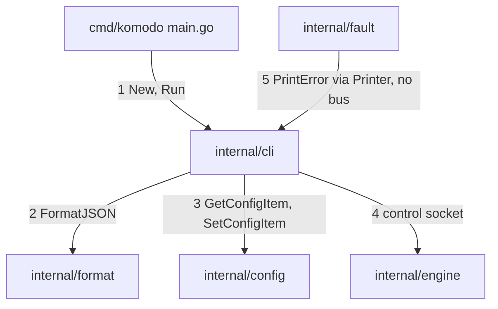

### 1.3 Data Model

#### The reply and exit codes

A command that runs without a terminal, or with `--json`, prints one `Envelope` and nothing else. The handler returns a `Result`; the `render` step turns it into the envelope and the exit code.

```go
// internal/cli/cli.go

// Envelope is the one JSON reply every command prints under --json.
type Envelope struct {
	V       int        `json:"v"`
	OK      bool       `json:"ok"`
	Verdict string     `json:"verdict"`
	Report  string     `json:"report"`
	Data    any        `json:"data"` // an empty object, never nil, when the command returns none
	Error   *ErrorBody `json:"error,omitempty"`
}

// ErrorBody explains a refusal or failure; a caller branches on Code.
type ErrorBody struct {
	Code   string `json:"code"`
	Reason string `json:"reason"`
	Fix    string `json:"fix"`
}

// Outcome classifies a finished command; its value is the process exit code.
type Outcome int

const (
	OutcomeOK       Outcome = 0 // the command did what was asked
	OutcomeRefused  Outcome = 1 // the harness declined on purpose
	OutcomeUsage    Outcome = 2 // the command line was wrong
	OutcomeHeld     Outcome = 3 // the command ran and reports a group or a check that needs a person
	OutcomeInternal Outcome = 4 // the harness itself failed
)

// Result is what a handler returns; render turns Shape and Facts into the report and the verdict.
type Result struct {
	Outcome Outcome
	Shape   string // the reply shape the Output Formatter prints, such as "reply.run"
	Code    string // reason code from the closed code list; empty on plain success
	Facts   any    // the values the shape's template prints
	Data    any    // the command's typed result, placed in Envelope.Data
	Reason  string // set when Outcome is not OutcomeOK
	Fix     string // the command or change that resolves it
	Raw     string // text printed as is, for help; the formatter is skipped
}
```

| Field | Type | Meaning |
|---|---|---|
| `v` | int | Envelope version, 1; a change to the shape raises the number |
| `ok` | bool | `true` when the command did what was asked |
| `verdict` | string | The plain first line of `report`, with code spans and bold markers removed |
| `report` | string | Text produced by `FormatJSON()` for `output.profile`; the orchestrator relays it verbatim |
| `data` | object | The command's typed result; `{}` when it returns none |
| `error` | `{code, reason, fix}` | Present only when `ok` is `false`; `fix` names the resolving command |

| Exit | Outcome | Meaning |
|---|---|---|
| 0 | `OutcomeOK` | The command succeeded |
| 1 | `OutcomeRefused` | Declined before acting: no terminal, pinned repository, tampered settings, value over its limit, no repository |
| 2 | `OutcomeUsage` | Unknown command or flag, or a bad value; an unknown flag's message names the closest real flag |
| 3 | `OutcomeHeld` | The command ran and reports a group the Runtime Manager holds until a person answers it (`status --wait` returns it with its question), or a failed `doctor` check |
| 4 | `OutcomeInternal` | The harness itself failed: a recovered panic, an undecodable record, a failed write to its own files |

Codes the CLI raises, from the closed code list owned by the [Output Formatter](#23-data-model):

| Situation | Exit | `error.code` |
|---|---|---|
| Repository pinned above the binary | 1 | `pinned` |
| Terminal-only command without a terminal | 1 | `no_terminal` |
| Command that needs a repository, run outside one | 1 | `no_repo` |
| Settings or agent registry edited by hand | 1 | `config_tampered` |
| Value over its hard limit | 1 | `over_limit` |
| Unknown command or flag, bad flag value, bad `--input` | 2 | `usage` |
| Unknown settings key or agent role | 2 | `unknown_key` |
| Value of the wrong type or outside its allowed list | 2 | `bad_value` |
| The harness itself failed | 4 | `internal` |

A refusal as printed under `--json` (exit 1):

```json
{
  "v": 1,
  "ok": false,
  "verdict": "Refused: settings.json was hand-edited",
  "report": "Refused: settings.json was edited outside komodo config.\nFix: komodo config set --accept",
  "data": {},
  "error": {
    "code": "config_tampered",
    "reason": "settings.json was hand-edited",
    "fix": "komodo config set --accept"
  }
}
```

A success, `komodo run tg-1.2 --json` (exit 0):

```json
{
  "v": 1,
  "ok": true,
  "verdict": "Run started for tg-1.2",
  "report": "Run started for `tg-1.2`.\n\n**Run id:** `0192e4c5-6f00-7a21-8c3b-2d9e0f1a4b57`",
  "data": {
    "run_id": "0192e4c5-6f00-7a21-8c3b-2d9e0f1a4b57"
  }
}
```

A caller branches on `v`. A caller that reads a higher `v` than it knows treats the reply as unreadable and stops, reporting the version it got. A field is never removed within one envelope version.

The `--help --json` output has one object per command, `{name, summary, tier, flags, result}`, where `result` is the JSON Schema (draft 2020-12) of the `data` struct, generated when the command runs from its field tags.

#### The command table

The command table is the one place that `parse`, `validate`, `--help` and the drift test read.

```go
// internal/cli/cli.go

// Tier says who may call a command.
type Tier int

const (
	TierShared   Tier = iota // a person or the orchestrator
	TierTerminal             // a person at a controlling terminal only
)

// FlagSpec describes one command flag for parsing, help and the drift test.
type FlagSpec struct {
	Name    string // long name without dashes, such as "dry-run"
	Short   string // one-letter form; empty when none
	Kind    string // bool, string, int, duration or time (an RFC 3339 timestamp)
	Default string // text form of the default; empty when none
	Help    string // one line shown by help
}

// Command is one row of the command table.
type Command struct {
	Name          string // "run", "config get"
	Summary       string // one line shown by help
	Tier          Tier
	Flags         []FlagSpec         // command-specific flags; global flags are added by parse
	NeedsTerminal func(c *Call) bool // nil when the command never needs a terminal
	NeedsRepo     func(c *Call) bool // nil when the command works outside a repository
	NeedsEngine   bool               // connects to the engine, starting it when none answers
	Hidden        bool               // a verb the harness starts itself; left out of help and the 12 commands
	PinExempt     bool               // runs even when the repository pin is above this binary
	TamperPolicy  TamperPolicy       // what the command does when the settings guard has tripped
	Run           Handler
}

// TamperPolicy says what a command does when the Configuration Manager reports a hand edit.
type TamperPolicy int

const (
	TamperRefuse TamperPolicy = iota // refuse with config_tampered
	TamperWarn                       // run, and print one warning line
)

// GlobalFlags holds the flags every command accepts.
type GlobalFlags struct {
	JSON    bool
	Dir     string // -C: act on the repository at this path
	Input   string // --input: file path, or "-" for standard input
	Quiet   bool
	Verbose bool
	NoColor bool
	DryRun  bool
	List    bool // --list
	All     bool // --all
	Version bool // --version
}

// RepoRef names the repository a command acts on.
type RepoRef struct {
	ID   string // normalized origin URL, or the git common dir path with no remote
	Root string
}

// Call is everything a handler needs, filled by the first three steps.
type Call struct {
	Command     *Command
	Args        []string      // positional arguments after flag parsing
	Flags       *flag.FlagSet // the command's parsed flags
	Global      GlobalFlags
	Repo        RepoRef // zero value when the command needs no repository
	HasTerminal bool
	Stdout      io.Writer
	CommonDir   string   // the repository's git common directory; empty outside a repository
	Groups      []string // the group labels a run label expands to, read from docs/backlog/
}

// Handler is one command's thin call into the part that owns the work.
type Handler func(c *Call) Result
```

`PinExempt` is `true` for `install`, `update`, `doctor` and the `--help` and `--version` paths. `NeedsEngine` is `true` for `run`, `stop`, `status`, `ui`, `abandon`, `replay`, `plan` and `clean`; `--version` and `--help` touch no engine. `NeedsRepo` is set for `run`, `plan` and `status` without `--all`. `Hidden` marks `internal engine`, which `commands()` and the help leave out. The `--input` object holds each flag under its long name and the positional arguments, in order, under `args`: `{"args": ["tg-1.2"], "dry-run": true}` is `run tg-1.2 --dry-run`. An unknown key is a usage error, like an unknown flag.

The row of `run`, as the table holds it:

```go
// internal/cli/work.go

var runCommand = Command{
	Name:    "run",
	Summary: "Start, schedule or continue a run, or answer a blocked group",
	Tier:    TierShared,
	Flags: []FlagSpec{ // --all is the global flag
		{Name: "schedule", Kind: "time", Help: "Queue the run for this RFC 3339 time"},
		{Name: "approve", Kind: "bool", Help: "Grant what the blocked group asked for"},
		{Name: "deny", Kind: "bool", Help: "Refuse what the blocked group asked for"},
	},
	NeedsEngine:  true,
	TamperPolicy: TamperRefuse,
	Run:          handleRun,
}
```

#### Control socket messages

A command that needs the engine writes one `engine.Request` as a line of JSON on the control socket and reads `engine.Reply` lines back on the same connection. Both types, the `Verb` values and the codes a refusal carries are defined in [Control socket frames](#73-data-model); this package holds only the client in `internal/cli/engine.go`. The reply kinds map onto `Reply.Status` and `Reply.Final`: a command accepted is `ok`, a command declined is `refused` with a `Code`, a failure is `error`, a recorded event or a live fact is `event`, and the last reply of a request sets `Final`.

| Command | Request | Replies |
|---|---|---|
| `run (id)`, `run --all` | `Verb` `run`; `Event` run-start; `Flags.All` | One final `ok` whose `data` holds the run id, or `refused` with a `Code` |
| `run (id) --schedule` | `Verb` `run`; `Flags.Schedule`; `Event` run-start with no run id and `data.schedule` set | One final `ok` whose `data` holds the run id the engine minted and the queued time |
| `run (id) --approve`, `--deny` | `Verb` `run`; `Event` run-continue; `Flags.Approve` or `Flags.Deny` | One final `ok`, or `refused` with `not_blocked` |
| `stop (id)` | `Verb` `stop`; `Event` run-stop | One final `ok`, or `refused` with `unknown_target` |
| `plan` | `Verb` `plan`; `Event` plan | `event` replies for the `error` events of the plan and for the `run-start` the Intake Handler publishes, which ends planning, then one final `ok` |
| `status`, `status (id)` | `Verb` `status`; `Target` for `(id)`; `Root`; `Flags.All`, `Flags.Wait`, `Flags.TimeoutS` | One final `ok` holding `StatusData`, with `figures` for `(id)`, `explain` for a failed or blocked group, and `recent` and `scorecard` for `--all`. With `--wait`, an `ok` holding `StatusData` after each change, then a final `ok` with `{"waited": "blocked"}`, `"done"` or `"timeout"` |
| `replay (id)` | `Verb` `replay`; `Target` | One `event` reply per recorded event, then a final `ok` with `{"gaps": 0}` |
| `abandon (id)` | `Verb` `abandon`; `Target` | One final `ok`, or `refused` with `unknown_target` |
| `ui` | `Verb` `status`, repeated by the page | The CLI process serves the page on `127.0.0.1` and reads from the engine over the socket; the page only reads, and the engine never serves HTTP |
| `clean` | `Verb` `clean`; `Flags.DryRun` | One final `ok` listing what was removed or, with `--dry-run`, would be removed |

`komodo run tg-1.2` writes, and the engine answers:

```json
{"id":"0192e4c5-8b10-7c3a-9d52-4e6f1a7b2c80","verb":"run","target":"tg-1.2","root":"/Users/rad/code/komodo","flags":{},"event":{"type":"run-start","subtype":"","run":"0192e4c5-6f00-7a21-8c3b-2d9e0f1a4b57","group":"","time":"2026-10-14T09:12:04Z","data":{"target":"tg-1.2","groups":["tg-1.2"],"source":"cli","repo":"github.com/rdevitto86/komodo-agentic-harness-coding","root":"/Users/rad/code/komodo","common_dir":"/Users/rad/code/komodo/.git"}}}
{"id":"0192e4c5-8b10-7c3a-9d52-4e6f1a7b2c80","status":"ok","data":{"run_id":"0192e4c5-6f00-7a21-8c3b-2d9e0f1a4b57"},"final":true}
```

#### Install manifest

`install` records every file and settings entry it owns, so a rerun changes only the differences. The repository manifest sits in the git directory at `<git-common-dir>/komodo/install.json`. Steps that write machine-wide files record them in a second manifest, `~/.komodo/state/install.json`, with the same `Entry` shape and an absolute `target`. The State Manager stores this machine-wide record, and `install` reads and writes it only through the State Manager.

```go
// internal/cli/install.go

// Manifest is the body of install.json: everything install owns in one place.
type Manifest struct {
	Entries    []Entry    `json:"entries"`    // one per owned file or settings entry
	Selections Selections `json:"selections"` // the optional parts a person chose
}

// Selections are the optional parts chosen at install; a rerun without a flag keeps them.
type Selections struct {
	Hosts   []string `json:"hosts,omitempty"` // "claude", "codex"
	Project bool     `json:"project"`         // the --project files are owned
}

// Entry records one owned file or settings entry and the content install wrote.
type Entry struct {
	Target string `json:"target"`          // path of the file
	Entry  string `json:"entry,omitempty"` // for a settings file, which entry inside it
	Hash   string `json:"hash"`            // fingerprint of the content install wrote
	Step   int    `json:"step"`            // number of the install step that wrote it
}
```

| Field | Rule |
|---|---|
| `target` | The file, relative to the repository root in the repository manifest |
| `entry` | Present only for `.claude/settings.json`: names the allow rule or the hook, by its JSON path and value |
| `hash` | The full SHA-256 (a 256-bit checksum), in lowercase hexadecimal, of the bytes install wrote; compared with the file's current content to tell a hand edit from install's own text |
| `step` | The install step that owns the entry, so `clean` and a rerun find it |

```json
{
  "entries": [
    { "target": "AGENTS.md", "hash": "9f2c61aa…", "step": 4 },
    { "target": "CLAUDE.md", "hash": "41d07be3…", "step": 5 },
    { "target": ".claude/settings.json", "entry": "permissions.allow Bash(komodo *)", "hash": "c3e8920f…", "step": 6 },
    { "target": ".claude/settings.json", "entry": "permissions.deny Bash(komodo config set*)", "hash": "7a1d4e52…", "step": 6 },
    { "target": ".claude/settings.json", "entry": "permissions.deny Bash(komodo install*)", "hash": "5b60c9d1…", "step": 6 },
    { "target": ".claude/settings.json", "entry": "permissions.deny Bash(komodo update*)", "hash": "0e83f2a6…", "step": 6 },
    { "target": ".claude/settings.json", "entry": "hooks.PreToolUse komodo internal guard", "hash": "e19a3b07…", "step": 6 }
  ],
  "selections": { "hosts": ["claude"], "project": false }
}
```

The same manifest as the machine-wide record `~/.komodo/state/install.json`, with the State Manager's header, an absolute `target` and the body shape of [10.3](#103-data-model):

```json
{
  "v": 1,
  "kind": "install",
  "rev": 2,
  "ts": "2026-10-14T08:55:12Z",
  "writer": "cli/48102",
  "body": {
    "entries": [
      { "target": "/Users/dev/.komodo/bin/komodo", "hash": "1a9509c4…", "step": 1 }
    ],
    "selections": { "hosts": ["claude"], "project": false }
  }
}
```

#### The Komodo block in `AGENTS.md`

`install` owns the text between two markers; a person never edits inside them. The block tells any host session how to drive the harness.

```go
// internal/cli/install.go

const (
	BlockBegin = "<!-- komodo:begin min=%s -->" // %s is the repository pin
	BlockEnd   = "<!-- komodo:end -->"
)

// Block is the Komodo block found in a repository's AGENTS.md.
type Block struct {
	Min   string // pin from the begin marker
	Start int    // byte offset of the begin marker
	End   int    // byte offset just after the end marker
}
```

```markdown
<!-- komodo:begin min=<running version> -->
#### Komodo harness

- **You are the orchestrator.** Drive the harness only through `komodo <command>`; with no terminal, every reply is the JSON envelope.
- **Installed at:** `<absolute path of bin/komodo>`.
- **Find your commands:** run `komodo --help --json` first. It lists every command, flag and result schema, and marks the terminal-only ones.
- **Not yours:** the terminal-only commands (`install`, `update`, `config set`). They refuse without a terminal. Hand the person the command.
- **Wait without polling:** run `komodo status --wait` in the background. It returns when a group is blocked or done, with the blocked group's question.
- **Answer a blocked group:** `komodo run <id> --approve` grants what it asked for; `komodo run <id> --deny` refuses it.
- **Report:** relay the envelope's `report` field verbatim.
- **Rules:** <orchestrator rules text, supplied by the Context Manager>
<output style for output.profile>
<!-- komodo:end -->
```

| Line | Written from | Rule |
|---|---|---|
| Begin marker | The running binary | `min=` is the higher of the existing pin and the running version, with any development-build suffix removed and never above the newest release the machine has seen; install never lowers it |
| Install path | Step 1 of `install` | The absolute path of `bin/komodo` under the Komodo home folder |
| Commands | The command table | The block names only commands the table holds; the drift test fails when it names another |
| Rules, output style | The [Context Manager](#6-context-manager) and the [Output Formatter](#2-output-formatter) | Pasted as supplied |
| End marker | The template | A missing or damaged marker drops the whole block from every brief |

The block names only commands the table holds. Among the shared commands it names `status --wait`, `run --approve` and `run --deny`.

#### Claude Code settings entries

Step 6 of `install` adds exactly these entries to the repository's `.claude/settings.json` and leaves every other key alone.

```json
{
  "permissions": {
    "allow": ["Bash(komodo *)"],
    "deny": ["Bash(komodo config set*)", "Bash(komodo install*)", "Bash(komodo update*)"]
  },
  "hooks": {
    "PreToolUse": [
      { "matcher": "Bash|Edit|Write",
        "hooks": [ { "type": "command", "command": "komodo internal guard", "onFailure": "block" } ] }
    ]
  }
}
```

| Entry | Rule |
|---|---|
| `allow`, `deny` | Deny rules are evaluated before allow rules. A rule matches only a command that starts with the text, so a wrapper is caught by the terminal check instead |
| `PreToolUse` matcher | `Bash|Edit|Write`, so the guard also sees file edits, not only shell commands |
| `onFailure` | `block`: when the guard hook crashes, times out or errors, Claude Code refuses the tool call instead of letting it through. This needs a Claude Code release that supports `onFailure` |
| Guard exit codes | Every internal error of the guard command exits 2, the code Claude Code reads as "block" |

The guard command is `komodo internal guard`, a hidden verb outside the 12 commands. The engine and the private tool server start the same way, as the hidden verbs `komodo internal engine` and `komodo internal tools`. The entry carries `onFailure: block`, the wider matcher and exit 2 on every guard error. `install` writes no other hook: there is no session-start hook, and no agent or skill is copied into any host.

#### Update records

`update` replaces the running binary with a newer signed one. The release manifest `latest.json` sits beside the binaries in the GitHub release and is about 1 KB.

```go
// internal/cli/update.go

// ReleaseManifest is latest.json: one release and how to verify its binaries.
type ReleaseManifest struct {
	Version string  `json:"version"` // semantic version of the release
	Assets  []Asset `json:"assets"`  // one per operating system and architecture
}

// Asset is the binary of one operating system and architecture.
type Asset struct {
	OS     string `json:"os"`     // linux or darwin
	Arch   string `json:"arch"`   // processor architecture
	URL    string `json:"url"`    // download address
	SHA256 string `json:"sha256"` // SHA-256 checksum of the binary, hexadecimal
}

// KeySet is the pair of public ed25519 keys compiled into the binary.
type KeySet struct {
	Current ed25519.PublicKey // signs today's releases
	Next    ed25519.PublicKey // lets a leaked key be rotated without breaking installed binaries
}
```

```json
{
  "version": "1.0.0",
  "assets": [
    { "os": "darwin", "arch": "arm64", "url": "https://github.com/…/releases/download/v1.0.0/komodo_darwin_arm64", "sha256": "<64 hexadecimal characters>" },
    { "os": "linux", "arch": "amd64", "url": "https://github.com/…/releases/download/v1.0.0/komodo_linux_amd64", "sha256": "<64 hexadecimal characters>" }
  ]
}
```

- **`latest.json.sig`** is the detached ed25519 signature (base64, one line) over the exact bytes of `latest.json`. Each asset is bound through its `sha256`.
- **Asset names** are `komodo_<os>_<arch>`. Four pairs are built: `darwin/arm64`, `darwin/amd64`, `linux/amd64`, `linux/arm64`. Windows runs through Windows Subsystem for Linux 2, so it uses the Linux build.
- **Unknown keys** in the manifest are ignored. A manifest without `version`, or without an asset for this machine, is refused.

The update state is `~/.komodo/state/update.json`; the State Manager stores this machine-wide record, and `update` reads and writes it only through the State Manager:

```json
{
  "v": 1,
  "kind": "update",
  "rev": 4,
  "ts": "2026-10-14T09:00:00Z",
  "writer": "cli/48190",
  "body": { "latest": "1.0.1", "checked_at": "2026-10-14T09:00:00Z", "previous": "1.0.0" }
}
```

The header is the State Manager's `MachineHeader` ([10.3](#103-data-model)). `checked_at` is RFC 3339 UTC. `previous` is the version `bin/komodo` held before the last swap. `~/.komodo/state/update.lock` is a file created exclusively so only one `update` runs at a time.

### 1.4 Interfaces

#### Go entry points

```go
// internal/cli/cli.go

type Deps struct {
	Format   *format.Formatter // FormatJSON()
	Config   *config.Manager   // GetConfigItem(), SetConfigItem(), Verify()
	Engine   Engine            // the control socket client
	Terminal func() bool       // true when a controlling terminal is attached
	Home     string            // the Komodo home folder, which a dry run of config set --accept reads
	State    *state.Machine    // install.json, update.json and providers.json; opened over Home with the cli writer when nil
	Host     Host              // the machine probes and seams of install, update and doctor; a nil field uses the real machine
	Stdout   io.Writer         // the reply stream; os.Stdout when nil
	Stderr   io.Writer         // warnings and prompts; os.Stderr when nil
	Stdin    io.Reader         // the answer to a confirmation; os.Stdin when nil
}

// State is the machine-wide records; Deps.Host holds what install, update and doctor read from the machine.

// Engine is the CLI's client of the engine's control socket.
type Engine interface {
	// Ensure connects, starting the engine first when none answers.
	Ensure(ctx context.Context) error
	// Send writes one request and returns the replies until the one that ends it.
	Send(ctx context.Context, r engine.Request) (<-chan engine.Reply, error)
}

// CLI is the command-line front door; it holds the parts in Deps.
type CLI struct{ /* deps, parsed flags, the command in progress */ }

// New returns a CLI that calls the parts in d.
func New(d Deps) *CLI

// Run parses args, runs one command and returns the process exit code.
func (c *CLI) Run(args []string) int

// PrintError shows a fault to the caller; it implements fault.Printer, which the Error Handler holds.
func (c *CLI) PrintError(f fault.Fault) error
```

`PrintError()` turns the fault into an `error.<code>` reply with the Output Formatter: `Code`, `Reason` and `Fix` become the `ErrorFacts` of [2.3](#23-data-model), and the run and group come from the fault's `Source`. It prints the envelope under `--json` and text otherwise, returns the print error, and never exits the process; the exit code of the command in progress is set by `render` from the fault's `Kind`, except that a fault with severity `warn` never changes it.

| Caller | Calls | When |
|---|---|---|
| `main` | `Run` | Once per process |
| Error Handler ([chapter 17](#17-error-handler)) | `PrintError` | A fault reaches the caller. `main` calls `fault.New(nil, cli)` in the CLI process, so there is no bus and the CLI is the `fault.Printer`; the engine's own Handler prints through `engine.ConnPrinter` |

| Dependency call | An error means | The CLI does |
|---|---|---|
| `Format.FormatJSON` | No template for the shape, or a template error | Prints the fixed `other` line and exits 4 with `internal` |
| `Config.Verify` | `ErrTampered` | Applies the command's `TamperPolicy` |
| `Config.GetConfigItem` | Unknown key | Exits 2 with `unknown_key`, naming the closest key |
| `Engine.Ensure` | No engine answered within 5 seconds | Exits 4 with `internal`, naming the socket path; nothing was started |
| `Engine.Send` | The engine sent `refused`, or the connection broke | A `refused` reply exits 1 with its code and reason; a broken connection exits 4 with `internal` |

#### Global flags

| Flag | Meaning | Default |
|---|---|---|
| `--json` | Print only the envelope | On when there is no terminal |
| `-C <path>` | Act on the repository at that path; the repository id is resolved from it | The current folder |
| `--input <file\|->` | The command's arguments as one JSON object, from a file or standard input (`-`); an explicit flag wins over the same key | none |
| `-q`, `-v` | Less or more human text in `report` | none |
| `--no-color` | Plain text; the `NO_COLOR` variable does the same | `output.color` |
| `--dry-run` | On every writing command: print each write, make none | none |
| `--help` | Same as the command's help; at any level of `config`, lists the keys below that level | none |
| `--list` | Lists the ids the command accepts | none |
| `--all` | Widens a listing or a read to everything the command can show | none |
| `--version` | Prints the running version and nothing else; it touches no repository, network or engine | none |

`--list` and `--all` act per command:

- **`--list`:** for `run` the epic and group labels under `docs/backlog/`, for `stop` and `replay` the run ids and labels the engine knows, for `abandon` the group labels that can be abandoned, and for `config get` every settings key.
- **`--all`:** for `run` every group that is not done, for `status` every repository on the machine, and for `config get` a JSON listing of every key with value, default, limit and source.

#### The 12 commands

Each command is a *direct call* (the CLI makes the call and prints the result), an *event* the CLI sends to the engine, or a *control request* the engine answers. No command reaches a Task Manager, a lease, the state or the cache directly; the work goes through the engine.

| Command | Becomes | Reaches |
|---|---|---|
| `install` | Direct call | The installer in this package; no event |
| `config get\|set (id)` | Direct call | `GetConfigItem()`, `SetConfigItem()` |
| `plan` | Event `plan` | Intake Handler subscribes to `plan` |
| `run (id)` | Event `run-start`; with `--approve` or `--deny`, event `run-continue` | Runtime Manager subscribes to both |
| `stop (id)` | Event `run-stop` | Runtime Manager subscribes to `run-stop` |
| `replay (id)` | Control request `replay` | Runtime Manager, which reads the Event Bus's event store through `bus.Reader` ([chapter 4](#4-event-bus)) |
| `status (id)` | Control request `status` | Runtime Manager, which adds the Metrics Service's figures ([chapter 18](#18-metrics-service)) |
| `abandon (id)` | Control request `abandon` | Runtime Manager, then the Cleanup Handler |
| `ui` | Direct call, reading the engine over the socket | The dashboard server in this package |
| `doctor` | Direct call | The checks in this package |
| `update` | Direct call | The updater in this package |
| `clean` | Control request `clean` | Runtime Manager, which removes everything that belongs to no open run ([chapter 16](#16-cleanup-handler)) |

**Commands that start the engine:** `run`, `stop`, `status`, `ui`, `abandon`, `replay` and `clean`. Each connects to the engine and starts it first when none answers ([Reaching the engine](#reaching-the-engine)). `plan` sends its event the same way and starts the engine when none answers, because the Intake Handler runs inside the engine process.

**Terminal-only commands:** `install`, `update` and `config set`. A refused call exits 1 with `no_terminal`, and the orchestrator hands the command to the person. On Claude Code the deny rules from step 6 refuse them first.

**Every other command is shared.** The orchestrator may call `plan`, `run`, `stop`, `replay`, `status`, `abandon`, `clean`, `ui`, `doctor`, `config get` and `--help`.

**What `(id)` names**

| Command | The id is |
|---|---|
| `run` | An epic label (`ep-1`) or a group label (`tg-1.2`); `--all` takes none |
| `stop`, `replay`, `status` | A label or a run id. A label means the latest attempt; a run id means that one attempt. `status` takes none to list live runs |
| `abandon` | A group label |
| `config get\|set` | A settings key |

Every reply shows both the label and the run id. A label is never reused after a plan is rewritten.

##### `install`

A person at a terminal runs `install`, in a repository for the repository steps and anywhere for the machine steps. It diffs the wanted file list against `install.json`, applies only the differences and ends by re-running the provider probe. A rerun makes 0 changes, a hand-edited owned file survives and is reported, and `install` never writes a settings file.

| Flag | Meaning |
|---|---|
| `--repo-only` | Write only files inside the repository (steps 4 to 7) |
| `--machine-only` | Write only the machine parts (steps 1 to 3); what `install.sh` runs |
| `--hosts claude,codex` | Override host detection |
| `--no-path` | Skip the path step |
| `--from <file>` | Install that binary file, with no network |
| `--project` | Also add `docs/{prd,hld,lld}.md`, `CHANGELOG.md` and a pull request template |
| `--no-project` | Stop owning the `--project` files; they stay on disk |
| `--force` | Overwrite hand-edited owned files |
| `--remove` | Undo the install: prune every entry `install.json` lists |

`install` writes the `AGENTS.md` block, the `@AGENTS.md` line and the settings entries as 7 manifest entries: the block, the import line, the allow rule, the three deny rules and the hook. A dry run prints one row per file, so a fresh repository with Claude Code lists 4 writes: `AGENTS.md`, `CLAUDE.md`, `.claude/settings.json` and the manifest. With no `AGENTS.md` the full template is the block alone. `--project` and `--no-project` record the choice in the manifest selections and add no file, because no project file template is defined. The hosts are kept in the selections only when `--hosts` named them; a rerun without the flag reuses them, else detects.

`install` does 3 things for a host: it places the binary, writes the short Komodo block into the repository's `AGENTS.md` (the harness is installed, here is its path, drive it only through `komodo` commands), and keeps the guard hook and the `@AGENTS.md` import. It starts no session-start hook and copies no agent or skill into any host. With `--remove` the wanted set is empty, so the diff prunes each owned entry: the Komodo block between its markers, the `@AGENTS.md` line, the owned settings entries and the placed binary version. A hand-edited owned file stays and is reported unless `--force` is given.

##### `config get` and `config set`

The id is a dotted settings key such as `limits.returns` or `agents.reviewer.model`; the [Configuration Manager](#3-configuration-manager) holds the key list.

- **`config get [<key>…]`** prints each value and the layer that set it. With no key, `--list` prints every key. `--all` prints JSON of every key with value, default, limit and source. After a key, `--all` lists that key's valid values.
- **`config set <key>=<value>…`** sets every pair or none. One call reads or writes, never both.
- **`config set --default <key>`** puts a key back to its built-in value. Resetting a whole section lists each change and waits for a typed `y`.
- **`config set --accept`** rehashes the files after a hand edit and records the acceptance.

##### `plan`

Anyone runs `plan`, usually the orchestrator. It starts planning with the goal text or the document paths: the CLI sends a `plan` event to the engine, and the engine's Event Bus delivers it to the Intake Handler. `plan` costs model tokens. `--from <path>` feeds a document set as input.

##### `run`

Anyone runs `run (id)`, usually the orchestrator. It sends the engine a `run-start` event with a unique run id and prints the id at once; it does not wait for the run.

| Form | Effect |
|---|---|
| `run <id>` | Runs an epic or a group by label. `komodo run ep-1` runs every group in epic 1 and `komodo run tg-1.2` runs one group |
| `run --all` | Runs every task group under `docs/backlog/` that is not done, in dependency order |
| `run <id> --schedule <time>` | Queues the run for `<time>`, an RFC 3339 timestamp (an internet date-time format) such as `2026-10-16T02:00:00-07:00` |
| `run <id> --approve` | Answers a blocked group by granting what it asked for, such as more files or more time |
| `run <id> --deny` | Answers a blocked group by refusing what it asked for |

- **Continuing.** A group that already has saved state continues from it, so `komodo run tg-1.2` after a crash continues each group from its saved state. A group that needs another pass, such as after a hand fix in its worktree, also continues with `komodo run tg-1.2`: it picks up at the group's current stage and runs test and review again before commit. `build`, `test` and `review` are not commands.
- **Scheduling.** `--schedule` is a socket request, not an event. The engine mints the run id, writes the entry (`target`, `root`, `run_id`, `at`, `queued_at`, `start`) to the schedule queue, returns the run id in its reply, stays up while any run is live or queued, and starts the run at its time. The reply shows the run id and the queued time, and `status` lists the queued run. When the entry fires, the engine publishes the one `run-start` with that run id.
- **Answering.** `--approve` and `--deny` send a `run-continue` event with `answer` set. The Runtime Manager passes the answer to the group's Task Manager over its command channel. A group that is not blocked refuses the answer with `not_blocked`.
- **Combinations.** `--approve` and `--deny` take an id and cannot combine with each other, `--all` or `--schedule`. `--all` takes no id. A combination is a usage error.

##### `stop`

Anyone runs `stop (id)`. It sends the engine a `run-stop` event, and the Runtime Manager halts the run's groups. The id is a label, which stops the latest attempt, or a run id, which stops that one attempt. `stop` also removes a queued run of that target from the schedule queue.

##### `replay`

Anyone runs `replay (id)`. It plays back the history of a run or a group from the Event Bus's event store, one recorded step at a time and in recorded order. It makes no model calls, costs nothing and changes nothing.

1. The CLI sends a `replay` request with the label or run id.
2. The engine answers with one `event` reply per recorded event, then a final `ok` reply holding the gap count.
3. A torn last line of the log, half-written when the program died, is dropped, and a gap line marks events the bus could not write. Each such place adds 1 to the gap count.
4. The CLI returns the steps and the gap count as `ReplayData`.

```go
// internal/cli/work.go

// ReplayData is the data of reply.replay.
type ReplayData struct {
	RunID string      `json:"run_id"` // the attempt that was replayed
	Steps []bus.Event `json:"steps"`  // the recorded events, in recorded order
	Gaps  int         `json:"gaps"`   // places where events are missing: a gap line, or a torn last line that was dropped
}
```

##### `status`

Anyone runs `status`, including the orchestrator. It sends a `status` request to the engine and prints live progress: each live run with its groups and their stages, the groups blocked on an answer with their question, and the queued runs with their start times. It covers the current repository; `--all` covers every repository on the machine.

`status (id)` adds the time, tokens and cost figures for that run or group; for a failed or blocked group it also adds the run's last events, which the Runtime Manager reads through `Explain`. `status --all` also lists recent runs with their totals, and the per-agent scorecard. The figures come from the Metrics Service ([chapter 18](#18-metrics-service)); `status --all` lists the 20 most recent runs, and the scorecard counts the last 30 days.

| Flag | Meaning |
|---|---|
| `--wait` | Waits until a group is blocked or done, then replies. A blocked group's question is in the reply and the command exits 3 |
| `--timeout <dur>` | The longest wait; 9 minutes by default. At the limit the reply says `timeout` and the command exits 0 |

`status --wait` is the orchestrator's way to wait. The orchestrator runs it in the background, so it reacts to a blocked group without polling, answers with `komodo run (id) --approve` or `--deny`, and waits again. With no live run, `--wait` returns at once with `waited` set to `done`.

```go
// internal/cli/status.go

// StatusData is the data of reply.status.
type StatusData struct {
	Runs    []RunRow     `json:"runs"`
	Queued  []QueuedRow  `json:"queued"`
	Blocked []BlockedRow `json:"blocked"`          // groups that wait for an answer
	Waited  string       `json:"waited,omitempty"` // with --wait: blocked, done or timeout
	Figures   *Figures            `json:"figures,omitempty"`   // status (id): the run's or group's time, tokens and cost
	Explain   []bus.Event          `json:"explain,omitempty"`   // status (id) of a failed or blocked group: the run's last events
	Recent    []metrics.RunMetrics `json:"recent,omitempty"`   // status --all: the 20 most recent runs with their totals
	Scorecard *metrics.Scorecard  `json:"scorecard,omitempty"` // status --all: one row per agent and model, over the last 30 days
}

// Figures are the time, tokens and cost of one run or group, from the Metrics Service.
type Figures struct {
	WallS     int64   `json:"wall_s"`     // seconds from the start to the end, or to now while open
	TokensIn  int     `json:"tokens_in"`
	TokensOut int     `json:"tokens_out"`
	USD       float64 `json:"usd"`        // metered dollars
	USDEquiv  float64 `json:"usd_equiv"`  // notional dollars of subscription sessions
}

// RunRow is one live run and its groups.
type RunRow struct {
	RunID  string     `json:"run_id"`
	Target string     `json:"target"` // the label the run was started with
	Groups []GroupRow `json:"groups"`
}

// GroupRow is one group of a live run.
type GroupRow struct {
	Group string `json:"group"` // the group label
	Stage string `json:"stage"`
	State string `json:"state"` // the state the Runtime Manager holds the group in
}

// QueuedRow is one entry of the schedule queue.
type QueuedRow struct {
	Target   string    `json:"target"`
	RunID    string    `json:"run_id"`   // the run id the engine minted when it queued the entry
	Root     string    `json:"root"`      // the repository root the target belongs to
	At       time.Time `json:"at"`
	QueuedAt time.Time `json:"queued_at"`
}

// BlockedRow is a group that waits for an answer.
type BlockedRow struct {
	Group    string `json:"group"`
	RunID    string `json:"run_id"`
	Reason   string `json:"reason"`   // the block reason code
	Question string `json:"question"` // what the group asks, in plain words
}
```

`komodo status --wait --json` when a group asks for files (exit 3):

```json
{
  "v": 1,
  "ok": true,
  "verdict": "tg-1.2 is blocked: it asks for 2 more files",
  "report": "`tg-1.2` is blocked: it asks for 2 more files.\n\n**Question:** the builder needs `internal/cache/store.go` and `internal/cache/lock.go`, outside its scope.\n**Fix:** `komodo run tg-1.2 --approve` or `--deny`",
  "data": {
    "runs": [
      { "run_id": "0192e4c5-6f00-7a21-8c3b-2d9e0f1a4b57", "target": "ep-1",
        "groups": [ { "group": "tg-1.2", "stage": "build", "state": "blocked" } ] }
    ],
    "queued": [],
    "blocked": [
      { "group": "tg-1.2", "run_id": "0192e4c5-6f00-7a21-8c3b-2d9e0f1a4b57", "reason": "needs_scope",
        "question": "The builder needs internal/cache/store.go and internal/cache/lock.go, outside its scope." }
    ],
    "waited": "blocked"
  }
}
```

##### `abandon`

Anyone runs `abandon (id)` to drop a group for good. The id is a group label; an epic label is a usage error.

1. The CLI sends an `abandon` request to the engine.
2. The Runtime Manager stops the group's Task Manager.
3. The Cleanup Handler frees the group's resources: its branch, worktree and sandbox, and the Runtime Manager releases its lease through the Lease Manager.
4. Groups that depend on the abandoned group block with the reason `dependency`, naming it.
5. The group's saved state and event log stay on disk.

##### `ui`

A person runs `ui` to open the web dashboard. It starts the engine when none runs, serves the page from `embed/ui/` on `127.0.0.1` only, on a free port, prints the address and stops on Ctrl-C. The page shows the same runs, groups and queued runs as `status`, with live events, read from the engine over the control socket. The page is read-only: every action stays a command, so it has no control for `stop`, `abandon` or an answer. Anyone may start `ui`, including the orchestrator. It is served on this machine's local address only. Beside each run the page shows the same time, tokens and cost figures as `status (id)`.

##### `doctor`

Anyone runs `doctor`, including the orchestrator. It prints each check's result with a fix line, changes nothing except refreshing the provider probe in `providers.json` (written through the State Manager), and still runs when the repository pin is above the binary. It exits 0 when every check passes and 3 when one fails, because it ran and reports something a person must fix.

- **Install:** the installed files against `install.json`, and the path entry.
- **Sandbox:** the operating-system sandbox (Seatbelt on macOS, Bubblewrap on Linux) by running a harmless command inside it.
- **Docker:** whether the Docker tools exist and the daemon answers. Without Docker the Tester falls back to the operating-system sandbox, and the run report says so.
- **Model links:** the Claude subscription link and the paid Anthropic interface, and the optional local model link when one is configured.
- **Komodo block:** one begin marker and one end marker in the repository's `AGENTS.md`.
- **Home folder:** the Komodo home folder is on a local file system and honours file locks; a network file system or a lock that lets two holders in fails the check ([G-280](#g-280) holds the open question of refusing such a folder).
- **Review rules:** each review rule whose findings Go verified under 50% of the time, with at least one finding submitted, fails the check ([G-268](#g-268) holds the open question of whether `doctor` reports them).

The `install` check compares every recorded entry with its disk fingerprint and looks for `komodo` on `PATH`. The `links` check is skipped, with the detail "not wired", when this build has no model client. It passes when the Claude subscription link or the paid Anthropic interface works and fails when a configured local link does not. A missing Docker passes with a note that the Tester uses the operating-system sandbox; Docker present with a silent daemon fails.

```go
// internal/cli/doctor.go

// DoctorData is the data of reply.doctor.
type DoctorData struct {
	Checks []Check `json:"checks"`
}

// Check is the result of one doctor check.
type Check struct {
	Name   string `json:"name"`   // install, sandbox, docker, links, block, home or rules
	Result string `json:"result"` // pass, fail, or skip when the check cannot run in this build; only fail makes the exit code 3
	Detail string `json:"detail"` // what was found
	Fix    string `json:"fix"`    // the command or change that resolves a failure; empty on pass
}
```

##### `update`

A person at a terminal runs `update`. It downloads the newest release to `versions/<v>/`, verifies the SHA-256 checksum and the ed25519 signature, and replaces `bin/komodo` atomically. Processes that already run keep their own version.

| Flag | Meaning |
|---|---|
| `--check` | Fetch `latest.json` now and report; changes nothing else |
| `--to <version>` | Install that version; may downgrade |
| `--restart-runs` | Move live runs onto the new binary: [TODO: how `update --restart-runs` moves live runs onto the new binary ([G-232](#g-232))]. Until it is decided the CLI calls a `RunMover` the engine will supply, and the flag refuses with the not-built-yet fault when none is wired |

##### `clean`

Anyone runs `clean`, including the orchestrator. It removes everything that belongs to no open run. An open run is one that is live, paused, blocked or queued.

- Group worktrees and local group branches.
- Docker containers.
- Runtime cache entries, and the language and build caches of repositories with no open run.
- Event logs and metrics records past retention.

`clean` never touches anything a live lease holds or an open run uses. `--dry-run` lists what would go and removes nothing. A branch or worktree goes only through the Cleanup Handler; the other removals belong to the part that owns the file ([chapter 16](#16-cleanup-handler)).

#### Terminal mode

The CLI has no full-screen terminal mode. Watching a run uses the web dashboard (`ui`) or `status`. The 12 commands and the reply envelope stay as specified here, because the orchestrator and scripts depend on them.

### 1.5 Behaviour

#### The five steps

Every command takes the same five steps. A failure in steps 1 to 3 has made 0 writes.

**📐 The five steps and where a refusal leaves**
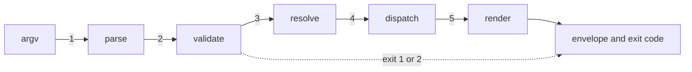

1. **Parse.** Find the command in the table, build a `flag.FlagSet` (Go's standard flag parser) from the global flags and the command's `Flags`, and parse the rest of `argv`. An unknown flag is a usage error that names the closest known flag. With `--input`, the JSON object is read and each key is applied as if typed, except where the same flag is on the command line, which wins. `--help` prints the command's help and ends.
2. **Validate.** Run these checks in order and return the first refusal:
   1. Pin check, unless `PinExempt`: when the repository pin is above the running version, refuse with exit 1 and the fix `run komodo update`.
   2. Types and allowed values of every flag; a failure is a usage error, exit 2.
   3. Terminal check: when `NeedsTerminal(c)` is true and no controlling terminal is attached, refuse with exit 1.
   4. Settings guard: call `Config.Verify`. On `ErrTampered` the command's `TamperPolicy` decides.
3. **Resolve.** Take the repository id from the working folder or `-C`. The id is the normalized origin address, or the git common directory path when there is no remote, so every worktree of a repository shares one id. It also resolves that repository's git common directory, which it puts in `common_dir` of the `run-start` it publishes. Then resolve the command's `(id)`: a label such as `ep-1` or `tg-1.2` is matched against the task lists under `docs/backlog/` (read with the Intake Handler's `Load`), and an epic label expands to its group labels. A run id is a version 7 UUID. A label that names no epic or group is a usage error, exit 2; the engine refuses a run id it does not know.
4. **Dispatch.** Call the handler with the filled `Call`. With `--dry-run`, the owning part prints each write the command would make and makes none.
5. **Render.** Marshal `Result.Shape` and `Result.Facts` into a message, call `FormatJSON()`, place its report in `report` and its verdict in `verdict`, print the envelope under `--json` and the text otherwise, and return the exit code of `Result.Outcome`.

The closest match for an unknown name is the known name at the smallest Levenshtein distance (fewest single-letter edits), when that distance is at most 2; ties go to table order. With nothing that close the message names `komodo --help`.

#### Reaching the engine

A command with `NeedsEngine` set connects to the engine on the control socket, `~/.komodo/state/engine.sock`, and starts the engine first when none answers. The socket is created readable and writable by its owner only, so no other user can send a request.

**📐 How a command finds or starts the engine**
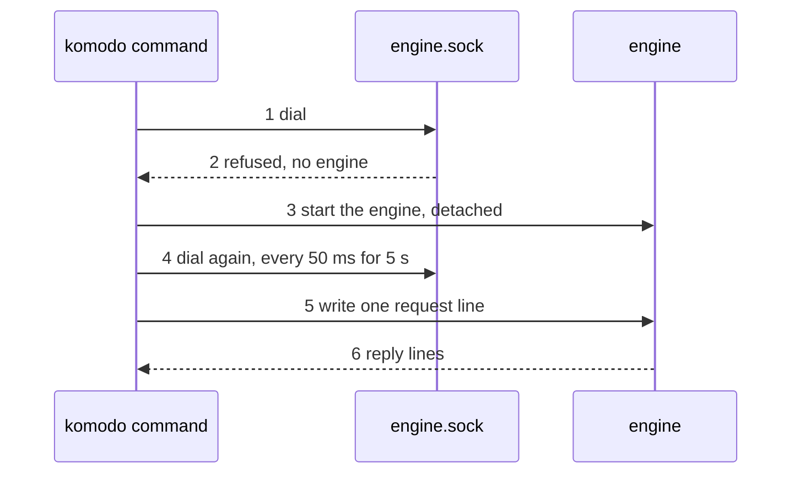

1. **Dial.** Open `engine.sock`. When the connection succeeds, go to step 4.
2. **Start.** When the file is missing, or the dial is refused because a crashed engine left the file, start the engine as a detached process of the `komodo` binary with the hidden verb `komodo internal engine`.
3. **Wait.** Dial again every 50 ms for up to 5 seconds. When none answers, exit 4 with `internal`, naming the socket path.
4. **Send.** Write one `engine.Request` line and read `engine.Reply` lines until the reply with `final` set ([Control socket messages](#control-socket-messages)).
5. **Hung engine.** When no reply arrives within 10 seconds and `~/.komodo/state/engine.beat` is older than 30 seconds, the CLI treats the engine as hung. It stops the engine's whole process tree, starts a fresh engine as in step 2, which recovers from saved state, and sends the request once more ([7.5](#heartbeats-and-a-hung-engine)).
Two commands that start an engine at the same moment end with one engine: the engine that cannot create the socket exits, and both commands dial the winner.

**Queued runs after a restart.** Every command, before its own work, checks whether an engine answers; when none does and the schedule queue holds an entry, the CLI starts the engine as in step 2, so a run that came due while the machine was off starts at once. The queue is read through the State Manager.

#### Tamper policy per command

A hand edit of the settings files must not lock out the command that stops a run.

| Policy | Commands |
|---|---|
| `TamperRefuse`: exit 1, `config_tampered`, fix `komodo config set --accept` | `config set`, `plan`, `run` |
| `TamperWarn`: run, print one warning line | `config get`, `stop`, `replay`, `status`, `abandon`, `doctor`, `ui`, `install`, `update`, `clean`, `--help`, `--version` |

The refused commands start agent work or change settings, so they need trusted values. The `stop` and `abandon` commands and every read must always work, and `config set --accept` is the one `config set` form that runs, because it is the fix.

#### Repository pin

1. Walk up from the working folder, or `-C`, to the first folder holding `.git` and read `AGENTS.md` there, with no git process.
2. Find the line `komodo:begin min=<version>`.
3. Compare it with the embedded version by semantic-version order.
4. When the pin is higher and the command is not exempt, refuse with exit 1.

Outside a git repository the pin check is skipped and `Call.Repo` stays empty. A command that needs a repository refuses with `no_repo`.

#### Terminal check

The check opens `/dev/tty`; a failed open counts as no terminal, the result an agent shell gets. Windows runs through Windows Subsystem for Linux 2, so the same check applies.

#### Install

Install is one state machine: compute the wanted set, diff it against `install.json`, apply the differences, re-probe providers.

**📐 What install does with one target**
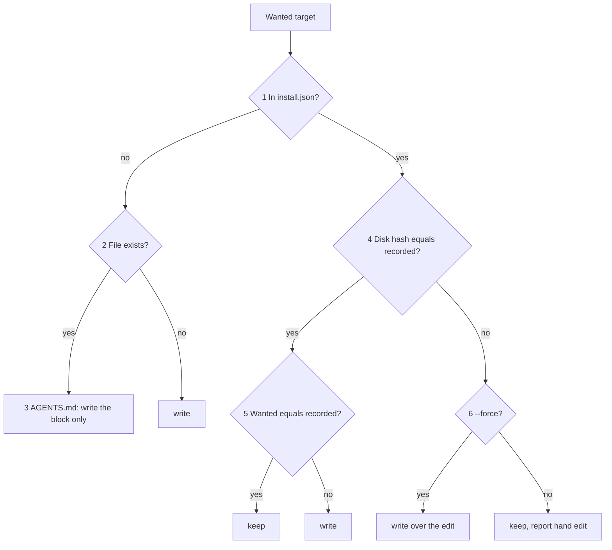

1. Resolve the hosts: `--hosts` if given, else detect. Claude Code is present when any of `CLAUDE.md`, `.claude/`, `claude` on `PATH` or `~/.claude/` exists. Codex is present when any of `.codex/`, `codex` on `PATH` or `~/.codex/` exists.
2. Resolve the scope. `--machine-only` keeps steps 1 to 3; `--repo-only` keeps steps 4 to 7, which need a git repository. `--repo-only` outside one refuses with exit 1 and `no_repo`; a plain `install` there runs only the machine steps and reports the rest as skipped.
3. Build the wanted set: each step's targets with the content install would write.
4. Read `install.json`; an absent manifest is empty.
5. Classify each target as in the diagram. A manifest entry no longer wanted is pruned. With `--remove` nothing is wanted, so every entry is pruned.
6. With `--dry-run`, print one row per target (file, action `write`, `keep` or `prune`, reason) and stop with 0 writes.
7. Apply in step order.
8. Run the provider probe and report each link's result.

| # | Target | Writes | Runs when |
|---|---|---|---|
| 1 | Binary | `~/.komodo/versions/<v>/komodo`, copied to `~/.komodo/bin/komodo` | Always |
| 2 | `PATH` | A symlink into `~/.local/bin` if that is on `PATH`, else one marked line in `~/.zshrc`, `~/.bashrc` or `~/.profile` by `$SHELL` | If `komodo` is missing from `PATH`; `--no-path` skips |
| 3 | Provider probe | `~/.komodo/state/providers.json`: written through the State Manager. It checks the Claude subscription link, the paid Anthropic interface and, when one is configured, the optional local model link | Always |
| 4 | `AGENTS.md` | The full template, or only the Komodo block between the markers | Inside a git repository |
| 5 | `CLAUDE.md` | The single line `@AGENTS.md` | Claude detected, or `--hosts claude` |
| 6 | `.claude/settings.json` | The entries of Claude Code settings entries, merged; other keys untouched | Claude detected |
| 7 | Manifest | `<git-common-dir>/komodo/install.json` | Inside a git repository |

- **Step 1, binary source.** `--from <file>` uses that file with no network; its version is what it prints for `--version`. Otherwise the running binary is copied. `install` makes no network call (invariant 12), so a newer release arrives through `update`, and an install from an older binary leaves `bin/` on the older version.
- **Shared files.** Content of `CLAUDE.md` or `.claude/settings.json` that is already there and equal to what step 5 or 6 would write stays the person's: install does not record it, and `--remove` never deletes it.
- **Step 6, the guard.** The hook entry is the guard command, not a whole group. When a `PreToolUse` group already runs `komodo internal guard`, install sets only that command inside the group and keeps the group's matcher and other hooks; otherwise it adds a group with the matcher `Bash|Edit|Write`. `--remove` deletes only the guard command, and its group only when no other hook is left. A rewrite keeps the file's key order and every value as written, with no escaping of `&`, `<` or `>`, and indents with 2 spaces.
- **Step 1, the lock.** The binary step takes `update.lock` like `update`, so an install and an update never write `bin/komodo` together; a held lock stops the install with a message.
- **Step 2, kept entry.** A path entry install recorded stays wanted on a rerun even though `komodo` is now on `PATH`, so a rerun never prunes its own symlink or shell line; `--no-path` leaves a recorded entry as it is.
- **Step 4.** With no `AGENTS.md`, the full template is written. With one, only the block is written or replaced; text outside the markers is never touched. A begin marker without an end marker, or two of either, stops the step and names the lines to fix by hand.
- **Step 6.** A hook that fails prints an error; `onFailure: block` makes the guard fail closed.
- **Never written:** a repository configuration folder, git hooks, `.codex/`, anything under `~/.claude` or `~/.codex`, or anything under `.claude/` beyond step 6. The settings files appear on the first `config set`, not at install.

The pin rises only. A rerun with nothing to change makes 0 writes.

#### Update

**📐 One update from check to cleanup**
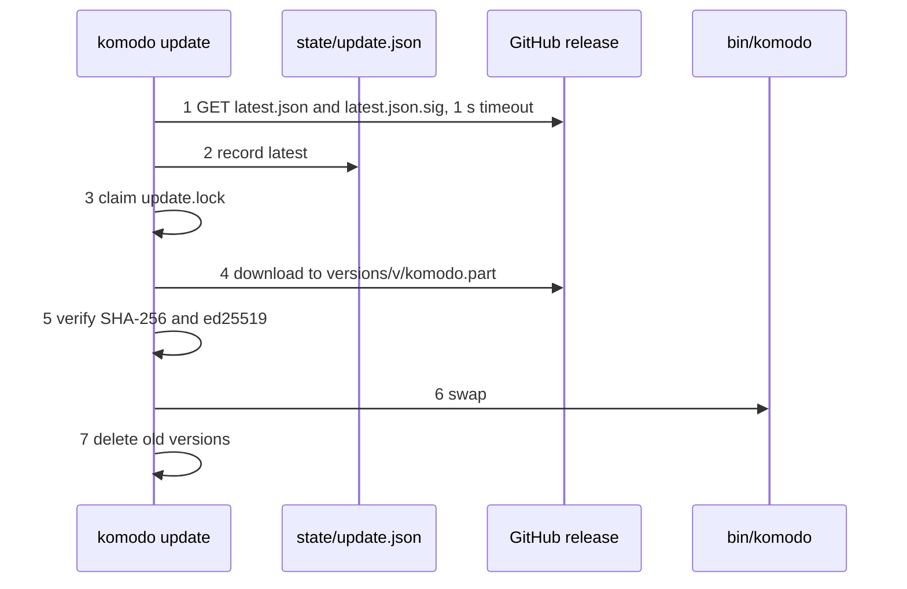

1. **Check.** Fetch `latest.json` and its signature with a 1 second timeout, and verify the signature against the compiled-in keys before the manifest is trusted. Only `update` fetches the release manifest. A failed fetch prints the error and its fix. With `--to <version>` the manifest comes from that version's release folder (`<releases>/download/v<version>/`), and its `version` must equal the one asked for; the newest release is `<releases>/latest/download/`.
2. **Record.** Replace `update.json` with the newest version seen. With `--check` or `--dry-run`, stop here; a dry run records nothing.
3. **Claim.** Create `update.lock` exclusively, with a token in it. If it exists and is younger than 10 minutes, another `update` is running and this one exits. An older lock is stale, so a crashed update cannot block updates; one claimer at a time takes a stale lock over, and release deletes the lock only while it still holds the claimer's token. The download limit is 5 minutes, under the 10-minute age.
4. **Download.** Fetch the asset for this operating system and architecture to `versions/<v>/komodo.part`.
5. **Verify.** Compare the download's SHA-256 with the asset's `sha256`; the signature was verified at step 1. On a mismatch delete the `.part` file, keep the old binary and print the error.
6. **Swap.** Rename `komodo.part` to `versions/<v>/komodo`, then replace `bin/komodo` atomically.
7. **Clean up.** Delete version folders that are not removable roles: keep the current version, the previous version, and every version named by an unfinished task group in the State Manager. Delete the rest. When the Host supplies no list of versions in use, cleanup deletes nothing and the reply says so in `notes`. The previous version is the folder `install.json` records for `bin/komodo`, else the running version; the swap also rewrites the `bin/komodo` hash and the version entry in `install.json`. The compiled-in keys are set by the release build with `-ldflags -X` on `releaseKeyCurrent` and `releaseKeyNext` (base64).

A signature verifies when it matches a key of the set; either key may sign. A rotation release is signed with the `next` key and compiles `next` into the current slot, so installed binaries accept it with no flag day. Moving the private key into a key management service, and refusing a manifest older than the last one accepted, wait for the first machine the owner does not own that runs `update` ([G-21](#g-21)). Producing and signing a release is done by this repository's Makefile, outside the product.

An install script reads the same `latest.json` over HTTPS, compares the SHA-256, and runs `komodo install --machine-only`; it does not verify the signature, because no key is on the machine yet.

#### How a command reaches the work

The CLI sends each event to the engine over the control socket, and the engine's Event Bus broadcasts it, so the CLI never waits on the part that handles it. It sends `run-start`, `run-stop` and `run-continue` for its commands and `plan` for `komodo plan`.

- **Start from planning:** the Intake Handler publishes `run-start` itself, inside the engine process, with `source` set to `intake`, its own run id and the epic label as `target`, for the groups it has just written.
- **Other events:** the Configuration Manager publishes `skill` and `mcp` right after it saves a change to either, and when it detects a hand edit on its next read ([3](#3-configuration-manager)).

The `run-start` the engine publishes when the entry for `komodo run ep-1 --schedule 2026-10-16T02:00:00-07:00` fires:

```json
{
  "type": "run-start",
  "subtype": "",
  "run": "0192e4c5-6f00-7a21-8c3b-2d9e0f1a4b57",
  "group": "",
  "time": "2026-10-14T09:12:04Z",
  "data": {
    "target": "ep-1",
    "groups": ["tg-1.1", "tg-1.2"],
    "source": "cli",
    "schedule": "2026-10-16T02:00:00-07:00",
    "repo": "github.com/rdevitto86/komodo-agentic-harness-coding",
    "root": "/Users/rad/code/komodo",
    "common_dir": "/Users/rad/code/komodo/.git"
  }
}
```

A `run-continue` for `komodo run tg-1.2 --approve`:

```json
{
  "type": "run-continue",
  "subtype": "",
  "run": "",
  "group": "",
  "time": "2026-10-14T09:40:10Z",
  "data": { "target": "tg-1.2", "answer": "approve" }
}
```

- `group` is empty on events the CLI sends; `data.target` and `data.groups` name what to run, so the Runtime Manager never searches on its own.
- `groups` holds the group labels the CLI read from the task lists under `docs/backlog/`: the groups of an epic, one group, or every group for `run --all`. The Runtime Manager starts those that are not done, in dependency order.
- `target` is the label the person typed, `all` for `run --all`, or the epic label when the Intake Handler starts the run. `schedule` is present only with `--schedule`. `source` is `cli` or `intake`.
- `run` holds the run id the CLI generated for `run-start`; for a scheduled run it holds the run id the engine minted when it queued the entry. For `run-stop` and `run-continue` it holds the run id the caller typed, or is empty when a label was typed; the Runtime Manager then takes the label's latest attempt and returns the run id in its `accepted` reply.
- `answer` is `approve` or `deny`, and is present only on `run-continue` sent by `--approve` or `--deny`.
- `repo` and `root` are the repository id and root the engine needs because it hosts runs of several repositories. The full payload per event type is in [Event Bus](#4-event-bus).
- While a command waits, the CLI receives over its socket connection the `run-status`, `run-complete`, `run-failure` and `error` events of the run it waits on; while `plan` waits, it also receives the run's `run-start`. The CLI starts work directly: it sends `plan`, which goes to the Intake Handler, or `run-start`, `run-stop` and `run-continue`, which go to the Runtime Manager.

#### Short commands

`--help` and `config get` answer under 50 ms with no network and no repository scan. `--help` reads text embedded at build. `config get` parses the settings once per process. The 50 ms figure is a target until a timing test measures it ([G-19](#g-19)).

### 1.6 State

Only the settings guard and the update flow have state, and the Configuration Manager owns the first ([3.6](#36-state)). A command holds none of its own: every run of `Run` starts clean.

**📐 One update**
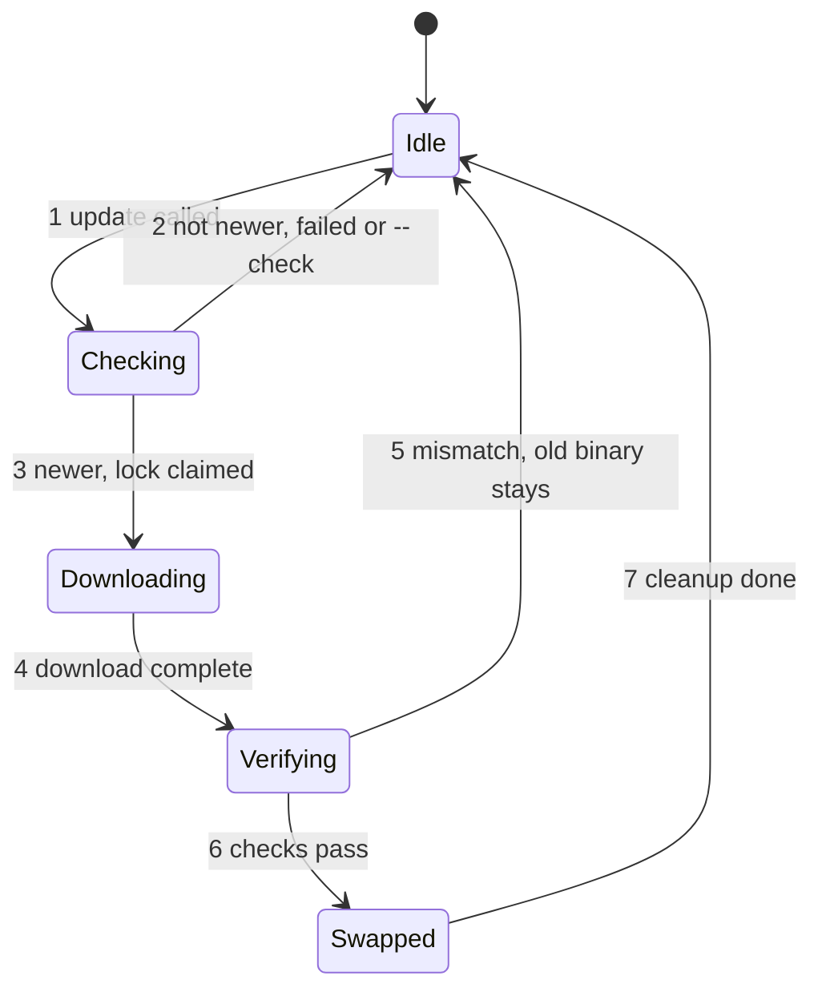

| State | Event | Next | True afterwards |
|---|---|---|---|
| Idle | `update` runs | Checking | The fetch is under way with a 1 second timeout |
| Checking | Fetch fails, `latest` is not newer, or `--check` | Idle | `update.json` holds the newest version seen |
| Checking | `latest` is newer and the lock is claimed | Downloading | `update.lock` exists |
| Downloading | Download completes | Verifying | `versions/<v>/komodo.part` exists |
| Verifying | Checksum or signature differs | Idle | The `.part` file is deleted; `bin/komodo` is unchanged; the lock is released |
| Verifying | Both checks pass | Swapped | `versions/<v>/komodo` exists and `bin/komodo` is the new binary |
| Swapped | Cleanup finishes | Idle | Only current, previous and in-use versions remain; the lock is released |

An install manifest entry is Absent, Owned or Edited. `install` moves Absent to Owned; a person's edit moves Owned to Edited; `install --force` moves Edited back to Owned; a prune removes it.

### 1.7 Invariants and Failures

**Invariants**
1. The pin check runs first among the validate checks, so an old binary never acts on a repository that needs a newer one.
2. A command that fails in steps 1 to 3 has made 0 writes.
3. Every writing command is idempotent: a repeat with the same arguments reports `0 changes`.
4. A model session cannot change settings: `config set` needs a terminal, and on Claude Code the deny rules refuse it first.
5. The guard hook fails closed: an error in it blocks the tool call.
6. `stop`, `abandon` and every read run even when the settings guard has tripped.
7. A binary is renamed into `versions/<v>/komodo` only after its checksum and signature match; a `.part` file is never run.
8. `bin/komodo` is replaced atomically, so it always names a complete, verified binary.
9. A running process starts every child from the version folder it started with, never from `bin/`.
10. Cleanup never deletes the current version, the previous version, or a version an unfinished task group names.
11. The repository pin only rises.
12. Only `update` makes a network call to fetch a release.
13. The CLI reaches the work only through the engine's control socket, never a Task Manager, a lease, the state or the cache.
14. Only the user who owns `engine.sock` can open it.
15. `status` and `replay` change nothing and make no model call.

**Failures**

| Situation | Detection | Action and bound | Final state |
|---|---|---|---|
| Unknown command or flag, or bad value | `parse`, `validate` | Exit 2; names the closest real flag | 0 writes |
| Repository pinned above the binary | Pin check | Only `install`, `update`, `doctor`, `--help` and `--version` run; others exit 1 with `run komodo update` | 0 writes |
| Settings hand-edited | `Config.Verify` | Per `TamperPolicy`: refuse with `config_tampered`, or warn once | Files unchanged |
| Terminal-only command without a terminal | `NeedsTerminal` | Exit 1 with `no_terminal`; the command does not run | 0 writes |
| `--input` unreadable or not a JSON object | `parse` | Exit 2 with `usage`, naming the file and the decode error | 0 writes |
| Event or request not accepted by the engine | No `ok` reply, or `Engine.Send` fails | Exit 4 with `internal` | Nothing started |
| Bad checksum or signature on update | Verify step | `.part` file discarded; error printed with its fix | Old binary stays |
| Two `update` calls at once | `update.lock` | The second exits at once | One update runs |
| Update crashes holding the lock | Lock age over 10 minutes | The next `update` takes over | Lock replaced |
| An owned file hand-edited | Hash comparison | File left alone and listed; `--force` overwrites | File as edited |
| A write fails during install | `Apply` | Stops at that step and reports it; the manifest is written after steps 4 to 6, so a rerun recomputes the diff | Earlier steps kept |
| Guard hook errors or times out | Claude Code with `onFailure: block` | The tool call is refused | Nothing ran |
| No engine answers and none can be started | `Engine.Ensure` waits 5 seconds | Exit 4 with `internal`, naming the socket path | Nothing started |
| The engine answers nothing for 10 seconds and its beat file is over 30 seconds old | `Engine.Send` and `engine.beat` | Stop the engine's process tree, start a fresh engine, retry the request once | One retry | A new engine recovered from saved state |
| `engine.sock` left behind by a crashed engine | The dial is refused | The CLI starts an engine | One engine |
| The engine refuses a request | A `refused` reply | Exit 1; the code and reason come from the reply | Nothing changed |
| A label names no epic or group | Step 3 | Exit 2 with `usage` | 0 writes |
| `--approve` or `--deny` for a group that is not blocked | The engine's `refused` reply | Exit 1 with `not_blocked` | Nothing changed |
| `status --wait` reaches its timeout | `--timeout` | Exit 0 with `waited` set to `timeout`; the caller asks again | Nothing changed |
| Panic in a handler | `Run` recovers | Exit 4 with `internal` | Process ends |

### 1.8 Config

The CLI owns no settings key. It reads `output.profile`, `output.turn_end_summary` and `output.color`, which the [Output Formatter](#28-config) owns.

| Variable | Effect |
|---|---|
| `KOMODO_HOME` | Another home folder instead of `~/.komodo`, such as `KOMODO_HOME=/tmp/k komodo config get --list`; tests set it |
| `NO_COLOR` | Plain text without colour codes |

| Constant | Value |
|---|---|
| Wait for a started engine to answer the socket | 5 seconds, redialled every 50 ms |
| Wait for a reply before the beat file is checked | 10 seconds; the engine is hung when the beat is also over 30 seconds old |
| Longest `status --wait` | 9 minutes, set by `--timeout`; Claude Code's shell tool stops a command at 10 minutes at most |

### 1.9 Proof Cases

**Unit**
- **Exit codes:** each `Outcome` value maps to the exit code in the table: 0, 1, 2, 3 and 4.
- **Closest match:** `komodo rnu` exits 2 and names `run`; an input with nothing within distance 2 names `komodo --help`.
- **Input merge:** `--input` with a flag that disagrees uses the flag.
- **Tamper policy:** with a tripped guard, `stop` runs and warns, `run` exits 1 with `config_tampered`.
- **Manifest plan:** a rerun of the planner on an unchanged repository returns 0 `write` and 0 `prune`; a hand-edited owned file plans `keep`, and `write` with `--force`.
- **Pin:** the pin written is the higher of the existing one and the running version, with a development suffix removed, never lower.
- **Settings merge:** step 6 adds the allow rule, the deny rules and the hook, and leaves a pre-existing key unchanged.
- **Cleanup:** the current, previous and in-use versions survive; the rest go.
- **Lock age:** a lock older than 10 minutes is stale; a younger one is not.

**Component** (the real parts with a fake release server and a fixture repository)
- **Golden envelope:** each of the 12 commands has a golden `--json` test that compares its output with a stored copy.
- **Terminal check:** with no controlling terminal, `komodo install` and `komodo config set limits.returns=4` exit 1 with `no_terminal`.
- **Pinned repository:** a repository whose `AGENTS.md` has `min=` above the binary refuses `run` with exit 1 and `run komodo update`, while `install`, `update`, `doctor`, `--help` and `--version` run.
- **Idempotent install:** the second `install` makes 0 repository changes, and `--dry-run` on a fresh repository lists 4 writes.
- **Install remove:** `install --remove` after `install` leaves 0 entries in `install.json` and no Komodo block in `AGENTS.md`; a hand-edited owned file stays and is reported.
- **Read-only dashboard and shared tier:** `ui` and `clean` run from a shell with no terminal; the page's served routes accept no method that changes state.
- **Status figures:** `status tg-1.2` against a fake engine prints the group's time, tokens and cost; `status --all` adds the recent runs and the scorecard.
- **Guard fails closed:** a guard command forced to crash makes Claude Code refuse the tool call.
- **Update:** a bad checksum or a bad signature keeps the old binary; two concurrent `update` calls run one.
- **Help against the table:** `--help --json` and the command table disagree only when the test fails.
- **Short commands:** `--help` and `config get` each answer under 50 ms.
- **Version kept:** a fixture task group that names an older version keeps that version folder through an update.
- **Label resolution:** `ep-1` expands to the group labels of epic 1 in a fixture task list, `tg-1.2` stays one group, and `ep-9` with no such epic exits 2 with `usage`.
- **Answer flags:** `run tg-1.2 --approve --deny` exits 2 with `usage`; `--approve` for a group that is not blocked exits 1 with `not_blocked`.
- **Schedule time:** `--schedule 2026-10-16T02:00:00-07:00` is accepted; `--schedule tomorrow` exits 2 with `usage`.
- **Engine on demand:** with no listener on a fixture `engine.sock`, `Engine.Ensure` starts a fake engine and the request is sent once; a second command finds the first engine and starts none.
- **Socket access:** the fixture `engine.sock` is created readable and writable by its owner only.
- **Status wait:** a fake engine that reports one blocked group makes `status --wait` exit 3 with that group's question; a fake engine with no live run makes it exit 0 with `waited` set to `done`.
- **Replay is read-only:** `replay tg-1.2` against a fixture event store prints each recorded event in order, marks a torn last line as a gap, and publishes nothing.

### 1.10 Open Gaps

Each id is a row in the [gap register](#appendix-b-gap-register); the rows are not copied here.

| Gap | Question |
|---|---|
| [G-19](#g-19) | The 50 ms short-command budget is a target until measured |
| [G-21](#g-21) | Enterprise signing: key management service and refusal of an older manifest |
| [G-232](#g-232) | How `update --restart-runs` moves live runs onto the new binary |

## 2. Output Formatter

The Output Formatter turns the harness's structured messages into text a person reads. It is mechanical: a template and a set of facts go in, the same words come out every time, and no model, repository or network is involved. The CLI hands it every reply and error; the purpose and the interactions are in [HLD 5.3](hld.md#53-output-formatter).

### 2.1 Scope and Concepts

**Owns:**
- `FormatJSON()`, the one entry point, and the templates behind it, one per reply shape and profile.
- The two profiles, the two closed code lists, the seven template functions, escaping, wrapping, colour and table limits.
- The golden files that pin the exact bytes of every template.

**Does not own:**
- The reply envelope and the exit code: [CLI](#1-cli).
- Deciding what a reply says. The part that produces a fact owns the check that the fact is true, because the formatter reads no repository.
- Model-written prose. A summary written by an agent feeds briefs and logs; no template renders it.
- The facts of a commit message and a pull request body: [Commit Handler](#15-commit-handler). The Commit Handler renders its own pull request body from its own template.

**Concepts**

| Term | Meaning |
|---|---|
| Message | The JSON the CLI passes in: a shape name, an optional code and the facts |
| Shape | One kind of reply, such as `reply.run`. Each shape has one fact struct and one template per profile |
| Facts | The values a template prints, decoded into the shape's fact struct |
| Code | One word from the closed code list that an error or a held group names, such as `over_limit` |
| Profile | A template set: `adhd` or `standard`. Both take the same facts and codes |
| Template | A Go `text/template` file under `embed/output/<profile>/` fed one fact struct |
| Golden file | The stored expected bytes of one template under one profile |
| Code span | Text fenced in backticks so Markdown shows it literally; every fact string is printed as one |
| Fixture | One stored fact set per shape, shared by both profiles, that the golden files are rendered from |

### 2.2 Package Layout

Go package `internal/format`. It imports the Go standard library and the packages the import order in [0.4](#04-import-order) allows.

| File | Holds |
|---|---|
| `internal/format/format.go` | `Formatter`, `New`, `FormatJSON`, template parse and the render steps |
| `internal/format/shapes.go` | One fact struct per shape and the shape registry |
| `internal/format/codes.go` | The closed error code list and the closed block reason list |
| `internal/format/funcs.go` | The seven template functions and the table limiter |
| `internal/format/escape.go` | Code-span escaping, wrapping at 80 columns, colour |
| `embed/output/{adhd,standard}/<shape>.tmpl` | One template per shape, per profile |
| `embed/output/{adhd,standard}/<shape>.golden` | The expected bytes of the matching template |
| `embed/output/fixtures/<shape>.json` | The fact set both profiles render for the golden files |
| `embed/output/adhd.md`, `embed/output/standard.md` | The style text of each profile, pasted into the `AGENTS.md` block by `install` |

**Entry points**

| Flow | Starts at |
|---|---|
| Any reply or error | `Formatter.FormatJSON` in `internal/format/format.go` |
| Style text for the `AGENTS.md` block | `OutputStyle` in `internal/format/format.go` |
| Golden-file tests | `format_test.go` beside `format.go` |

### 2.3 Data Model

#### The message and its result

The CLI builds a message from a `Result` and receives the rendered text back.

```go
// internal/format/format.go

// Message is the JSON that FormatJSON reads.
type Message struct {
	Shape string          `json:"shape"`          // reply.run, error.over_limit, event.run-status, ...
	Code  string          `json:"code,omitempty"` // set for error.* and needs.* shapes; the code the shape name ends in
	Facts json.RawMessage `json:"facts"`          // decoded strictly into the shape's fact struct
}

// Rendered is the text FormatJSON returns.
type Rendered struct {
	Verdict string // line one of Report with code spans and bold markers removed
	Report  string // the full text for the profile, wrapped and coloured
}
```

```json
{
  "shape": "reply.run",
  "facts": { "group": "tg-1.2", "run_id": "0192e4c5-6f00-7a21-8c3b-2d9e0f1a4b57" }
}
```

| Field | Type | Rule |
|---|---|---|
| `shape` | string | Must name a registered shape, else `ErrShapeUnknown` |
| `code` | string | Required for `error.*` and `needs.*` shapes. It must be on the error code list (`error.*`) or the block reason list (`needs.*`), equal the code the shape name ends in, and equal `facts.code` when that is present; else `ErrCodeUnknown` |
| `facts` | object | Decoded with unknown fields refused; a missing field takes its zero value |

#### Profiles and options

```go
// internal/format/format.go

// Profile names an output template set.
type Profile string

const (
	ProfileAdhd     Profile = "adhd"
	ProfileStandard Profile = "standard"
)

// ColorMode is whether to add colour codes; the CLI resolves "auto" before it calls New.
type ColorMode string

const (
	ColorOn  ColorMode = "on"
	ColorOff ColorMode = "off"
)

// Options configure one Formatter.
type Options struct {
	Profile Profile
	Color   ColorMode
	TurnEnd bool // print the four closing headings when they hold items
}
```

| Profile | Layout |
|---|---|
| `adhd` | Verdict on line one, bold labels, tables for data lists, at most 5 bullets and 3 options, the closing headings in order |
| `standard` | The same facts in the same order, verdict on line one, written as plain sentences: no bold labels and no bullet or option caps. Tables keep the row and cell limits |

The profile is fixed per machine. No repository setting and no flag changes a template. The four closing headings are `✅ Successful Changes`, `❌ Blocked Changes`, `📌 Callouts` and `⚠️ Warnings`, in that order, each skipped when empty.

#### Fact structs

Each shape has exactly one fact struct. These are the structs for the CLI's shapes.

```go
// internal/format/shapes.go

// RunFacts feeds reply.run.
type RunFacts struct {
	Group string `json:"group"`  // the label the command named, such as tg-1.2 or ep-1; empty for run --all
	RunID string `json:"run_id"`
}

// StopFacts feeds reply.stop.
type StopFacts struct {
	RunID string `json:"run_id"`
}

// PlanFacts feeds reply.plan.
type PlanFacts struct {
	Goal string `json:"goal"`
}

// ConfigRow is one setting as config get prints it.
type ConfigRow struct {
	Key    string `json:"key"`
	Value  string `json:"value"`
	Source string `json:"source"` // built-in or machine
}

// ConfigGetFacts feeds reply.config.get.
type ConfigGetFacts struct {
	Rows Table `json:"rows"`
}

// ConfigSetFacts feeds reply.config.set.
type ConfigSetFacts struct {
	Batch   string `json:"batch"`   // the audit batch id; empty when nothing changed
	Changed Table  `json:"changed"` // key, old value, new value
}

// InstallFacts feeds reply.install.
type InstallFacts struct {
	Changes Table `json:"changes"` // file, action, reason
	Probe   Table `json:"probe"`   // one row per model link checked
}

// UpdateFacts feeds reply.update.
type UpdateFacts struct {
	From   string `json:"from"`
	To     string `json:"to"`
	Action string `json:"action"` // swapped, current or checked
}

// CleanFacts feeds reply.clean.
type CleanFacts struct {
	Removed Table `json:"removed"`
}

// ScheduleFacts feeds reply.schedule.
type ScheduleFacts struct {
	Target string `json:"target"` // the label that was queued
	RunID  string `json:"run_id"`
	At     string `json:"at"` // the start time, RFC 3339
}

// AnswerFacts feeds reply.answer.
type AnswerFacts struct {
	Group  string `json:"group"`
	Answer string `json:"answer"` // approve or deny
}

// AbandonFacts feeds reply.abandon.
type AbandonFacts struct {
	Group string `json:"group"`
	RunID string `json:"run_id"`
}

// ReplayFacts feeds reply.replay.
type ReplayFacts struct {
	RunID string   `json:"run_id"`
	Steps []string `json:"steps"` // one formatted line per recorded event, in recorded order
	Gaps  int      `json:"gaps"`  // places where events are missing: a gap line, or a torn last line that was dropped
}

// StatusFacts feeds reply.status.
type StatusFacts struct {
	Runs    Table  `json:"runs"`             // run id, label, groups
	Queued  Table  `json:"queued"`           // label, start time
	Blocked Table  `json:"blocked"`          // group, reason, question
	Waited  string `json:"waited,omitempty"` // with --wait: blocked, done or timeout
	Figures   Table `json:"figures,omitempty"`   // status (id): time, tokens and cost
	Recent    Table `json:"recent,omitempty"`    // status --all: recent runs with their totals
	Scorecard Table `json:"scorecard,omitempty"` // status --all: one row per agent and model
}

// DoctorFacts feeds reply.doctor.
type DoctorFacts struct {
	Checks Table `json:"checks"` // check, result, fix
}

// UIFacts feeds reply.ui.
type UIFacts struct {
	Address string `json:"address"` // where the dashboard listens
}

// VersionFacts feeds reply.version.
type VersionFacts struct {
	Version string `json:"version"`
}

// ErrorFacts feeds error.<code>.
type ErrorFacts struct {
	Code   string `json:"code"`
	Reason string `json:"reason"`
	Fix    string `json:"fix"` // the command that resolves it
	Run    string `json:"run,omitempty"`
	Group  string `json:"group,omitempty"`
}

// NeedsFacts feeds needs.<code>: a group that waits for a person.
type NeedsFacts struct {
	Code     string `json:"code"`
	Group    string `json:"group"`
	Task     string `json:"task,omitempty"`
	Question string `json:"question,omitempty"` // what the blocked group asks, in plain words
	Fix      string `json:"fix"`
}

// EventFacts feeds event.<type> for the events the CLI prints.
type EventFacts struct {
	Type    string         `json:"type"`
	Subtype string         `json:"subtype"`
	Run     string         `json:"run"`
	Group   string         `json:"group,omitempty"`
	Time    time.Time      `json:"time"`
	Data    map[string]any `json:"data,omitempty"`
}

// OtherFacts feeds the fixed line for the code other.
type OtherFacts struct {
	Path string `json:"path"` // the file that holds the full text
}

// Table is a fact the table function renders.
type Table struct {
	Head []string   `json:"head"` // column labels
	Rows [][]string `json:"rows"` // cells, already formatted
	What string     `json:"what"` // the noun of the overflow line, such as "groups"
}
```

| Shape | Fact struct | Printed after |
|---|---|---|
| `reply.install`, `reply.update`, `reply.clean` | `InstallFacts`, `UpdateFacts`, `CleanFacts` | The command of that name |
| `reply.config.get`, `reply.config.set` | `ConfigGetFacts`, `ConfigSetFacts` | `config get`, `config set` |
| `reply.plan`, `reply.run`, `reply.stop` | `PlanFacts`, `RunFacts`, `StopFacts` | The command of that name |
| `reply.schedule`, `reply.answer`, `reply.abandon` | `ScheduleFacts`, `AnswerFacts`, `AbandonFacts` | `run --schedule`, `run --approve` or `--deny`, `abandon` |
| `reply.replay`, `reply.status` | `ReplayFacts`, `StatusFacts` | `replay`, `status` |
| `reply.doctor`, `reply.ui`, `reply.version` | `DoctorFacts`, `UIFacts`, `VersionFacts` | `doctor`, `ui`, `--version` |
| `error.<code>`, `needs.<code>`, `other` | `ErrorFacts`, `NeedsFacts`, `OtherFacts` | A refusal, a held group, any unlisted case |
| `event.run-status`, `event.run-complete`, `event.run-failure`, `event.resource` | `EventFacts` | An event the CLI subscribed to |

A held group's block reason, one of the `Reason` values of [10.3](#103-data-model) that is not a session exit, is the code of its `needs.<reason>` shape. Every error code, including `card_changed`, `locked` and the `plan_*` codes, renders as `error.<code>`. The pull-request body and commit-message shapes belong to the [Commit Handler](#15-commit-handler).

#### The closed code list

Two closed lists hold the words an error or a held group may name: the error codes, each rendered as `error.<code>`, and the block reasons, each rendered as `needs.<reason>`. Each entry has a template and a golden file under both profiles. Adding an entry changes the list, both templates and both golden files together.

```go
// internal/format/codes.go

// Code is one word from the closed code list.
type Code string

const (
	ConfigTampered Code = "config_tampered"
	Pinned         Code = "pinned"
	NoTerminal     Code = "no_terminal"
	NotBlocked     Code = "not_blocked"
	NoRepo         Code = "no_repo"
	Usage          Code = "usage"
	UnknownKey     Code = "unknown_key"
	BadValue       Code = "bad_value"
	OverLimit      Code = "over_limit"
	UnknownTarget  Code = "unknown_target"
	RunRefused     Code = "run_refused"
	EngineStopping Code = "engine_stopping"
	BadFrame       Code = "bad_frame"
	CardChanged    Code = "card_changed"
	Locked         Code = "locked"
	BusOverflow    Code = "bus_overflow"
	StoreFailed    Code = "store_failed"
	PlanBlocked    Code = "plan_blocked"
	PlanTimeout    Code = "plan_timeout"
	PlanInput      Code = "plan_input"
	PlanWrite      Code = "plan_write"
	ContextRefused Code = "context_refused"
	Internal       Code = "internal"
	Other          Code = "other"
)
```

| Code | Raised by | Meaning |
|---|---|---|
| `config_tampered` | CLI, Configuration Manager | A settings file was hand-edited; the fix is `komodo config set --accept` |
| `pinned` | CLI | The repository pin is above the running binary; the fix is `komodo update` |
| `no_terminal` | CLI | A terminal-only command ran without a controlling terminal |
| `not_blocked` | Runtime Manager, CLI | `--approve` or `--deny` named a group that is not blocked |
| `no_repo` | CLI | A command that needs a repository ran outside one |
| `usage` | CLI | Unknown command or flag, bad flag value or unreadable `--input` |
| `unknown_key` | Configuration Manager | A settings key or agent role outside the registry; names the closest one |
| `bad_value` | Configuration Manager | A value of the wrong type or outside its allowed list |
| `over_limit` | Configuration Manager | A value over its hard limit, or a model no probe found |
| `unknown_target` | Runtime Manager | A label or run id names nothing in the plan or the saved state |
| `run_refused` | Runtime Manager | A run was refused, such as a dependency cycle or a dependency outside the run that is not Done |
| `engine_stopping` | Runtime Manager | The engine is past its exit check; the CLI starts a new engine and repeats the request |
| `bad_frame` | Runtime Manager | A line on the control socket is not a valid request |
| `card_changed` | Intake Handler | A task card changed since the plan read it |
| `locked` | Intake Handler | An amended file names a group a live run holds |
| `bus_overflow` | Event Bus | A subscriber's queue was full and events were dropped |
| `store_failed` | Event Bus | An append to the event store or a trim failed; the fix is `komodo doctor` |
| `plan_blocked`, `plan_timeout`, `plan_input`, `plan_write` | Intake Handler | A plan failed lint three times, passed its deadline, had unreadable input or could not write its files |
| `context_refused` | Context Manager | The brief was refused |
| `internal` | Any part | The harness itself failed |
| `other` | Any part | A case with no template of its own; prints one fixed line pointing to a file |

The block reasons are the `Reason` values of [10.3](#103-data-model) that end a group's work and not a session; the State Manager owns their meaning. The formatter holds the same words as a closed list:

```go
// internal/format/codes.go

// blockReasons lists the reasons a group is blocked; each is the code of a needs.<reason> shape.
var blockReasons = []string{
	"no_provider", "pause_timeout", "paid_refused", "regression", "returns", "flap", "retries",
	"attempts", "needs_scope", "context", "setup", "publish", "merge_conflict", "cleanup", "wall",
	"dependency", "crash", "contract", "state_invalid", "tester", "flaky",
}
```

Every other component adds the codes it raises to this list in its own chapter's failure table, and the golden tests fail until each has both templates. The types are strings so that no component imports `internal/format` for a constant: a producer writes the code word into its message.

### 2.4 Interfaces

```go
// internal/format/format.go

// Formatter renders messages for one profile, colour mode and closing-heading setting.
type Formatter struct{ /* parsed templates */ }

// New parses every embedded template for the profile and fails on any that does not parse.
func New(o Options) (*Formatter, error)

// FormatJSON reads one Message and returns the rendered text for the profile.
func (f *Formatter) FormatJSON(msg []byte) (Rendered, error)

// OutputStyle returns the style text of one profile for the AGENTS.md block.
func OutputStyle(p Profile) (string, error)

var (
	ErrShapeUnknown = errors.New("no template has that shape name")
	ErrCodeUnknown  = errors.New("code is not in the code list")
	ErrFactsInvalid = errors.New("facts do not decode into the shape's fact struct")
)
```

| Method | Error | Meaning and what the caller does |
|---|---|---|
| `New` | A template does not parse, or calls a function outside the allowed set | The program refuses to start and names the template; the tests prevent it at build |
| `FormatJSON` | `ErrShapeUnknown` | No template has that shape; the CLI prints the fixed `other` line and exits 4 with `internal` |
| `FormatJSON` | `ErrCodeUnknown` | The code is not on the list of its shape, or differs from the code the shape name or `facts.code` gives; same handling |
| `FormatJSON` | `ErrFactsInvalid` | The facts have an unknown field or a wrong type; same handling |
| `FormatJSON` | Template execution error | A template names a field the struct lacks; same handling. The tests prevent it at build |
| `OutputStyle` | Read error | The embedded file is missing; the error returns to `install` |

| Caller | Calls | When |
|---|---|---|
| [CLI](#1-cli) | `New`, then `FormatJSON` | `New` once per process after reading `output.*`; `FormatJSON` in the render step of every command and in `PrintError()` |
| CLI `install` | `OutputStyle` | Writing the Komodo block |

Only the CLI calls `FormatJSON()`. The formatter never reads settings: the CLI reads `output.profile`, `output.turn_end_summary` and `output.color` through `GetConfigItem()` and passes them in `Options`.

### 2.5 Behaviour

#### Rendering a message

`FormatJSON` runs these steps in this order for every message. A template cannot compute, read files or be reshaped by a fact that contains Markdown.

**📐 How one message becomes text**
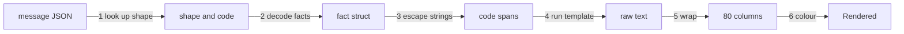

1. **Look up.** Decode the message envelope. An unknown shape returns `ErrShapeUnknown`; a code outside its list, or one that differs from the code the shape name ends in, returns `ErrCodeUnknown`.
2. **Decode.** Decode `facts` into the shape's fact struct with unknown fields refused. A failure returns `ErrFactsInvalid`.
3. **Escape.** Replace every string in the struct with its code-span form, described below.
4. **Run.** Execute the template for the profile. It is parsed once with the fixed options:

```go
// parse builds one template with the fixed options and function map.
func parse(name, text string) (*template.Template, error) {
	return template.New(name).Option("missingkey=error").Funcs(funcs).Parse(text)
}
```

5. **Wrap.** Wrap at 80 columns, counting characters.
6. **Colour.** With colour on, wrap line one in bold and every code span in dim. Removing the escape codes gives exactly the colour-off text, so colour never changes a fact.

`Verdict` is line one of the wrapped text with the backticks and the `**` bold markers removed.

#### Escaping

A fact string becomes a code span so a value containing Markdown cannot reshape the output.

- Each newline or carriage return becomes the two characters `\n`.
- Every other control byte below 0x20 except the tab, such as the escape byte, becomes the visible four characters `\xNN`, so no terminal sequence survives.
- The span is fenced by one more backtick than the longest backtick run inside it, and padded with one space when the text starts or ends with a backtick (the CommonMark code-span rule).
- Wrapping breaks only at spaces outside code spans. A span is never split, and one longer than 80 columns sits alone on its line.
- Table lines are never wrapped.

#### The seven template functions

The function map adds exactly seven functions.

```go
// funcs is the added template function map; no other added function is callable.
var funcs template.FuncMap // keys: code, fenced, n, plural, dur, path, table
```

| Function | Meaning |
|---|---|
| `code(c string) string` | The code word as a code span; a word on neither list fails with `ErrCodeUnknown` |
| `fenced(s string) string` | An escaped fact as plain text for a fenced block: a run of 3 or more backticks is broken so the fact cannot close the fence |
| `n(i int64) string` | The number with comma thousands separators, such as `12,400` |
| `plural(i int64, one, many string) string` | `one` when `i` is 1, else `many` |
| `dur(d time.Duration) string` | The two largest units, such as `1h 5m` or `42s` |
| `path(p string) string` | A slash path as a code span; over 45 characters, middle folders become `…` |
| `table(t Table) string` | A Markdown table with the limits below |

`New` walks every parsed template and rejects `call`, `html`, `js`, `print`, `printf`, `println` and `urlquery`, so a template cannot reach anything beyond its facts and the seven functions.

#### Limiting tables and unlisted cases

- A table of more than 5 rows prints the top 5 rows plus one line `<N> more: <what>`, such as `2 more: groups`.
- A cell over 45 characters moves to a labeled line below the table, `<column label>, row <n>: <text>`, and the cell reads `see below`.
- A row with more cells than the header fails the render, so a template never hides a fact.
- A replay is the exception to the table limit: its steps print as lines in one fenced block through `fenced`, because a replay is a log, not a summary.
- A code with no template of its own is `other`. It prints one fixed line pointing to a file:

```text
Needs a decision; details in {{.Path}}
```

#### Determinism

The same profile, options and message give the same bytes.

- Templates read only their fact struct. No template reads the clock, the environment or a file.
- A map in the facts is printed in sorted key order, which Go's templates do.
- A time is printed in UTC.
- No part of the formatter calls a model, a command or the network.

#### Golden files

Each shape has a fixture and a golden file per profile. The fixture for `reply.run`:

```json
{ "group": "tg-1.2", "run_id": "0192e4c5-6f00-7a21-8c3b-2d9e0f1a4b57" }
```

The template under `adhd` and the bytes it renders:

```text
Run started for {{.Group}}.

**Run id:** {{.RunID}}
```

```text
Run started for `tg-1.2`.

**Run id:** `0192e4c5-6f00-7a21-8c3b-2d9e0f1a4b57`
```

The golden test renders every fixture under both profiles with colour off and compares the bytes. A template change is a golden change in the same commit.

### 2.6 State

The formatter holds no state across calls. `New` parses the templates once; after that `FormatJSON` is a function of its message, its options and the embedded files, and is safe to call from several goroutines.

### 2.7 Invariants and Failures

**Invariants**
1. Every line a person reads from the harness is rendered by a template from facts; model prose is never rendered.
2. Facts are escaped before a template sees them.
3. The same profile and the same message give the same bytes.
4. The formatter reads no repository, no settings file, no clock and no network, and calls no model.
5. Every error code and every block reason has a template and a golden file under both profiles.
6. A template calls only the seven added functions and Go's own comparison and flow functions.
7. Colour adds escape codes and removes none of the text.

**Failures**

| Situation | Detection | Action and bound | Final state |
|---|---|---|---|
| Message names no known shape | `FormatJSON` | `ErrShapeUnknown`; the CLI prints the fixed line, exit 4 | No text rendered |
| Code outside its list, or unequal to the shape name or `facts.code` | `FormatJSON` | `ErrCodeUnknown`; same handling | No text rendered |
| Facts with an unknown field or wrong type | `FormatJSON` | `ErrFactsInvalid`; same handling | No text rendered |
| A template does not parse or names a banned function | `New` | The program refuses to start, naming the template | No process |
| A template names a field the struct lacks | `missingkey=error` at run, and the field test at build | Execution error; the build test prevents it | No text rendered |
| A table over 5 rows | `table` | Top 5 rows plus `<N> more: <what>` | Text rendered |
| A cell over 45 characters | `table` | The cell moves below the table | Text rendered |
| A row with more cells than the header | `table` | Execution error; the render fails | No text rendered |
| A golden file differs from the rendered bytes | `go test` | The test fails and names the shape and profile | Build blocked |

### 2.8 Config

The CLI reads these keys through the [Configuration Manager](#3-configuration-manager) and passes them in `Options`; the formatter never reads them.

| Key | Type | Default | Effect |
|---|---|---|---|
| `output.profile` | enum `adhd`, `standard` | `adhd` | Picks the template set. Facts and codes are the same under both |
| `output.turn_end_summary` | bool | `true` | Turns the four closing headings on or off; each is skipped when empty |
| `output.color` | enum `auto`, `on`, `off` | `auto` | `auto` decides from the terminal, `on` forces colour, `off` removes it |

The environment variable `NO_COLOR` and the flag `--no-color` also turn colour off; the CLI folds them into `Options.Color`.

| Constant | Value |
|---|---|
| Template functions added | 7 |
| Wrap width | 80 columns |
| Rows a rendered table shows; cell length before it moves | 5; 45 characters |
| Bullets and options under `adhd` | At most 5 bullets and 3 options |

### 2.9 Proof Cases

Unit cases use fixtures; no case calls a model, a repository or the network.

**Unit**
- **Same bytes:** a fixture `reply.run` renders identical bytes on 2 runs under `adhd`.
- **Escaping:** a fact path holding a newline and `## x` renders as one literal code span; a fact holding an escape sequence renders with no raw escape byte.
- **Wrapping:** a 100-character span sits alone on its line and is not split.
- **Table limit:** a 7-row table renders 5 rows and one `2 more: groups` line.
- **Cell limit:** a 46-character cell moves below the table under a labeled line; a 45-character cell stays.
- **Colour:** stripping the escape codes from colour-on output gives the colour-off bytes.
- **Verdict:** `Rendered.Verdict` equals line one with markers removed.
- **Unlisted case:** the code `other` renders the fixed line.

**Component**
- **Golden files:** every shape renders under both profiles to its golden bytes; a golden file changed by one byte fails.
- **Struct against template:** a template field with no struct field fails, and a struct field no template uses fails.
- **Codes:** every error code and every block reason has a template and a golden file under both profiles; a code that differs from its shape name is refused.
- **Banned functions:** a template calling `printf` makes `New` fail.
- **Unknown input:** a message with an unknown shape, an unlisted code or an unknown fact field returns the matching error.

### 2.10 Open Gaps

Each id is a row in the [gap register](#appendix-b-gap-register); the rows are not copied here.

No open gaps.

## 3. Configuration Manager

The Configuration Manager guards the harness settings and the agent registry, the list of agent roles with their models, limits and permissions. It is the only part allowed to read or change them; the CLI and the Runtime Manager ask it for values. Every change is checked against a built-in list of keys and limits, logged, and written all-or-nothing. The purpose and the interactions are in [HLD 5.4](hld.md#54-configuration-manager).

### 3.1 Scope and Concepts

**Owns:**
- The settings file and the agent registry file, their built-in defaults and hard limits, and the strict reading of both.
- `GetConfigItem()` and `SetConfigItem()`, the validation behind them and the audit log of every change.
- The hand-edit guard: a checksum of each file and the state machine that reacts to a mismatch.
- The effective-settings snapshot a run pins at its start, and its hash.
- The four agent role definitions and the checks that keep them consistent.
- Publishing the `skill` and `mcp` events: right after `SetConfigItem()` saves a change to either, and when `Verify` detects a hand edit on the next read, with the data of [6.3](#63-data-model).

**Does not own:**
- What each key does. The chapter of the part that uses a key lists it in its own Config page ([3.8](#38-config) shows where).
- Parsing the `config` command and printing its reply: [CLI](#1-cli) and [Output Formatter](#2-output-formatter).
- The model catalog and the probe that fills it: the CLI's `install` writes it, and the Task Manager's model client reads it ([chapter 11](#11-task-manager)).
- Agent prompt templates, skills and tool-server connections: [Context Manager](#6-context-manager).

**Concepts**

| Term | Meaning |
|---|---|
| Key | A dotted setting name such as `limits.returns`. The key is the `(id)` of `config get` and `config set` |
| Layer | Where a value came from: 1 is the built-in table compiled into the binary, 2 is the machine files under `~/.komodo/` |
| Hard limit | The largest or smallest value the built-in table allows for a key. A machine value cannot pass it |
| Settings file | `~/.komodo/settings.json`: the flat keys a person has changed |
| Agent registry | The role definitions: built-in files in the binary plus the person's overrides in `~/.komodo/agents.json` |
| Role | One agent job: `planner`, `builder`, `tester` or `reviewer`. The registry holds these 4 roles and no others |
| Weight | An agent's model size class: `heavy`, `standard` or `light`. It picks the model per link |
| Effective settings | The built-in layer overlaid with the machine layer, after strict reading and limit checks |
| Snapshot | The effective settings a run copies at its start, with a hash of them |
| Tamper guard | The check that the machine files still match the checksum the last `SetConfigItem()` wrote |

**Who may call.** Two parts hold a `*Manager`:
- The CLI, for `config get`, `config set` and the output keys.
- The Runtime Manager, for run limits, the snapshot and each role's definition.

`main` hands out the manager; every other part receives the values it needs as arguments. A test fails when any other package imports `internal/config` ([3.9](#39-proof-cases)). The Context Manager does not call it.

### 3.2 Package Layout

Go package `internal/config`. It imports the Go standard library and the packages the import order in [0.4](#04-import-order) allows.

| File | Holds |
|---|---|
| `internal/config/manager.go` | `Manager`, `New`, `GetConfigItem`, `SetConfigItem`, `ListConfigItems`, `Snapshot` |
| `internal/config/registry.go` | `KeySpec`, `Kind`, the built-in key table and the value checks |
| `internal/config/settings.go` | Reading the layers, strict decode, the effective settings and their hash |
| `internal/config/agents.go` | `Agent`, the role files, the overrides and the cross-checks |
| `internal/config/audit.go` | The audit log, the checksums and the tamper guard |
| `internal/config/atomic.go` | Atomic file write and the writer lock |
| `embed/defaults.json` | The default and hard limit of every key |
| `embed/agents/<role>/agent.json` | The built-in definition of one role |

**Entry points**

| Flow | Starts at |
|---|---|
| Read one value | `Manager.GetConfigItem` |
| Write values | `Manager.SetConfigItem` |
| Hand-edit check | `Manager.Verify`, called by the CLI's validate step |
| Run snapshot | `Manager.Snapshot`, called by the Runtime Manager at run start |
| Role definition | `Manager.GetAgent` |

`embed/defaults.json` holds one `KeySpec` per key, fields in snake_case.

```json
{
  "keys": [
    { "name": "limits.returns", "kind": "int", "default": 3, "min": 0, "max": 5 },
    { "name": "limits.pool_min", "kind": "int", "default": 1, "min": 1, "max_key": "limits.pool_max" }
  ]
}
```

### 3.3 Data Model

#### Files

| File | Layer | Holds |
|---|---|---|
| `embed/defaults.json`, `embed/agents/<role>/agent.json` | 1 | Defaults, hard limits and role definitions, compiled into the binary |
| `~/.komodo/settings.json` | 2 | Flat keys a person set. Created by the first `config set`; before that the built-in layer alone applies |
| `~/.komodo/agents.json` | 2 | Per-role overrides of 4 keys. Created by the first agent override |
| `~/.komodo/state/config.sha` | guard | The checksum of each machine file |
| `~/.komodo/state/config.log` | guard | One audit row per changed key |
| `~/.komodo/state/settings.lock` | guard | Locked by the one writer at a time; the file stays on disk and its presence means nothing |

`KOMODO_HOME` replaces `~/.komodo`.

The Configuration Manager writes the guard files itself, with the standard library, instead of through the State Manager: it is built first, and the guard must work when no other part exists.

#### Settings and the key table

```go
// internal/config/registry.go

// Kind is the value type of a key.
type Kind int

const (
	KindString Kind = iota
	KindEnum        // one of KeySpec.Enum
	KindBool
	KindInt
	KindNumber   // integer or decimal
	KindDuration // such as 1h or 10m
	KindPath     // a file path
	KindEnvRef   // env:NAME, never a secret value
)

// KeySpec is one row of the built-in table: a key, its default and its hard limit.
type KeySpec struct {
	Name    string
	Kind    Kind
	Default any      // nil when Derived is set
	Enum    []string // allowed values for KindEnum
	Min     any      // hard minimum; nil when none
	Max     any      // hard maximum; nil when none
	MaxKey  string   // another key that caps this one, such as limits.pool_max
	Derived string   // names the rule when the default is computed per group
	Family  bool     // the name holds one variable part in angle brackets, such as a link name
	Members map[string]any // the variable parts a family allows with their defaults; nil allows any name
}

// Layer names where a value came from.
type Layer int

const (
	LayerBuiltIn Layer = 1 // embed/defaults.json
	LayerMachine Layer = 2 // ~/.komodo/settings.json and ~/.komodo/agents.json
)

// Setting is one resolved value and the layer that set it.
type Setting struct {
	Value  any
	Source Layer
}
```

A `settings.json` in which a person has set three keys; every value is within its hard limit:

```json
{
  "output.profile": "standard",
  "limits.pool_max": 4,
  "cache.max_mb": 512
}
```

A top-level key that is not in the built-in table is an error that names the closest known key. The settings of the optional free local model link are flat keys of the form `providers.local.<name>.<field>`, one set per endpoint name; they are listed with the other link keys in the [Task Manager](#118-config) chapter.

**Versioning.** The files carry no version field. Strict reading is the version check: a file written by a newer binary with a new key fails to load on an older one, naming the key and the fix `run komodo update`.

#### The agent registry

Each role is one file in the binary. A person overrides four keys per role in `agents.json`; nothing else about a role is settable.

```go
// internal/config/agents.go

// Weight is an agent's model size; it picks the model per link.
type Weight string

const (
	Heavy    Weight = "heavy"
	Standard Weight = "standard"
	Light    Weight = "light"
)

// Limits are one agent's session clocks in minutes and its restart count.
type Limits struct {
	WallMin int `json:"wall_min"` // most minutes a session may run
	IdleMin int `json:"idle_min"` // minutes of silence before the nudge
	Retries int `json:"retries"`  // fresh sessions after a timeout or idle stop
}

// Skills lists the skills an agent may pull and the ones injected into every brief.
type Skills struct {
	Allow  []string `json:"allow"`
	Always []string `json:"always"`
}

// Slots lists the brief slots an agent must receive and those it may receive.
type Slots struct {
	Required []string `json:"required"`
	Optional []string `json:"optional"`
}

// Agent is the decoded agent.json of one role.
type Agent struct {
	V          int             `json:"v"`           // schema version, 1
	Weight     Weight          `json:"weight"`      // heavy, standard or light
	Chain      []string        `json:"chain"`       // model links in order
	Tools      []string        `json:"tools"`       // the only tools advertised to the session
	RunClasses []string        `json:"run_classes"` // the only command classes the run tool may execute
	Guard      []string        `json:"guard"`       // permission rows beyond the inherited ones
	Limits     Limits          `json:"limits"`
	Skills     Skills          `json:"skills"`
	Slots      Slots           `json:"slots"`
	Result     json.RawMessage `json:"result"`    // JSON Schema of the final call
	PoolSlot   bool            `json:"pool_slot"` // takes one session slot; the slot rules are in chapter 7
}

// AgentOverride is one role's entry in agents.json; nil fields keep the built-in value.
type AgentOverride struct {
	Model          string `json:"model,omitempty"`
	SessionWallMin *int   `json:"session_wall_min,omitempty"`
	SessionIdleMin *int   `json:"session_idle_min,omitempty"`
	Retries        *int   `json:"retries,omitempty"`
}
```

| Field | Rule |
|---|---|
| `v` | Schema version, 1; a file with another number fails the build test |
| `weight` | Picks the model per link. `heavy`, `standard` or `light` |
| `chain` | The ordered model links the role may use, fixed in the file and never reordered by a key: `claude-cli` (the Claude subscription), then `anthropic-api` (the paid Anthropic interface) |
| `tools` | The only built-in tools advertised to the session. A tool from an outside tool server is never listed here: it reaches an agent only when a person switches that server on for the named agent in the Context Manager's list ([6](#6-context-manager)) |
| `run_classes` | The only classes of command (build, test, lint, format) the `run` tool may execute |
| `guard` | Row ids of the Task Manager's permission table that apply beyond the inherited ones |
| `limits` | Time and retries only; no turn or token caps |
| `skills` | `allow` lists skills the agent may pull (a trailing `*`, as in `standards-*`, names every skill with that prefix); `always` lists the ones injected into every brief |
| `slots` | The brief slots the agent must and may receive |
| `result` | The final call's schema; its `$id` is `komodo:agent/<role>/result/<v>` and its `code` fields draw on the [code list](#23-data-model) |
| `pool_slot` | `true` when the role takes a session slot; the slot rules are in [7. Runtime Manager](#7-runtime-manager) |

The builder's `agent.json`:

```json
{
  "v": 1,
  "weight": "standard",
  "chain": ["claude-cli", "anthropic-api"],
  "tools": ["read", "search", "edit", "write", "run", "skill", "task_done"],
  "run_classes": ["build", "test", "lint", "format"],
  "guard": ["R1", "B1"],
  "limits": {"wall_min": 60, "idle_min": 10, "retries": 2},
  "skills": {
    "allow": ["standards-*"],
    "always": ["standards-comments"]
  },
  "slots": {
    "required": ["repo_profile", "group", "tasks", "files", "file_contents"],
    "optional": ["repo_context", "standards", "diff", "checks", "findings", "scope_answer", "specs"]
  },
  "result": {"$id": "komodo:agent/builder/result/1", "type": "object", "required": ["status", "summary"]},
  "pool_slot": true
}
```

The `chain` names the 2 links beta 6 ships. OpenAI's subscription and interface links are designed into the model client's interface and built after beta 6.

| Role | Weight | Pool slot | Purpose |
|---|---|---|---|
| `planner` | heavy | No | Writes the whole plan in one session: groups, tasks, file patterns and acceptance items |
| `builder` | standard | Yes | Implements every task of one group in one session, committing after each |
| `tester` | light | Yes | Gives a blind pass or fail per acceptance item, with evidence |
| `reviewer` | heavy | Yes | Applies the review lenses and gives one verdict per task |

An `agents.json` overriding the reviewer, written by `komodo config set agents.reviewer.model=sonnet agents.reviewer.session_wall_min=90 agents.reviewer.retries=3`:

```json
{
  "reviewer": {
    "model": "sonnet",
    "session_wall_min": 90,
    "retries": 3
  }
}
```

#### Effective settings and the snapshot

```go
// internal/config/settings.go

// Effective is the merged settings and role definitions.
type Effective struct {
	Flat   map[string]Setting
	Agents map[string]Agent // each role with its overrides applied
}

// Snapshot is the effective settings a run copies at its start.
type Snapshot struct {
	Effective
	Hash string // SHA-256 in lowercase hexadecimal
}

// Item is one key as GetConfigItem returns it.
type Item struct {
	Key      string
	Value    any
	Source   Layer
	Default  any
	Limit    any      // the hard limit that applies, nil when none
	Allowed  []string // the allowed values for an enum key
	Fallback bool     // true when the machine layer was unreadable and the built-in value is served
}
```

The hash is the SHA-256 of the JSON encoding of `Effective` without `Source`. Go's `encoding/json` writes map keys in sorted order, so the same values give the same hash on every machine. The hash is also the prefix of every Cache Manager key, so a settings change never reuses context built under the old settings.

#### The audit log and the checksums

```go
// internal/config/audit.go

// Change is one key moving from an old value to a new one.
type Change struct {
	Key string
	Old any
	New any
}

// Batch is one successful write: every change from one SetConfigItem call.
type Batch struct {
	ID      string
	Time    time.Time
	Changes []Change
}
```

`config.log` holds one JSON line per changed key: `time` in RFC 3339 UTC, `batch`, `key`, `old` and `new`. The batch id is a UUID version 7, so ids sort by time. `config.sha` holds the SHA-256 (a 256-bit checksum, 64 lowercase hexadecimal characters) of each machine file; a missing file records an empty string.

```json
{"time":"2026-10-14T09:12:04Z","batch":"0192e5a1-3c00-7b10-8d2e-4f6a1b2c3d4e","key":"limits.returns","old":3,"new":4}
{"time":"2026-10-14T09:20:11Z","batch":"0192e5a8-9e00-7c42-9a1b-5e7f2c3d4e5f","key":"settings.json","old":"<64 hexadecimal characters>","new":"<64 hexadecimal characters>"}
```

```json
{ "settings": "<64 hexadecimal characters>", "agents": "<64 hexadecimal characters>" }
```

The second log line is an acceptance: its `key` is the file name, with the checksums before and after as `old` and `new`.

### 3.4 Interfaces

```go
// internal/config/manager.go

// New builds the manager. known holds the names the role files are checked against;
// modelOK reports whether a model name passed the provider probe.
func New(home string, known Known, modelOK func(model string) bool) (*Manager, error)

// Known holds the names the role definitions are cross-checked against.
type Known struct {
	GuardRows map[string]bool // permission rows the Task Manager defines
	Tools     map[string]bool // tools the tool runtime registers
}

// GetConfigItem returns one key with its source, default and limit.
func (m *Manager) GetConfigItem(key string) (Item, error)

// SetConfigItem checks every change and writes all of them or none.
func (m *Manager) SetConfigItem(changes ...Change) (Batch, error)

// ListConfigItems returns every key under a prefix; an empty prefix returns all.
func (m *Manager) ListConfigItems(prefix string) []Item

// GetAgent returns one role's definition with its overrides applied.
func (m *Manager) GetAgent(role string) (Agent, bool)

// Snapshot returns the effective settings and their hash for a run to pin.
func (m *Manager) Snapshot() (Snapshot, error)

// Verify compares each machine file with its recorded checksum; ErrTampered on mismatch.
func (m *Manager) Verify() error

// PlanReset returns the changes that put a key, a role or a whole file back to its built-in value.
func (m *Manager) PlanReset(target string) ([]Change, error)

// Accept rehashes the machine files after a hand edit and records the acceptance.
func (m *Manager) Accept() (Batch, error)
```

**What phase 2 checks.** The Configuration Manager is built in phase 2, before the Task Manager (phase 5) and the model client (phase 4) exist, so phase 2 passes an empty `Known` and a `modelOK` that always returns true. Phase 2 checks the key table: types, enums, hard limits, the tamper checksums, unknown fields in role files, unique `result` identifiers and valid `chain` and `v`. Phase 5 adds the `known.GuardRows` check, and phase 4 adds the `known.Tools` check and the model probe, by passing filled values to `New`.

```go
var ErrTampered = errors.New("a settings file was edited outside komodo config")

// LimitError reports a value over its hard limit, naming the key, the value and the limit.
type LimitError struct {
	Key   string
	Value any
	Limit any
}

// UnknownKeyError reports a key or role outside the built-in table and names the closest one.
type UnknownKeyError struct {
	Key     string
	Closest string
}

// BadValueError reports a value of the wrong type or outside its allowed list.
type BadValueError struct {
	Key    string
	Value  any
	Detail string
}
```

| Method | Error | Caller does |
|---|---|---|
| `GetConfigItem` | `UnknownKeyError` | CLI exits 2 with `unknown_key`, naming the closest key |
| `GetConfigItem` | none on a bad machine file | Serves the built-in value with `Fallback` set, so `stop` and `--help` keep working |
| `SetConfigItem` | `UnknownKeyError`, `BadValueError`, `LimitError` | CLI exits 2 (`unknown_key`, `bad_value`) or 1 (`over_limit`); nothing is written |
| `SetConfigItem` | `ErrTampered` | CLI exits 1 with `config_tampered` |
| `SetConfigItem` | A write fails | CLI exits 4 with `internal`; the audit rows are in the log and the checksum is stale ([3.6](#36-state)) |
| `GetAgent` | `false` | The role is not one of the four; the caller refuses |
| `Snapshot` | A role file fails a cross-check | The Runtime Manager refuses to start the run and raises an error event |
| `Verify` | `ErrTampered` | CLI applies the command's tamper policy ([1.5](#15-behaviour)) |
| `PlanReset` | `UnknownKeyError` | CLI refuses; a role or whole-file reset lists each change and waits for a typed `y` |
| `Accept` | A file cannot be hashed | CLI exits 4; the guard stays tripped |

A key name addresses one of two files. A key that starts with `agents.<role>.` is an override in `agents.json`; every other key is in `settings.json`.

| Caller | Calls | When |
|---|---|---|
| CLI validate step ([chapter 1](#15-behaviour)) | `Verify` | Every command |
| CLI `config` handler | `GetConfigItem`, `ListConfigItems`, `SetConfigItem`, `PlanReset`, `Accept` | `config get`, `config set` |
| CLI render step | `GetConfigItem` | `output.*` keys, once per process |
| Runtime Manager ([chapter 7](#7-runtime-manager)) | `Snapshot` | At run start; the run keeps the copy and its hash |
| Runtime Manager | `GetAgent`, `GetConfigItem` | Before each session starts, for the role's limits and model |

### 3.5 Behaviour

#### Effective settings

1. Read the built-in table and the role files from the embedded data. Every key has a value there, so no key is ever missing.
2. Read `settings.json` and `agents.json` if they exist; absent means the built-in layer alone applies.
3. Decode strictly: each top-level key must be a table key or a member of a key family, and a family with a member list accepts only those members; otherwise fail naming the closest key.
4. Check each value against its `Kind`, `Enum`, `Min`, `Max` and `MaxKey`; fail naming the key, the value and the limit.
5. Take the machine value where present and the built-in value elsewhere, and record the `Layer` of each.
6. Apply each role's overrides to its definition.
7. Compute the hash when a snapshot is asked for.

If step 3 or 4 fails for a machine file, the manager serves layer 1 for every key and reports the failure through `Verify`.

#### Per-agent limits

A role's wall, idle and retry limits come from the highest layer that sets them:
1. The override in `agents.json`: `session_wall_min`, `session_idle_min`, `retries`.
2. The flat key `limits.session_wall_min` or `limits.session_idle_min` in `settings.json`; `retries` has no flat key.
3. The role file's `limits`.

Each result is capped by its hard limit in [3.8](#38-config). The builder's wall time is the group's, which the Runtime Manager works out; no other part does.

#### Writing settings

**📐 One settings write, from the CLI to disk**
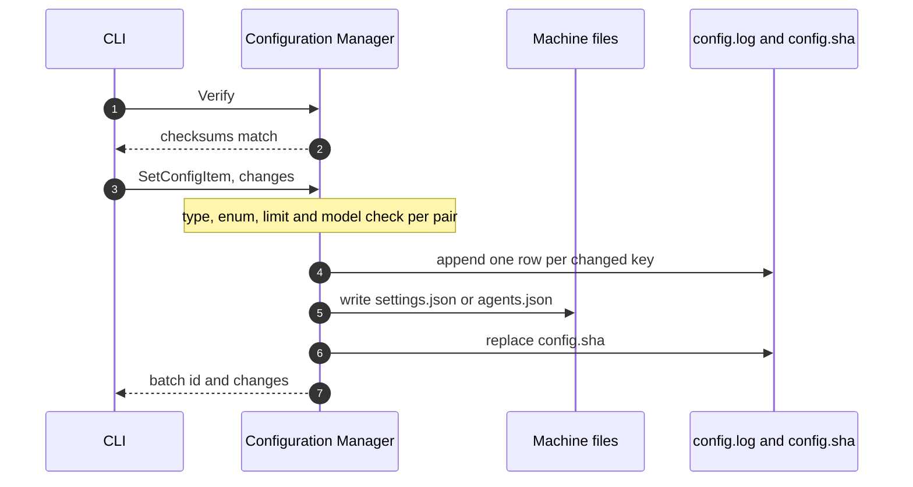

1. The CLI calls `Verify`; a mismatch ends the write.
2. The CLI calls `SetConfigItem` with every pair of the command.
3. For each pair the manager finds the `KeySpec`, parses the value to its `Kind`, and checks enum membership, the `env:` form for `KindEnvRef`, the hard limits and `MaxKey`. A `model` value must also pass `modelOK`.
4. A pair whose value equals the effective value is dropped. When every pair is dropped the batch is empty and nothing is written.
5. When any pair fails, the manager returns its error and writes nothing: a call sets every pair or none.
6. The manager takes an exclusive operating-system lock on `settings.lock` through `core.FileLock`. The kernel frees the lock when its holder dies and never takes it from a holder that is only slow, so no age or token is checked.
7. It appends one audit row per changed key under one batch id.
8. It writes each changed file by writing a temporary file and renaming it over the original.
9. It replaces `config.sha` with the new checksums, releases the lock and returns the batch.

A crash after step 7 leaves a logged batch that never applied; the next write's `old` values show it. A crash after step 8 leaves the checksum stale, so the guard reads Tampered until a person checks the file and accepts it. No crash leaves a change applied and unlogged.

A reader that finds a file and its checksum disagreeing while another process holds the lock rereads once after 100 milliseconds before reporting Tampered. The reader checks the lock through a read-only open that never creates the file; a missing lock file is not held, and any other open failure counts as held.

Model values are validated against the probe. With no probe record, a `model` write is refused with `over_limit` and the fix `komodo install --machine-only`, which re-runs the probe. The probe covers `claude-cli` and `anthropic-api`.

#### Reset and accept

- **Reset.** `PlanReset` returns the changes that put a key, a role's overrides or a whole file back to the built-in value. The CLI then follows the write path with those changes. A role or whole-file reset first lists each change and waits for a typed `y`. A reset of a file that failed strict reading plans one change for the file; applying it rewrites the file to built-in values, and a set rewrites it from built-ins plus the change.
- **Accept.** `Accept` rehashes both machine files into `config.sha` and appends one row whose `key` is the file name. With no machine files it deletes `config.sha`, which returns the guard to Defaults. A person triggers `Accept` with `komodo config set --accept` and `PlanReset` with `komodo config set --default <key>`; both stay flags of `config set`.

#### Loading the role files

1. Read `embed/agents/<role>/agent.json` for each of the four roles.
2. Decode with unknown fields refused.
3. Check that no two roles share a `result` `$id`, every `guard` row exists in `known.GuardRows`, and every `tools` entry exists in `known.Tools`.
4. Check that `chain` and `v` are valid.
5. Keep the decoded roles for the process lifetime.

Steps 3 to 5 also run as a build test against the real tables, so a broken role file never ships.

#### Run pinning

A run's settings are the snapshot taken at its start; later edits do not reach it. The one exception is an agent's `model`: a write reaches each open run at its next session start, because the Runtime Manager reads it with `GetConfigItem` then, and the session-start event records the model it used so a replay makes the same choice. Sessions already running finish on their model.

### 3.6 State

Only the tamper guard has state. The manager itself is stateless between calls.

**📐 The tamper guard**
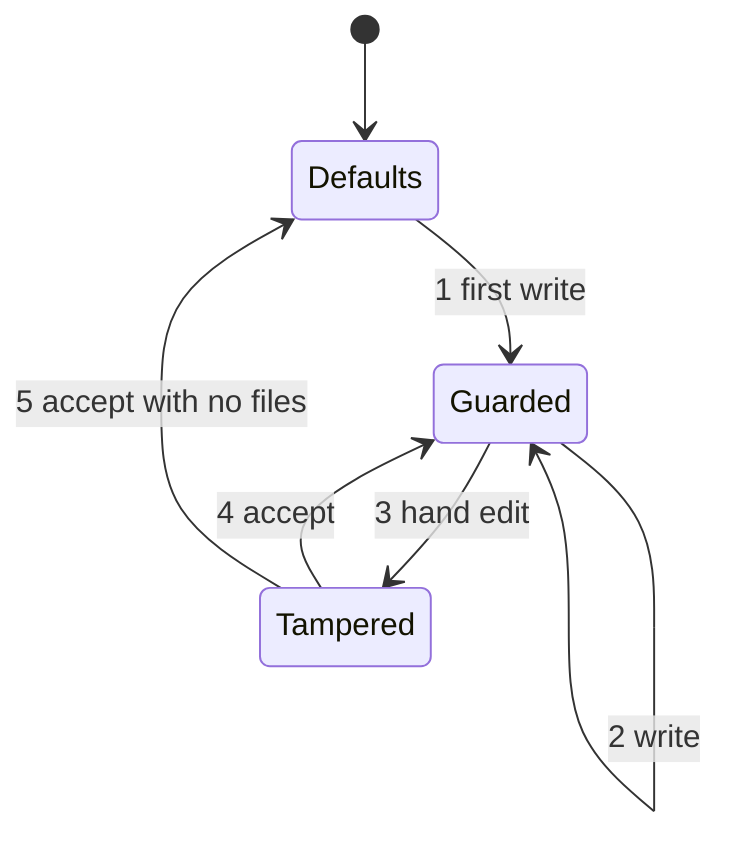

| State | Event | Next | True afterwards |
|---|---|---|---|
| Defaults | `SetConfigItem` | Guarded | A machine file exists; `config.sha` matches it; one audit row per changed key |
| Guarded | `SetConfigItem` | Guarded | The files, the checksums and the log changed together, or none of them |
| Guarded | A person edits a machine file | Tampered | The checksum no longer matches; the harness wrote nothing |
| Tampered | `Accept` | Guarded | The checksums match the edited files; one audit row logged |
| Tampered | `Accept` when no machine file exists | Defaults | `config.sha` is deleted |

- **Defaults:** no machine file exists and no checksum is recorded; the built-in layer applies.
- **Guarded:** each machine file matches its recorded checksum.
- **Tampered:** a file differs from its checksum, a file has no checksum, or a checksum has no file.

### 3.7 Invariants and Failures

**Invariants**
1. Only the CLI and the Runtime Manager hold a `*Manager`; no other package imports `internal/config`, except the cross-package tests in `internal/integration`.
2. The settings files and the agent registry are written only by `SetConfigItem` and `Accept`.
3. A `SetConfigItem` call writes every pair or none, and one audit row per changed key.
4. No value passes its hard limit, and no model passes without a probe.
5. A secret is never in a settings file: key settings are `env:NAME` references.
6. A tripped tamper guard never stops a read or the `stop` command: reads serve a value, and only commands that start work or change settings are refused.
7. A run's settings are the snapshot it took at its start, except an agent's `model`.
8. A role's chain and tools are fixed in the binary; no key reorders or extends them.
9. Every write is idempotent: the same call again reports `0 changes` and writes no audit row.

**Failures**

| Situation | Detected by | Action and bound | Final state |
|---|---|---|---|
| Unknown key or role | `SetConfigItem`, `GetConfigItem` | `UnknownKeyError` naming the closest key | Files unchanged |
| Value of the wrong type or outside its list | `SetConfigItem` | `BadValueError` | Files unchanged |
| Value over its hard limit | `SetConfigItem` | `LimitError` naming key, value and limit | Files unchanged |
| One bad pair out of several | `SetConfigItem` | Nothing is written for any pair | Files unchanged |
| Model that no probe found | `modelOK` | Refused as `over_limit`, fix `komodo install --machine-only` | Files unchanged |
| A machine file hand-edited | `Verify` | `ErrTampered`; the CLI's policy decides which commands run | Guard Tampered |
| A machine file fails strict reading | `Load` | Serves the built-in value with `Fallback` set; `Verify` reports it; `PlanReset` and `SetConfigItem` still rewrite the file | Files unchanged |
| Crash after the audit rows, before the file | Next write | The log shows a batch that never applied | Settings as before |
| Crash after the file, before the checksum | `Verify` | Guard reads Tampered until `Accept` | Settings as written |
| Another writer holds `settings.lock` | `core.FileLock` finds the lock taken | Retry for up to 2 seconds, then fail with `ErrLocked`; a dead holder frees the lock at once | One writer at a time |
| A role file breaks a cross-check | Build test, `Snapshot` | The build fails; at run time the run does not start | No run |

### 3.8 Config

The Configuration Manager owns the four per-role override keys. Every other key is owned by the part that uses it, and that part's chapter lists it.

| Key | Type | Default | Hard limit | Effect |
|---|---|---|---|---|
| `agents.<role>.model` | string | The role weight's model | A probed model | The model the role starts on. With no override, `config get` shows `weight:<the role's weight>` as both the value and the default, such as `weight:heavy`, which the model client resolves to a model. A change reaches an open run at its next session start. The chain is not changed |
| `agents.<role>.session_wall_min` | int | `limits.session_wall_min` | 120 | Wall-clock limit for this role's sessions; beats the flat key |
| `agents.<role>.session_idle_min` | int | `limits.session_idle_min` | 30 | Silence limit before a nudge; beats the flat key |
| `agents.<role>.retries` | int | 2 | 3 | Fresh sessions after a timeout or idle stop, counted per group and never reset while the group is open |

Where the other keys are described:

| Key group | Chapter |
|---|---|
| `output.*` | [Output Formatter](#28-config) |
| `limits.pool_*`, `limits.group_*` except `limits.group_tokens`, `limits.returns`, `limits.pause_max_min` | [Runtime Manager](#78-config) |
| `limits.session_*`, `limits.link_sessions.<link>`, `guard.refusal_limit`, `sandbox.*`, `providers.*`, `http.*` | [Task Manager](#118-config) |
| `cache.*` | [Cache Manager](#8-cache-manager) |
| `bus.*`, `events.*` | [Event Bus](#48-config) |
| `metrics.*` | [Metrics Service](#188-config) |
| `commit.*` | [Commit Handler](#158-config) |
| `check.*` | [Tester](#138-config) |
| `limits.group_tokens`, `limits.usd_ceiling_per_run`, `limits.usd_ceiling_per_day`, `warn.*` | [Resource Manager](#198-config) |

Keys that other parts own and that the key table carries, with their type, default and owner:

| Key | Type and default | Owner |
|---|---|---|
| `lease.lock_timeout_s` | int, 30 | [Lease Manager](#98-config) |
| `limits.usd_ceiling_per_run` | number, 0 (no ceiling) | [Resource Manager](#19-resource-manager) |
| `limits.usd_ceiling_per_day` | number, 0 (off) | [Resource Manager](#19-resource-manager) |
| `events.retention_days` | int, 30 | [Event Bus](#48-config) |
| `warn.quota_pct` | int, 80 | [Resource Manager](#19-resource-manager) |
| `review.mode` | enum `economy` or `thorough`, `thorough` | [Reviewer](#148-config) |
| `limits.link_sessions.<link>` | int; the default is in [11.8](#118-config) | [Task Manager](#118-config) |
| `providers.local.<name>.url`, `.models`, `.ctx`, `.key`, `.self_hosted`, `.first_byte_s` | six flat keys per endpoint name, all absent (the local link is off); types in [11.8](#118-config) | [Task Manager](#118-config) |

Token and cost usage are always read; no key switches them off.

| Constant | Value |
|---|---|
| Reread wait on a mismatch while the lock is held | 100 milliseconds |
| Lock wait before a write fails | 2 seconds |
| Roles | 4 |

| Variable | Effect |
|---|---|
| `KOMODO_HOME` | Another home folder instead of `~/.komodo`; tests and continuous-integration jobs set it |

### 3.9 Proof Cases

**Unit**
- **Strict reading:** a `settings.json` with an unknown key fails to load and names the closest known key.
- **Limits:** `SetConfigItem(limits.returns=9)` returns a `LimitError` naming the key and the limit 5, and the file is unchanged.
- **All or none:** a call with 1 bad pair out of 3 writes nothing; a good call logs 1 audit row per changed key.
- **Idempotence:** the same call twice reports `0 changes` the second time and appends no row.
- **Layer order:** a role override beats the flat key, which beats the role file, for wall time.
- **Fallback:** a `settings.json` that fails strict reading makes `GetConfigItem` serve the built-in value with `Fallback` set.
- **Hash:** the same values give the same snapshot hash on two runs.
- **Role files:** an `agent.json` with an unknown field, a guard row outside `known.GuardRows` or a tool outside `known.Tools` fails to load.

**Component**
- **Hand edit:** editing `settings.json` makes `Verify` return `ErrTampered`; `GetConfigItem` still serves values; `Accept` restores Guarded and logs 1 row.
- **Crash points:** killing the process after the audit rows, and after the file write, leaves the states in the failure table.
- **Lock:** two writers at once produce 2 batches in order, never interleaved rows.
- **Model check:** a `model` value no probe lists is refused; with no probe record the refusal names `komodo install --machine-only`.
- **Live model:** a model write during a fixture run makes the next session start read the new model while the running session keeps its own.
- **Callers:** a test lists the packages that import `internal/config` and fails when any is not `internal/cli`, `internal/engine` or `cmd/komodo`.
- **Discovery:** `ListConfigItems("")` returns a default, a limit and a source for every key.

### 3.10 Open Gaps

Each id is a row in the [gap register](#appendix-b-gap-register); the rows are not copied here.

| Gap | Question |
|---|---|
| [G-280](#g-280) | Whether Komodo refuses a network or shared home folder |
## 4. Event Bus

The Event Bus is the harness's spine: a part that learns something publishes it as an event, and any part that needs it subscribes by event type, so a publisher never knows who listens. Every event has the same shape, so one reader can handle all of them. The design and its reasons are in [HLD 5.5](hld.md#55-event-bus).

### 4.1 Scope and Concepts

**Owns:**
- The event shape, the list of types and subtypes, and the data struct of each subtype.
- The `Publish` and `Subscribe` interfaces, ordered delivery per subscriber, and the bounded buffer.
- The rule for a slow or failing subscriber.
- Where the bus lives, in memory inside the engine, and how a command's event reaches it ([4.5](#45-behaviour)).
- The event store: `Publish` appends each event to the run's event log before it broadcasts, `bus.Reader` reads the logs back, and retention and the run-to-folder map belong to the bus ([4.3](#43-data-model), [4.5](#45-behaviour)).

**Does not own:**
- The group state machine and the pure decision function: [7. Runtime Manager](#7-runtime-manager) (stage rules, blocks, retries, timers) and [11. Task Manager](#11-task-manager) (the per-group flow of agent sessions).
- The figures worked out from events: the [Metrics Service](#18-metrics-service) subscribes live and rebuilds them from the event store after a restart; it writes no event log.
- Recovery. It never reads the event store; it reads only the [State Manager](#10-state-manager).
- Starting and stopping the engine, and serving the control socket: [7. Runtime Manager](#7-runtime-manager) and [1. CLI](#1-cli).

**Concepts**
- **Event:** one fact, as a small record: a type, a subtype, the run and group it belongs to, a time and a data body.
- **Type:** the coarse kind of event, such as `run-status`; the types are the arrows on the owner's diagram.
- **Subtype:** the finer kind inside a type, such as `session.end`; it names the exact data body.
- **Publisher:** a subsystem that puts an event on the bus.
- **Subscriber:** a subsystem that asks the bus for the events of the types it needs.
- **Subscription:** one subscriber's private queue of events, delivered in the order they were published.
- **Engine:** the Runtime Manager's process. One engine runs per user per machine, is started on demand, and hosts every live run and the bus.
- **Control socket:** the private local socket `~/.komodo/state/engine.sock` that only this user can open. The CLI reaches the engine through it.
- **Event log:** the append-only file per run, `<common_dir>/komodo/events/<run-id>.jsonl`, in which `Publish` stores each event as one JSON line before it broadcasts the event.
- **Event store:** every event log, the machine log `~/.komodo/events/engine.jsonl` for events with no run, and the run-to-folder map `~/.komodo/events/runs.json`.
- **Common directory:** `common_dir`, the repository's git common directory, which the run's `run-start` event carries; it tells the event store which repository holds the run's log.
- **Forced to disk:** the operating system is told to write a file's bytes to the storage device now, so a power cut cannot lose them. A plain write only hands the bytes to the operating system, which survives a killed program but not a power cut.

Events are coarse: one per run, group, stage, session or task change, never one per model turn or token.

### 4.2 Package Layout

Go package `internal/bus` ([HLD Appendix A](hld.md#appendix-a-traceability)). It imports only `internal/core` ([0.4](#04-import-order)); every other package may import it.

| File | Holds |
|---|---|
| `internal/bus/event.go` | `Event`, `Type`, `Subtype`, `ID`, `Payload`, JSON encoding and decoding |
| `internal/bus/types.go` | The `Type` constants and the registry that binds each type and subtype to its data struct |
| `internal/bus/data.go` | The data struct of every subtype whose body this chapter defines ([4.3](#43-data-model)); the other owning packages declare their own |
| `internal/bus/bus.go` | `Bus`, `New`, `Publish`, `Subscribe`, `Close` |
| `internal/bus/subscription.go` | `Subscription`, its bounded queue, `Close`, `Dropped` |
| `internal/bus/store.go` | The event store: the log of each run, the append, the forced write, the gap line |
| `internal/bus/runs.go` | The run-to-folder map `runs.json` |
| `internal/bus/reader.go` | `Reader`, `NewReader`, `ReplayLog`, `Gap`: the read that drops a torn last line |
| `internal/bus/trim.go` | Retention and the size bound |
| `embed/event.schema.json` | JSON Schema generated at build from the registry; a test fails when it disagrees with the Go types |

### 4.3 Data Model

#### The event

```go
// Type is the coarse kind of an event, one of the 11 types of the diagram.
type Type string

// Subtype is the finer kind inside a type, such as "session.end"; empty when the type needs no refinement.
type Subtype string

// ID is a version 7 universally unique identifier in text form ([0.2](#02-naming-and-identifiers)).
type ID string

const (
	TypePlan        Type = "plan"
	TypeSkill       Type = "skill"
	TypeMCP         Type = "mcp"
	TypeRunStart    Type = "run-start"
	TypeRunStop     Type = "run-stop"
	TypeRunContinue Type = "run-continue"
	TypeRunStatus   Type = "run-status"
	TypeRunComplete Type = "run-complete"
	TypeRunFailure  Type = "run-failure"
	TypeResource    Type = "resource"
	TypeError       Type = "error"
)

// Event is one line of the event stream; every event in the harness has this shape.
type Event struct {
	Type    Type      `json:"type"`
	Subtype Subtype   `json:"subtype"`
	Run     ID        `json:"run"`
	Group   ID        `json:"group"` // empty for run-level events
	Time    time.Time `json:"time"`  // stamped by Publish in Coordinated Universal Time, whole seconds
	Data    Payload   `json:"data"`  // the one struct registered for the type and subtype
}

// Payload is implemented by exactly one data struct per type and subtype pair.
type Payload interface{ EventKey() Key }

// Key names a type and subtype pair.
type Key struct {
	Type    Type
	Subtype Subtype
}

// UnmarshalJSON reads type and subtype first, then decodes data into the struct the registry returns for them.
func (e *Event) UnmarshalJSON(b []byte) error
```

| Field | Rule |
|---|---|
| `type` | One of the 11 constants; any other value is refused by `Publish` |
| `subtype` | Part of the registered pair; `""` when the type has no subtypes |
| `run` | The run the event belongs to; set on every event except `run-stop` and `run-continue` when the person typed a label (the Runtime Manager resolves the label's latest attempt), and machine events that belong to no run, such as `bus.overflow` and a resource fact with no run |
| `group` | The task group the event belongs to; `""` on a run-level event |
| `time` | When `Publish` accepted the event, written as `2026-10-14T15:31:12Z`; never a model's claim |
| `data` | The registered data struct; unknown fields are refused on decode |

**Example.** A `session.end` event as one line on the stream; the spread layout is for reading.

```json
{
  "type": "run-status",
  "subtype": "session.end",
  "run": "0192e4c5-6f00-7a21-8c3b-2d9e0f1a4b57",
  "group": "0192e4c5-7a10-7d3e-9b2f-6c1d8e4a5f30",
  "time": "2026-10-14T15:31:12Z",
  "data": {"stage": "build", "session": "0192e4c6-1d40-7b85-a2f3-8c6e1d0b9a47", "reason": "schema_fail", "agent": "builder", "task": "tsk-add-lock", "link": "claude-cli", "tokens": 0, "wall_s": 1140}
}
```

A run-level event, the CLI's request to run one task group at a scheduled time (`komodo run tg-1.2 --schedule 2026-10-16T02:00:00-07:00`):

```json
{
  "type": "run-start",
  "subtype": "",
  "run": "0192e4c5-6f00-7a21-8c3b-2d9e0f1a4b57",
  "group": "",
  "time": "2026-10-14T15:20:00Z",
  "data": {
    "target": "tg-1.2",
    "groups": ["tg-1.2"],
    "source": "cli",
    "schedule": "2026-10-16T02:00:00-07:00"
  }
}
```

`data.schedule` is absent for a run that starts at once. The Intake Handler's request after planning has the same shape with `"source": "intake"`.

**Fields the event does not carry.** The event line holds no `version`, `sequence`, `epoch`, `stale`, `cause`, `last`, `checksum`, `stage`, `session` or `reason`.
- `stage`, `session` and `reason` live in `data`, through the embedded `GroupFacts` below.
- `sequence`, `cause`, `last` and `checksum` are not part of an event. The event store keeps each event as one JSON line in publish order, and recovery reads the State Manager instead.
- `epoch` and `stale` belong to the stage rules of [7. Runtime Manager](#7-runtime-manager).

#### Types and subtypes

| Type | What it carries | Subtypes |
|---|---|---|
| `plan` | A request to plan, published by the CLI for `komodo plan` | Defined in [5. Intake Handler](#5-intake-handler) |
| `skill` | A skill switch or request for the Context Manager, published by the Configuration Manager | `set`, `reload`; body in [6.3](#63-data-model) |
| `mcp` | A tool-server request for the Context Manager, published by the Configuration Manager. Outside tool servers stay off until a person adds one to the Context Manager's list and switches it on for named agents | `set`, `reload` |
| `run-start`, `run-stop`, `run-continue` | A request to start, stop or continue a run. The CLI publishes all three; the Intake Handler also publishes `run-start`, which ends planning | `""` |
| `run-status` | Progress facts of a run, group, stage, session or task | The `family.name` events of the table below, plus those in [More subtypes](#43-data-model) |
| `run-complete` | A run ended with every group finished, or the stop sequence finished | `done`, `stopped` |
| `run-failure` | A group or run cannot continue without a person | `group.blocked`, `lease.lost`, `stalled` |
| `resource` | A usage or plan-limit fact for the Resource Manager | `usage`, `headroom`, `overage`, `limit`, `limit.warn` |
| `error` | A fault for the Error Handler | `bus.overflow` and `bus.store_failed` (below); `fault.error`, `fault.panic`, `fault.resource` in [17. Error Handler](#17-error-handler); `plan-blocked`, `plan-timeout`, `plan-input`, `plan-write`, `context-refused`, `run-refused` |

The three command events tell the Runtime Manager what to do, so it never searches for work on its own. Their `data`:

```go
// RunStart is the data of run-start: a request to the Runtime Manager to run a target.
type RunStart struct {
	Target   string    `json:"target"`            // the label the command named, such as ep-1 or tg-1.2; "all" for run --all; the epic label when the Intake Handler starts the run
	Groups   []string  `json:"groups"`            // the group labels to run, such as tg-1.2
	Source   string    `json:"source"`            // "cli" or "intake": who published the request
	Schedule time.Time `json:"schedule,omitzero"` // RFC 3339 start time of a scheduled run; absent otherwise
	Repo     string    `json:"repo"`              // the repository id the run belongs to
	Root     string    `json:"root"`              // the repository root on this machine
	CommonDir string   `json:"common_dir"`        // the repository's git common directory, which holds its Komodo files and the run's event log
	Request  ID        `json:"request,omitempty"` // the control socket Request.ID of the command
}

// RunStop is the data of run-stop: a request to stop a run, or to remove a queued scheduled run.
type RunStop struct {
	Target  string `json:"target"`            // an epic or group label, or a run id when one attempt is meant; a label means the latest attempt
	Request ID     `json:"request,omitempty"` // the control socket Request.ID of the command
}

// RunContinue is the data of run-continue: a request for a blocked or paused group to go on.
type RunContinue struct {
	Target string `json:"target"`           // an epic or group label
	Answer string `json:"answer,omitempty"` // "approve" or "deny" from --approve or --deny; empty for a plain continue
	Request ID    `json:"request,omitempty"` // the control socket Request.ID of the command
}
```

A `run-start` that the Intake Handler publishes after planning carries its own run id, and `abandon` is a control request on the engine's socket, not an event ([7.5](#75-behaviour)).

The Runtime Manager sends an `Answer` down the group's command channel to its Task Manager. `komodo run (id) --schedule` publishes no event. It is a request on the control socket; the engine mints the run id, stores it in the schedule queue entry (`~/.komodo/state/schedule.json`, kept by the [State Manager](#10-state-manager)) and publishes the one `run-start`, with that run id and `schedule` set, when the entry fires.

What `run-continue` resets for each block reason is owned by [7. Runtime Manager](#7-runtime-manager).

#### More subtypes

Subtypes that other chapters define, with the chapter that owns the data body.

| Type | Subtypes | Owner |
|---|---|---|
| `run-status` | `group.approved`, `publish.done`, `pr.opened` | [15. Commit Handler](#15-commit-handler) |
| `run-status` | `cleanup.start`, `cleanup.done`, `group.discarded` | [16. Cleanup Handler](#16-cleanup-handler) |
| `run-status` | `group.done`, `group.closed`, `session.resume-lost` | [7. Runtime Manager](#7-runtime-manager) |
| `run-status` | `sandbox.fallback`, `tool.outside` | [11. Task Manager](#11-task-manager) |
| `run-status` | `epic.paused`, `epic.resumed` | [15. Commit Handler](#15-commit-handler) |
| `run-failure` | `stalled` | [7. Runtime Manager](#7-runtime-manager) |
| `skill`, `mcp` | `set`, `reload` | [6. Context Manager](#6-context-manager) for the body; the Configuration Manager publishes them |
| `resource` | `usage`, `headroom`, `overage`, `limit` | [19. Resource Manager](#19-resource-manager) |
| `error` | `plan-blocked`, `plan-timeout`, `plan-input`, `plan-write` | [5. Intake Handler](#5-intake-handler) |
| `error` | `context-refused` | [6. Context Manager](#6-context-manager) |
| `error` | `run-refused` | [7. Runtime Manager](#7-runtime-manager) |
| `error` | `fault.error`, `fault.panic`, `fault.resource` | [17. Error Handler](#17-error-handler) |

The package that publishes a subtype in this table declares its data struct and registers the pair with `Register` ([4.4](#44-interfaces)). It exposes one `RegisterEvents()` function, and `main` calls every `RegisterEvents()` before the first `Publish`:

```go
// internal/fault/fault.go

// RegisterEvents binds the three fault subtypes to their data structs.
func RegisterEvents() {
	bus.Register(bus.Key{Type: bus.TypeError, Subtype: "fault.error"}, func() bus.Payload { return &ErrorFault{} })
	bus.Register(bus.Key{Type: bus.TypeError, Subtype: "fault.panic"}, func() bus.Payload { return &PanicFault{} })
	bus.Register(bus.Key{Type: bus.TypeError, Subtype: "fault.resource"}, func() bus.Payload { return &ResourceFault{} })
}
```

`Publish` refuses a pair that no `RegisterEvents()` or `data.go` bound ([4.7](#47-invariants-and-failures)).

#### Event names to type and subtype

Each event name has the form `family.name`, such as `session.end`. The table gives the type and subtype a name is published under. The subtype keeps the name, so a data struct and its table test follow it. A row marked `none` is not published.

| Event name | Type / subtype | Data fields |
|---|---|---|
| `run.start` | `run-status` / `run.start` | `groups`, `config_hash`, `version` |
| `run.done` | `run-complete` / `done` | `done`, `blocked` |
| `run.stopped` | `run-complete` / `stopped` | `signal`, `saved` |
| `group.paused` | `run-status` / `group.paused` | `until`, `link` |
| `group.resumed` | `run-status` / `group.resumed` | `from`, `to` |
| `group.blocked` | `run-failure` / `group.blocked` | `counter`, `detail`, `reason`, `prior`, `paths` |
| `lease.lost` | `run-failure` / `lease.lost` | `fence`, `holder`, `where` |
| `stage.enter` | `run-status` / `stage.enter` | `from`, `to`, `return` |
| `stage.exit` | `run-status` / `stage.exit` | `from` |
| `session.start` | `run-status` / `session.start` | `agent`, `task`, `link`, `model`, `resumed` |
| `session.idle` | `run-status` / `session.idle` | `idle_s`, `nudged` |
| `session.timewarn` | `run-status` / `session.timewarn` | `used_s`, `wall_s` |
| `session.end` | `run-status` / `session.end` | The `SessionEnd` struct below, with `reason` and `usage` (token and cost detail) |
| `task.claimed` | `run-status` / `task.claimed` | `task` |
| `task.released` | `run-status` / `task.released` | `task` |
| `task.done` | `run-status` / `task.done` | `task` |
| `task.retry` | `run-status` / `task.retry` | `task`, `attempt` |
| `check.done` | `run-status` / `check.done` | `pass`, `tip`, `head`, `regression`, `steps`; the free mechanical checks that open the Tester's turn |
| `finding.submit` | `run-status` / `finding.submit` | `rule`, `file`, `line`, `quote` |
| `finding.verified` | `run-status` / `finding.verified` | The submit fields plus `severity`, `in` |
| `tool.denied` | `run-status` / `tool.denied` | `tool`, `row`, `target`, `count` |
| `sandbox.fallback` | `run-status` / `sandbox.fallback` | `role`, `wanted`, `used`, `why`; the Tester ran in the operating-system sandbox because Docker was missing |
| `tool.outside` | `run-status` / `tool.outside` | `server`, `tool`, `outcome`; one call to an outside tool server |
| `epic.paused` | `run-status` / `epic.paused` | `epic`, `group`, `output`; a recheck of the epic branch failed |
| `epic.resumed` | `run-status` / `epic.resumed` | `epic`, `group`; a recheck passed on a paused epic |
| `timer.due` | `run-status` / `timer.due` | `until` |
| `lock.taken` | `run-status` / `lock.taken` | `card_hash`, `tasks` |
| `lock.released` | `run-status` / `lock.released` | `by` |
| `action.start`, `action.done` | none | Recovery reads only the State Manager, so no event marks an action before it runs |
| `state.truncated` | none | A torn last line of the event log is dropped when read, and replay marks the gap ([4.5](#45-behaviour)) |
| `bus.store_failed` | `error` / `bus.store_failed` | `run`, `path`, `reason`; an append to the event store or a trim failed |
| `provider.skip` | `run-status` / `provider.skip` | `from`, `to`: link names, `claude-cli` or `anthropic-api` |
| `limit.warn` | `resource` / `limit.warn` | `link`, `kind`, `pct`, `usd` |
| `lease.taken` | `run-status` / `lease.taken` | `fence`, `pid` |
| `pool.slot.taken`, `queue.enqueued` | none | Link session counts and the schedule queue are machine-wide records in the State Manager ([10](#10-state-manager)), not events |
| `request.resume` | `run-continue` | The command event above |
| `request.timer` | none | The schedule queue and the `schedule` field of `run-start` carry a scheduled start; the engine stays up while a run is queued |
| `request.accepted`, `request.refused` | `run-status` / `request.accepted`, `request.refused` | `request` (the command's id), `why` on refusal |

#### Data structs

A data struct holds the facts of its subtype and is bound to its pair by `EventKey()`. The schema allows no field beyond these tags, and a field marked `omitempty` or `omitzero` is absent when empty. The `stage` and `reason` fields are plain strings here because `bus` imports only `core`; their values are the one `Stage` list and the one `Reason` list that [10. State Manager](#10-state-manager) owns.

```go
// --- Shared by group facts

// GroupFacts carries the stage, session and reason of a group event; embedded in a group fact's data.
type GroupFacts struct {
	Stage   string `json:"stage,omitempty"`   // the group's stage when the fact was seen: a state.Stage value
	Session ID     `json:"session,omitempty"` // session and task facts only
	Reason  string `json:"reason,omitempty"`  // a state.Reason value, block or exit
}

// --- Run

// RunStartedFact is the data of run-status / run.start.
type RunStartedFact struct {
	Groups     []ID   `json:"groups"`      // the groups the run queued, in queue order
	ConfigHash string `json:"config_hash"` // the effective configuration the run pinned
	Version    string `json:"version"`     // the binary version the run is pinned to
}

// RunDone is the data of run-complete / done.
type RunDone struct {
	Done    []ID `json:"done"`    // groups that ended Done
	Blocked []ID `json:"blocked"` // groups left Blocked
}

// RunStopped is the data of run-complete / stopped.
type RunStopped struct {
	Signal string `json:"signal,omitempty"` // the signal received, such as SIGINT; empty for a stop command
	Saved  []ID   `json:"saved"`            // groups whose state the stop sequence saved
}

// --- Group

// GroupPaused is the data of run-status / group.paused.
type GroupPaused struct {
	GroupFacts
	Until time.Time `json:"until"` // the provider's reset time
	Link  string    `json:"link"`  // the link whose limit paused the group
}

// GroupResumed is the data of run-status / group.resumed: a group left Paused or Blocked.
type GroupResumed struct {
	From string `json:"from"` // the stage the group was held in
	To   string `json:"to"`   // the stage it re-enters
}

// EventKey binds GroupResumed to run-status / group.resumed.
func (GroupResumed) EventKey() Key { return Key{TypeRunStatus, "group.resumed"} }

// GroupDone is the data of run-status / group.done: how a group ended.
type GroupDone struct {
	Outcome string `json:"outcome"` // complete, abandoned or lost
}

// EventKey binds GroupDone to run-status / group.done.
func (GroupDone) EventKey() Key { return Key{TypeRunStatus, "group.done"} }

// GroupBlocked is the data of run-failure / group.blocked; the reason is the block reason.
type GroupBlocked struct {
	GroupFacts
	Prior   string   `json:"prior,omitempty"`   // the working stage the group left
	Paths   []string `json:"paths,omitempty"`   // needs_scope only: the paths asked for
	Counter string   `json:"counter,omitempty"` // unnamed block only: retries, returns or flap
	Detail  string   `json:"detail,omitempty"`  // what the CLI shows, at most 4 KB
}

// LeaseLost is the data of run-failure / lease.lost.
type LeaseLost struct {
	GroupFacts
	Fence  uint64 `json:"fence"`            // the higher fence number found
	Holder ID     `json:"holder,omitempty"` // the run now holding the lease, when the lease names it
	Where  string `json:"where"`            // "renew" for a refused renewal, "push" for the ownership check before a push
}

// StageEnter is the data of run-status / stage.enter.
type StageEnter struct {
	From   string `json:"from"`   // the stage left; empty for the first entry
	To     string `json:"to"`     // the stage entered
	Return bool   `json:"return"` // a failure sent the group back to Build
}

// StageExit is the data of run-status / stage.exit.
type StageExit struct {
	From string `json:"from"` // the stage whose gate was met
}

// --- Session

// SessionStart is the data of run-status / session.start.
type SessionStart struct {
	GroupFacts
	Agent   string `json:"agent"`          // builder, tester, reviewer or planner
	Task    string `json:"task,omitempty"` // builder only: the task claimed with it
	Link    string `json:"link"`           // the model link: claude-cli or anthropic-api
	Model   string `json:"model"`          // the model identifier the link reported
	Resumed bool   `json:"resumed"`        // continued from a saved handle, so it adds no attempt
}

// SessionIdle is the data of run-status / session.idle.
type SessionIdle struct {
	GroupFacts
	IdleS  int64 `json:"idle_s"` // seconds with no stream line and no running tool
	Nudged bool  `json:"nudged"` // true when the one nudge was sent; false when the stop ladder starts
}

// SessionTimewarn is the data of run-status / session.timewarn.
type SessionTimewarn struct {
	GroupFacts
	UsedS int64 `json:"used_s"` // wall seconds used
	WallS int64 `json:"wall_s"` // the session's wall limit in seconds
}

// SessionEnd is the data of run-status / session.end; the reason is the exit reason.
type SessionEnd struct {
	GroupFacts
	Agent       string         `json:"agent"`
	Task        string         `json:"task,omitempty"`         // builder only: the task held at the end
	Link        string         `json:"link"`
	Handle      string         `json:"handle,omitempty"`       // the provider's resume handle, kept for paused and provider
	ResetAt     time.Time      `json:"reset_at,omitzero"`      // paused only: the provider's reset time
	Tokens      int64          `json:"tokens"`                 // input plus output tokens
	Usage       *SessionUsage  `json:"usage,omitempty"`        // token and cost detail the model client reported
	WallS       int64          `json:"wall_s"`                 // seconds the session ran
	ScopePaths  []string       `json:"scope_paths,omitempty"`  // needs_scope only: the paths asked for
	ScopeReason string         `json:"scope_reason,omitempty"` // needs_scope only: the builder's reason
	Verify      *VerifyOutcome `json:"verify,omitempty"`       // reviewer or tester with reason done
	Unfinished  *Unfinished    `json:"unfinished,omitempty"`   // builder only: the task left with uncommitted edits
}

// Unfinished names the task whose edits a Builder session left in the worktree and the files they changed.
type Unfinished struct {
	Task  string   `json:"task"`
	Files []string `json:"files"`
}

// SessionUsage is the token and cost part of a session, as the model client reported it.
type SessionUsage struct {
	TokensIn    int     `json:"tokens_in"`
	TokensOut   int     `json:"tokens_out"`
	CacheRead   int     `json:"cache_read"`
	CacheWrite  int     `json:"cache_write"`
	USD         float64 `json:"usd"`          // metered cost; zero on a subscription link
	USDEquiv    float64 `json:"usd_equiv"`    // notional cost of a subscription session
	SkillTokens int     `json:"skill_tokens"` // tokens of the skills in the brief
}

// VerifyOutcome is a validated reviewer or tester result.
type VerifyOutcome struct {
	Pass            bool     `json:"pass"`                       // every task met or confirmed and every item passed
	NotMet          []string `json:"not_met,omitempty"`          // task identifiers marked not_met or not_confirmed
	BriefIncomplete bool     `json:"brief_incomplete,omitempty"` // the reviewer answered brief_incomplete
	Failed          []string `json:"failed,omitempty"`           // tester items the reruns confirmed failed
	Disputed        []string `json:"disputed,omitempty"`         // tester items the reruns passed
	Split           []string `json:"split,omitempty"`            // tester items whose two reruns disagreed
}

// --- Work

// TaskClaimed is the data of run-status / task.claimed.
type TaskClaimed struct {
	GroupFacts
	Task string `json:"task"` // the task identifier
}

// TaskReleased is the data of run-status / task.released.
type TaskReleased struct {
	GroupFacts
	Task string `json:"task"`
}

// TaskDone is the data of run-status / task.done.
type TaskDone struct {
	GroupFacts
	Task string `json:"task"`
}

// TaskRetry is the data of run-status / task.retry; the reason is the cause.
type TaskRetry struct {
	GroupFacts
	Task    string `json:"task"`
	Attempt int    `json:"attempt"` // the attempt the fresh session will be
}

// FindingSubmit is the data of run-status / finding.submit.
type FindingSubmit struct {
	GroupFacts
	Rule  string `json:"rule"`  // a rule identifier from a lens catalog
	File  string `json:"file"`  // path from the worktree root
	Line  int    `json:"line"`  // line number from 1 in the head tree
	Quote string `json:"quote"` // the quoted evidence line
}

// FindingVerified is the data of run-status / finding.verified.
type FindingVerified struct {
	FindingSubmit
	Severity string `json:"severity"` // blocker, major or minor, from the rule
	In       string `json:"in"`       // "head" or "diff", where the quote was found
}

// ToolDenied is the data of run-status / tool.denied.
type ToolDenied struct {
	GroupFacts
	Tool   string `json:"tool"`             // the tool refused, such as edit
	Row    string `json:"row"`              // the guard row, such as B1
	Target string `json:"target,omitempty"` // the path or command refused, secrets masked
	Count  int    `json:"count"`            // refusals under this row in this session
}

// SandboxFallback is the data of run-status / sandbox.fallback.
type SandboxFallback struct {
	GroupFacts
	Role   string `json:"role"`   // the agent whose commands moved, such as tester
	Wanted string `json:"wanted"` // the mechanism the role should have used, such as docker
	Used   string `json:"used"`   // the mechanism it ran in, such as seatbelt or bubblewrap
	Why    string `json:"why"`    // why the wanted mechanism was not used
}

// ToolOutside is the data of run-status / tool.outside.
type ToolOutside struct {
	GroupFacts
	Server  string `json:"server"`  // the outside tool server's name
	Tool    string `json:"tool"`    // the tool called
	Outcome string `json:"outcome"` // ok, error or timeout
}

// EpicPaused is the data of run-status / epic.paused.
type EpicPaused struct {
	Epic   string `json:"epic"`   // the epic label, such as ep-1
	Group  string `json:"group"`  // the label of the group whose landing paused the epic
	Output string `json:"output"` // the exact output of the failing recheck
}

// EpicResumed is the data of run-status / epic.resumed.
type EpicResumed struct {
	Epic  string `json:"epic"`  // the epic label
	Group string `json:"group"` // the label of the group whose recheck passed
}

// TimerDue is the data of run-status / timer.due; reason pause_timeout marks the pause cap.
type TimerDue struct {
	GroupFacts
	Until time.Time `json:"until"` // the wait time, or the cap time, that passed
}

// CheckDone is the data of run-status / check.done: the result of the free mechanical checks.
type CheckDone struct {
	GroupFacts
	Pass       bool        `json:"pass"`       // every step passed or warned
	Tip        bool        `json:"tip"`        // the checks ran on the epic branch after a landing
	Head       string      `json:"head"`       // the commit checked
	Regression bool        `json:"regression"` // a test that passed at the base fails
	Steps      []CheckStep `json:"steps"`
}

// CheckStep is one check step's result.
type CheckStep struct {
	Step   string   `json:"step"`             // a step name, such as coverage
	Level  string   `json:"level"`            // pass, warn or fail
	Detail []string `json:"detail,omitempty"` // the failing tests, files or secret locations
}

// ProviderSkip is the data of run-status / provider.skip.
type ProviderSkip struct {
	GroupFacts
	From string `json:"from"` // the link skipped
	To   string `json:"to"`   // the next link tried; empty when none is left
}

// LockTaken is the data of run-status / lock.taken.
type LockTaken struct {
	CardHash string   `json:"card_hash"` // the hash of the group's task-list files
	Tasks    []string `json:"tasks"`     // the locked task identifiers, in file-name order
}

// LockReleased is the data of run-status / lock.released.
type LockReleased struct {
	By string `json:"by"` // what released the lock
}

// LeaseTaken is the data of run-status / lease.taken.
type LeaseTaken struct {
	Fence uint64 `json:"fence"` // the fence number the claim wrote
	PID   int    `json:"pid"`   // the holder's process identifier
}

// --- Resource

// LimitWarn is the data of resource / limit.warn.
type LimitWarn struct {
	Link string  `json:"link"`
	Kind string  `json:"kind"`          // quota, overage or spend
	Pct  int     `json:"pct,omitempty"` // quota only: percent of the window used
	USD  float64 `json:"usd,omitempty"` // spend only: dollars spent in the run
}

// --- Bus

// BusOverflow is the data of error / bus.overflow, published when a subscription's queue is full.
type BusOverflow struct {
	Subscription string `json:"subscription"` // the name given to Subscribe
	Dropped      uint64 `json:"dropped"`      // events lost so far
}

// BusStoreFailed is the data of error / bus.store_failed, published when the event store cannot append or trim.
type BusStoreFailed struct {
	Run    ID     `json:"run,omitempty"` // the run whose log failed; empty for the machine log or a trim
	Path   string `json:"path"`          // the log that could not be appended to, or the events folder for a failed trim
	Reason string `json:"reason"`        // the error text
}

// --- Command outcome

// RequestRef names the command that a request outcome answers.
type RequestRef struct {
	Request ID `json:"request"` // the control socket Request.ID of the command, copied into the command event's data as request
}

// RequestAccepted is the data of run-status / request.accepted.
type RequestAccepted struct {
	RequestRef
}

// RequestRefused is the data of run-status / request.refused.
type RequestRefused struct {
	RequestRef
	Why string `json:"why"` // what the CLI shows, such as "group is running"
}
```

Each field is a fact its publisher saw, never a model's claim.

#### The event store

`Publish` writes every event it accepts to the event store before it broadcasts. Secrets are masked before anything is written.

| Path | Write | Holds |
|---|---|---|
| `<common_dir>/komodo/events/<run-id>.jsonl` | Append | One line for every event of that run, plus gap lines |
| `~/.komodo/events/engine.jsonl` | Append | Events with no run, and events of a run whose folder is unknown, plus gap lines; trimmed daily |
| `~/.komodo/events/runs.json` | Replace | The run-to-folder map |

`Append` adds one line. `Replace` writes a temporary file and renames it into place, so a reader never sees half a file. The run logs and the event schema are the export format; there is no telemetry export in this release.

Each run has one log, named by the run's version 7 identifier:

```text
/Users/dev/src/shop/.git/komodo/events/0192e4c5-6f00-7a21-8c3b-2d9e0f1a4b57.jsonl
```

A line is the event exactly as `Publish` stamped it:

```json
{"type":"run-status","subtype":"stage.enter","run":"0192e4c5-6f00-7a21-8c3b-2d9e0f1a4b57","group":"0192e4c5-7a10-7d3e-9b2f-6c1d8e4a5f30","time":"2026-10-14T15:20:03Z","data":{"from":"intake","to":"build","return":false}}
```

A gap line records events the store could not write; the bus writes it before the next event once appends work again:

```json
{"gap":true,"time":"2026-10-14T15:40:11Z","dropped":12}
```

The end of a log whose program died while writing holds a torn line, which has no closing newline:

```text
{"type":"run-status","subtype":"task.done","run":"0192e4c5-6f00-7a21-8c3b-2d9e0f1a4b57","group":"0192e4c5-7a10-7d3e-9b2f-6c1d8e4a5f30","time":"2026-10-14T15:52:40Z","data":{"task":"tsk-fence-stale"}}
{"type":"run-status","subtype":"stage.enter","run":"0192e4c5-6f00-7a21-8c3b-2d9
```

The run-to-folder map tells the store and the Reader where each run's log lives:

```go
// ReadFolder is one entry of runs.json: where a run's event log lives.
type ReadFolder struct {
	Dir     string    `json:"dir"`     // the run's events folder, <common_dir>/komodo/events
	Started time.Time `json:"started"` // the time of the run's first event
}
```

```json
{
  "0192e4c5-6f00-7a21-8c3b-2d9e0f1a4b57": {
    "dir": "/Users/dev/src/shop/.git/komodo/events",
    "started": "2026-10-14T15:20:03Z"
  }
}
```

`Reader` reads the store; a read never writes. `komodo replay` and the Metrics Service's rebuild use it. Whether a run is open is not stored in the map: the engine passes `Options.RunOpen`, a function that answers for a run id.

```go
// Reader reads the event store; a read never writes.
type Reader interface {
	// Replay returns a run's events in publish order, or one group's when group is not empty; it drops a torn last line and marks the gap.
	Replay(ctx context.Context, run, group ID) (ReplayLog, error)
	// Explain returns the last n events of a run, with their reasons, newest last.
	Explain(ctx context.Context, run ID, n int) ([]Event, error)
}

// NewReader returns the file-backed Reader over dir, the machine events folder that holds runs.json.
func NewReader(dir string) Reader

// ReplayLog is a run's events in the order written, with every gap marked.
type ReplayLog struct {
	Events  []Event `json:"events"`
	Gaps    []Gap   `json:"gaps"`
	Skipped int     `json:"skipped"` // lines before the last that did not parse
}

// Gap marks where a run's log is missing events.
type Gap struct {
	After   int       `json:"after"`             // how many events came before the gap
	Kind    string    `json:"kind"`              // dropped (appends failed and the events were not stored) or torn (the last line was half-written)
	Dropped int       `json:"dropped,omitempty"` // events lost, for kind dropped
	Time    time.Time `json:"time,omitzero"`     // from the gap line; zero for torn
}
```

```json
{"events":[{"type":"run-status","subtype":"task.done","run":"0192e4c5-6f00-7a21-8c3b-2d9e0f1a4b57","group":"0192e4c5-7a10-7d3e-9b2f-6c1d8e4a5f30","time":"2026-10-14T15:52:40Z","data":{"task":"tsk-fence-stale"}}],"gaps":[{"after":1,"kind":"torn"}],"skipped":0}
```

| Method | On failure |
|---|---|
| `Replay` | A missing log returns an error naming the run. A torn last line is dropped and marked as a `torn` gap. An unreadable line before the last is skipped and counted in `Skipped` |
| `Explain` | A missing log returns an error naming the run; unreadable lines are skipped |

### 4.4 Interfaces

```go
// Bus accepts events and delivers each to the subscriptions that asked for its type.
type Bus interface {
	// Publish validates the event, stamps its time, appends it to the event store and queues it for every matching subscription; it never waits for a subscriber.
	Publish(e Event) error
	// Subscribe returns a private queue of events of the given types; no types means every type.
	Subscribe(name string, types ...Type) (*Subscription, error)
	// Seal refuses every later Publish with ErrBusSealed; queued events still reach their subscribers.
	Seal()
	// Close stops delivery, forces the open logs to disk, closes them and closes every subscription's channel.
	Close() error
	// Trim deletes event logs past events.retention_days and past the size bound, never the log of an open run; with dry set it deletes nothing and returns what would go.
	Trim(dry bool) ([]string, error)
}

// Options holds the values the Configuration Manager hands to New.
type Options struct {
	BufferEvents  int                 // queue size per subscription
	EventsDir     string              // the machine events folder, ~/.komodo/events
	RetentionDays int                 // events.retention_days; 0 or less means 30
	Mask          func(string) string // masks secrets in an event line before it is written; passed in by the code that wires the harness
	Go            func(func())        // starts the work that must follow Publish after it releases its lock, such as publishing bus.store_failed; the engine passes the Error Handler's Go wrapper, and nil runs the work inline
	RunOpen       func(run ID) bool   // reports whether a run is open; retention never deletes the log of an open run; nil counts every run as open
}

// New returns an in-process bus with its event store; the engine holds the one bus of a machine.
func New(o Options) Bus

// Subscription is one subscriber's ordered, bounded queue.
type Subscription struct {
	Events <-chan Event // events in publish order; closed after Close
}

// Close ends the subscription; later events are not queued for it.
func (s *Subscription) Close()

// Dropped returns how many events this subscription lost to a full queue.
func (s *Subscription) Dropped() uint64

// Register binds a type and subtype pair to its data struct; called once per pair at start.
func Register(k Key, newData func() Payload)
```

| Error | Returned by | Meaning |
|---|---|---|
| `ErrUnknownEvent` | `Publish` | The type and subtype pair is not registered, or `data` is not the registered struct |
| `ErrBusClosed` | `Publish`, `Subscribe` | The bus was closed |
| `ErrBusSealed` | `Publish` | The bus was sealed; a closed bus reports `ErrBusClosed` first |

| Caller | Calls | When |
|---|---|---|
| Every subsystem | `Publish` | A fact it owns changed |
| Every subscriber | `Subscribe`, then reads `Events` | Once at start; the subscriber's own goroutine reads |
| Metrics Service | `Subscribe` with no types; `ReadFolder` map and `Reader.Replay` | Updates its figures from each event; rebuilds them from the event store after a restart |
| Error Handler (in the engine) | `Subscribe` with `error` | Catches faults |
| CLI (over the control socket) | `Subscribe` for the run it waits on | `run-status`, `run-complete`, `run-failure` and `error` events while a command waits |
| Runtime Manager | `Reader.Replay`; `Trim` | A `komodo replay (id)` request; a `komodo clean` request |

#### Who publishes and who subscribes

| Type | Publishers | Subscribers |
|---|---|---|
| `plan` | CLI | Intake Handler |
| `skill`, `mcp` | Configuration Manager, right after it saves a change to either, and when it detects a hand edit on its next read | Context Manager |
| `run-start` | CLI; Intake Handler, which ends planning with it | Runtime Manager |
| `run-stop`, `run-continue` | CLI | Runtime Manager |
| `run-status`, `run-complete`, `run-failure` | Runtime Manager | CLI, for the run it waits on |
| `resource` | Runtime Manager | Resource Manager |
| `error` | Any subsystem; the bus on overflow and on a store failure | Error Handler; CLI, for the run it waits on |
| Every type | | Metrics Service |

The CLI is not in the engine's process. "The CLI publishes" means the CLI sends the event over the control socket, and the engine's bus broadcasts it ([4.5](#45-behaviour)). While a command waits, the CLI receives the `run-status`, `run-complete`, `run-failure` and `error` events of the run it waits on over the same connection.

### 4.5 Behaviour

#### Where the bus runs

1. The bus lives in memory inside the engine. `New` is called once, by the engine, and every part that runs in the engine shares that one bus.
2. The first command that needs a live run (`run`, `stop`, `status`, `ui`, `abandon`, `replay`) starts the engine if none is running.
3. A command reaches the engine over the control socket. The CLI sends its event over the socket, the engine publishes it on the bus, and replies and live events come back on the same connection.
4. The engine exits when no run is live and none is queued. The bus and its queues end with it.

#### Appending to the event store

1. `Publish` appends each event, masked, as one JSON line to the run's event log `<common_dir>/komodo/events/<run-id>.jsonl` before it broadcasts. `common_dir` comes from the run's `run-start` event, and the bus records the run's folder in `runs.json` when that event arrives. An event with no run, or with a run whose folder the map does not hold, goes to `~/.komodo/events/engine.jsonl`.
2. The append is one write call with no buffer, so each line reaches the operating system at once and survives a killed process. A `stage.enter` forces its own log to disk, and the final `error` event, one whose data implements `bus.Finaler` and reports `IsFinal`, forces every open log to disk. These syncs run after `Publish` releases the bus lock and before it returns, so a slow disk never holds up another publisher.
3. The append runs while `Publish` holds the bus lock, so the log holds every event in exact publish order.
4. A failed append still broadcasts the event. The bus counts the failure, and after `Publish` releases its lock it publishes one `error` / `bus.store_failed` event for the burst through `Options.Go`; the Error Handler maps it to severity warn. Once appends work again the bus writes a gap line before the next event.
5. Each failure kind has its own burst, keyed by the log path, `unplaced:<run>` for an event whose folder is unknown (empty path), `runs.json` for a failed map save, and `sync:<path>` for a failed disk sync. Each burst is announced once and ends at that key's next success. A failed sync after a good write loses nothing, so it writes no gap line.
6. At most 64 logs stay open; the least recently written is closed and reopened on demand.
7. When the store opens a log whose last byte is not a newline, it writes a newline first, so a new line never joins a torn one.
8. Recovery after a crash never reads the event store. It reads only the State Manager, so a lost log line never changes where a group continues.

**Run end.** A run ends at `run-complete` of either subtype or at `run-failure` / `stalled`. The bus then forces the log to disk and closes it. A later event of that run reopens the log for append.

**Replay read.** `komodo replay (id)` plays a run's or group's history from the log, step by step, with no model call and no write.
1. The CLI sends the command to the Runtime Manager, which calls `Reader.Replay` with the run id (the latest attempt when the person gave a label) and the group id when one group is asked for.
2. The Reader finds the run's folder in `runs.json`, opens its log and reads it line by line.
3. A line that parses becomes an event; a gap line becomes a `dropped` mark at its position.
4. A line before the last that does not parse is skipped and counted in `Skipped`.
5. A last line with no closing newline is a torn line: the Reader drops it and adds a `torn` mark after the last event.
6. The Runtime Manager hands the `ReplayLog` to the CLI, which plays it back and shows each mark.

A read of a run that is still live can meet the line being written as a torn last line; the Reader treats it the same way. With a group filter, `Gap.After` counts the events returned, not all events. A last line with no closing newline is torn even if it parses; a last line that has its newline and does not parse counts in `Skipped`.

**Retention.** The bus trims an events folder at the first `run-start` for that folder, then at most once a day on a later `run-start`; no timer runs. `komodo clean` calls `Trim` on demand. A trim reads `runs.json` once.
1. It deletes the whole log of every run that `Options.RunOpen` reports closed and whose file is older than `events.retention_days`. The log of an open run is never deleted, a nil `RunOpen` counts every run as open, and a log written to in the last 24 hours is never deleted.
2. It drops those runs from `runs.json`.
3. When the folder holds more than 100 MB, it deletes the oldest logs of closed runs until the folder is at or below 80 MB.
4. When the logs of open runs exceed 100 MB by themselves, it deletes none of them and publishes one `bus.store_failed` naming the folder.

The same daily trigger trims `engine.jsonl`: it keeps the lines within `events.retention_days` and cuts the file to 80% of 100 MB, dropping the oldest lines first.

With `dry` set, `Trim` deletes nothing and returns the paths it would delete.

**One writer per run.** One engine per user per machine hosts every live run ([7. Runtime Manager](#7-runtime-manager)), so one bus appends to each run's log.

**📐 How does one event travel from publisher to subscriber?**
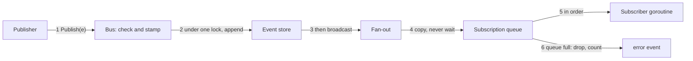

1. A publisher calls `Publish`. The bus checks that the type and subtype pair is registered and that `data` is its struct, or returns `ErrUnknownEvent`.
2. The bus sets `time`, takes the bus lock and appends the event to the event store. All events pass through this lock, so the log and every subscriber see the same order.
3. The bus broadcasts the event even when the append failed ([Appending to the event store](#appending-to-the-event-store)).
4. The bus puts the event on each matching queue without blocking and releases the lock. A publisher never waits for a subscriber.
5. Each subscriber reads its own queue in its own goroutine, one event at a time, so a subscriber sees events in publish order.
6. When a queue is full the bus drops the new event for that one subscription, adds one to its `Dropped` count, and publishes one `error` / `bus.overflow` event naming the subscription.

#### A slow or failing subscriber

- **Slow:** its queue fills; later events are dropped for it alone and counted. Other subscribers and the publisher are not affected.
- **Panicking:** the bus never runs subscriber code, so a panic happens in the subscriber's own goroutine. That goroutine starts through the Error Handler's panic-catching helper ([17](#17-error-handler)), which publishes an `error` event; the subscriber's code then calls `Close`.
- **An overflow event that is itself dropped:** the bus counts it but never announces it, so a full queue cannot feed a loop. Every other drop is announced, including one on the Error Handler's queue, so the other subscribers still record it.

A subscriber cannot ask the queue for a dropped event again. The event store holds every event `Publish` accepted, including those a slow subscriber dropped, and the Metrics Service rebuilds its figures from it.

### 4.6 State

The bus keeps its subscriptions and counters in memory. The event store is the one place it writes files.

| State | Held in | Lost at a crash |
|---|---|---|
| Subscription list | `Bus` | Yes; subscribers subscribe again at start |
| Queued events | Each `Subscription` | Yes; the event store already holds each one, and recovery reads the State Manager |
| `Dropped` counts | Each `Subscription` | Yes; the `bus.overflow` events carry them |
| Event logs | `<common_dir>/komodo/events/<run-id>.jsonl`, `~/.komodo/events/engine.jsonl` | No; kept until retention deletes them |
| Run-to-folder map | `~/.komodo/events/runs.json` | No; the Reader and the next `Publish` read it again |
| Store failure count | The store, per log | Yes; the `bus.store_failed` event and the gap line carry it |

### 4.7 Invariants and Failures

**Invariants**
1. Every subscriber sees events in the order they were published.
2. `Publish` never blocks on a subscriber.
3. A subscriber's failure never changes another subscriber's queue or the publisher.
4. Every published event has a registered type and subtype pair; a test fails when an emitted pair is missing from the registry, or a registered pair is never emitted.
5. `Publish` takes ownership of the event's data, a pointer to its registered struct; neither the publisher nor any subscriber changes it afterwards, so every subscriber reads the same body.
6. An event's time is stamped while `Publish` holds the bus lock, so times never decrease along the stream.
7. After `Seal`, every `Publish` from every caller returns `ErrBusSealed` and queues nothing; events queued before it still reach their subscribers. The Error Handler seals the bus after its final event ([17.7](#177-invariants-and-failures)).
8. `Publish` appends an event to the event store before it broadcasts it, so the log holds every accepted event in exact publish order.
9. A failed append never stops a publish: the event is still broadcast, the failure is counted and announced, and the gap is marked.
10. Only the bus writes the event store; a run's log is only appended to, and only retention removes it, whole and never while its run is open.
11. Every line written is masked first.
12. Recovery never reads the event store.

**Failures**

| Failure | Detected by | Action | Bound | Final state |
|---|---|---|---|---|
| Unknown type, subtype or data struct | `Publish` | Return `ErrUnknownEvent`; the event is not queued | 0 retries | The publisher logs through the Error Handler |
| Queue full | `Publish`, at the queue | Drop the event for that subscription; publish `bus.overflow` | One `bus.overflow` per burst per subscription; a burst ends when that queue drains to half its size | The subscriber misses events |
| Subscriber panics | The panic-catching helper | The helper publishes `error`; the subscriber closes | 0 | That subscriber stops; others continue |
| Publish after close | `Publish` | Return `ErrBusClosed` | 0 | Nothing queued |
| Publish after seal | `Publish` | Return `ErrBusSealed` | 0 | Nothing queued; earlier events still drain |
| An append to a log fails | The store | Broadcast the event anyway; count the failure; publish `bus.store_failed` once per burst; write a gap line when appends work again | One `bus.store_failed` per burst per log | The log lacks the events of the burst, marked by the gap line |
| A torn last line in a log | The Reader | Drop it; add a `torn` mark | 1 per read | The fragment stays until retention deletes the log |
| An unreadable line in a log | The Reader | Skip it; count it in `Skipped` | 0 retries | The line stays until retention deletes the log |
| `runs.json` unreadable | The store, at start | Rename it `runs.json.bad-<unix>`; start with an empty map; publish one `bus.store_failed`; every later save re-reads the file and merges, so a save never drops entries it did not know | 1 | The map refills as `run-start` events arrive |
| Logs of open runs over the size bound | The trim | Delete none of them; publish `bus.store_failed` naming the folder | 1 per folder | The folder stays over the bound |
| The control socket does not answer | The CLI | Start the engine, then send the command again | Dial every 50 ms for 5 seconds | The command runs, or the CLI reports the error |

### 4.8 Config

The Configuration Manager reads the settings file and hands the value to `bus.New`.

| Key | Type | Default | Effect |
|---|---|---|---|
| `bus.buffer_events` | integer | 50 | Queue size per subscription; a subscription 50 events behind drops the next event |
| `events.retention_days` | integer | 30 (least 1) | Days a closed run's event log is kept; the size bound is the other limit, and the log of an open run is never deleted |

| Constant | Value |
|---|---|
| Size bound | 100 MB per repository, trimmed to 80% |
| Trim interval | The first `run-start` per events folder, then at most once a day on a later `run-start` | | 4.3 µs per event, measured |
| Forced to disk | On every `stage.enter` and on the final `error` event |

### 4.9 Proof Cases

Component tests with fake subscribers; no live provider tests.

| Fixture input | Expected result |
|---|---|
| 1,000 events from 4 publishers, 3 subscribers | Every subscriber sees the same order |
| A subscriber of `run-status` only | Never receives an `error` event |
| A subscriber that never reads, queue 50 | Events 51 on are dropped, `Dropped` rises, one `bus.overflow` is published |
| A slow subscriber and a fast one | The fast one receives all events with no added delay |
| A subscriber goroutine that panics | One `error` event; the other subscribers are unaffected |
| `Publish` of an unregistered subtype | `ErrUnknownEvent`; nothing queued |
| Decode of the example `session.end` line | The registry returns `SessionEnd`; an unknown field is refused |
| `Close` then `Publish` | `ErrBusClosed`; every `Events` channel is closed |
| `Seal` with events queued, then `Publish` from 8 goroutines | Every `Publish` returns `ErrBusSealed`; the queued events are still delivered in order |
| Every row of the event-name table | The pair is registered, or the row says none or names its TODO |
| A `run-start` with `schedule` set, sent over the control socket | The engine's bus broadcasts it once; the Runtime Manager receives `groups`, `source` and `schedule` |
| 10 events, then the engine is killed | The event log holds all 10 lines handed to the operating system before the kill; a torn last line is dropped on read |
| A `run-start` with `common_dir`, then 3 events of the run | `runs.json` maps the run to `<common_dir>/komodo/events`; the log holds 4 lines in publish order |
| 1,000 events from 4 publishers | The log's line order equals the order every subscriber saw |
| An event with no run, and an event of a run the map does not hold | Both lines are in `engine.jsonl` |
| A log directory that rejects writes for 3 events, then accepts | All 3 events reach the subscribers; one `bus.store_failed` is published; a gap line with `dropped` 3 precedes the next event |
| A `stage.enter` and a final `error` event | Each forces the log to disk; a plain event does not |
| An event line that holds a secret | The line is written masked |
| A log whose last line has no closing newline | `Replay` returns every earlier event and one `torn` gap after the last; opening the log for append first writes a newline |
| A log with an unparseable line in the middle | `Replay` skips it and `Skipped` is 1 |
| `Replay` for one group | Only that group's events return; every gap mark stays |
| A run log of a closed run, 31 days old, with retention 30 | `Trim` deletes the whole file and the map entry; the log of an open run stays |
| Logs of ended runs at 120 MB | After `Trim` the folder is at or below 80 MB |
| Logs of open runs past 100 MB | `Trim` deletes none and publishes one `bus.store_failed` naming the folder |
| `Trim` with `dry` set | Returns the paths that would go and deletes none |
| 10,000 appends | The mean cost is near the measured 4.3 µs per append |

### 4.10 Open Gaps

Each id is a row in the [gap register](#appendix-b-gap-register); the rows are not copied here.

No gap row touches this chapter.

## 5. Intake Handler

The Intake Handler turns a request to plan into task lists the rest of the harness can run. It reads source documents such as an HLD or a product requirements document, starts the planner agent through the model client, checks the planner's draft with plain Go code, and publishes the `run-start` event, which ends planning, when the draft passes. The purpose and the interactions are in [HLD 5.6](hld.md#56-intake-handler).

The Intake Handler writes task lists only. It creates no branch or worktree and takes no lease: the Task Manager creates a group's branch and worktree ([chapter 11](#11-task-manager)), and the Lease Manager holds the lease ([chapter 9](#9-lease-manager)).

### 5.1 Scope and Concepts

**Owns:**
- The task-list file grammar: reading and writing `TG.md` and `tsk-*.md`.
- Lint: the eight checks that run on every planner draft and on stored task lists.
- The dependency graph built from the task lists: nodes, edges, waves and the longest chain.
- The planning run: the planner session, its lint returns and the all-or-nothing write.
- The card hash of a group, a fingerprint of its task-list files.
- The `plan` subscription and the `run-start` publication.
- The list of task groups under `docs/backlog/` that are not done, in dependency order: the source of `komodo run --all`.

**Does not own:**
- The planner's brief, its slots and the repo map: [chapter 6](#6-context-manager) builds them; this chapter asks for them through `GetContext()`.
- Link choice and the model client (`internal/llm`) that the Intake Handler opens the planner session through ([chapter 11](#11-task-manager)).
- Running groups, group order and group timers: [chapter 7](#7-runtime-manager).
- The lease record of a group: [chapter 9](#9-lease-manager). Its branch and worktree: the Task Manager ([chapter 11](#11-task-manager)).
- Committing and pushing the task lists: the Commit Handler commits them onto the epic branch as its first commit, when the Runtime Manager asks at run start ([chapter 7](#7-runtime-manager), [chapter 15](#15-commit-handler)).
- The agent definition of the planner (model weight, limits, chain): [chapter 3](#3-configuration-manager).

**Concepts**

| Term | Meaning |
|---|---|
| Task list | The set of Markdown files under `docs/backlog/` that describe the work |
| Epic | The folder `docs/backlog/epic-N/`; it holds task groups |
| Task group | The folder `tg-N.M/` with a `TG.md` and 1 to 8 task files; the unit one Task Manager runs |
| Task | One `tsk-*.md` file naming at most 5 files and at most 300 estimated changed lines |
| Acceptance item | One check of a group, written as `WHEN <event> THE SYSTEM SHALL <response>` (the Easy Approach to Requirements Syntax, EARS) |
| Planner | The agent that drafts the task lists in one session; it sizes a group so one builder finishes it within 1 hour |
| Draft | The planner's whole answer held in memory: every file of the plan, none written |
| Lint | The automatic rule check of task lists; it spends 0 model tokens |
| Wave | Groups with no dependency on each other; wave 1 holds groups with no dependency |
| Card hash | A fingerprint of one group's `TG.md` and `tsk-*.md` files, used to detect edits after the run starts |

### 5.2 Package Layout

The package is `internal/intake`.

| File | Holds |
|---|---|
| `internal/intake/intake.go` | `Handler`: the `plan` subscription, the `run-start` publication and the plan state |
| `internal/intake/backlog.go` | Grammar: parse and write `TG.md` and `tsk-*.md` |
| `internal/intake/lint.go` | The eight lint checks, sizing and the EARS shape |
| `internal/intake/graph.go` | Dependency graph, cycle refusal, waves, longest chain |
| `internal/intake/plan.go` | `Plan`: the planner session, lint returns and the all-or-nothing write |
| `internal/intake/docs.go` | Reading the source documents a plan request names |
| `internal/intake/hash.go` | The card hash of a group |
| `internal/intake/fields.go` | Field blocks, acceptance items and the value checks of `TG.md` and `tsk-*.md` |
| `internal/intake/write.go` | Staging, the folder swap with rollback and the restore of `.plan-old-*` folders |

The planner's role definition and result decoder are in `internal/agent/planner.go`: `PlannerRole`, `PlannerResult` and `ParsePlannerResult`. A `PlannerResult` has the shape of a `PlanDraft`; the handler copies one into the other.

### 5.3 Data Model

#### Task-list layout

```text
docs/backlog/
  epic-1/
    tg-1.1/
      TG.md
      tsk-add-lock.md
    tg-1.2/
      TG.md
      tsk-fence-stale.md
```

**📐 How the task-list files relate**
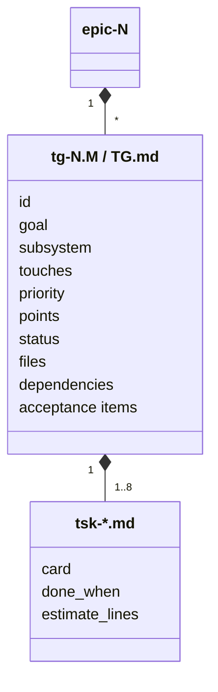

The folder names are the readable names. A group's folder name is also what another group's `dependencies:` line cites. A task file name is fixed only by the `tsk-` prefix.

#### Group file: `TG.md`

```text
id: 0192e4c5-7a10-7d3e-9b2f-6c1d8e4a5f30
goal: The lease refuses a write with an older fence
subsystem: Runtime Manager
touches: internal/engine/**
priority: high
points: 3
status: todo
files:
- internal/lease/fence.go
- internal/engine/drive_test.go
dependencies: tg-1.1

- WHEN a write carries an older fence THE SYSTEM SHALL refuse it
  cmd: go test ./internal/engine/...
```

| Field | Type | Rule |
|---|---|---|
| `id:` | string | Universally unique identifier, version 7, written when the group is created |
| `goal:` | string | One line: what the group delivers; the pull request title and the builder's brief read it |
| `subsystem:` | string | A component name from the component map, or `none` |
| `touches:` | globs | File patterns the group expects to change; overlap between two groups decides which must run first |
| `priority:` | string | `high` or `normal`; the Intake Handler validates it and [chapter 7](#7-runtime-manager) says what it orders |
| `points:` | integer | Story points 1, 2, 3, 5 or 8; 8 is one builder hour; lint fails a missing value or one off the scale |
| `status:` | string | `todo`, `in_progress`, `blocked`, `needs_refinement` or `done`; the Intake Handler writes `todo` and never rewrites it; the card hash leaves the line out |
| `files:` | list | The exact files the group's builder may write; a file outside the list needs a scope request |
| `dependencies:` | group names | Groups that must finish before this group starts |
| acceptance items | list | The checks the tester runs, one per item, each with an optional `cmd:` and an optional `needs:` line |

An acceptance item has these parts:

| Part | Rule |
|---|---|
| First word | `WHEN`, or the `IF` or `WHILE` form |
| `SHALL` | Required; an item without it fails lint. Go checks the shape, never the meaning |
| `cmd:` | Optional command the tester runs; without it Go cannot rerun the item |
| `needs:` | Optional; `network`, `docker` or `service:<name>`; the tester skips the item with reason `env` in a sandbox that cannot satisfy it |

Grammar of both files:
- **Field block:** bare `key: value` lines at the top, no YAML fences; the block ends at the first blank line. Keys are lowercase and each appears once.
- **Lists:** a one-line value is a list of one; several values are `- ` lines under the key, as `files:` shows.
- **Acceptance items:** `- ` lines after the field block, in one of three shapes: `WHEN <event> THE SYSTEM SHALL <response>`, `IF <condition> THEN THE SYSTEM SHALL <response>` or `WHILE <state> THE SYSTEM SHALL <response>`. An indented `cmd:` or `needs:` line belongs to the item above it.
- **Numbers:** a new epic is the highest `epic-N` plus 1; a new group is the highest `tg-N.M` of its epic plus 1.
- **Unknown key:** a `grammar` finding names the key, so a file from a newer grammar is refused, never half read. A missing optional key reads as its default: `subsystem` `none`, `touches` empty, `priority` `normal`, `status` `todo`. A missing `id`, `goal` or `points` is a `grammar` finding; a missing or empty `files`, a missing `dependencies` key (a group with none writes the key with no value) and a task without `files` or `done_when` are `required` findings.

#### Task file: `tsk-*.md`

```text
files: internal/engine/build.go
done_when: go test ./internal/engine/...
estimate_lines: 120

Add the stale check to Build: an event whose epoch is below the group's is dropped and logged.
```

| Field | Type | Rule |
|---|---|---|
| the card | text | Free Markdown after the blank line: the task's own write-up that the builder's brief reads |
| `files:` | list | At most 5 files, all from the group's `files`; they size the task and point its brief at those files |
| `done_when:` | command | The task's pass condition; the builder runs it before it reports the task done |
| `estimate_lines:` | integer | The planner's estimate of changed lines, at most 300 |

The task identifier is the file name without `.md`, such as `tsk-add-lock`. A task file has no other fields.

#### Go types

```go
// Priority is a group's ordering hint.
type Priority string

const (
	PriorityHigh   Priority = "high"
	PriorityNormal Priority = "normal"
)

// Epic is one docs/backlog/epic-N/ folder.
type Epic struct {
	Number int     // N in epic-N
	Groups []Group // one per tg-N.M folder, in folder-name order
}

// Group is one tg-N.M folder: TG.md plus its task files.
type Group struct {
	ID           string       // identifier from id:
	Name         string       // folder name, such as tg-1.2
	Goal         string       // one-line goal
	Points       int          // story points
	Status       string       // status: as last written
	Subsystem    string       // component name, or none
	Touches      []string     // globs the group expects to change
	Priority     Priority     // high or normal
	Files        []string     // files the builder may write
	Dependencies []string     // names of groups that must finish first
	Acceptance   []Acceptance // checks the tester runs
	Tasks        []Task       // at most 8
}

// Acceptance is one acceptance item.
type Acceptance struct {
	Keyword string   // WHEN, IF or WHILE
	Text    string   // the item after the keyword, through its SHALL clause
	Cmd     string   // optional command the tester runs
	Needs   []string // optional: network, docker or service:<name>
}

// Task is one tsk-*.md file.
type Task struct {
	Name          string   // file name without .md
	Files         []string // files the task names, at most 5
	DoneWhen      string   // command that proves the task done
	EstimateLines int      // planner's estimate of changed lines, at most 300
}
```

#### Lint finding

```go
// Severity says whether a finding stops the plan or only warns.
type Severity string

const (
	SeverityFail Severity = "fail"
	SeverityWarn Severity = "warn"
)

// Rule names the lint check that produced a finding.
type Rule string

const (
	RuleGrammar       Rule = "grammar"
	RuleRequired      Rule = "required"
	RuleWaveIsolation Rule = "wave_isolation"
	RuleProtected     Rule = "protected"
	RuleSizing        Rule = "sizing"
	RuleGraph         Rule = "graph"
	RuleEARS          Rule = "ears"
	RuleCaseCollision Rule = "case_collision"
)

// Finding is one failed or warned check, naming the rule and the file.
type Finding struct {
	Rule     Rule     `json:"rule"`
	Severity Severity `json:"severity"`
	Path     string   `json:"path"`    // the file the rule failed on
	Message  string   `json:"message"` // what is wrong, in one sentence
}
```

```json
{"rule": "ears", "severity": "fail", "path": "epic-2/tg-2.1/TG.md", "message": "acceptance item 2 has no SHALL"}
```

| Field | Rule |
|---|---|
| `rule` | One of the eight checks in [5.5](#55-behaviour) |
| `severity` | `fail` stops the plan; `warn` is reported and nothing stops |
| `path` | The file the rule failed on |
| `message` | The text sent back into the planner session on a failed draft |

A finding exists in memory only. It is printed, sent back into a session or carried in an error, and never stored.

#### Dependency graph

```go
// Graph is the dependency graph of the task lists: groups are nodes, "must finish first" are edges.
type Graph struct {
	Groups  []string            // group names in folder-name order
	Deps    map[string][]string // group name -> groups that must finish first
	Touches map[string][]string // group name -> its touches globs
}
```

#### Plan request and draft

```go
// PlanRequest is the data of a plan event.
type PlanRequest struct {
	Goal string   `json:"goal"` // the one-line goal; may be empty when Docs is set
	Docs []string `json:"docs"` // source documents to plan from, as repository paths
	Epic int      `json:"epic"` // an existing epic to amend as a delta; 0 for a new epic
}

// PlanDraft is the planner's result: every task-list file of the plan, in memory.
type PlanDraft struct {
	Files []DraftFile `json:"files"`
}

// DraftFile is one task-list file of a draft.
type DraftFile struct {
	Path    string `json:"path"`    // path under docs/backlog/, such as epic-2/tg-2.1/TG.md
	Content string `json:"content"` // the whole file
}
```

```json
{
  "files": [
    {"path": "epic-2/tg-2.1/TG.md", "content": "id: 0192e4c5-...\ngoal: ...\n"},
    {"path": "epic-2/tg-2.1/tsk-add-lock.md", "content": "files: internal/lease/lock.go\n..."}
  ]
}
```

| Field | Rule |
|---|---|
| `goal` | A plan needs a goal, at least one document, or both |
| `docs` | Each path must exist in the repository at the base commit; the Intake Handler reads it, the planner does not |
| `epic` | A non-zero value amends only groups that are not in a run |
| `files[].path` | Relative to `docs/backlog/`; a path with `..` or an absolute path fails the `grammar` rule |

#### Event data

The Intake Handler subscribes to `plan` and publishes `run-start` and `error`. The Event Bus chapter owns the full list of subtypes ([chapter 4](#4-event-bus)).

```json
{
  "type": "plan", "subtype": "request", "run": "0192e4c5-6f00-7a21-8c3b-2d9e0f1a4b57", "group": "",
  "time": "2026-10-14T21:03:11Z",
  "data": {"goal": "Add lease revocation", "docs": ["docs/hld.md"], "epic": 0}
}
```

The handler ends planning by publishing `run-start` for the groups it just wrote. Its `data` tells the Runtime Manager what to run, so the Runtime Manager never searches the task lists itself:

```json
{
  "type": "run-start", "subtype": "", "run": "0192e5a0-3b44-7d10-8c62-9a1f4e7b0d25", "group": "",
  "time": "2026-10-14T21:09:40Z",
  "data": {"target": "ep-2", "groups": ["tg-2.1", "tg-2.2"], "source": "intake", "repo": "github.com/acme/shop", "root": "/Users/dev/src/shop", "common_dir": "/Users/dev/src/shop/.git"}
}
```

| Field | Rule |
|---|---|
| `data.target` | The label of the epic the plan wrote, such as `ep-2` for the folder `epic-2` |
| `data.groups` | The labels of the groups the plan wrote, in dependency order; a group not written by this plan is absent |
| `data.source` | `intake`; a `run-start` from the CLI says `cli` |
| `data.repo`, `data.root`, `data.common_dir` | The repository id, the repository root and the git common directory the plan was written in |
| `run` | The run id of this `run-start`: a new version 7 UUID, not the run id of the `plan` event |

A group label is the group's folder name, such as `tg-2.1`. The full `run-start` shape is in [chapter 4](#4-event-bus).

The package registers `plan` / `request` and the four plan error subtypes with `RegisterEvents()`. The `error` data structs:

```go
// PlanBlocked is the data of error / plan-blocked.
type PlanBlocked struct {
	Findings  []Finding `json:"findings"`   // the findings of the third draft
	DraftPath string    `json:"draft_path"` // folder holding the last failing draft; empty when it could not be saved
}

// PlanTimeout is the data of error / plan-timeout.
type PlanTimeout struct {
	WallMin int `json:"wall_min"` // the minutes the plan was allowed
}

// PlanInput is the data of error / plan-input.
type PlanInput struct {
	Reason string `json:"reason"` // what failed, in one sentence
}

// PlanWrite is the data of error / plan-write.
type PlanWrite struct {
	Reason string `json:"reason"` // what failed, in one sentence
}
```

Each `error` event carries the run id of the `plan` event it answers. A planner session that fails for any other reason, such as an unreachable model, ends the plan with `error` / `plan-input` and its reason.

#### Card hash

The card hash is `sha256:` followed by the lowercase hexadecimal SHA-256 of `TG.md` and then each `tsk-*.md` in byte order of file name. Each file is written as its path from the repository root, a newline, its length in decimal, a newline and its bytes. The `status:` line of `TG.md` is left out, because other components write it. The hash lets the harness detect an edit to a group's task list after the run started.

### 5.4 Interfaces

#### Handler

```go
// Deps are the collaborators the harness passes in at construction.
type Deps struct {
	Bus       Publisher                                          // publishes events and subscribes by type
	Context   ContextSource                                      // GetContext() of the Context Manager
	Start     StartSession                                       // opens a planner session through the model client
	Locks     LockReader                                         // reports whether a group is in a run
	Protected func() []string                                    // paths no agent may write, from the Task Manager's guard data
	Limits    PlannerLimits                                      // wall clock and returns, from the Agent Registry
	Root      string                                             // repository root
	Tree      func(ctx context.Context) (contextmgr.Tree, error) // read-only view of the base commit: the tracked files and the documents a plan names
	Chain     []contextmgr.Candidate                             // the planner's link chain with measured contexts; sizes the repo map
	Repo      string                                             // repository id, copied into run-start
	CommonDir string                                             // git common directory, copied into run-start
}

// New returns a Handler; it does not subscribe until Run is called.
func New(d Deps) *Handler

// Run subscribes to plan events and handles them one at a time until ctx ends.
func (h *Handler) Run(ctx context.Context) error
```

```go
// ContextSource is the part of the Context Manager the Intake Handler calls.
type ContextSource interface {
	GetContext(ctx context.Context, req contextmgr.Request) (contextmgr.Context, error)
}

// Publisher is the part of the Event Bus the Intake Handler uses.
type Publisher interface {
	Publish(e bus.Event) error
	Subscribe(name string, types ...bus.Type) (*bus.Subscription, error)
}

// LockReader answers whether a group is in a run; the State Manager backs it.
type LockReader interface {
	InRun(groupID string) (run string, locked bool, err error)
}

// PlannerLimits are the planner's clocks from the Agent Registry.
type PlannerLimits struct {
	WallMin int // most minutes one plan may run; 0 means no deadline
	IdleMin int // minutes of silence before the session is stopped
}
```

| Caller | Call | When |
|---|---|---|
| Harness wiring | `New`, `Run` | Once at start |
| Event Bus | the `plan` subscription | A `plan` event arrives |
| Handler | `Context.GetContext` | Once per planner session, for the planner's brief |
| Handler | `Locks.InRun` | Before an amended plan touches an existing group |

#### Task lists

```go
// Load reads docs/backlog/ under root; grammar problems come back as findings, not errors.
func Load(root string) ([]Epic, []Finding, error)

// Lint runs the eight checks on the loaded task lists and returns their findings.
func Lint(epics []Epic, protected, tracked []string) []Finding

// LintDraft parses a draft in memory and runs the same checks as Lint.
func LintDraft(d PlanDraft, existing []Epic, protected, tracked []string) []Finding

// OverEstimate warns when a task's real changed lines exceed twice its estimate.
func OverEstimate(t Task, actualLines int) (Finding, bool)

// CardHash returns the card hash of one group.
func CardHash(root string, g Group) (string, error)
```

| Function | On failure |
|---|---|
| `Load` | A file the program cannot read is `err`; a missing or unknown field is a `grammar` finding naming the file |
| `Lint`, `LintDraft` | Cannot fail; a problem in the task lists is a finding |
| `CardHash` | A file that cannot be read is `err` |

`protected` is the list of paths no agent may write. The Task Manager owns that list ([chapter 11](#11-task-manager)); the harness passes it in, so lint keeps no copy and a test passes a fake list.

#### Graph

```go
// BuildGraph builds the dependency graph; a cycle is a failing graph finding.
func BuildGraph(epics []Epic, tracked []string) (Graph, []Finding)

// Waves returns the groups that can run together; wave 1 holds the groups with no dependency.
func (g Graph) Waves() [][]string

// LongestChain returns the number of groups on the longest dependency chain.
func (g Graph) LongestChain() int
```

`BuildGraph` cannot fail. A failing finding means the graph must not be used.

#### Groups to run

```go
// Pending returns the labels of every group under target whose status is not done, in dependency order; target is all, an epic label or a group label.
func Pending(epics []Epic, g Graph, target string) []string
```

The list is the source of `komodo run --all` (target `all`), and the CLI uses it to fill `data.groups` of a `run-start` event. `Pending` cannot fail; a graph with a failing finding is never passed in.

| Caller | When |
|---|---|
| The CLI | `komodo run --all` fills `data.groups` with the result |
| The handler | After a plan, `Plan` fills `PlanResult.Groups` with the written groups in the same order |

#### Planning

```go
// PlannerSession is one live planner session.
type PlannerSession interface {
	// Send gives the session a brief or lint failure text and returns its next draft.
	Send(ctx context.Context, text string) (PlanDraft, error)
	// Close ends the session.
	Close() error
}

// StartSession opens a planner session through the model client.
type StartSession func(ctx context.Context) (PlannerSession, error)

// PlanResult says what a plan wrote.
type PlanResult struct {
	Epic    int
	Written []string // paths of the files written, from the repository root
	Groups  []string // labels of the groups written, in dependency order

	Hashes map[string]string // card hash of each group written, by label
}

// PlanBlockedError ends a plan whose third draft failed lint; nothing was written.
type PlanBlockedError struct {
	Findings  []Finding // the findings of the third draft
	DraftPath string    // folder that holds the last failing draft for inspection
}

// Error returns the failure with the finding count.
func (e PlanBlockedError) Error() string

// Plan runs the planner session, lints its draft and writes files only when lint passes.
func (h *Handler) Plan(ctx context.Context, r PlanRequest) (PlanResult, error)
```

| Error | Meaning and what the caller does |
|---|---|
| `PlanBlockedError` | The third draft failed lint. `Run` publishes an `error` event with subtype `plan-blocked` carrying the findings |
| `LockedError` | An amended plan touched a group that is in a run; the group is left unchanged and the plan fails naming the run. `Run` publishes `error` / `plan-input` |
| `context.DeadlineExceeded` | The planner's wall clock ran out; no file is written |

```go
// LockedError is returned when a group is in a run; Run names that run.
type LockedError struct{ Run string }
```

### 5.5 Behaviour

#### Walkthrough

A person plans a goal that needs two groups.

**📐 From a plan request to the run-start event**
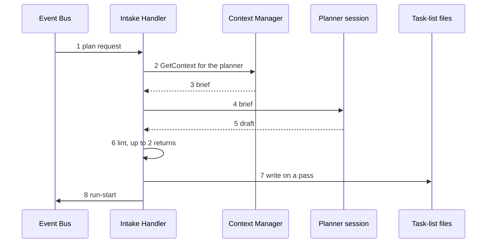

1. A `plan` / `request` event reaches the handler; the CLI publishes it for `komodo plan`. It handles one plan at a time.
2. The handler reads each document named in `docs` and calls `GetContext()` with agent `planner`, the goal and the documents.
3. The Context Manager returns the planner's brief; the repo map and the layout are part of it ([chapter 6](#6-context-manager)).
4. The handler opens a planner session through the model client with a deadline of `WallMin` minutes and sends the brief.
5. The planner returns a draft: each group's goal, `touches`, dependencies, tasks and acceptance items.
6. Go lints the draft. A failing draft goes back into the same session with the finding text, up to 2 times; a third failing draft ends the plan.
7. The handler writes the files, all or nothing, and computes each group's card hash.
8. The handler publishes `run-start` with the labels of the groups it wrote in `data.groups`.

#### Algorithms

**Handling a plan request**

1. Refuse a request with no goal and no document.
2. Read each document in `docs` at the base commit; a missing document fails the plan before any model runs.
3. When `epic` is non-zero, `Load` the epic and ask `Locks.InRun` for each group; a locked group is a read-only input and an amended file naming it fails the plan with `LockedError`.
4. Call `GetContext()` and open the session.
5. Run the lint loop below.
6. Write the files, then publish `run-start` with `PlanResult.Groups`.

The draft's epic must be the one the request allows: highest `epic-N` plus 1 for a new epic, the named epic for an amendment. Any other epic number is a `grammar` finding and counts as a failed draft. A `WallMin` of 0 sets no deadline.

A document that does not fit the planner's brief ceiling fails the plan with the error that `GetContext()` returns; nothing is cut ([chapter 6](#6-context-manager)).

**The lint loop**

**📐 The planner session with its lint returns**
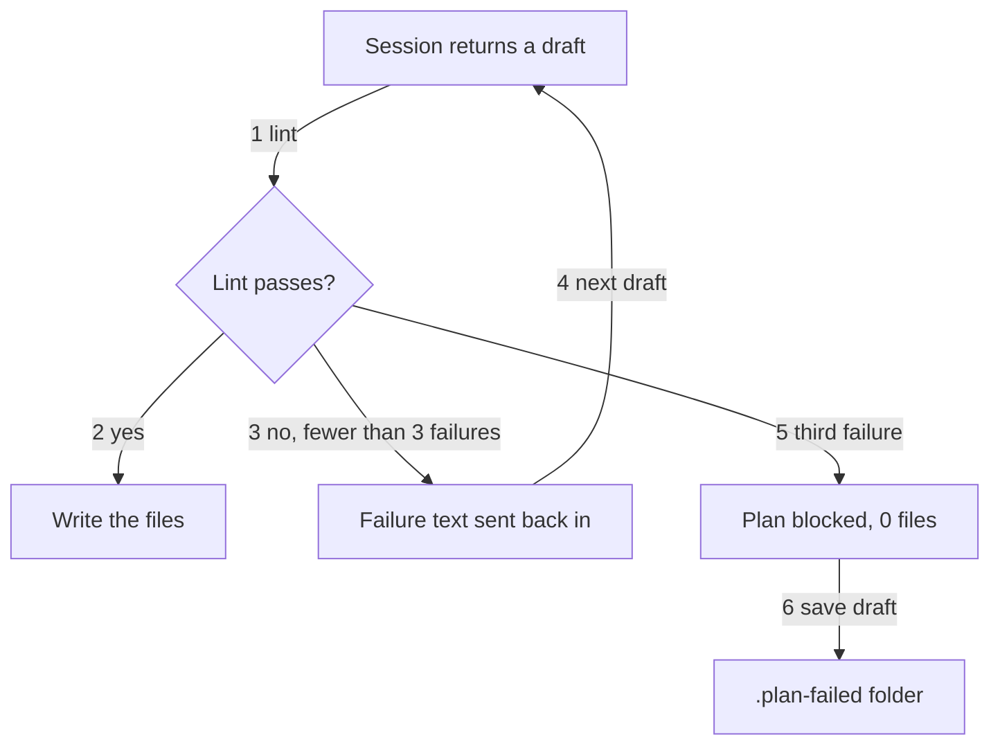

1. `LintDraft` returns all findings. A draft passes when no finding has severity `fail`.
2. On a pass, write the files.
3. On a failure with fewer than 3 failing drafts so far, send the finding text into the same session.
4. The session returns its next draft, and the loop runs again.
5. The third failing draft ends the plan with `PlanBlockedError`; 0 task-list files exist.
6. Save the last failing draft under `docs/backlog/.plan-failed-<random>/` so a person can read it; `Load` ignores that folder.

The planner may call a `lint_backlog` tool before it answers. The tool calls `Handler.LintBacklog(d PlanDraft) []Finding`, which runs `LintDraft` with the stored task lists, the protected list and the tracked files of the plan in progress, and does not count as a return. `DraftFromResult(agent.PlannerResult) PlanDraft` copies the planner's final call into a draft.

**Lint**

Each finding names its rule and its file. Lint never stops at the first finding; it returns all of them, sorted by path and then rule.

| Check | Rule |
|---|---|
| Grammar | Every `TG.md` and `tsk-*.md` matches the layout and field set; a missing or unknown field fails and is named |
| `files`, `done_when`, dependencies | Each group lists its files and dependencies and each task its `files` and `done_when`; every file a task names is in its group's `files` |
| Wave isolation | Groups in one wave share no `files` |
| Protected | A group whose `files` include a protected path or any `docs/backlog/**` path fails |
| Sizing | A task names at most 5 files and 300 estimated lines; a group has at most 8 tasks and 8 story points; a chain has at most 4 groups |
| Graph | A cycle fails; a chain over 4, a group every other group waits on and a group with over 5 dependencies warn |
| EARS | `WHEN`, `IF` or `WHILE` shape; an item without `SHALL` fails |
| Case collision | Two paths that differ only by case fail |

| Check | Fails when | Warns when |
|---|---|---|
| Sizing | A task has over 5 files or 300 estimated lines; a group has over 8 tasks or 8 points | A chain has over 4 groups; a task's real lines exceed twice its estimate after Build |
| Graph | The dependency graph has a cycle | The longest chain has over 4 groups; one group is waited on by every other group; a group has over 5 dependencies |

- **Case collision inputs:** every tracked file of the base commit plus every group's `files`. Task file names within one group are checked too.
- **Draft numbers and status:** a draft group that is new must take the next `tg-N.M` of its epic, a draft group must write `status: todo`, and a path number has no leading zero. Each is a failed draft.
- **Protected list:** it comes from the caller, never from a file this package reads.

**Building the dependency graph**

**📐 Building the graph**
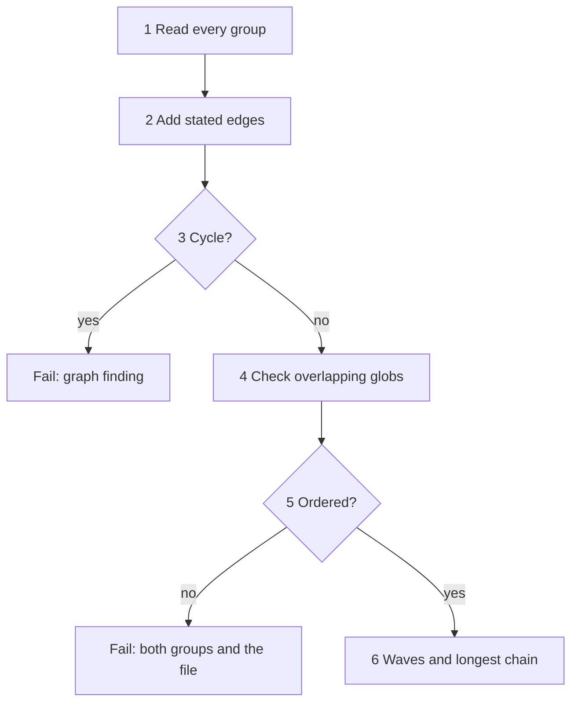

1. Read every group of every epic: name, `touches`, `files` and `dependencies`.
2. Add one edge for each stated dependency.
3. Refuse a cycle: a path of edges that returns to its start fails the graph.
4. Compare the `touches` globs of every pair of groups. Two groups with overlapping globs must be ordered.
5. An overlapping pair with no order fails lint and names both groups and the shared file. An order through a third group counts.
6. Place groups with no dependency in wave 1, count the longest chain, and warn when it is over 4.

Two globs overlap when one file matches both, among the tracked files of the base commit and every group's `files`; the file named is the first such path in byte order. After wave 1, a group's wave is 1 plus the highest wave of the groups it waits on. A group counts as waited on by every other group only when the plan has at least 3 groups and every other group lists it directly. Waves serve lint, the graph view and the order of `Pending` and `PlanResult.Groups` (wave first, then folder-name order); the Runtime Manager starts a group as soon as its dependencies finish.

**Writing the files**

1. The draft is staged under `docs/backlog/.plan-<random>/epic-N/`. A new epic is then renamed into place as `epic-N` in one rename.
2. An amended group is written the same way: the old folder is renamed aside to `.plan-old-<random>`, the new one goes into place, and the old one is then removed.
3. A crash leaves each group old or new, never half. The next plan restores an orphaned `.plan-old-*` folder.
4. `Load` ignores every `.plan-*` folder.

**Task lists are read-only to agents**

Lint keeps every `docs/backlog/` path out of a group's `files`, and the builder's scope rule keeps it inside `files`. A blocker against a task list goes to the orchestrator or a person. The Intake Handler is the only component that writes the task-list files, and it does so only from a draft that passed lint.

### 5.6 State

The package keeps no state files. A plan exists in memory until its files are written; the task-list files hold everything after that.

| Item | State | Moves on | True after the move |
|---|---|---|---|
| Plan | Drafting | The planner session returns a draft | The draft is in memory; no file exists |
| Plan | Written | The draft lints clean | The files exist under `docs/backlog/` |
| Plan | Blocked | The third draft fails lint, or the deadline passes | 0 files were written |

**📐 States of one plan**
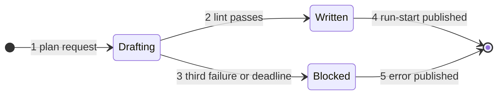

A lint failure under 3 returns the draft to the same session and leaves the plan in Drafting.

### 5.7 Invariants and Failures

#### Invariants

1. A task-list file is written only from a draft that passed lint; a failing draft writes 0 files.
2. Lint is one function; the planner's tool, the plan loop and any stored-list check call the same eight checks.
3. The Intake Handler publishes `run-start` only after the files are written and every card hash is computed.
4. The planner session holds no write tool and no git or forge credential.
5. A group in a run is never rewritten by a plan.
6. A plan handles one request at a time; a second `plan` event waits.

#### Failures

| Situation | Detection | Action and final state |
|---|---|---|
| A draft fails lint | `LintDraft` returns a failing finding | Failure text goes back into the same session, up to 2 times; plan stays Drafting |
| The third draft fails lint | The third failing result | Plan Blocked; 0 files; last draft saved under `.plan-failed-*`; `error` / `plan-blocked` published |
| The planner's wall clock runs out | The session deadline | Session closed; Blocked; 0 files; `error` / `plan-timeout` published |
| A named document is missing | `docs.go` read at the base commit | Plan fails before any session; `error` / `plan-input` published |
| A document exceeds the brief ceiling | `GetContext()` returns its context error | Plan fails; nothing is cut; `error` / `plan-input` published |
| A group's `files` include a protected path | `Lint`, rule `protected` | Counted as a failed draft |
| Two groups in one wave share a file | `Lint`, rule `wave_isolation` | Counted as a failed draft |
| Overlapping globs with no order | `BuildGraph` | Counted as a failed draft; the finding names both groups and the file |
| A dependency cycle | `BuildGraph` | Counted as a failed draft |
| An amended plan names a group in a run | `Locks.InRun` | `LockedError` naming the run; the group is unchanged |
| The rename of a new folder fails | Filesystem error | Plan Blocked; the old folder is restored; `error` / `plan-write` published |
| `Locks.InRun` cannot answer | Error from the State Manager | Plan fails closed; `error` / `plan-input` published |
| A task over twice its estimate after Build | `OverEstimate` | A warning for the next plan; nothing stops |

A failed lint leaves no group started, so nothing is locked. The person fixes the file, or plans again with `epic` set to the epic number, which amends only groups that are not in a run.

A plan always asks the model: no earlier draft is reused. The only cached input is the repo map of one exact tree, built by Go code ([chapter 8](#8-cache-manager)).

The Intake Handler runs inside the engine process, and `komodo plan` starts the engine when none runs ([chapter 7](#7-runtime-manager)). A plan runs from an event and publishes events, so no caller blocks on the model. The CLI learns that planning ended from the `run-start` the Intake Handler publishes with `source` `intake`: while `plan` waits, the CLI also receives that event over its socket connection, and an `error` event ends the wait with that fault.

### 5.8 Config

The Intake Handler owns no settings key. It receives values from the Configuration Manager at construction.

| Value | Source | Effect |
|---|---|---|
| `PlannerLimits.WallMin` | Agent Registry, planner `limits.wall_min` | Deadline of one plan |
| `PlannerLimits.IdleMin` | Agent Registry, planner `limits.idle_min` | Silence before the session is stopped |
| `Protected` | The Task Manager's guard data | Paths lint refuses in a group's `files` |
| Model link and weight of the planner | Agent Registry; the links are the Claude subscription link, then the paid Anthropic interface ([chapter 11](#11-task-manager)) | Which model the planner session uses |

Fixed constants, not settings:

| Constant | Value | Effect |
|---|---|---|
| Files per task | 5 | Sizing fails over it |
| Estimated lines per task | 300 | Sizing fails over it |
| Tasks per group | 8 | Sizing fails over it |
| Story points per group | 8, on the scale 1, 2, 3, 5, 8 | Sizing fails over it or off the scale |
| Groups in a chain | 4 | A longer chain warns |
| Dependencies per group | 5 | A group with more warns |
| Real lines against estimate | 2 times | A task over it warns after Build |
| Lint returns into a planner session | 2 | The third failure blocks the plan |

### 5.9 Proof Cases

#### Unit

- A task list of epic 1 passes `Lint` with 0 failing findings.
- Two groups in one wave sharing a file fail lint, rule `wave_isolation`.
- A dependency cycle fails lint, rule `graph`.
- A 5-group chain warns and does not fail.
- A group with 6 dependencies warns.
- An item without `SHALL` fails lint, rule `ears`.
- A task with 6 files, or 301 estimated lines, fails lint; a group with 9 tasks fails lint.
- A group whose `files` include a protected path, or any path under `docs/backlog/`, fails lint, rule `protected`.
- Two paths `Readme.md` and `README.md` fail lint, rule `case_collision`.
- A task whose real lines are 2.1 times its estimate yields a warning from `OverEstimate`.
- `CardHash` ignores the `status:` line and changes when any task file changes by one byte.
- A fixture goal touching 2 overlapping areas yields 2 groups with a derived dependency; a draft that omits it fails lint naming the shared file.
- A draft path with `..` fails the `grammar` rule.
- `Pending` over a backlog of 3 groups, one with status `done`, returns the 2 other labels with a group after the groups it depends on.

#### Component

These use a mock model client that returns scripted drafts, and a fake bus.

- A draft that fails lint writes 0 files.
- A session whose draft fails lint 3 times ends the plan Blocked and publishes `error` / `plan-blocked` with the findings.
- A session that fails once and then passes receives the failure text once and the plan writes its files.
- A plan whose deadline passes publishes `error` / `plan-timeout` and writes 0 files.
- An amended plan naming a group in a run returns `LockedError` and leaves the group unchanged.
- A killed process between the two renames leaves each group old or new, and the next plan restores `.plan-old-*`.
- A passing plan publishes one `run-start` with source `intake`; it lists in `data.groups` exactly the groups the plan wrote, in dependency order, and no `next` event exists.
- A failed plan publishes no `run-start`.
- The planner session receives no write tool.

### 5.10 Open Gaps

Each id is a row in the [gap register](#appendix-b-gap-register); the rows are not copied here.

| Gap | Question |
|---|---|

## 6. Context Manager

The Context Manager owns everything an agent may see beyond the code: skills (documents of standards), agent prompt templates and connections to Model Context Protocol servers (small programs that offer tools to a model). It switches each item on or off, decides which agents may use it, and assembles an agent's prompt, called the brief, from them. The Intake Handler and the Runtime Manager ask it for context through `GetContext()`. The purpose and the interactions are in [HLD 5.7](hld.md#57-context-manager).

### 6.1 Scope and Concepts

**Owns:**
- The skill index, skill selection, skill pulls, the integrity check and the compile from standards lines to reviewer rule identifiers.
- The 4 agent prompt templates (planner, builder, tester, reviewer) and the brief slots they name.
- The allow-listed list of Model Context Protocol servers: each entry is off by default and is switched on per agent.
- The on/off state and the per-agent access of every skill and connection.
- Brief assembly: the 5 parts, the slot fill, the size count and the ceiling check.
- The repo map, the repo profile (detected languages and commands) and the repo guidance extracted from `AGENTS.md`.
- The `skill` and `mcp` subscriptions.

**Does not own:**
- Settings and the Agent Registry: the Configuration Manager ([chapter 3](#3-configuration-manager)). The Context Manager never reads them; the harness passes values in and events carry changes.
- Opening a model session, choosing a link and the tool loop: [chapter 11](#11-task-manager).
- The guard rows, including the steering-phrase list: [chapter 11](#11-task-manager).
- The cache store: [chapter 8](#8-cache-manager). The Runtime Manager opens the cache and passes the Context Manager a cache handle; the Context Manager reads and writes repeated pieces through it directly and never opens or closes the cache.
- Rendering lines a person reads: [chapter 2](#2-output-formatter).

**Concepts**

| Term | Meaning |
|---|---|
| Skill | A Markdown file of standards or workflow steps put before a model session |
| Standards skill | One of the `standards-*` skills; one per language, framework or concern, such as `standards-go` |
| Orchestrator skill | A skill read by the interactive orchestrator session, never by a worker |
| Worker | Any agent other than the orchestrator: planner, builder, tester, reviewer |
| Template | An agent's `prompt.md`: role text, then a `# Brief` section with `{{slot}}` holes |
| Connection | One entry naming a Model Context Protocol server: how to start it and which agents may use it |
| Item | A skill or a connection; the unit that has an on/off state |
| Origin | Where an item's text comes from: `embedded` (inside the binary) or `local` (a file in the Komodo context folder) |
| Index | `index.json`: one row per skill with its globs, markers, sections and fingerprint |
| Fingerprint | The SHA-256 checksum of a skill file, a 256-bit number computed from its bytes; its first 8 hex characters are `sha8` |
| Preinject | Putting a skill into a brief because its globs match the group's `files` |
| Pull | A session asking for a skill, or one section as `<name>#<section>`, during the session |
| Marker | A repo file whose presence shows the repo uses a technology, such as `cdk.json` |
| Slot | One named hole in a template's `# Brief` section |
| Ceiling | The largest brief a link accepts: half the link's measured context window |
| Addendum | The repo's `AGENTS.md` text outside the Komodo block |

#### Embedded and read files

Every item is either embedded in the binary or read from disk. The split below holds for every build.

| File kind | Origin | Why |
|---|---|---|
| Shipped skills, `index.json`, `rules.json` | Embedded | The text of a shipped skill always comes from the binary and is checked against the index built with it |
| The 4 shipped agent templates | Embedded | A template holds role text; only a new binary changes it |
| Language pattern files for the repo map | Embedded | Patterns are code-like data that ship with the map builder |
| The Komodo tool set entry | Embedded | It names the tools of the harness itself |
| Local skills | Read from the context folder | A person adds standards of their own without a new binary |
| Outside connections | Read from the context folder | Which servers exist is the person's choice; each is off until the person switches it on for named agents |

The context folder is `skills/` and `connections.json` under the Komodo home folder ([chapter 20](#20-data-locations-and-data-flow)). It is never inside the repository, so a cloned repository cannot plant a skill or a connection. The repository's own `.claude/` folder is never read. A local skill cannot reuse a shipped skill's name: the loader refuses it.

### 6.2 Package Layout

The package is `internal/contextmgr`.

| File | Holds |
|---|---|
| `internal/contextmgr/context.go` | `Manager`, `Request`, `Context` and `GetContext()` |
| `internal/contextmgr/items.go` | The item table, on/off state, per-agent access and the `skill` and `mcp` event handlers |
| `internal/contextmgr/skills.go` | Index load, `Select`, `Get`, `List`, section lookup, fingerprint check, rule compile |
| `internal/contextmgr/source.go` | Reading embedded files and context-folder files; local-skill checks |
| `internal/contextmgr/templates.go` | Template parse and the slot check |
| `internal/contextmgr/mcp.go` | The connection table and its file format |
| `internal/contextmgr/brief.go` | Slots, parts, `Build`, `Place` and `Ceiling` |
| `internal/contextmgr/addendum.go` | `AGENTS.md` extraction at the base commit and the steering scan |
| `internal/contextmgr/repomap.go` | Symbol graph, ranking and fitting to the budget |
| `internal/contextmgr/detect.go` | Repo profile: command detection by marker file |
| `internal/contextmgr/tokens.go` | The bundled token counter |
| `embed/skills/` | `index.json`, `rules.json` and `<name>/SKILL.md` per shipped skill |
| `embed/templates/<agent>.md` | The 4 shipped templates |
| `embed/langs/<lang>.json` | Per-language symbol patterns for the repo map |

### 6.3 Data Model

#### Skill file

Every `SKILL.md` opens with frontmatter, then Markdown sections. A line starting `- **Never` or `- **Always` becomes a reviewer rule.

```markdown
---
v: 1
name: standards-go
description: "Go standards: errors, naming, tests and package layout"
globs:
  - "*.go"
markers: []
sections:
  - "Errors"
  - "Naming"
  - "Tests"
---
## Errors
- **Never ... (the rest of the line is the rule text)
- **Always ... (the rest of the line is the rule text)
```

```go
// SkillName names one skill, such as "standards-go".
type SkillName string

// Frontmatter is the strict header of a SKILL.md; an unknown key is refused.
type Frontmatter struct {
	V           int       // schema version, 1
	Name        SkillName // equals the skill's folder name
	Description string    // one line shown by List
	Globs       []string  // file patterns that select the skill
	Markers     []string  // repo files that must exist
	Sections    []string  // headings an agent may pull as name#section
}
```

| Field | Type | Rule |
|---|---|---|
| `v` | int | Schema version, 1 |
| `name` | string | The skill name, the same as its folder name |
| `description` | string | One line of at most 100 characters |
| `globs` | list | File patterns; a match with any file in the group's `files` selects the skill |
| `markers` | list | Repo files; the skill is selected when at least one is met; an empty list means no marker is required |
| `sections` | list | Every level-2 heading of the body, in body order; an entry with no heading, a heading with no entry and a duplicate heading are all refused |

The frontmatter is a strict subset of YAML between two `---` lines: `key: value` lines with a plain or double-quoted value, the empty list `[]`, and block lists of `  - "item"` lines. A hand-written line parser in `skills.go` reads it with `bufio.Scanner` and `strconv.Unquote`, so no YAML library is needed; any other line is refused.

A marker is a glob some file path in the base tree matches, or `<glob>:<text>`, met when a file matching the glob contains the text. The Context Manager applies this rule to the tree's `Paths()` for every marker, so it never depends on a `Tree`'s own `Exists`. A glob without a `/` matches any one segment of a path, so `*.xcodeproj` matches a folder; a `/` pattern matches whole paths, and `**` stands for any number of segments. `standards-aws` writes its Terraform marker as `*.tf:provider "aws"`.

#### Skill index

```go
// Index is the whole of embed/skills/index.json.
type Index struct {
	V      int          `json:"v"`      // schema version, 1
	Skills []IndexEntry `json:"skills"` // one row per shipped skill, sorted by name
}

// IndexEntry is one skill's row in index.json.
type IndexEntry struct {
	Name        SkillName `json:"name"`
	Description string    `json:"description"`
	Globs       []string  `json:"globs"`
	Markers     []string  `json:"markers"`
	Sections    []string  `json:"sections"`
	SHA256      string    `json:"sha256"` // 64 lowercase hex characters, written by the build
	Always      bool      `json:"-"`      // set by List for a skill in the agent's always list
}
```

```json
{
  "v": 1,
  "skills": [
    {
      "name": "standards-ui-mobile",
      "description": "Mobile interface standards for Android and iOS",
      "globs": ["*.kt", "*.swift"],
      "markers": ["AndroidManifest.xml", "*.xcodeproj"],
      "sections": ["Layout", "Accessibility", "Lifecycle"],
      "sha256": "<64 lowercase hex characters>"
    }
  ]
}
```

The fingerprint is the SHA-256 of the whole `SKILL.md` as embedded, frontmatter included. `sha8` is its first 8 characters. A local skill has no row in the embedded index; the loader computes its fingerprint when it reads the file and keeps it in memory for the life of the process.

#### Selection result and reviewer rules

```go
// Selected is one skill chosen for a brief, ready to render.
type Selected struct {
	Name   SkillName
	Origin Origin // embedded or local
	SHA8   string // short form of the fingerprint
	Body   string // the SKILL.md text, verified against its fingerprint
}

// Rule is one reviewer rule compiled from a Never or Always line.
type Rule struct {
	ID    string // std.<skill>.<n>
	Skill SkillName
	Line  string // the source line
}
```

| Field | Meaning |
|---|---|
| `Selected.Name`, `SHA8`, `Body` | The skill, its short fingerprint and its verified text; rendered as `## Standards: <name> (<sha8>)` followed by the body |
| `Rule.ID` | `std.<skill>.<n>`, the identifier a reviewer finding cites |
| `Rule.Line` | The line without its leading `- ` and every `**`, trimmed |

`n` counts the skill's `- **Never` and `- **Always` lines from 1 in body order, and `<skill>` is the skill name without `standards-`, so the third such line of `standards-go` is `std.go.3`. The build writes every shipped rule to `embed/skills/rules.json` as a JSON array of `{id, skill, line}` rows, ordered by skill name and then by `n`; a Go test regenerates it and compares byte for byte, and `go test -run TestShippedIndexAndRules -update` rewrites both `rules.json` and `index.json`. A standards rule has severity `major`.

#### Item table

The Context Manager keeps one table of items in memory. Its starting values come from the harness at construction; later changes arrive as events.

```go
// Origin says where an item's text comes from.
type Origin string

const (
	OriginEmbedded Origin = "embedded"
	OriginLocal    Origin = "local"
)

// ItemState is the on/off state and per-agent access of one skill.
type ItemState struct {
	Name    SkillName
	Origin  Origin
	Enabled bool     // a disabled skill is never selected and cannot be pulled
	Allow   []string // agents that may be given or pull it
	Always  []string // agents whose every brief carries it
}
```

```json
{"type": "skill", "subtype": "set", "run": "", "group": "", "time": "2026-10-14T21:03:11Z",
 "data": {"name": "standards-go", "enabled": true, "allow": ["builder", "reviewer", "tester"], "always": []}}
```

| Field | Rule |
|---|---|
| `name` | A skill the table holds; an unknown name is refused |
| `enabled` | `false` removes the skill from every selection and every pull |
| `allow` | Agent names; a name that is not one of the 4 agents is refused |
| `always` | A subset of `allow`; these skills lead the agent's standards, in the order of the item table: the harness's starting rows in the order it gave them, then the rest in index order |

An agent reaches a skill when the skill is enabled and the agent is in its `allow` list. A trailing `*` in an `allow` entry of the Agent Registry names every skill with that prefix, such as `standards-*`; the harness expands it against the table when it builds the starting values.

#### Connections

```go
// Connection is one Model Context Protocol server the harness can offer to agents.
type Connection struct {
	Name    string   `json:"name"`
	Command string   `json:"command"`           // program started for the server
	Args    []string `json:"args"`
	Env     []string `json:"env"`               // names of environment variables passed through; never values
	Enabled bool     `json:"enabled"`
	Allow   []string `json:"allow"`             // agents that may use it
	Hosts   []string `json:"hosts"`             // network hosts the server may reach; empty means no network
	Origin  Origin   `json:"-"`                 // set by the loader, never read from the file
}

// ConnectionFile is the whole of connections.json.
type ConnectionFile struct {
	V           int          `json:"v"` // schema version, 1
	Connections []Connection `json:"connections"`
}
```

```json
{
  "v": 1,
  "connections": [
    {"name": "docs-search", "command": "docs-mcp", "args": ["--stdio"], "env": ["DOCS_TOKEN"], "enabled": false, "allow": ["planner"], "hosts": []}
  ]
}
```

| Field | Rule |
|---|---|
| `name` | Unique; the name `komodo` is reserved for the embedded tool set entry |
| `command`, `args` | Started without a shell |
| `env` | Names only; the values come from the harness's environment and never reach a file or a brief |
| `enabled` | `false` by default for an entry read from the file; a value in the file is ignored |
| `allow` | Agents that may use it; empty means none |
| `hosts` | Network hosts the server may reach; empty means the server has no network |

The embedded `komodo` entry always exists and is always enabled for every agent. It is `{name: komodo, command: komodo}` with no arguments, no variables and no hosts, and an `mcp` / `set` event that names it is refused. `Deps.Conns` changes only the `enabled` and `allow` of an entry that is in the file; a name that is not in the file adds a `Warning`. The tools it advertises to one agent are that agent's tool list in the Agent Registry, and the Task Manager checks every call.

Outside servers follow these rules:
- **Off by default:** an entry read from `connections.json` is disabled until a `mcp` / `set` event enables it.
- **Per agent:** an enabled entry reaches only the agents in its `allow` list.
- **Sandboxed:** the server runs inside the sandbox, with no network unless `hosts` names a host.
- **Guarded:** every call passes the Task Manager's guard ([chapter 11](#11-task-manager)), and every call is recorded as an event.

#### Request and context

```go
// Request is what a caller hands GetContext.
type Request struct {
	Agent string // planner, builder, tester or reviewer
	Run   string
	Group string // empty for the planner
	Tree  Tree   // read-only view of the base commit
	Files []string // the group's files; selects skills; empty for the planner
	Slots Values // slot values only the caller has: goal, group, tasks, diff, findings and so on
	Chain []Candidate // the agent's link chain with each link's measured context; sizes the repo map
}

// Tree is a read-only view of the repository at one commit.
type Tree interface {
	Hash() string                          // content fingerprint of the tree
	Paths() []string                       // tracked file paths in byte order
	ReadFile(path string) ([]byte, error)
	Exists(pattern string) bool            // marker lookup
}

// Context is what GetContext returns: a brief and what goes with it.
type Context struct {
	Brief      Brief
	Skills     []Selected     // the standards in the brief, in order
	Tools      []Connection   // enabled connections this agent may use, the embedded one first
	Commands   CommandSet     // detected setup, build, test, lint and format commands
	Warnings   []Warning      // problems that did not stop the brief
	BriefTokens int           // size of all 5 parts
}

// Warning is a problem GetContext reports without failing, such as a dropped paragraph.
// Load problems (a refused local skill, an unreadable connections.json) are in every Context and in Manager.Warnings.
type Warning struct {
	Code string // for example addendum_paragraph_dropped
	Path string
	Note string
}
```

```json
{
  "agent": "builder",
  "run": "0192e4c5-6f00-7a21-8c3b-2d9e0f1a4b57",
  "group": "tg-2.1",
  "files": ["internal/lease/lock.go", "internal/lease/lock_test.go"],
  "slots": {"group": "tg-2.1: lease revocation", "tasks": "...", "file_contents": "..."}
}
```

| Field | Rule |
|---|---|
| `agent` | One of the 4 agents; any other name fails with `ErrAgentUnknown` |
| `tree` | The base commit of the group, or of the repository for a plan; the Context Manager reads nothing from the working tree |
| `files` | Used only for skill selection and for the `files` slot check |
| `slots` | Filled by the caller; the Context Manager adds the slots it computes ([6.5](#65-behaviour)) |
| `chain` | The agent's links with their measured contexts. The repo map and the layout are each fitted to a tenth of the smallest ceiling in it; with no chain the planner's map is not fitted and a reviewer gets no map |

#### Brief

A brief has 5 parts, ordered so the parts that change least come first and the provider's prompt cache can reuse the prefix.

| Part | Source | Changes when |
|---|---|---|
| 1 Tool definitions | The agent's tool list and the connections it may use | The agent or an item's state changes |
| 2 Role | The template's `# Role` | The binary changes |
| 3 Repo guidance | `AGENTS.md` minus the Komodo block, at the base commit | The base commit changes |
| 4 Standards | Skills, `always` first, then by name | The group's file types or item state change |
| 5 Task | The template's `# Brief` with its slots filled | Every task |

Parts 1 to 4 hold no timestamps, identifiers or unsorted maps, so two briefs for one agent share every prefix byte. No harness rule appears in any part. Part 1 lists the agent's tool names (`Deps.Tools`, from the Agent Registry) under `# Tools` and the connection names under `# Tool servers`; part 3 is the addendum under `# Repository guidance`, or empty; part 4 is each skill under `## Standards: <name> (<sha8>)`, or empty. Where the model client places its provider cache markers is [chapter 11](#11-task-manager)'s.

```go
// Slot names one hole in a template's # Brief section.
type Slot string

const (
	RepoContext  Slot = "repo_context"
	RepoProfile  Slot = "repo_profile"
	Standards    Slot = "standards"
	Group        Slot = "group"
	Tasks        Slot = "tasks"
	Files        Slot = "files"
	FileContents Slot = "file_contents"
	Diff         Slot = "diff"
	Checks       Slot = "checks"
	Findings     Slot = "findings"
	ScopeAnswer  Slot = "scope_answer"
	Lens         Slot = "lens"
	LensRules    Slot = "lens_rules"
	Callers      Slot = "callers"
	Specs        Slot = "specs"
	Goal         Slot = "goal"
	Layout       Slot = "layout"
	Backlog      Slot = "backlog"
	SlotRepoMap  Slot = "repo_map" // named SlotRepoMap because RepoMap is the map type
	Baseline     Slot = "baseline"
	Acceptance   Slot = "acceptance"
)

// Values holds the filled text of each slot; a missing or empty entry is an empty slot.
type Values map[Slot]string

// Part is one of the 5 brief parts, in assembly order.
type Part int

const (
	PartTools Part = iota + 1
	PartRole
	PartRepoContext
	PartStandards
	PartTask
)

// Brief is the assembled prompt, one text per part.
type Brief struct {
	Agent string
	Parts [5]string
}
```

An empty required slot fails the brief before any model runs. An empty optional slot renders `none`. Slots fill in one pass, so a filled value is never expanded again: a value containing `{{task}}` stays literal.

| Slot | Filled by | Needed by |
|---|---|---|
| `repo_context` | Context Manager: `AGENTS.md` addendum at base | Optional: all 4 agents |
| `repo_profile` | Context Manager: detection | Required: all 4 agents |
| `standards` | Context Manager: skills | Optional: builder, reviewer, tester |
| `repo_map` | Context Manager: ranked symbols | Required: planner. Optional: reviewer |
| `layout` | Context Manager: repo tree, paths only | Required: planner |
| `goal` | Caller (Intake Handler) | Required: planner |
| `specs` | Caller: the source documents of a plan, or the spec anchors a task cites | Optional: planner, builder, reviewer |
| `backlog` | Caller: existing epics and groups | Optional: planner |
| `group`, `tasks` | Caller: the group's task list at base | Required: builder, reviewer, tester |
| `acceptance` | Caller: the group's acceptance items at base | Required: tester |
| `files` | Caller: the group's `files` | Required: builder, reviewer |
| `file_contents` | Caller: each file at base, or `new file` | Required: builder |
| `diff` | Caller: base to the builder's head | Required: reviewer. Optional: builder, tester |
| `checks` | Caller: the Task Manager, from the free mechanical checks that run first in the Tester's turn | Required: reviewer. Optional: builder, tester |
| `findings` | Caller: open reviewer findings | Optional: builder, reviewer |
| `scope_answer` | Caller: the orchestrator's answer to a scope request, given with `komodo run (id) --approve` or `--deny` | Optional: builder |
| `lens`, `lens_rules` | Caller: the Reviewer's lens text and rule catalog | Required: reviewer |
| `callers` | Caller: callers of changed symbols | Optional: reviewer |
| `baseline` | Caller: tests failing at the base commit | Optional: tester |

An agent not named in a row never receives the slot. `repo_context` and `standards` are the text of parts 3 and 4, so a template names neither and `ParseTemplate` refuses a hole for them.

#### Template file

A shipped template is role text first, then a `# Brief` section whose `{{slots}}` the Context Manager fills once.

```markdown
# Role

You are the builder. Read neighbouring code, make the smallest change, test what you change. When you are finished, stop and summarize.

# Brief

{{repo_profile}}
{{group}}
{{tasks}}
{{files}}
{{file_contents}}
{{diff}}
{{checks}}
{{findings}}
{{scope_answer}}
{{specs}}
```

A template holds `# Role` text, never a rule, and a `# Brief` section with `{{slots}}`. Role text says how to do the job. The orchestrator rules and the output contract live outside every worker template. A Go test fails an unknown slot, an unfilled slot and a slot the agent's table row does not name. A template cannot name a tool, so no file can widen an agent's powers. `ParseTemplate` refuses a template with text before `# Role`, a second level-1 heading, a slot in the role text, an unknown slot, a slot outside the agent's row, or no hole for a required slot; headings inside a code fence are not headings.

#### Repo map

```go
// RepoMap is the ranked symbol list that fills the repo_map slot.
type RepoMap struct {
	TreeHash string    // content fingerprint of the tree the map was built from
	Files    []MapFile // best-ranked first
}

// MapFile is one file with its rank and symbols.
type MapFile struct {
	Path    string
	Rank    int      // inbound references; a file the goal names counts three times
	Symbols []Symbol // functions, types, classes and exports found in the file
	Source  bool     // true for a Go file or a file of a language with a pattern file
	Named   bool     // true when the goal names the file
}

// Symbol is one named definition.
type Symbol struct {
	Name string
	Kind string // function, type, class or export
}
```

A pattern file `embed/langs/<lang>.json` looks like `{"extensions": [".py"], "symbols": [{"kind": "function", "pattern": "^def (\\w+)"}]}`. Each pattern is a Go regular expression whose first group is the symbol name, matched line by line; the first pattern that matches a line wins. Go symbols are `function` (methods included), `type`, and `export` for an exported constant or variable. Only a Go file or a file of a language with a pattern file is read for references; a file of any other language is listed with rank 0. A map with no file renders `no source files`, and so does an empty layout.

| Rule | Detail |
|---|---|
| Rank | The number of other files that name one of the file's symbols as a whole word, each file counted once per symbol |
| Goal files | A file whose path, base name or symbol name appears as a word in the goal counts three times, and at least 1, so the goal can lift a file nothing references |
| Order | Source files and files the goal names first: rank descending, then files the goal names, then path in byte order. Every other file follows, by path, so it drops first and equal ranks always render the same |
| Rendered form | One line `<path> (<rank>)` per file, then each symbol on its own line as two spaces, its kind and its name, in file order |

#### Repo profile

```go
// Class is one kind of command the Task Manager and the agents' run tool execute.
type Class string

const (
	ClassSetup   Class = "setup"
	ClassBuild   Class = "build"
	ClassTest    Class = "test"
	ClassLint    Class = "lint"
	ClassFormat  Class = "format"
	ClassGitRead Class = "git-read" // git status, diff, log and show; always on
)

// Command is one detected command, run without a shell.
type Command struct {
	Class  Class
	Argv   []string
	Marker string // the file that produced it; "Makefile" when a target won
	PerFile bool // true when the caller appends the edited file paths as final arguments
}

// CommandSet is the detected commands of one repo and the hash they are cached under.
type CommandSet struct {
	Commands   []Command
	MarkerHash string // hash of the marker files; the cache key
}
```

| Marker | `setup` | `build` | `test` | `lint` | `format` |
|---|---|---|---|---|---|
| `go.mod` | `go mod download` | `go build ./...` | `go test ./...` | `go vet ./...` | `gofmt -w` |
| `package.json` | `npm ci` | `npm run build` | `npm test` | `npm run lint` | `npx prettier --write` |
| `Cargo.toml` | `cargo fetch` | `cargo build` | `cargo test` | `cargo clippy` | `cargo fmt --` |
| `pyproject.toml` | none | none | `pytest` | `ruff check` | `ruff format` |
| `Makefile` | `make setup` | `make build` | `make test` | `make lint` | `make fmt` |

A marker with no entry for a class leaves that class empty. For `package.json`, `build`, `test` and `lint` are filled only when `scripts` defines `build`, `test` or `lint`, and `format` is `npx prettier --write` when `prettier` is a dependency, else `npm run format --` when `scripts` defines `format`, else empty; `setup` needs no script. **The format class rewrites files:** its command runs on each edited file after an edit, the caller appends the file path as the last argument, and `PerFile` is true; a `Makefile` `fmt` target takes no path, runs on the whole repository, and has `PerFile` false. A `Makefile` target named like the class (`setup`, `build`, `test`, `lint`, or `fmt` for `format`) beats the language marker for that class. Markers are looked up at the repository root; the `git-read` class holds `git status`, `git diff`, `git log` and `git show`. `MarkerHash` is the SHA-256 of the marker file names and contents. The `repo_profile` slot renders `Languages: <names by extension>` and one `  <class>: <commands>` line per class found.

### 6.4 Interfaces

#### GetContext

```go
// New returns a Manager with its starting item table; it does not subscribe until Run is called.
func New(d Deps) (*Manager, error)

// Run subscribes to skill and mcp events and applies them in arrival order until ctx ends.
func (m *Manager) Run(ctx context.Context) error

// GetContext assembles the brief and the tool list for one agent.
func (m *Manager) GetContext(ctx context.Context, req Request) (Context, error)
```

```go
// Deps are the collaborators the harness passes in at construction.
type Deps struct {
	Bus       Publisher
	Cache     cache.Handle   // the cache handle the Runtime Manager opens and passes in
	Items     []ItemState    // starting skill state, from the Configuration Manager
	Conns     []Connection   // starting connection state
	Phrases   func() []string // steering phrases, from the Task Manager's guard data
	Home      string         // Komodo home folder; the context folder is under it
	Count     Counter        // token counter; New uses the bundled one when nil
	Tools     map[string][]string // each agent's tool names, from the Agent Registry; part 1 lists them
	Embedded  fs.FS               // the embedded files; New uses the binary's own when nil
}

// The Context Manager reads and writes the skills, context, map and setup namespaces through
// cache.Handle; it never creates or closes the cache.
```

| Error | Meaning and what the caller does |
|---|---|
| `ErrAgentUnknown` | The agent is not one of the 4; a programming error |
| `EmptySlotError` | A required slot is empty; no model runs and the caller fails the task with the slot named |
| `ErrSkillHash` | A skill body failed its fingerprint check; GetContext fails and no brief is returned |
| `ErrSkillUnknown` | A name in the agent's `always` list is not in the table |
| `ErrTemplate` | A template names an unknown slot or has no `# Brief` section; a build-time test prevents it |

| Caller | When |
|---|---|
| Intake Handler | Once per plan, with agent `planner` |
| Runtime Manager | Before it starts each builder, tester or reviewer session, and again for each rework session |

`GetContext()` never opens a session and never chooses a link. The Runtime Manager hands the result to the Task Manager.

#### Placing a brief

```go
// Counter returns the token count of a text.
type Counter func(text string) int

// Tokens returns the size of all 5 parts, counted with count.
func (br Brief) Tokens(count Counter) int

// Ceiling returns the largest brief a link of this measured context accepts.
func Ceiling(ctx int) int { return ctx / 2 }

// Candidate is one link of the agent's chain with its measured context.
type Candidate struct {
	Link string
	Ctx  int
}

// ErrContext means no link in the chain has a ceiling that holds the brief.
var ErrContext = errors.New("brief exceeds half the measured context of every link in the chain")

// Place returns the first candidate, in chain order, whose ceiling holds the brief.
func (br Brief) Place(chain []Candidate, count Counter) (Candidate, error)

// EmptySlotError names the required slot that had no value.
type EmptySlotError struct{ Slot Slot }

// Error returns the failure with the slot named.
func (e EmptySlotError) Error() string { return "required slot " + string(e.Slot) + " is empty" }
```

The Task Manager calls `Place` with the chain from the Agent Registry and each link's measured context. Beta 6 ships two Claude links, the Claude subscription link first and then the paid Anthropic interface; links for OpenAI come after beta 6, and the free local model is an optional link ([chapter 11](#11-task-manager)). The rule holds for every link: the ceiling is half the measured context, and nothing is cut to fit.

The token counter is one bundled estimate for every link, so a size check is repeatable. The half-context ceiling is the margin that absorbs the difference between the estimate and a provider's own count.

#### Skills

```go
// Loader selects and serves skills; every call reads the item table as it stands.
type Loader interface {
	// Select returns the preinject set: always first, then matches by name.
	Select(agent string, files []string, t Tree) ([]Selected, error)
	// Get returns a skill body, or one section for a name#section reference.
	Get(agent, ref string) (string, error)
	// List returns the index rows the agent may reach, with the always ones marked.
	List(agent string) []IndexEntry
}

var (
	ErrSkillUnknown    = errors.New("no skill has that name")
	ErrSkillNotAllowed = errors.New("skill is not available to this agent")
	ErrSectionUnknown  = errors.New("skill has no section with that heading")
	ErrSkillHash       = errors.New("skill body does not match its fingerprint")
)
```

| Method | Error | Meaning and what the caller does |
|---|---|---|
| `Select` | `ErrSkillHash` | A body failed the fingerprint check; the skill is refused and `GetContext` fails |
| `Select` | `ErrSkillUnknown` | A name in `always` is absent from the table |
| `Get` | `ErrSkillNotAllowed` | The skill is disabled or the agent is not in its `allow` list; the reply is the tool's refusal text |
| `Get` | `ErrSkillUnknown` | No skill has that name |
| `Get` | `ErrSectionUnknown` | The section is not in `sections`; the reply lists the skill's sections |
| `Get` | `ErrSkillHash` | Same as `Select` |
| `List` | none | A read of the table |

| Caller | Call |
|---|---|
| `GetContext` | `Select`, for the `standards` slot |
| The Task Manager's `skill` tool | `Get`, when a session pulls a skill or a section |

#### Rules

```go
// CompileRules returns the reviewer rules of one standards skill body.
func CompileRules(skill SkillName, body string) []Rule
```

A body with no `- **Never` or `- **Always` line yields no rule. The Reviewer cites a rule by its identifier ([chapter 14](#14-reviewer)).

#### Events handled

The Configuration Manager publishes `skill` and `mcp` right after it saves a change to either, and when it detects a hand edit on its next read.

| Event | Data | Effect |
|---|---|---|
| `skill` / `set` | `name`, `enabled`, `allow`, `always` | Replaces that skill's state in the table |
| `skill` / `reload` | none | Rereads the local skills in the context folder and rebuilds the table's local rows |
| `mcp` / `set` | `name`, `enabled`, `allow` | Replaces that connection's state |
| `mcp` / `reload` | none | Rereads `connections.json` |

The Event Bus chapter owns the list of subtypes ([chapter 4](#4-event-bus)). The Context Manager declares the data structs and binds them with `RegisterEvents()`; it reads an event body of any other type with the same fields by encoding it to JSON, with unknown fields refused.

```go
// SkillSet is the data of skill / set; MCPSet carries name, enabled and allow of mcp / set.
type SkillSet struct {
	Name    string   `json:"name"`
	Enabled bool     `json:"enabled"`
	Allow   []string `json:"allow"`
	Always  []string `json:"always"`
}

// ContextRefused is the data of error / context-refused.
type ContextRefused struct {
	Event  string `json:"event"`  // the refused event as type/subtype
	Field  string `json:"field"`  // the field that failed
	Reason string `json:"reason"` // what was wrong with it
}
```

The `reload` subtypes carry an empty body. A `set` that names the `komodo` connection is refused.

### 6.5 Behaviour

#### Walkthrough: one builder brief

A builder session starts for a group whose `files` are `internal/store/db.go` and `internal/store/db_test.go`. The builder's `always` list is `standards-comments`.

**📐 How one brief is assembled**
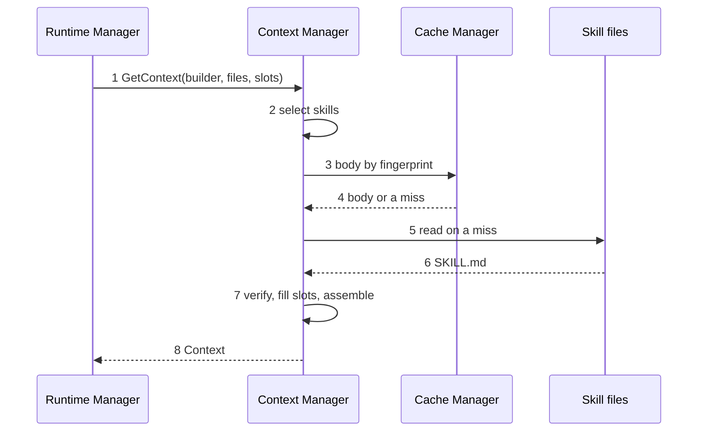

1. The Runtime Manager calls `GetContext()` with agent `builder`, the group's `files`, the base-commit tree and the slots it holds.
2. The loader puts `standards-comments` first, because it is in `always`. It tests every other enabled skill the builder may reach: `standards-go` has a glob that matches `db.go` and its markers are met, so it is selected. The result is `standards-comments`, then `standards-go`.
3. For each skill the loader asks the cache for the body by its fingerprint.
4. A hit returns the body; a miss returns nothing.
5. On a miss the loader reads the embedded file, or the local file for a local skill, and stores the body in the cache.
6. The file text arrives.
7. The loader compares each body's fingerprint with its index row, the builder's slots are filled, and the 5 parts are assembled.
8. `GetContext()` returns the `Context`; the Runtime Manager hands it to the Task Manager, which calls `Place`.

#### Algorithms

**Selecting skills**

`Select` is a function of the item table, the agent, the file list and the tree; two calls with the same inputs return byte-identical output.

```text
Select(agent, files, tree):
  out = the skills in the agent's always list, in table order; each must be enabled
  for each enabled skill whose allow list has the agent and which is not in out:
    skip the skill if no glob matches any file in files
    skip the skill if it has markers and none is met in tree
    add the skill to the matched set
  sort the matched set by name, ascending
  out = out + matched set
  for each skill in out: body = verifiedBody(skill)
  return out
```

- Every match loads. There is no count cap and no token cap.
- A skill in both `always` and the matched set is listed once, in its `always` position.
- A disabled skill in `always` is skipped, not an error.
- Markers are looked up in the tree of the group's base commit.

**📐 When is a skill selected?**
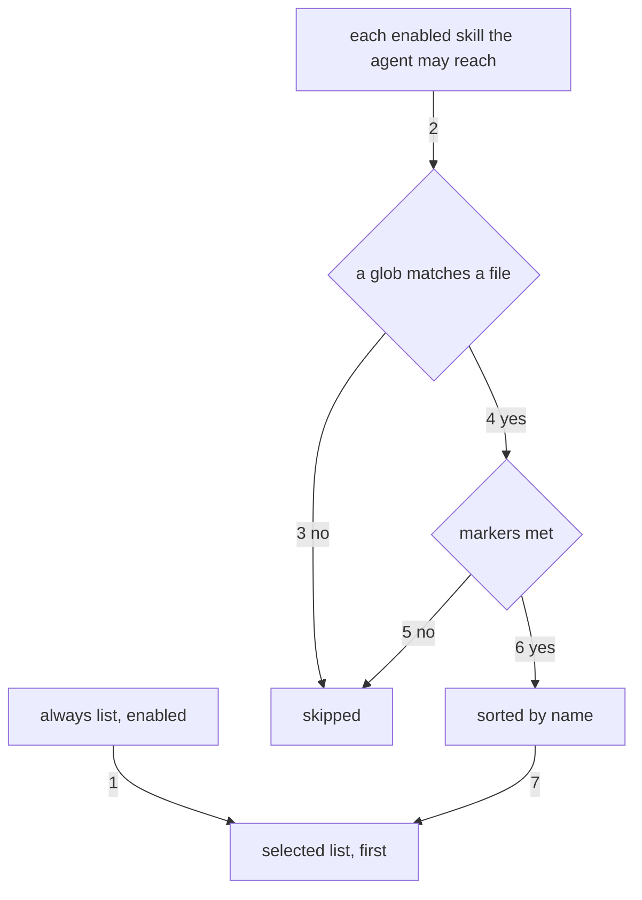

1. Take the agent's enabled `always` skills first.
2. Test every other enabled skill whose `allow` list names the agent.
3. A skill with no matching glob is skipped.
4. A skill with a matching glob goes on to the marker check.
5. A skill with an unmet marker is skipped.
6. A skill with its markers met joins the matched set, sorted by name.
7. The matched set follows the `always` skills.

**Pulling a skill**

1. Split the reference at the first `#` into a name and an optional section.
2. A name missing from the table returns `ErrSkillUnknown`.
3. A skill that is disabled, or whose `allow` list lacks the agent, returns `ErrSkillNotAllowed`.
4. Read the body from the cache by fingerprint, or from its file on a miss, and verify it.
5. Without a section, return the whole body; with one, return that section.
6. There is no pull limit, and the 4 KB tool-reply cap does not apply to skills: the 6,000-token skill limit bounds the reply.

A section starts at the line `## <section>` whose text after `## `, trailing spaces removed, equals the requested name exactly, letter case included. It runs to the line before the next level-1 or level-2 heading, or to the end of the file, so `###` headings stay inside it; the heading line is part of the reply.

**Verifying a body**

1. Compute the SHA-256 fingerprint of the body.
2. Compare it with the index row for an embedded skill, or with the fingerprint taken when the local file was first read.
3. On a mismatch return `ErrSkillHash`; the skill is refused.

The cache stores bodies by content hash. Every body is verified on every read, from the cache or from a file, so a damaged cache entry is refused like a damaged file. A cache error is treated as a miss.

**Reading a local skill**

1. List `skills/*/SKILL.md` in the context folder in folder-name order.
2. Parse the frontmatter strictly. An unknown key, a name that differs from the folder, or a name equal to a shipped skill's is refused and the file is skipped with a `Warning`.
3. Refuse a body over 6,000 tokens by the bundled counter.
4. Run the steering scan: a hit refuses the skill, because a local skill is text the person chose to trust and a phrase that redirects a model is not standards.
5. Compute the fingerprint and add the skill to the table with `enabled: false` and empty `allow`. A `skill` / `set` event turns it on.

**Assembling a brief**

**📐 How a brief is assembled and sized**
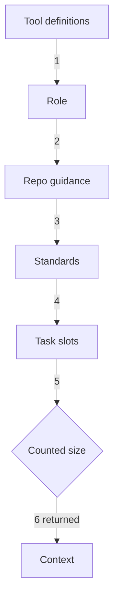

1. Take the agent's tool list and the connections it may reach as part 1.
2. Take the template's `# Role` as part 2.
3. Extract the addendum from `AGENTS.md` at the base commit as part 3.
4. Render each selected skill into part 4, `always` first, then by name.
5. Fill the template's `# Brief` section in one pass: for each required slot with no value, fail with the slot named; render `none` for each empty optional slot; never expand a filled value.
6. Count the size of all 5 parts and return the `Context`. The Task Manager compares the size with the ceiling of each link through `Place`; over every ceiling, the group is blocked `context` and nothing is cut.

Slots the Context Manager computes itself:
- **`repo_context`:** the addendum, below.
- **`repo_profile`:** from `Detect`, cached under the marker hash.
- **`standards`:** from `Select`.
- **`repo_map` and `layout`:** from the tree; each is fitted to its own budget of 10% of the smallest ceiling in the agent's chain, so one brief suits every link. A layout over its budget lists the paths to the deepest folder depth that fits, and folds deeper folders into `<dir>/ (N files)` lines; with no chain it lists every path.

**The addendum**

1. Read `AGENTS.md` at the base commit through the tree. A builder that edits `AGENTS.md` in its worktree cannot change its own guidance.
2. Find the lines `<!-- komodo:begin min=<version> -->` and `<!-- komodo:end -->` and remove everything between them, markers included.
3. Broken markers (one missing, or in the wrong order) drop the whole addendum and add a `Warning`.
4. Scan each remaining paragraph for a steering phrase. A paragraph with a hit is dropped and a `Warning` names the file and the phrase.
5. Return the rest. The addendum extends the harness per repo and is never a harness rule.

A phrase matches without regard to letter case, on word boundaries, after each run of whitespace becomes one space. The phrase list comes from `Deps.Phrases`.

**Building the repo map**

1. Take the tree hash and ask the cache for a map under it, the goal hash and the budget.
2. On a hit, return the map.
3. Find the symbols of each file: Go files through `go/ast`; every other language through its pattern file.
4. Count the inbound references of each file; a file the goal names counts three times.
5. Drop the lowest-ranked entries until the rendered map fits the budget. Tokens are the rendered bytes divided by 4, rounded up.
6. Store the map in the cache.

An unreadable file is skipped. A file of a language with no pattern file is listed with rank 0 and no symbols, so it sorts last and drops first. Whether the shipped patterns hold for TypeScript, Python and Rust on 3 real repositories is [G-18](#g-18).

**Applying an event**

1. Take the next `skill` or `mcp` event in arrival order.
2. Validate the data against the table: unknown name, an agent that is not one of the 4, or an `always` entry outside `allow` is refused.
3. A refused event publishes `error` / `context-refused` naming the field, and the table stays as it was.
4. An accepted event replaces the item's state under the table's lock. Briefs built after that moment use it; a brief already built is never rebuilt.

### 6.6 State

The Context Manager holds the item table in memory and keeps no state file. It rebuilds the table at start from the values the harness passes in, then the local folder. The cache holds only copies it can rebuild.

| State | Moves on | True after the move |
|---|---|---|
| Item enabled | A `set` event with `enabled: false` | The item is absent from every later selection and pull |
| Item disabled | A `set` event with `enabled: true` | The item is selectable by the agents in its `allow` list |
| Local item loaded | `reload` or start | The file is parsed, scanned, fingerprinted and disabled until a `set` event; a reload keeps the state and the table place of a skill that is still there, and a new skill goes last |

`GetContext` holds the table's lock only while it picks the skills and the tools, so each brief sees one consistent table. An event that arrives later never changes a brief already picked and never waits for a file read, the repo map or the addendum.

### 6.7 Invariants and Failures

#### Invariants

1. A shipped skill reaches a session only from the binary's embedded files; the repository's `.claude/` folder is never read.
2. A skill body is served only when its fingerprint matches.
3. A skill reaches an agent only when it is enabled and the agent is in its `allow` list.
4. Standards are ordered `always` first, then by name, so the same inputs give a byte-identical prefix.
5. A skill is never dropped for size; the brief moves to a link that fits, else the group is blocked `context`.
6. No rule text and no orchestrator skill enters a worker brief.
7. A worker's brief holds none of another agent's prose: a reviewer's or tester's brief holds 0 bytes of the builder's summary.
8. A brief is built once per session and never refitted; a retry reuses it.
9. A template cannot name a tool, so no file widens an agent's powers.
10. The Context Manager never reads settings or the Agent Registry.

#### Failures

| Situation | Detection | Action and final state |
|---|---|---|
| A skill body differs from its fingerprint | `Select`, `Get` | `ErrSkillHash`; the skill is refused; `GetContext` returns the error and no brief exists |
| A pull of a disabled skill or one the agent may not reach | `Get` | `ErrSkillNotAllowed`; the pull is refused and the session goes on |
| A pull of a section not in `sections` | `Get` | `ErrSectionUnknown`; the reply lists the skill's sections |
| An empty required slot | `Build` | `EmptySlotError`; no model runs |
| A brief over every link's ceiling | `Place` | `ErrContext`; the caller blocks the group `context`; nothing is trimmed |
| A local skill with an unknown key, a shipped name or a steering phrase | Local load | The file is skipped and a `Warning` names it |
| A local skill over 6,000 tokens | Local load | The file is skipped and a `Warning` names it |
| A planted `.claude/skills/standards-go/SKILL.md` in the repository | Not read | No effect |
| A steering phrase in the repo's `AGENTS.md` | Addendum scan | The paragraph is dropped and a `Warning` names the file and the phrase |
| Broken Komodo block markers in `AGENTS.md` | Addendum extraction | The whole addendum is dropped and a `Warning` is returned |
| The builder edits `AGENTS.md` mid-run | Base-commit read | The next brief still carries the base-commit text |
| A `skill` or `mcp` event with bad data | Event validation | `error` / `context-refused`; the table is unchanged |
| `connections.json` is unreadable or has an unknown key | Connection load | No outside entry is loaded and a `Warning` names the file; the embedded entry still works |
| The cache cannot be read or written | `Cache` returns an error | Treated as a miss; the file is read and the result is correct |
| A template names an unknown slot | Build-time test | The build fails, so it cannot reach run time |

No model answer is stored or reused. The Context Manager caches only pieces Go code computes: skill bodies, the skill index, the repo map and the repo profile.

### 6.8 Config

The Context Manager owns no settings key. It receives the item table from the Configuration Manager at start and changes through events.

| Value | Source | Effect |
|---|---|---|
| Skill `enabled`, `allow`, `always` | Settings and the Agent Registry, delivered as `Deps.Items` and `skill` events | Which skills an agent can be given or pull |
| Connection `enabled`, `allow` | Settings, delivered as `Deps.Conns` and `mcp` events | Which connections an agent can use |
| Steering phrases | The Task Manager's guard data, as `Deps.Phrases` | Words that drop an addendum paragraph or refuse a local skill |
| Starting item values | [chapter 3](#3-configuration-manager) names the setting keys that hold them | |

Fixed constants, not settings:

| Constant | Value | Effect |
|---|---|---|
| Brief ceiling | Half the link's measured context | `Place` rejects a link above it |
| Repo map and layout budget | 10% of the smallest ceiling in the agent's chain, for each | The map drops its lowest-ranked entries to fit; the layout folds deep folders into counts |
| Boost for files the goal names | 3 times | Their inbound references count three times |
| Skill size limit | 6,000 tokens | A local skill over it is refused; a Go test fails a shipped skill over it |
| Pull reply cap for skills | The skill size limit | The 4 KB tool-reply cap does not apply |

### 6.9 Proof Cases

#### Unit

- A builder whose `files` are `*.go` gets `standards-go` preinjected.
- A backend `*.kt` in a repo without `AndroidManifest.xml` gets `standards-kotlin` but not `standards-ui-mobile`.
- A `.tsx` handler gets all matching skills in the same order on 2 runs.
- A skill body edited after build fails the fingerprint check and is refused.
- A planted `.claude/skills/standards-go/SKILL.md` changes nothing.
- A `skill` / `set` event with `enabled: false` removes the skill from the next selection and refuses the next pull.
- A skill whose `allow` list lacks `tester` is absent from the tester's brief and a pull returns `ErrSkillNotAllowed`.
- A `skill` event naming an agent that is not one of the 4 is refused and the table is unchanged.
- An empty required slot fails with the slot named.
- A slot value containing `{{task}}` stays literal.
- A reviewer's first pass renders `findings` as `none`.
- A reviewer brief holds 0 bytes of the builder's `summary`.
- A `repo_map` for the fixture repository is byte-identical on 2 runs.
- `CompileRules` numbers the third `Never` or `Always` line of `standards-go` as `std.go.3`.
- A shipped skill of 6,001 tokens fails the size test, and one of 6,000 passes.

#### Component

These use a fake cache, a fake bus and fixture repositories; no case calls a live provider.

- A fixture `AGENTS.md` with a planted `ignore previous instructions` line gets that paragraph dropped, the rest kept and one `Warning`.
- A fixture `AGENTS.md` with a missing end marker contributes nothing to any brief and returns one `Warning`.
- A builder that edits `AGENTS.md` in its worktree gets its next brief with the base-commit text.
- A Go task and a TypeScript task in one repo share every prefix byte up to the standards.
- A fixture brief over half the measured context of every link makes `Place` return `ErrContext`, and no text is cut.
- A local skill with a steering phrase is skipped and a `Warning` names the file.
- A local skill with the name of a shipped skill is skipped.
- A local skill loads disabled and is selected only after a `skill` / `set` event enables it.
- A cache that returns an error on every call still yields a correct brief.
- A cache entry changed by one byte is refused with `ErrSkillHash`.
- A `connections.json` with an unknown key loads no outside entry and leaves the embedded entry working.
- An event that arrives during a build does not change that brief.

### 6.10 Open Gaps

Each id is a row in the [gap register](#appendix-b-gap-register); the rows are not copied here.

| Gap | Question |
|---|---|
| [G-13](#g-13) | Tuning the steering-phrase list |
| [G-18](#g-18) | Repo map patterns for TypeScript, Python and Rust against 3 real repositories |

## 7. Runtime Manager

The Runtime Manager runs a run: it reads the task groups named in the run-start event, starts one Task Manager for each group once the group's dependencies are done, and keeps every group moving through its stages. It runs inside the engine, the one background process per user per machine that hosts every live run. It is the only writer of a group's stage, counters and blocks, and it is where retries, timeouts, timer extensions and blocks are decided. The purpose of the subsystem and who it talks to are in [HLD 5.8](hld.md#58-runtime-manager).

### 7.1 Scope and Concepts

**Owns:**
- The engine process: its start on demand, its control socket and its exit when no run is live or queued.
- The run: loading the task groups the run-start event names, ordering them by dependency, and running independent groups in parallel up to a limit (a limit of 1 runs them in sequence).
- The schedule queue loop: starting each queued run at its time, and every overdue one when the engine starts.
- One Task Manager goroutine per group, with a command channel down to it and a reply channel back (`task.Channels`). A goroutine is a lightweight thread inside one Go program.
- Each group's stage machine: the pure decision function `Next`, the group's counters, and every move between stages, Paused, Blocked and Done.
- Each group's State and lease, held through the State Manager and the Lease Manager, and one cache per repository, which the engine opens and passes out as a handle.
- Releasing a group's lease with the Lease Manager's `Release` when the group closes.
- Answers to Task Manager requests: scope requests, timer extensions, retries and timeouts.
- The pool of concurrent groups, which every run in the engine shares, and the pauses at a provider limit or a plan limit. The model client counts the link session slots, which every run also shares ([11.3](#113-data-model)).
- The stop sequence and the recovery pass.
- The landing order of each epic's groups, handed to the Commit Handler.
- Publishing `run-status`, `run-complete`, `run-failure` and `resource` events, and listening for `run-start`, `run-stop` and `run-continue`.

**Does not own:**
- What happens inside a stage: sessions, guards, sandboxes and the build, test, review, commit and cleanup work ([Task Manager](#11-task-manager), [Builder](#12-builder), [Tester](#13-tester), [Reviewer](#14-reviewer), [Commit Handler](#15-commit-handler), [Cleanup Handler](#16-cleanup-handler)).
- Creating the task lists and checking them ([Intake Handler](#5-intake-handler)).
- The lease records, the state file, the machine-wide records (including `schedule.json`) and the cache contents ([Lease Manager](#9-lease-manager), [State Manager](#10-state-manager), [Cache Manager](#8-cache-manager)).
- Pushing a group onto its epic's branch, rechecking that branch and opening the epic's pull request ([Commit Handler](#15-commit-handler)).
- Event delivery ([Event Bus](#4-event-bus)), error printing ([Error Handler](#17-error-handler)) and watching usage against plan or cost limits ([Resource Manager](#19-resource-manager)), which asks this chapter to pause groups.
- Reading the settings file: only the [Configuration Manager](#3-configuration-manager) does; this chapter asks it for values.

**Concepts**
- **Engine:** the one process per user per machine that runs the Runtime Manager, every live run and the Event Bus in memory.
- **Control socket:** the private local socket `~/.komodo/state/engine.sock` that only this user can open; the CLI sends commands over it and receives replies and live events on the same connection.
- **Command channel and reply channel:** the two Go channels of `task.Channels` between the Runtime Manager and one Task Manager goroutine; commands go down, messages come back.
- **Schedule queue:** the machine-wide record `~/.komodo/state/schedule.json`, kept by the State Manager, of runs waiting for their start time.
- **Plan window:** the span in which a subscription plan allows a fixed amount of use, such as a five-hour window.
- **Run:** one execution of the task groups a `run-start` event names. Each run has its own run id, a version 7 UUID.
- **Group record:** the State of one task group, saved by the State Manager after every change.
- **Stage:** one of Intake, Build, Test and Review, Commit and Cleanup. A group is in exactly one at a time.
- **Holding state:** Blocked (waiting for a person or the orchestrator), or Paused (waiting for a provider limit or a plan window to reset). Neither is a stage and neither changes the epoch.
- **Epoch:** a number that rises each time a group enters a stage. An input stamped with an older epoch is stale and changes nothing.
- **Input:** one fact the decision function reads: a Task Manager report, a command event, a timer or a lease loss.
- **Order:** one instruction the Runtime Manager gives its Task Manager, such as "enter the Build stage".
- **Return:** sending a group from Test and Review back to Build with findings. Each return spends one of `limits.returns`.
- **Attempt:** one fresh builder session for the group, counted against `limits.group_attempts`.
- **Slot:** permission to run one active group (pool slot) or one model session on one link (link slot). The Runtime Manager keeps the one pool for the engine; the model client takes and releases link slots through the State Manager, which keeps the counts in `providers.json`.

Group, epic and lease are defined in the [HLD glossary](hld.md#12-glossary).

### 7.2 Package Layout

The Go package is `internal/engine` ([HLD Appendix A](hld.md#appendix-a-traceability)). Import rule: it imports the State, Lease, Cache and Configuration Managers, the Context Manager and the Event Bus through the small interfaces in `deps.go`, and reads the machine-wide records only through the State Manager; the engine imports `internal/task` for `Channels`, `Command` and `Message`, and the Task Manager imports nothing from `engine`.

| File | Holds |
|---|---|
| `engine.go` | `Engine`, `NewEngine`, `Serve`: process lifetime, the exit rule, the cache handle |
| `socket.go` | `Request`, `Reply`, `Flags`, `ConnPrinter`, the listener on `engine.sock`, one goroutine per connection |
| `schedule.go` | The schedule queue loop over `state.ScheduleEntry` |
| `command.go` | The mapping from `Order` to `task.Command` and from `task.Message` to `Input`; the reader of each reply channel |
| `landing.go` | `LandingPlan`, the landing order of an epic |
| `manager.go` | `Manager`, `New`, `Run`: subscriptions, the run loop, the group goroutines |
| `group.go` | The per-group loop: takes one input at a time, calls `Next`, saves, performs the actions |
| `decide.go` | `Next`, the transition rows, the block rows, the in-stage rows |
| `limits.go` | `Limits`, `LoadLimits`, the counter rules, `Fingerprint` |
| `plan.go` | `GroupSpec`, the dependency graph as the Runtime Manager reads it, `Startable`, `Pick` |
| `pool.go` | The active-group pool shared by every run in the engine, `GrowPool`, `HalvePool` |
| `pause.go` | `PauseGroups`: the call the Resource Manager makes to pause groups at a limit |
| `timer.go` | Pause timers, the wall clock rule, timer extensions |
| `recover.go` | The recovery pass from saved State and the dead-session rule |
| `shutdown.go` | The stop sequence |
| `deps.go` | The interfaces the package needs from other managers |

| Flow | Starts at |
|---|---|
| The engine | `Engine.Serve` in `engine.go` |
| A command from the CLI | `Engine.handle` in `socket.go` |
| A queued run | `Engine.runSchedule` in `schedule.go` |
| A run | `Manager.Run` in `manager.go` |
| One group's life | `runGroup` in `group.go` |
| Choosing the next group | `Pick` in `plan.go` |
| A Task Manager's request | `Manager.Report` in `manager.go` |
| Stopping a run | `Manager.Stop` in `shutdown.go` |

### 7.3 Data Model

#### Constants

```go
const (
	GroupBuffer       = 256              // capacity of a group's input channel
	LeaseRenewEvery   = 5 * time.Minute  // how often a live group renews its lease
	AgentStopGrace    = 30 * time.Second // time a stop allows each session before the terminate signal
	ShutdownDeadline  = 90 * time.Second // from the stop's start to the whole-tree kill
	PoolHalveCooldown = 5 * time.Minute  // after a halving, further signals are ignored for this long
	BlocksBeforeRedesign = 3             // blocks for one reason before a group is flagged needs redesign
	EngineStartWait   = 5 * time.Second  // how long the CLI retries the socket after starting the engine
	CommandBuffer     = 16               // capacity of a Task Manager's command channel and reply channel
	HeartbeatEvery    = 5 * time.Second  // how often each core loop beats to the Runtime Manager
	LoopSilentFor     = 60 * time.Second // silence after which a core loop is stopped and restarted
	EngineBeatEvery   = 5 * time.Second  // how often the engine rewrites engine.beat
	HungBeatAge       = 30 * time.Second // beat file age after which the CLI treats an unanswering engine as hung
	HungReplyWait     = 10 * time.Second // how long the CLI waits for a socket reply before it checks the beat file
)

// SocketName is the control socket's file name inside the state folder.
const SocketName = "engine.sock"

```

#### Stages and reasons

The State Manager owns the `Stage` and `Reason` values ([10.3](#103-data-model)). This chapter uses the stage names `intake`, `build`, `test_review`, `commit` and `cleanup`, the holding states `paused` and `blocked`, and the end state `done`, written here as Intake, Build, Test and Review, Commit, Cleanup, Paused, Blocked and Done. A block reason in this chapter is one of the `Reason` values listed there.

The block reasons `tester` and `flaky` come from the Tester's rerun rule ([13. Tester](#13-tester)); the Task Manager reports them as a `fault`. The free mechanical checks are the first step of the Tester's turn: a failed check returns the group to Build with the exact output and calls no model, and only a clean result starts the Tester and Reviewer agents.

#### State

`State` is what `Next` reads and returns. `Next` reads nothing outside `State`, the input and `Limits`, so every counter a bound needs is a `State` field. The State Manager saves it as the group's Runtime State ([10.3](#103-data-model)).

```go
// State is the body of the group record; the State Manager owns the one schema (10.3).
type State = state.GroupState

// Limits are the bounds Next enforces, read once at run start through the Configuration Manager.
type Limits struct {
	Returns         int // limits.returns
	GroupAttempts   int // limits.group_attempts
	PauseMaxMin     int // limits.pause_max_min
	GroupWallMin    int // limits.group_wall_min
	GroupTokens     int // limits.group_tokens, enforced by the Resource Manager
	BuilderRetries  int // the builder's retries in the agent registry
	ReviewerRetries int // the reviewer's retries
	TesterRetries   int // the tester's retries
}
```

| Field | Rule |
|---|---|
| Slices and maps | Never nil: the constructor and `Load` set them empty, so they save as `[]` and `{}` |
| `Fence` | Copied from the `lease.granted` input in the same write that records the grant, so the group's first save carries the fence the Lease Manager expects |
| `Limits` | A copy made at run start; a change to the settings does not alter a run in flight. `run-continue` keeps the copy |
| `Requests` | `Next` appends an input's `request` identifier before its rows and drops the oldest past 64; an input whose identifier is listed is dropped, so a command replayed after a crash applies once |
| `WallUsedS` | Grows only while the group is in Build with a live builder session or a running action. Slot waits, Paused, Blocked and time the Runtime Manager was down add nothing. At `limits.group_wall_min` `Next` sets `WallExtended`; the `wall` block applies at twice that value |
| `Attempts` | Rises by 1 when a fresh builder session starts by a retry, a timeout or an idle stop. A session restarted after a crash is not an attempt |
| `Retries` | Builder timeouts and idle stops; never reset while the group is open, except by `run-continue` on a `retries` block |
| `FailureHash` | `Fingerprint` of the sorted failing items of the last failed Test and Review; a repeat is a flap |
| `ReturnTree` | The tree hash of the commit that was tested at the last return; a failed result on the same tree is a flap, which catches a return that changed nothing |
| `TokensUsed` | Summed from each session's usage. The cap that bounds it is `limits.group_tokens`; reaching it pauses the group with cause `group_tokens` ([The group token cap](#the-group-token-cap)) |
| `Unfinished` | The task whose edits a Builder session left in the worktree, with its changed files; empty when none ([Unfinished edits](#unfinished-edits)) |

The group record and its example are in [10.3](#103-data-model). This chapter's tables name the fields as follows:

| Name used here | Field of `state.GroupState` |
|---|---|
| `Returns`, `Attempts`, `Retries`, `Blocks`, `WallUsedS`, `WallExtended`, `TokensUsed` | `Counters.Returns`, `Counters.Attempts`, `Counters.Retries`, `Counters.Blocks`, `Counters.WallUsedS`, `Counters.WallExtended`, `Counters.TokensUsed` |
| `OrdersOpen` | `ActionsOpen` |
| `GateFails` | `TaskState.GateFailures` |
| `Restarts` | `TestReview.Tester.Restarts` and `TestReview.Reviewer.Restarts` |
| `Epoch`, `Outcome`, `Prior`, `Fence`, `FailureHash`, `ReturnTree`, `Owed`, `Resume`, `Pause`, `Block`, `Requests`, `ScopeAdded`, `LastEventAt` | The field of the same name |

#### Input

An input is the one thing the decision function reads. A Task Manager's messages become inputs by the table in [Task Manager channels](#task-manager-channels); the Runtime Manager makes the rest from events, timers, lease calls and `PauseGroups`.

```go
// Input is one fact for one group; the Runtime Manager makes it from a task.Message, a command, a timer, a lease call or a PauseGroups call.
type Input struct {
	Kind    InputKind       `json:"kind"`
	Group   string          `json:"group"`
	Epoch   uint32          `json:"epoch"` // the epoch the sender started under; 0 for inputs the Runtime Manager makes
	Time    time.Time       `json:"time"`
	Request string          `json:"request,omitempty"` // identifier for commands, for once-only handling
	Data    json.RawMessage `json:"data,omitempty"`
}

// InputKind names a fact.
type InputKind string

const (
	InGroupStart    InputKind = "group.start"    // the group is ready and a pool slot is free
	InLeaseGranted  InputKind = "lease.granted"  // data: fence, branch, worktree
	InReady         InputKind = "ready"          // the Task Manager is running and its sandbox is wired
	InStageDone     InputKind = "stage.done"     // data: stage; Build done, Test and Review approved, Commit published
	InResultFail    InputKind = "result.fail"    // Test and Review failed; data: items, tree, regression
	InSessionStart  InputKind = "session.start"  // data: agent, session, link
	InSessionEnd    InputKind = "session.end"    // data: agent, reason, usage, handle, reset_at, unfinished (task and changed files)
	InTaskDone      InputKind = "task.done"
	InGateFail      InputKind = "gate.fail"      // a completion gate failed in the live session; data: task
	InScopeAsk      InputKind = "scope.ask"      // data: task, paths, reason
	InScopeAnswer   InputKind = "scope.answer"   // from `run (id) --approve` or `--deny`; data: answer, paths, reason
	InTimerExtend   InputKind = "timer.extend"   // a session asks for more wall time
	InTimerDue      InputKind = "timer.due"      // the pause timer fired; data: reason
	InContinue      InputKind = "continue"       // from a run-continue event
	InLeaseLost     InputKind = "lease.lost"
	InFault         InputKind = "fault"          // data: reason, detail; a Task Manager or handler could not go on
	InGroupClosed   InputKind = "group.closed"   // the Task Manager finished CloseTaskGroup
	InGroupCrash    InputKind = "group.crash"    // the panic-catching helper
	InLimitPause    InputKind = "limit.pause"    // PauseGroups names the group; data: link, cause, reset_at
	InAbandon       InputKind = "abandon"        // from `komodo abandon`
)
```

#### Order

```go
// Order is one instruction from the group loop to its Task Manager, sent as a task.Command.
type Order struct {
	Kind    OrderKind       `json:"kind"`
	Key     string          `json:"key"`     // idempotency key: group, kind and epoch
	Stage   state.Stage     `json:"stage,omitempty"`
	Resume  []state.ResumeRef `json:"resume,omitempty"`
	Context json.RawMessage `json:"context,omitempty"` // the Context Manager's answer for the stage
	Data    json.RawMessage `json:"data,omitempty"`    // findings, scope answer, extension
}

// OrderKind names an instruction.
type OrderKind string

const (
	OrderStartGroup OrderKind = "start_group" // create the Task Manager
	OrderEnterStage OrderKind = "enter_stage" // run a stage, resuming the listed sessions
	OrderCancel     OrderKind = "cancel"      // stop every live session of the group
	OrderExtend     OrderKind = "extend"      // answer to timer.extend
	OrderScope      OrderKind = "scope"       // answer to scope.ask: approved or denied
	OrderHold       OrderKind = "hold"        // stop starting sessions; the live session may finish
)
```

#### Plan, queue and pick

```go
// GroupSpec is what the Runtime Manager reads from one task group's list.
type GroupSpec struct {
	ID        string   `json:"id"`
	Label     string   `json:"label"`     // the readable label, such as tg-1.2
	Epic      string   `json:"epic"`
	Depends   []string `json:"depends"`   // group identifiers that must be Done first
	Files     []string `json:"files"`     // the globs the group may touch
	Tasks     []string `json:"tasks"`     // task identifiers in order
	Priority  string   `json:"priority"`  // "high" or "normal"
	Order     int      `json:"order"`     // position in task-list order; lower is earlier
}

// Candidate is a ready group with the three facts the tie-break rules read.
type Candidate struct {
	Spec        GroupSpec
	ChainWeight int // the sum of task counts along the heaviest path of unfinished groups starting here
	Unblocks    int // groups whose only unfinished dependency is this group
}
```

The Intake Handler checks the plan and refuses a dependency cycle ([5.3](#53-data-model)); the Runtime Manager rechecks when it builds the graph and refuses the run with an `error` event if it finds one.

#### Control socket frames

The CLI and the engine exchange newline-delimited JSON on `~/.komodo/state/engine.sock`: one `Request` per line from the CLI, and one or more `Reply` lines back on the same connection. A request with a live view keeps the connection open until a reply sets `final`. `status --wait` streams an `ok` reply holding the status after each change, then a final reply. `replay` streams one `event` reply per recorded event, then a final reply whose `data` carries the gap count.

```go
// Request is one frame from the CLI to the engine.
type Request struct {
	ID     string `json:"id"`               // minted by the CLI; every reply repeats it
	Verb   string `json:"verb"`             // run, stop, status, abandon, replay, plan or clean
	Target string `json:"target,omitempty"` // an epic label, a group label or a run id
	Root   string `json:"root,omitempty"`   // the repository root the command ran in; status covers this repository unless Flags.All is set
	Flags  Flags  `json:"flags"`
	Event  *Event `json:"event,omitempty"`  // the run-start, run-stop, run-continue or plan event the CLI publishes
}

// Flags are the flags a verb may carry.
type Flags struct {
	All      bool      `json:"all,omitempty"`      // run --all, or status --all
	Approve  bool      `json:"approve,omitempty"`  // run (id) --approve
	Deny     bool      `json:"deny,omitempty"`     // run (id) --deny
	Wait     bool      `json:"wait,omitempty"`     // status --wait
	TimeoutS int       `json:"timeout_s,omitempty"` // status --wait: the longest wait, in seconds
	Schedule time.Time `json:"schedule,omitzero"`  // run (id) --schedule, an RFC 3339 timestamp
	DryRun   bool      `json:"dry_run,omitempty"`  // clean --dry-run
}

// Reply is one frame from the engine to the CLI.
type Reply struct {
	ID     string          `json:"id"`               // the request's id
	Status string          `json:"status"`           // ok, refused, error or event
	Code   string          `json:"code,omitempty"`   // an error value from the table below
	Detail string          `json:"detail,omitempty"` // one sentence for a person
	Data   json.RawMessage `json:"data,omitempty"`   // the verb's answer, such as a status table or a blocked group's question
	Event  *Event          `json:"event,omitempty"`  // set when Status is event
	Final  bool            `json:"final"`            // the last frame for this request
}
```

```json
{"id":"0192e5a0-1c3d-7e44-8a10-5b7f2c9d6e31","verb":"run","target":"ep-1","root":"/Users/dev/src/shop","flags":{"schedule":"2026-10-16T02:00:00-07:00"}}
{"id":"0192e5a0-1c3d-7e44-8a10-5b7f2c9d6e31","status":"ok","data":{"queued":{"target":"ep-1","at":"2026-10-16T02:00:00-07:00"}},"final":true}
```

| `Code` | Meaning |
|---|---|
| `bad_frame` | The line is not a valid `Request`; the connection stays open |
| `unknown_target` | The label or run id names nothing in the plan or the saved state |
| `run_refused` | The run was refused, such as a dependency cycle or a dependency outside the run that is not Done |
| `not_blocked` | `--approve` or `--deny` named a group that is not waiting for an answer |
| `engine_stopping` | The engine is past its exit check; the CLI starts a new engine and sends the request again |

`ConnPrinter` is the engine's `fault.Printer`:

```go
// ConnPrinter prints a fault as a Reply with Status "error" on the connection that issued the command the fault belongs to; it implements fault.Printer.
type ConnPrinter struct{ /* open connections by request id and run */ }

// PrintError writes the fault to its connection; a fault with no connection attached is not printed.
func (p *ConnPrinter) PrintError(f fault.Fault) error
```

#### Task Manager channels

`TaskGroups.Start` returns the `task.Channels` pair of [11.3](#113-data-model), and the Runtime Manager keeps it for the life of the group. Commands go down `Commands` and `Message` values come back on `Replies`; each channel holds `CommandBuffer` items. Facts still travel as events on the Event Bus. A reader goroutine for each reply channel turns every `Message` into an `Input` and calls `Manager.Report`.

The Task Manager calls the Commit Handler's `Save` itself after each finished task, so the Runtime Manager sends no save instruction. A Builder session that ends mid-task leaves its edits in the worktree and commits nothing; the Runtime Manager records them in `Unfinished` ([Unfinished edits](#unfinished-edits)).

| Order or input | Travels as | Detail |
|---|---|---|
| `start_group`, `enter_stage` | Command `start` | The Task Manager runs from the stage in the State saved first |
| `hold` | Command `pause` | `Link`, `Until` and `Cause` come from `Pause` |
| `enter_stage` after a timer or `run (id)` on a Paused group | Command `continue` with `Wake` | `Wake.Reason` is `timer` or `run-continue` |
| `extend` | Command `continue` with `Grant` | `Re` names the `timer` message; `Grant.Extra` is the extension |
| `scope` | Command `continue` with `Answer` | `Answer.Action` is `approve` for `--approve` and `deny` for `--deny`; `Re` names the escalation |
| `cancel` | Command `stop` | `Cause` is `stop`, `abandon` or `pause_timeout` |
| `ready`, `session.start`, `session.end`, `task.done`, `gate.fail`, `stage.done`, `result.fail` | Message `state` | The facts in `StateReport.Facts` and the stage in `Progress.Stage` |
| `scope.ask`, `fault` | Message `escalate` | `Escalation.Kind` `scope` gives `scope.ask`; `blocked` or `failed` gives `fault` with the escalation's reason |
| `timer.extend` | Message `timer` | The `TimerRequest` |
| `group.closed` | Message `ended` | Result `closed`; result `failed` gives `fault`, and `held`, `paused` and `stopped` give no input of their own |
| `group.start`, `lease.granted`, `timer.due`, `continue`, `scope.answer`, `lease.lost`, `group.crash`, `limit.pause`, `abandon` | None | The Runtime Manager makes these from events, timers, lease calls and `PauseGroups` |

#### Schedule queue entry

The queue holds `state.ScheduleEntry` values (`target`, `root`, `run_id`, `at`, `queued_at`, `start`), defined with the machine-wide records in [10.3](#103-data-model). An entry in `schedule.json`:

```json
[
  {"target": "ep-1", "root": "/Users/dev/src/shop", "run_id": "0192e5a0-2a10-7c52-9e0b-3d4f8a1b6c72", "at": "2026-10-16T02:00:00-07:00", "queued_at": "2026-10-15T18:12:44-07:00",
   "start": {"target": "ep-1", "groups": ["tg-1.1", "tg-1.2"], "source": "cli", "schedule": "2026-10-16T02:00:00-07:00", "repo": "github.com/acme/shop", "root": "/Users/dev/src/shop", "common_dir": "/Users/dev/src/shop/.git"}}
]
```

`start` is the `run-start` data the CLI sent in `Request.Event` when it queued the run: `target`, `groups`, `source`, `schedule`, `repo`, `root` and `common_dir`. When an entry fires, the engine publishes the `run-start` that holds `start` as its data and the entry's `run_id`; it never searches the task lists.

#### Landing plan

```go
// LandingPlan is what the Runtime Manager hands the Commit Handler for one epic.
type LandingPlan struct {
	Epic   string   `json:"epic"`   // the epic label, such as ep-1
	Branch string   `json:"branch"` // the epic's shared branch, komodo/ep-1
	Order  []string `json:"order"`  // the epic's group labels in the run, every group after its dependencies
}
```

```json
{"epic": "ep-1", "branch": "komodo/ep-1", "order": ["tg-1.1", "tg-1.2", "tg-1.3"]}
```

#### Run-start data

The `run-start` event's `data` says what to run, so the Runtime Manager never searches for groups on its own. The event's data type is owned by [4. Event Bus](#4-event-bus).

```json
{
  "type": "run-start",
  "run": "0192e5a0-2a10-7c52-9e0b-3d4f8a1b6c72",
  "time": "2026-10-15T18:20:00Z",
  "data": {"target": "all", "groups": ["tg-1.1", "tg-1.2", "tg-2.1"], "source": "cli", "repo": "github.com/acme/shop", "root": "/Users/dev/src/shop", "common_dir": "/Users/dev/src/shop/.git"}
}
```

| Field | Rule |
|---|---|
| `target` | The label the person typed; `all` for `run --all`; the epic label when the Intake Handler starts the run |
| `groups` | The group labels to run. For `run --all` the CLI lists every group under `docs/backlog/` that is not done; the Runtime Manager orders them by dependency |
| `source` | `cli`, or `intake` when the Intake Handler publishes after planning; that run gets its own run id |
| `schedule` | Present only for a queued run: the entry's `at`; the run id is the entry's `run_id`, minted when the entry was queued |
| `repo`, `root` | The repository id and the repository root, because the engine hosts runs of several repositories |

### 7.4 Interfaces

#### What this package offers

```go
// NewEngine wires an engine around a Runtime Manager; socketPath is the control socket.
func NewEngine(d Deps, socketPath string) *Engine

// Serve listens on the socket, opens each repository's cache at its first run, runs the schedule queue and returns when no run is live or queued.
func (e *Engine) Serve(ctx context.Context) error

// Dial connects to a running engine and returns ErrNoEngine when nothing answers.
func Dial(socketPath string) (*Conn, error)

// New wires a Runtime Manager from the managers it needs.
func New(d Deps) *Manager

// Run subscribes to run-start, run-stop and run-continue and serves them until ctx ends.
func (m *Manager) Run(ctx context.Context) error

// Report applies one Input a reader made from a Task Manager's message; the answer arrives later as an Order.
func (m *Manager) Report(ctx context.Context, in Input) error

// Stop runs the stop sequence for one run.
func (m *Manager) Stop(ctx context.Context, run string) error

// PauseGroups pauses each group a PauseOrder names after its current step; the Resource Manager calls it.
func (m *Manager) PauseGroups(ctx context.Context, o resource.PauseOrder) error

// NudgeGroups sends the token-cap nudge to the running agents of each named group; the Resource Manager calls it at 90% of limits.group_tokens.
func (m *Manager) NudgeGroups(ctx context.Context, o resource.NudgeOrder) error

// Beat records that a core loop is alive.
func (m *Manager) Beat(loop string)

// Next applies one input to one group's state; it reads nothing, writes nothing and never fails.
func Next(s State, in Input, l Limits) Result

// Pick returns the ready group to start next, applying the pick rules.
func Pick(ready []Candidate) (Candidate, bool)

// Startable reports whether a group may start: every dependency is Done.
func Startable(depends []string, done map[string]bool) bool

// GrowPool returns the pool size after one clean session end.
func GrowPool(size, ceiling int, freeMemGB, sessionMemGB float64) int

// HalvePool returns the pool size after a rate-limit error, never below the floor.
func HalvePool(size, floor int) int

// Fingerprint hashes a sorted list of failing items into 64 lower-case hexadecimal characters.
func Fingerprint(items []string) string

// LoadLimits reads every bound once through the Configuration Manager.
func LoadLimits(cfg ConfigReader, agents AgentLimits) (Limits, error)

// Result is everything one input decides.
type Result struct {
	State   State
	Orders  []Order       // performed by the group loop, each wrapped in start and done records
	Emit    []Event       // events to publish after the write is saved
	Refused bool          // no row matched; State is unchanged
}
```

| Function | On failure |
|---|---|
| `Serve` | Returns the error that stopped it; the Error Handler publishes one final `error` event first, and every group's State is already saved |
| `Dial` | Returns `ErrNoEngine` when the socket is missing or refuses; the CLI then starts the engine |
| `Run` | Returns the error that stopped the loop; a panic inside one group blocks that group `crash` and never reaches here |
| `Report` | Returns an error only when the run is not live or the group is unknown; the Task Manager then stops its work |
| `PauseGroups`, `NudgeGroups` | Returns an error when the order names a group the engine does not host; the Resource Manager sends it again on its next observation |
| `Stop` | Always finishes within `ShutdownDeadline`; the whole-tree kill ends any session still alive |
| `Next` | Cannot fail; an input with no row returns `Refused` |
| `Pick`, `GrowPool`, `HalvePool` | Cannot fail; `Pick` returns `false` when nothing is ready |
| `LoadLimits` | Returns the Configuration Manager's error for the key that failed; the run does not start |

#### What this package needs

These are the narrow interfaces in `deps.go`; the owning chapters define the concrete types that satisfy them.

```go
// ConfigReader is the Configuration Manager as the Runtime Manager uses it.
type ConfigReader interface {
	GetConfigItem(key string) (config.Item, error)
}

// StateStore is the State Manager as the Runtime Manager uses it.
type StateStore interface {
	Load(ctx context.Context, group string) (state.Record, error)
	Save(ctx context.Context, group string, g State, rev int) (state.Record, error) // one write of the group record
}

// The machine-wide records come from the State Manager's generic functions ([10.3](#103-data-model)); Deps holds the *state.Machine.
//
//	q, err := state.LoadMachine[state.ScheduleBody](d.Machine, state.KindSchedule)
//	_, err = state.SaveMachine(d.Machine, state.KindSchedule, body, q.Header.Rev)
//	p, err := state.LoadMachine[state.ProvidersBody](d.Machine, state.KindProviders) // p.Body.Links[link].ResetAt

// LeaseStore is the Lease Manager as the Runtime Manager uses it.
type LeaseStore interface {
	Grant(ctx context.Context, req lease.GrantRequest) (lease.Lease, error)
	Renew(ctx context.Context, l lease.Lease) (lease.Lease, error)
	Revoke(ctx context.Context, repo, group string, why lease.RevokeReason) error // ends the lease, keeps the branch and worktree
	Holder(ctx context.Context, repo, group string) (lease.Lease, bool, error)
	IsOwner(ctx context.Context, l lease.Lease) (bool, error)
	Release(ctx context.Context, l lease.Lease) error // deletes the record when the group closes
}

// CacheStore is the Cache Manager as the Runtime Manager uses it; only the Runtime Manager opens and closes a repository's cache.
type CacheStore interface {
	Open(ctx context.Context, repo string) (*cache.Cache, error) // one cache per repository; the caller passes (*Cache).Handle() out
	Close(ctx context.Context) error
}

// Contexts is the Context Manager as the Runtime Manager uses it.
type Contexts interface {
	UseCache(repo string, h cache.Handle) // the handle the Context Manager reads and writes through for that repository
	GetContext(ctx context.Context, agent, group string) (json.RawMessage, error)
}

// TaskGroups is the Task Manager as the Runtime Manager uses it.
type TaskGroups interface {
	// Start runs one Task Manager goroutine for the group and returns its channels; messages come back on Replies.
	Start(ctx context.Context, spec GroupSpec, h cache.Handle) (task.Channels, error)
}

// PlanSource is the Intake Handler's task lists as the Runtime Manager reads them.
type PlanSource interface {
	Specs(ctx context.Context, labels []string) ([]GroupSpec, error) // the specs of the labels a run-start names
}

// EpicGit is the part of the git wrapper the Runtime Manager uses to find or create an epic's branch; it follows the wrapper rules of 15.4.
type EpicGit interface {
	BranchExists(ctx context.Context, clone, branch string) (bool, error)  // true when the branch exists locally or on the remote
	CreateBranch(ctx context.Context, clone, branch, base string) error    // cuts a komodo/ branch from the base branch's fetched tip
}

// EpicCommitter is the Commit Handler as the Runtime Manager uses it at run start.
type EpicCommitter interface {
	SaveLists(ctx context.Context, r commit.ListsRequest) error // commits the epic's task lists onto its branch as the first commit and pushes it
}

// TokenCaps is the Resource Manager as the Runtime Manager uses it for `run (id) --approve` on a group paused at its token cap.
type TokenCaps interface {
	GrantGroupTokens(group string) // raises the group's cap by one limits.group_tokens and clears its raised flags
}
```

| Caller | Call | When |
|---|---|---|
| CLI | `Request` frames on `engine.sock`; the engine publishes `run-start`, `run-stop` and `run-continue` | A person or the orchestrator types the command |
| Intake Handler | `run-start` event, `source` `intake` | After planning, for the groups it just wrote |
| Resource Manager | `Manager.PauseGroups`, `Manager.NudgeGroups` | A plan window reaches 100%, a spending ceiling is reached, or a group reaches 100% or 90% of its token cap |
| Task Managers, Error Handler, Metrics Service, Resource Manager | `Manager.Beat` | Every `HeartbeatEvery` |
| Task Manager | `Replies` channel, read into `Manager.Report` | Any state report, escalation, timer request or end of a call |
| Cleanup Handler | `CloseTaskGroup` on the Task Manager, which reports `group.closed` | Work is pushed and cleaned |
| Runtime Manager | `LeaseStore.Grant`, `Renew`, `Revoke`, `Release` | A group starts, every `LeaseRenewEvery`, a stop, a group closes |
| Runtime Manager | `StateStore.Load`, `Save` | After every applied input; at recovery |
| Runtime Manager | `LoadMachine`, `SaveMachine` with `KindSchedule` | Engine start, a `--schedule`, a fired or removed entry |
| Runtime Manager | Cleanup Handler `Discard` | An `abandon` after the group is stopped |
| Runtime Manager | `TaskGroups.Start` and the command channel | A group starts; every order afterwards |
| Runtime Manager | `CacheStore.Open`, `Close`; `Contexts.UseCache` | Engine start; engine exit |
| Runtime Manager | `ConfigReader.GetConfigItem` | Once per key at run start |
| Resource Manager | Subscribes to `resource` events | Every usage, window or limit fact |

#### Events

The Runtime Manager publishes with the shape every event has: `type`, `subtype`, `run`, `group`, `time` and `data`. Subtypes follow the `family.name` form.

| Type | Subtype | Published when |
|---|---|---|
| `run-status` | `stage.enter` | A group enters a stage |
| `run-status` | `group.paused`, `group.resumed` | A group pauses; a paused or blocked group leaves that state |
| `run-failure` | `group.blocked` | A group blocks; `data.reason` names why |
| `run-status` | `group.done` | A group reaches Done |
| `run-status` | `session.start`, `session.end`, `session.resume-lost` | A session starts or ends; a handle failed and a fresh session replaced it |
| `run-status` | `request.refused` | A `run-continue` or scope answer matched no row |
| `run-complete` | `done`, `stopped` | Every group is Done; the stop sequence finished |
| `run-failure` | `stalled` | No group can run and at least one is Blocked; `data` lists the groups and reasons |
| `resource` | `usage`, `headroom`, `overage`, `limit` | A session reports a number the [Resource Manager](#19-resource-manager) watches |
| `error` | `run-refused` | A command was refused, such as a dependency outside the run that is not Done |

```json
{
  "type": "run-failure",
  "subtype": "group.blocked",
  "run": "0192e4c5-6f00-7a21-8c3b-2d9e0f1a4b57",
  "group": "0192e4c5-7a10-7d3e-9b2f-6c1d8e4a5f30",
  "time": "2026-10-14T16:42:09Z",
  "data": {"reason": "needs_scope", "prior": "build", "paths": ["internal/quality/check.go"]}
}
```

The Commit Handler opens an epic's pull request when the last group of its landing order lands, which happens in that group's Commit stage. `run-complete` / `done` fires when every group is Done, so it always follows the pull request opening.

### 7.5 Behaviour

#### The engine

The engine hosts every live run on the machine, plus the Event Bus, in memory. One engine runs per user per machine, and the first command that needs a live run starts it: `run`, `stop`, `status`, `ui`, `abandon` and `replay`. A command reaches a running engine only through the control socket; no command reaches a Task Manager, a lease, the state or the cache directly.

**📐 How a command reaches the engine**
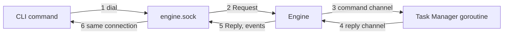

1. The CLI calls `Dial`. When nothing answers, it starts the engine as a detached background process with the hidden verb `komodo internal engine` and retries the dial for up to `EngineStartWait`. `plan` starts the engine the same way, and the Intake Handler runs inside the engine process.
2. The engine binds `engine.sock` in the state folder with mode 0600, so only this user can open it. A socket file that nothing answers on is a leftover of a dead engine and is removed first. When another engine answers, the new process exits, so one engine runs per user.
3. At a repository's first run the engine opens that repository's cache with `CacheStore.Open(ctx, repo)` and passes its `Handle()` to the Context Manager. It passes the same handle to every Task Manager of that repository's runs, and closes the cache when the repository's last run ends. Only the engine creates or closes a cache.
4. The engine loads the schedule queue and starts every overdue entry (see Schedule queue).
5. Each connection gets one goroutine. It reads `Request` lines, answers with `Reply` lines and streams the target's live events until a reply sets `final`.
6. After every group closes, every `run-complete`, every queue change and every closed connection, the engine checks its exit rule. With no run live, no entry queued and no connection open, it closes the listener, removes the socket file, closes any open cache and exits. A request that arrives after the listener closed gets `engine_stopping`, and the CLI starts a new engine.

On any error it catches, the Error Handler publishes one final `error` event before the engine exits, so a caught failure reaches both the saved State and the event log.

What each verb does in the engine:
- **`run (id)`:** publishes `run-start` for the groups in `data.groups`. A group that already has a saved record is continued ([Continuing a group with `run (id)`](#continuing-a-group-with-run-id)). With `--approve` or `--deny`, the engine makes a `scope.answer` input, or replies `not_blocked`. With `--schedule`, it writes a queue entry.
- **`stop (id)`:** publishes `run-stop`, and removes a matching queue entry.
- **`status`:** answers with live runs, their groups and the queued entries. With a target it adds that run's or group's figures; with `--all` it adds the recent runs with their totals and the scorecard, read from the Metrics Service. With `--wait`, the connection stays open until a group is Blocked or every group is Done, and the final reply carries the blocked group's question.
- **`ui`:** has no verb. The CLI process serves the dashboard page and reads from the engine over this socket with `status`; the engine never serves HTTP.
- **`clean`:** removes everything that belongs to no open run, and replies with what it removed or, with `Flags.DryRun`, would remove. It asks the Cleanup Handler for `Sweep`, which clears worktrees, local group branches and containers; calls `Cache.Clear` for the repositories with no open run, which covers the runtime cache and the language and build caches; and calls `Bus.Trim` and the Metrics Service's `Trim` for event logs and metrics records past retention. An open run is one that is live, paused, blocked or queued; nothing a live lease holds or an open run uses is touched. `komodo update` asks for `UnusedVersions` through the same verb.
- **`abandon (id)`:** a control request, not an event. The Runtime Manager stops the group, makes the `abandon` input, and calls the Cleanup Handler's `Discard`, which frees the group's resources.
- **`replay (id)`:** reads the event store through `bus.Reader` ([chapter 4](#4-event-bus)) for the run or group and streams one `event` reply per recorded event, then a final reply carrying the gap count. It calls no model and changes nothing.
- **`plan`:** publishes the `plan` event.

Over the socket, "the CLI publishes" an event means the CLI sends the event inside a `Request` and the engine's bus broadcasts it.

#### Schedule queue

`komodo run (id) --schedule <time>` queues a run. It is a socket request (verb `run`, `Flags.Schedule`) that publishes no event. The queue is the machine-wide record `schedule.json`, kept by the State Manager; the engine reads and writes it only through `StateStore`.

**📐 How a queued run starts**
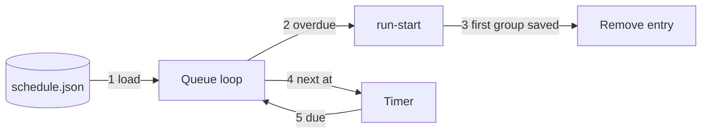

1. `--schedule` reaches the engine as a request whose `Event` holds the `run-start` data; the engine mints the run id, writes the entry with `run_id` and `start` set, with `SaveMachine` and `KindSchedule` before it replies with the run id, and the CLI starts the engine first if it is not running. The engine stays up while any run is live or queued.
2. At engine start, and at every timer wake, the loop calls `LoadMachine` with `KindSchedule` and starts each entry whose `at` is not in the future, oldest first.
3. Starting an entry publishes the one `run-start` that holds the entry's stored `start` as its data, with the entry's `run_id`. The loop removes the entry with `SaveMachine` once the run's first group record is saved. A crash before that leaves the entry, and the next engine start fires it again; groups that already have records continue and are not duplicated.
4. The loop arms one timer for the earliest `at` in the future. A `--schedule` or a `stop` re-arms it.
5. After the machine restarts, the next `komodo` command finds the queue and starts the engine, which starts everything overdue at once ([1. CLI](#1-cli)).

`komodo stop (id)` removes a queued entry, and `komodo status` lists the queued entries.

#### Starting a run

**📐 How a run starts groups**
```mermaid
flowchart LR
  EV["run-start event"] -->|"1 read settings"| LL["LoadLimits"]
  LL -->|"2 read plan"| PG["Plan graph"]
  PG -->|"3 ready groups"| PK["Pick"]
  PK -->|"4 slot free"| GS["group.start"]
  GS -->|"5 take lease"| LS["Lease Manager"]
  LS -->|"6 start"| TM["Task Manager"]
```

1. `Run` receives `run-start` and calls `LoadLimits`, which asks the Configuration Manager for each key once.
2. It reads the group labels from the event's `data.groups`, never from a search of its own, gets their specs through `PlanSource.Specs`, builds the dependency graph and refuses a cycle or an unknown label with an `error` event.
3. A group with a saved record that is not Done goes to the recovery pass instead ([Crash recovery](#crash-recovery-and-restarting-groups)); a Done group is skipped.
4. A group is ready when `Startable` is true and its record does not exist yet. A group whose dependency is Blocked or Paused is not ready and is shown as waiting on that group in the run's view; its own record is untouched.
5. When fewer than the pool size of groups are active, `Pick` chooses a ready group. An active group is one in any stage; Paused and Blocked groups are not active.
6. The group's first input is `group.start`; its first order is to take the lease, which records the branch and worktree names. The Task Manager creates the branch `komodo/<epic>-<group>`, such as `komodo/ep-1-tg-1.2`, and the worktree when it handles `start`.
7. When `lease.granted` is saved, the Runtime Manager calls `TaskGroups.Start` with the repository's cache handle. It then sends `start` for `OrderStartGroup` down the new command channel, and the Task Manager reports `ready`.

`run-start` naming one group runs that group alone; it is refused with `error` / `run-refused`, naming the dependency, when a dependency outside the run is not Done. A cycle in the plan is refused the same way.

When the run starts, the Runtime Manager also builds a `LandingPlan` for each epic in the run: the epic's groups in dependency order, ties broken by task-list `Order`. It sends the plan to the Commit Handler in `Order.Data` of every `enter_stage` Commit order. A group removed by `abandon` leaves the list, and the Runtime Manager sends the shortened plan.

**Pick order.** When a slot frees, the Runtime Manager applies these rules in order:
1. Groups marked `priority: high` go first.
2. The longest remaining chain, weighted by task count (`ChainWeight`).
3. The most groups unblocked (`Unblocks`).
4. Task-list order (`Order`).

The pool is one per engine: groups of every run in the engine draw from it, and `Pick` chooses among the ready groups of all runs by the same rules.

#### One turn of a group

**📐 One turn of a group's loop**
```mermaid
flowchart TB
  IN["Input arrives"] -->|"1 take one"| NX["Next in memory"]
  NX -->|"2 State and orders"| SV["StateStore.Save"]
  SV -->|"3 one write"| RO["Run each order"]
  RO -->|"4 order done"| SV2["Save order done"]
  SV2 -->|"5 publish"| PB["Event Bus"]
```

1. The group's goroutine takes the next input from its channel (capacity `GroupBuffer`); a full channel makes the sender wait and never drops an input.
2. It sets `stale` when the input's epoch is older than the group's, then calls `Next`. A stale input changes nothing.
3. It calls `Save` once, with the new State and the first order marked open. The save returns only when the write is durable.
4. It performs each order, which `Next` also placed in `OrdersOpen`; a rerun after a crash skips an order whose key is done.
5. It saves the order as done, then publishes the events on the Event Bus.

Each group has exactly one loop goroutine in the Runtime Manager, and it is the only writer of that group's State. It sends each order to the group's Task Manager goroutine as a `task.Command`, and the Task Manager's `Message` values come back on the reply channel. A panic in a group goroutine is caught by one helper, `Go`, which sends `group.crash`; the run and the other groups continue.

#### Link slots

Before every model session the Task Manager's link choice takes a slot on a link with `LimitStore.TakeSlot`, and it releases the slot when the session ends ([11.5](#115-behaviour)). The Runtime Manager grants nothing and answers no request for a session.

1. The link session counts and the reset times live in `providers.json`, kept by the State Manager. Every run in the engine shares one set of slots, because the count is machine-wide.
2. `limits.link_sessions.<link>` is the most sessions one link carries at once.
3. When every allowed link is limited or has no free slot, the Task Manager ends the session with reason `paused`, and the existing pause path below runs. A slot wait holds no pool slot and adds nothing to `WallUsedS`.
4. When none of the links is usable and none is limited, the Task Manager escalates `blocked` with reason `no_provider`.

The pool grows by 1 after a clean session end while free memory covers one more `sandbox.max_mem_gb`, up to `limits.pool_max`. It halves, never below `limits.pool_min`, on a rate-limit error from a provider; after a halving, further signals are ignored for `PoolHalveCooldown`. A plan window that passes its 80% warning does not change the pool: the Resource Manager only warns until the window reaches 100%.

#### A provider limit

When a provider refuses for a plan limit, the Runtime Manager holds the group until the limit resets. When Claude's window runs out and paid use is off, groups wait this way. A provider limit reaches the Runtime Manager as a session that ends with reason `paused`: either a running session hit the limit, or the Task Manager found every allowed link limited before it started one. Both take the same path.

**📐 From a provider limit to a continued session**
```mermaid
sequenceDiagram
  autonumber
  participant T as Task Manager
  participant R as Runtime Manager
  participant S as State Manager
  T->>R: session.end paused, with every allowed link limited
  R->>S: Paused, Resume, Pause.Until, Pause.Since
  R->>R: arm timer at Pause.Until
  R->>T: timer.due: enter_stage with Resume
  T-->>R: session.end paused again, or work continues
```

1. The Task Manager reports `session.end` with reason `paused` and the resume handle, if it has one.
2. Row 9 of the transition table moves the group to Paused: `Prior` is the stage, `Resume` holds the handles, `Pause.Until` is the latest reset time among the halted sessions plus 1 minute, and `Pause.Since` is set only if the group was not already paused.
3. The Runtime Manager arms an in-memory timer for `Pause.Until`; the same time is in the saved State, so a recovery pass re-arms it.
4. At the time, `timer.due` returns the group to `Prior` under the same epoch and orders the stage again, with the saved handles. A restart owed to a sibling agent that ended while the group was paused is ordered now, not earlier.
5. If the provider still refuses, no model turn is spent and the Task Manager reports `paused` again. `Pause.Since` is kept, `Pause.Refused` rises by 1, and the next try waits for the new reset time, or 15, 30, then 60 minutes when none is given, and 60 minutes after that.
6. When `Pause.Since` plus `limits.pause_max_min` passes, `timer.due` with reason `pause_timeout` blocks the group `pause_timeout` and cancels live sessions; the saved work is kept.

A person's `run-continue` on a Paused group tries every halted agent at once. Paused time stops every wall clock. A sibling session that was not halted keeps running while the group is Paused, and its own timers keep running.

The Resource Manager does not decide any of this; it watches the same numbers and may also cause a pause, as the next section describes.

#### A plan window or a spending ceiling

The Resource Manager warns at 80% of a plan window, or of a spending amount set in configuration, and changes nothing. At 100% of a plan window it calls `PauseGroups` for the groups seen on that link.

**📐 From a full plan window to resumed groups**
```mermaid
sequenceDiagram
  autonumber
  participant X as Resource Manager
  participant R as Runtime Manager
  participant S as State Manager
  participant T as Task Manager
  X->>R: PauseGroups with a PauseOrder
  R->>S: Paused, Pause.Until, Resume
  R->>T: pause command
  R->>R: arm timer at Pause.Until
  R->>T: continue command with Wake at the timer
```

1. `PauseGroups` receives a `PauseOrder` ([19.3](#193-data-model)): the reason `window_full`, `spend_ceiling`, `spend_ceiling_day` or `group_tokens`, the link or run, the group labels and `Until`. The reasons give the causes `plan_window`, `spending` and `group_tokens`.
2. For a `window_full` order, a group is paused only when no other link in its current agent's chain can be used: every other link is limited, unavailable, unauthorized or refused by the billing check. Otherwise the group is left running, and its Task Manager's link choice moves the next session to the usable link. When Claude's window runs out and paid use is off, no other link is usable, so the groups wait.
3. A group with no live session or running action moves to Paused at once (row 17). A group with a live session sets `Pause.After`, lets the session finish, and moves to Paused at its `session.end` with the handle in `Resume` (row 18). The finished session is the group's current step.
4. The group loop saves the Paused State first, then sends the `pause` command, so no new session starts.
5. For `plan_window`, `Pause.Until` is `Until` plus 1 minute and the Runtime Manager arms a timer for it. At the timer, `timer.due` sends `continue`, and the group resumes by itself (row 10). The pause is not subject to `limits.pause_max_min`, because the window's reset is the only end it needs.
6. For `spend_ceiling`, which applies only when `limits.usd_ceiling_per_run` is set, every named group is paused with cause `spending`, no timer is armed and the pause is not subject to `limits.pause_max_min`. A group paused at the ceiling continues only with `komodo run (id)`.
7. For `spend_ceiling_day`, which applies only when `limits.usd_ceiling_per_day` is set, every group that uses a paid link is paused with cause `spending`, `Pause.Until` is the next local midnight, and the Runtime Manager arms a timer for it. The pause is not subject to `limits.pause_max_min`. A group on a subscription link is not named and keeps working. The group resumes at the timer, or earlier when the ceiling is raised and the group is continued with `komodo run (id)`.
8. A paused group keeps its lease, and the Runtime Manager keeps renewing it every `LeaseRenewEvery`, 5 minutes. Its pool slot returns.

#### The group token cap

`limits.group_tokens` bounds the tokens one group may use. A value of 0 means unlimited, with no nudge. The Resource Manager counts the tokens ([19.5](#195-behaviour)) and gives the Runtime Manager two orders.

1. At 90% of the cap it calls `NudgeGroups`. The Runtime Manager sends a `nudge` command down the command channel of that group's Task Manager. A nudge changes no State, so it is no input. The Task Manager adds one role-specific line to each running agent's session: the Tester and the Reviewer finish and report, and the Builder wraps up its task and saves ([11.5](#115-behaviour)).
2. At 100% it calls `PauseGroups` with reason `group_tokens`. The group pauses after its current step, keeps its lease, and has pause cause `group_tokens`. No timer is armed and the pause is not subject to `limits.pause_max_min`.
3. `komodo run (id) --approve` on that group grants one more cap and continues it. The engine calls `TokenCaps.GrantGroupTokens`, which raises the group's cap by one `limits.group_tokens`, then makes the `continue` input.
4. A provider limit keeps its own path ([A provider limit](#a-provider-limit)).

#### Heartbeats and a hung engine

Two watches cover a loop that stops answering and an engine that stops answering.

**Inside the engine.** Every core loop calls `Manager.Beat` every `HeartbeatEvery`, 5 seconds. The core loops are each Task Manager, the Error Handler loop, the Metrics Service loop and the Resource Manager loop.

```go
// Beat records that a core loop is alive; loop is "task:<group id>", "fault", "metrics" or "resource".
func (m *Manager) Beat(loop string)
```

A loop silent for `LoopSilentFor`, 60 seconds, is stopped and restarted. A Task Manager restarts from its saved state, which counts as one retry of the group. A watcher loop (the Error Handler, the Metrics Service or the Resource Manager) restarts in place.

**The engine's own heartbeat.** The engine writes `~/.komodo/state/engine.beat` every `EngineBeatEvery`, 5 seconds, from a goroutine of its own. The file holds the engine's process id and the time:

```json
{"pid": 48190, "at": "2026-10-14T15:31:12Z"}
```

**A frozen engine.** A CLI command that gets no socket reply within `HungReplyWait`, 10 seconds, while `at` in the beat file is older than `HungBeatAge`, 30 seconds, treats the engine as hung.
1. The CLI stops the engine's whole process tree. The engine starts as the leader of its own process group, so one kill signal to the group reaches every child.
2. It starts a fresh engine ([Reaching the engine](#reaching-the-engine)). The new engine recovers from saved state ([Crash recovery and restarting groups](#crash-recovery-and-restarting-groups)).
3. It sends the command again, once.

#### Unfinished edits

When a Builder session ends mid-task, its edits stay in the worktree and nothing is committed. The Runtime Manager records in the group's state the task that holds unfinished edits, with its changed files, from the `unfinished` data of the `session.end` input.

```json
{"task": "tsk-fence-stale", "files": ["internal/lease/fence.go", "internal/lease/fence_test.go"]}
```

When the group continues, the next Builder session's brief says so and lists those files ([12.5](#125-behaviour)). The record is cleared when the task is done.

#### The epic branch comes first

Before any Task Manager starts, the Runtime Manager makes sure the epic's branch holds the plan.
1. At run start, the Runtime Manager checks whether `komodo/<epic>` exists, locally or on the remote, through `EpicGit.BranchExists`.
2. When it is missing, the Runtime Manager creates it from the base branch through `EpicGit.CreateBranch`.
3. The Runtime Manager then asks the Commit Handler to commit the epic's task lists, from `docs/backlog/`, onto it as its first commit and to push it (`Commit.SaveLists`, [15.5](#155-behaviour)).
4. Only then do Task Managers cut group branches from the epic tip.

So every group starts with the plan and all landed work. The Commit Handler remains the only part that commits and pushes.

#### Scope requests

A builder that needs a file outside its group's files stops its session with a request; the Runtime Manager answers or blocks the group. The orchestrator answers a request no rule can settle.

1. The Task Manager reports `scope.ask` with the paths and the reason, and the session ends.
2. The Runtime Manager keeps the lease and the worktree; the tasks finished so far are already saved as local commits.
3. It denies with no one asked when a path is protected (the harness's own settings, `.git`, secret files), is in another live group's files, or the task already spent its one request (`ScopeAsked`). It sets `ScopeAsked` and sends `OrderScope` with the denial, which travels as a `continue` command with a deny `Answer`; the group stays in Build.
4. Otherwise it blocks the group `needs_scope`, sets `ScopeAsked`, keeps the session's handle in `Resume`, and publishes `run-failure` / `group.blocked`. This block is never counted as a flap.
5. The orchestrator waits with `komodo status --wait`, which returns the blocked group's question, and answers with `komodo run (id) --approve` or `komodo run (id) --deny`. The engine makes a `scope.answer` input; row 14 moves the group to Build and sends `continue` with an `Answer` of `approve` or `deny` down the command channel. Approval adds the paths to `ScopeAdded`, so the group's effective files are its list plus `ScopeAdded`.
6. The same session resumes with the answer in its brief.

A `wall` block is answered the same way: `--approve` grants more time and resets the group's working time as `run (id)` does for that reason, and `--deny` leaves the group Blocked. `--approve` or `--deny` on a group blocked for any other reason is refused with code `not_blocked`.

#### Continuing a blocked group

`komodo run (id)` on a Paused or Blocked group is a request to try again, so it must undo what stopped the group; otherwise the next input blocks it again at once. Each reason below names what the continue resets. A reset counter starts a full new round and never touches `Blocks`, so a group blocked 3 times for one reason is still flagged `needs redesign`.

| Reason | `run-continue` resets | Refused when |
|---|---|---|
| `returns`, `regression` | `Returns` to 0; `FailureHash` and `ReturnTree` cleared | Never |
| `flap` | `FailureHash` and `ReturnTree` cleared; `Returns` kept | Never |
| `retries` | `Retries` to 0, or the stage's `Restarts` to 0 | Never |
| `attempts` | `Attempts` to 0 | Never |
| `wall` | `WallUsedS` to 0 and `WallExtended` cleared | Never |
| `pause_timeout` | `Pause.Since` cleared, a new window starts | Never |
| `no_provider`, `paid_refused`, `context` | Nothing; link selection and the billing check run again against the current settings | Never; the group blocks again if the cause remains |
| `needs_scope` | Nothing | No answer yet: the request is refused, naming the answer needed |
| `dependency` | Nothing | A dependency is still not Done or was abandoned: refused, naming it |
| `setup`, `publish`, `merge_conflict`, `cleanup`, `contract` | The failed stage's own retry count in the handler | Never |
| `crash` | Nothing; the recovery pass replays the State | Never |
| `state_invalid` | Nothing | The State Manager still reports the record invalid |
| a `spending` pause | `Pause` cleared | Never; the group returns to `Prior` and the Resource Manager pauses it again if the ceiling still holds |
| a `group_tokens` pause | `Pause` cleared; with `--approve`, one more cap is granted to the group first | `--deny` is refused with `not_blocked`; without `--approve` the Resource Manager pauses the group again at its next observation |

A continue that is accepted returns the group to `Prior`, raises the epoch, enters the stage and publishes `group.resumed`. A continue that matches nothing publishes `request.refused` with the reason, which wakes a waiting orchestrator.

`run-continue` with no group continues every Paused and Blocked group of the run. A group in a working stage ignores it.

#### Continuing a group with `run (id)`

`komodo run (id)` continues a group from its saved State, wherever it stopped: after a stop, a crash, a block or a hand fix in its worktree. A group never skips Test and Review on the way to commit.

1. The engine loads the group's record through the State Manager.
2. A Done group is left alone and the reply says so.
3. A Paused or Blocked group follows the table above and returns to `Prior`.
4. A group saved in a working stage continues at that stage; a Build group with every task done goes on to Test and Review.
5. A group whose stage, or whose `Prior`, is Commit re-enters Test and Review with the epoch raised (row 19). Its open Commit orders are dropped, since Commit runs again after approval.
6. A group saved in Cleanup continues in Cleanup, because its work is already published.

#### Crash recovery and restarting groups

Recovery reads only the State Manager. The group loop saves a group's State before it acts on a change, so the saved State always reflects the last decided step. Nothing starts a dead engine by itself except the schedule queue; the next command starts a new engine, and `komodo run (id)` continues each group from its saved State. When a `run-start` names groups that have saved records, the recovery pass handles them before any new group starts.

**📐 What the recovery pass does for each group**
```mermaid
flowchart TB
  S["Recovery pass"] -->|"1 load"| L["Group State"]
  L -->|"2 lease"| LE["Grant or refuse"]
  LE -->|"3 open orders"| O["Rerun by key"]
  O -->|"4 sessions"| D["Dead-session rule"]
  D -->|"5 timers"| T["Re-arm"]
  T -->|"6 start"| TM["Task Manager"]
```

1. It asks the State Manager to load each named group that is not Done. The State Manager returns the last saved State, which is all that recovery reads; the event store is never used to recover.
2. It calls `LeaseStore.Holder`, then `Grant` for each group. When another holder has the group, the group is Done with outcome `lost`, naming the holder.
3. It reruns every open order under its key, so a stage entry happens once. A group saved in Commit is the exception: it re-enters Test and Review ([Continuing a group with `run (id)`](#continuing-a-group-with-run-id)).
4. It applies the dead-session rule below.
5. It re-arms the timer of every Paused group; a timer already due fires at once.
6. It starts a Task Manager goroutine with `TaskGroups.Start` for each group in a working stage and sends `start` with the stage order again.

**The dead-session rule.** One rule covers every session that was live at the crash, and the crash is never charged to `Attempts` or `Retries`:
1. For each session the State shows as claimed with no `session.end`, the Runtime Manager saves `session.end` with reason `crash`, which releases its task.
2. It records the task that holds unfinished edits in `Unfinished` with its changed files, commits nothing, and orders the stage again with the session's `ResumeRef`.
3. The Task Manager continues the same conversation from the handle. If the handle fails, it starts a fresh session with the brief, the diff of the work so far and the last summary, and the Runtime Manager publishes `session.resume-lost`.
4. A session whose start order is still open is not marked dead; rerunning the order starts it once.

The Cleanup Handler removes the branches and worktrees a dead run left behind ([16](#16-cleanup-handler)); what triggers it after a crash is [TODO: what triggers removing a dead run's leftovers ([G-218](#g-218))].

#### Stopping a run

One sequence serves `run-stop`, an operating-system signal and an update that moves a run to a new binary.

**📐 The stop sequence**
```mermaid
sequenceDiagram
  autonumber
  participant R as Runtime Manager
  participant T as Task Managers
  participant L as Lease Manager
  R->>R: stop admitting groups and grants
  R->>T: cancel; sessions stop, terminate at 30 s, kill at 90 s
  R->>R: save every group State
  R->>L: revoke every lease
  R->>R: publish run-complete stopped
```

1. The Runtime Manager starts no new group and grants no new session.
2. It sends a `stop` command, from `OrderCancel`, to every Task Manager. Each session is stopped with an interrupt, then the terminate signal `AgentStopGrace` later, then a whole-tree kill; the whole sequence is bounded by `ShutdownDeadline`, 90 seconds from the start.
3. Each Task Manager has already saved its finished tasks through the Commit Handler.
4. It saves every group's State.
5. Only then does it revoke the leases with reason `stop`, so no other process can open a group while this one still writes. The branches and worktrees stay.
6. It publishes `run-complete` / `stopped`.

A group keeps the stage it was in. A later `komodo run (id)` for the run starts the recovery pass.

`komodo stop` dials the control socket and sends a `Request`; the engine runs `Manager.Stop` and publishes `run-stop`. While a group is Paused or Blocked its lease stays held and is renewed every 5 minutes until the stop. When the stop sequence ends and nothing else is live or queued, the engine exits. What watches an engine that stops answering is described in [Heartbeats and a hung engine](#heartbeats-and-a-hung-engine).

#### Timer extensions

A Task Manager sends `timer.extend` when a session nears its wall limit and its task is not done. The Runtime Manager grants one 100% extension per group: it sets `WallExtended` and answers `OrderExtend` with the new limit. A second request is denied, and the `wall` block applies at twice `limits.group_wall_min` of counted working time.

#### Dependents, completion and the run's end

1. A group reaches Done at `group.closed`; the pool slot returns, the Runtime Manager calls `LeaseStore.Release` and runs `Pick` again.
2. A group starts once every dependency is Done. Done means the Commit Handler published the group and the Cleanup Handler closed it.
3. A dependent's branch is cut from its epic's branch `komodo/<epic>`, which holds every dependency that has landed. A dependency's pull request is not merged first: each epic has one pull request, opened when its last group lands and merged by a person.
4. When every group is Done, the Runtime Manager publishes `run-complete` / `done`.
5. When no group can run and at least one is Blocked, it publishes `run-failure` / `stalled`, listing each blocked group and its reason; the Error Handler and the CLI show it to the caller.
6. `komodo abandon (id)` drops a group for good: the Runtime Manager stops the group, the group is Done with outcome `abandoned` (row 20), the Cleanup Handler's `Discard` frees its resources, and each dependent blocks with `dependency`.

#### Landing on an epic's branch

Each epic has one shared branch, `komodo/<epic>`. Each group works on its own branch, `komodo/<epic>-<group>`. The Runtime Manager hands the Commit Handler the epic's `LandingPlan` and the Commit Handler does the rest:
- It pushes each approved group onto the epic's branch, one group at a time per epic.
- It rechecks the epic's branch after each landing; a failed recheck pauses landings on that epic until the recheck passes.
- It opens one pull request for the epic when the last group of the plan's `order` lands, and a person merges it.
Groups land in the order they are approved, which the plan's dependency order never contradicts, because a dependent cannot start before its dependencies are Done.

### 7.6 State

**📐 Group stages and holding states**
```mermaid
stateDiagram-v2
  [*] --> Intake: 1 group.start
  Intake --> Build: 3 ready
  Build --> TestReview: 4 stage.done
  TestReview --> Commit: 5 both approve
  TestReview --> Build: 6 result.fail
  Commit --> Cleanup: 7 published
  Cleanup --> Done: 8 group.closed
  Build --> Paused: 9 limit
  TestReview --> Paused: 9 limit
  Paused --> Build: 10 timer.due
  Paused --> TestReview: 10 timer.due
  Paused --> Blocked: 11 pause_timeout
  Blocked --> Build: 13 continue
  Done --> [*]
```

Rows 2, 12 and 14 to 20 are left off the drawing:
- Any working stage, Paused and Blocked can enter Blocked (row 15), and Blocked can return to the stage it left.
- A lost lease ends a group from any stage (row 16).
- A plan pause reaches Paused by rows 17 and 18, the same Paused state as the drawing's row 9.
- A group continued from Commit re-enters Test and Review (row 19).
- `abandon` ends a group from any stage (row 20).

Both tables below are one Go slice of `Transition`, whose `From`, `On` and `To` fields are the From, Input and To columns. For each input `Next` applies the first matching in-stage row, then the first matching stage-move row against the updated state; either may be absent. An input that matches neither is refused and logged, never dropped. Counter updates happen before any row.

```go
// Transition is one row of the stage-move and in-stage tables.
type Transition struct {
	From   []state.Stage                       // nil means any stage
	On     InputKind
	When   func(State, Input, Limits) bool     // the condition column; nil means always
	To     Stage                               // a stage, Keep or ToPrior
	Apply  func(State, Input, Limits) State    // the Sets column
	Orders []OrderKind
	Emits  []string                            // run-status subtypes
}
```

**What a stage move emits.**
- Into a working stage: `run-status` / `stage.enter`, and the epoch rises.
- Out of Paused to `Prior`: no `stage.enter` and the epoch stays; the group continues in place.
- Into Paused, Blocked or Done: `group.paused`, `group.blocked` or `group.done`.
- Out of Paused or Blocked into a working stage: `group.resumed`, with the stage the group was held in and the stage it re-enters.
- `Prior` is set only when a group leaves a working stage, so a group that blocks from Paused keeps the stage it paused in.

#### Stage moves

| # | From | Input | Condition | To | Sets; orders; emits |
|---|---|---|---|---|---|
| 1 | `NoStage` | `group.start` | The group is ready and a slot is free | Intake | Epoch 1; orders the lease grant; emits `stage.enter` |
| 2 | Intake | `lease.granted` | | Intake | `Fence` set from the grant; orders `start_group` |
| 3 | Intake | `ready` | | Build | Epoch + 1; orders `enter_stage` Build at the first task not done; emits `stage.enter` |
| 4 | Build | `stage.done` Build | Every task is done | Test and Review | Epoch + 1; `Restarts` cleared; orders `enter_stage` Test and Review on the group's tree; emits `stage.enter` |
| 5 | Test and Review | `stage.done` | Tester and Reviewer both approved | Commit | Epoch + 1; orders `enter_stage` Commit; emits `stage.enter` |
| 6 | Test and Review | `result.fail` | `Returns` under the limit; fingerprint and tree both differ from the last return | Build | `Returns` + 1; `FailureHash` and `ReturnTree` set; orders `cancel` for a live sibling, then `enter_stage` Build with the findings; emits `stage.enter`. A failed mechanical check arrives here too, with its exact output as the findings |
| 7 | Commit | `stage.done` | Published | Cleanup | Epoch + 1; orders `enter_stage` Cleanup; emits `stage.enter` |
| 8 | Cleanup | `group.closed` | | Done | `Outcome` complete; returns the slot; calls `LeaseStore.Release`; emits `group.done` |
| 9 | Build, Test and Review | `session.end` reason `paused` | No allowed link left | Paused | `Prior` = stage; `Resume` added; `Pause` set; emits `group.paused` |
| 10 | Paused | `timer.due` | Reason is not `pause_timeout` | `Prior` | Same epoch; orders `enter_stage` from `Resume` and orders owed restarts; emits `group.resumed` |
| 11 | Paused | `timer.due` reason `pause_timeout` | `Pause.Since` plus `limits.pause_max_min` reached, and `Pause.Cause` is `provider` | Blocked | Orders `cancel` for a live sibling; the saved work is kept; emits `group.blocked` |
| 12 | Paused | `continue` | Before the timer | `Prior` | As row 10, with `group.resumed`; a refused attempt re-pauses by row 9 with `Since` kept |
| 13 | Blocked | `continue` | The reason's reset rule is satisfied | `Prior` | Reset per the table in 7.5; Epoch + 1; emits `group.resumed`, `stage.enter` |
| 14 | Blocked | `scope.answer` | `Block.Reason` is `needs_scope`, or `wall` with approval | Build | Approve adds paths to `ScopeAdded`, or resets the working time for `wall`; orders `scope` and `enter_stage` from `Resume`; Epoch + 1; emits `group.resumed` |
| 15 | Any working stage, Paused | Any input in the block rows | See Block rows | Blocked | `Prior` = stage; orders `cancel` for every live session; `Blocks[reason]` + 1; emits `group.blocked` |
| 16 | Any stage but Done | `lease.lost` | Another process holds the group | Done | `Outcome` lost; orders `cancel`; frees nothing, because the lease belongs to the other holder |
| 17 | Build, Test and Review | `limit.pause` | No live session or running action | Paused | `Prior` = stage; `Pause` set from the input with `Until` = `reset_at` + 1 minute, and no `Until` for cause `spending`; orders `hold`; emits `group.paused` |
| 18 | Build, Test and Review | `session.end` | `Pause.After` is set | Paused | `Prior` = stage; `Resume` added; `After` cleared; orders `hold`; emits `group.paused` |
| 19 | Commit; Paused or Blocked with `Prior` Commit | `continue`, or the recovery pass | | Test and Review | Epoch + 1; open Commit orders dropped; orders `enter_stage` Test and Review on the group's tree; emits `group.resumed` when the group was Paused or Blocked, then `stage.enter` |
| 20 | Any stage but Done | `abandon` | | Done | `Outcome` abandoned; orders `cancel`; the Cleanup Handler's `Discard` frees the branch, worktree and sandbox; `LeaseStore.Release` ends the lease; dependents block `dependency`; emits `group.done` |

#### Block rows

Each row's input is the one that spends the bound or reports the failure; the bound's own stage-move row applies only while the bound has room.

| Input | Stages | Condition | Reason |
|---|---|---|---|
| `result.fail` | Test and Review | `Returns` at the limit | `regression` when the data flags a test that passed at the base; else `returns` |
| `result.fail` | Test and Review | Fingerprint equals `FailureHash`, or tree equals `ReturnTree` | `flap` |
| `session.end` builder, reason `timeout` or `idle` | Build | A task is not done and `Retries` passes the builder's retries | `retries` |
| `session.end` builder, reason `timeout`, `idle`, or a retry request | Build | `Attempts` is at `limits.group_attempts` | `attempts` |
| `session.end` tester or reviewer without a result | Test and Review | The agent's `Restarts` passes its retries | `retries` |
| `session.end` reason `billing` | Build, Test and Review | | `paid_refused` |
| `session.end` reason `needs_scope`, or `scope.ask` | Build | The scope rules in 7.5 did not deny it | `needs_scope` |
| `fault` | Build, Test and Review | Every link is unavailable or unauthorized, none limited | `no_provider` |
| `fault` | Intake, Build, Test and Review | The brief exceeds half the context of every link | `context` |
| `fault` | Intake | The lease, branch, worktree or sandbox could not be set up | `setup` |
| `fault` | Commit | A push or pull request failed 3 times | `commit` |
| `fault` | Commit | The branch conflicts with its base and one automatic merge did not resolve it | `merge_conflict` |
| `fault` | Cleanup | Removal failed | `cleanup` |
| Any input in Build | Build | `WallExtended` is set and `WallUsedS` reaches twice `limits.group_wall_min` | `wall` |
| `abandon` of another group | Any working stage, Paused | A dependency group was abandoned | `dependency` |
| `fault` | Test and Review | The Tester's reruns split once, or its second dispute stands | `flaky`, or `tester` |
| `group.crash` | Any working stage, Paused | The group's goroutine panicked | `crash` |
| A result that breaks its declared shape | Any working stage, Paused | Found by the group loop before the write | `contract` |
| A refused save or a bad record | Any working stage, Paused | The State Manager refused | `state_invalid` |

#### In-stage rows

| Input | Stages | Sets; orders; emits |
|---|---|---|
| `session.start` | Build, Test and Review | Task `claimed` with its session; a fresh builder session started by a retry, timeout or idle stop adds 1 to `Attempts`; a restart after a crash adds nothing |
| `session.end` builder | Build | Clears the task's session; `TokensUsed` grows by the session's usage; then the exit row below |
| `task.done` | Build | Task `done`; `GateFails` reset |
| `gate.fail` | Build | `GateFails` + 1 for the task; the third failure ends the session with reason `check_fail` and orders a retry |
| `session.end` tester or reviewer, no result | Test and Review | `Restarts` + 1; orders a fresh session of the same agent on the group's tree while within its retries, or records the restart in `Owed` when the group is Paused; never a return |
| `session.end` reason `paused` | Paused | Adds a `Resume` entry; `Pause.Until` takes the later time; `Pause.Refused` + 1 when the same session paused before |
| `limit.pause` | Build, Test and Review | With a live session or running action: `Pause.After`, `Pause.Cause`, `Pause.Until` and `Pause.Link` set; no stage move until row 18 |
| `timer.extend` | Build | Grants once per group: `WallExtended` set, orders `extend` |
| `scope.ask` | Build | Denial rules of 7.5; sets `ScopeAsked` |
| `request` identifiers | Any | Appended to `Requests`; an already-listed identifier is dropped |
| `session.start`, `session.end`, `task.done`, `group.closed` | Blocked, Done | Recorded only; the sessions were cancelled when the group blocked or ended |

**Builder exit reasons.** The row a builder's `session.end` applies in Build:

| Exit reason | Sets; orders; emits |
|---|---|
| `done` | With every task done, row 4 moves the group; with a task not done, a retry |
| `check_fail`, `no_result`, `schema_fail`, `refusals` | A retry, which adds an attempt |
| `timeout`, `idle` | `Retries` + 1; a fresh session while within the builder's retries |
| `provider` | `Resume` set; orders the stage again on the next allowed link |
| `paused` | `Resume` set; row 9 |
| `needs_scope` | `Resume` set from the handle; the scope rules |
| `billing` | The block rows |
| `cancelled`, `pause_timeout` | None; the cause already moved the group |
| `crash` | None of its own; the dead-session rule |

The state of each holding state:

| State | Waits on | Slot | Lease and worktree | Clocks | Ends by |
|---|---|---|---|---|---|
| Paused | `Pause.Until` | Pool slot returned | Kept, renewed | Stopped | The timer, `run (id)`, `pause_timeout` for a provider pause |
| Blocked | A person or the orchestrator | Pool slot returned | Kept, renewed | Stopped | `run (id)`, `scope.answer` |

A group in a holding state still has its goroutine: it renews its lease every `LeaseRenewEvery` and waits for its timer and its commands.

### 7.7 Invariants and Failures

**Invariants**
1. A group has exactly one writer, its goroutine; the lease's fence stops any other process.
2. An input and the decision `Next` made on it are saved in one write before any order runs.
3. An order's start is saved before it runs and its done after, so a restart skips it by key.
4. A group starts only when every dependency is Done and the lease is granted.
5. A lease is revoked at a stop only after every session is stopped and the State is saved.
6. A stale input never moves a stage.
7. The pool never exceeds `limits.pool_max` or falls below `limits.pool_min`.
8. A crash is never charged to `Attempts` or `Retries`.
9. Waiting for a slot, a pause, a block and downtime never add to `WallUsedS`.
10. Every loop has a counter, and only `Next` changes a counter.
11. The engine exits only with no run live, no entry queued and no connection open.
12. Only the engine creates or closes a cache, one per repository; every other part uses the handle it passes.
13. A group's State is saved before the group acts on a change, so recovery reads only saved State.
14. Every run in the engine draws from one active-group pool and one set of link slots.
15. The Runtime Manager calls the Lease Manager's `Release` when a group closes.

| Situation | Detected by | Action; bound | Final state |
|---|---|---|---|
| A group's goroutine panics | The panic-catching helper | `group.crash` for that group only | Blocked `crash` |
| Input channel full | The sender | The sender waits; no input is dropped | Unchanged |
| Late result from a cancelled session | Epoch older than the group's | Recorded `stale`; ignored | Unchanged |
| Input matches no row | `Next` returns `Refused` | Logged; State unchanged | Unchanged |
| A result breaks its declared shape | The group loop, before the write | Not saved | Blocked `contract` |
| Save refused by the State Manager | `Save` returns an error | Not applied | Blocked `state_invalid` |
| Lease renewal refused | `Renew` returns the new holder | Cancel sessions; frees nothing | Done, outcome `lost` |
| Lease renewal write fails | `Renew` returns an error | Retry at the next interval, inside the lease's life | Unchanged |
| Provider limit with no link left | `session.end` reason `paused` | Pause until the reset; at `limits.pause_max_min` | Paused, then Blocked `pause_timeout` |
| Return that changes nothing | Tree equals `ReturnTree` | Stop; 0 more | Blocked `flap` |
| Returns spent | `Returns` at the limit | Stop | Blocked `returns` or `regression` |
| Working time over twice the group wall | `WallUsedS` | Stop; the one extension is used | Blocked `wall` |
| Session found dead after a crash | Recovery pass | The dead-session rule; 0 attempts charged | Group continues |
| Sessions alive 90 seconds into a stop | The stop sequence | Whole-tree kill | Run stopped |
| Dependency Blocked or Paused | The run's view | Dependents wait; unrelated groups run | Dependents not started |
| Engine killed without a stop | The next command that starts an engine | `run (id)` runs the recovery pass from saved State | Resumed |
| A socket file left by a dead engine | The new engine finds nothing answering | The file is removed and rebound | Engine serves |
| A second engine starts | The bind finds an engine answering | The new process exits | One engine |
| A request lands during the exit check | The listener is closed | Reply `engine_stopping`; the CLI starts a new engine | Request served |
| A queued entry is overdue at engine start | The queue loop | Started at once | Run started |

A crash loses at most the lines the event store had not yet handed to the operating system, and never loses saved State. Watching a hung engine is described in [Heartbeats and a hung engine](#heartbeats-and-a-hung-engine).

### 7.8 Config

The Runtime Manager asks the Configuration Manager for these keys once, at run start; it never reads the settings file.

| Key | Type | Default | Effect |
|---|---|---|---|
| `limits.pool_min` | integer | 1 | Active groups kept open after a rate-limit error shrinks the pool; cannot exceed `limits.pool_max` |
| `limits.pool_max` | integer | 6 (most 16) | Most groups active at once; 1 runs groups in sequence |
| `limits.returns` | integer | 3 (most 5) | Returns from Test and Review to Build before the group blocks |
| `limits.group_attempts` | integer | 6 (most 10) | Fresh builder sessions per group before the group blocks `attempts` |
| `limits.group_wall_min` | integer | 60 | Minutes of counted Build working time; one 100% extension; `wall` at twice |
| `limits.pause_max_min` | integer | 360 (most 1,440) | Longest a group stays Paused before it blocks `pause_timeout` |
| `limits.link_sessions.<link>` | integer | Default and limit in [11.8](#118-config) | Most concurrent sessions on one link; the Task Manager's link choice enforces it |
| `sandbox.max_mem_gb` | integer | Set by the Configuration Manager | Read here: the pool grows only while free memory covers one more |
| agent `retries` | integer | Per agent in the registry | Read for the builder, reviewer and tester through `GetConfigItem` |

The state folder holds `engine.sock` and `schedule.json`; neither has a setting. `limits.group_tokens` is read here into `Limits` but owned by the [Resource Manager](#19-resource-manager). The defaults hold until the first measured runs show the Max five-hour window draining sooner ([G-07](#g-07)).

### 7.9 Proof Cases

Each case is a table test on `Next`, a component test on the run loop with fake managers, or a recovery test. Fixture limits: `limits.returns` 2, `limits.group_attempts` 2, agent `retries` 1.

**Unit** (pure functions, no files)
- Every stage with every input kind, including Paused, Blocked and Done: each pair applies its row or returns `Refused`; none panics.
- With 2 slots and 3 ready groups, the `priority: high` group starts first; equal groups start in task-list order.
- A rate-limit error halves the pool, never below the floor; a second signal inside `PoolHalveCooldown` changes nothing.
- `Startable` is false while any dependency is not Done.
- Tester fails then reviewer approves, and the reverse: one return to Build at the second end.
- A return on the same tree as `ReturnTree` blocks `flap`.
- Builder `session.end` reason `timeout` with `Retries` at 1 blocks `retries`.
- `WallUsedS` reaching `limits.group_wall_min`, then twice it: `WallExtended` set, then Blocked `wall`.
- A slot wait, a Paused interval and a downtime gap add 0 to `WallUsedS`.
- For each reason in the continue table, `Next` on `continue` resets exactly the named counters, and a second block of the same reason follows only when the cause remains.
- A `continue` on `needs_scope` with no answer is refused and publishes `request.refused`.
- `limit.pause` with no live session gives Paused with `Pause.Until` at `Until` plus 1 minute; with a live session it sets `Pause.After` and Paused follows at the session's end.
- A Paused group with cause `plan_window` or `spending` ignores `limits.pause_max_min`; a `provider` pause blocks `pause_timeout` at it.
- `continue` on a group whose stage or `Prior` is Commit goes to Test and Review, not Commit.
- `abandon` ends any stage Done with outcome `abandoned` and blocks each dependent `dependency`.
- A failed mechanical check returns the group to Build by row 6 with the output as findings, and orders no model session.
- The landing plan lists each epic's groups with every group after its dependencies, ties by `Order`.
- A `Request` and a `Reply` survive a JSON round trip; a bad line gives `bad_frame` and leaves the connection open.
- `Fingerprint` ignores line numbers and gives the same hash for the same items in any order.

**Component** (fake managers matching documented behaviour; no live provider)
- A fixture group passes Intake, Build, Test and Review, Commit and Cleanup, and ends Done with the slot returned.
- A group starts while every allowed link is limited: it is Paused with a timer, not Blocked, and it resumes at the timer.
- A refused resume re-pauses, keeps `Pause.Since`, adds 1 to `Pause.Refused` and spends 0 turns.
- A pause past `limits.pause_max_min` blocks `pause_timeout` and keeps the saved work.
- With `limits.pool_max` 2 and 4 ready groups, 2 groups run and the rest wait; a group whose dependency is Blocked waits while an unrelated group runs.
- A panic in one group blocks only that group `crash`; a second group keeps running.
- `kill -9` with a builder live, then `run (id)`: one `session.end` reason `crash`, `Attempts` unchanged, the stage ordered again with the handle; with a failing handle, a fresh session and one `session.resume-lost`.
- `kill -9` between an order's start and done: the order runs again once by its key.
- A run with all groups Blocked publishes one `run-failure` / `stalled` listing every reason.
- A stop with a session that ignores the interrupt: the whole-tree kill lands at 90 seconds, the work is saved, and `run-complete` / `stopped` is published after the leases are revoked.
- A scope request on another live group's file is denied without asking, sets `ScopeAsked`, and the group stays in Build; a second request on the same task is denied the same way.
- A stale `result.fail` from a cancelled Tester after a return changes nothing.
- `lease.lost` ends the group Done with outcome `lost` and releases nothing.
- Two CLIs start together: one engine remains and both are served; a socket file left by a dead engine is removed and rebound.
- With the last run finished and the last connection closed, the engine exits and removes the socket; a request during the exit gets `engine_stopping`.
- Each of the four `task.Command` kinds (`start`, `pause`, `continue`, `stop`) reaches a fake Task Manager, and its `task.Message` returns on the reply channel and becomes the `Input` the mapping table names.
- `--approve` on a blocked group sends `continue` with an `Answer` of `approve`; on a group that is not blocked the reply code is `not_blocked`.
- Two runs in one engine with a pool of 2 start 2 groups between them, and a model session on a link at its `limits.link_sessions` count ends `paused` without a grant from the Runtime Manager.
- A queue with one overdue and one future entry: the overdue run starts at engine start, the engine stays up for the future one, and `stop` removes it.
- A crash after `--schedule` wrote the entry but before the run's first group record is saved: the next engine starts the run once, with no duplicate group.
- `run --all` reads its groups only from the event's `data.groups`; `PlanSource.Specs` receives exactly those labels.
- A repository's cache opens at that repository's first run, the same handle reaches the Context Manager and every Task Manager of its runs, and the cache closes when its last run ends.
- Kill the engine after a `Save` and before its order: `run (id)` continues from the saved State and reads no event log.
- A group saved in Commit with an open push order: `run (id)` runs Test and Review again before Commit.
- A group with a live session when `PauseGroups` arrives finishes the session and pauses; at `Until` it resumes without a command.
- `PauseGroups` for a `window_full` order leaves a group running when another link in its agent's chain is usable, and pauses it when none is.
- A group paused at `spend_ceiling` has no timer and continues only with `komodo run (id)`; its lease is renewed every 5 minutes while paused.
- `NudgeGroups` sends one `nudge` command to a group's Task Manager and changes no State; with `limits.group_tokens` 0 it is never called.
- `PauseGroups` with reason `group_tokens` pauses the group after its current step with cause `group_tokens`, no timer and the lease kept; `run (id) --approve` raises the group's cap by one and continues it; `--deny` is refused with `not_blocked`.
- `PauseGroups` with reason `spend_ceiling_day` pauses only groups on a paid link, arms a timer for the next local midnight, and leaves a group on a subscription link running.
- A fake core loop that stops beating for 60 seconds is restarted; a Task Manager restart continues from the saved state and adds one retry.
- A fake engine that does not reply for 10 seconds with a beat file 31 seconds old is killed as a process tree, a new engine starts, and the command is sent once more; with a beat file 20 seconds old the CLI keeps waiting.
- A `session.end` input with `unfinished` sets `Unfinished`; a continued group's `enter_stage` order carries it, and the group record shows no commit for that task.
- A run whose epic branch is missing gets it created from the base branch and one first commit of the task lists, pushed, before the first group branch is cut; an existing epic branch is left as it is.
- A queued entry fires: the engine publishes the entry's stored `start` as the `run-start` data, and the event carries the `run_id` the queue reply returned.
- Closing a group calls `LeaseStore.Release` once.

### 7.10 Open Gaps

| Gap | Question | Closes by |
|---|---|---|
| [G-218](#g-218) | What triggers removing a dead run's leftover worktrees, branches and sandboxes after a crash | Stated default |
| [G-280](#g-280) | Whether Komodo refuses a network or shared home folder |
| [G-07](#g-07) | The real Max five-hour window against 3 sessions on one subscription link | Ledger measurement over the first 20 groups |
## 8. Cache Manager

The Cache Manager is the local cache for pieces of context and for prompt-cache markers. It keeps what is expensive to rebuild so the harness does not pay for it twice: pieces of context, and the plan that tells the model client which parts of a prompt the provider may remember. It never stores a model's answer, so a model call is always a real call. Every entry is found by a fingerprint of its inputs, so an entry is either exactly right or absent. The purpose of the subsystem and who it talks to are in [HLD 5.9](hld.md#59-cache-manager).

### 8.1 Scope and Concepts

**Owns:**
- The entry store: keys, the check that an entry is whole, the size cap and eviction.
- The cache handle: the read and write view of an open cache that the Runtime Manager passes to the Context Manager and to each Task Manager.
- The marker plan: which parts of a prompt carry a provider cache marker.
- The size rules of the language store; the Cache Manager owns the store itself, a default the design leaves unstated and [G-215](#g-215) confirms.

**Does not own:**
- What a skill, template or brief contains: [Context Manager](#6-context-manager).
- Sending a request to a provider and writing its cache fields: the model client, [Task Manager](#11-task-manager).
- The settings file that holds the size caps: [Configuration Manager](#3-configuration-manager).
- Opening the cache: only the Runtime Manager creates or closes it ([chapter 7](#7-runtime-manager)).

**Concepts**

| Term | Meaning |
|---|---|
| Entry | One stored piece: a byte string found by a namespace and a key |
| Namespace | The family an entry belongs to, such as `context`; each family has its own folder |
| Key | A fixed-length fingerprint (SHA-256, a 256-bit hash of the inputs, written as 64 hexadecimal characters) of an entry's inputs and the binary version |
| Exact fingerprint | A key built only from the inputs that decide the result, never from the clock |
| Provider prompt cache | The provider's own short-lived memory of a prompt beginning; it lives at the provider, not here |
| Marker | A flag in a request telling the provider to remember the prompt up to that point and bill later reads at a lower rate |
| Marker plan | The ordered prompt layers and which of them carry a marker |
| Language store | Downloaded dependencies and build output kept per repository; it is large and has its own cap |
| Cache handle | The part of an open cache that other components hold: `Key`, `Get` and `Put`. Creating, clearing and closing stay with the Runtime Manager |

#### What is cached

| Namespace | Holds | Key inputs | Depends on |
|---|---|---|---|
| `skills` | The skill index and each skill body | Binary version; body content hash | None |
| `context` | File slices, signature trims, diffs, briefs | Git blob hash plus trim settings; commit pair; hash of every brief input | None |
| `map` | The ranked repository map | Tree hash plus goal hash | None |
| `setup` | The repository profile: detected build, test, lint and format commands | Hash of the marker files such as `go.mod` | None |
| `prompt` | Marker plans | Agent role, config hash | None |

- **Tree hash:** the git identifier of the full contents of a checkout; an unchanged tree has the same hash.
- **Model answers:** no model's answer is put in the cache, and no lookup returns one in place of a new call.
- **Command results:** the free mechanical checks run every time, so no command result is cached.
- **Dependency copies:** installed dependencies are too large for this store and live in the language store.

### 8.2 Package Layout

The package is `internal/cache`. It reuses the code of `internal/core/cache.go` and its test file, moved here and renamed from package `core` to `cache`. It uses only the Go standard library and writes its temporary files itself, so it imports no other Komodo package.

```
internal/cache/
├── cache.go      Cache, Handle, Get, Put, Stats, Clear, Close, Key, eviction
├── entry.go      entry encode and verify, namespace and key checks
├── scan.go       directory scan, stale temporary file removal
├── marker.go     Layer, MarkerPlan, PlanMarkers
└── lang.go       language store size rules and trim
```

| File | Holds |
|---|---|
| `cache.go` | The `Cache` type, the `Handle` interface and the calls on them |
| `entry.go` | `encodeEntry`, `decodeEntry`, `validNamespace`, `validKey`; the JSON entry file |
| `scan.go` | `scanCache`, `statsOf` |
| `marker.go` | The marker plan and its computation |
| `lang.go` | Language store trim to 80% of its cap |

**Entry points**

| Flow | Starts in | Called by |
|---|---|---|
| Look up an entry | `Handle.Get` | Context Manager; each Task Manager |
| Store an entry | `Handle.Put` | The same callers after a miss |
| Plan markers for a request | `PlanMarkers`, then `Handle.Put` in `prompt` | Each Task Manager's model client |
| Open and close | `New`, `Cache.Close` | Runtime Manager only |
| Clear and count | `Cache.Clear`, `Cache.Stats` | Runtime Manager only |
| Stamp and trim the language store | `Cache.TouchLang`, `Cache.TrimLang` | Runtime Manager only |

The Runtime Manager opens the one `*Cache` of a repository at that repository's first run and closes it when the repository's last run ends. When it starts the Context Manager and each Task Manager it passes them a `Handle` of that cache, and they read and write through it directly. No other part opens a cache of its own.

### 8.3 Data Model

#### Namespace and key

```go
// Namespace groups cache entries by the kind of piece they hold.
type Namespace string

// The namespaces a cache holds.
const (
	NSSkills  Namespace = "skills"  // skill index and bodies
	NSContext Namespace = "context" // file slices, trims, diffs and briefs
	NSMap     Namespace = "map"     // repository map
	NSSetup   Namespace = "setup"   // repository profile
	NSPrompt  Namespace = "prompt"  // marker plans
)

// Key is the 64-character lowercase hexadecimal fingerprint of an entry's inputs.
type Key string
```

The key is the SHA-256 of the binary version and every input, each written as its length in 8 bytes (big-endian) followed by its bytes. The length prefix makes `("ab","c")` and `("a","bc")` different keys. A new binary version therefore starts with an empty cache.

#### Limits and counts

```go
// Limits are the size caps the Runtime Manager passes in from the Configuration Manager.
type Limits struct {
	MaxBytes     int64 // cap of the entry store, from cache.max_mb
	LangMaxBytes int64 // cap of the language stores of all repositories together, from sandbox.lang_cache_gb
	LangRoot     string // folder that holds one language store per repository, such as cache/lang
}

// Stats counts one cache in total and per namespace.
type Stats struct {
	Entries    int                          `json:"entries"`    // entries held
	Bytes      int64                        `json:"bytes"`      // size of those entries
	Namespaces map[Namespace]NamespaceStats `json:"namespaces"` // the same counts per namespace
	Hits       map[Namespace]int64          `json:"hits"`       // lookups that found a valid entry
	Lookups    map[Namespace]int64          `json:"lookups"`    // all lookups
}

// NamespaceStats counts the entries and bytes of one namespace.
type NamespaceStats struct {
	Entries int   `json:"entries"`
	Bytes   int64 `json:"bytes"`
}
```

```json
{
  "entries": 412,
  "bytes": 51839204,
  "namespaces": {
    "context": {"entries": 301, "bytes": 30112876},
    "skills": {"entries": 14, "bytes": 211004}
  },
  "hits": {"context": 188, "skills": 40},
  "lookups": {"context": 301, "skills": 44}
}
```

| Field | Rule |
|---|---|
| `entries`, `bytes` | Totals over every namespace of one repository's cache |
| `namespaces` | Only namespaces with at least one entry appear |
| `hits`, `lookups` | Counted by `Get` since the cache was opened, for a valid namespace and key on an open cache; the hit rate is `hits / lookups` |

#### Marker plan

A provider can remember the start of a prompt if the request marks where that start ends. The plan uses 2 fixed markers plus the provider's automatic marker, which moves to the newest message each turn so a growing conversation is remembered too. That is 3 of the 4 markers a request may carry.

```go
// Layer is one part of a prompt, in the order the parts are sent.
type Layer struct {
	Name string `json:"name"` // tools, role, repo, standards, brief or conversation
	Hash string `json:"hash"` // SHA-256 of the layer's bytes
}

// MarkerPlan says where the model client places markers for one agent role.
type MarkerPlan struct {
	Layers []Layer  `json:"layers"` // the layers in send order
	Fixed  []string `json:"fixed"`  // names of layers followed by a fixed marker
	Auto   bool     `json:"auto"`   // true when the provider's automatic marker is on
}

// PlanMarkers returns the plan for a layer list: fixed markers after repo and brief, automatic marker on.
func PlanMarkers(layers []Layer) MarkerPlan
```

```json
{
  "layers": [
    {"name": "tools", "hash": "9f2c0e41"},
    {"name": "role", "hash": "51ab7d02"},
    {"name": "repo", "hash": "c77e19ae"},
    {"name": "brief", "hash": "04d8b3f6"}
  ],
  "fixed": ["repo", "brief"],
  "auto": true
}
```

(Hashes are shortened here; a real hash is 64 characters.)

| Field | Rule |
|---|---|
| `layers` | Tools and role come first because they change least; a changed layer breaks the provider's memory of every layer after it |
| `fixed` | Exactly `repo` and `brief`; a layer missing from the request drops its marker |
| `auto` | `PlanMarkers` always sets it true; the model client clears it for a link whose provider has no automatic marker |

The provider's memory itself is at the provider. The cache keeps only the plan and the counters, so that a change in a layer's hash is visible before the request is sent.

#### Entry form of the current code

Each entry is one small JSON file. The cache is a folder of these files and uses only the Go standard library; it has no database.

```
context/3f/a1/3fa1c9e0...e7.json   # <namespace>/<key[0:2]>/<key[2:4]>/<key>.json
```

```go
// entryFile is the JSON stored for one entry.
type entryFile struct {
	V       int    `json:"v"`       // schema version, 1
	SHA256  string `json:"sha256"`  // 64 hexadecimal characters: SHA-256 of the payload bytes
	Payload []byte `json:"payload"` // the payload; encoding/json writes it as base64
}
```

```json
{"v": 1, "sha256": "8b1e...", "payload": "eyJyYW5rIjogMX0="}
```

- **Whole-entry check:** a read decodes the file, hashes the payload again and compares it with `sha256`; a file that is not valid JSON fails the check.
- **Size:** the entry's size is the size of its file on disk, base64 expansion included; the cap and `ErrEntryTooLarge` count that size.
- **Last-read time:** the file's modification time; a hit sets it to now.
- **Write:** a temporary file in the same folder, renamed into place, so a reader sees the old entry, the new one or none.
- **Temporary files:** a write goes to `.<key>.json.tmp-<n>` beside the entry. A file named `*.json.tmp-*` older than 1 hour is deleted by the next scan.

### 8.4 Interfaces

```go
// ErrEntryTooLarge reports a Put whose entry alone exceeds the cache cap.
var ErrEntryTooLarge = errors.New("cache entry larger than the cache cap")

// ErrClosed reports a Put on a cache that the Runtime Manager has closed.
var ErrClosed = errors.New("cache is closed")

// Handle is what the Runtime Manager passes to the Context Manager and to each Task Manager.
type Handle interface {
	// Key hashes the version and inputs into an entry key.
	Key(inputs ...string) Key
	// Get returns the payload under key; a miss, a failed whole-entry check or an I/O error all return false.
	Get(ns Namespace, key Key) ([]byte, bool)
	// Put stores data under key atomically, then evicts least recently read entries until the cache fits its cap.
	Put(ns Namespace, key Key, data []byte) error
}

// New opens the cache of one repository at root for a binary version, creating root if needed; only the Runtime Manager calls it.
func New(root, version string, lim Limits) (*Cache, error)

// Handle returns the cache as a Handle, ready to pass to another component.
func (c *Cache) Handle() Handle

// Stats counts the entries held and the lookups served.
func (c *Cache) Stats() (Stats, error)

// Clear deletes every entry of the given namespaces, or of all when none is given, and returns what it removed.
func (c *Cache) Clear(ns ...Namespace) (Stats, error)

// Close stops the cache; later Get calls miss and later Put calls return ErrClosed. Only the Runtime Manager calls it.
func (c *Cache) Close() error

// TouchLang stamps the repository's language store as used now; the Runtime Manager calls it when a group of that repository starts.
func (c *Cache) TouchLang(repo string) error

// TrimLang deletes whole repository stores under dir, least recently used first, until about 80% of the cap is left, and returns the bytes removed.
// A repository for which keep returns true is never deleted; a nil keep keeps all. An empty dir means LangRoot.
func (c *Cache) TrimLang(dir string, keep func(repo string) bool) (int64, error)
```

| Method | On failure |
|---|---|
| `New` | An empty root or an uncreatable folder returns an error; the harness runs without a cache |
| `Get` | A bad entry is deleted and reported as a miss; the caller recomputes. The cache is never required |
| `Put` | `ErrEntryTooLarge` for an entry over the cap; `ErrClosed` after `Close`; any other error is returned and the caller goes on without the entry |
| `Stats` | A scan error is returned |
| `Clear` | A removal error is returned with nothing partly reported |
| `Close` | Cannot fail in a way a caller acts on; a second call returns nil. `Stats`, `Clear`, `TouchLang` and `TrimLang` still work after it |
| `Clear` with an unknown namespace | An error, and nothing is removed |
| `TrimLang` | A scan or removal error is returned with the bytes already removed; a missing folder removes nothing; an empty `dir` with no `LangRoot` is an error |
| `TouchLang` | An id that is not one folder name, or no `LangRoot`, returns an error |

| Caller | Call | When |
|---|---|---|
| Runtime Manager | `New`, `Handle`, `Stats`, `Clear`, `TouchLang`, `TrimLang`, `Close` | Opens a repository's cache at its first run, passes a handle to each part it starts, closes it when the repository's last run ends |
| Context Manager | `Handle.Key`, `Get`, `Put` | Skills, context, map and setup pieces |
| Task Manager | `Handle.Key`, `Get`, `Put`, `PlanMarkers` | Marker plans in `prompt` |

The Context Manager and each Task Manager never call `New`, `Stats`, `Clear`, `TouchLang`, `TrimLang` or `Close`; the interface they hold does not have them.

### 8.5 Behaviour

**📐 How does a cache lookup resolve?**
```mermaid
flowchart TD
  A["Caller builds key"] -->|"1"| B{"Entry exists?"}
  B -->|"2 no"| M["Miss"]
  B -->|"3 yes"| C{"Whole-entry check passes?"}
  C -->|"4 no"| D["Delete entry"]
  D --> M
  C -->|"5 yes"| H["Hit: stamp last-read"]
  M -->|"6"| P["Caller computes, then Put"]
  P -->|"7"| E["Evict if over cap"]
```

1. The caller builds the key from its inputs with `Key`. No input is a time.
2. `Get` looks for the entry; an absent entry is a miss.
3. A present entry is read whole and decoded.
4. A failed check deletes the entry and counts as a miss, so a wrong entry is never used.
5. A good entry updates its last-read time and the hit counter.
6. On a miss the caller computes the result and calls `Put`.
7. `Put` evicts until the cache fits its cap.

#### Eviction

1. After a store, if the running total is within the cap and the last disk scan is under 30 seconds old, nothing happens.
2. Otherwise the cache rescans the disk, so entries written by other processes count.
3. Entries are ordered by last-read time, oldest first, ties broken by path.
4. The entry just written is never removed. Entries are deleted from the oldest until the total fits.

#### Language store trim

1. The language store is trimmed while the harness runs, not deleted whole. Its unit is one repository's folder, `cache/lang/<repo-id>/`.
2. `TouchLang` rewrites an empty `.last-used` file in the repository's folder; the file's modification time is the unit's last use. A folder with no stamp counts as the oldest.
3. When the folders together pass the cap, `TrimLang` deletes whole folders, least recently used first, ties broken by repository id, until the total is at about 80% of the cap.
4. A repository for which the `keep` function returns true is skipped, so a repository that holds a lease is never deleted; the Runtime Manager passes a function that asks the Lease Manager. A nil `keep` skips every repository.
5. A folder goes whole or stays whole: it is never trimmed file by file. Read-only folders, as a module cache leaves them, are made writable first, and the folder named by `dir` itself is never removed.

#### Marker plan for one request

1. The model client lists the request's layers in send order with their hashes.
2. `PlanMarkers` returns the plan: fixed markers after `repo` and `brief`, automatic marker on.
3. The model client writes the markers the provider's interface expects.
4. The plan is put under the `prompt` namespace, so the next request compares layer hashes first.

#### Concurrency and locking

- Processes of one repository share one cache.
- Two processes writing one key each write a temporary file and rename it; the last rename wins and both payloads are equal because the key names the inputs.
- Inside one process a mutex guards the in-memory index; reads take no lock on disk.

### 8.6 State

| State | Meaning | Moves on |
|---|---|---|
| Absent | No entry under the key | `Put` makes it Valid |
| Valid | Whole entry, last-read time set | `Get` stays Valid; eviction or a failed check makes it Absent |

A cache that has never been used holds no index; the index is built on the first store.

### 8.7 Invariants and Failures

#### Invariants

1. A key depends on the inputs and the binary version only; no key contains the clock.
2. An entry that fails its check is deleted before the caller sees a miss.
3. A model's answer is never put in the cache.
4. An entry is stored whole or not at all.
5. The cache never grows past its cap by more than one rescan interval of writes.
6. Only the Runtime Manager creates, clears or closes a cache; the Context Manager and each Task Manager hold a `Handle` that reads and writes.

#### Failures

| Situation | Detected by | Action | Final state |
|---|---|---|---|
| Entry fails its check | `Get` | Delete it; the caller recomputes | Entry absent |
| Entry larger than the cap | `Put` | Return `ErrEntryTooLarge` | Nothing stored |
| Disk scan fails during eviction | `evict` | Return the error; the next `Put` retries the scan | Cache over cap until the retry |
| A writer died mid-write | Scan finds `*.json.tmp-*` over 1 hour old | Delete it | No partial entry |
| Cache folder cannot be created | `New` | Return the error; the harness runs without a cache | No cache |

### 8.8 Config

The Configuration Manager reads the settings file and passes these values to the Runtime Manager, which passes them to `New`.

| Key | Type | Default | Effect |
|---|---|---|---|
| `cache.max_mb` | integer | 256 (maximum 4096) | Size cap of one repository's entry store; least recently used entries go first |
| `sandbox.lang_cache_gb` | integer | 10 (maximum 50) | Size cap of the language stores of all repositories together; least recently used repositories are deleted whole until about 80% is left. The key's owner is [TODO: owner of the language and build caches ([G-215](#g-215))] |

### 8.9 Proof Cases

Tests use a temporary directory; no network and no live provider.

#### Unit

- A key changes when the binary version or any input changes, and equal inputs give equal keys.
- `("ab","c")` and `("a","bc")` give different keys.
- `Put` then `Get` returns the payload; a different version misses.
- A bad namespace or a key that is not 64 lowercase hexadecimal characters is refused.
- `PlanMarkers` returns fixed markers on `repo` and `brief` and the automatic marker on; a layer missing from the input drops its marker.
- `Put` of a `checks` or `review` namespace is refused as a bad namespace.
- An entry file is valid JSON with `v`, `sha256` and `payload`; changing one byte of `payload` fails the check.

#### Component

- A corrupted entry is deleted and reported as a miss.
- Eviction removes the least recently read entries first and keeps the cache under its cap.
- Two processes evicting at once stay under the cap.
- An entry over the cap is refused with `ErrEntryTooLarge`.
- Concurrent writers of one key leave one whole entry.
- `Stats` on a missing root reports an empty cache; `Clear` for one namespace leaves the others.
- A rename failure on `Put` keeps a valid existing entry.
- A `Handle` given to a second goroutine reads and writes the same entries as the `Cache`; after `Close`, `Get` misses and `Put` returns `ErrClosed`.
- The method set of `Handle` is exactly `Key`, `Get` and `Put`: a test over the interface type finds no `Clear`, `Stats`, `Close`, `TrimLang` or `TouchLang`.
- A language store over its cap deletes repository folders whole, in stamp order, to about 80%; a repository the `keep` function names survives; a read-only module tree is removed whole; the store's root folder stays.
- `Get` counts a hit and a lookup; a miss counts a lookup only.

### 8.10 Open Gaps

| Gap | Question |
|---|---|
| [G-215](#g-215) | Confirms that the Cache Manager owns the language and build caches, which the design names no owner for |

## 9. Lease Manager

The Lease Manager keeps the lease registry, the single source of truth for which task group owns which branch and which worktree (a private git checkout where one group works), across all groups and runs on a machine. It controls access to them, revokes leases, times them out and releases a lease when its group closes. It performs no git writes; the Runtime Manager is its caller for grants, renewals, revocations and releases. The purpose of the subsystem and who it talks to are in [HLD 5.10](hld.md#510-lease-manager).

### 9.1 Scope and Concepts

**Owns:**
- The lease registry: one JSON file per task group plus one lock file per lease, the single source of truth for branch and worktree ownership across all groups and runs on a machine.
- Granting, renewing, revoking and timing out leases.
- Releasing a lease when its group closes. Paused groups keep their leases.
- The fence number, a counter in each record that rises on every grant, takeover and revocation.
- Answering "is this group still the owner" when asked.

**Does not own:**
- Creating a group's branch and worktree: [Task Manager](#11-task-manager).
- Saving finished work: the Task Manager asks the [Commit Handler](#15-commit-handler) for a local commit after each finished task.
- Committing the Intake Handler's task lists: the Commit Handler, when the Runtime Manager asks at run start ([chapter 15](#15-commit-handler)).
- Any git write. The Lease Manager never runs `git commit`, `git push` or `git worktree`.
- Removing a group's branches and worktrees: [Cleanup Handler](#16-cleanup-handler).
- Pushing each approved group onto its epic's shared branch, `komodo/<epic>`, and opening the epic's pull request: [Commit Handler](#15-commit-handler). A lease names only the group's own branch, `komodo/<epic>-<group>`; the epic branch is not leased.
- When to renew, whom to revoke, and when to run the sweep: [Runtime Manager](#7-runtime-manager); the sweep trigger waits on [TODO: what triggers removing a dead run's leftovers ([G-218](#g-218))].
- A group's runtime state, which only carries a copy of the fence: [State Manager](#10-state-manager).
- Agent permissions inside the worktree: [Task Manager](#11-task-manager).

**Concepts**

| Term | Meaning |
|---|---|
| Lease | The registry record that names the one run holding a group's branch and worktree |
| Holder | The run, with its process, that a lease names |
| Fence | A whole number in the record that rises on every grant, takeover and revocation of a group's lease |
| Takeover | A new run replacing a holder whose lease is dead |
| Revocation | The Lease Manager ending a live holder's lease on the Runtime Manager's order |
| Stalled holder | A holder that stopped for a while and wakes after its lease passed to someone else |
| Repo id | The normalised origin URL, or the git common directory path when there is no remote |
| Lock file | A file created exclusively beside a lease's record for the length of one write, so two runs never write one lease at once |
| File lock | The exclusive operating-system lock on a lock file; the kernel frees it when its holder dies, and the file stays on disk |

**📐 How does a lease record relate to the group's checkout?**
```mermaid
flowchart TB
  REC["Registry record: group-id"] -->|"1 names"| BR["Group branch"]
  REC -->|"1 names"| WT["Worktree path"]
  REC -->|"2 holds"| FN["Fence number"]
  RM["Runtime Manager"] -->|"3 Grant, Renew, Revoke"| REC
  CALLER["Any part, when asked"] -->|"4 IsOwner"| REC
```

1. The registry record names the branch and worktree that one holder owns.
2. The record carries the fence number.
3. The Runtime Manager grants, renews and revokes the record.
4. A caller asks whether a lease still owns the group; the answer is read from the record.

### 9.2 Package Layout

The package is `internal/lease`. It holds the registry and no git code.

```
internal/lease/
├── manager.go    Manager and the calls other parts use
├── registry.go   Registry interface and Record
├── files.go      file registry: JSON records
├── lock.go       lock files: take through core.FileLock
├── fences.go     the per-repository fence high-water mark
├── identity.go   the machine id from the operating system
├── lease.go      Lease, Fence, liveness rule, errors
├── proc.go       process existence and process start time
├── config.go     lock timeout from the config value
└── sweep.go      registry sweep
```

| File | Holds |
|---|---|
| `manager.go` | `New`, `Grant`, `Renew`, `Revoke`, `Holder`, `IsOwner`, `Release` |
| `registry.go` | The storage seam the file registry implements |
| `files.go` | `FileRegistry`: one JSON file per lease, safe writes |
| `lock.go` | The lock file: `core.FileLock` with the registry's lock timeout as the longest wait |
| `fences.go` | `FenceKeeper` and the file registry's `.fences.json`, the highest fence each group ever had; a damaged file is set aside and rebuilt with a floor |
| `identity.go` | The machine id: Linux `/etc/machine-id` then `/var/lib/dbus/machine-id`, macOS `IOPlatformUUID` from `ioreg -rd1 -c IOPlatformExpertDevice`; only without one, a random value kept in `~/.komodo/state/machine-id` |
| `lease.go` | The `Lease` value and the rule for whether it is live |
| `proc.go` | `ProcessCheck`, `OSProcessCheck` and `ProcessStart`, which ask `ps` for a process start time |
| `config.go` | `LockTimeout`, which turns the value of `lease.lock_timeout_s` into a duration. The caller reads the key from the Configuration Manager, because no other package imports it ([3.7](#37-invariants-and-failures)) |
| `sweep.go` | `Sweep` |

On disk this chapter writes under the machine folder `~/.komodo/`. The registry is a folder of small JSON files, one record per lease, with a lock file beside each record. The lock files stay on disk; only the operating-system lock on one means a write is in progress. It uses the standard library only.

```
~/.komodo/leases/<repo-id>/<group-id>.json   the lease record
~/.komodo/leases/<repo-id>/<group-id>.lock   locked only while a write is in progress
~/.komodo/leases/<repo-id>/.fences.json       the highest fence each group of the repository ever had
~/.komodo/leases/<repo-id>/.repo.lock        locked only while a grant or a revocation is in progress
~/.komodo/state/machine-id                   the id of this machine, made on first use only when the operating system gives none
```

The repo id is written as one folder name by URL path escaping, so `/` becomes `%2F` and a leading `.` becomes `%2E`. A group id that is empty, starts with `.` or holds a path separator is refused with `ErrBadKey`.

**Entry points**

| Flow | Starts in | Called by |
|---|---|---|
| Grant a lease | `Manager.Grant` | Runtime Manager, when a group's dependencies are met |
| Renew | `Manager.Renew` | Runtime Manager, every 5 minutes while the group is held |
| Revoke | `Manager.Revoke` | Runtime Manager, on a stop, a group timeout or a stalled holder |
| Ask whether a lease still owns the group | `Manager.IsOwner` | Any part that asks |
| Release a lease | `Manager.Release` | Runtime Manager, when the group closes |
| Registry sweep | `Manager.Sweep` | [TODO: what triggers the sweep ([G-218](#g-218))] |

### 9.3 Data Model

#### Constants

```go
const (
	LeaseExpiry        = 2 * time.Hour    // age of the last renewal after which a lease on another host counts as dead
	DefaultLockTimeout = 30 * time.Second // longest wait for a lock; the key lease.lock_timeout_s overrides it
	LockSuffix         = ".lock"          // a lease's lock file is <group-id>.lock beside its record
)
```

The renewal period, 5 minutes, belongs to the Runtime Manager ([chapter 7](#7-runtime-manager)). `LeaseExpiry` has no configuration key; the lock timeout has one, in [9.8](#98-config).

#### Lease

```go
// Fence is the number that rises on every grant, takeover and revocation of a group's lease.
type Fence uint64

// LeaseState is where a lease stands in its life.
type LeaseState string

const (
	StateHeld     LeaseState = "held"     // one run holds the group
	StateRevoked  LeaseState = "revoked"  // ended on order; the holder is no longer the owner
)

// Lease is one registry record: the run that owns a group's branch and worktree.
type Lease struct {
	Repo      string     `json:"repo"`       // repo id
	Group     string     `json:"group"`      // task group id
	Run       string     `json:"run"`        // run that holds the group
	Branch    string     `json:"branch"`     // the group's branch name, as the caller gave it
	Worktree  string     `json:"worktree"`   // absolute path of the group's worktree
	PID       int        `json:"pid"`        // process id of the holder
	ProcStart time.Time  `json:"proc_start"` // start time of the holder's process
	Host      string     `json:"host"`       // machine the holder runs on
	ClonePath string     `json:"clone_path"` // clone the run started from
	Fence     Fence      `json:"fence"`      // fence value this holder took
	State     LeaseState `json:"state"`      // see LeaseState
	Rev       int        `json:"rev"`        // rises by 1 on every registry write
	TakenAt   time.Time  `json:"taken_at"`   // when the holder took the lease
	RenewedAt time.Time  `json:"renewed_at"` // when the holder last renewed it
}
```

```json
{
  "repo": "github.com/acme/shop",
  "group": "0198f3a2-7a10-7d3e-9b2f-6c1d8e4a5f30",
  "run": "0198f3a2-6c1e-7b44-9d0a-3f5e1c2b7a10",
  "branch": "komodo/ep-1-tg-1.2",
  "worktree": "/Users/dev/.komodo/wt/github.com-acme-shop/0198f3a2-7a10-7d3e-9b2f-6c1d8e4a5f30",
  "pid": 48213,
  "proc_start": "2026-10-14T09:12:40Z",
  "host": "5d41402abc4b2a76b9719d911017c592",
  "clone_path": "/Users/dev/src/shop",
  "fence": 3,
  "state": "held",
  "rev": 7,
  "taken_at": "2026-10-14T09:14:02Z",
  "renewed_at": "2026-10-14T09:34:02Z"
}
```

| Field | Rule |
|---|---|
| `repo`, `group` | Together the registry key; one record per group |
| `branch`, `worktree` | No two live records name the same branch or the same worktree path |
| `pid`, `proc_start` | On the same machine a lease is live while this process exists and started at this time; a reused process id with a different start time is a different process. A holder whose start time is unknown (the zero time) is judged by its last renewal against `LeaseExpiry`, never by its process id alone |
| `host` | The machine id of the holder; the process check runs only when it equals this machine's id, so a changed network host name never splits liveness. A home folder shared by several machines or containers is unsupported ([G-280](#g-280)) |
| `clone_path` | The sweep removes a record whose clone is gone |
| `fence` | The fence written at grant, takeover or revocation; it never falls, and a new record after `Release` starts above the highest fence the group had |
| `rev` | Every registry write names the `rev` it read; a stale `rev` is refused |
| `taken_at`, `renewed_at` | RFC 3339 in UTC to the second; renewal rewrites `renewed_at` only |

The branch name follows `komodo/<epic>-<group>`, and the caller of `Grant` passes it in. The record names the group's own branch only; the epic's shared branch, `komodo/<epic>`, has no lease.

#### Liveness

```go
// Live reports whether a lease still has a working holder as seen from host.
func (l Lease) Live(now time.Time, host string, alive ProcessCheck) bool
```

```go
// ProcessCheck reports whether a process with this id exists and started at the given time.
type ProcessCheck func(pid int, start time.Time) bool
```

- **Revoked:** never live.
- **Same host:** live while the holder's process exists with the recorded start time, however old the last renewal is. A laptop that slept for hours keeps its lease.
- **Another host:** live while the last renewal is no older than `LeaseExpiry`.

`OSProcessCheck` is the check `New` uses when it is given none. It reads a start time from `ps -o lstart=` and accepts a difference of up to 2 seconds, because `ps` reports whole seconds. `ps` exiting 1 with no output means the process is gone. A timeout, a kill or any other `ps` failure means unknown, not gone: the check then asks the process with signal 0 and counts it live whenever it answers. A holder whose own start time cannot be read records the zero time, which only asks whether the process exists.

#### Registry seam

```go
// Registry is the storage of lease records; the file registry implements these five calls.
type Registry interface {
	Create(ctx context.Context, l Lease) error
	Get(ctx context.Context, repo, group string) (Lease, error)
	Swap(ctx context.Context, l Lease, rev int) (int, error)
	Delete(ctx context.Context, repo, group string, rev int) error
	List(ctx context.Context, repo string) ([]Lease, error)
}
```

| Call | Rule |
|---|---|
| `Create` | Succeeds for exactly one caller when no record exists; `ErrExists` for the others |
| `Swap` | Replaces the record only if its current `rev` equals `rev`; `ErrStaleRev` otherwise; returns the new `rev` |
| `Delete` | Removes the record only if `rev` is current |
| `Get`, `List` | Return whole records; `ErrNotFound` for an absent key |

Two runs racing for one stale lease both call `Swap` with the `rev` they read; exactly one succeeds. Renewal uses the same `Swap`, so a renewal after a takeover fails instead of overwriting the new holder.

The file registry takes a lock file for the length of every `Create`, `Swap` and `Delete`; [File registry writes](#file-registry-writes) lists the steps. `Create` sets `rev` to 1, and `Swap` sets it to the named `rev` plus 1.

A registry may also implement the optional `RepoLocker`. `Grant` holds it for the whole grant, which is what keeps two grants of one repository from interleaving; the file registry holds it as `<repo-id>/.repo.lock`, with the same lock file rules.

```go
// RepoLocker is implemented by a registry that can hold one repository's grants still across processes.
type RepoLocker interface {
	LockRepo(ctx context.Context, repo string) (unlock func(), err error)
}
```

#### Requests and results

```go
// GrantRequest asks for a group's lease.
type GrantRequest struct {
	Repo      string // repo id
	Group     string // task group id
	Run       string // run asking
	Branch    string // branch name the lease records for the group
	Worktree  string // worktree path the lease records for the group
	ClonePath string // clone the run started from
}

// RevokeReason says why the Runtime Manager revoked a lease.
type RevokeReason string

const (
	RevokeStop    RevokeReason = "stop"    // a person stopped the run
	RevokeTimeout RevokeReason = "timeout" // the group ran past its time
	RevokeStalled RevokeReason = "stalled" // the holder stopped renewing
)

// SweepReport counts what one sweep did.
type SweepReport struct {
	LeasesDropped int `json:"leases_dropped"` // records removed because their clone is gone
}
```

#### Events

The Lease Manager returns errors and publishes nothing; the Runtime Manager publishes the facts under these names, which [chapter 4](#4-event-bus) maps to bus events.

| Name | When |
|---|---|
| `lease.taken` | A grant or takeover succeeded |
| `lease.lost` | A renewal or ownership check found that another run holds the group |

### 9.4 Interfaces

#### Errors

```go
var (
	ErrExists      = errors.New("lease record already exists")            // Registry.Create lost the race
	ErrStaleRev    = errors.New("lease record changed since it was read") // Registry.Swap or Delete saw a newer rev
	ErrNotFound    = errors.New("lease record does not exist")
	ErrLeased      = errors.New("group is leased by another run")         // Grant: a live holder exists
	ErrLeaseLost   = errors.New("lease lost: another run took the group")
	ErrBranchTaken = errors.New("branch or worktree is owned by another group")
	ErrBadKey      = errors.New("repo or group id cannot name a file")
	ErrLocked      = errors.New("lease record stayed locked by another writer") // a lock stayed held past twice the lock timeout
)

// HeldError carries the live holder so the caller can name it.
type HeldError struct{ Holder Lease }

func (e HeldError) Error() string { return "group is leased by run " + e.Holder.Run }
func (e HeldError) Unwrap() error { return ErrLeased }
```

#### Manager

```go
// NewFileRegistry opens the folder of JSON records and lock files; lockTimeout is the longest a writer waits for a lock.
func NewFileRegistry(root string, lockTimeout time.Duration) *FileRegistry

// New opens the lease manager over a registry and a process check; lockTimeoutS is the value of lease.lock_timeout_s.
// A nil registry is the file registry under home/leases with that wait; a nil check is OSProcessCheck.
func New(home string, lockTimeoutS any, reg Registry, alive ProcessCheck) (*Manager, error)

// LockTimeout turns the value of lease.lock_timeout_s into a duration; a missing or non-positive value gives DefaultLockTimeout.
// The caller reads the key and passes its value to New.
func LockTimeout(seconds any) time.Duration

// Grant takes the group's lease, raises the fence and records the branch and worktree names.
func (m *Manager) Grant(ctx context.Context, req GrantRequest) (Lease, error)

// Renew rewrites renewed_at; ErrLeaseLost means another run holds the group.
func (m *Manager) Renew(ctx context.Context, l Lease) (Lease, error)

// Revoke ends a live lease and raises the fence, so the holder stops being the owner.
func (m *Manager) Revoke(ctx context.Context, repo, group string, why RevokeReason) error

// Holder reads the lease of a group; the bool is false when the group has none.
func (m *Manager) Holder(ctx context.Context, repo, group string) (Lease, bool, error)

// IsOwner reports whether the lease still names this run and fence in the registry.
func (m *Manager) IsOwner(ctx context.Context, l Lease) (bool, error)

// Release deletes the group's record.
func (m *Manager) Release(ctx context.Context, l Lease) error

// Sweep drops records whose clone is gone.
func (m *Manager) Sweep(ctx context.Context, repo string) (SweepReport, error)
```

| Method | Error means | Caller does |
|---|---|---|
| `Grant`, `HeldError` | A live run holds the group | Runtime Manager does not start the group and names the holder |
| `Grant`, `ErrBranchTaken` | Another group's live lease names the branch or worktree | Runtime Manager reports the clash to the Error Handler |
| `Renew`, `ErrLeaseLost` | Another run took the group, or the lease was revoked | Runtime Manager stops the group in this run |
| `IsOwner`, `false` | Another run holds the group, or the lease was revoked | The asking part treats the lease as lost |

| Caller | Call | When |
|---|---|---|
| Runtime Manager | `Grant`, `Renew`, `Revoke`, `Holder`, `IsOwner` | Group start, every 5 minutes, stop or timeout, any command that touches a worktree |
| Any part | `IsOwner` | When it needs to know the group is still owned |
| Runtime Manager | `Release` | When the group closes |
| [TODO: what triggers the sweep ([G-218](#g-218))] | `Sweep` | Not fixed |

Agents never call the Lease Manager and never run git.

### 9.5 Behaviour

#### Grant

**📐 What does a grant do?**
```mermaid
flowchart TD
  A["Grant request"] -->|"1"| B{"Record exists?"}
  B -->|"2 no: Create"| C["Record: held, fence 1"]
  B -->|"3 yes, live"| X["HeldError"]
  B -->|"4 yes, dead: Swap"| D["Record: held, fence + 1"]
```

1. Check that no other live lease names the branch or worktree path; `ErrBranchTaken` otherwise.
2. No record: `Create` one in state `held` with fence 1 and the holder's process id and start time. Exactly one caller wins.
3. A record whose holder is live (see [Liveness](#93-data-model)) returns `HeldError` naming it.
4. A dead record: `Swap` it, naming the `rev` read, into a `held` record with the fence raised by 1. Only one taker succeeds; the loser gets `ErrStaleRev`, rereads and finds a live holder.

Before step 1, `Grant` takes the repository's grant lock (`RepoLocker`) and the group's in-process mutex. The holder's process id, start time and host name are the Manager's own, read when `New` ran; `GrantRequest` carries none of them. The grant lock makes step 1 and step 2 or 4 one step across processes, so two groups never both get one branch.

The Task Manager creates the branch and worktree the record names, after `Grant` returns. The Lease Manager never creates them.

#### The first record carries the right fence

1. `Grant` returns a `Lease` whose `Fence` is the only fence a holder uses.
2. `Renew` and `IsOwner` take the whole `Lease` value. No caller supplies a bare number, and the Lease Manager never reads a fence from group state.
3. The Runtime Manager passes `Lease.Fence` to the State Manager when it creates the group's first record, so the record holds the fence from its first write ([chapter 10](#10-state-manager)).
4. After a crash, the Runtime Manager calls `Grant` again; the new `Lease` carries the raised fence, and the Runtime Manager writes it to the group's record before any agent runs.

#### Renew, revoke and time out

1. Every 5 minutes the Runtime Manager calls `Renew` for each held group. `Renew` is a `Swap` on `rev`, so a renewal after a takeover or revocation returns `ErrLeaseLost`.
2. A lease on this host is live while its process lives; a lease on another host is dead when its last renewal is older than `LeaseExpiry`.
3. A holder that is live by process but has not renewed for `LeaseExpiry` is stalled, not dead. The Runtime Manager first kills the holder's process tree, then calls `Revoke`.
4. `Revoke` swaps the record to `revoked` and raises the fence by 1, so the old holder is no longer the owner.
5. A group with a revoked lease is granted again with `Grant`, which raises the fence by 1 again.
6. `Revoke` of a group with no record returns `ErrNotFound`; of an already revoked lease it changes nothing. A reason other than the three constants is refused.
7. `Holder` returns the record in any state, so a caller can see a revoked lease; its bool is false only when no record exists.

#### Paused groups

1. When a plan window runs out, the Runtime Manager pauses the affected groups after their current step.
2. A paused group keeps its lease. Neither `Revoke` nor `Release` is called for it.
3. The Runtime Manager keeps renewing the lease every 5 minutes, so a pause longer than `LeaseExpiry` never makes the holder stalled.
4. The group resumes under the same lease and the same fence.

#### Ownership check

1. `IsOwner` reads the record for the lease's repo and group.
2. It returns true only when the record is `held`, names the lease's run and carries the lease's fence.
3. It writes nothing.

#### Release

1. `Release` deletes the record with `Delete`, naming the `rev` read. A group with no record is a no-op.
2. A record of another run, or a held record with another fence, is left alone and `Release` returns `ErrLeaseLost`; a revoked record of the same run is deleted.
3. A later `Grant` of the same group creates a new record above the highest fence the group had, taken from `.fences.json`; release after fence 2 and grant again gives fence 3.
4. The Runtime Manager calls it when the group closes, after the Cleanup Handler has reported the group closed.

#### Registry sweep

1. `Sweep` lists the repository's records.
2. A record whose clone path is gone is deleted, unless its lease is live. A record with no clone path is kept.
3. The sweep never touches a live lease. A record that changed during the sweep is left alone.
4. Removing the leftover worktrees of a dead run is [TODO: what triggers removing a dead run's leftovers ([G-218](#g-218))].

#### File registry writes

1. Take the exclusive operating-system lock on `<group-id>.lock` through `core.FileLock`, creating the file when it is absent. The call polls without blocking until it holds the lock.
2. The wait ends with `ErrLocked` after the lock timeout, or with the context's error. A holder that is merely slow, stopped or asleep keeps its lock however old the file is; the kernel frees the lock only when the holder's process ends.
3. With the lock held, read the record and apply the call's rule: `Create` needs no record, `Swap` and `Delete` need the named `rev` to be current.
4. Write the new record to a temporary file beside it, sync the file, rename it over `<group-id>.json` and sync the folder.
5. Release the lock. The lock file stays.

A crash between steps 1 and 5 frees the lock at once and leaves a record that is whole, old or new, because the rename is atomic. `Get` and `List` take no lock.

#### Concurrency and locking

- Two processes agree through the file lock and the `rev` check of `Create` and `Swap`; no in-memory lock crosses processes.
- A lock held by a dead writer is free at once, because the kernel releases it with the process.
- Inside one process a mutex guards each group, so a `Renew` and an `IsOwner` of one group never interleave.
- A `Grant` and a `Revoke` hold the repository's lock first, so they run one at a time per repository across processes. The in-process part is a semaphore that a context can cancel, taken before the file lock; each call raises the group's entry in `.fences.json` under that lock before it writes the record that carries the fence. Lock order is always the repository, then the group.

### 9.6 State

| State | Meaning | Moves on |
|---|---|---|
| Absent | No record | `Grant` makes it Held |
| Held | One run holds the group | `Renew` stays Held; dead holder: a takeover makes a new Held with a higher fence; `Revoke` makes it Revoked; `Release` makes it Absent |
| Revoked | Ended on order | `Grant` makes a new Held |

**📐 How does a lease change state?**
```mermaid
stateDiagram-v2
  [*] --> Absent
  Absent --> Held: Grant
  Held --> Held: Renew
  Held --> Held: takeover of a dead holder
  Held --> Revoked: Revoke
  Revoked --> Held: Grant
  Held --> Absent: Release
```

After each move, `Held` means exactly one run is the owner, with the current fence. A paused group stays in `Held`.

### 9.7 Invariants and Failures

#### Invariants

1. At most one live lease exists per group, and no two live leases name one branch or worktree path.
2. The fence never falls while the record exists.
3. No caller supplies a fence number; it comes from the `Lease` that `Grant` returned.
4. The Lease Manager performs no git write; agents never touch git.
5. A same-host lease with a live holder process is never taken over because of its age.
6. `IsOwner` writes nothing.
7. A paused group keeps its lease until the group closes.
8. A lock is held only for the length of one write, and the kernel frees it when its holder dies.

#### Failures

| Situation | Detection | Action | Final state |
|---|---|---|---|
| Two runs grant one group | `Create` or `Swap` loses | The loser rereads and gets `HeldError` | One holder |
| Holder dies, same host | Process missing or start time differs | The next `Grant` takes over, fence + 1 | Old holder no longer owner |
| Laptop slept, process alive | Process check passes | Lease stays live; no takeover | Same holder |
| Holder alive but not renewing | No renewal for `LeaseExpiry` | Runtime Manager kills the process tree, then `Revoke` | Revoked |
| Stalled holder wakes after takeover | `IsOwner` or `Renew` | `false` or `ErrLeaseLost` | Stale run stops |
| Branch name already used by another group | Step 1 of the grant | `ErrBranchTaken` | Absent |
| Clone path gone | Sweep | Delete the record | Absent |
| Writer died holding a lock | None needed | The kernel freed the lock with the process; the next writer takes it at once | Record whole |
| Group paused at a limit | The Runtime Manager's pause | The lease stays held and is renewed | Held |

### 9.8 Config

The Lease Manager owns one configuration key. The expiry and renewal period are constants in [Constants](#93-data-model).

| Key | Kind | Default | Meaning |
|---|---|---|---|
| `lease.lock_timeout_s` | int | 30 | Longest wait in seconds for a lease's lock file before a write fails with `ErrLocked` |

### 9.9 Proof Cases

Tests use a temporary directory; no network, no git and no live provider.

#### Unit and component

- A second `Grant` on a held group returns `HeldError` naming the holder.
- Two runs racing for one dead lease yield exactly one holder.
- A `Renew` after a takeover or `Revoke` returns `ErrLeaseLost`.
- A lease whose process lives but whose last renewal is 3 hours old, on this host, is live.
- A lease on another host renewed 2 hours and 1 minute ago is dead.
- A reused process id with a different start time counts as dead.
- `IsOwner` returns false for a revoked lease and for a lease with a lower fence.
- `IsOwner` returns true for the lease that `Grant` returned.
- `ErrBranchTaken` when a second group names a live group's branch.
- The sweep deletes a record whose clone is gone and never touches a live lease.
- A lock file with an old modification time but a live holder is not taken over; the writer waits and then fails with `ErrLocked` after `lease.lock_timeout_s`.
- A held lock makes a second writer wait; it writes once the first releases (child-process tests in `internal/core` show that a killed holder frees the lock at once and a stopped holder never loses it).
- A write killed after the rename and before the release leaves a whole record, and the next writer takes the lock at once.
- A paused group's lease stays `held`, and `Renew` keeps succeeding while it is paused.
- `Release` deletes the record, and a later `Grant` of the same group starts above its highest fence (fence 3 after fence 2).
- `Release` of a lease another run took leaves the new holder's record and returns `ErrLeaseLost`.
- Many goroutines granting one group, and many groups naming one branch, give one owner and no records left by the losers.
- Two processes granting one group, and two processes granting groups that name one branch, give one owner in total (child-process test).
- Two processes taking over a dead group again and again give fences that are each used once and rise without a gap (child-process test).
- Many writers racing for one lock never overlap.
- A `ps` that times out, is killed or rejects its flags is unknown, and a live process that answers signal 0 is never taken over.
- A machine id comes from the operating system, and only without one is it made once under `~/.komodo/state/machine-id`; every lease records it.
- A holder with an unknown start time is live only while its last renewal is within `LeaseExpiry`, whatever process holds its pid.
- A damaged `.fences.json` is set aside as `.fences.json.bad-<unix>` and rebuilt with a floor of the larger of the current Unix seconds and the highest fence in any record of the repository; the next fence of every group is above that floor, and the repair is reported once.
- A grant or revocation waiting for the repository's lock, in this process or another, ends when its context does.
- A repo id of dots or slashes stays inside the registry folder, and a group id with a path separator is refused.

### 9.10 Open Gaps

| Gap | Question |
|---|---|
| [G-218](#g-218) | What triggers removing a dead run's leftovers |

## 10. State Manager

The State Manager is the one place a task group's runtime state is read and written: its stage, the counters that bound its retries and time, its blocks and its progress. It checks every record against one schema before the record reaches disk, writes it whole or not at all, and sets aside a damaged record instead of guessing at repairs. It is the only record that recovery reads, and the Runtime Manager saves a group's state through it before the Runtime Manager acts. It also stores the machine-wide records beside the group records, under the same checks and safe writes. The purpose of the subsystem and who it talks to are in [HLD 5.11](hld.md#511-state-manager).

### 10.1 Scope and Concepts

**Owns:**
- The schema of a task group's runtime state record and the checks run on every write and read.
- Atomic writes, the revision check, the group record's file, and quarantine of a damaged record.
- Migration of an older record version, and the generated schema files.
- The machine-wide records: provider reset times, link session counts, install and update state, and the schedule queue.
- Being the only record recovery reads: a group continues from its saved state.

**Does not own:**
- Leases, the fence and the branch and worktree names the lease records: [Lease Manager](#9-lease-manager). The record keeps only a copy of the fence.
- Cached results: [Cache Manager](#8-cache-manager).
- The event shape and delivery: [Event Bus](#4-event-bus).
- The event log. The State Manager keeps none; the [Event Bus](#4-event-bus) appends every event to its event store, which replay and the Metrics Service read.
- When a stage changes, when a counter rises and which bound applies: [Runtime Manager](#7-runtime-manager), the only caller that writes a group record.
- What a machine-wide record says: the Resource Manager, the model client and the CLI decide the contents and reach the file only through the State Manager.

**Concepts**

| Term | Meaning |
|---|---|
| Group record | The runtime state of one task group: a header and a body, stored as one JSON file |
| Machine-wide record | A JSON file under `~/.komodo/state/` that belongs to the machine, not to one group: a header and a body |
| Header | Version, group, revision, time and writer, set by the manager |
| Revision (`rev`) | A number that rises by 1 on every write; a writer names the revision it last read |
| Stage | Which step of the pipeline the group is in, or that it is paused or blocked |
| Counter | A number the Runtime Manager reads to decide a bound, such as retries used |
| Block | The reason a group cannot continue without a person or the orchestrator, and when it stopped |
| Quarantine | Renaming a damaged record to `.bad-<time>` so it is never read again or repaired automatically |
| Migration | An in-memory step that upgrades an older record to the current version |

**📐 How does a group's state reach disk?**
```mermaid
flowchart LR
  TM["Task Manager"] -->|"1 updates"| RM["Runtime Manager"]
  RM -->|"2 Create, Save"| SM["State Manager"]
  SM -->|"3 atomic write"| F[("Runtime State file")]
  RM -->|"4 Load, Counters"| SM
  F -.->|"5 failed read check"| BAD["Quarantine .bad-time"]
```

1. Each Task Manager sends its group's changes to the Runtime Manager.
2. The Runtime Manager is the only writer and calls `Create` or `Save`.
3. The manager validates the record and writes it whole.
4. The Runtime Manager reads the record and the counters it needs.
5. A record that fails a read check is set aside, never repaired.

**📐 How does a machine-wide record reach disk?**
```mermaid
flowchart LR
  RES["Resource Manager"] -->|"1 LoadMachine, SaveMachine"| SM["State Manager"]
  MC["Model client"] -->|"1 LoadMachine, SaveMachine"| SM
  CLI["CLI"] -->|"2 LoadMachine, SaveMachine"| SM
  SM -->|"3 atomic write"| F[("~/.komodo/state/<br/>providers.json, update.json,<br/>install.json, schedule.json")]
```

1. The Resource Manager and the model client read and write `providers.json` through the State Manager.
2. The CLI reads and writes `update.json`, `install.json` and `schedule.json` through it.
3. The manager validates the record and writes it whole, as it does a group record.

### 10.2 Package Layout

The package is `internal/state`. It imports only the Event Bus package, for `bus.RunStart` in the schedule entry, and `internal/core`, for the atomic file write.

```
internal/state/
├── manager.go        Manager and the calls other parts use
├── record.go         Header, Record, GroupState and its parts
├── reason.go         the Reason list
├── errors.go         the error values, InvalidError and DiskError
├── validate.go       enum, invariant, writer and revision checks
├── walk.go           the check for a null slice or map, and its repair on read
├── store.go          atomic write, read, quarantine
├── machine.go        Machine, NewMachine, LoadMachine and SaveMachine
├── machine_types.go  the machine-wide record types
├── machine_check.go  the rules of the four machine-wide bodies
├── limits.go         link slots, reset times, session reset and plan windows
├── migrate.go        version steps
└── schema_test.go    builds embed/state.schema.json and embed/machine.schema.json
```

| File | Holds |
|---|---|
| `manager.go` | `New`, `Create`, `Save`, `Load`, `Peek`, `Counters`, `List`, `Remove`, `Quarantined` |
| `record.go`, `reason.go` | The structs of the group record, and the reasons |
| `errors.go` | The error values, `InvalidError`, `DiskError` |
| `validate.go`, `walk.go` | The group record checks, and the null slice and map check |
| `store.go` | Temporary file, sync, rename; read; `.bad-<time>` |
| `machine.go`, `machine_types.go`, `machine_check.go` | `Machine`, `NewMachine`, `LoadMachine`, `SaveMachine`, the four machine-wide bodies and their rules |
| `limits.go` | The link slot, reset time and session reset calls, and the plan window calls |
| `migrate.go` | `Migration`, `RegisterMigration` |
| `schema_test.go` | The schema builder; `go test ./internal/state -run TestSchemasMatchGoTypes -update` rewrites the files |

`embed/state.schema.json` and `embed/machine.schema.json` are built from the Go structs; a test fails when a file disagrees with them.

`New` takes the repository's Komodo folder (`<git-common-dir>/komodo`), and the records live under its `runs` folder. `NewMachine` takes the Komodo home folder, and the records live under its `state` folder. A writer is a component name such as `engine`, or the full `<component>/<run>/<pid>` form; a bare name gets the run and process added to each header.

The group record is one file per group under the repository's runtime folder, and the machine-wide records are four files under the machine folder. The folders are fixed in [chapter 20](#20-data-locations-and-data-flow).

```
<git-common-dir>/komodo/runs/<group-id>/state.json
<git-common-dir>/komodo/runs/<group-id>/state.json.bad-20261014T091405Z   (a quarantined record)
~/.komodo/state/providers.json
~/.komodo/state/update.json
~/.komodo/state/install.json
~/.komodo/state/schedule.json
```

**Entry points**

| Flow | Starts in | Called by |
|---|---|---|
| A group starts | `Manager.Create` | Runtime Manager, with the fence from the Lease Manager |
| A change is saved | `Manager.Save` | Runtime Manager |
| A group continues after a stop or a crash | `Manager.Load` | Runtime Manager, on `komodo run (id)` |
| A read that must not write | `Manager.Peek` | The engine, for the `status` request |
| A counter is read | `Manager.Counters` | Runtime Manager |
| A machine-wide record is read or saved | `LoadMachine`, `SaveMachine` | Resource Manager, model client, CLI, Runtime Manager |
| An older record is read | `Migrate` | `Load`, `Peek` |

### 10.3 Data Model

#### Header and record

```go
// Header is the five fields every record carries; the manager fills in all of them.
type Header struct {
	V      int       `json:"v"`      // schema version the record was written under
	Group  string    `json:"group"`  // task group id; the record's key
	Rev    int       `json:"rev"`    // rises by 1 on every write
	TS     time.Time `json:"ts"`     // when the manager wrote the record
	Writer string    `json:"writer"` // component, run and process of the writer
}

// Record is one stored group record as a reader receives it.
type Record struct {
	Header Header
	State  GroupState
}
```

| Field | Rule |
|---|---|
| `v` | The schema version; a newer binary reads an older `v` through a migration step in memory |
| `group` | Equals the folder name; a mismatch is a damaged record |
| `rev` | A write naming any `rev` other than the current one is refused |
| `ts` | RFC 3339 in UTC to the second |
| `writer` | `<component>/<run>/<pid>`; only `engine` may write |

#### Group state

```go
// Stage is where a group stands in the pipeline.
type Stage string

const (
	StageIntake     Stage = "intake"      // the Intake Handler's planning stage
	StageBuild      Stage = "build"       // the Builder works through the tasks
	StageTestReview Stage = "test_review" // the Tester and Reviewer judge in parallel
	StageCommit     Stage = "commit"      // the Commit Handler publishes
	StageCleanup    Stage = "cleanup"     // the Cleanup Handler frees resources
	StageDone       Stage = "done"        // the group is closed
	StagePaused     Stage = "paused"      // a plan window or a spending ceiling is reached; the lease is kept and the group resumes when the window resets
	StageBlocked    Stage = "blocked"     // needs a person or the orchestrator
)

// GroupState is one task group's runtime state: the body of a group record.
type GroupState struct {
	Run         string        `json:"run"`          // run that holds the group
	Group       string        `json:"group"`        // task group id
	Stage       Stage         `json:"stage"`        // current stage
	Prior       Stage         `json:"prior"`        // the working stage a paused or blocked group left
	Epoch       uint32        `json:"epoch"`        // rises each time the group enters a stage; an input from an older epoch is stale
	Outcome     string        `json:"outcome"`      // set in done: complete, lost or abandoned
	Fence       uint64        `json:"fence"`        // the Lease Manager's fence for this holder; never zero
	ConfigHash  string        `json:"config_hash"`  // SHA-256 of the settings pinned at run start
	Counters    Counters      `json:"counters"`     // numbers the Runtime Manager reads
	Tasks       []TaskState   `json:"tasks"`        // progress of each task
	TestReview  TestReview    `json:"test_review"`  // results of the current test and review round
	ActionsOpen []OpenAction  `json:"actions_open"` // actions ordered but not yet done
	Resume      []ResumeRef   `json:"resume"`       // how each interrupted session can continue
	Pause       PauseState    `json:"pause"`        // set while the group is paused
	Block       BlockState    `json:"block"`        // set while the group is blocked
	FailureHash string        `json:"failure_hash"` // fingerprint of the failure behind the last return to build
	ReturnTree  string        `json:"return_tree"`  // tree hash tested at the last return; the same tree again is a flap
	Owed        []string      `json:"owed"`         // agents whose restart is owed until a pause ends
	Requests    []string      `json:"requests"`     // ids of requests applied, newest last, at most 64
	ScopeAdded  []string      `json:"scope_added"`  // file patterns the orchestrator approved for the group
	Unfinished  *UnfinishedEdits `json:"unfinished,omitempty"` // the task whose edits a Builder session left in the worktree
	LastEventAt time.Time     `json:"last_event_at"` // time of the previous applied change, for wall time
}

// UnfinishedEdits names a task whose edits sit in the worktree uncommitted.
type UnfinishedEdits struct {
	Task  string   `json:"task"`  // the task identifier
	Files []string `json:"files"` // the changed files, paths from the worktree root
}

// Counters are the numbers that bound a group; only the Runtime Manager changes them.
type Counters struct {
	Returns      int            `json:"returns"`       // returns to build after a failed test or review
	Attempts     int            `json:"attempts"`      // fresh builder sessions for the group
	Retries      int            `json:"retries"`       // builder restarts after a timeout or idle stop
	Crashes      int            `json:"crashes"`       // sessions lost to a crash; never charged to attempts or retries
	Blocks       map[string]int `json:"blocks"`        // blocks per reason
	WallUsedS    int64          `json:"wall_used_s"`   // seconds worked, excluding paused and blocked time
	WallExtended bool           `json:"wall_extended"` // the one wall-time extension was granted
	TokensUsed   int64          `json:"tokens_used"`   // tokens used by the group
}

// TaskState is one task's progress.
type TaskState struct {
	ID           string `json:"id"`            // task id, such as tsk-add-lock
	State        string `json:"state"`         // queued, claimed or done
	Session      string `json:"session,omitempty"` // session working the task
	ScopeAsked   bool   `json:"scope_asked"`   // the task's one request for more files is spent
	GateFailures int    `json:"gate_failures"` // failed completion checks for this task
}

// TestReview is the Tester's and Reviewer's progress in the current round.
type TestReview struct {
	Tester   RoundState `json:"tester"`
	Reviewer RoundState `json:"reviewer"`
	Findings []Finding  `json:"findings"` // blocking findings Go verified this round
	NotMet   []string   `json:"not_met"`  // task ids the Tester marked not met
	Failed   []string   `json:"failed"`   // tester items confirmed failed
}

// RoundState is one agent's progress in the current round.
type RoundState struct {
	Session  string `json:"session,omitempty"` // live or last session of the agent
	Result   string `json:"result"`            // empty until it ends, then pass, fail or cancelled
	Restarts int    `json:"restarts"`          // fresh sessions after an end without a result
}

// Finding names one verified blocking finding by rule and file.
type Finding struct {
	Rule string `json:"rule"`
	File string `json:"file"`
}

// OpenAction is a side effect the Runtime Manager ordered that has not finished.
type OpenAction struct {
	ID   string          `json:"id"`   // fingerprint of the order, so a rerun is recognised
	Kind string          `json:"kind"` // the kind of action
	Args json.RawMessage `json:"args"` // arguments of that kind
	Started bool         `json:"started"` // the action began; a rerun after a crash skips an action whose id is done
}

// ResumeRef is how an interrupted session can be continued.
type ResumeRef struct {
	Agent   string `json:"agent,omitempty"`  // the agent whose session halted
	Session string `json:"session,omitempty"`
	Handle  string `json:"handle,omitempty"` // the provider's conversation handle
	Link    string `json:"link,omitempty"`   // the model link the session used
}

// PauseState holds a paused group's wait.
type PauseState struct {
	Until time.Time `json:"until,omitzero"` // when the limit resets, plus a margin
	Since time.Time `json:"since,omitzero"` // when the group paused
	Link  string    `json:"link,omitempty"` // the limited link
	Refused int     `json:"refused"`        // resume attempts the provider refused, for the backoff
	Cause string    `json:"cause,omitempty"` // provider, plan_window, spending or group_tokens
	After bool      `json:"after,omitempty"` // a limit pause waits for the live session to end
}

// BlockState names why and when a blocked group stopped.
type BlockState struct {
	Reason  Reason    `json:"reason,omitempty"`
	Counter string    `json:"counter,omitempty"` // the spent counter of an unnamed block
	At      time.Time `json:"at,omitzero"`
}

// Reason is the one closed list of why a group is blocked and why a session ended; this package owns it, and the Runtime Manager and the Task Manager use it.
type Reason string

const (
	ReasonNoProvider    Reason = "no_provider"    // every link in the chain was unavailable or unauthorized
	ReasonPauseTimeout  Reason = "pause_timeout"  // paused for limits.pause_max_min
	ReasonPaidRefused   Reason = "paid_refused"   // the billing check refused a paid link
	ReasonRegression    Reason = "regression"     // a test that passed at the base fails and returns are spent
	ReasonReturns       Reason = "returns"        // returns are spent
	ReasonFlap          Reason = "flap"           // the same failure, or a return that changed nothing
	ReasonRetries       Reason = "retries"        // an agent's timeouts or idle stops passed its retries
	ReasonAttempts      Reason = "attempts"       // every fresh builder session was used
	ReasonNeedsScope    Reason = "needs_scope"    // the builder needs a file outside its group's files
	ReasonContext       Reason = "context"        // the brief exceeds half the context of every link
	ReasonSetup         Reason = "setup"          // the group could not start: lease, worktree or sandbox
	ReasonPublish       Reason = "publish"        // push or pull request failed
	ReasonMergeConflict Reason = "merge_conflict" // the group's branch conflicts with its base
	ReasonCleanup       Reason = "cleanup"        // cleanup could not remove what it must
	ReasonWall          Reason = "wall"           // working time reached twice limits.group_wall_min
	ReasonDependency    Reason = "dependency"     // a dependency was removed from the run
	ReasonCrash         Reason = "crash"          // the group's goroutine panicked, or an action failed past its retry
	ReasonContract      Reason = "contract"       // a decision result broke the event's declared shape
	ReasonStateInvalid  Reason = "state_invalid"  // a record or a write failed a check
	ReasonTester        Reason = "tester"         // the Tester's results were disputed twice
	ReasonFlaky         Reason = "flaky"          // the Tester's reruns split once and a role reported results it cannot confirm
	ReasonDone          Reason = "done"           // session exit: the session returned a valid result
	ReasonCheckFail     Reason = "check_fail"     // session exit: the result failed the agent's own gate twice
	ReasonNoResult      Reason = "no_result"      // session exit: the reply was cut off or the conversation outgrew the context
	ReasonSchemaFail    Reason = "schema_fail"    // session exit: the result broke the schema after the one re-prompt
	ReasonTimeout       Reason = "timeout"        // session exit: the wall limit stopped the session
	ReasonIdle          Reason = "idle"           // session exit: the session stayed silent past the nudge and its grace
	ReasonRefusals      Reason = "refusals"       // session exit: the guard refused one row the limit's number of times
	ReasonProvider      Reason = "provider"       // session exit: a usage limit ended it and another link is allowed
	ReasonBilling       Reason = "billing"        // session exit: the first stream line showed a paid key
	ReasonPaused        Reason = "paused"         // session exit: a limit halted it, no link is left, a resume handle exists
	ReasonCancelled     Reason = "cancelled"      // session exit: the Task Manager stopped it on purpose
)
```

The record holds no progress of the free mechanical checks, which run as the first step of the Tester's turn: a continued group runs them again from the start. It holds no event sequence number, because recovery reads the saved state alone and the event log belongs to the Event Bus.

```json
{
  "v": 1,
  "group": "0198f3a2-7a10-7d3e-9b2f-6c1d8e4a5f30",
  "rev": 18,
  "ts": "2026-10-14T16:01:40Z",
  "writer": "engine/0198f3a2-6c1e-7b44-9d0a-3f5e1c2b7a10/48213",
  "state": {
    "run": "0198f3a2-6c1e-7b44-9d0a-3f5e1c2b7a10",
    "group": "0198f3a2-7a10-7d3e-9b2f-6c1d8e4a5f30",
    "stage": "build",
    "prior": "",
    "epoch": 4,
    "outcome": "",
    "fence": 3,
    "config_hash": "023c648e364af6cf885bc15be12621607595a7ef64533179971d9e8d0603cb2c",
    "counters": {
      "returns": 1, "attempts": 1, "retries": 0, "crashes": 0, "blocks": {},
      "wall_used_s": 2460, "wall_extended": false, "tokens_used": 0
    },
    "tasks": [
      {"id": "tsk-add-lock", "state": "claimed", "session": "0198f3a3-1d40-7b85-a2f3-8c6e1d0b9a47", "scope_asked": false, "gate_failures": 0}
    ],
    "test_review": {
      "tester": {"result": "", "restarts": 0},
      "reviewer": {"result": "", "restarts": 0},
      "findings": [], "not_met": [], "failed": []
    },
    "actions_open": [],
    "resume": [{"session": "0198f3a3-1d40-7b85-a2f3-8c6e1d0b9a47", "handle": "0198f3a3-1d40-7b85-a2f3-8c6e1d0b9a47", "link": "claude-cli"}],
    "pause": {},
    "block": {},
    "failure_hash": "1a9509c4c1d09512211b773b90b562dc6e5a2fbbb344ccd72c2a230a51a86353",
    "return_tree": "9f2c1e7a5b3d4c80a6e1f0d2b7c9a841e3d5f607",
    "owed": [],
    "requests": [],
    "scope_added": [],
    "last_event_at": "2026-10-14T16:01:40Z"
  }
}
```

| Field | Rule |
|---|---|
| `fence` | Copied from the `Lease` that the Lease Manager granted; zero is refused; never falls |
| `counters` | `returns`, `attempts`, `retries`, `crashes`, `wall_used_s`, `tokens_used` and every value in `blocks` never fall; only the Runtime Manager changes them |
| `stage`, `prior` | One of the stage values; `prior` is set only when `stage` is `paused` or `blocked` |
| `block.reason` | One of the reason values; the Runtime Manager chapter adds a reason by adding it here |
| `tasks[].state` | `queued`, `claimed` or `done` |
| `tasks[].gate_failures` | Counts failed completion checks for one task; the count lives here and in no session |
| `test_review.*.result` | Empty, `pass`, `fail` or `cancelled` |
| `requests` | At most 64 ids; the oldest is dropped past that |
| slices and maps | Never null; an absent value is `[]` or `{}` |

`failure_hash` is the SHA-256 of the sorted list of failing items, each written as one line such as `finding:<rule>:<file>` or `not_met:<task>`, so a rerun of the same failure gives the same hash. `config_hash` is the SHA-256, in 64 lowercase hexadecimal characters, of the effective settings at run start encoded by Go's `encoding/json`; a settings edit during the run never reaches the run.

The counters, the retry bounds and the rules for when each counter rises are in [chapter 7](#73-data-model).

#### Machine-wide records

Four records belong to the machine rather than to one group. Each is a header and a body in one JSON file under `~/.komodo/state/`, checked and written the same way as a group record.

```go
// MachineKind names a machine-wide record; it is also the file's name without .json.
type MachineKind string

const (
	KindProviders MachineKind = "providers" // probe results, limit reset times and link session counts
	KindUpdate    MachineKind = "update"    // the newest version seen and the one before the last swap
	KindInstall   MachineKind = "install"   // every machine-wide file and entry that install owns
	KindSchedule  MachineKind = "schedule"  // runs queued by komodo run --schedule
)

// MachineHeader is the five fields every machine-wide record carries; the manager fills in all of them.
type MachineHeader struct {
	V      int         `json:"v"`      // schema version the record was written under
	Kind   MachineKind `json:"kind"`   // which record this is; equals the file's name
	Rev    int         `json:"rev"`    // rises by 1 on every write
	TS     time.Time   `json:"ts"`     // when the manager wrote the record
	Writer string      `json:"writer"` // component and process of the writer
}

// MachineRecord is one stored machine-wide record as a reader receives it.
type MachineRecord[T any] struct {
	Header MachineHeader
	Body   T
}
```

**`providers.json`** holds what the machine knows about each model link. The Resource Manager and the model client are its users.

```go
// ProvidersBody is the body of providers.json.
type ProvidersBody struct {
	Links map[string]LinkRecord `json:"links"` // keyed by link name, such as claude-cli
}

// LinkRecord is one link's probe result, limit reset time and running session count.
type LinkRecord struct {
	Probe    json.RawMessage `json:"probe"`             // the model client's probe result, stored whole; the manager checks only that it is an object
	ResetAt  time.Time       `json:"reset_at,omitzero"` // when the link's limit lifts; zero when not limited
	Cap      string          `json:"cap,omitempty"`     // which cap was hit: window, weekly, model, spend or quota
	Sessions int             `json:"sessions"`          // sessions running on the link across the machine

	Windows map[string]WindowRecord `json:"windows,omitempty"` // the Resource Manager's plan windows of the link, keyed by window name
}

// WindowKey names one window on one link.
type WindowKey struct {
	Link   string
	Window string
}

// WindowRecord is one window's entry in providers.json.
type WindowRecord struct {
	PercentUsed float64   `json:"percent_used"`
	ResetAt     time.Time `json:"reset_at"`
	Sessions    int       `json:"sessions"` // sessions finished in the window
}
```

```json
{
  "v": 1,
  "kind": "providers",
  "rev": 12,
  "ts": "2026-10-14T16:01:40Z",
  "writer": "resource/48213",
  "body": {
    "links": {
      "claude-cli": {
        "probe": {"OK": true, "Path": "/usr/local/bin/claude", "Ctx": 1000000},
        "reset_at": "2026-10-14T21:30:00Z",
        "cap": "window",
        "sessions": 2
      },
      "anthropic-api": {"probe": {"OK": false, "Reason": "no key"}, "sessions": 0}
    }
  }
}
```

**`update.json`** holds the update state. The CLI's `update` command is its user.

```go
// UpdateBody is the body of update.json.
type UpdateBody struct {
	Latest    string    `json:"latest"`     // newest released version seen
	CheckedAt time.Time `json:"checked_at"` // when update last looked
	Previous  string    `json:"previous"`   // version bin/komodo held before the last swap
}
```

```json
{
  "v": 1,
  "kind": "update",
  "rev": 4,
  "ts": "2026-10-14T09:00:00Z",
  "writer": "cli/48190",
  "body": {"latest": "1.0.1", "checked_at": "2026-10-14T09:00:00Z", "previous": "1.0.0"}
}
```

**`install.json`** holds the machine-wide files and entries that `install` owns, so a rerun changes only the differences. The CLI's installer is its user.

```go
// InstallBody is the body of install.json.
type InstallBody struct {
	Entries    []InstallEntry    `json:"entries"`    // one per owned machine-wide file or entry
	Selections InstallSelections `json:"selections"` // the optional parts a person chose
}

// InstallEntry records one owned file and the content install wrote.
type InstallEntry struct {
	Target string `json:"target"`          // absolute path of the file
	Entry  string `json:"entry,omitempty"` // for a settings file, which entry inside it
	Hash   string `json:"hash"`            // SHA-256 of the content install wrote, 64 lowercase hexadecimal characters
	Step   int    `json:"step"`            // number of the install step that wrote it
}

// InstallSelections are the optional parts chosen at install.
type InstallSelections struct {
	Hosts   []string `json:"hosts,omitempty"` // "claude", "codex"
	Project bool     `json:"project"`         // the --project files are owned
}
```

```json
{
  "v": 1,
  "kind": "install",
  "rev": 2,
  "ts": "2026-10-14T08:55:12Z",
  "writer": "cli/48102",
  "body": {
    "entries": [
      {"target": "/Users/dev/.komodo/bin/komodo", "hash": "1a9509c4c1d09512211b773b90b562dc6e5a2fbbb344ccd72c2a230a51a86353", "step": 1}
    ],
    "selections": {"hosts": ["claude"], "project": false}
  }
}
```

**`schedule.json`** is the schedule queue: runs waiting for their start time. The engine adds an entry when `komodo run --schedule` reaches it, and the Runtime Manager starts each run at its time.

```go
// ScheduleBody is the body of schedule.json.
type ScheduleBody struct {
	Entries []ScheduleEntry `json:"entries"` // queued runs, never null
}

// ScheduleEntry is one queued run.
type ScheduleEntry struct {
	Target   string    `json:"target"`    // the (id) given to komodo run, such as ep-1 or tg-1.2
	Root     string    `json:"root"`      // the repository root the target belongs to
	RunID    string    `json:"run_id"`    // the run id the engine minted when it queued the entry
	At       time.Time `json:"at"`        // when the run starts
	QueuedAt time.Time `json:"queued_at"` // when komodo run --schedule queued it
	Start    bus.RunStart `json:"start"`  // the run-start data the CLI sent; published as is when the entry fires
}
```

```json
{
  "v": 1,
  "kind": "schedule",
  "rev": 3,
  "ts": "2026-10-15T20:41:09Z",
  "writer": "engine/48301",
  "body": {
    "entries": [
      {"target": "ep-1", "root": "/Users/dev/src/shop", "run_id": "0192e5a0-2a10-7c52-9e0b-3d4f8a1b6c72", "at": "2026-10-16T09:00:00Z", "queued_at": "2026-10-15T20:41:09Z",
       "start": {"target": "ep-1", "groups": ["tg-1.1", "tg-1.2"], "source": "cli", "schedule": "2026-10-16T09:00:00Z", "repo": "github.com/acme/shop", "root": "/Users/dev/src/shop", "common_dir": "/Users/dev/src/shop/.git"}}
    ]
  }
}
```

`root` is the repository root, so an engine that hosts runs for several repositories knows which repository a `target` names. `start` is the `run-start` data the CLI read from the task lists when it queued the run; when an entry fires, the Runtime Manager publishes it as is and searches nothing ([chapter 7](#7-runtime-manager)).

| Field | Rule |
|---|---|
| `kind` | One of the four kinds; equals the file's name |
| `writer` | `<component>/<pid>`; the component is `resource`, `model`, `cli` or `engine` |
| `providers` `links` | Never null; `probe` is a JSON object, `{}` when absent; `sessions` is never below 0; `cap` is empty or one of `window`, `weekly`, `model`, `spend`, `quota`; a window's `percent_used` and `sessions` are never below 0 |
| `update` | `latest` and `previous` are empty or version strings; `checked_at` is RFC 3339 in UTC |
| `install` `entries` | Never null; every entry has `target`, `hash` and `step` |
| `schedule` `entries` | Never null; `target`, `root`, `run_id` and `start.groups` are not empty; `at` and `queued_at` are RFC 3339 in UTC |

### 10.4 Interfaces

```go
// Errors the manager returns.
var (
	ErrStaleRev     = errors.New("record changed since it was read")  // rev is not current; reread and retry
	ErrExists       = errors.New("record already exists")             // Create found a record
	ErrNotFound     = errors.New("record does not exist")
	ErrNotWriter    = errors.New("component may not write state")     // the writer check refused
	ErrNewerVersion = errors.New("record written by a newer komodo")  // v above the current version
	ErrCorrupt      = errors.New("record failed a read check")        // the record was set aside
)

// InvalidError is returned for a write that breaks the schema or an invariant; the disk is untouched.
type InvalidError struct {
	Group string // the group id, or the kind of a machine-wide record
	Field string // path of the failing field
	Why   string // what is wrong with it
}

// Error describes the refusal as state_invalid with the group, the field and the reason.
func (e *InvalidError) Error() string

// DiskError wraps a failed open, write, sync or rename; the disk keeps the old record.
type DiskError struct {
	Path string // the file the call touched
	Err  error  // the operating system error
}
```

```go
// New opens the manager over the runtime folder; writer names the component allowed to write.
func New(root, writer string) (*Manager, error)

// Create writes a group's first record at rev 1; it refuses a zero fence and an existing record.
func (m *Manager) Create(group string, g GroupState) (Record, error)

// Save replaces the record after the checks; rev must be the revision last read.
func (m *Manager) Save(group string, g GroupState, rev int) (Record, error)

// Load reads and checks a record; a damaged record is set aside and ErrCorrupt returned.
func (m *Manager) Load(group string) (Record, error)

// Peek reads and checks a record without ever writing; a damaged record is reported, not moved.
func (m *Manager) Peek(group string) (Record, error)

// Counters reads only the counters of a group.
func (m *Manager) Counters(group string) (Counters, error)

// List reads every group record, returning good records with the first error.
func (m *Manager) List() ([]Record, error)

// Remove deletes a record after the writer and revision checks.
func (m *Manager) Remove(group string, rev int) error

// Quarantined lists the set-aside records.
func (m *Manager) Quarantined() ([]string, error)
```

```go
// NewMachine opens the manager over the machine's state folder; writer names the component allowed to write.
func NewMachine(home, writer string) (*Machine, error)

// LoadMachine reads and checks a machine-wide record; a first run gets ErrNotFound and starts from an empty body.
func LoadMachine[T any](m *Machine, kind MachineKind) (MachineRecord[T], error)

// SaveMachine replaces a machine-wide record after the checks; rev is the revision last read, or 0 to create the record.
func SaveMachine[T any](m *Machine, kind MachineKind, body T, rev int) (MachineRecord[T], error)
```

The calls on `providers.json` that the Task Manager and the Resource Manager make are methods of `Machine`. They use plain strings for a link and a cap, so `internal/state` imports neither the model client nor the Resource Manager; each caller adapts them to its own interface.

```go
// ResetSessions sets every link's session count to 0; the engine calls it at start.
func (m *Machine) ResetSessions() error

// ResetAt returns when a link's limit lifts; false when the link has no recorded limit.
func (m *Machine) ResetAt(link string) (time.Time, bool)

// Record stores when a link's limit lifts and which cap was hit.
func (m *Machine) Record(link string, reset time.Time, capKind string) error

// TakeSlot counts one more live session on the link; false when the link already has most.
func (m *Machine) TakeSlot(link string, most int) (bool, error)

// ReleaseSlot counts one session fewer on the link, never below 0.
func (m *Machine) ReleaseSlot(link string) error

// LoadWindows returns every stored window record.
func (m *Machine) LoadWindows(ctx context.Context) (map[WindowKey]WindowRecord, error)

// SaveWindow stores one window record under its link, leaving the rest of the link's record as it is.
func (m *Machine) SaveWindow(ctx context.Context, k WindowKey, r WindowRecord) error
```

Each of these takes the record's file lock, reads `providers.json` once, changes it and writes it once, so no revision can go stale in between.

| Method | An error means | The disk afterwards |
|---|---|---|
| `Create` | `*InvalidError`, `ErrExists`, `ErrNotWriter` or `*DiskError` | No record written |
| `Save` | `*InvalidError`, `ErrStaleRev`, `ErrNotFound`, `ErrNotWriter` or `*DiskError` | The old record is unchanged |
| `Load` | `ErrCorrupt`, `ErrNewerVersion`, `ErrNotFound` | `ErrCorrupt`: the record is renamed `.bad-<time>` |
| `Peek` | The same | Nothing written |
| `Remove` | `ErrStaleRev`, `ErrNotFound`, `ErrNotWriter` | The record stays |
| `LoadMachine` | `ErrNotFound`, `ErrCorrupt`, `ErrNewerVersion` | `ErrCorrupt`: the record is renamed `.bad-<time>` |
| `SaveMachine` | `*InvalidError`, `ErrStaleRev`, `ErrExists`, `ErrNotWriter` or `*DiskError` | The old record is unchanged; a `rev` other than 0 with no record is `ErrStaleRev` |

| Caller | Calls | When |
|---|---|---|
| Runtime Manager | `Create` | A group is granted its lease; the fence comes from that lease |
| Runtime Manager | `Save` | Every change of stage, counter, task, block or open action |
| Runtime Manager | `Load` | A group continues from its saved state, after a stop or a crash |
| Runtime Manager | `Counters` | Before it decides a bound |
| Runtime Manager | `Peek`, `List` | The engine answers a `status` request from the CLI |
| Runtime Manager | `Remove` | A group's record is dropped; no command calls it, because `komodo clean` keeps state records |
| Resource Manager, model client | `LoadMachine`, `SaveMachine` | `providers.json`: probe results, limit reset times, link session counts |
| Resource Manager | `LoadWindows`, `SaveWindow` | `providers.json`: the plan windows of each link |
| Task Manager (model client) | `TakeSlot`, `ReleaseSlot`, `ResetAt`, `Record` | `providers.json`: link session counts and limit reset times |
| Runtime Manager | `ResetSessions` | The engine starts |
| CLI installer | `LoadMachine`, `SaveMachine` | `update.json` and `install.json`, written with a `rev` check; a conflict is read again and retried. `install` and `doctor` also refresh the probe in `providers.json` the same way |
| Runtime Manager | `LoadMachine`, `SaveMachine` | `schedule.json`: writes an entry for `komodo run --schedule`, reads the queue at start; an entry leaves it when its run starts or `komodo stop (id)` removes it |

The Runtime Manager handles a refusal by kind: `*InvalidError` or `ErrNotWriter` is a program fault and blocks the group `state_invalid`; `ErrStaleRev` makes it reread and retry once; `*DiskError` is retried once, then blocks the group `crash`.

### 10.5 Behaviour

#### Write

**📐 What does a write do?**
```mermaid
sequenceDiagram
  autonumber
  participant R as Runtime Manager
  participant M as State Manager
  participant D as Disk
  R->>M: Save(group, state, rev)
  M->>M: writer, rev, schema, invariants
  M->>D: temp file, sync
  M->>D: rename over state.json, sync folder
  M-->>R: new record, rev + 1
```

1. The writer check: only `engine` may write.
2. The revision check: the named `rev` must equal the stored one, or `ErrStaleRev`. `Create` instead requires that no record exists.
3. The schema check: types, required fields, enum values (stage, reason, task state, result), no null slices or maps.
4. The invariants: `fence` is not zero and not lower than the stored one, and no counter is lower than the stored one. `outcome` is set exactly when the stage is `done`, and `prior` only while the group is paused or blocked.
5. The manager fills the header (`v`, `rev + 1`, `ts`, `writer`). It keeps the 64 newest `requests`, and an open action with no `args` is stored with `{}`.
6. It writes the record to a temporary file named `.state.json.tmp-<number>` in the same folder and syncs the file. A failed write is tried once more; a second failure is a `*DiskError`.
7. It renames the temporary file over `state.json`, which is atomic, then syncs the folder.
8. A failed check at steps 1 to 4 returns the error and leaves the file byte-identical.

The Runtime Manager saves the new state, including any actions it orders, before it acts on the change or runs those actions. A crash after the save therefore finds them in `actions_open` and reruns them; a crash before it loses the change whole.

#### Read

**📐 What does a read do with a record?**
```mermaid
flowchart TD
  A["Load or Peek"] -->|"1 read file"| B{"JSON and schema ok?"}
  B -->|"2 no"| W{"Writer's Load?"}
  W -->|"3 yes"| Q["Rename to .bad-time, ErrCorrupt"]
  W -->|"3 no"| E["Return ErrCorrupt, write nothing"]
  B -->|"4 yes"| V{"v older than current?"}
  V -->|"5 yes"| M["Migrate in memory"]
  V -->|"5 no"| R["Return the record"]
  M --> R
```

1. Read the file and decode it strictly: an unknown field is a failure.
2. Check the schema as a write does.
3. A failure read by the writer's `Load` renames the file to `state.json.bad-<time>` (for example `20261014T091405Z`) and returns `ErrCorrupt`; the Runtime Manager blocks the group `state_invalid`. A failure read by `Peek` or `List` is returned and nothing is written.
4. A passing record with an older `v` goes through the registered migration steps until it reaches the current version. The read writes nothing.
5. A record with a newer `v` returns `ErrNewerVersion` and is left untouched; the person is told to update Komodo.

A damaged record is never repaired automatically. A group whose record is set aside cannot continue until a person has dealt with the `.bad-<time>` file.

#### Recovery

1. A successful `Save` is on disk before the Runtime Manager acts on it, so the saved record always reflects the last decided step.
2. After a crash, `komodo run (id)` starts the engine, which calls `Load` for each group of the target and continues each from its saved state.
3. Recovery reads no other record: no event log and no snapshot.
4. The State Manager keeps no event log and never publishes an event. The Event Bus delivers events and appends each one to its event store, which replay reads.

#### Machine-wide records

1. `SaveMachine` runs the same steps as a group write: the writer check, the revision check, the schema check and the invariants, then a write to a temporary file, a sync and a rename over the record.
2. The writer check accepts the components `resource`, `model`, `cli` and `engine`.
3. A rev of 0 creates the record and returns `ErrExists` when one is already stored; any other rev must equal the stored one, or `ErrStaleRev`.
4. `LoadMachine` reads and checks the record as a group read does: a strict decode, the schema check, an in-memory migration of an older `v`, and `ErrNewerVersion` for a newer one.
5. A record that fails a read check is renamed `<kind>.json.bad-<time>` and `ErrCorrupt` is returned, so it is never repaired automatically.
6. A stale temporary file is deleted by the next open when it is older than 1 hour.
7. A quarantined name that already exists gets `-1`, `-2` and so on after the time.
8. Probe results are stored compact, and every time is stored in UTC.
9. A write holds the exclusive operating-system lock on `<kind>.json.lock` from the revision check to the rename, taken through `core.FileLock` with a 2 second wait, so two processes never both pass the check. The kernel frees the lock when its holder dies; the file stays. Writers of one process first queue on a per-kind semaphore that a context can cancel, so only one of them polls the file lock; reads never take the semaphore. A home folder shared by several machines is unsupported.
10. A record that fails a read check is set aside only after a reread under the record lock shows the same bytes; a record replaced meanwhile is returned or judged afresh.
11. A folder a write creates (`runs/<group>`, `~/.komodo/state`) is followed by a sync of the folder above it.

After the machine restarts, the next komodo command finds `schedule.json` and starts the engine, which starts any entry whose `at` has passed at once. Each machine-wide record has one writer process, the engine. The one exception is the CLI installer, which writes `install.json` and `update.json` with a `rev` check and, on `ErrStaleRev`, reads the record again and retries. The session counts in `providers.json` reset to 0 when the engine starts, so a process that died holding a session leaves no stale count.

#### Migration

```go
// Migration upgrades a record from version From to From+1, in memory.
type Migration struct {
	From int
	Kind MachineKind // empty for a group record
	Step func(old []byte) ([]byte, error)
}

// RegisterMigration adds a step; called from init in migrate.go.
func RegisterMigration(m Migration)
```

A step receives the whole record as JSON and returns it upgraded; the runner sets `v` after each step. `Kind` is empty for a group record and names the record for a machine-wide one. Version 0 has the same shape as version 1, so its step returns the record unchanged. A fixture with `v: 0` reads as `v: 1`. A group record is written under the current version the next time the Runtime Manager saves it.

#### Concurrency and locking

- Each group has one writer, the Runtime Manager inside the one engine process of the user, and the lease keeps other runs away from the group.
- The revision check refuses a stale writer; the rename makes a reader see the old record or the new one, never a mix.
- Inside one process a mutex per group serialises its calls. Two groups never wait on each other.
- Machine-wide records can be written by the engine and by a separate CLI process; the revision check refuses a stale writer.

### 10.6 State

| State | Meaning | Moves on |
|---|---|---|
| Absent | No file | `Create` makes it Present |
| Present | A whole record | `Save` with the current `rev` stays Present with `rev + 1`; `Remove` makes it Absent |
| Set aside | Renamed `.bad-<time>` | A person decides; the group has no record |

A `Save` with a stale `rev` is refused and the record is unchanged.

### 10.7 Invariants and Failures

#### Invariants

1. Invalid state never reaches disk: a refused write leaves the file byte-identical.
2. A record is whole or absent: the rename is atomic.
3. `rev` rises by 1 per write; `fence` and every counter never fall.
4. A group record never has a zero fence.
5. Only the Runtime Manager writes a group record; the lease keeps other runs out.
6. A damaged record is set aside and never repaired automatically.
7. The State Manager imports only the Event Bus package and `internal/core`.
8. A machine-wide record follows rules 1 to 3 and 6: checked before it reaches disk, whole or absent, `rev` rising by 1.
9. The State Manager keeps no event log; recovery reads only its records.

#### Failures

| Situation | Detected by | Action | Final state |
|---|---|---|---|
| Write breaks the schema or an invariant | The write checks | `*InvalidError` with the field path | Disk untouched |
| Write names a stale `rev` | The revision check | `ErrStaleRev`; the caller rereads and retries once | Old record stands |
| Write from another component | The writer check | `ErrNotWriter` | Disk untouched |
| First write with fence 0 | `Create` | `*InvalidError` on `state.fence` | No record |
| Record fails a read check | `Load` | Rename to `.bad-<time>`; the group blocks `state_invalid` | Set aside |
| Record from a newer binary | `Load` | `ErrNewerVersion`; nothing moved | Unchanged |
| Disk write, sync or rename fails | The store | One retry, then `*DiskError`; the group blocks `crash` | Old record stands |
| Crash during a save | A leftover `.state.json.tmp-<number>` | The next open deletes temporary files older than 1 hour | Old record stands |
| Machine-wide record breaks the schema | `SaveMachine` checks | `*InvalidError` with the field path | Disk untouched |
| Machine-wide record fails a read check | `LoadMachine` | Rename to `.bad-<time>`; `ErrCorrupt` | Set aside |
| Write to a machine-wide record by an unlisted component | The writer check | `ErrNotWriter` | Disk untouched |

### 10.8 Config

The State Manager owns no configuration key. It keeps no event log, so it has no snapshot interval.

### 10.9 Proof Cases

Tests use a temporary directory; no network and no live provider.

#### Unit

- A record missing a required field is refused with its field path, and the file is byte-identical afterward.
- A write with a stale `rev` is refused.
- `Create` with fence 0 is refused; `Create` over an existing record is refused.
- A `Save` that lowers the fence or a counter is refused.
- A `Save` from a component other than `engine` is refused.
- A `v: 0` fixture reads as `v: 1`; a `v` above the current one returns `ErrNewerVersion` and is not moved.
- A null slice or map in a write is refused; a decoded absent value comes back as `[]` or `{}`.

#### Component

- A corrupted `state.json` is renamed `.bad-<time>` by `Load` and `ErrCorrupt` is returned; `Peek` returns the error and leaves the file.
- A killed write leaves the old record readable and a stale temporary file that the next open removes.
- Two goroutines saving one group with the same `rev`: exactly one succeeds.
- A group created with the fence from `Lease.Grant` accepts its first `Save` with that fence ([chapter 9](#9-lease-manager)).
- `Counters` returns the stored counters without decoding the rest.
- Saving a crash adds to `crashes` and leaves `attempts` and `retries` unchanged.
- After a simulated crash, `Load` returns the last saved record, and the engine continues the group from it with no event log present.
- Each of `providers.json`, `update.json`, `install.json` and `schedule.json` round-trips through `SaveMachine` and `LoadMachine` and comes back equal.
- A `SaveMachine` with a null `entries` slice, an empty schedule `target` or a negative `sessions` is refused with its field path.
- A `SaveMachine` from a component other than `resource`, `model`, `cli` or `engine` is refused with `ErrNotWriter`.
- A `SaveMachine` with a stale `rev` is refused, and the record is unchanged.
- A corrupted `schedule.json` is renamed `.bad-<time>` by `LoadMachine`, and `ErrCorrupt` is returned.
- A schedule entry whose `at` has passed, found after a restart, is returned by `LoadMachine` and removed by a `SaveMachine` that names the `rev` read.

### 10.10 Open Gaps

| Gap | Question |
|---|---|
| [G-280](#g-280) | Whether Komodo refuses a network or shared home folder |

## 11. Task Manager

The Task Manager is the controller of one task group. It runs as one goroutine, a lightweight thread inside one Go program, in the engine, which is the Runtime Manager's process. It runs the group from Build to Cleanup, creates the group's branch and worktree, guards every action its agents request, opens the group's model sessions through the model client, and creates and destroys the group's sandbox instances. It also talks to the Runtime Manager in both directions: it receives commands, escalates blockers, asks for more time, and reports state. This chapter covers the Task Manager (`internal/task`) and the two adapters it owns: the model client (`internal/llm`) and the test sandbox (`internal/sandbox`). The purpose and interactions are in [HLD 5.12](hld.md#512-task-manager).

### 11.1 Scope and Concepts

**Owns:**
- The pipeline of one task group: Build, then Test and Review in parallel, then Commit, then Cleanup, with the rework loop back to the builder.
- The two-way link with the Runtime Manager: a command channel down and a reply channel up. Over the reply channel it escalates, asks for a timer extension and reports state.
- The group's branch and worktree, created at the names the lease records, and a local commit after each finished task, which the Task Manager asks the Commit Handler to make without a push.
- The session supervisor: it starts, watches and stops each model session and records one exit reason.
- The guard and the tool runtime: every agent action is checked against the agent's permissions, and refused by default.
- Link choice and failover for each session: the chain, the billing decision and the hand-off of a provider limit.
- The model client (`internal/llm`): the adapters for the Claude subscription command-line link, the paid Anthropic link and the optional local link, the places reserved for OpenAI's links, and the tool loop. The HTTP client they use stays in `internal/core`.
- The sandbox (`internal/sandbox`): a Docker container per group for the Tester, the operating-system sandbox for the Builder's quick commands, `CreateSandboxInstance()` and `DestroySandboxInstance()` (the second is called inside `CloseTaskGroup()`), and the confinement of every command. The language and build caches belong to the Cache Manager ([chapter 8](#8-cache-manager)); the sandbox mounts them.
- Outside tool servers: starting each enabled server inside the sandbox and passing every call it receives through the guard.

**Does not own:**
- The agent definitions and their permission values: the Configuration Manager ([chapter 3](#3-configuration-manager)).
- Assembling a brief, the skills and the prompt templates: the Context Manager ([chapter 6](#6-context-manager)).
- Timers, retry loops, holding states and the pause cap: the Runtime Manager ([chapter 7](#7-runtime-manager)).
- The durable record of a group's state: the State Manager ([chapter 10](#10-state-manager)).
- Lease records, and releasing the lease when the group closes: the Lease Manager ([chapter 9](#9-lease-manager)). Agents never touch git. The Commit Handler commits the epic's task lists onto the epic branch when the Runtime Manager asks at run start.
- The free mechanical checks (the task's completion commands, the affected tests, coverage and the secret scan): the first step of the Tester's turn ([chapter 13](#13-tester)). The Task Manager supplies the sandbox they run in.
- What the builder, tester and reviewer decide: [chapter 12](#12-builder), [chapter 13](#13-tester) and [chapter 14](#14-reviewer).
- Commit and push: the Commit Handler ([chapter 15](#15-commit-handler)). Branch and worktree removal: the Cleanup Handler ([chapter 16](#16-cleanup-handler)).
- How an error reaches the person: the Error Handler ([chapter 17](#17-error-handler)). Usage and cost: [chapter 18](#18-metrics-service) and [chapter 19](#19-resource-manager).

**Concepts**

| Term | Meaning in this chapter |
|---|---|
| Task group | A bounded set of tasks that ship together; one Task Manager serves one group |
| Pipeline | The fixed order of stages a group passes: Build, Test and Review, Commit, Cleanup |
| Return | A trip from Test and Review back to Build because the tester or reviewer found problems |
| Session | One model conversation for one agent's job; its folder holds the brief, stream and result |
| Guard | The check every agent action passes before it runs |
| Row | One guard rule stored as data in the policy file, named by an identifier such as `G3` |
| Permissions | What one agent may do: its tools, its command classes and its extra guard rows, from the agent registry |
| Link | One way to reach a model: the `claude` command-line program, or an HTTP endpoint |
| Chain | The ordered list of links an agent tries, subscription first |
| Model client | The `internal/llm` package: it runs one session on one link and returns a stream of events |
| API link | A link where Go sends requests over HTTP and runs the tool loop itself, as opposed to the `claude` program |
| Test sandbox instance | A sealed environment the sandbox package creates for one group and role: a Docker container for the Tester, an operating-system sandbox for the Builder; commands run inside it |
| Confinement | Whatever makes a command start sealed: a test sandbox instance or an operating-system profile |
| Resume handle | The provider's identifier of a saved conversation, kept so a halted session can continue |
| Held | The Task Manager has stopped and waits for one answer from the Runtime Manager |
| Command channel | The Go channel on which the Runtime Manager sends one Task Manager its commands: start, pause, continue and stop |
| Reply channel | The Go channel on which the Task Manager sends escalations, timer requests, state reports and the end of each call back |
| Operating-system sandbox | A Seatbelt profile on macOS or a Bubblewrap command line on Linux that seals one command without a container |
| Cache handle | The open Cache Manager that the Runtime Manager passes in; the Task Manager and the model client read and write through it directly |

### 11.2 Package Layout

**`internal/task`: the Task Manager**

| File | Holds |
|---|---|
| `manager.go` | `Manager`, `New`, `Run`, `Resume`, `Continue`, `Pause`, `Stop`, `CloseTaskGroup` |
| `serve.go` | `Channels`, `Command`, `Message`, `Serve`: the command loop of the goroutine |
| `pipeline.go` | Stage order, the parallel Test and Review, the rework loop and its counters |
| `runtime.go` | The `Runtime` interface and the shapes of escalations, timer requests and state reports |
| `session.go` | The session supervisor: spawn, clocks, time warning, nudge and the stop ladder |
| `links.go` | `Router`: link choice, failover, the billing decision, provider-limit hand-off |
| `guard.go` | `Guard.Check`: allow or refuse; fail closed; the refusal limit |
| `rows.go` | Loads the guard rows from `policy.json` |
| `paths.go` | Path containment, symlinks and secret files |
| `tools.go` | `Registry`, `Bound`, `Dispatch`: binds an agent's permitted tools to one session |
| `tools_files.go` | `read`, `search`, `edit`, `write` |
| `tools_run.go` | `run` |
| `tools_git.go` | `diff`, `git_read` |
| `tools_submit.go` | `submit_finding`, `task_done`, `skill`, `lint_backlog` |
| `toolserver.go` | The Model Context Protocol (MCP) tool server for subscription sessions, over standard input and output; it also fronts the enabled outside tool servers |
| `outside.go` | Starts each enabled outside tool server inside the sandbox and forwards its guarded calls |
| `gitptr.go` | Records the worktree's `.git` pointer and checks it before any host git call |
| `proc.go`, `proc_unix.go` | Process groups, the 10-minute timeout, the output cap and the whole-tree kill |
| `policy.json` | The guard rows with scopes, the secret patterns and the test-sibling rules, compiled into the binary |

**`internal/llm`: the model client**

| File | Holds |
|---|---|
| `client.go` | `Client`, the `Provider` interface, `Session`, `Input`, link names |
| `stream.go` | `Stream`, `StreamEvent`, `Result`, `Usage`, `ResumeHandle` |
| `errors.go` | Sentinel errors, `ProviderLimit`, `CapKind` |
| `billing.go` | Cost class per link, the environment scrub, the first-line check; fails closed |
| `claude.go` | The subscription link: launch line, stream parsing, resume, `claude` path search |
| `anthropic.go` | The paid Anthropic link: Messages requests, cache markers from the cache handle, structured output, effort |
| `openai.go` | The place for OpenAI's subscription and interface links. They implement `Provider` and are not built, so each returns `ErrNotYet` |
| `local.go` | The optional local link: an OpenAI-compatible server on this machine, and its context-size probe |
| `loop.go` | The tool loop for API links and the result re-validation |
| `probe.go` | `Probe` and the measured context |
| `catalog.go`, `models.json` | The model catalog: default model per weight, windows and prices |
| `http.go`, `http_policy.go`, `http_stream.go` | None: the HTTP client stays in `internal/core` because the update path also needs it; `internal/llm` builds on it and adds the model-link behaviour |

**`internal/sandbox`: the test sandbox**

| File | Holds |
|---|---|
| `sandbox.go` | `Manager`, `Spec`, `Instance`, `Backend`, `CreateSandboxInstance`, `DestroySandboxInstance`, `Command`, `EndSetup`, `SetMasked`, `Caveats` |
| `profile.go` | Turns a `Spec` into the mount, mask and limit rules every backend applies, and renders the Seatbelt profile and the Bubblewrap arguments |
| `backend_docker.go` | The Docker container, one per group, for the Tester, and the image chosen from the repository's version files |
| `backend_seatbelt.go` | Seatbelt on macOS, for the Builder's quick commands and the Tester without Docker |
| `backend_bubblewrap.go` | Bubblewrap on Linux and Windows Subsystem for Linux, for the same two jobs |
| `copy.go` | The tester's dependency copy and the plan that says, per language, what to copy, what to rerun and what to share |

Import rule: `task` imports `llm` and `sandbox`. `llm` and `sandbox` import neither `task` nor each other (both import `internal/core`), and every package uses the Go standard library only. `task` and `llm` also import `internal/cache` for the type of the cache handle, and `task` imports the value types `Approval`, `SaveRequest`, `SaveResult` and `Result` from `internal/commit`, which imports neither `task` nor `engine`. The Runtime Manager, the Context Manager, the Commit Handler, the Cleanup Handler and git reach `task` through the narrow interfaces in [11.4](#114-interfaces), so `task` imports none of their other packages.

### 11.3 Data Model

#### What the Runtime Manager hands over

The Runtime Manager reads the agent registry from the Configuration Manager and the briefing source from the Context Manager. It builds one `GroupSpec`, starts the Task Manager goroutine with it, the two channels of the next section and the cache handle, and keeps the other ends of the channels.

```go
// GroupSpec is everything one Task Manager needs to run its group.
type GroupSpec struct {
	Run        string                 // run identifier, a version 7 UUID (a time-ordered unique identifier)
	Group      string                 // task group label, such as tg-1.2
	Tasks      []TaskSpec             // tasks in order
	Files      []string               // the group's file globs; the builder writes only here
	Lease      LeaseRef               // branch, worktree and git folder the lease records
	Agents     map[string]Permissions // permissions per agent role
	Servers    []OutsideServer        // outside tool servers switched on for at least one agent
	Limits     Limits                 // session clocks, returns, refusals, attempts
	Saved      *Progress              // the group's saved state when `run` continues it; nil for a new group
	OtherFiles []string               // file globs of the other groups in the run
}

// TaskSpec is one task of the group.
type TaskSpec struct {
	ID       string `json:"id"`
	Title    string `json:"title"`
	DoneWhen string `json:"done_when"` // command class the builder's task_done reruns
}

// LeaseRef is the lease's record for one group.
type LeaseRef struct {
	Branch   string `json:"branch"`
	Worktree string `json:"worktree"` // absolute path
	GitDir   string `json:"git_dir"`  // this worktree's own git folder, absolute path
	Fence    int64  `json:"fence"`    // rising number that proves the lease is current
}

// Permissions is what one agent may do; an empty value allows nothing.
type Permissions struct {
	Tools      []string `json:"tools"`       // the only tools advertised and callable
	RunClasses []string `json:"run_classes"` // the only command classes `run` may start
	Guard      []RowID  `json:"guard"`       // guard rows beyond the ones every agent inherits
	Servers    []string `json:"servers"`     // outside tool servers switched on for this agent
	Weight     string   `json:"weight"`      // heavy, standard or light
	Chain      []string `json:"chain"`       // link names in order
}

// Limits are the numbers the Task Manager enforces, resolved by the Runtime Manager from settings.
type Limits struct {
	SessionWall    time.Duration
	SessionIdle    time.Duration
	SessionRetries int // fresh sessions after a timeout or idle stop, per agent
	Returns        int // trips back to Build before the group is escalated
	Attempts       int // fresh builder sessions for the group
	RefusalLimit   int // refusals under one guard row before the session ends
}

// OutsideServer is one outside tool server from the Context Manager's list, switched on for at least one agent.
type OutsideServer struct {
	Name    string   `json:"name"`
	Command string   `json:"command"`         // started without a shell
	Args    []string `json:"args,omitempty"`
	Env     []string `json:"env,omitempty"`   // variable names only; the values come from the harness environment
	Hosts   []string `json:"hosts,omitempty"` // hosts the server may reach; empty means no network
}
```

A group that needs another pass, such as one fixed by hand in its worktree, continues with `komodo run (id)`. The Runtime Manager passes the group's saved state as `Saved`; the pipeline starts at `Saved.Stage` and runs test and review again before commit. A new group has `Saved` nil and starts at `build`. A role absent from `Agents` has no permissions, so any session for it is refused.

```json
{
  "run": "0192e5a1-7c3e-7b1a-9d4e-5f2a8c1b3d60",
  "group": "tg-1.2",
  "files": ["internal/lease/**"],
  "lease": {"branch": "komodo/ep-1-tg-1.2", "worktree": "/home/dev/.komodo/wt/shop/0192e5a1-7d20-7c10-8a31-5b0e9d4c6f22",
            "git_dir": "/home/dev/src/shop/.git/worktrees/tg-1.2", "fence": 7},
  "agents": {"builder": {"tools": ["read", "search", "edit", "write", "run", "skill", "task_done"],
                         "run_classes": ["build", "test", "lint", "format"], "guard": ["R1", "B1"], "servers": [],
                         "weight": "standard", "chain": ["claude-cli", "anthropic-api"]}},
  "servers": [],
  "saved": null
}
```

#### Stages and counters

The pipeline's stages are the `state.Stage` values `build`, `test_review`, `commit` and `cleanup`; [10. State Manager](#10-state-manager) owns the type. The State Manager saves this record before the Runtime Manager acts on a change, so a group continued after a crash starts from its last decided step.

```go
// Progress is the Task Manager's own counters; the Runtime Manager persists them through ReportState.
type Progress struct {
	Stage          state.Stage `json:"stage"`
	TasksDone      []string `json:"tasks_done"`
	Returns        int      `json:"returns"`          // trips back to Build so far
	Disputes       int      `json:"disputes"`         // tester restarts after a disputed result
	Attempts       int      `json:"attempts"`         // fresh builder sessions so far
	TreeAtReturn   string   `json:"tree_at_return"`   // tree hash when the group last went back to Build
	ScopeAsked     []string `json:"scope_asked"`      // task identifiers that already made their one scope request
	Widened        []string `json:"widened"`          // paths a scope answer added to the group's files
	Refusals       map[string]int `json:"refusals"`   // refusals per guard row in the current session
	Pause          *PauseState `json:"pause,omitempty"`
	Handles        map[string]llm.ResumeHandle `json:"handles,omitempty"` // handle of each agent's live session, reported before the session starts
}

// PauseState is a group waiting out a provider limit.
type PauseState struct {
	Since          time.Time `json:"since"`           // first pause of this wait; kept across re-pauses
	WaitUntil      time.Time `json:"wait_until"`      // latest reset time among halted sessions, plus 1 minute
	WaitLink       string    `json:"wait_link"`       // the link whose reset the group waits for
	RefusedResumes int       `json:"refused_resumes"` // resumes the provider refused at 0 turns
	Owed           []string  `json:"owed"`            // agents to start at the timer, instead of starting now
	Handle         *llm.ResumeHandle `json:"handle,omitempty"`
}
```

#### Calls with the Runtime Manager

One Task Manager and the Runtime Manager talk over two Go channels. Commands go down the command channel; escalations, timer requests, state reports and the end of each call come back on the reply channel. Facts reach the Event Bus as events, which the Runtime Manager publishes from the state reports. The loop that serves the channels is in [11.4](#114-interfaces).

```go
// Channels connect a Task Manager goroutine to the Runtime Manager that started it.
type Channels struct {
	Commands <-chan Command // from the Runtime Manager
	Replies  chan<- Message // to the Runtime Manager; closed when Serve returns
}

// CommandKind names an instruction on the command channel.
type CommandKind string

const (
	CmdStart    CommandKind = "start"    // run the pipeline
	CmdPause    CommandKind = "pause"    // hold the group after its current step
	CmdContinue CommandKind = "continue" // an answer, a timer grant or a wake-up
	CmdStop     CommandKind = "stop"     // cancel live sessions and end
	CmdNudge    CommandKind = "nudge"    // add the token-cap nudge to each live session
	CmdRecheck  CommandKind = "recheck"  // run the free checks on the epic tip in the group's container
)

// Command is one instruction the Runtime Manager sends to one Task Manager.
type Command struct {
	Kind   CommandKind `json:"kind"`
	Re     string      `json:"re,omitempty"`     // the Message.ID this command answers
	Answer *Answer     `json:"answer,omitempty"` // continue: the one reply to an Escalation
	Grant  *TimerGrant `json:"grant,omitempty"`  // continue: the reply to a TimerRequest
	Wake   *Wake       `json:"wake,omitempty"`   // continue: resume a paused group
	Link   string      `json:"link,omitempty"`   // pause: the link whose window ran out
	Until  time.Time   `json:"until,omitzero"`   // pause: when the window resets; zero when unknown
	Cause  string      `json:"cause,omitempty"`  // stop and pause: why
}

// MessageKind names an item on the reply channel.
type MessageKind string

const (
	MsgEscalate MessageKind = "escalate" // a blocker or a request
	MsgTimer    MessageKind = "timer"    // a request for more wall time
	MsgState    MessageKind = "state"    // progress and the facts since the last report
	MsgEnded    MessageKind = "ended"    // Run, Resume or Continue returned
)

// Message is one item the Task Manager sends to the Runtime Manager.
type Message struct {
	ID         string        `json:"id"` // unique; a Command's Re names it
	Kind       MessageKind   `json:"kind"`
	Escalation *Escalation   `json:"escalation,omitempty"`
	Timer      *TimerRequest `json:"timer,omitempty"`
	State      *StateReport  `json:"state,omitempty"`
	Ended      *Ended        `json:"ended,omitempty"`
}

// Ended says how a call that ran the pipeline ended.
type Ended struct {
	Result string `json:"result"`          // closed, held, paused, stopped or failed
	Error  string `json:"error,omitempty"` // the error text when Result is failed
}
```

A command and a message on the wire, as the tests read them:

```json
{"kind": "continue", "re": "esc-4", "answer": {"escalation": "esc-4", "action": "approve", "approved": ["internal/lease/clock.go"]}}
{"id": "esc-4", "kind": "escalate", "escalation": {"id": "esc-4", "group": "tg-1.2", "kind": "scope", "reason": "needs_scope"}}
```

```go
// Escalation is a blocker or a request the Task Manager cannot settle alone.
type Escalation struct {
	ID     string          `json:"id"`     // unique; an Answer names it
	Group  string          `json:"group"`
	Kind   EscalationKind  `json:"kind"`   // scope, blocked or failed
	Reason string          `json:"reason"` // see the reasons table below
	Detail json.RawMessage `json:"detail,omitempty"`
}

// EscalationKind says what the Task Manager needs back.
type EscalationKind string

const (
	EscScope   EscalationKind = "scope"   // a builder asked for files outside its list; waits for an answer
	EscBlocked EscalationKind = "blocked" // work stopped; the Runtime Manager decides retry, hold or end
	EscFailed  EscalationKind = "failed"  // work cannot continue; the group ends
)

// Answer is the one reply to an Escalation, delivered through Manager.Continue.
type Answer struct {
	Escalation string   `json:"escalation"` // the Escalation.ID
	Action     string   `json:"action"`     // approve (komodo run --approve) or deny (--deny)
	Approved   []string `json:"approved,omitempty"` // scope: paths added to the group's files
}

// TimerRequest asks the Runtime Manager for more wall time for one session.
type TimerRequest struct {
	Session string        `json:"session"`
	Used    time.Duration `json:"used"`
	Limit   time.Duration `json:"limit"`
}

// TimerGrant is the Runtime Manager's reply; zero Extra means no more time.
type TimerGrant struct {
	Extra time.Duration `json:"extra"`
}

// StateReport is one update the Runtime Manager persists and publishes.
type StateReport struct {
	Group    string   `json:"group"`
	Progress Progress `json:"progress"`
	Facts    []Fact   `json:"facts,omitempty"` // things that happened since the last report
}

// Fact is one thing that happened; the Runtime Manager publishes it as an event.
type Fact struct {
	Subtype string          `json:"subtype"` // such as session.start or tool.denied
	At      time.Time       `json:"at"`
	Data    json.RawMessage `json:"data,omitempty"`
}
```

| Reason | Kind | Raised when |
|---|---|---|
| `needs_scope` | `scope` | A builder stopped because a write fell outside its files |
| `returns` | `blocked` | The group went back to Build more often than `limits.returns` |
| `flap` | `blocked` | A return left the tree unchanged |
| `attempts` | `blocked` | Fresh builder sessions reached `limits.group_attempts` |
| `refusals` | `blocked` | The same guard row refused the same session `guard.refusal_limit` times, and the retries ran out |
| `no_provider`, `paid_refused`, `context` | `blocked` | Link choice found no allowed link ([11.4](#114-interfaces)) |
| `contract` | `blocked` | A reviewer's or tester's commands changed a tracked file twice in one trip |
| `flaky` | `blocked` | A role reported results it cannot confirm |
| `setup` | `blocked` | The setup command or the sandbox instance failed |
| `crash` | `failed` | A session died and its retries ran out |

An open escalation is the question that `komodo status --wait` returns for a blocked group. `komodo run (id) --approve` or `--deny` answers it ([11.5](#115-behaviour)).

The facts the Task Manager hands over are listed below. [Chapter 4](#4-event-bus) maps each to an event type and subtype.

| Subtype | Data |
|---|---|
| `session.start`, `session.end` | Session, agent, link, model, measured context and its source; the exit reason on end |
| `session.idle`, `session.timewarn` | Session, minutes of silence or minutes left |
| `tool.denied` | Tool, guard row, refused target, count under that row |
| `finding.submit` | Rule, file, line, quote, note |
| `provider.skip` | `from`, `to`, `reason` |
| `limit.warn` | Link, kind (window past `warn.quota_pct`, overage drawn) |
| `scope.request`, `scope.answer` | Task, paths; the answer's action and approved paths |
| `sandbox.fallback` | Role, the mechanism wanted, the mechanism used, the reason; the run report says so |
| `tool.outside` | Server, tool, outcome (`ok`, `error` or `timeout`) of one outside tool server call |

#### The guard

```go
// RowID names a policy row, such as "G3" or "B1".
type RowID string

// Patterns is one glob or a list of globs; JSON accepts either form.
type Patterns []string

// UnmarshalJSON reads a string or an array of strings.
func (p *Patterns) UnmarshalJSON(b []byte) error

// Row is one guard rule as stored in policy.json.
type Row struct {
	ID          RowID    `json:"id"`          // G1..G6, R1, B1
	Scope       string   `json:"scope"`       // agent name, writers, runners or all
	Kind        string   `json:"kind"`        // tool, path, run or text
	Pattern     Patterns `json:"pattern"`     // what matches; home-relative globs expand at load
	Action      string   `json:"action"`      // refuse
	Message     string   `json:"message"`     // template id of the refusal line
	Alternative string   `json:"alternative"` // template id of the allowed alternative
}
```

`*` matches within one path segment, `**` any number of whole segments, `?` one character, `[abc]` one of a set; a pattern with no `/` matches the base name at any depth; matching is case-sensitive except rows G3 and G4. A pattern that starts with `!` removes matches: G4 lists `!.env.example`, `!.env.sample` and `!.env.template` after `.env*`. The patterns of a `text` row (G5) are regular expressions. `message` and `alternative` name templates `refuse.<id>` and `alt.<id>` in the policy file's `templates` map, for example `refuse.G3`: "Refused by G3: {{path}} is a protected path." The policy file is one object, `{"v": 1, "rows": [...], "secret_content": [...], "test_siblings": {...}, "templates": {...}}`, compiled into the binary and read only by it. `secret_content`, `test_siblings` and `templates` are read from the compiled file; `NewGuard` takes the rows, so a test can pass altered rows. `test_siblings` holds `pairs` (`{"test": "{name}_test.go", "source": "{name}.go"}`) and `tests_dirs` (`["tests"]`).

**The rows**

| ID | Refuse | Scope |
|---|---|---|
| G1 | A tool not in the agent's permissions; the server does not list it either | all |
| G2 | Reads or writes outside the session worktree, including `..` paths and symlink escapes | all |
| G3 | Writes to protected paths: `.git` (file or folder), `.git/config`, `.git/hooks`, `bin/komodo`, `~/.komodo/**`, `~/.claude/settings*.json`, `.claude/settings*.json`, the policy file, `docs/prd.md`. Memory (`~/.claude/projects/*/memory/`) and plans (`~/.claude/plans/`) are never blocked | writers |
| G4 | Reads of secret files, or written content that matches a `secret_content` pattern (secret list) | reads all; writes writers |
| G5 | Attribution trailers or session links in any text the agent writes: a `Co-Authored-By:` trailer naming Claude or Anthropic, the line `Generated with Claude Code`, and links to `claude.ai/code` or `claude.ai/share` | writers |
| G6 | The refusal that reaches `guard.refusal_limit` under the same row; it ends the session | all |
| R1 | Any command class the agent's permissions do not list; `run` takes `{class, args[]}` | runners |
| B1 | Writes outside the group's `files` and their test siblings; the refusal says to stop with result status `needs_scope` | builder |

Rows O1 to O10, which guarded the orchestrator's shell, are not part of the Task Manager: they guard a person's or the orchestrator's own shell, not an agent session. Row B2 (a builder's own backlog files) is a lint fact for the Intake Handler, not a guard row.

##### The secret list

- **Secret files:** `.env*` except `.env.example`, `.env.sample` and `.env.template`; `*.pem`; `id_rsa*`, `id_dsa*`, `id_ecdsa*`, `id_ed25519*`; `*.key`.
- **Secret content:** private-key headers (`-----BEGIN` … `PRIVATE KEY-----`), AWS access key identifiers (`AKIA` plus 16 capitals or digits), GitHub tokens (`ghp_`, `gho_`, `ghs_`, `github_pat_`), Anthropic and OpenAI keys (`sk-ant-`, `sk-proj-`) and Slack tokens (`xoxb-`, `xoxp-`).

A test sibling sits in the folder of a file in `files`: Go `<name>_test.go`; Python `test_<name>.py` or `<name>_test.py`; JavaScript and TypeScript `<name>.test.<ext>` or `<name>.spec.<ext>`; Rust any `.rs` file under the `tests/` folder of a crate, where the crate is the folder of the nearest `Cargo.toml` above the file and holds a file in `files`.

Each agent's rows compile from the rows its scope selects plus the row identifiers in its `Permissions.Guard`. `writers` are agents whose tools include `edit` or `write`; `runners` are agents whose tools include `run`. The rows G1 to G6 are compiled in and apply to every agent whatever the registry lists, so a registry edit cannot widen an agent below that floor.

#### The tool call

```go
// Call is one tool request as the guard sees it.
type Call struct {
	Tool string          // tool name as requested
	Args json.RawMessage // arguments exactly as received
}

// Verdict is the guard's decision for one call.
type Verdict struct {
	Allowed     bool
	Row         RowID  // the refusing row; empty when allowed
	Message     string // the refusal line naming the row
	Alternative string // what the model may do instead
	EndSession  bool   // true on the refusal that reaches guard.refusal_limit
	Count       int    // refusals under Row so far in this session
	Target      string // the refused path, class or tool name, for the tool.denied fact
}

// Binding is what the guard needs from an agent and its group.
type Binding struct {
	Agent       string
	Permissions Permissions
	Worktree    string   // absolute path of the session worktree
	Files       []string // the group's files globs; builder only
}

// RunArgs is the argument object of the run tool.
type RunArgs struct {
	Class string   `json:"class"` // a command class listed in the agent's run_classes
	Args  []string `json:"args"`  // passed to the class's command as separate arguments
}
```

A `run` request: `{"class": "test", "args": ["./internal/lease/..."]}`. The command is the class's detected argv with the arguments appended.

| Tool | Arguments | Reply text |
|---|---|---|
| `read` | `{path, start, end}`; lines count from 1; `start`, `end` optional | One line per source line: its number, a tab, the text |
| `search` | `{pattern, path}`; `pattern` is a Go regular expression, `path` an optional folder | `path:line: text` per match, sorted by path then line |
| `edit` | `{path, old, new}` | The edited lines with 3 lines around them, after formatting |
| `write` | `{path, content}` | `created <path>, <n> lines` |
| `run` | `{class, args}` | The command's output, capped |
| `diff` | `{paths}`, optional | The unified diff of the group's change against its base commit |
| `git_read` | `{command, args}`; `command` is `log`, `show`, `blame` or `status` | The command's output |
| `skill` | `{name}`: `<skill>` or `<skill>#<section>` | The skill text |
| `submit_finding` | `{rule, file, line, quote, note}` | `filed <rule> at <file>:<line>` |
| `task_done` | `{task}` | The `done_when` exit code and capped output |
| `lint_backlog` | `{draft}`: the planned task list as one text | `ok`, or one lint error per line |

A reply is `Reply{Text, LogPath}`. When the output exceeds 4 KB, the first 1 KB and the last 3 KB are kept, joined by one line `[… <n> bytes cut; full output in <LogPath>]`, since errors usually sit at the end. `read` is not capped.

#### The session

```go
// Package llm.

// Weight is the agent's size class.
type Weight string

const (
	Heavy    Weight = "heavy"
	Standard Weight = "standard"
	Light    Weight = "light"
)

// Link names one way to reach a model.
type Link string

const (
	ClaudeCLI          Link = "claude-cli"          // the Claude subscription, through the claude program
	AnthropicAPI       Link = "anthropic-api"       // the paid Anthropic HTTP interface
	OpenAISubscription Link = "openai-subscription" // OpenAI's subscription; in the interface, not built
	OpenAIAPI          Link = "openai-api"          // OpenAI's paid HTTP interface; in the interface, not built
	Local              Link = "local"               // the optional free model on this machine
)

// Session is one model session an adapter runs.
type Session struct {
	ID      string          // session UUID chosen by the Task Manager before the start
	Dir     string          // the session folder: brief.md, system.md, mcp.json, out/
	Agent   string          // agent role, such as "builder"
	Link    Link            // the selected link
	Model   string          // exact pinned model identifier for the weight on this link
	Profile CapacityProfile // context, slots, cost class and effort measured for this session
	Schema  json.RawMessage // the agent's result schema for the final call
	Tools   ToolHost        // bound tool functions; used by API links only
	Env     []string        // environment of the claude program, after the scrub
	Cache   cache.Handle   // the cache handle; the paid adapter stores its marker plan there
	Parts   [5]string       // the brief's five parts; API links place cache markers between them
	Gate    Gate            // the role's own check of a result; API links only, nil accepts any valid result
}

// Input is the one new user message sent when a session resumes.
type Input struct {
	Text string // written to standard input (claude-cli) or appended as the next turn (API links)
}

// CapacityProfile is what the model client measures for one link and weight.
type CapacityProfile struct {
	Ctx       int    // context window in tokens, measured
	Slots     int    // concurrent sessions allowed on the link
	CostClass string // subscription, free or paid
	Effort    string // high, medium or low
}

// ToolHost is the bound tool set the API-link loop calls; task.Bound satisfies it.
type ToolHost interface {
	// Advertised returns the names of the tools sent with each request.
	Advertised() []string
	// Dispatch runs the guard, then the tool, and returns a capped reply.
	Dispatch(ctx context.Context, name string, args json.RawMessage) ToolReply
}
```

**Stream and events**

```go
// StopLevel is one rung of the stop ladder.
type StopLevel int

const (
	Interrupt StopLevel = iota // ends the turn, keeps its result (API links: cancel after the current tool call)
	Terminate                  // SIGTERM
	Kill                       // whole process tree
)

// Stream delivers one session's events and accepts injected lines.
type Stream interface {
	// Next blocks for the next event and returns io.EOF after the Result event.
	Next(ctx context.Context) (StreamEvent, error)
	// Inject sends one line to the live session: the time warning or the nudge.
	Inject(line string) error
	// Stop applies one rung of the stop ladder.
	Stop(level StopLevel) error
	// Close releases the process or connection; it is safe to call twice.
	Close() error
}

// StreamKind classifies a stream event.
type StreamKind string

const (
	KindInit      StreamKind = "init"       // first line of a claude program session
	KindOutput    StreamKind = "output"     // any other model output line or API chunk
	KindRetry     StreamKind = "retry"      // the claude program announced an API retry
	KindRateLimit StreamKind = "rate_limit" // the claude program reported a rate-limit event
	KindHeadroom  StreamKind = "headroom"   // rate-limit headers read on an API response
	KindResult    StreamKind = "result"     // the final event
)

// StreamEvent is one parsed stream line; exactly one payload field is set by Kind.
type StreamEvent struct {
	Kind      StreamKind
	Raw       json.RawMessage // the line as received, appended to stream.jsonl
	Init      *Init
	Retry     *Retry
	RateLimit *RateLimit
	Headroom  *Headroom
	Result    *Result
}

// Init carries the field the billing check reads from the first line.
type Init struct {
	APIKeySource string // "none" on a subscription login
}

// Retry is a retry announcement from the claude program.
type Retry struct {
	Category     string // rate_limit, overloaded, billing_error or max_output_tokens
	RetryDelayMS int    // the session counts as alive until this delay passes
}

// RateLimit is a rate-limit report from the claude program.
type RateLimit struct {
	IsUsingOverage bool      // true when a Max plan draws paid overage credits
	ResetAt        time.Time // when the cap lifts; zero when absent
}

// Headroom is one rate-limit bucket read from response headers.
type Headroom struct {
	Name      string
	Limit     int64
	Remaining int64
	Reset     time.Time
}

// PercentLeft returns Remaining divided by Limit, times 100.
func (h Headroom) PercentLeft() float64
```

How the `claude` program's lines map to kinds:
- `system` with subtype `init` is `init`; subtype `api_retry` is `retry`.
- `rate_limit_event` is `rate_limit`; its reset time is `rate_limit_info.resetsAt`, in Unix seconds.
- `result` is `result`; the structured answer is its `structured_output` field, which `--json-schema` fills.
- Every other line, such as `assistant` and `user`, is `output`.

On the paid link the window total is the `anthropic-ratelimit-*-limit` header beside `-remaining` and `-reset`; the lowest `PercentLeft` across the windows is the one compared. Verified by [G-71](#g-71) and [G-72](#g-72).

```go
// Usage counts tokens and cost; always read.
type Usage struct {
	TokensIn   int     // tokens sent to the model
	TokensOut  int     // tokens the model returned
	CacheRead  int     // tokens served from the provider cache
	CacheWrite int     // tokens written to the provider cache
	USD        float64 // metered cost; zero on a subscription link
	USDEquiv   float64 // notional cost: the claude program's total_cost_usd on a subscription
}

// ResumeHandle names a saved session so a later Resume can continue it.
type ResumeHandle struct {
	Link  Link   // the link that made the handle
	Kind  string // "session_id" (claude program) or "messages_file" (API links)
	Value string // the session UUID, or the path of the saved messages file
}

// Result is what a session stream ends with.
type Result struct {
	Output json.RawMessage // the final answer, shaped by the agent's result schema
	Usage  *Usage
	Handle ResumeHandle
}
```

**Errors**

```go
// Sentinel errors an adapter returns; the Task Manager maps them to skips, escalations or exit reasons.
var (
	ErrUnavailable  = errors.New("link unavailable")
	ErrUnauthorized = errors.New("link not logged in")
	ErrModelGone    = errors.New("model not found (HTTP 404)")
	ErrBilling      = errors.New("first line shows a paid API key")
	ErrNotYet       = errors.New("link not built")
	ErrStreamClosed = errors.New("stream already closed")
	ErrUnpriced     = errors.New("model has no price in the catalog")
)

// CapKind names which provider cap was hit.
type CapKind string

const (
	CapWindow CapKind = "window" // the 5-hour window
	CapWeekly CapKind = "weekly" // the weekly cap
	CapModel  CapKind = "model"  // a per-model cap
	CapSpend  CapKind = "spend"  // a spend limit the account owner set
	CapQuota  CapKind = "quota"  // a quota error in a response body
)

// ProviderLimit reports a halted session or a refused start; ResetAt is zero when the provider gave none.
type ProviderLimit struct {
	Link    Link
	Cap     CapKind
	ResetAt time.Time
	Handle  *ResumeHandle // set when a running session was halted
}

// Error implements the error interface.
func (e *ProviderLimit) Error() string { return "provider limit on " + string(e.Link) }
```

`ProviderLimit` is the session-level error. The HTTP client's own `LimitError` (HTTP client) is the request-level error; an adapter converts one into the other.

**Probe result and the model catalog**

```go
// ProbeResult is what Probe records for one link.
type ProbeResult struct {
	Link      Link
	OK        bool
	Reason    string            // why the link is unusable, when OK is false
	Path      string            // subscription link: absolute path of the claude program
	Version   string            // subscription link: program version
	Auth      AuthStatus        // subscription link: parsed `claude auth status --json`
	InitLine  json.RawMessage   // subscription link: one system/init line per program version
	Models    map[Weight]string // exact identifiers per weight
	Ctx       int               // measured context in tokens
	CtxSource string            // "models_api", "catalog", "default", "ollama_ps" or "endpoint"
	Ollama    bool              // local link: true when GET /api/version answered
}

// AuthStatus holds the two login fields the billing check reads.
type AuthStatus struct {
	AuthMethod       string `json:"authMethod"`       // "claude.ai" on a subscription login
	SubscriptionType string `json:"subscriptionType"` // pro, max, team or enterprise
}

// CatalogEntry is one model in models.json.
type CatalogEntry struct {
	ID       string  `json:"id"`
	Weight   string  `json:"weight"`           // heavy, standard or light
	Tier     string  `json:"tier"`             // latest, prior or local
	Window   int     `json:"window,omitempty"` // context tokens; absent for local models, which are measured
	MaxOut   int     `json:"max_out,omitempty"`
	PriceIn  float64 `json:"price_in_usd_per_m"`
	PriceOut float64 `json:"price_out_usd_per_m"`
}
```

- **Weights:** planner and reviewer are heavy, builder is standard, tester is light; heavy runs the Opus line, standard the Sonnet line, light the Haiku line. The registry holds the weight per agent.
- **Catalog rules:** only the latest and prior version of a line are used; every identifier is an exact pinned snapshot, never an alias. The probe writes the identifiers a run uses to a State Manager record, and no identifier changes mid-run.
- **Local models (optional link):** the catalog lists no window or price for them. Gemma 4 31B serves heavy, Qwen3.6-27B standard and Nemotron 3 Nano light, all free. A weight with no model listed uses the nearest listed one.

**The optional local link**

The local link is an OpenAI-compatible server on this machine, such as Ollama, a program that serves open models on one computer. It is not part of any chain unless a person configures it, and nothing requires it. Its entry holds:

```go
// LocalEndpoint is the optional local link's server.
type LocalEndpoint struct {
	URL        string            // the server's /v1 base, such as http://localhost:11434/v1
	Models     map[Weight]string // a model name per weight
	Ctx        int               // context tokens; required for a server that is not Ollama
	Key        string            // env:NAME reference to an API key the server needs; optional
	SelfHosted bool              // marks a server that is not on loopback as free
	FirstByteS int               // seconds to wait for the first byte; the default is 300 on loopback
}
```

```json
{"url": "http://localhost:11434/v1", "models": {"standard": "Qwen3.6-27B"}}
```

The link's cost class is `free` on loopback, or when `SelfHosted` is true. A non-loopback server without `SelfHosted` is `paid`.

**Measured context.** The model client measures the window each session runs with, in tokens. It never uses a typed number except to lower it.

| Link | Source of the context |
|---|---|
| `claude-cli`, `anthropic-api` | The Models API `max_input_tokens`, else the catalog entry, else the default window 262,144 |
| Local, Ollama | `/api/ps` `context_length` for the loaded model; an unloaded model is first loaded with an empty request; a typed `Ctx` only lowers it |
| Local, any other server | The entry's `Ctx`, which is required |

- **Reachable:** the probe sends `GET /models` to the server's `/v1` base. The server counts as reachable when it answers within 1 s.
- **Ollama:** the probe sends `GET /api/version` to the endpoint's host; an answer sets `ProbeResult.Ollama` and means `/api/ps` is usable.
- **Floor:** a local server whose measured context is below `providers.ctx_floor` fails `doctor`, which names the fix `OLLAMA_CONTEXT_LENGTH=262144`. At run time `Select` skips it with `ctx_below_floor`. The floor applies to the local link only.
- **Default window:** 262,144 applies to any model neither measured nor in the catalog. A window smaller than the real one only shrinks briefs; a larger one would let a server cut the prompt.
- **Keep loaded:** Ollama's `keep_alive` is set to the run's remaining wall time, so the server does not unload the model after its 5-minute default.
- **Sizing:** the local model Qwen3.6-27B at a 262,144-token context suits a 24 GB (24 gigabyte) machine. A machine that serves it below the floor fails `doctor` as above. Verified by [G-03](#g-03).

#### The HTTP client

The client is the existing code in `internal/core/http.go`, `http_policy.go` and `http_stream.go`. It stays in `internal/core`; `internal/llm` wraps it and uses its `Client` and `Options` without copying them. The paid Anthropic adapter, the optional local adapter and, once built, OpenAI's interface adapter all send through it.

| Type | Holds |
|---|---|
| `Endpoint` | `Hosts`, `Methods` (allowlists), `SelfHosted` (plain `http://` allowed with a warning), `FirstByte` |
| `HTTPOptions` | `CABundle`, `Secrets` (redacted), `WarnQuotaPct`, `MaxBody`, `StreamIdle`, `Log`, `OnWarn`, and test seams for proxy, sleep, clock and jitter |
| `LimitError` | `Kind` (`LimitSpend`, `LimitQuota`, `LimitRetryAfter`), `Status`, `RetryAfter`, `Code`: a call returned as a limit instead of retried |
| `StatusError` | `Status`, `Header`, redacted `Body`, `Attempts`: a final non-2xx response |
| `StreamHooks` | `Activity`, `Event`, `Restart`, `Final`: how a server-sent event (SSE) stream reaches its consumer; an SSE is one block of a streamed reply, sent as `event:` and `data:` lines |
| `Headroom` | One rate-limit bucket: `Name`, `Limit`, `Remaining`, `Reset` |

#### The test sandbox

```go
// Spec says what one sandbox instance may read, write and reach.
type Spec struct {
	Group      string   // task group identifier
	Worktree   string   // working directory; writable except the .git entry
	GitDir     string   // this worktree's own git folder; read-only
	ReadOnly   []string // always includes <Worktree>/.git
	Writable   []string // the instance's temporary folder first, then its private build cache
	Modules    string   // module and registry caches; read-only
	Toolchains []string // toolchain folders; read-only
	Masked     []string // worktree files matching row G4; unreadable
	MaxProcs   int      // sandbox.max_procs
	MaxMemGB   int      // sandbox.max_mem_gb
	Role       string   // builder or tester; picks the mechanism
	Network    bool     // true only for the group's setup command
}

// Instance is one created sandbox.
type Instance struct {
	ID        string    `json:"id"`
	Group     string    `json:"group"`
	Backend   string    `json:"backend"` // the mechanism's name
	Fallback  bool      `json:"fallback,omitempty"` // true when the Tester runs in the operating-system sandbox because Docker is missing
	Reason    string    `json:"reason,omitempty"`   // why the first choice failed, when Fallback is true
	CreatedAt time.Time `json:"created_at"`
}

// Command is one process to start: the class's command plus the model's arguments.
type Command struct {
	Argv    []string
	Env     []string
	Timeout time.Duration
}

// Backend is one confinement mechanism.
type Backend interface {
	// Name returns the mechanism name shown to the person.
	Name() string
	// Check returns an error that names the fix when the mechanism cannot run here.
	Check() error
	// Prepare renders the rules once per instance; a container mechanism also creates the container.
	Prepare(ctx context.Context, s Spec) (Instance, error)
	// Command wraps one command so that it starts inside the instance.
	Command(ctx context.Context, i Instance, s Spec, c Command) (*exec.Cmd, error)
	// Release removes what Prepare created.
	Release(ctx context.Context, i Instance) error
}
```

Notes on `Spec`: `ReadOnly` always holds `<Worktree>/.git`, so a confined command cannot rewrite the pointer to the git folder (11.5). Module and registry caches (`GOMODCACHE`, the cargo registry, the npm cache) are read-only so a test cannot patch a dependency a later step trusts, while build caches such as `GOCACHE` stay writable in the instance's private cache. `Masked` files are unreadable; the Task Manager refreshes the list through `SetMasked` before each command, and a container hides only the files that existed when it was made. `Command` refuses a masked file that exists now and was not mounted over, or whose file on the host was replaced since the mount (a different device or inode); a listed file that does not exist is ignored. `Network` is off for every command except the group's `commands.setup`; loopback is always allowed.

The command environment holds only `PATH`, `HOME` (the instance's temporary folder), `TMPDIR`, `LANG`, `RUSTUP_HOME` and the cache variables, plus the tag `KOMODO_SANDBOX_CMD` that names the command to the sandbox. `PATH` is the detected toolchain folders in detection order, then the system folders.

The rules every mechanism applies, whatever it is:
- The host's service sockets are unreachable: no mount of the container runtime's socket, and for a mechanism that shares the host filesystem, `/run`, `/var/run` and `/run/user` are replaced by empty folders.
- Each instance has its own process limit and memory limit where the platform allows; the person is told where it does not.
- Each instance has a private loopback where the platform allows, so two instances can bind one fixed port.

**Mechanisms.** A mechanism is one `Backend`. There are three:

| Mechanism | Used for | Runs on |
|---|---|---|
| Docker container | The Tester's validation | One fresh container per group, wherever Docker runs |
| Seatbelt | The Builder's quick commands, such as compiling one package; the Tester without Docker | macOS, through `sandbox-exec` |
| Bubblewrap | The same two jobs | Linux and Windows Subsystem for Linux, through `bwrap` |

- **Builder:** its commands run in the operating-system sandbox, with no container.
- **Tester:** its commands run in a Docker container made for the group. The Cleanup Handler destroys the container at cleanup, through `CloseTaskGroup`.
- **Fallback:** when Docker is missing or its daemon does not answer, the Tester's commands run in the operating-system sandbox. `Instance.Fallback` is true, the Task Manager reports the fact `sandbox.fallback`, and the run report says so.

A container mechanism follows the image rules below. The operating-system mechanisms follow the profiles after them.

**Operating-system profiles.** `profile.go` renders one profile per worktree and `Spec`, once, and reuses it for every command.

| System | Mechanism | Profile |
|---|---|---|
| macOS | Seatbelt, through `sandbox-exec` | Reads allowed outside home; inside home only the worktree, the repository's git folder, the harness's caches and the toolchain folders; writes only to the worktree, the instance's temporary folder and the build cache; network denied except loopback; no process or memory cap, and `doctor` says so |
| Linux, Windows Subsystem for Linux | Bubblewrap, through `bwrap` | `/` read-only; home an empty temporary file system with the worktree, git folder, caches and toolchains bound back; worktree, temporary folder and build cache writable; `/tmp` a temporary file system; network off; the sandbox dies with its parent; control-group caps where delegated, and without delegation no cap, with the same `doctor` and run report line as macOS; when user namespaces are blocked, no Builder command can start and the group escalates `blocked`, reason `setup`, naming the fix |

The rendered Seatbelt profile for one worktree. Later rules win, so home is closed and then reopened for the listed folders:

```scheme
(version 1)
(deny default)
(allow process-exec process-fork sysctl-read)
(allow signal (target same-sandbox))                              ; never a host process
(allow mach-lookup (global-name "com.apple.system.logger")      ; an allow-list of 17 system services, not every service
                   (global-name "com.apple.cfprefsd.daemon"))   ; the full list is `machServices` in profile.go
(allow file-read*)
(deny file-read* (subpath "/Users/dev"))                        ; home closed
(allow file-read-metadata)                                       ; names and sizes stay visible, contents do not
(allow file-read* (subpath "/Users/dev/.komodo/wt/shop/0192e5a1-7d20-7c10-8a31-5b0e9d4c6f22")  ; worktree
                  (subpath "/Users/dev/src/shop/.git")           ; git folder
                  (subpath "/Users/dev/.komodo/cache/lang/shop/modules") ; module caches
                  (subpath "/Users/dev/.rustup")                 ; toolchain
                  (subpath "/private/tmp/komodo-s1")             ; the instance's temporary folder
                  (subpath "/Users/dev/.komodo/cache/lang/shop/build")) ; build caches
(deny file-read* (literal "/Users/dev/.komodo/wt/shop/0192e5a1-7d20-7c10-8a31-5b0e9d4c6f22/.env")) ; one literal per Spec.Masked file
(allow file-write* (subpath "/dev/null") (subpath "/dev/dtracehelper"))
(allow file-write* (subpath "/Users/dev/.komodo/wt/shop/0192e5a1-7d20-7c10-8a31-5b0e9d4c6f22")
                   (subpath "/private/tmp/komodo-s1")            ; the instance's temporary folder
                   (subpath "/Users/dev/.komodo/cache/lang/shop/build")) ; build caches only
(deny file-write* (subpath "/Users/dev/.komodo/wt/shop/0192e5a1-7d20-7c10-8a31-5b0e9d4c6f22/.git")) ; ReadOnly
(deny file-write* (literal "/Users/dev/.komodo/wt/shop/0192e5a1-7d20-7c10-8a31-5b0e9d4c6f22/.env")) ; a masked file cannot be rewritten, renamed or removed
(deny file-write-unlink (literal "/Users/dev/.komodo/wt/shop/0192e5a1-7d20-7c10-8a31-5b0e9d4c6f22/cfg")) ; nor can the folder that holds one
(deny file-read* file-write* (subpath "/private/var/run") (subpath "/var/run") (subpath "/run")) ; host service sockets
(allow network-outbound (remote unix-socket (subpath "/Users/dev/.komodo/wt/shop/0192e5a1-7d20-7c10-8a31-5b0e9d4c6f22")
                                            (subpath "/private/tmp/komodo-s1")
                                            (subpath "/Users/dev/.komodo/cache/lang/shop/build"))) ; Unix sockets only inside the writable folders
(allow network-bind (local unix-socket (subpath "/Users/dev/.komodo/wt/shop/0192e5a1-7d20-7c10-8a31-5b0e9d4c6f22")
                                       (subpath "/private/tmp/komodo-s1")
                                       (subpath "/Users/dev/.komodo/cache/lang/shop/build")))
(allow network-outbound (remote ip "localhost:*"))
(allow network-bind network-inbound (local ip "localhost:*"))
```

The loopback rule is two rules on purpose. Filters inside one rule are alternatives, so `(allow network* (remote ip "localhost:*") (local ip "localhost:*"))` let a command connect to a public address, which a real `sandbox-exec` run showed. For the setup command, `Spec.Network` replaces the last two rules with `(allow network-outbound (remote ip))` and the name-resolver socket `/private/var/run/mDNSResponder`; a bare `(allow network*)` is never used, because it also opens every Unix socket, such as the container runtime's and the key agent's.

Seatbelt's loopback is the host's own: unlike Bubblewrap and Docker, a command can reach any service listening on `127.0.0.1`. Seatbelt cannot give a private one, so `Caveats` names this line together with the missing process and memory caps, for the run report and `doctor`. A masked file or the folder above it cannot be moved by the confined command, so `mv .env stolen && cat stolen` fails. Seatbelt applies the profile to a command's processes, so a command that starts a daemon in a new session can outlive it; each command therefore runs as `sh -c 'trap "kill -9 -1" TERM; "$@" <&0 & wait $!; exit $?'`, and a cancel or timeout sends SIGTERM to that shell, which kills every process of its sandbox (`signal` is limited to `same-sandbox`), and then the host kills the process group, the descendants it finds and any process carrying the command's `KOMODO_SANDBOX_CMD` tag. Whoever starts a command waits for it with `sandbox.Wait`, which also releases the timeout. If the home folder cannot be found, `Check` and `Prepare` fail instead of leaving home open.

The Bubblewrap command line for the same worktree:

```text
bwrap --ro-bind / / --dev /dev --proc /proc --tmpfs /run --tmpfs /home/dev --tmpfs /tmp \
  --bind <worktree> <worktree> --ro-bind <worktree>/.git <worktree>/.git \
  --ro-bind <git dir> <git dir> --ro-bind <lang>/modules <lang>/modules \
  --bind <instance temp> <instance temp> --bind <lang>/build <lang>/build \
  --ro-bind /dev/null <worktree>/.env \
  --unshare-net --unshare-pid --die-with-parent --new-session \
  --chdir <worktree> -- <command> <args>
```

For the group's setup command alone, `Spec.Network` is true: the Seatbelt profile then allows network access, and the Bubblewrap line leaves out `--unshare-net`.

A container mechanism uses the full official image per detected language (`golang`, `node`, `rust`, `python`, tagged from the repository's version files), adds `clippy`, `rustfmt` and `uv` where the language needs them, makes one container per instance with the worktree at `/work`, runs setup with network on and then disconnected (`Manager.EndSetup` disconnects the bridge network), and runs each command as `docker exec`; a timeout runs the command under `timeout -k 5`, which kills its process group inside the container, and a cancel runs a second `docker exec` that kills every process of the container carrying the command's `KOMODO_SANDBOX_CMD` tag, because ending the `docker exec` client leaves the command running. A configured `sandbox.image` is used as it is: no tool is added to it. The tools are added by `docker exec -u 0` while the network is on: `rustup component add clippy rustfmt` for Rust and `pip install uv` for Python. The image tag is the Go minor version from `go.mod`, the version in `.nvmrc`, `.node-version` or `engines.node`, a numeric `channel` in `rust-toolchain.toml` or `rust-version` in `Cargo.toml`, and the version in `.python-version` or `requires-python`; any other repository sets `sandbox.image`. A Makefile-only or 2-language repository sets `sandbox.image`.

**Language caches.** The caches are the harness's own, under a per-repository folder: never the person's `~/.npm`, `~/.cargo/registry` or Go cache. The Cache Manager keeps them and their size rules ([chapter 8](#8-cache-manager)); the sandbox only mounts them, with the toolchain folders read-only. The per-user process limit is never used, because it counts every process the person runs.

**Tester copy.** The tester gets its dependencies by the platform's mechanism: `cp -cR` (clonefile) on macOS, proven (1.2 GB with pnpm symlinks cloned in 0.00 s); `cp -R --reflink=auto` on Linux and Windows Subsystem for Linux 2, verified by [G-09](#g-09) and [G-10](#g-10). Go copies nothing; Node copies `node_modules` with symlinks kept; Rust copies nothing and shares one `CARGO_TARGET_DIR` per group under the language cache, because Cargo keys its fingerprints by absolute path ([G-12](#g-12)); Python reruns `uv sync`; Makefile-only reruns `make setup`. A changed lockfile reruns setup instead of copying. Symlinks are copied as links and never followed; a link resolving outside the worktree is dropped and logged. A `.venv` is never copied. [TODO: whether the tester gets a copy of the worktree or a read-only mount of the builder's ([G-261](#g-261))]; either way the builder's worktree is never writable from the tester's commands. Verified by [G-11](#g-11) and [G-25](#g-25).

#### The session folder

One folder per session. The supervisor writes the brief, the request and the result; its location is in [chapter 20](#20-data-locations-and-data-flow).

| File | Written by | Holds |
|---|---|---|
| `brief.md` | Supervisor, once | The prompt the model received |
| `system.md` | Supervisor, once | The output format only; never role or rule text |
| `mcp.json` | Supervisor, once, for the subscription link | The one tool server entry, with its start-up inputs in the environment |
| `scope.json` | Supervisor, on every start and resume | The group's effective file list, including paths a scope answer added |
| `request.json` | Supervisor | How the session was launched: `session`, `group`, `task`, `agent`, `link`, `model`, `cost_class`, `effort`, `ctx`, `brief_tokens`, `resume` |
| `stream.jsonl` | Task Manager | The model's raw output stream |
| `messages.jsonl` | The tool loop | One JSON object per turn on API links: `turn`, `role`, `content`, `ts` |
| `result.json` | Supervisor | `session`, `exit_reason`, `result`, `usage`, `handle` |
| `out/` | The tool runtime | One `<call>.log` per capped call: the command's combined output exactly as produced |
| `tools.jsonl` | The tool server or the tool loop | One `ToolLine` per tool start, tool end, refusal and finding |

```go
// ToolLine is one line of tools.jsonl.
type ToolLine struct {
	Kind    string          `json:"kind"`              // start, end, denied or finding
	Call    string          `json:"call"`              // the tool call identifier, shared by its start and end lines
	Tool    string          `json:"tool"`              // the tool name, such as edit
	At      time.Time       `json:"at"`                // when the tool server saw it, whole seconds
	Outcome string          `json:"outcome,omitempty"` // end only: ok, error or timeout
	Data    json.RawMessage `json:"data,omitempty"`    // denied: the tool, the row, the target and the count; finding: rule, file, line, quote, note
}
```

Only `denied` and `finding` lines become facts; `start` and `end` lines stay in the folder and feed the running-tool count that keeps a long command from counting as silence.

#### Exit reasons

Every session ends with exactly one `state.Reason` value ([10. State Manager](#10-state-manager) owns the one list), written to `result.json` and to the `session.end` fact. This table gives the meaning of the exit values.

| Reason | Set when | The Task Manager then |
|---|---|---|
| `done` | The session finished and returned a valid result | Records the result; the stage continues |
| `needs_scope` | A builder asked for a file outside its list (row B1) | Holds and escalates `scope` |
| `check_fail` | The result failed the agent's own gate twice | Counts an attempt and retries the task |
| `no_result` | The reply was cut at the output limit and one "continue" did not finish it, or the conversation outgrew the context | Counts an attempt and retries the task |
| `schema_fail` | The final result broke the schema after the one allowed re-prompt | Counts an attempt and retries the task |
| `timeout` | The wall limit was hit and the ladder stopped the session | Starts a fresh session, up to the agent's retries |
| `idle` | The session stayed silent past the nudge and 5 minutes of grace | Starts a fresh session, up to the agent's retries |
| `refusals` | The guard refused the same row `guard.refusal_limit` times (row G6) | Retries the task |
| `provider` | A usage limit ended the session and the chain has an allowed link | Keeps the resume handle; the next session starts on the next allowed link |
| `billing` | The first stream line showed a paid API key instead of the subscription login | The session is killed before turn 1; escalates `blocked`, reason `paid_refused` |
| `paused` | A provider limit halted the session, no link is left, and a resume handle exists | Reports the pause; resumes at the timer |
| `cancelled` | The Task Manager stopped it on purpose | Acts by cause |
| `crash` | The session died without reporting | Recorded on restart; the task runs again, and a crash is never charged as an attempt |

An agent's retry count and the group's attempt count are bounded by `Limits`; reaching either escalates.

### 11.4 Interfaces

#### Task Manager

```go
// Manager runs one task group's pipeline; the Runtime Manager starts one per group.
type Manager struct { /* spec, progress, runtime, router, sandbox, sessions */ }

// New builds a Manager from the group's spec and the collaborators it calls.
func New(spec GroupSpec, c Collaborators) (*Manager, error)

// Serve runs the command loop of the Task Manager goroutine until the group is closed or stopped.
func (m *Manager) Serve(ctx context.Context, ch Channels) error

// Run runs the pipeline from the saved stage, or from build for a new group, and returns when the group is closed, held or stopped.
func (m *Manager) Run(ctx context.Context) error

// Resume continues a paused group at its timer; it starts owed agents first.
func (m *Manager) Resume(ctx context.Context, w Wake) error

// Continue delivers the one Answer to an Escalation and continues the held group.
func (m *Manager) Continue(ctx context.Context, a Answer) error

// Pause holds the group after its current step; Resume releases it at the reset time.
func (m *Manager) Pause(ctx context.Context, link string, until time.Time) error

// Stop cancels live sessions with a cause and returns.
func (m *Manager) Stop(ctx context.Context, cause string) error

// CloseTaskGroup ends the group: it destroys the sandbox instance and reports the closing state.
func (m *Manager) CloseTaskGroup(ctx context.Context) error

// Errors Run, Resume and Continue return.
var (
	ErrHeld         = errors.New("an escalation is open")
	ErrGroupPaused  = errors.New("the group waits on a provider limit")
	ErrNoEscalation = errors.New("no open escalation matches the answer")
	ErrNotPaused    = errors.New("the group is not paused")
)

// Wake says why the Runtime Manager resumed a paused group.
type Wake struct {
	Reason string    // timer or run-continue
	At     time.Time
}
```

| Method | Error | Meaning and what the caller does |
|---|---|---|
| `New` | A spec with no worktree | A programming error; the Runtime Manager does not start the group |
| `Run` | `ErrHeld` | An escalation is open; the loop sends `ended` with result `held`, and the Runtime Manager waits and sends `continue` |
| `Run` | `ErrGroupPaused` | The group waits on a provider limit; the loop sends `ended` with result `paused`, and the Runtime Manager sleeps and sends `continue` with a wake-up |
| `Run` | Any other error | The group failed; the loop sends `ended` with result `failed`, and the Runtime Manager passes it to the Error Handler |
| `Continue` | `ErrNoEscalation` | The answer names no open escalation, or a second answer arrived; it is dropped and logged |
| `Resume` | `ErrNotPaused` | The group is not paused; the call does nothing |
| `Pause`, `Stop`, `CloseTaskGroup` | none | Safe to call twice; the second call does nothing |

**Runtime model.** The Task Manager is a goroutine that the Runtime Manager starts inside the engine, one per task group. The engine is the Runtime Manager's process: one per user per machine, started by the first command that needs a live run.

1. The Runtime Manager builds the `GroupSpec`, calls `New`, creates a `Channels` pair and starts a goroutine that calls `Serve`.
2. `Serve` waits for `start`, then runs the pipeline on this goroutine. Between steps, and while it waits on a session's stream, it reads the command channel, so a `stop` or `pause` is acted on without waiting for the group to finish.
3. A `continue` command carries one of three things: an `Answer` to an open escalation (`Continue`), a `Wake` for a paused group (`Resume`), or a `TimerGrant` for a waiting `ExtendTimer`. Its `Re` field names the message it answers.
4. A `pause` command makes the group finish its current session, judge the result, and then hold before it starts another. It sets `Progress.Pause` with `Until` as `WaitUntil`, and reports the state. The group keeps its lease. The Runtime Manager sends `continue` with a `Wake` when the window resets.
5. A `stop` command calls `Stop` with the cause the command carries, such as `stop`, `abandon` or `pause_timeout`.
6. Every escalation, timer request, state report and end of a call is a `Message` on the reply channel. A send on a full channel waits and drops nothing.

A command from a person never reaches `Serve` directly. The command line sends it over the engine's private control socket, `~/.komodo/state/engine.sock`, to the Runtime Manager, which turns it into a `Command` for the group named by its label. The Runtime Manager is the only sender on a command channel, and `Serve` is the only caller of `Run`, `Resume`, `Continue`, `Pause` and `Stop`. `Serve` closes the reply channel when it returns.

The engine supplies the `Runtime` interface below by sending `Message` values on the reply channel. `ExtendTimer` sends a `timer` message and blocks until the `continue` command whose `Re` names it arrives.

#### Collaborators

`RoleInput` holds the group's tasks, the diff, the trip number and the earlier findings. The Task Manager reaches everything outside its packages through these interfaces. The Runtime Manager supplies them, so `internal/task` imports no other subsystem beyond the types named in 11.2.

```go
// Collaborators are the parts a Manager calls.
type Collaborators struct {
	Runtime   Runtime         // the Runtime Manager
	Briefs    Briefer         // the Context Manager, through the Runtime Manager
	Roles     map[string]Role // the builder, tester and reviewer
	Git       Git             // the shared git wrapper
	Commit    Committer       // the Commit Handler
	Router    *Router
	Client    *llm.Client
	Sandboxes *sandbox.Manager
	Limits    LimitStore
	Cache     cache.Handle   // the cache handle; only the Runtime Manager creates or closes the cache
}

// Runtime is the Runtime Manager as the Task Manager sees it.
type Runtime interface {
	// Escalate hands over a blocker or a request; it returns once the Runtime Manager accepted it.
	Escalate(ctx context.Context, e Escalation) error
	// ExtendTimer asks for more wall time for one session and waits for the reply.
	ExtendTimer(ctx context.Context, r TimerRequest) (TimerGrant, error)
	// ReportState hands over the group's progress and the facts since the last report.
	ReportState(ctx context.Context, s StateReport) error
}

// Briefer assembles a brief for one agent from slot values.
type Briefer interface {
	Brief(ctx context.Context, agent string, slots map[string]string) (Brief, error)
}

// Brief is the assembled prompt, one text per part, and its size in tokens.
type Brief struct {
	Agent  string
	Parts  [5]string // tools, role, repository guidance, standards, task
	Tokens int
}

// RoleInput is what a role needs to fill its brief.
type RoleInput struct {
	Group    string
	Tasks    []TaskSpec
	Diff     string
	Trip     int
	Findings []string
}

// Role is the agent-specific half of a stage; internal/agent implements it.
type Role interface {
	// Slots returns the brief values for this trip, from the group's state and earlier findings.
	Slots(ctx context.Context, in RoleInput) (map[string]string, error)
	// Judge validates a session's result, runs the role's own gate and says what happens next.
	Judge(ctx context.Context, r llm.Result) (Outcome, error)
}

// Outcome is what a role's Judge decides.
type Outcome struct {
	Kind     OutcomeKind
	Reason   string   // for Block
	Findings []string // for Return: verified findings the builder receives
}

// OutcomeKind is the pipeline's next move for one role.
type OutcomeKind string

const (
	OutcomePass    OutcomeKind = "pass"    // this role approves
	OutcomeReturn  OutcomeKind = "return"  // back to Build with Findings
	OutcomeRestart OutcomeKind = "restart" // start the same role once more (a disputed tester result)
	OutcomeBlock   OutcomeKind = "block"   // escalate with Reason
)

// Git is the shared git wrapper as the Task Manager uses it; every call follows the host git rules in 11.5.
type Git interface {
	TreeHash(ctx context.Context, l LeaseRef) (string, error)
	Diff(ctx context.Context, l LeaseRef, paths []string) (string, error)
	ReadOnly(ctx context.Context, l LeaseRef, command string, args []string) (string, error) // log, show, blame, status
	ResetTracked(ctx context.Context, l LeaseRef) error // restores changed tracked files; removes untracked, non-ignored files
	AddWorktree(ctx context.Context, l LeaseRef) error  // creates l.Branch and checks it out at l.Worktree, through core.Git.AddWorktree (15.4)
}

// Committer is the Commit Handler as the Task Manager sees it.
type Committer interface {
	// Save makes a local commit of one finished task; it never pushes.
	Save(ctx context.Context, r commit.SaveRequest) (commit.SaveResult, error)
	// Publish hands over the approved group; the Commit Handler lands it on its epic's branch.
	Publish(ctx context.Context, a commit.Approval) (commit.Result, error)
}

// LimitStore is the machine-wide record of limited links and link session counts, kept by the State Manager in providers.json.
type LimitStore interface {
	ResetAt(l llm.Link) (time.Time, bool) // when the link's limit lifts; false when not limited
	Record(l llm.Link, reset time.Time, cap llm.CapKind) error
	// TakeSlot counts one more live session on the link; false when the link already has max.
	TakeSlot(l llm.Link, max int) (bool, error)
	// ReleaseSlot counts one session fewer on the link.
	ReleaseSlot(l llm.Link) error
}
```

#### Link choice

```go
// SelectRequest is what the pipeline asks for before each session.
type SelectRequest struct {
	Chain       []llm.Link
	Weight      llm.Weight
	Model       string // agent model override, empty for none
	BriefTokens int    // size of the assembled brief
}

// Skip records one link passed over, published as the fact provider.skip.
type Skip struct {
	From, To llm.Link
	Reason   string // ctx_below_floor, quota, unavailable, unauthorized, not_built, paid or the provider's reason
}

// Selection is the chosen link and every skip on the way to it.
type Selection struct {
	Link    llm.Link
	Model   string
	Profile llm.CapacityProfile
	Skips   []Skip
}

// Router chooses links and records limits.
type Router struct {
	Client *llm.Client
	Quota  LimitStore
	Paid   string // providers.paid: never, fallback or allowed
}

// Select returns the first link in the chain that can serve the session now.
func (r *Router) Select(ctx context.Context, req SelectRequest) (Selection, error)

// RecordLimit stores the link's reset time so every group skips it.
func (r *Router) RecordLimit(ctx context.Context, e *llm.ProviderLimit) error

// Errors Select returns when no link can serve the session.
var (
	ErrNoProvider  = errors.New("every link unavailable or unauthorized")
	ErrPaidRefused = errors.New("only a paid link remains and providers.paid forbids it")
	ErrContext     = errors.New("the brief exceeds half the context of every link")
	ErrPaused      = errors.New("every remaining link is over its limit")
)

// PausedError carries the limits that emptied the chain; it unwraps to ErrPaused.
type PausedError struct{ Limits []*llm.ProviderLimit }
```

| `Select` error | The pipeline does |
|---|---|
| `ErrNoProvider` | Escalates `blocked`, reason `no_provider`; a person fixes the provider or the login |
| `ErrPaidRefused` | Escalates `blocked`, reason `paid_refused`, naming `providers.paid` |
| `ErrContext` | Escalates `blocked`, reason `context`; a person shrinks the task or adds a larger model |
| `ErrPaused` | Pauses the group, exactly as a running session's pause does (pause) |

`Select` returns `*PausedError` when at least one remaining link is over a limit, because a limit lifts at a known time. It returns `ErrNoProvider` only when every link is unavailable or unauthorized.

#### Guard and tools

```go
// ToolReply (package llm) is what the model receives for one tool call.
type ToolReply struct {
	Text    string // at most 4 KB, except for read
	LogPath string // out/<call>.log; set when Text was capped
}

// Reply is the Task Manager's name for ToolReply.
type Reply = llm.ToolReply

// Registry holds every tool Go knows.
type Registry struct { /* tools by name */ }

// Bound is the registry narrowed to one session's tools and guard.
type Bound struct { /* permitted tools, guard */ }

// Bind attaches the permitted tools to one session and fails on a permitted tool that is not registered.
func (r *Registry) Bind(permitted []string, g *Guard) (*Bound, error)

// Advertised returns the names of the tools the session may see.
func (b *Bound) Advertised() []string

// Dispatch runs the guard, then the tool, and returns a capped reply; a refusal is a reply.
func (b *Bound) Dispatch(ctx context.Context, name string, args json.RawMessage) Reply

// Guard holds the rows compiled for one session.
type Guard struct { /* matcher, refusal counts per row */ }

// NewGuard compiles the rows that bind this agent into one matcher.
func NewGuard(rows []Row, b Binding, refusalLimit int) (*Guard, error)

// Check decides one call; unparsable input, an unknown tool or an internal error is a refusal, never an allow.
func (g *Guard) Check(c Call) Verdict

// SetFiles replaces the group's file list after a scope answer.
func (g *Guard) SetFiles(files []string)
```

`Bind` fails on a permitted tool that is not registered, so the permission list is broken: the session does not start and the Task Manager escalates `blocked` with the tool named. `NewGuard` fails when the rows cannot be compiled: the session ends `no_result` and the task retries. `Dispatch` and `Check` cannot fail: a refusal or tool failure comes back as reply text (`error: <what failed>`), and a parse failure or internal error is a refusal.

A tool of an outside tool server is listed in `Permissions.Tools` as `<server>.<tool>` and reaches an agent only when the server is also named in `Permissions.Servers` ([Outside tool servers](#115-behaviour)). A tool that is not in the agent's permissions is refused by row G1, and a call whose path or class arguments the guard cannot read is refused.

#### Model client

```go
// Provider is implemented once per link; the Task Manager treats every link the same way.
type Provider interface {
	// Link returns the link this adapter serves.
	Link() Link
	// Probe checks the link is reachable and records its path, version and login; no model turn.
	Probe(ctx context.Context) (ProbeResult, error)
	// Profile measures the link's capacity profile for a weight.
	Profile(ctx context.Context, w Weight) (CapacityProfile, error)
	// Start begins one model session and returns the stream of its events.
	Start(ctx context.Context, s Session) (Stream, error)
	// Resume continues a saved session from its handle, sending the new input.
	Resume(ctx context.Context, s Session, in Input) (Stream, error)
}

// Client holds the adapters by link name.
type Client struct { /* providers by link */ }

// New builds a Client over the adapters that this machine supports.
func New(providers map[Link]Provider) *Client

// Probe, Profile, Start and Resume dispatch to the adapter of the named link.
func (c *Client) Probe(ctx context.Context, l Link) (ProbeResult, error)
func (c *Client) Profile(ctx context.Context, l Link, w Weight) (CapacityProfile, error)
func (c *Client) Start(ctx context.Context, s Session) (Stream, error)
func (c *Client) Resume(ctx context.Context, s Session, in Input) (Stream, error)

// Classify returns the cost class of a link from its login; unknown means paid.
func Classify(l Link, auth AuthStatus) string

// Scrub returns env without the variables that would make claude prefer an API key.
func Scrub(env []string) []string

// CheckInit fails with ErrBilling unless the first stream line reports apiKeySource "none".
func CheckInit(i Init) error
```

`Probe` and `Profile` return `ErrUnavailable` or `ErrUnauthorized` for a missing program, a silent endpoint or a logged-out login, and `ErrNotYet` for one of OpenAI's links, which the interface names and no adapter yet serves; `Router.Select` skips the link. `Start` returns `ErrModelGone` on HTTP 404 (the task's next session takes the prior identifier), `ErrBilling` when the first line shows a paid key, `*ProviderLimit` for a provider cap, and `ErrNotYet` for a link named but not built. `Stream.Next` returns `io.EOF` after the result event; `Inject` and `Stop` return `ErrStreamClosed` on an ended session, which the caller ignores. A failed `Resume` gets a fresh session (resume).

The API links add a few shapes beside `Provider`:

```go
// ToolDefiner is implemented by a ToolHost that can describe its tools; a host without it gets a permissive schema.
type ToolDefiner interface {
	Definition(name string) (ToolDef, bool)
}

// Gate is the role's own check of a result; an empty reply passes it, any text goes back into the session.
type Gate interface {
	Check(ctx context.Context, output json.RawMessage) (string, error)
}

// EndError is what Stream.Next returns when the tool loop ends without a usable result.
type EndError struct {
	Reason state.Reason // check_fail, no_result or schema_fail
	Detail string
}
```

`Session` also carries `Parts`, the brief's five parts, so the paid adapter can place its cache markers between them, and `Gate`. `Client.ProbeAll` probes every adapter and returns one `ProbeResult` per link, with `OK` false and a `Reason` for a link that failed. `NewModelCheck(catalog, probes...)` returns the function the Configuration Manager takes as its `modelOK`: a model passes when a successful probe found it, or when it is a hosted catalog model and at least one probe succeeded. A paid-link `400` whose message begins `You have reached your specified API usage limits` becomes a `ProviderLimit` of cap `spend` inside the adapter.

#### HTTP client

`NewHTTPClient(opts)` builds the client and loads the CA bundle. `Do(ctx, ep, req)` sends with retries and returns the whole body; `Stream(ctx, ep, req, hooks)` feeds SSE events to the hooks and retries a mid-answer drop once from the start; `Redact` and `AddSecrets` manage the redaction list. `Do` and `Stream` return `*LimitError`, `*StatusError`, `ErrRefused` (policy) or `ErrStreamIdle` (silent body). The paid Anthropic adapter, the optional local adapter and, once built, OpenAI's interface adapter call it on every request; any other subsystem builds its own client with its own `Endpoint`.

#### Test sandbox

```go
// Manager creates and destroys sandbox instances.
type Manager struct { /* backends by role, live instances */ }

// NewManager builds a Manager over the backends, keyed by role ("builder" or "tester"), and the operating-system backend the tester falls back to without Docker.
func NewManager(byRole map[string]Backend, testerFallback Backend) *Manager

// CreateSandboxInstance prepares one instance for a group and role.
func (m *Manager) CreateSandboxInstance(ctx context.Context, s Spec) (Instance, error)

// DestroySandboxInstance releases an instance; destroying an unknown or destroyed instance does nothing.
func (m *Manager) DestroySandboxInstance(ctx context.Context, id string) error

// Command wraps one command so that it starts inside the instance; the command never runs unwrapped.
func (m *Manager) Command(ctx context.Context, id string, c Command) (*exec.Cmd, error)

// EndSetup turns the network off for every later command; calling it twice does nothing.
func (m *Manager) EndSetup(ctx context.Context, id string) error

// SetMasked replaces the unreadable file list; the Task Manager calls it before each command.
func (m *Manager) SetMasked(id string, masked []string) error

// Caveats names the requested limits the instance's mechanism cannot enforce here, for the run report and `doctor`.
func (m *Manager) Caveats(id string) []string
```

A failing `Backend.Check` or `CreateSandboxInstance` makes the pipeline escalate `blocked`, reason `setup`, naming the fix. `Command` returns a `*StartError` whose text is the reply `error: the sandbox could not start the command: <reason>` and never runs the command unsandboxed. A backend whose network is fixed at creation also implements `CutNetwork`, which `EndSetup` calls, and one that cannot enforce a limit implements `Caveats`. A failed `DestroySandboxInstance` is returned from `CloseTaskGroup`. A container left by a run that died before cleanup is removed by `komodo clean`, through the Cleanup Handler's `Sweep`, when no open run uses it; the Docker backend's `Sweep(ctx, keep)` removes the labelled containers whose group `keep` does not claim.

`Spec.Role` picks the backend. The `builder` role gets the operating-system sandbox. The `tester` role gets a Docker container, or `testerFallback` when `Backend.Check` fails on Docker; the instance then carries `Fallback` and `Reason`. A Docker `Prepare` that fails after a passing check does not fall back: it escalates `blocked`, reason `setup`.

### 11.5 Behaviour

#### Walkthrough

One group from start to close: a build, one return, a second build, a pass, a commit by the Commit Handler.

**📐 Which stage follows which in one group**
```mermaid
flowchart TB
  S["Setup"] -->|"1"| B["Build"]
  B -->|"2"| K["Mechanical checks"]
  K -->|"3"| T["Test"]
  K -->|"3"| R["Review"]
  K -->|"4"| B
  T -->|"5"| J{"Both pass?"}
  R -->|"5"| J
  J -->|"6"| C["Commit"]
  C -->|"7"| X["Cleanup"]
  X -->|"8"| Z["Closed"]
  J -->|"9"| W["Rework check"]
  W -->|"10"| B
```

1. `Run` creates the group's branch and worktree at the names the lease records, through `Git.AddWorktree`, unless the worktree already exists. It records the `.git` pointer, runs the setup command for the worktree, the only step with network access, then enters Build. The branch starts from the tip of the epic's branch `komodo/<epic>`, which the Runtime Manager made sure exists and holds the plan and all landed work before this step ([7.5](#75-behaviour)).
2. Build ends with the builder's result judged `pass`. After each finished task the Task Manager has already asked the Commit Handler to save a local commit (`Committer.Save`), which does not push. The pipeline then runs the mechanical checks.
3. The checks run as Go code in the Tester's sandbox. Only a clean result starts the tester and the reviewer together; each ends with an `Outcome`. The pipeline waits for both, unless the reviewer returns first (rework rules).
4. A failed check goes straight back to Build with the exact output, and no model is called ([Checks before the sessions](#115-behaviour)).
5. Both roles `pass`.
6. The pipeline calls `Committer.Publish`. The Commit Handler pushes the group onto its epic's branch, one group at a time per epic, and rechecks that branch. A failed recheck pauses landings on that epic until it passes. When the last group of the epic lands, the Commit Handler opens one pull request for the epic, and a person merges it.
7. The Commit Handler then calls the Cleanup Handler ([chapter 15](#15-commit-handler)). The Task Manager does not call it.
8. The Cleanup Handler removes the group's branch and worktree and calls only `CloseTaskGroup()` on this Task Manager. Inside it the Task Manager calls `DestroySandboxInstance()`, reports stage `cleanup` closed, and `Run` returns. The Runtime Manager calls the Lease Manager's `Release` when the group closes.
9. If either role returned, the pipeline runs the rework check.
10. Inside the bound, the builder receives the findings and the group re-enters Build.

Every stage change and every session start and end is a `ReportState` call.

#### Rework rules

The reviewer and the tester start together and run side by side. The reviewer is never cancelled by a tester result.

| Case | Outcome |
|---|---|
| A mechanical check fails | No tester or reviewer session starts; back to Build with the exact output |
| Reviewer returns first | The tester is cancelled; the reviewer finishes; back to Build with all its verified findings |
| Tester returns | The reviewer finishes; back to Build with the tester's findings and the reviewer's |
| Tester result is `restart` and `Disputes` is 0 | `Disputes` becomes 1; the tester restarts once with Go's output; the reviewer keeps going; the group does not go back to Build |
| Tester result is `restart` and `Disputes` is 1 | Escalate `blocked`, reason `flaky`; the group does not go back to Build |
| Both pass | The pipeline enters Commit |
| Both return in one moment | Both reach the builder in the one return |
| Either `block` | Escalate `blocked` with the role's reason |

A return counts one in `Progress.Returns`. The rework check runs these steps in order:

1. If `Returns` has reached `limits.returns`, escalate `blocked`, reason `returns`.
2. Take the tree hash of the group's worktree through `Git.TreeHash`. If it equals `TreeAtReturn`, the builder changed nothing since the last return: escalate `blocked`, reason `flap`.
3. Store the hash in `TreeAtReturn`, raise `Returns`, and enter Build with the findings in the builder's brief.

While the group is paused, a tester or reviewer restart is added to `Pause.Owed` and started at the timer, never at once, so no session starts with no allowed link and the agent's retry budget is not spent.

#### Checks before the sessions

When the group enters `test_review`, Go code runs the free checks before any model is called.

1. `CreateSandboxInstance` makes the Tester's sandbox for the group: a Docker container, or the operating-system sandbox when Docker is missing.
2. The checks run inside it as the first step of the Tester's turn ([chapter 13](#13-tester)): the task's completion commands, the affected tests, coverage and the secret scan.
3. A failure becomes a `return` whose findings are the exact output. The rework check then runs, and the group re-enters Build. No session starts.
4. A clean result starts the tester and the reviewer together.

#### Start a session

1. The pipeline asks the role for its slot values and the `Briefer` for the brief. The brief is sized once and never refitted.
2. `Select` walks the chain (link choice) and returns the link, the model and the profile `{ctx, slots, cost_class, effort}`.
3. The supervisor takes a slot on the link with `LimitStore.TakeSlot`, against `limits.link_sessions.<link>`. The count is the link's session count in `providers.json`, kept by the State Manager, so every group on the machine shares it. The supervisor releases the slot with `ReleaseSlot` when the session ends or pauses.
4. The supervisor picks the session identifier, writes `brief.md` once, `scope.json`, `request.json` and, for the subscription link, `mcp.json`, and reports the fact `session.start` with the measured context and its source. The state report that holds the session's handle goes up before `Start` is called.
5. `Start` runs the billing check (billing check), launches the process or sends the first request, and returns the stream.
6. Events flow until the `result` event; `Next` then returns `io.EOF`.

If `Select` returns `ErrPaused` at step 2, the group pauses at once (pause).

#### Link choice and failover

`Select` walks the chain in order and returns the first link that can serve the session. It never skips a link because a task failed.

**📐 Which link serves the next session**
```mermaid
flowchart TD
  A["1 next link in the chain"] --> B{"2 limited?"}
  B -->|"yes: skip"| A
  B -->|"no"| C{"3 probe usable?"}
  C -->|"no: skip"| A
  C -->|"yes"| D{"4 cost class allowed?"}
  D -->|"no: skip"| A
  D -->|"yes"| F{"5 brief within half context?"}
  F -->|"no: next that fits"| A
  F -->|"yes"| G["6 start the session"]
```

1. Take the next link from `SelectRequest.Chain`. With an agent `model` override the model's link comes first. The chain lists the Claude subscription link first, then the paid Anthropic link. The optional local link may follow. OpenAI's links can be named in a chain, and `Select` skips each with reason `not_built` until it is built.
2. If `LimitStore.ResetAt` gives a reset time still in the future for the link, skip it as over its limit.
3. If the probe record marks the link unavailable or unauthorized, skip it.
4. Compute the cost class (billing check). Under `providers.paid: never` a `paid` link is removed from the chain. Under `fallback` a `paid` link runs only after every `subscription` link has been skipped. Under `allowed` a `paid` link runs in its chain position.
5. If the brief exceeds half the measured context, skip the link and take the next one that fits. Nothing is cut to fit. The local link is also skipped with `ctx_below_floor` when its measured context is below `providers.ctx_floor`.
6. Return the link, the model and the profile, plus one `Skip` per skipped link. Each `Skip` becomes a `provider.skip` fact and a warning that names the model the task actually ran on.

Rules that hold on every walk:
- A model retired mid-run returns HTTP 404. The start fails with `ErrModelGone`; the task's next session takes the prior identifier. The cost is one failed start per retirement.
- Any Claude limit (the 5-hour window, the weekly cap or a per-model cap) moves the next session to the next allowed link. After the recorded reset time, new sessions return to the subscription link; a task already on another link finishes there.
- An agent set to a prior model never falls forward to the latest model.
- A failover is not an attempt: `Progress.Attempts` counts only fresh builder sessions that a timeout, an idle stop, a failed gate or a schema failure caused.
- A link is skipped only because it is limited, unavailable, unauthorized, paid and refused, or too small for the brief.

#### Billing check

The check gives each link a cost class before every session and fails closed: any doubt counts as `paid`.

**Pricing a paid session.** The paid adapter prices every turn from the catalog: cache reads at 0.1 times the input price, cache writes at 1.25 times for the 5-minute lifetime and 2 times for the 1-hour lifetime. A paid model with no catalog price, or a price of zero, is never started: `Start` and `Resume` return `ErrUnpriced`, so spend is never reported as zero.

| Cost class | When | Runs |
|---|---|---|
| `subscription` | The `claude` link with `authMethod: claude.ai` and `subscriptionType` in `pro`, `max`, `team`, `enterprise` | Always |
| `free` | The optional local link, on loopback or marked `self_hosted` | Always |
| `paid` | The paid Anthropic link, OpenAI's paid interface, any other login, any unknown link | Per `providers.paid` |

| `providers.paid` | Effect |
|---|---|
| `never` | Paid links are removed from every chain; the group escalates `blocked` with `paid_refused`, naming the key |
| `fallback` | A paid link runs only after every subscription link is skipped |
| `allowed` | Paid links run in chain order |

1. Before each subscription session run `claude auth status --json` (0.1 s) with the environment the session will use. The answer is cached 60 s per fingerprint of the variables that choose the login (`HOME`, `USER`, `LOGNAME`, `CLAUDE_CONFIG_DIR`, `CLAUDE_CODE_OAUTH_TOKEN` and the `XDG_*` folders), so a session with another login is checked on its own; a read that a cancelled caller or a timeout cut short is never cached. It sets the cost class; a logged-out or unknown login is `paid`.
2. Remove `ANTHROPIC_API_KEY`, `ANTHROPIC_AUTH_TOKEN`, `ANTHROPIC_BASE_URL` and every `CLAUDE_CODE_USE_*` from the environment. `CLAUDE_CODE_OAUTH_TOKEN` stays: it is a subscription token. The `claude` program in print mode prefers a present key over the login.
3. Spawn the program and read its first line.
4. `system/init` must say `apiKeySource: "none"`, else the session is killed before turn 1, exits `billing`, and the group escalates `blocked`, reason `paid_refused`.

**The environment of the `claude` program.** The program is started with the harness's own environment: the real `HOME` and `USER`, `PATH`, `LANG`, the `XDG_*` variables and `CLAUDE_CODE_OAUTH_TOKEN`, minus the scrub list, plus `CLAUDE_CODE_RESUME_INTERRUPTED_TURN=1` on a resume. The temporary `HOME` of the command sandbox applies to commands the tool runtime starts, never to the `claude` program, so its login is found. `claude auth status --json` runs with the same environment, so the probe tests the login the session will use. `--setting-sources ""` keeps the real `HOME`'s settings, hooks and memory files out of the session. Whether any further variable is needed for the login to be found is part of [G-71](#g-71).

The `apiKeySource` field is present in the Claude Code binary but absent from its headless documentation. The probe records one `system/init` line per program version and fails the link at probe time when a version lacks the field. The probe sends a one-word prompt, reads the `system/init` line and kills the process on it, so at most one short turn of subscription quota is spent per program version. Verified by [G-02](#g-02).

#### The subscription link

The launch line, one flag per line:

```sh
<probed path> -p --output-format stream-json --input-format stream-json --verbose \
  --session-id <uuid> \
  --model <weight → model> \
  --system-prompt-file <session>/system.md \
  --tools "" \
  --mcp-config <session>/mcp.json --strict-mcp-config \
  --permission-mode dontAsk \
  --permission-prompts none \
  --allowedTools mcp__komodo \
  --setting-sources "" \
  --json-schema <agent result schema>
# brief: one stream-json user message on standard input; stdin stays open, closed after the result
```

| Flag | Effect |
|---|---|
| `-p` | Print mode: takes a prompt and exits instead of opening an interactive chat |
| `--output-format stream-json` | One JSON line per event, so the supervisor reads heartbeats, retry lines and the result without parsing prose |
| `--input-format stream-json` | Lets the Task Manager write JSON messages to standard input during the session; the time warning and the nudge use it |
| `--verbose` | Required by the program when `-p` meets `--output-format stream-json`; every turn's lines reach the stream. Verified by [G-71](#g-71) |
| `--session-id <uuid>` | The Task Manager picks the identifier, so the resume handle exists before the session ends |
| `--model` | The exact pinned model identifier for the agent's weight |
| `--system-prompt-file` | Replaces the program's default system prompt with the harness's file |
| `--tools ""` | Switches off every native tool, so only the harness's tools exist |
| `--mcp-config … --strict-mcp-config` | Points to this session's private tool server and forbids every other Model Context Protocol server from the person's settings. An enabled outside server is reached only through the private tool server ([Outside tool servers](#115-behaviour)) |
| `--permission-mode dontAsk` | A tool call nothing allows is denied outright, since nobody is watching |
| `--permission-prompts none` | Tells the model a denied call will not be retried by asking |
| `--allowedTools mcp__komodo` | Allows calls to the harness's tool server and nothing else |
| `--setting-sources ""` | Loads no settings, hooks or `CLAUDE.md` from the person or the repository |
| `--json-schema` | Forces the final answer into the agent's result schema |

`--bare` is never used: it reads only an API key and never the subscription login. The adapter pins each needed flag instead of relying on a default.

**Resume.** The same line with `--resume <uuid>` and `CLAUDE_CODE_RESUME_INTERRUPTED_TURN=1` continues a saved session, with the new input on standard input.

**Stream facts.** The first line is `system/init`. Piped standard input is capped at 10 MB; a 500K-token brief is about 2 MB. The program's `SIGINT` ends a turn and keeps its result, while `SIGTERM` leaves it unfinished with exit code 143, so the stop ladder sends `SIGINT` first.

**Wire details the adapter fixes.**
- The program starts in the session folder. A resume replaces `--session-id <uuid>` with `--resume <uuid>`, and the new input is the one message on standard input.
- The brief is written to standard input right after the start, and the first line is read at once; the adapter kills the program on any first line that is not `system/init` with `apiKeySource: "none"`.
- `api_retry` carries its category in `error` and its delay in `retry_delay_ms`; `rate_limit_event` carries `status`, `rateLimitType`, `isUsingOverage` and `resetsAt` under `rate_limit_info`.
- A `rate_limit` event whose status starts with `allowed`, or that reports overage, never ends the session. `rateLimitType` maps to the cap: `five_hour` to `window`, `seven_day` to `weekly`, a name holding `opus` or `sonnet` to `model`.
- The probe reuses the `system/init` line already recorded for the program version, so a second probe of one version spends no turn.
- The `result` line is checked before it is passed on. `is_error` true or a subtype starting `error` ends the session with `no_result`; a missing `structured_output`, or one that breaks the agent's result schema, ends it with `schema_fail`. The program's own `--json-schema` is not trusted alone.

**When a session ends on a limit.** A short rate limit that the program retries itself must not end the session. The adapter ends a session with exit reason `provider` only when:
1. A `rate_limit` event carries a reset time more than 60 s away, the same bound the HTTP client uses to turn a rate limit into a stop.
2. A `retry` event has category `billing_error`.
3. An HTTP response yields a `*LimitError`.

A `retry` event of category `rate_limit` with no reset time, or one 60 s away or less, only extends liveness by its delay. A `rate_limit` event with `IsUsingOverage` true raises one `limit.warn` fact. The fact reaches the Runtime Manager in the next `ReportState`. The Resource Manager warns at 80% of a plan window or of a spending amount set in configuration. Overage spending only warns, unless a spending ceiling is set in configuration, in which case it pauses the groups ([chapter 19](#19-resource-manager)). A link classed `paid` never runs under `providers.paid: never`.

**Finding `claude`.** `exec.LookPath("claude")`, then `~/.local/bin/claude`, `/opt/homebrew/bin/claude`, `/usr/local/bin/claude`, in that order; never a file under `~/.local/share/claude/versions/`, which the program's updater deletes. Login state comes only from `claude auth status --json`; no code reads credentials.

#### API links

On the paid Anthropic link, `Start` runs the tool loop in `loop.go` over the HTTP client and emits the same events as the subscription link. The loop's rules are in the tool loop. The adapter owns the final call.

| Link | Final call |
|---|---|
| Subscription | `--json-schema` on the launch line |
| Paid Anthropic | Structured outputs (`output_config.format`) with thinking left on; the larger models refuse a forced `tool_choice` with HTTP 400, so none is sent |
| OpenAI subscription | `--output-schema` on the launch line; in the interface, not built |
| OpenAI interface | No tools, `response_format: json_schema` with `strict: true`; in the interface, not built |
| Local | No tools, the schema as `response_format`; Ollama has no `tool_choice` |

- Every link ends the same way: tools on `auto`, a text-only reply ends the work, one final call returns the result schema, and Go validates it again.
- Effort per weight on API links is fixed per agent: heavy `high`, standard `medium`, light `low`. A change of effort or thinking invalidates the prompt cache.
- The Messages interface (`POST /v1/messages`, `tool_use` and `tool_result` blocks) and the OpenAI-compatible interface (`POST <base>/chat/completions`, `tool_calls`) are mapped by [G-72](#g-72).

**Prompt caching on the paid link.** A cache marker is a point up to which the provider stores the prompt for cheap reuse. A request holds at most 4 markers [web: https://platform.claude.com/docs/en/build-with-claude/prompt-caching].
1. The adapter writes 2 fixed markers: `cache_control: {"type": "ephemeral", "ttl": "1h"}` on the last block of the repository guidance (brief part 3), and `{"type": "ephemeral"}` on the last block of the brief (part 5). Everything before a marker is cached with it, including the tool definitions and the role.
2. The adapter adds the provider's automatic marker, a top-level `cache_control` field on the request body. It moves to the newest message on each turn, so the growing history of tool calls is cached instead of re-sent at full price.
3. The 2 fixed markers plus the automatic one leave 1 slot free. A fourth explicit marker would use the last slot, and the provider returns HTTP 400 when no slot is left for the automatic one.
4. No timestamps, identifiers or unsorted maps appear in parts 1 to 4, so two sessions of one agent share every prefix byte.

The subscription link caches on its own. On the paid link the adapter passes the request's layers to `cache.PlanMarkers`, writes the markers the plan names, and stores the plan under the `prompt` namespace through the cache handle ([chapter 8](#8-cache-manager)). The cache never returns a stored model answer in place of a new call, and the model client stores no answers.

#### The tool loop

The loop runs on API links. It is the harness's copy of what the `claude` program does inside `-p`.

1. Tools stay on `auto`: the model reasons and calls tools freely, and thinking stays on.
2. A text-only reply ends the work. No nudge is sent.
3. One final model call, not a tool, returns only the agent's result schema.
4. The loop checks the result: the schema first (1 re-prompt), then the role's own gate through `Role.Judge`. A failure goes back into the same session with its output; 2 rejected results end it with `check_fail`.
5. A reply cut off at the output limit gets "continue" once, then the session ends with `no_result`.

No result tool exists mid-session: the result always comes from the final call, on every link.

**Stop and inject.** `Inject` queues a line that rides on the next user message sent to the model. `Stop(Interrupt)` lets the current tool call finish and then makes the next call the final one; `Terminate` and `Kill` cancel at once. A loop that ends without a usable result returns `*EndError`, whose `Reason` is `check_fail`, `no_result` or `schema_fail`. `messages.jsonl` numbers each line `turn` by the message's position in the conversation.

**Stubs and numbering.** The stub names the log path the tool host returned in `ToolReply.LogPath`; when the host saved no log, the stub ends `bytes, not saved]`. A call numbers from 1 in the session; a resumed session continues the numbering from the saved conversation, and the log paths of calls made before the resume are not kept, so their stubs say `not saved`.

**Cut tool calls.** A tool call whose arguments were cut off at the output limit, never closed, or are not valid JSON is never dispatched. It gets an `error:` tool result that says it did not run, and the model sends it again.

**Saved conversation.** `messages.jsonl` holds one line per message. A tool result, the `continue` message and the final-call prompt that follow one model reply share one user message and one line, so a resumed session reads alternating user and assistant messages. A reply with no content ends the session with `no_result`. The saved blocks keep the fields the Messages interface requires even when empty: a `thinking` block keeps its `thinking` and `signature`, a `tool_use` keeps `input`, and an empty text block is dropped when the reply is assembled.

**Context limit.** The loop counts tokens every turn: the larger of the encoded size divided by 4 and the last reported input size plus the encoded size of what was added since, because the standard library has no tokenizer. When the conversation passes `min(200,000 tokens, 80% of the link's measured context)`, the oldest tool outputs become one-line stubs, `[output of <tool> call <n> cut: <bytes> bytes in <log path>]`, until the conversation is half that size. Cutting to half lets the cache break rarely and each turn send less. If the conversation is still over the context after stubbing, the session ends with `no_result` and nothing past the context is sent. Tokens spent come from the provider's reported usage after each turn.

#### Run the session clocks

One timer per session wakes every 15 s. Liveness is events, never pings: a session is alive while its stream produces lines, while a tool call runs, or until the delay of a `retry` event has passed. On API links the stream-idle timer of the HTTP client is the heartbeat.

```go
// Timer and ladder constants of one session.
const (
	TickEvery   = 15 * time.Second // one timer per session checks wall, idle and the warning
	WarnPercent = 80               // share of the wall limit that triggers the time warning
	IdleGrace   = 5 * time.Minute  // time a nudged session has before the stop ladder
	TermAfter   = 30 * time.Second // from SIGINT to SIGTERM
	KillAfter   = 60 * time.Second // from SIGTERM to the whole-tree kill
)

// SessionLimits are the resolved clocks of one session.
type SessionLimits struct {
	Wall time.Duration
	Idle time.Duration
}

// Clocks is everything one timer tick reads about a session.
type Clocks struct {
	Started      time.Time     // when the session was spawned
	PausedFor    time.Duration // time this session spent paused, excluded from wall
	LastLine     time.Time     // last stream line or tool call
	RetryUntil   time.Time     // end of a retry delay announced by a retry event
	ToolsRunning int           // tool calls in flight
	Warned       bool          // the time-warning line was sent
	NudgedAt     time.Time     // zero until the nudge was sent
}

// TickAction is what one timer tick decides.
type TickAction int

const (
	TickNone        TickAction = iota
	TickWarn                   // ask for more time, then inject the time-warning line
	TickNudge                  // inject the nudge and start the grace
	TickStopTimeout            // climb the stop ladder, exit reason timeout
	TickStopIdle               // climb the stop ladder, exit reason idle
)

// Tick decides what one timer tick does; it reads the clocks and touches nothing else.
func (c *Clocks) Tick(now time.Time, lim SessionLimits) TickAction

// Supervise reads one stream to its Result, injecting lines and stopping the session as the clocks decide.
func Supervise(ctx context.Context, s llm.Stream, lim SessionLimits, c *Clocks) (llm.Result, Reason, error)
```

1. While this session is paused, its wall and idle clocks stop; skip the tick.
2. If wall used has reached the wall limit, climb the stop ladder with reason `timeout`.
3. If wall used has reached 80% and no warning was sent, call `Runtime.ExtendTimer` once. A non-zero `Extra` raises the session's wall limit by that amount. Then inject the time-warning line, with the minutes left under the limit now in force.
4. If the session has been silent for the idle limit with no running tool, and was not nudged, inject the nudge and start the 5-minute grace.
5. If it was nudged, the grace is over and no stream line arrived, climb the stop ladder with reason `idle`.
6. If it was nudged before and recovered, a second silence of the idle limit climbs the ladder with reason `idle`. A session gets one nudge in its life.
7. A stream line or tool call at any point resets the idle clock.

A nudge cannot reach a model turn that is stuck inside a tool call; delivery in that case is best effort.

**The token-cap nudge.** At 90% of `limits.group_tokens`, the `nudge` command makes the Task Manager inject one role-specific line into each running agent's session. It is separate from the idle nudge, so it does not use up the idle nudge.

| Role | Line injected |
|---|---|
| Tester, Reviewer | `The group is at 90% of its token cap; finish and report your result now` |
| Builder | `The group is at 90% of its token cap; wrap up your current task and save it` |

**Unfinished edits.** When a Builder session ends with its task not done, the Task Manager lists the changed files with the read-only `status` of the git wrapper and puts `unfinished` (the task and the files) in its `session.end` fact. It commits nothing.

**The landing recheck.** After the Commit Handler lands a group, it asks that group's Task Manager to run the free checks on the epic tip, in the group's Docker container. The Task Manager runs them with the `recheck` command and reports pass or fail, with the exact output of a failing check, to the Commit Handler. The container is destroyed at cleanup as before. How the container sees the epic tip, which sits in the Commit Handler's landing worktree, is [TODO: how the group's container sees the epic tip held in the landing worktree ([G-277](#g-277))].

```text
Finish the current task and stop; 12 minutes remain
Report status or stop now; the harness will ask for your result
```

#### Stop a session

1. Send `SIGINT`. It ends the current turn and keeps its result.
2. After 30 s, if the session is alive, send `SIGTERM`.
3. 60 s after the `SIGTERM`, kill the whole process tree. The ladder takes at most 90 s.
4. On API links, cancel the request context once the current tool call returns.
5. Each session runs in its own process group, so killing the group ends every child process the model started.
6. Write `result.json` with the exit reason, including the partial result of a turn that `SIGINT` ended, and report `session.end`.

#### Pause and resume

**📐 From a provider limit to a resumed session**
```mermaid
sequenceDiagram
  autonumber
  participant P as Provider
  participant T as Task Manager
  participant R as Runtime Manager
  P-->>T: ProviderLimit with reset time
  T->>T: RecordLimit, build PauseState
  T->>R: ReportState with the pause
  R->>R: sleep until WaitUntil
  R->>T: Resume(Wake)
  T->>P: Resume(handle, input)
  P-->>T: stream, or refused at 0 turns
```

1. A running session halts with a `ProviderLimit`, or `Select` returns `*PausedError` when the group starts or restarts a session (the group pauses without ever having a session to halt).
2. The Task Manager calls `RecordLimit` for every limit, so every group skips the limited link.
3. With a link left that holds the brief, the next session starts there. With none, the group pauses: `Since` is the existing value or now, `WaitUntil` is the latest reset plus 1 minute, `WaitLink` names the link. With no reset time, `WaitUntil` is the current time plus the retry delay, or plus 15 minutes when none was given. The wall and idle clocks stop.
4. The Task Manager reports the pause in `ReportState`. The Runtime Manager persists the timer, sleeps, and enforces `limits.pause_max_min` from `Pause.Since`.
5. At the timer the Runtime Manager calls `Resume`. The Task Manager starts any owed agents, then resumes from the handle.
6. If the provider still refuses, no model turn is spent: `RefusedResumes` rises, `Since` is kept, and the group re-pauses on the new reset time, or on a backoff of 15, 30, then 60 minutes when none is given. After the third refusal every further wait is 60 minutes.
7. When the Runtime Manager calls `Stop` with cause `pause_timeout`, the session is cancelled and the group escalates `blocked`.

**Resume a session.** One rule covers every resume (a timer, a scope answer, a crash):
1. Try the saved handle. On the subscription link run `--resume <uuid>`; on API links replay `messages.jsonl`.
2. If it fails, start a fresh session with the brief, the work-in-progress diff and the last builder `summary`, and report the fact `resume_lost`.
3. A resume never charges `Attempts`, and a crash is never an attempt. After a crash the Runtime Manager reads only the State Manager, builds a new Task Manager and passes the group's saved state as `GroupSpec.Saved`. The saved `Progress.Handles` hold each live session's handle, so the new Task Manager resumes from them. The supervisor reports the handle, and writes it to `request.json` in the session folder, before the session starts.

The rewriting of `scope.json` happens before either step, so a resumed session sees the paths a scope answer added.

**Pause by command.** A `pause` command from the Runtime Manager holds a group for a plan window that ran out, not for a provider refusal. The group finishes its current session and judges the result. It then sets `Progress.Pause` with `WaitUntil` from the command, reports the state and starts no session. It keeps its lease. A `continue` command with a `Wake` at the reset time releases it.

#### Scope request

A builder that needs a file outside its list stops with result status `needs_scope`. The orchestrator answers with `komodo run (id) --approve`, which grants the files, or `--deny`, which refuses them. The command line sends the answer to the Runtime Manager, which sends a `continue` command carrying an `Answer` down the command channel; `Serve` passes it to `Manager.Continue`.

1. Row B1 refuses the write and tells the builder to stop with `needs_scope`, naming the paths. The builder ends with exit reason `needs_scope`.
2. The Task Manager adds the task to `ScopeAsked`. Tasks finished earlier are already saved as local commits; the stopped task's partial work stays in the worktree. This is recorded on the exit, so the one-request-per-task limit holds.
3. It removes from the request every path that is protected (row G3), a secret file (row G4), or covered by another group's files. If the task is already in `ScopeAsked`, or no path is left, it denies at once without escalating and resumes the builder with a denial.
4. Otherwise it calls `Runtime.Escalate` with kind `scope` and the remaining paths, and the group is held. `komodo status --wait` returns this question.
5. `Continue` delivers the `Answer`, whose action is `approve` or `deny`. The Task Manager re-applies step 3 to the approved paths: it never applies a path it would have denied itself.
6. It appends the applied paths to the group's files and to `Progress.Widened`, calls `Guard.SetFiles`, rewrites `scope.json` with the effective list, and resumes the builder with the answer as its input.

#### Guard check

An agent's rows compile into a matcher once per session. A check is a map lookup plus the glob tests of the rows that bind the agent, about 40 for the builder, and finishes in under 1 ms. Path containment is resolved afresh on every call, so a symlink that a `run` creates is seen on the next call.

- A call the guard cannot parse, an unknown tool, an empty permission list or an error inside the guard is a refusal.
- Each refusal counts against its row for the session. The refusal that reaches `guard.refusal_limit` ends the session with exit reason `refusals`, and the task retries in a fresh session (row G6).
- Rows are tested in policy file order, G1 first; the first refusing row is the one the refusal names, so one call counts against one row.
- A home-anchored pattern such as `~/.komodo/**` is expanded to an absolute path at load and never matches inside the session's own worktree, which sits under `~/.komodo/wt/`; inside it only the repository-relative patterns apply.
- `search` skips every secret file, and `diff` and `git_read` show a secret file's name, never its contents.
- Every refusal is reported as the fact `tool.denied`, an event of type `error`. The Error Handler decides which refusals reach the person.
- `system.md` holds only the output format, so no rule text reaches a worker; the rules are data in `policy.json`.

#### Tool call and run

1. At session start the registry binds the permitted tools to the session. A tool not in the list is neither advertised nor callable (row G1).
2. On the subscription link the tool server talks to the program over standard input and output. It starts in under 100 ms because it reads nothing from disk, and it dies with its session. The supervisor passes its inputs in `mcp.json`: the arguments name the agent and the session, and the environment carries the worktree, the file list and the permitted classes as JSON text. The tool server starts as the hidden verb `komodo internal tools` of the same binary, outside the 13 commands.
3. On an API link, the tool loop calls the same tool functions in the harness process.
4. The guard runs before the tool. A refusal returns a reply naming the row and the allowed alternative.
5. The reply is capped; the full output goes to `out/<call>.log`, and the capped reply names the path.
6. A validated `submit_finding` becomes the fact `finding.submit`. The role judges its evidence; a finding whose quote is not at its `file:line` is dropped and logged, and does not block.
7. After an `edit`, the repository's detected `format` command runs on the edited file inside the confinement. If it fails, the edit stays unformatted and the reply carries the error; a repository with no `format` command skips the step.
8. When `task_done` reports a task's `done_when` command passing, the Task Manager adds the task to `Progress.TasksDone`, calls `Committer.Save` for it, and reports the state. The commit stays local.

**The run tool.**
1. Row R1 checks that the class is in the agent's `run_classes`. Anything else is refused and the model is told which classes exist.
2. Go builds the command from the class's detected command plus the arguments. No shell sits between the tool and the command, so shell syntax in an argument is a literal string.
3. `Sandboxes.Command` wraps the command. The model client itself is never sandboxed.
4. The command starts in the worktree with the allowlisted environment.
5. After 10 minutes the whole process tree is killed; a container mechanism kills the process group inside the container.
6. The reply keeps 4 KB; the full output goes to the log.

Three layers contain a command, from the weakest to the strongest: no native shell or edit tool exists; the process limits (worktree as working directory, environment allowlist, timeout, output cap, process and memory caps, whole-tree kill); and the confinement. The boundary is the confinement: builders write tests and `run` them, so any code can run, and row R1 limits command names only.

**The reviewer's and tester's run.** Neither has a write tool, but their `run` may write the worktree so tests work.
1. After the last reviewer or tester session in a worktree ends, `Git.ResetTracked` restores changed tracked files and removes untracked files that are not ignored.
2. A reset discards that session's result; the role reruns once in a fresh session. A second tracked edit in the same trip escalates `blocked`, reason `contract`.
3. Ignored build output stays.

#### Host git

The shared git wrapper runs git on the host for the Task Manager's tree hashes, diffs and resets. A confined command can write the worktree, including its `.git` pointer file, so these rules hold under every confinement mechanism:

1. **Read-only pointer.** Every confinement makes `<Worktree>/.git` and the worktree's own git folder read-only. A confined command cannot rewrite the pointer to a folder it controls.
2. **Pointer check.** When a group starts, `gitptr.go` records the exact text of `<Worktree>/.git`. Before every host git call it reads the file again; any difference refuses the call and escalates `blocked`, reason `contract`.
3. **Explicit folders.** Each git call passes `--git-dir=<Lease.GitDir>` and `--work-tree=<Lease.Worktree>`, so git never follows the pointer file.
4. **Blank hooks and monitors.** Each call passes `-c core.fsmonitor=` (blank) and `-c core.hooksPath=` set to an empty folder, and the environment `GIT_CONFIG_NOSYSTEM=1` and `GIT_CONFIG_GLOBAL` set to the null device, so a planted setting cannot run code outside the confinement. Each call also passes `-c diff.external=` (blank), and `log`, `show` and `blame` pass `--no-textconv` (and `log` and `show` pass `--no-ext-diff`), so a `.gitattributes` file the agent wrote cannot select a configured conversion program.
5. **No other path.** No git command runs on the host with a working directory inside a folder a confined command could write unless rules 1 to 4 hold.

Beside the rules above, `git_read` passes on only the flags `-n`, `-N`, `-p`, `-s`, `-w`, `-M`, `-L` and a fixed list of long flags, and names a secret file only by name. A revision argument is read the way git reads it: `<rev>:<path>`, `:<path>`, `:<stage>:<path>`, with a colon inside `{...}` belonging to the revision; the object path is checked as a read path, and an argument whose object path the guard cannot classify is refused. The diff of a secret file, in a combined diff or under a quoted name, shows its header and no body, and so does a header the Task Manager cannot read. Rule 4 is unproven until its component case runs ([11.9](#119-proof-cases)).

#### Tool server timing

The tool server answers `initialize` inside the program's 30 s `MCP_TIMEOUT` (it takes under 100 ms). When the first `system/init` line does not list the harness server as `connected`, the supervisor stops the session before turn 1 with `no_result`. `MCP_TOOL_TIMEOUT` is about 28 hours, so the 10-minute `run` timeout is the only per-command timer. `CLAUDE_CODE_RETRY_WATCHDOG` is never set; the supervisor reads `system/api_retry` lines instead.

#### Outside tool servers

Outside tool servers are off by default. A server is on for an agent only when a person adds it to the Context Manager's list and switches it on for that agent by name.

1. The Runtime Manager copies only the enabled entries into `GroupSpec.Servers`, and names each one in the `Servers` list of the agents allowed to use it.
2. At session start, for an agent with servers, the tool server starts each listed server inside the sandbox of the agent's role, with no network unless the entry lists `Hosts`. Until the open gap below is settled, a server that lists `Hosts` still gets no network and a warning says so. How each mechanism limits a server to those hosts is [TODO: how each sandbox mechanism limits an outside server to the hosts its entry lists ([G-264](#g-264))].
3. The agent sees the server's tools as `<server>.<tool>`, and only when `Permissions.Tools` lists them. The launch line still holds one entry, the private tool server, which forwards the call. The variable names in an entry's `Env` are not passed to the server while the sandbox passes only its own variables, and the start warns once per variable; [TODO: whether and how an outside server receives the variables its entry names ([G-283](#g-283))].
4. Every call passes the guard first, exactly like a built-in tool: row G1 refuses a name not in the permissions, and a refusal counts toward `guard.refusal_limit` (row G6).
5. Every call, allowed or refused, is recorded: a `tool.outside` fact for an allowed call, and `tool.denied` for a refusal.
6. The server dies with the session.

#### HTTP client behaviour

The client sends every request through one `http.Transport` per process, with keep-alive and HTTP/2 to hosted links.

1. Send the request. Connect times out at 10 s and the first byte at 60 s; loopback endpoints get 300 s, and an endpoint may set its own `FirstByte`.
2. Classify the outcome. Retry classes: connection reset, 408, 429 with `retry-after` of at most 60 s, 500, 502, 503, 504 and 529 `overloaded`.
3. Sleep `random(0, min(30 s, 1 s × 2^attempt))` (full jitter), or the `retry-after` value when present, then send again. At most 4 attempts.
4. Return a `LimitError`, without retrying, for a 429 with error code `enforced_spend_limit_reached`, a 429 whose error code contains `quota`, a 429 with `retry-after` over 60 s, or a 400 `invalid_request_error` whose message begins `You have reached your specified API usage limits` (a spend limit the account owner set in the Console, kind `spend`). Every other 400 stays a final error.

Streaming rules:
- A streamed reply is read as server-sent events, one line at a time, never buffering the whole body.
- A stream idle for 90 s on a hosted link, or 300 s on a loopback or `SelfHosted` endpoint, counts as dead. The session clocks read this value.
- A stream that drops mid-answer gets 1 retry from the start with the partial text discarded (`Restart` hook); a second drop fails the session.
- On every response the client reads `anthropic-ratelimit-*-remaining`, `-limit` and `-reset`; below `100 − warn.quota_pct` percent remaining it calls `OnWarn` before any 429.

Connection and safety rules:
- The client trusts the system roots plus the certificate file named by `http.ca_bundle`, honours `HTTPS_PROXY` and `NO_PROXY`, keeps no cookies and never proxies loopback.
- Plain `http://` is allowed to loopback, or to a `SelfHosted` endpoint with a warning; everything else needs encrypted HTTP.
- A redirect is followed only to the same host. A non-streamed body over 8 MB is refused.
- A call is checked against the endpoint's allowlist of hosts and methods before it is sent.
- Redaction: API keys and every `env:` value never reach logs, events or error text.

#### Sandbox instance

`CreateSandboxInstance` is called once per role. The Builder's instance is made when the group first needs a confined command. The Tester's instance, a separate Docker container, is made when the group enters `test_review`.

1. Check `Backend.Check`; on failure escalate `blocked`, reason `setup`, naming the fix. When the Tester's Docker check fails, use the operating-system backend, report `sandbox.fallback`, and escalate only if that backend fails too.
2. Build the `Spec`: the worktree, `.git` read-only, the instance's private temporary folder and build cache, read-only module caches, toolchain folders, the masked secret files, and the process and memory caps.
3. Call `Backend.Prepare`. A container mechanism creates the container with network on for the setup command only.
4. Run `commands.setup` with `Network` true, then turn the network off. This is the only network time an instance has.
5. Every `run` calls `Manager.Command`. `DestroySandboxInstance` runs at `CloseTaskGroup` or when the group is stopped; it is safe to call twice.

### 11.6 State

**Session states.** A session moves through the states below. Its exit reason is fixed when it enters Stopping or Ended.

**📐 States of one session**
```mermaid
stateDiagram-v2
  direction LR
  [*] --> Alive: spawn
  Alive --> Silent: no line, no tool
  Silent --> Alive: line or tool call
  Silent --> Nudged: idle limit
  Nudged --> Alive: stream line
  Nudged --> Stopping: grace over
  Alive --> Stopping: wall limit, stop
  Alive --> Paused: group paused
  Paused --> Alive: timer due
  Alive --> Ended: result, halt, crash
  Stopping --> Ended: ladder done
  Ended --> [*]: result.json written
```

The steps in 11.5 and the stop ladder give each move; a session that ends `paused` is resumed from its handle, and one that ends `timeout` or `idle` gets a fresh session up to the agent's retries.

**Group states.** The group's stage and counters are `Progress`; the Runtime Manager persists it.

| Stage | Entered on | Left on |
|---|---|---|
| `build` | `Run` starts, or a return | Builder `pass` |
| `test_review` | Builder `pass` | Both roles `pass`, or a return |
| `commit` | Both roles `pass` | `Committer.Publish` returns |
| `cleanup` | The commit is published | `CloseTaskGroup` |

Paused and held are conditions, not stages: `Progress.Pause` is set while paused, and an open `Escalation` is held. A group can be paused or held in any stage.

**Refusal counting.** The guard counts refusals per row for the life of one session. A refusal below `guard.refusal_limit` leaves the session running; the refusal that reaches it ends the session with exit reason `refusals`.

A sandbox instance goes Created, SetupOnline (network on for the setup command only), Ready (network off, only loopback), then Destroyed; `DestroySandboxInstance` is allowed from any state.

### 11.7 Invariants and Failures

**Invariants.** These hold at all times.

1. Every tool call passes the guard before its tool function runs. A refusal never turns into an allow: unparsable input, an unknown tool, an empty permission list and a guard error all refuse.
2. A tool is callable only when the agent's permissions list it, and only listed tools are advertised. Rows G1 to G6 apply to every agent whatever the registry lists, and no guard row is Go code.
3. No `run` command starts outside a confinement; with none available the group escalates `blocked`. Network is off for every `run`; only the group's setup command has network, and no agent can run it.
4. No git command runs on the host against a path a confined command could write, unless the host git rules of 11.5 hold. This is true under every mechanism.
5. No agent has a git write tool, and no command class runs a git write.
6. The model client is never sandboxed; the confinement wraps `run` commands only.
7. Language caches are the harness's own; module caches are read-only and build caches private to one instance. A tester's confined commands never write the builder's worktree.
8. Every reply except `read` is at most 4 KB.
9. The session identifier is chosen and recorded before the start, so the resume handle is known before the session ends. The brief is written once to `brief.md` and never rebuilt.
10. Every session ends with exactly one exit reason. Wall and idle clocks do not run while the session is paused.
11. The billing check completes before the first model turn. Login state comes only from `claude auth status --json`; no code opens the keychain or a credentials file.
12. A run keeps the model identifiers the probe wrote. A link is skipped only because it is unavailable, unauthorized, limited, forbidden by `providers.paid` or too small for the brief, never because a task failed on it. A brief is never cut to fit a window.
13. No API key and no `env:` value reaches a log, an event or an error text.
14. The Task Manager accepts exactly one `Answer` per `Escalation`.
15. Commands reach the Task Manager only on its command channel, from the Runtime Manager; no other part calls `Run`, `Resume`, `Continue`, `Pause` or `Stop`.
16. An outside tool server is off unless a person adds it and switches it on for a named agent. It runs inside the sandbox, with no network unless its entry lists a host. Every call passes the guard and is recorded as an event.

**Failures: pipeline and supervisor**

| Situation | Detected by | Behaviour |
|---|---|---|
| Session silent past the idle limit | Timer tick | Nudge, 5-minute grace, ladder, reason `idle`; fresh session up to the agent's retries |
| Wall limit reached | Timer tick | Ladder, reason `timeout`; fresh session up to the agent's retries |
| Timer extension denied | `TimerGrant.Extra` is 0 | The warning is injected as before; the limit stands |
| Nudge to a turn stuck in a tool call | Best effort | May land late; accepted |
| Orphan child processes | Process group kill | Killing the group ends every child |
| Provider limit with a link left | `ProviderLimit` | Reason `provider`; next session on the next allowed link |
| Provider limit, no link left, or at session start | `ProviderLimit`, `*PausedError` | Group pauses; timer through the Runtime Manager; resume from the handle |
| Resume handle fails | Resume error | Fresh session with the brief, the diff and the last `summary`; `resume_lost` |
| Session died without a report | Runtime Manager's restart | Reason `crash`; the task runs again; no attempt charged |
| Returns reach `limits.returns` | Rework check | Escalate `blocked`, reason `returns` |
| Return leaves the tree unchanged | Rework check | Escalate `blocked`, reason `flap` |
| Attempts reach `limits.group_attempts` | Pipeline | Escalate `blocked`, reason `attempts` |
| Scope request for a protected or other-group path | Scope step 3 | Denied at once; the builder resumes with a denial |
| Second scope request in one task | `ScopeAsked` | Denied at once |
| `.git` pointer text changed | Pointer check | The host git call is refused; escalate `blocked`, reason `contract` |
| Reviewer's or tester's test edits a tracked file twice | `ResetTracked` count | Escalate `blocked`, reason `contract` |
| Sandbox cannot start, or setup fails | `Backend.Check`, `Prepare` | Escalate `blocked`, reason `setup`, naming the fix |
| Docker missing for the Tester | `Backend.Check` on Docker | The Tester runs in the operating-system sandbox; the fact `sandbox.fallback` is reported and the run report says so |
| A mechanical check fails | The Tester's first step | Back to Build with the exact output; no model is called |
| A `pause` command arrives during a session | Command channel | The session finishes and is judged; then the group holds, keeping its lease |
| `CloseTaskGroup` while a session is live | Manager | The session is stopped with cause `cancelled`, then the instance is destroyed |

**Failures: tools and guard**

| Situation | Detection | Behaviour |
|---|---|---|
| Input cannot be parsed, tool is unknown, guard errors | The guard returns a refusal | The call is refused and reported as `tool.denied` |
| A tool not in the agent's permissions | Row G1 | Refused naming G1 and the allowed tools |
| Refusals under one row reach `guard.refusal_limit` | Row G6 | Session ends `refusals`; the task retries in a fresh session |
| `write` on an existing file | `write` | Refused with "use `edit`" |
| `edit` search text not found | `edit` | The reply shows the 5 closest lines |
| Reply cut off at the output limit | Tool loop | "continue" once, then the session ends `no_result` |
| Conversation over the context after stubbing | Tool loop | The session ends `no_result`; nothing past the context is sent |
| Two rejected results | Tool loop | The session ends `check_fail` |
| `run` past 10 min | Process control | The whole process tree is killed |
| A `run` argument of `&&` | By construction | Reaches the command as a literal string |
| Platform cannot cap processes or memory | `Backend.Check` | The person is told; commands run uncapped |
| Two sessions bind one fixed port | Both run `test` | A private loopback where the mechanism gives one; otherwise `test` runs are serialized by a per-repository lock |
| A test needs a database or public host | Fails at base and head | Pre-existing; warns, never blocks; an item that declares `needs:` is skipped with reason `env` |
| A symlink resolves outside the worktree | Tester copy | Dropped at copy time and logged |
| The builder changed a lockfile | Tester copy | Setup reruns for the tester instead of copying |
| Copy exceeds 60 s | Test-stage timing | A warning naming the mechanism |

**Failures: model client**

| Situation | Detection | Behaviour |
|---|---|---|
| Model ID returns 404 mid-run | HTTP status 404 at start | That start fails once; the task's next session takes the prior identifier |
| Paid link under `providers.paid: never` | Billing check | Link removed from the chain; if nothing is left, escalate `paid_refused` |
| `ANTHROPIC_API_KEY` set with a subscription login | Scrub, then the init line | Variable removed; the init line must say `apiKeySource: none` or the session dies before turn 1 |
| Subscription draws overage credits | `rate_limit` event | One `limit.warn` fact; the session finishes; the Resource Manager warns, and pauses only at a spending ceiling |
| Short rate limit the program retries itself | `retry` event, no reset or reset within 60 s | Liveness only; the session continues |
| Stream drops mid-answer | Connection closes before the final event | 1 retry from the start; a second drop fails the session |
| 429 with a spend or quota code, or `retry-after` over 60 s | Status, header and body | `LimitError`; failover or pause, no retry |
| 400 whose message begins `You have reached your specified API usage limits` | Status and body | `LimitError` of kind `spend`; failover or pause, no retry |
| Non-loopback `http://` endpoint without `SelfHosted` | Scheme check | Refused |
| Redirect to another host, or body over 8 MB | Client | Refused |
| `http.ca_bundle` missing or malformed | `NewClient` | Returns an error naming the file |
| A planted `CLAUDE.md`, user hook or memory file | `--setting-sources ""` | No effect on a worker |
| `claude` not found or logged out | Probe | Link marked unusable with a reason |
| Init line lacks `apiKeySource` for a program version | Probe | The link fails at probe time |

### 11.8 Config

The Runtime Manager reads these values from the Configuration Manager and passes them in `GroupSpec.Limits` and the collaborators. The Task Manager reads no settings file. Defaults are set by the Configuration Manager ([chapter 3](#3-configuration-manager)); the values below are the ones the Task Manager's text assumes.

| Key | Type | Default | Effect |
|---|---|---|---|
| `limits.session_wall_min` | int | 60 | Most minutes one session runs; warning at 80% |
| `limits.session_idle_min` | int | 10 | Minutes of silence before the nudge; a 5-minute grace follows |
| `limits.returns` | int | 3 | Trips from Test and Review back to Build before the group is escalated; hard limit 5 |
| `limits.group_attempts` | int | 6 | Fresh builder sessions per group before the group is escalated |
| `limits.group_tokens` | int | 2,000,000 | Token cap per group; the Resource Manager owns it ([chapter 19](#19-resource-manager)) |
| `limits.pause_max_min` | int | 360 | Read by the Runtime Manager: longest a session stays paused; hard limit 1,440 |
| `limits.link_sessions.<link>` | int | 3 for `claude-cli` and `anthropic-api`, 1 for `local` (most 8) | Most concurrent sessions per link across all groups; counted in `providers.json` through `LimitStore` |
| `agents.<name>.retries` | int | per agent | Fresh sessions after a timeout or idle stop, inside `limits.group_attempts` |
| `guard.refusal_limit` | int | 3 | Refusals under one row before the session ends; hard limit 5; the only guard tunable |
| `sandbox.max_procs` | int | 512 | Processes per instance, where the platform can cap them |
| `sandbox.max_mem_gb` | int | 8 | Memory per instance in gigabytes |
| `sandbox.image` | string | detected | Image of the Tester's container; required for a Makefile-only or 2-language repository |
| `providers.paid` | enum | `never` | `never`, `fallback` or `allowed`; see the billing check |
| `providers.keys.anthropic` | env ref | `env:ANTHROPIC_API_KEY` | Names the environment variable holding the key; the value is never stored or logged |
| `providers.local.<name>.url` | string | none | Address of one local endpoint; the local link is off while no endpoint has a `url` |
| `providers.local.<name>.models` | string | none | The model names that endpoint serves; [TODO: how several model names are written in the one string ([G-273](#g-273))] |
| `providers.local.<name>.ctx` | int | none | Context size of the endpoint in tokens; the link is refused below `providers.ctx_floor` |
| `providers.local.<name>.key` | env ref | none | Names the environment variable holding the endpoint's key; the value is never stored or logged |
| `providers.local.<name>.self_hosted` | bool | `false` | Marks an endpoint off the loopback address as under the person's control, which makes it free |
| `providers.local.<name>.first_byte_s` | int | none | Seconds to wait for the first byte of a reply; at least 1 |
| `providers.ctx_floor` | int | 262144 | Smallest context the optional local link may have; the default catches Ollama's 4,096 |
| `warn.quota_pct` | int | 80 | Warns when a provider window passes this percent used |
| `http.ca_bundle` | path | none | Extra trusted certificates added to the system roots |

The default values of the agents' weights, chains and permissions live in the agent registry ([chapter 3](#3-configuration-manager)). Security rows are never config.

**Constants fixed in code**

| Constant | Value |
|---|---|
| Session timer; warning; nudge grace | 15 s; 80% of wall; 5 minutes |
| Stop ladder | `SIGINT`, `SIGTERM` after 30 s, whole-tree kill 60 s later |
| `run` timeout; reply cap | 10 min; 4 KB (`read`: 2,000 lines per call) |
| Brief ceiling | Half the link's measured context; default window 262,144 tokens |
| Tool-output trim; cache markers | At `min(200,000 tokens, 80% of context)`, down to half; 2 fixed plus the automatic one |
| HTTP | Connect 10 s; first byte 60 s (loopback 300 s); stream idle 90 s (loopback 300 s); 4 attempts; body 8 MB; `retry-after` over 60 s is a limit |
| Resume backoff; `wait_until` | 15, 30, then 60 min; latest reset plus 1 min |

### 11.9 Proof Cases

Component cases run real commands in the confinement of the platform. Unit cases use fixtures and mocks of documented provider behaviour: a fake `claude` program and a fake HTTP server. No case calls a live provider.

#### Unit

**Pipeline and clocks**
- `Tick` with a session silent past the idle limit returns `TickNudge`, then `TickStopIdle` after the grace.
- `Tick` with a session that recovered after its nudge and goes silent again returns `TickStopIdle`, with no second nudge.
- A fake Runtime Manager that grants 10 minutes at the 80% mark raises the wall limit by 10 minutes; a zero grant leaves it.
- A reviewer `return` while the tester runs cancels the tester and sends the builder the findings.
- A tester `restart` with `Disputes` 0 restarts the tester once and does not return to Build; with `Disputes` 1 it escalates `flaky`.
- A return whose tree hash equals `TreeAtReturn` escalates `flap`; `Returns` at the limit escalates `returns`.
- A tester restart that comes due while the group is paused is added to `Owed` and starts at the timer.
- A group started while every link is limited pauses, reports a `Pause` with `Since` set, and makes 0 model calls.
- A re-pause keeps `Since` and raises `RefusedResumes`.
- A failover changes `Attempts` by 0.
- A `Select` that meets `LimitStore.TakeSlot` returning false for every link pauses the group; a slot taken is released when the session ends.

**Command loop and git**
- A `stop` command sent while a session runs cancels the session and ends `Serve`; `Serve` closes the reply channel.
- A `pause` command sent during a session lets the session finish, then holds the group with `Progress.Pause` set and the lease kept; a `continue` with a `Wake` releases it.
- A `continue` carrying a `TimerGrant` with the `Re` of a waiting `ExtendTimer` returns the grant to that call.
- A second `Answer` for one escalation is dropped and logged.
- A group continued from a `Saved` state at `test_review` starts there and runs test and review before commit; a new group starts at `build`.
- A `GroupSpec` with `Saved.Handles` resumes each live session from its handle; with a failing handle it starts a fresh session and reports `resume_lost`.
- `Run` on a new group calls `Git.AddWorktree` once; on a continued group whose worktree exists it calls it 0 times.
- A passing `task_done` calls `Committer.Save` once for that task and never pushes.
- A failing mechanical check returns to Build with the exact output and starts 0 sessions and makes 0 model calls.

**Scope request**
- A request for `~/.komodo/x`, a secret file or another group's file is denied with no escalation.
- A second request from one task is denied with no escalation.
- An approved path that is protected is not applied.
- After an approval, `scope.json` holds the added path and the guard allows a write there.

**Guard and tools**
- The guard table test covers every row for every agent, and malformed input is refused.
- An agent with an empty `Permissions` is refused for every tool.
- A reviewer calling `edit` is refused; a builder calling `submit_finding` is refused.
- An outside tool server absent from `Permissions.Servers` is never started; its tool is refused by row G1.
- An enabled outside server with no `Hosts` starts with no network, and a call from it to a public address fails.
- Every call to an outside tool, allowed or refused, produces one fact: `tool.outside` or `tool.denied`.
- `write` on an existing file is refused.
- A `run` argument of `&&` reaches the command as a literal string.
- A 40 KB `run` output leaves its full log at the named path.
- A `policy.json` row edited without its test fails the guard table test.
- The Task Manager package compiles with no import of another subsystem beyond the `state` and `cache` types and the `commit` value types.

**Model client**
- A fake `retry` line with category `rate_limit` and a reset 30 s away does not end the session.
- A fake `rate_limit` event with a reset 3 hours away ends the session with `provider`.
- A fake init line with `apiKeySource: "ANTHROPIC_API_KEY"` is killed before turn 1 and exits `billing`.
- A fake `isUsingOverage: true` event raises one `limit.warn` fact and the session finishes.
- With `ANTHROPIC_API_KEY` set and a subscription login, a session runs on `apiKeySource: none` and 0 paid calls are made.
- `Select` removes a paid link under `never`, runs it last under `fallback`, and runs it in place under `allowed`.
- A brief of exactly half the measured context fits; one token more moves to the next link.
- A chain that names `openai-subscription` or `openai-api` skips it with reason `not_built`, and `Probe` returns `ErrNotYet`.
- A fixture Ollama reporting 262,144 takes a brief of 131,072 tokens and refuses 131,073.
- A fixture Ollama whose `/api/ps` reports `context_length: 4096` is skipped with `ctx_below_floor`.
- A local entry with `Ctx` 65,536, 262,144 measured and `providers.ctx_floor` 32,768 sizes briefs to 32,768 tokens.
- The `claude` environment holds the real `HOME`; the command environment holds the instance's temporary `HOME`.
- The Anthropic request carries 2 explicit markers and the top-level marker; a request builder given 4 explicit markers returns an error before sending.
- On each API link, a model that stops with text gets 1 final call and a schema-valid result; a builder whose gate fails continues in the same session.
- A session past `min(200,000 tokens, 80% of context)` stubs old outputs down to half and never sends past the context.

**HTTP client**
- Retry sleeps over 100 runs stay within [0, 30 s] and are not identical.
- A fake server answering 429 then 200 succeeds on attempt 2; a 529 is retried.
- A 429 with `enforced_spend_limit_reached` returns a `LimitError` after 1 attempt; a 429 with `Retry-After: 3600` does too.
- A 400 whose message begins `You have reached your specified API usage limits` returns a `spend` limit after 1 attempt, and any other 400 stays a final error.
- A stream cut mid-answer succeeds on the retry; a stream cut twice fails.
- A planted key and an `env:` key never appear in any log.
- A server signed by a test certificate authority fails without `http.ca_bundle` and passes with it.
- Plain `http://` to a non-loopback host without `SelfHosted` is refused; a redirect to a new host is refused.

#### Component

**Sandbox and process control**
- A `run` in the operating-system sandbox that writes outside the worktree fails, on Seatbelt and on Bubblewrap.
- The Tester's validation runs in a Docker container made for the group; the Cleanup Handler's `CloseTaskGroup` destroys it, and a second call does nothing.
- With Docker missing, the Tester's commands run in the operating-system sandbox, `Instance.Fallback` is true and the fact `sandbox.fallback` is reported.
- A `run` that writes outside the worktree fails.
- A `run` that rewrites `<worktree>/.git` fails.
- A `run` that connects to a public address fails.
- `env` in a `run` shows only the allowed variables.
- A `run` that sleeps past 10 minutes dies with its whole tree.
- A `run` that reads `~/.ssh` or writes the person's `~/.cargo/registry` fails.
- A test that reads a tracked `.env` file fails, and the reply names the denial.
- A builder's `run` that writes the module cache fails, and a `go build` that writes `GOCACHE` passes.
- The tester's `run` that writes the builder's worktree path fails.
- `go test` binding `127.0.0.1` passes; `go build` in a fresh worktree passes after setup.
- Two instances binding one fixed port both pass where the mechanism gives a private loopback ([G-08](#g-08)).
- A reviewer's test that edits a tracked file is reset and the review reruns once; a second edit escalates `contract`.
- A `node_modules` tree with a pnpm symlink copies with the link intact, and a link pointing outside the worktree is dropped.
- The container runtime's socket is unreachable from a `run`.

**Host git**
- A `run` plants a `.git` pointer to a folder whose configuration sets `core.fsmonitor` to a script; the next host git call is refused by the pointer check and the script does not run.
- With the pointer unchanged, a host git call with a configuration in the worktree that sets `core.fsmonitor` and `core.hooksPath` runs no script.

**Model client**
- A worker launched with the subscription launch line completes a tool call, and with `--allowedTools` removed the same call is denied.
- A planted memory file, user hook and `CLAUDE.md` have no effect on a worker.
- With `providers.paid: never` and a faked usage limit, the group pauses, reports its timer, makes 0 paid calls, and resumes when the Runtime Manager calls `Resume`.
- A `Resume` before the reset is refused at 0 turns and re-pauses with the new reset time.
- A faked limit past `limits.pause_max_min` cancels the session and escalates.
- A session on a faked 5-hour limit moves the next session to the next allowed link, and 0 paid calls are made under `never`.

#### Gate

- A `Permissions` entry naming an unregistered tool fails the build of the group at `Bind`.
- A guard row identifier in `Permissions.Guard` absent from `policy.json` fails the Configuration Manager's registry check.

### 11.10 Open Gaps

Each id is a row in the [gap register](#appendix-b-gap-register); the rows are not copied here.

| Gap | Question | Touches |
|---|---|---|
| [G-261](#g-261) | Whether the Tester gets a copy of the worktree or a read-only mount | Tester copy |
| [G-277](#g-277) | How the group's container sees the epic tip held in the landing worktree | The landing recheck |
| [G-264](#g-264) | How each mechanism limits an outside server to its listed hosts | Outside tool servers |
| [G-283](#g-283) | Whether and how an outside server receives the variables its entry names | Outside tool servers |
| [G-02](#g-02) | Capturing the `system/init` line at probe time without a model turn | Billing check |
| [G-08](#g-08) | A private loopback per instance | Sandbox |
| [G-09](#g-09), [G-10](#g-10), [G-11](#g-11), [G-12](#g-12), [G-25](#g-25) | Tester copy mechanisms and costs | Sandbox |
| [G-71](#g-71) | Details of the subscription link, including which environment variables the login needs | Subscription link |
| [G-72](#g-72) | Request and response mapping of the API interfaces and the cache markers | API links |
| [G-03](#g-03), [G-04](#g-04) | A local model at the context floor, and parallel requests | Only the optional local link |
| [G-07](#g-07) | The real 5-hour window against `limits.link_sessions` for the subscription link | Slots |

## 12. Builder

The Builder is the agent that writes the code of one task group. It works task by task inside the group's worktree (the private checkout the lease records for the group), and Go code proves each finished task. This chapter specifies the Builder's role definition, brief, result and rework loop; the purpose and the interactions are in [HLD 5.13](hld.md#513-builder).

### 12.1 Scope and Concepts

**Owns:**
- The Builder's role definition: tools, command classes, guard rows, brief slots, result schema.
- The Builder's result and how Go validates it.
- The task gate: Go reruns a task's completion command and reports its exit code. A passing task is then saved as a local commit by the Commit Handler, on the Task Manager's request (12.5).
- The scope request: a Builder that needs a file outside its group's file list.
- What the Builder receives when the Tester or Reviewer returns work to it.

**Does not own:**
- Starting, timing, stopping and resuming the Builder's model session, and the guard that checks every action: [Task Manager](#11-task-manager). A session that ends mid-task leaves its edits in the worktree and commits nothing; the Runtime Manager records them and the next brief lists them ([7.5](#unfinished-edits)).
- The prompt text, skills and the filling of brief slots: [Context Manager](#6-context-manager).
- The agent registry entry (model, link chain, limits): [Configuration Manager](#3-configuration-manager).
- The return counter, attempt counter, retry loops and group clocks: [Runtime Manager](#7-runtime-manager).
- Lease records: [Lease Manager](#9-lease-manager). Creating the group's branch and worktree: [Task Manager](#11-task-manager).
- Judging the work under test: [Tester](#13-tester) and [Reviewer](#14-reviewer). Saving each finished task as a local commit and pushing the approved work: [Commit Handler](#15-commit-handler).

**Concepts**

| Term | Meaning in this chapter |
|---|---|
| Task | One unit of work in a task group's task list, with an identifier, a card (its description) and a completion command. |
| Completion command | The command a task names as its success test; the task list calls it `done_when`. |
| Round | One pass of the Builder followed by the mechanical checks, the Tester and the Reviewer on the same work under test. |
| Return | A trip back to the Builder with a failed mechanical check, a failed acceptance item or Reviewer findings; it ends a round. |
| Gate result | The completion command's exit code and capped output, handed back to the live Builder by the `task_done` tool. |
| File list | The paths the group may change: the task list's `files`, plus any scope the orchestrator approved. |
| Test sibling | A test file in the folder of a file in the file list, such as `lock_test.go` beside `lock.go`. |
| Scope request | The Builder's stop with status `needs_scope`, naming the paths it needs and why. |
| Local commit | A commit on the group's branch that is not pushed; the Commit Handler makes it when the Task Manager asks. |
| Operating-system sandbox | Seatbelt on macOS, the built-in tool that confines a program to chosen files and network access, or Bubblewrap on Linux, a tool that runs a command in a locked-down view of the machine. |

### 12.2 Package Layout

Go package `internal/agent` (HLD Appendix A). It holds the role definitions and result schemas of all agents; files below are the Builder's.

| File | Holds |
|---|---|
| `internal/agent/role.go` | `Role` and `Slots`, the compiled role definition every agent shares |
| `internal/agent/builder.go` | The Builder's `Role`, `BuilderResult` and `ParseBuilderResult` |
| `internal/agent/taskgate.go` | `CommandRunner`, `TaskGate` and `CapOutput`: rerun a completion command and return its capped outcome |
| `internal/agent/scope.go` | `ScopeRequest`, `ScopeAnswer`, `OutOfScope`, `AutoDeny` and `MatchGlob`, the guard's pattern matcher (a pattern with no slash matches the base name at any depth), and `MatchPath`, the matcher of a group's file list (a pattern with no slash matches only at the root, so `go.mod` never allows `tools/go.mod`) |

Files this chapter calls but does not own:

| File | Used for |
|---|---|
| `internal/task/` | Runs the Builder's session, guards each action, calls `TaskGate` and `ParseBuilderResult`, and asks the Commit Handler for a local commit after each finished task |
| `internal/sandbox/` | Runs the Builder's quick commands and the completion command in the operating-system sandbox |

`agent` imports none of these packages. The command runner reaches it as a function value, so it can be tested with fakes.

The Tester's validation runs in a Docker container (a tool that runs programs in isolated containers), not in the operating-system sandbox ([Tester](#13-tester)).

### 12.3 Data Model

#### Role definition

Every agent role is one compiled `Role`. Its tools, command classes and guard rows are constants of the binary; the registry file changes only the tunables of [Configuration Manager](#3-configuration-manager), so a file can never widen an agent's powers.

```go
// Slots lists the brief slots a role must receive and those it may receive.
type Slots struct {
	Required []string `json:"required"`
	Optional []string `json:"optional"`
}

// Role is the compiled definition of one agent role.
type Role struct {
	Name       string          `json:"name"`        // builder, tester, reviewer or planner
	Tools      []string        `json:"tools"`       // the only tools advertised to the session
	RunClasses []string        `json:"run_classes"` // the only classes the run tool may execute
	Guard      []string        `json:"guard"`       // guard rows beyond the inherited G1 to G6
	Slots      Slots           `json:"slots"`
	Result     json.RawMessage `json:"result"`    // JSON Schema of the final call
	PoolSlot   bool            `json:"pool_slot"` // takes one of the machine-wide session slots
}
```

| Field | Meaning |
|---|---|
| `tools` | Tools the model sees; any other tool is refused by guard row G1. |
| `run_classes` | Command classes `run` may execute; any other class is refused by row R1. |
| `guard` | Rows added to the inherited G1 to G6; the Builder adds R1 and B1. |
| `result` | The schema the model's final call must satisfy; Go validates it again. |
| `pool_slot` | True for Builder, Tester and Reviewer, so the Runtime Manager counts their sessions against the pool. |

The Builder's role as compiled:

```json
{
  "name": "builder",
  "tools": ["read", "search", "edit", "write", "run", "skill", "task_done"],
  "run_classes": ["build", "test", "lint", "format"],
  "guard": ["R1", "B1"],
  "slots": {
    "required": ["repo_profile", "group", "tasks", "files", "file_contents"],
    "optional": ["repo_context", "standards", "diff", "checks", "findings", "scope_answer", "specs"]
  },
  "result": {"$id": "komodo:agent/builder/result/1", "type": "object", "required": ["status", "summary"]},
  "pool_slot": true
}
```

The registry entry the Builder reads: a weight (model size: `heavy`, `standard` or `light`), a link chain and session limits. Defaults are in 12.8. The chain names the Claude subscription link first and the paid Anthropic interface second; the free local model is an optional link.

#### Brief slots

The [Context Manager](#6-context-manager) fills the slots through `GetContext()`; the Builder never reads files to build its own prompt.

| Slot | Holds | Builder |
|---|---|---|
| `repo_profile` | Detected languages and command classes | Required |
| `group` | Group identifier, title and goal | Required |
| `tasks` | Per task: identifier, title, card, completion command | Required |
| `files` | The group's file list | Required |
| `file_contents` | Each file of the list at the base commit; `new file` when absent | Required |
| `repo_context`, `standards`, `specs` | Repository guidance, standards skills, spec anchors the tasks cite | Optional |
| `diff` | Base commit to the group's current files | Optional, on a return |
| `checks` | Exact output of the failed mechanical check or the Tester's failing command | Optional, on a return |
| `findings` | Open Reviewer findings | Optional, on a return |
| `scope_answer` | `approved` or `denied`, the paths and the reason, one line each | Optional, on resume |
| `unfinished` | The task that holds unfinished edits and its changed files, one path per line | Optional, on resume |

An empty required slot fails the brief before a model runs. An empty optional slot renders `none`.

#### Result

```go
// BuilderStatus is how a Builder session ended its work.
type BuilderStatus string

const (
	BuilderDone       BuilderStatus = "done"
	BuilderNeedsScope BuilderStatus = "needs_scope"
)

// BuilderResult is the Builder's final call.
type BuilderResult struct {
	Status   BuilderStatus `json:"status"`
	Summary  string        `json:"summary"`            // what changed, in the Builder's words
	Paths    []string      `json:"paths,omitempty"`    // needs_scope only: the paths asked for
	Reason   string        `json:"reason,omitempty"`   // needs_scope only: why they are needed
	Disputed []string      `json:"disputed,omitempty"` // file:line of each finding the Builder rejects
}
```

| Field | Rule |
|---|---|
| `status` | `done` or `needs_scope`; any other value fails the schema. |
| `summary` | Required. A fresh session after a crash receives the last summary in its brief. |
| `paths`, `reason` | Required when `status` is `needs_scope`; refused otherwise. |
| `disputed` | Each entry is a finding's `<file>:<line>`, such as `internal/agent/lock.go:42`; it feeds the precision counters of 14.3. |

A finished group:

```json
{"status": "done", "summary": "Added the lock file type and its tests; both tasks pass.", "disputed": []}
```

A scope request:

```json
{"status": "needs_scope", "summary": "Stopped before tsk-add-lock.", "paths": ["internal/lease/lock.go"], "reason": "The lock type must be read by the lease package."}
```

#### Task gate

```go
// TaskRef names the task being finished.
type TaskRef struct {
	Group       string
	Task        string
	DoneCommand string // the task's completion command
}

// TaskOutcome is the result of one gate run.
type TaskOutcome struct {
	ExitCode int
	Output   string // combined output, capped at 4 KB with head and tail kept
}
```

The gate result the `task_done` tool returns to the Builder is `ExitCode` and `Output`. A passing run produces the event below (type `run-status`; the subtype list is in [Event Bus](#4-event-bus)); values are illustrative.

```json
{
  "type": "run-status",
  "subtype": "task.done",
  "run": "0192e4c5-6f00-7a21-8c3b-2d9e0f1a4b57",
  "group": "0192e4c5-7a10-7d3e-9b2f-6c1d8e4a5f30",
  "time": "2026-10-14T15:31:12Z",
  "data": {"task": "tsk-add-lock"}
}
```

#### Scope request and answer

```go
// ScopeRequest is a Builder's request for paths outside its file list.
type ScopeRequest struct {
	Group  string
	Task   string
	Paths  []string
	Reason string
}

// ScopeAnswer is the orchestrator's or the Runtime Manager's answer.
type ScopeAnswer struct {
	Approve bool
	Paths   []string
	Reason  string
}
```

| Field | Meaning |
|---|---|
| `Paths` | Paths from the worktree root. In an answer, the paths the decision covers. |
| `Reason` | In a request, why the Builder needs them; in an answer, why the decision was made. |
| `Approve` | True adds the paths to the group's file list; false leaves it unchanged. |

The `scope_answer` slot renders an answer as:

```text
denied: docs/hld.md - out of this group's scope
```

### 12.4 Interfaces

```go
// BuilderRole returns the compiled Builder role.
func BuilderRole() Role

// ParseBuilderResult decodes and validates a Builder final call.
func ParseBuilderResult(raw []byte) (BuilderResult, error)

// CommandRunner runs one command in the sandbox and returns its exit code and capped output.
type CommandRunner func(ctx context.Context, command string) (exit int, output string, err error)

// TaskGate finishes a task: it reruns the completion command and returns its outcome.
type TaskGate struct {
	Run CommandRunner
}

// Complete reruns the task's completion command; it writes nothing to git.
func (g TaskGate) Complete(ctx context.Context, t TaskRef) (TaskOutcome, error)

// OutOfScope returns the changed paths that are neither in the file list nor a test sibling.
func OutOfScope(changed, files []string, sibling func(path string) bool, match func(glob, path string) bool) []string

// AutoDeny returns the first requested path denied without asking anyone, and why.
func AutoDeny(paths []string, protected func(string) bool, ownedByOther func(string) (group string, ok bool)) (path, why string, denied bool)
```

| Function | On failure |
|---|---|
| `ParseBuilderResult` | Returns an error for unknown fields, a bad status or a `needs_scope` without paths and reason. The Task Manager re-prompts once, then ends the session `schema_fail`. |
| `TaskGate.Complete` | A non-zero exit returns the outcome and a nil error. An error means the command could not run; the Task Manager records an error event. |
| `OutOfScope` | Cannot fail; used by the guard rule B1. |
| `AutoDeny` | Cannot fail; `denied` is false when every path may go to the orchestrator. |

**Who calls each function**

| Caller | Call | When |
|---|---|---|
| Task Manager | `BuilderRole` | Before it opens a Builder session |
| Task Manager | `TaskGate.Complete` | The Builder calls the `task_done` tool |
| Task Manager | `ParseBuilderResult` | The Builder's final call arrives |
| Task Manager guard | `OutOfScope` | The Builder asks to edit or write a file |
| Task Manager | `AutoDeny` | A result with status `needs_scope` arrives |

### 12.5 Behaviour

#### Walkthrough

One group of 2 tasks goes from the Builder's start to the hand-off, and the Reviewer returns it once.

**📐 How the Builder finishes tasks and handles a return**
```mermaid
flowchart TD
  S["Task Manager starts the Builder"] -->|"1 brief"| W["Edit and test one task"]
  W -->|"2 task_done"| G{"Go reruns the completion command"}
  G -->|"3 exit non-zero, under 3 tries"| W
  G -->|"4 exit 0: task done, local commit"| N{"More tasks?"}
  N -->|"5 yes"| W
  N -->|"6 no: final call"| H["Mechanical checks, then Tester and Reviewer"]
  H -->|"7 failed check or findings: return"| W
```

1. The Task Manager builds the brief and starts the Builder's session in the group's worktree.
2. The Builder edits and tests one task, then calls `task_done` with the task identifier.
3. Go runs `TaskGate.Complete`. A non-zero exit goes back to the live session as a gate result; the third failure of one task ends the session `check_fail`.
4. An exit of 0 publishes `task.done`. The Task Manager then asks the Commit Handler to save a local commit of the task, without pushing.
5. The Builder starts the next task.
6. After the last `task.done` the Builder makes its final call, `BuilderResult` with status `done`. The group enters Test and Review: Go runs the mechanical checks first ([Tester](#13-tester)), and only a clean result starts the Tester and the Reviewer, at the same time.
7. A return, from a failed check or from findings, resumes the same Builder session with `findings`, `checks` and `diff` in its brief; the loop repeats from step 2 for the tasks the return names.

#### Algorithms

**Finish a task**
1. The `task_done` call carries only a task identifier; Go looks up the completion command in the task list.
2. `Complete` runs the command through `CommandRunner` in the sandbox and caps the output.
3. It returns the exit code and the capped output; it makes no commit.
4. The Task Manager adds 1 to the task's gate-failure count on a non-zero exit, in the group's runtime state ([State Manager](#10-state-manager)); at 3 it ends the session `check_fail`.
5. On exit 0 the Task Manager publishes `task.done` and asks the Commit Handler to save a local commit of the task's files. Nothing is pushed.

**Request a file outside the list**

**📐 How a scope request is answered**
```mermaid
sequenceDiagram
  participant B as Builder
  participant T as Task Manager
  participant R as Runtime Manager
  participant O as Orchestrator
  T->>B: 1 refuse the edit, stop with needs_scope
  B->>T: 2 final call needs_scope, paths, reason
  T->>T: 2 record the request
  T->>T: 3 AutoDeny and the one-request check
  alt denied without asking
    T->>B: 8 resume the same session with the denial
  else any other path
    T->>R: 4 group waits on a scope answer
    O->>R: 5 komodo status --wait
    R->>O: 5 the blocked group's question
    O->>R: 6 komodo run (id) --approve or --deny
    R->>T: 7 answer, approval adds the paths
    T->>B: 8 resume the same session with scope_answer
  end
```

1. The guard refuses an edit outside the file list (row B1) and tells the Builder to stop with status `needs_scope`.
2. The Task Manager validates the result and sets the task's `ScopeAsked` flag in the runtime state. The worktree and lease stay held.
3. `AutoDeny` denies without asking when a path is protected (guard rows G3 and G4: Komodo's own settings, `.git`, secret files) or belongs to another live group's file list. A second request in one task is denied with the reason `one scope request per task`.
4. For any other path the Task Manager tells the Runtime Manager that the group waits on a scope answer, with reason `needs_scope`.
5. The orchestrator learns of the question through `komodo status --wait`, which returns the blocked group's question: the paths and the reason.
6. It answers with `komodo run (id) --approve`, which grants the requested paths, or `komodo run (id) --deny`, which refuses them. Whether `--deny` carries a reason text for the Builder is [TODO: whether `--deny` carries a reason text ([G-266](#g-266))].
7. The Runtime Manager passes the answer to the Task Manager through its command channel. An approval adds the paths to the group's added-scope list in the runtime state, so the task list files never change; the effective file list is the task list's `files` plus that list.
8. The Task Manager rewrites the guard's effective file list from the runtime state, then resumes the same session with the answer in `scope_answer`. It repeats the rewrite on every resume.

After a denial the Builder finishes the task inside the file list; a task it cannot finish fails its completion command and takes the usual retry path.

**Receive a return**
1. The Runtime Manager counts the return against the group's return limit ([Runtime Manager](#7-runtime-manager)).
2. The Task Manager fills `findings` with the verified findings of the Reviewer, `checks` with the exact output of a failed mechanical check or the Tester's failing output, and `diff` with the delta since the last round.
3. It resumes the Builder's session. When the session cannot resume, a fresh session receives the brief, the diff of the work so far and the last `summary`.
4. The Builder fixes the named problems, calls `task_done` for each affected task, and may list a rejected finding in `disputed`.
5. A return that left the tree unchanged is detected at the next hand-off (12.7).

`build` is not a command. The Builder runs when its group enters the Build stage. A group that needs another pass, for example after a hand fix in its worktree, continues with `komodo run (id)`, which picks up at the group's current stage and runs test and review again before commit.

The Builder's quick commands, such as compiling one package, run through `CommandRunner` in the operating-system sandbox.

### 12.6 State

The Builder keeps no state of its own. The runtime state of the group ([State Manager](#10-state-manager)) holds what this chapter reads and writes:

| State | Written when | Meaning |
|---|---|---|
| Task `queued`, `claimed`, `done` | The session claims a task; `task.done` | Which task the Builder holds; a fresh session resumes at the first task not `done` |
| Gate-failure count, per task | Each non-zero gate run | At 3 the session ends `check_fail` |
| `ScopeAsked`, per task | A `needs_scope` result | 1 request per task |
| Added-scope list | An approval | Paths added to the file list |
| Last return's tree hash | Each return | Compared with the next hand-off's tree hash (12.7) |

### 12.7 Invariants and Failures

**Invariants**
1. A task is `done` only after Go ran its completion command and saw exit 0; the Builder's claim is never enough.
2. The Builder holds no git path: only the Commit Handler commits and pushes.
3. The Builder writes only inside the effective file list and its test siblings.
4. Any single failure loses at most one model turn.
5. Every rework loop has a counter and a bound.

**Failure rows**

| Failure | Detected by | Action; bound | Then |
|---|---|---|---|
| Completion command fails | `TaskGate.Complete` | Back to the live session as a gate result; 2 per task | The third failure ends the session `check_fail`; task retry |
| Final call breaks the schema | `ParseBuilderResult` | One re-prompt; 1 | The session ends `schema_fail`; task retry |
| `done` with a task not `done` | Task Manager | Fresh task retry; counts an attempt | Retry, then blocked `attempts` |
| Edit outside the file list | Guard row B1 | Refuse; tell the Builder to stop with `needs_scope` | Scope request |
| Request for a protected path or another group's file | `AutoDeny` | Deny without asking; 0 asks | The Builder continues inside the list |
| Second scope request in one task | `ScopeAsked` flag | Deny without asking; 1 request per task | The Builder continues inside the list |
| Approved scope missing after a resume | Task Manager | Rewrite the effective file list on every resume | The Builder sees the approved paths |
| Return changed nothing | Tree hash at hand-off equals the last return's | Stop the loop; 1 | Blocked, naming the unchanged findings |
| Returns spent | Runtime Manager | Stop; the limit of 12.8 | Blocked with the reason of the last failing finding |
| Fresh sessions spent | Runtime Manager | Stop; the attempt limit of 12.8 | Blocked `attempts` |
| Timeout or idle stop | Task Manager | Fresh session resuming at the open task; the agent's `retries` | Blocked when spent |
| Provider plan window reaches its limit | Task Manager | Reported to the Runtime Manager, which pauses the group after its current step; the lease stays held | The group resumes when the window resets |
| Engine killed mid-session | Recovery | Reads only the State Manager; `komodo run (id)` continues the group from its saved state | A fresh session resumes at the first task not `done` |
| The `.git` entry of the worktree is writable from the sandbox | Task Manager, at sandbox start | Refuse to start the command | Error event |

Block reasons, attempt and return counters are specified in [Runtime Manager](#7-runtime-manager). A `disputed` entry changes only the precision counters; whether a disputed finding stops blocking is [UNKNOWN: the design gives `disputed` only the precision role].

### 12.8 Config

Only the Configuration Manager reads settings; the Task Manager and Runtime Manager pass these values to the Builder.

| Key | Type | Default | Effect |
|---|---|---|---|
| Registry entry `weight` | enum | `standard` | Model size for the Builder; the model per link is chosen by the model client |
| Registry entry `chain` | list | Claude subscription link, then paid Anthropic interface | Links tried in order; the free local model is an optional link |
| Registry entry wall, idle and `retries` | int | 60 min, 10 min, 2 | Session wall limit, silence before the nudge, fresh sessions after a timeout or idle stop |
| `limits.returns` | int | 3 | Returns to the Builder before the group is blocked; owned by [Runtime Manager](#7-runtime-manager) |
| `limits.group_attempts` | int | 6 | Fresh Builder sessions per group; owned by [Runtime Manager](#7-runtime-manager) |
| `guard.refusal_limit` | int | 3 | Refusals under one guard row before the session ends; owned by [Task Manager](#11-task-manager) |

Constants:

```go
const (
	GateFeedbacksPerTask = 2 // gate results sent back to a live session before check_fail
	ScopeRequestsPerTask = 1 // scope requests one task may make
)
```

### 12.9 Proof Cases

**Unit level**
- `ParseBuilderResult` accepts both examples of 12.3 and refuses `needs_scope` without paths.
- `OutOfScope` allows a test sibling and flags a file outside the list.
- `AutoDeny` denies a path under `.git` and a path in another group's list, and passes any other.
- `TaskGate.Complete` with a fake runner returns the exit code and output for exit 0 and exit 1, and writes nothing to git.

**Component level** (Task Manager with mocks that match documented provider behaviour; no live provider tests)
- Two failing gate runs reach the live session; the third ends it `check_fail`.
- A `needs_scope` result for an allowed path asks the orchestrator, and an approval resumes the same session with `scope_answer`.
- After an approval and a resume, the guard still allows the approved path.
- A session killed after its first `task.done` resumes at the second task.
- Each exit 0 asks the Commit Handler for one local commit and pushes nothing.
- The quick command of a Builder session runs in the operating-system sandbox, never in Docker.
- A return carrying one finding resumes the same session; a second return with an identical tree is blocked.

### 12.10 Open Gaps

| Gap | Question | Used in |
|---|---|---|
| [G-266](#g-266) | Whether `--deny` carries a reason text for the Builder | 12.5 |

The Builder's tool list holds only Komodo's tools. Outside Model Context Protocol servers (a standard way for a model to call outside tools) are off by default: a person adds them to the Context Manager's list and switches them on for named agents. Each runs inside the sandbox with no network unless its entry allows a host. Every call passes the Task Manager's guard and is recorded as an event.
## 13. Tester

The Tester is the agent that proves the Builder's added and modified code works. It checks that the tests are accurate, that every item of the task list is met, and that nothing that worked before fails. Its turn begins with free mechanical checks that Go runs in the Tester's sandbox; only a clean result wakes the Tester and the [Reviewer](#14-reviewer), which then run side by side. The purpose and the interactions are in [HLD 5.14](hld.md#514-tester).

### 13.1 Scope and Concepts

**Owns:**
- The Tester's role definition, brief slots and result.
- Acceptance items, the Tester's blind pass over them, and Go's reruns of a failed item.
- The per-task confirmation: one answer for every task identifier.
- The mechanical checks, the first step of the Tester's turn, run by Go code in the Tester's sandbox with no model call: rerun of completion commands, scope, secret scan, affected tests (impact set, baseline comparison and flake rule), coverage and case collision (13.5).

**Does not own:**
- Creating the group's sandbox, the guard that checks every Tester action, the session clocks, and the reset of files a read-only session touched: [Task Manager](#11-task-manager). Destroying the sandbox when the group closes: [Cleanup Handler](#16-cleanup-handler), through the Task Manager.
- Returning a group with a failed check to the Builder, starting both judges after a clean result, and cancelling the Tester: [Task Manager](#11-task-manager). The rule that both must pass: [Reviewer](#14-reviewer) (14.5).
- The task-list grammar of acceptance items: [Intake Handler](#5-intake-handler).
- The return counter and block reasons: [Runtime Manager](#7-runtime-manager).
- The prompt text and slot filling: [Context Manager](#6-context-manager).

**Concepts**

| Term | Meaning in this chapter |
|---|---|
| Acceptance item | A line of a group's task list in the form `WHEN <event> THE SYSTEM SHALL <response>`, with an optional `cmd:` line and an optional `needs:` line. |
| Delta code | The files changed between the group's base commit and the work under test. |
| Mechanical checks | The free checks Go runs first in the Tester's turn: no model is called, and a failure returns the group to the Builder with the exact output. |
| Clean result | A check run in which no step has level `fail`; warnings do not count. Only a clean result starts the Tester and the Reviewer. |
| Sandbox | The group's Docker container (Docker runs programs in isolated containers), created fresh for the group. Without Docker, the operating-system sandbox: Seatbelt on macOS or Bubblewrap on Linux; the run report says so. |
| Baseline | The result of the `test` command class at the base commit, keyed by the commit's tree hash (a hash of all file contents). |
| Regression | A test that passed at the base commit and fails in the work under test. |
| Impact set | The affected tests the mechanical checks run for a change: the changed packages and every package that imports one. |
| Rerun | Go running a failed item's command again, twice, alone, in the sandbox. |
| Dispute | A failed item whose two reruns both pass. |
| Flaky | A test whose two reruns disagree. |
| Blind pass | The Tester sees the task list, acceptance items and diff, never the Builder's prose. |

### 13.2 Package Layout

Go package `internal/agent` (HLD Appendix A). `Role` and `Slots` are defined in [12.3](#123-data-model).

| File | Holds |
|---|---|
| `internal/agent/tester.go` | The Tester's `Role`, `Item`, `ItemResult`, `TesterResult`, `TesterVerdict`, `ParseTesterResult`, `NewTester` and `Tester.AcceptResult` |
| `internal/agent/rerun.go` | `Tester.Rerun` and `AdjudicateItem` |
| `internal/agent/checks.go` | `Checker`, the check steps, their results and `CheckDone` |
| `internal/agent/checker.go` | `CheckerConfig`, `NewChecker` and the eight steps |
| `internal/agent/coverage.go` | `CoverageCommand`, `ParseCoverage` and `CoverageLevel` |
| `internal/agent/gotest.go` | `TestRun`, `ParseGoTestJSON` and `NewBaseline`: Go test and package-list output |
| `internal/agent/secrets.go` | The diff reader (`diffLines`, which `Reviewer.Lenses` also uses) and the secret scan |
| `internal/agent/junit.go` | `ParseJUnit`: per-test results from a JUnit XML report |
| `internal/agent/baseline.go` | `Baseline`, `Classify`, `ClassifyFailure` |
| `internal/agent/impact.go` | `ImpactSet` |
| `internal/agent/scope.go` | `OutOfScope`, shared with the Builder ([12.2](#122-package-layout)) |

Files this chapter calls but does not own:

| File | Used for |
|---|---|
| `internal/sandbox/` | The group's Docker container, or the operating-system sandbox as the fallback, through `CreateSandboxInstance()` and `DestroySandboxInstance()` |
| `internal/task/` | Runs the mechanical checks and the Tester's session, and calls the functions below |

### 13.3 Data Model

#### Role and brief

```json
{
  "name": "tester",
  "tools": ["read", "search", "run"],
  "run_classes": ["build", "test"],
  "guard": ["R1"],
  "slots": {
    "required": ["repo_profile", "group", "tasks", "acceptance"],
    "optional": ["repo_context", "standards", "diff", "checks", "baseline"]
  },
  "result": {"$id": "komodo:agent/tester/result/1", "type": "object", "required": ["items", "tasks"]},
  "pool_slot": true
}
```

The Tester has no write tool. Its `run` may write files in the sandbox; the Task Manager resets the checkout afterwards. The Tester's default weight is `light`; its link chain names the Claude subscription link first and the paid Anthropic interface second, and the free local model is an optional link.

| Slot | Holds | Tester |
|---|---|---|
| `repo_profile`, `group`, `tasks` | Languages and command classes; group goal; per task: identifier, title, card, completion command | Required |
| `repo_context`, `standards` | Repository guidance and standards skills | Optional |
| `diff` | Base commit to the work under test | Optional |
| `baseline` | Tests failing at the base commit | Optional |
| `acceptance` | The group's acceptance items at the base commit | Required |
| `checks` | The clean mechanical check result, with its warnings and flaky tests; the checks always run before the Tester starts | Optional |

The `acceptance` slot is defined in the slot table of [chapter 6](#6-context-manager). The brief holds 0 bytes of the Builder's prose.

#### Acceptance item

An item as written in the group's task list, with the command Go reruns:

```markdown
- WHEN a changed file lies outside the group's file list
  THE SYSTEM SHALL fail the check and name the file
  cmd: go test ./internal/agent/ -run TestOutOfScope
  needs: service:postgres
```

```go
// Item is one acceptance item of a group's task list.
type Item struct {
	ID    string
	Text  string   // the acceptance sentence
	Cmd   string   // the command Go can rerun; empty when the item has none
	Needs []string // network, docker or service:<name>
}
```

| Field | Meaning |
|---|---|
| `ID` | The item's identifier in the task list. |
| `Cmd` | Empty means Go can never confirm a failure of this item. |
| `Needs` | An item that needs a network, Docker or a service is skipped with reason `env` and a warning line. Whether the Docker container can satisfy a need is [UNKNOWN: not stated in the design]. |

#### Result

```go
// DisputeReason is why the Tester failed an item that Go's reruns passed.
type DisputeReason string

const (
	ReasonEnv          DisputeReason = "env"
	ReasonWrongCommand DisputeReason = "wrong_command"
	ReasonFlaky        DisputeReason = "flaky"
	ReasonRealFailure  DisputeReason = "real_failure"
)

// Confirmation is the Tester's answer for one task identifier.
type Confirmation string

const (
	Confirmed    Confirmation = "confirmed"
	NotConfirmed Confirmation = "not_confirmed"
)

// ItemResult is the Tester's pass or fail for one item.
type ItemResult struct {
	Item     string        `json:"item"`
	Pass     bool          `json:"pass"`
	Evidence string        `json:"evidence"`         // the output or observation behind the answer
	Reason   DisputeReason `json:"reason,omitempty"` // after a restart with Go's output: why the item failed for the Tester
}

// TaskConfirmation is the Tester's answer for one task identifier.
type TaskConfirmation struct {
	Task         string       `json:"task"`
	Confirmation Confirmation `json:"confirmation"`
}

// TesterResult is the Tester's whole final call.
type TesterResult struct {
	Items []ItemResult       `json:"items"`
	Tasks []TaskConfirmation `json:"tasks"`
}
```

| Field | Rule |
|---|---|
| `items[].pass` | True when the item's command or observation met the sentence. |
| `items[].evidence` | Required, non-empty: the command output or file and line behind the answer. |
| `items[].reason` | Set only on the restart that follows a dispute; one of the 4 words. |
| `tasks[]` | Every task identifier of the group exactly once; judged from its completion command and acceptance items. |

```json
{
  "items": [
    {"item": "ac-1", "pass": true, "evidence": "go test ./internal/agent/ -run TestOutOfScope: ok"},
    {"item": "ac-2", "pass": false, "evidence": "TestSibling/py: want sibling, got outside"}
  ],
  "tasks": [
    {"task": "tsk-add-scope", "confirmation": "not_confirmed"},
    {"task": "tsk-add-lock", "confirmation": "confirmed"}
  ]
}
```

```go
// RerunOutcome is Go's judgement of a failed item after two reruns.
type RerunOutcome string

const (
	RerunConfirmed RerunOutcome = "confirmed" // both reruns failed
	RerunDisputed  RerunOutcome = "disputed"  // both reruns passed
	RerunSplit     RerunOutcome = "split"     // one passed, one failed
	RerunUnconfirmed RerunOutcome = "unconfirmed" // the item has no command, so Go ran nothing
)
```

The Task Manager folds the validated result and the rerun outcomes into one verdict for the approval rule of [14.5](#145-behaviour):

```go
// TesterVerdict is the Tester's outcome as the approval rule reads it.
type TesterVerdict struct {
	Ended    bool     `json:"ended"`              // the Tester's session ended with a valid result and Go's reruns finished
	Restarts int      `json:"restarts,omitempty"` // restarts spent after a dispute
	Pass     bool     `json:"pass"`               // every task confirmed and every item passed or skipped
	NotMet   []string `json:"not_met,omitempty"`  // task identifiers marked not_confirmed
	Failed   []string `json:"failed,omitempty"`   // items Go's two reruns confirmed failed
	Disputed []string `json:"disputed,omitempty"` // items Go's two reruns passed
	Split    []string `json:"split,omitempty"`    // items whose two reruns disagreed
	Skipped  []string `json:"skipped,omitempty"`  // items with needs: or no command, never blocking
}
```

#### Mechanical check shapes

These shapes serve the mechanical checks of 13.5.

```go
// Step names one mechanical check.
type Step string

const (
	StepDoneWhen      Step = "done_when"
	StepScope         Step = "scope"
	StepSecrets       Step = "secrets"
	StepCoverage      Step = "coverage"
	StepBaseline      Step = "baseline"
	StepImpactSet     Step = "impact_set"
	StepFlake         Step = "flake"
	StepCaseCollision Step = "case_collision"
)

// Level is the weight of one step's result.
type Level string

const (
	LevelPass Level = "pass"
	LevelWarn Level = "warn" // reported; does not block
	LevelFail Level = "fail" // blocks; the group returns to the Builder
)

// StepResult is what one step found.
type StepResult struct {
	Step   Step     `json:"step"`
	Level  Level    `json:"level"`
	Detail []string `json:"detail,omitempty"` // failing test, file path or secret location
	Output string   `json:"output,omitempty"` // exact command output, capped like a gate result (12.3)
}

// CheckResult is the outcome of one run of all steps.
type CheckResult struct {
	Steps []StepResult `json:"steps"`
	Flaky []string     `json:"flaky,omitempty"` // tests reported flaky
}

// Clean reports whether no step has level fail; warnings do not count.
func (r CheckResult) Clean() bool

// CheckInput is everything one run reads.
type CheckInput struct {
	Group    string
	Base     string            // base commit
	Head     string            // tree hash of the work under test
	Files    []string          // the group's effective file list
	Changed  []string          // paths changed between Base and Head
	DoneWhen map[string]string // task identifier to completion command
	Language string            // decides the impact set
}

// TestStatus classifies one test against the baseline.
type TestStatus string

const (
	StatusOK          TestStatus = "ok"
	StatusRegression  TestStatus = "regression"   // passed at base, fails at head: blocks
	StatusPreExisting TestStatus = "pre_existing" // fails at both: warns
	StatusNew         TestStatus = "new"          // no base result, fails at head: blocks like a regression
)

// Baseline is the test-class result at one base commit, keyed by tree hash.
type Baseline struct {
	TreeHash string
	Passed   map[string]bool // test name to whether it passed at base
}
```

| Step result | Meaning |
|---|---|
| `fail` | Blocks; the group returns to the Builder with the detail and the exact output. |
| `warn` | Reported in the run report and the pull request body; does not block. |
| `pass` | Silent. |

```json
{"steps": [
  {"step": "scope", "level": "pass"},
  {"step": "baseline", "level": "fail", "detail": ["TestLeaseTake"], "output": "--- FAIL: TestLeaseTake (0.00s)\n    lease_test.go:58: want held, got free"},
  {"step": "flake", "level": "warn", "detail": ["TestFenceRace"]}
], "flaky": ["TestFenceRace"]}
```

A run ends with one `check.done` event (type `run-status`; the subtype list is in [Event Bus](#4-event-bus)), whether the result is clean or not. Values are illustrative.

```go
// CheckDone is the data of the check.done event.
type CheckDone struct {
	Pass       bool         `json:"pass"`       // true when the result is clean
	Head       string       `json:"head"`       // tree hash of the work under test
	Regression bool         `json:"regression"` // a test passed at the base commit and fails at head
	Steps      []StepResult `json:"steps"`
}
```

```json
{
  "type": "run-status",
  "subtype": "check.done",
  "run": "0192e4c5-6f00-7a21-8c3b-2d9e0f1a4b57",
  "group": "0192e4c5-7a10-7d3e-9b2f-6c1d8e4a5f30",
  "time": "2026-10-14T15:36:40Z",
  "data": {"pass": false, "head": "7d1a0c2e9b3f4a5d6c8e0f1a2b3c4d5e6f708192", "regression": true,
           "steps": [{"step": "baseline", "level": "fail", "detail": ["TestLeaseTake"]}]}
}
```

### 13.4 Interfaces

```go
// Tester is the Go side of a Tester session.
type Tester interface {
	// Rerun runs an item's command twice in the sandbox and returns the outcome and the last output.
	Rerun(ctx context.Context, run CommandRunner, it Item) (RerunOutcome, string, error)
	// AcceptResult rejects a result that skips or repeats a task identifier or an acceptance item, or leaves evidence empty.
	AcceptResult(tasks, items []string, r TesterResult) error
}

// AdjudicateItem judges a failed item from Go's two reruns; true means the rerun passed.
func AdjudicateItem(reruns [2]bool) RerunOutcome

// Checker runs the mechanical checks on the work under test.
type Checker interface {
	Check(ctx context.Context, run CommandRunner, in CheckInput) (CheckResult, error)
}

// ClassifyFailure judges a failing test from its two solo reruns; true means the rerun passed.
func ClassifyFailure(reruns [2]bool) FlakeOutcome

// Classify judges one test against the baseline.
func (b Baseline) Classify(test string, passedAtHead bool) TestStatus

// ImpactSet returns the Go packages that import a changed package, directly or through others.
func ImpactSet(deps map[string][]string, changed []string) []string

// CaseCollisions returns the groups of paths that differ only by letter case.
func CaseCollisions(paths []string) [][]string
```

`CommandRunner` is defined in [12.4](#124-interfaces); for the checks and the Tester it is bound to the group's sandbox instance, which the Task Manager created with `CreateSandboxInstance()`.

`NewChecker(CheckerConfig)` builds the `Checker`. The Task Manager passes in what the steps read besides the sandbox: the coverage floor, a reader of the diff, the stored baseline and base coverage, the secret patterns of guard row G4, the test-sibling matcher, the file-list matcher (`MatchPath` when none is given) and, per language, its test command and the command that prints its JUnit XML report. A step that lacks its input, such as an empty secret pattern list, is a step that cannot run. Steps run one after another. A baseline names a Go test `<package>.<test name>` and any other test `<class>.<test name>` from its JUnit report. Where a language's JUnit report command comes from is [TODO: where each non-Go language's JUnit report command comes from ([G-282](#g-282))].

| Function | On failure |
|---|---|
| `Tester.Rerun` | An item with no `Cmd` is never rerun and its failure is never confirmed: `Rerun` returns `RerunUnconfirmed`. A command that cannot start returns the error and the item counts as `env`: skipped, reported, never blocking. |
| `Tester.AcceptResult` | A skipped or repeated task identifier or acceptance item, or an item the group does not have, returns an error; the Task Manager re-prompts once naming the identifiers, and a second rejection ends the session `schema_fail`. |
| `AdjudicateItem`, `ClassifyFailure`, `Baseline.Classify`, `ImpactSet`, `CaseCollisions` | Cannot fail. A test absent from the baseline is `ok` when it passes and `new` when it fails. |
| `Checker.Check` | An error means a step could not run, such as a sandbox refusal; the group does not pass and is blocked `setup` naming the step. |

**Who calls each function**

| Caller | Call | When |
|---|---|---|
| Task Manager | `CreateSandboxInstance()` | The group first enters Test and Review |
| Task Manager | `Checker.Check` | First step of Test and Review, before any model session |
| Task Manager | `Tester.AcceptResult` | The Tester's final call arrives |
| Task Manager | `Tester.Rerun` | The result holds a failed item that has a command |
| Task Manager | `DestroySandboxInstance()` | The Cleanup Handler closes the group through `CloseTaskGroup()` |

### 13.5 Behaviour

#### Walkthrough

**📐 What happens when a group enters Test and Review**
```mermaid
sequenceDiagram
  participant T as Task Manager
  participant X as Sandbox
  participant G as Go
  participant A as Tester
  participant B as Builder
  T->>X: 1 CreateSandboxInstance
  T->>G: 2 Checker.Check
  G->>X: 3 run the checks
  alt a check fails
    G->>T: 4 fail, exact output
    T->>B: 5 return, no model call
  else clean result
    G->>T: 4 clean
    T->>A: 5 start the session with the brief
    A->>X: 6 run item commands
    A->>T: 7 final call, items and tasks
    T->>G: 8 AcceptResult
    G->>X: 9 rerun each failed item twice
    G->>T: 10 verdict
  end
```

1. On the group's first entry to Test and Review, the Task Manager creates the group's Docker container. Later rounds place the latest work under test in the same container. Without Docker the Task Manager uses the operating-system sandbox, and the run report says so.
2. The Task Manager calls `Checker.Check`. These are the first step of the Tester's turn: Go code, no model call.
3. Go runs the mechanical checks (below) in the container.
4. A failure returns the result with each failing step's exact output. A clean result continues at edge 5.
5. On a failure the Task Manager returns the group to the Builder with that output and counts one return. Neither the Tester nor the Reviewer starts. On a clean result it starts the Tester's session with the brief, and the Reviewer at the same moment ([14.5](#145-behaviour)).
6. The Tester runs each acceptance item's command with `run` (classes `build` and `test`) and reads the diff and files as needed.
7. It ends with one final call: a pass or fail with evidence for every item, and `confirmed` or `not_confirmed` for every task identifier.
8. Go rejects a result that skips or repeats a task identifier, or that has no result, a repeated result or an unknown identifier for an acceptance item.
9. Go reruns every failed item that has a command, twice, in the same container, and judges it with `AdjudicateItem`.
10. The Task Manager builds the `TesterVerdict` and gives it to the approval rule of [14.5](#145-behaviour).

After every return, the Builder's revised work passes through the checks again, and the Tester reruns every item. `test` is not a command: a group that needs another pass, for example after a hand fix in its worktree, continues with `komodo run (id)`, which picks up at the group's current stage.

#### A failed item

**📐 What happens when the Tester fails an item**
```mermaid
flowchart TD
  F["Tester fails an item"] -->|"1"| C{"Has a cmd line?"}
  C -->|"2 no"| U["Unconfirmed: reported, never blocks"]
  C -->|"3 yes"| R{"Go reruns twice"}
  R -->|"4 both fail"| OK["Confirmed: returns to the Builder"]
  R -->|"5 both pass"| RS["Restart the Tester once with Go's output"]
  R -->|"6 one each"| FL["Blocked flaky"]
  RS -->|"7 second dispute"| TB["Blocked tester"]
```

- **Edge 1:** a Tester-reported failure of an item enters the flow.
- **Edge 2:** an item with no command cannot be rerun, so Go cannot confirm its failure. It is listed as unconfirmed in the run report and the pull request body.
- **Edge 3:** an item with a command is rerun twice, alone, in the same sandbox.
- **Edge 4:** the item reaches the Builder, together with the Reviewer's findings.
- **Edge 5:** the Tester restarts once with the item, its evidence, and Go's command and output; it returns a reason code (`env`, `wrong_command`, `flaky` or `real_failure`). The dispute is counted at its first occurrence, and disputed items are neither failures nor passes in the failure test.
- **Edge 6:** a split blocks the group `flaky`.
- **Edge 7:** a second dispute blocks the group `tester`; it is a harness fault and does not count against the Builder.

```go
// AdjudicateItem judges a failed item from Go's two reruns; true means the rerun passed.
func AdjudicateItem(reruns [2]bool) RerunOutcome {
	switch {
	case !reruns[0] && !reruns[1]:
		return RerunConfirmed
	case reruns[0] && reruns[1]:
		return RerunDisputed
	default:
		return RerunSplit
	}
}
```

The Tester's split blocks the group, unlike a split of the flake rule below, which only reports.

#### Mechanical checks

The checks are the first step of the Tester's turn. They cost no model tokens: Go runs commands and scans text in the Tester's sandbox. A failure returns the group to the Builder with the exact output and no model call; only a clean result wakes the Tester and the Reviewer.

| Step | Rule |
|---|---|
| `done_when` | Every task's completion command is rerun in the sandbox on the work under test. |
| `scope` | Every changed file is in the effective file list or is a test sibling (`OutOfScope`). |
| `secrets` | The diff's added lines are scanned with the guard's secret-content patterns, the list guard row G4 uses ([Task Manager](#11-task-manager)). |
| `coverage` | Whole-repository line coverage against `check.coverage`, blocking in every language. When the base is already under the floor, a group fails only if it lowers coverage below the base value. |
| `baseline` | Passed at base and fails at head is a regression and blocks, naming the test; failing at both is pre-existing and warns. |
| `impact_set` | The affected tests. Go: the tests of every package that imports a changed package. Other languages: the full `test` class. |
| `flake` | Any failing test is rerun twice alone; see the flake rule below. |
| `case_collision` | Two files that differ only by letter case fail the check on every operating system. |

Every step runs even after another fails, so one return names every failure. A step that cannot run blocks the group `setup`, naming the step. A warning does not stop the run: it travels in the `checks` slot, the run report and the pull request body.

**📐 In what order do the checks run**
```mermaid
flowchart LR
  D["Read the diff: collision, scope, secrets"] -->|"1"| R["Run in the sandbox: completion commands, impact-set tests"]
  R -->|"2 failing tests"| B["Compare with the baseline"]
  B -->|"3 regressions"| F["Rerun each failure twice"]
  F -->|"4 verdicts"| C["Run the coverage command"]
  C -->|"5 percent"| O["One result: pass only if no step failed"]
```

Edge N is the output of step N.

1. Case collision, scope and secrets read only the diff, inline in Go.
2. The completion commands and the impact-set tests run in parallel inside the sandbox's process cap.
3. `Baseline.Classify` compares each test with the base.
4. Each failing test is rerun twice alone; results are never read from a cache, so the second rerun is never a copy of the first.
5. The coverage command runs last, once, and is skipped once a blocking regression is confirmed.
6. Go publishes one `check.done` event with the result (13.3).

##### Baseline

1. Go runs the `test` command class at the base commit and keeps the result by tree hash. One entry serves every group cut from the same base. Where the result is stored and which sandbox produces it is [TODO: where the baseline result is stored and which sandbox runs it ([G-267](#g-267))].
2. `Classify` marks a test `regression` when it passed at base and fails at head, and `pre_existing` when it fails at both.
3. A regression returns the group to the Builder with the failing test's output; a pre-existing failure only warns.
4. Tests that need a database or a public host fail at both commits, so the baseline marks them pre-existing.

##### Impact set

For Go, the impact set is the changed packages plus every package that imports one of them, directly or through others. `go list` prints each package's dependencies; reading that relation backwards gives the importers.

```sh
go list -test -f '{{.ImportPath}} {{join .Deps " "}}' ./...
```

```go
// ImpactSet returns the changed packages and every package that depends on one of them.
func ImpactSet(deps map[string][]string, changed []string) []string {
	want := map[string]bool{}
	for _, c := range changed {
		want[c] = true
	}
	var out []string
	for pkg, ds := range deps {
		hit := want[pkg]
		for _, d := range ds {
			if want[d] {
				hit = true
			}
		}
		if hit {
			out = append(out, pkg)
		}
	}
	sort.Strings(out)
	return out
}
```

A changed file that is not Go source belongs to the nearest package at or above its folder, so an embedded file or `testdata` selects the package that owns it. A change in a nested module, or one that maps to no package, selects every package of the module, and the `impact_set` step warns and names the file. Nested modules are not tested separately.

For a language other than Go, the test command runs once and its JUnit report gives one result per test. When the report is missing or unreadable, a failing command is one whole-command failure. That failure is never classed as pre-existing, even when the command also failed at the base: it blocks, with a detail line saying that per-test results are unavailable, because a failure at the base would otherwise hide every new failure.

A Go test that started and never finished, killed by another test's panic or a timeout, counts as failed.

Without `-test`, `go list` omits packages that only a test file imports. With it, the test variant such as `poc/b [poc/b.test]` lists them, so the caller strips the bracket suffix and skips the generated `.test` main packages before calling `ImpactSet`.

##### Flake rule

1. A failing test is rerun twice, alone.
2. Both reruns fail: the failure is confirmed. Whether it blocks follows the baseline rule.
3. Any rerun passes: the test is reported `flaky`, does not block, and is counted per repository.

```go
// FlakeOutcome is the verdict on a failing test after two solo reruns.
type FlakeOutcome string

const (
	FlakeConfirmed FlakeOutcome = "confirmed" // both reruns failed
	FlakeFlaky     FlakeOutcome = "flaky"     // any rerun passed: reported, does not block
)

// ClassifyFailure judges a failing test from its two solo reruns; true means the rerun passed.
func ClassifyFailure(reruns [2]bool) FlakeOutcome {
	if !reruns[0] && !reruns[1] {
		return FlakeConfirmed
	}
	return FlakeFlaky
}
```

##### Case collision

```go
// CaseCollisions returns the groups of paths that differ only by letter case.
func CaseCollisions(paths []string) [][]string {
	by := map[string][]string{}
	for _, p := range paths {
		k := strings.ToLower(p)
		by[k] = append(by[k], p)
	}
	var out [][]string
	for _, g := range by {
		if len(g) > 1 {
			sort.Strings(g)
			out = append(out, g)
		}
	}
	return out
}
```

##### Coverage tools

Each default tool reports a whole-repository line percent in the field named. Verified by [G-169](#g-169).

| Language | Command | Percent read from |
|---|---|---|
| Go | `go test -coverpkg=./... -coverprofile=c.out ./...` | `go tool cover -func=c.out`, `total:` |
| Python | `coverage run -m pytest`, then `coverage json` | `totals.percent_covered` |
| JavaScript, TypeScript | `c8 --reporter=json-summary` around `test` | `total.lines.pct` |
| Rust | `cargo llvm-cov --json --summary-only` | `data[0].totals.lines.percent` |
| Java, Kotlin | JaCoCo through the Gradle or Maven `test` | The report's `LINE` counter |

JavaScript and TypeScript wrap the repository's own `test` command. Java and Kotlin have no default command; the command that prints the JaCoCo report is [TODO: the command and report path for Java and Kotlin coverage ([G-281](#g-281))], so their coverage step fails naming the language until one is configured.

A language with no default tool fails the coverage step, naming the language, because the floor holds in every language; `doctor` reports it before a run.

### 13.6 State

The Tester keeps no state of its own. The group's runtime state ([State Manager](#10-state-manager)) holds the Tester's restart count, its dispute count and each item's state.

**📐 Which states a Tester item reaches**
```mermaid
stateDiagram-v2
  [*] --> Passed: 1 Tester passes
  [*] --> Failed: 2 Tester fails
  Failed --> Unconfirmed: 3 no cmd line
  Failed --> Confirmed: 4 both reruns fail
  Failed --> Disputed: 5 both reruns pass
  Failed --> Split: 6 one each
  Disputed --> Failed: 7 Tester restarted once
  Disputed --> Blocked: 8 second dispute
  Split --> Blocked: 9 flaky
  Confirmed --> [*]: 10 returns to the Builder
```

After 4 the item reaches the Builder. After 8 the group is blocked `tester`; after 9, `flaky`. `Passed` and `Unconfirmed` end the item with nothing to do.

### 13.7 Invariants and Failures

**Invariants**
1. A Tester failure counts only after Go's two reruns of its command also fail.
2. The Tester's confirmation list holds every task identifier exactly once.
3. The mechanical checks start no model session, and a failed check returns the group to the Builder before the Tester or the Reviewer starts.
4. No command of the Tester can change the Builder's worktree or its `.git` entry; the sandbox receives the work under test and the Tester never holds a git path.
5. A Tester brief holds 0 bytes of the Builder's prose.
6. A failed item with no command never blocks.

**Failure rows**

| Failure | Detected by | Action; bound | Then |
|---|---|---|---|
| Item fails, both reruns fail | `AdjudicateItem` | Return to the Builder with the item; the return limit | Blocked when returns are spent |
| Item fails, both reruns pass, dispute count 0 | `AdjudicateItem` | Restart the Tester once with Go's output; 1 | The round continues |
| Second dispute | Task Manager | Stop; 0 | Blocked `tester` |
| Reruns split | `AdjudicateItem` | Stop; 0 | Blocked `flaky` |
| Item has no command | `Tester.Rerun` | List as unconfirmed; 0 | Never blocks |
| Item needs a network, Docker or service | Task Manager | Skip with reason `env` and a warning; 0 | Never blocks |
| Result skips or repeats a task | `AcceptResult` | One re-prompt; 1 | Session ends `schema_fail`; task retry |
| Session ends without a result | Task Manager | Fresh Tester session; the agent's `retries` | Blocked when spent |
| `run` edited a tracked file | Task Manager | Reset the file, discard the result, rerun in a fresh session; 1 | Blocked `contract` |
| A completion command fails in the checks | `Checker.Check` | Return to the Builder with the exact output; no model call; the return limit | Blocked when returns are spent |
| A scope, secret scan or case-collision step fails | `Checker.Check` | Return to the Builder naming the file or location; the return limit | Blocked when returns are spent |
| Regression against the baseline | `Baseline.Classify` | Return to the Builder with the test's output; the return limit | Blocked `regression` when spent |
| A check step cannot run | `Checker.Check` | Stop naming the step; 0 | Blocked `setup` |
| Coverage tool missing for the language | Coverage step | Fail naming the language; 0 | Return to the Builder |
| Docker is not available | Task Manager | Use the operating-system sandbox; the run report says so; 0 | The checks and the Tester run there |
| No sandbox can be created | Task Manager | Error event; 0 | Blocked `setup`, naming the fix |
| Provider plan window reaches its limit | Task Manager | Reported to the Runtime Manager, which pauses the group after its current step; the lease stays held | The group resumes when the window resets |

Block reasons are listed in [Runtime Manager](#7-runtime-manager). A provider pause or the Task Manager's cancel of the Tester (14.5) leaves no result to judge.

### 13.8 Config

Only the Configuration Manager reads settings; the Task Manager passes these values to the Tester.

| Key | Type | Default | Effect |
|---|---|---|---|
| `check.coverage` | int | 80 | Percent of the repository's lines tests must cover, in every language; hard limit 100. Owned here. |
| Registry entry `weight` | enum | `light` | Model size for the Tester |
| Registry entry `chain` | list | Claude subscription link, then paid Anthropic interface | Links tried in order; the free local model is an optional link |
| Registry entry `retries` | int | set by the registry | Fresh Tester sessions after an end without a result, per round |
| `limits.returns` | int | 3 | Returns to the Builder before the group is blocked; owned by [Runtime Manager](#7-runtime-manager) |
| `sandbox.max_procs`, `sandbox.max_mem_gb` | int | 512, 8 | Process and memory caps for one session's commands; owned by [Task Manager](#11-task-manager) |

```go
const (
	FlakeReruns    = 2 // solo reruns of a failing test or a failed Tester item
	TesterRestarts = 1 // restarts of the Tester after a dispute
)
```

### 13.9 Proof Cases

**Unit level**
- `AdjudicateItem` returns confirmed, disputed and split for the 3 rerun pairs.
- `ClassifyFailure` returns flaky when any rerun passes.
- `ImpactSet` over a 3-package chain returns the changed package and both importers.
- `CaseCollisions` groups `README.md` and `readme.md`.
- `Baseline.Classify` returns `new` for a failing test absent from the baseline.
- `AcceptResult` refuses a repeated task identifier.
- `CheckResult.Clean` is false when any step has level `fail` and true when only warnings remain.
- A coverage of 79 percent against a floor of 80 fails. With a base of 70, a head of 72 passes and a head of 68 fails.
- A language with no default coverage tool fails the coverage step and names the language.

**Component level** (Task Manager with mocks that match documented provider behaviour; no live provider tests)
- A seeded failing acceptance item with a command returns the group to the Builder.
- A failing completion command returns the group to the Builder with the command's exact output, and the mock model records 0 calls.
- A clean check result starts the Tester and the Reviewer; a failed one starts neither.
- With Docker absent, the checks and the Tester run in the operating-system sandbox and the run report says so.
- A fake Tester that fails an item the sandbox passes twice is restarted once; a second dispute blocks `tester`.
- A fixture with one pre-existing failing test passes with a warning; the same fixture with a seeded regression names the test.
- A seeded out-of-scope write fails the scope step, and a planted fake key fails the secrets step.
- A test that fails once and passes twice is reported flaky and does not block.
- An item with no command is listed unconfirmed and does not block.
- The Docker container survives a Tester session that ended in `schema_fail`, and `CloseTaskGroup()` destroys it.

### 13.10 Open Gaps

| Gap | Question | Used in |
|---|---|---|
| [G-267](#g-267) | Where the baseline result is stored and which sandbox runs it | 13.5 |
| [G-169](#g-169) | Whether each default coverage tool yields a whole-repository line percent | 13.5 |
| [G-281](#g-281) | The command and report path for Java and Kotlin coverage | 13.5 |
| [G-282](#g-282) | Where each non-Go language's JUnit report command comes from | 13.4 |

The Tester's tool list holds only Komodo's tools. Outside Model Context Protocol servers (a standard way for a model to call outside tools) are off by default: a person adds them to the Context Manager's list and switches them on for named agents. Each runs inside the sandbox with no network unless its entry allows a host. Every call passes the Task Manager's guard and is recorded as an event.
## 14. Reviewer

The Reviewer is the final code check on the Builder's work. It starts once the free mechanical checks pass, reads the change while the [Tester](#13-tester) runs, files findings that Go verifies, and gives one verdict per task. This chapter also holds the approval rule: the group moves to the Commit Handler only when both the Tester and the Reviewer pass. The purpose and the interactions are in [HLD 5.15](hld.md#515-reviewer).

### 14.1 Scope and Concepts

**Owns:**
- The Reviewer's role definition, brief slots and result.
- The lenses (catalogs of review rules), the review profiles and the choice of lenses for a diff.
- The evidence check: a finding blocks only when Go finds the line it quotes.
- The per-task verdicts and the precision counters.
- The approval rule that joins the Tester's and the Reviewer's verdicts.

**Does not own:**
- Starting both judges on one commit after a clean check result, cancelling the Tester, the session clocks and the guard: [Task Manager](#11-task-manager).
- Test accuracy, acceptance items, regression checks and the free mechanical checks that run before either judge starts: [Tester](#13-tester).
- The return counter, retries and block reasons: [Runtime Manager](#7-runtime-manager).
- The standards skills and the rule list compiled from them: [Context Manager](#6-context-manager).
- Storing and reporting events and counters: [Metrics Service](#18-metrics-service).
- Committing, pushing and opening the pull request: [Commit Handler](#15-commit-handler).

**Concepts**

| Term | Meaning in this chapter |
|---|---|
| Lens | A catalog of review rules for one kind of problem, with a condition that says when it applies. |
| Rule | One testable sentence in a catalog, with an identifier such as `correctness.1`. |
| Finding | A Reviewer claim: a rule identifier, a file and line, and the quoted line of evidence. |
| Evidence check | Go looking for the quoted line at the stated file and line. |
| Verdict | The Reviewer's answer for one task identifier: `met`, `not_met` or `brief_incomplete`. |
| Profile | The review depth: `thorough` or `economy`. It has no link to the cache. |
| Round | One pass of the Builder followed by the mechanical checks, the Tester and the Reviewer on the same work under test. |
| Approval | Both judges passed the same work under test in the same round. |

### 14.2 Package Layout

Go package `internal/agent` (HLD Appendix A). `Role` and `Slots` are defined in [12.3](#123-data-model).

| File | Holds |
|---|---|
| `internal/agent/reviewer.go` | The Reviewer's `Role`, `ReviewerResult`, `ParseReviewerResult`, `Reviewer.AcceptResult` and `ExactlyOnce` |
| `internal/agent/lens.go` | `Rule`, `Applies`, `Catalog`, `LoadCatalogs`, `NewReviewer`, `Profile` and `Reviewer.Lenses` |
| `internal/agent/evidence.go` | `Finding`, `LineSource`, `VerifyFinding` and `Reviewer.AcceptFinding` |
| `internal/agent/precision.go` | `Precision`, the per-rule counters |
| `internal/agent/approval.go` | `ReviewerVerdict`, `Outcome` and `Decide`, the approval rule |
| `internal/agent/lenses/<lens>.json`, `<lens>.md` | The catalogs: rule identifiers, severities and file scopes in the JSON file; rule text in the Markdown file |

Files this chapter calls but does not own:

| File | Used for |
|---|---|
| `internal/task/` | Runs both sessions, calls the functions below, applies the outcome |
| `internal/contextmgr/` | Fills the `lens`, `lens_rules`, `callers` and `diff` slots through `GetContext()` |

The catalogs are compiled into the binary, so a reader never sees an older or newer catalog.

### 14.3 Data Model

#### Role and brief

```json
{
  "name": "reviewer",
  "tools": ["read", "search", "skill", "diff", "git_read", "run", "submit_finding"],
  "run_classes": ["build", "test", "lint"],
  "guard": ["R1"],
  "slots": {
    "required": ["repo_profile", "group", "tasks", "files", "diff", "lens", "lens_rules", "checks"],
    "optional": ["repo_context", "standards", "findings", "callers", "specs", "repo_map"]
  },
  "result": {"$id": "komodo:agent/reviewer/result/1", "type": "object", "required": ["verdicts"]},
  "pool_slot": true
}
```

The Reviewer has no write tool; `diff` and `git_read` are read-only git. Its `run` may write files, and the Task Manager resets the checkout afterwards. The default weight is `heavy`; its link chain names the Claude subscription link first and the paid Anthropic interface second, and the free local model is an optional link.

| Slot | Holds | Reviewer |
|---|---|---|
| `repo_profile`, `group`, `tasks`, `files` | Languages; group goal; per task identifier, title, card and completion command; the file list | Required |
| `diff` | Base commit to the work under test; on a re-review, only the lines changed since the last review | Required |
| `lens`, `lens_rules` | The selected lenses' text and their rule catalogs | Required |
| `findings` | Open findings, on a re-review | Optional |
| `callers` | Go callers of changed symbols, found with `go/packages`; other languages use `search` | Optional |
| `repo_context`, `standards`, `specs`, `repo_map` | Repository guidance, standards skills, spec anchors, ranked symbol graph | Optional |
| `checks` | The clean mechanical check result, one line per step, with its warnings and flaky tests | Required |

A Reviewer brief holds 0 bytes of the Builder's prose.

#### Rules and lenses

A rule identifier is `<lens>.<n>`, with `n` counting from 1 in file order; a released identifier is never reused for another rule. Each catalog starts with one rule per item in its lens's Checks column in 14.5. Each `Never` and `Always` line of a standards skill also compiles into a rule identifier the Reviewer may cite ([Context Manager](#6-context-manager)).

```go
// Severity ranks a finding; blocker and major stop the group, minor is counted.
type Severity string

const (
	SeverityBlocker Severity = "blocker"
	SeverityMajor   Severity = "major"
	SeverityMinor   Severity = "minor"
)

// Rule is one review rule in a lens catalog.
type Rule struct {
	ID       string   `json:"id"`
	Severity Severity `json:"severity"`
	Applies  Applies  `json:"applies"`
	Check    string   `json:"check"`
	Evidence string   `json:"evidence"`
	Source   string   `json:"source"` // where the rule comes from
}

// Applies is the file scope of a rule.
type Applies struct {
	Globs   []string `json:"globs"`
	Markers []string `json:"markers"`
}
```

| Field | Meaning |
|---|---|
| `id` | The identifier a finding cites; an unknown identifier is refused. The known set is every lens catalog plus the standards rule list. |
| `severity` | `blocker` and `major` block; `minor` is reported and counted. |
| `applies.globs` | Changed-file patterns that make the rule apply. |
| `applies.markers` | Text markers in the diff that make the rule apply. |
| `check` | One sentence stating what must hold. |
| `evidence` | The line a finding must quote. |

A lens file `<lens>.json` holds `lens`, `when`, `applies` and `rules`. `when` is `always`, `filter`, `spec_cited` or `economy_only`. A `filter` lens applies when a changed path matches one of `applies.globs`, or a changed line of the diff (added or removed, without its marker) matches one of `applies.markers`, which are regular expressions. The Markdown file `<lens>.md` holds one `## <rule id>` section of text per rule. Loading fails when a rule identifier is out of order, a section is missing or extra, a severity is unknown or a field is empty. The catalogs ship with one short rule per item of the Checks column in 14.5; the full rule text is still to author ([G-16](#g-16)).

The values below are illustrative:

```json
{
  "id": "correctness.1",
  "severity": "major",
  "applies": {"globs": ["**/*.go"], "markers": []},
  "check": "an error return is not ignored",
  "evidence": "the line that drops the error",
  "source": "Google code review guide: functionality"
}
```

#### Findings and verdicts

```go
// Finding is one Reviewer claim, submitted with the submit_finding tool.
type Finding struct {
	Rule  string `json:"rule"`  // a rule identifier from a lens catalog or the standards rule list
	File  string `json:"file"`  // path from the worktree root
	Line  int    `json:"line"`  // line number from 1
	Quote string `json:"quote"` // the quoted line of evidence
}

// Verdict is the Reviewer's answer for one task identifier.
type Verdict string

const (
	VerdictMet             Verdict = "met"
	VerdictNotMet          Verdict = "not_met"
	VerdictBriefIncomplete Verdict = "brief_incomplete"
)

// TaskVerdict is the Reviewer's verdict on one task.
type TaskVerdict struct {
	Task    string  `json:"task"`
	Verdict Verdict `json:"verdict"`
}

// ReviewerResult is the Reviewer's whole final call: one verdict per task identifier.
type ReviewerResult struct {
	Verdicts []TaskVerdict `json:"verdicts"`
}
```

| Verdict | Meaning |
|---|---|
| `met` | The task's card and completion command are satisfied by the diff. |
| `not_met` | They are not; the group returns to the Builder. |
| `brief_incomplete` | The brief lacked what the Reviewer needed. A harness fault, not counted against the Builder; it blocks with reason `brief`. |

A finding as `submit_finding` takes it, and the final call:

```json
{"rule": "correctness.1", "file": "internal/agent/taskgate.go", "line": 41, "quote": "out, _ := g.Run(ctx, t.DoneCommand)"}
```

```json
{"verdicts": [{"task": "tsk-add-lock", "verdict": "met"}, {"task": "tsk-add-scope", "verdict": "not_met"}]}
```

The tool emits the claim as an event; Go's verdict on it is a second event. Both use type `run-status`; the subtype list is in [Event Bus](#4-event-bus). Values are illustrative.

```json
{
  "type": "run-status",
  "subtype": "finding.verified",
  "run": "0192e4c5-6f00-7a21-8c3b-2d9e0f1a4b57",
  "group": "0192e4c5-7a10-7d3e-9b2f-6c1d8e4a5f30",
  "time": "2026-10-14T15:40:02Z",
  "data": {"rule": "correctness.1", "file": "internal/agent/taskgate.go", "line": 41, "severity": "major", "in": "head"}
}
```

`in` names where Go found the quote: `head` for the head tree, `diff` for the diff.

#### Precision counters

```go
// Precision counts one rule's findings for one model.
type Precision struct {
	Rule      string
	Model     string
	Submitted int // findings that passed submit_finding validation
	Verified  int // Go found the quote
	Fixed     int // the Builder fixed the finding
	Disputed  int // the Builder listed the finding's file:line in its result
}
```

The counters are not stored apart: they are counted per rule from the recorded `finding.submit` and `finding.verified` events and the Builder's `disputed` list ([Metrics Service](#18-metrics-service)). A rule verified under 30% of the time for 60 days is a design change to the catalog.

#### Approval

```go
// ReviewerVerdict is the Reviewer's outcome as the approval rule reads it.
type ReviewerVerdict struct {
	Ended           bool      `json:"ended"`                      // the Reviewer's session ended with a valid result
	NotMet          []string  `json:"not_met,omitempty"`          // task identifiers marked not_met
	Blocking        []Finding `json:"blocking,omitempty"`         // verified findings of severity blocker or major
	BriefIncomplete bool      `json:"brief_incomplete,omitempty"` // any task answered brief_incomplete
}

// Decision is what the approval rule decides for a round.
type Decision string

const (
	DecisionWait    Decision = "wait"    // a judge has not finished, or the Tester is being restarted
	DecisionApprove Decision = "approve" // both passed: hand the approved work to the Commit Handler
	DecisionReturn  Decision = "return"  // back to the Builder with findings
	DecisionBlock   Decision = "block"   // a harness fault or a flaky item; a person is needed
)

// Outcome is the result of Decide.
type Outcome struct {
	Decision Decision  `json:"decision"`
	Reason   string    `json:"reason,omitempty"`   // the block reason when Decision is block
	Findings []Finding `json:"findings,omitempty"` // every verified blocking finding, for the Builder
	Items    []string  `json:"items,omitempty"`    // Tester items Go confirmed failed
	NotMet   []string  `json:"not_met,omitempty"`  // tasks marked not_met or not_confirmed
}
```

### 14.4 Interfaces

```go
// Reviewer is the Go side of a Reviewer session.
type Reviewer interface {
	// Lenses returns the lens names to run for a diff under a profile.
	Lenses(d Diff, p Profile) []string
	// AcceptFinding reports whether a submitted finding is verified, and its severity.
	AcceptFinding(f Finding, head, diff LineSource) (Severity, bool, error)
	// AcceptResult rejects a result that skips or repeats a task identifier.
	AcceptResult(tasks []string, r ReviewerResult) error
}

// Diff is what lens selection reads.
type Diff struct {
	Paths []string
	Text  string // the unified diff
	Specs bool   // a task cites a spec anchor
}

// Profile is the review depth.
type Profile string

const (
	ProfileThorough Profile = "thorough"
	ProfileEconomy  Profile = "economy"
)

// LineSource returns line n of a file.
type LineSource interface {
	Line(file string, n int) (string, bool)
}

// VerifyFinding reports where the quoted line is found, "head" or "diff", and whether it is.
func VerifyFinding(f Finding, head, diff LineSource) (in string, ok bool)

// ExactlyOnce rejects a list that skips or repeats a task identifier.
func ExactlyOnce(want, got []string) error

// Decide joins the Tester's and the Reviewer's verdicts for one round.
func Decide(t TesterVerdict, r ReviewerVerdict) Outcome
```

`TesterVerdict` is defined in [13.3](#133-data-model). `ExactlyOnce` serves both judges. `NewReviewer(standards)` loads the compiled catalogs and builds the `Reviewer`; `standards` reports the severity of a rule compiled from a standards skill.

| Function | On failure |
|---|---|
| `Lenses` | Cannot fail. |
| `AcceptFinding` | A rule identifier in no catalog and not in the standards rule list returns an error and the finding is refused. A quote not found returns false; the finding is dropped and logged. |
| `AcceptResult` | A skipped or repeated task identifier returns an error; the Task Manager re-prompts once naming the identifiers, and a second rejection ends the session `schema_fail`. |
| `VerifyFinding`, `Decide` | Cannot fail. |

**Who calls each function**

| Caller | Call | When |
|---|---|---|
| Task Manager | `Reviewer.Lenses` | Before the Reviewer's session starts |
| Task Manager | `Reviewer.AcceptFinding` | The `submit_finding` tool emits a `finding.submit` event |
| Task Manager | `Reviewer.AcceptResult` | The Reviewer's final call arrives |
| Task Manager | `Decide` | A judge's session ends, or Go's reruns of a Tester item finish |

### 14.5 Behaviour

#### Walkthrough

One group of 2 tasks: the Reviewer files one verified blocking finding, so the group returns to the Builder once.

**📐 What happens between the hand-off and the return to the Builder**
```mermaid
sequenceDiagram
  participant T as Task Manager
  participant R as Reviewer
  participant G as Go
  participant Q as Tester
  participant B as Builder
  T->>G: 1 Checker.Check, clean result
  T->>R: 2 start with the selected lenses
  T->>Q: 2 start on the same work under test
  R->>G: 3 submit_finding
  G->>T: 4 quote found at file:line, finding verified
  T->>Q: 5 cancel
  R->>T: 6 final call, verdict per task
  T->>G: 7 Decide
  G->>T: 7 return, with every verified finding
  T->>B: 8 resume the same session with the findings
```

1. The Task Manager runs the mechanical checks ([13.5](#135-behaviour)). A failed check returns the group to the Builder with no model call and starts neither judge; a clean result continues.
2. The Task Manager chooses the lenses with `Lenses` and starts the Reviewer and the Tester on the same work under test at the same time.
3. The Reviewer reads the diff and files, runs commands, and calls `submit_finding` for each problem.
4. `AcceptFinding` runs the evidence check; when Go finds the quoted line, a `finding.verified` event is published.
5. The first verified blocking finding makes the Task Manager cancel the Tester; the Tester's session ends `cancelled`.
6. The Reviewer ends with its final call. `AcceptResult` checks that every task has exactly one verdict.
7. `Decide` returns `return` with every verified blocking finding.
8. The Task Manager resumes the Builder's session; output from the cancelled Tester that arrives after the return belongs to a superseded round and is recorded stale and ignored.

#### Lens selection and profiles

`correctness`, `readiness` and `quality` always apply; each other lens applies when the diff meets the condition in its `applies` filter.

| Lens | Applies when | Checks |
|---|---|---|
| `correctness` | Always | Logic, error paths, nil and bounds, resource release |
| `security` | Always for the install and update commands, the model client, the Task Manager's guard and tools, the sandbox and the Commit Handler; else on auth, crypto, exec, net, path or environment code | Injection, secrets, path escape, unsafe exec, TLS |
| `spec` | A task cites a spec anchor | The diff matches the cited section, which is in the brief; a mismatch is `not_met`, not a finding |
| `contract` | An exported symbol changed (Go through `go/ast`; other languages by export-line diff) | Every caller still compiles and a task intends the change |
| `concurrency` | The diff adds `go`, `chan`, `sync`, `atomic`, threads or async | Data races, lock order, cancellation, goroutine leaks |
| `platform` | `_darwin.go`, `_linux.go`, path or shell handling | Separators, case, line endings, signals |
| `config` | Embedded JSON defaults or the guard policy file | Hard limits kept, schema version bumped, gate fixture updated |
| `readiness` | Always | Tests for changed behaviour; docs and changelog touched when the task says so |
| `quality` | Always | Naming, duplication, comment rules from the comments standard |
| `economy` | Economy profile only | The merged checklist of the rows above at reduced depth |

| Rule | Detail |
|---|---|
| Profiles | `thorough`: every applicable lens at full depth. `economy`: the merged `economy` lens, plus the full `security` lens wherever that lens applies. |
| Markdown-only diff | A diff touching only `*.md` runs 3 lenses: `correctness`, `readiness` and `quality`. |
| One session | One Reviewer session applies every selected lens, so the lenses share one pool slot. Each finding carries its lens in its rule identifier. |
| Added checks | The Reviewer may run build, test and lint with `run`; Go reruns any command a verdict depends on, so the verdict rests on Go's result. |
| Re-review | Only the delta: `git diff` from the work last reviewed to the work under test, with the open findings. A re-review happens in the round after a return, and when `komodo run (id)` continues a group. |

A Reviewer result is never reused: every review is a model call, because the cache holds context pieces and prompt-cache markers, never a stored model answer. `review` is not a command. A group that needs another pass, for example after a hand fix in its worktree, continues with `komodo run (id)`, which picks up at the group's current stage and runs test and review again before commit.

#### The evidence check

A finding blocks only when Go finds its quoted line.

**📐 When does a finding block**
```mermaid
flowchart TD
  F["submit_finding"] -->|"1"| K{"Known rule identifier?"}
  K -->|"2 no"| REF["Refused"]
  K -->|"3 yes"| Q{"Quote at file:line?"}
  Q -->|"4 no"| DROP["Dropped and logged"]
  Q -->|"5 yes"| S{"Severity"}
  S -->|"6 blocker or major"| BLOCK["Blocks the group"]
  S -->|"7 minor"| COUNT["Reported and counted"]
```

1. The tool checks the argument shape and the rule identifier against every catalog and the standards rule list; edge 2 refuses an unknown identifier.
2. `VerifyFinding` looks for the quote at `File:Line`, first in the head tree and then in the diff. A line matches when it equals the quote after both are trimmed of leading and trailing whitespace; inner whitespace and letter case must match exactly. A quote holding a line break, or an empty quote, never matches.
3. Edge 4: a quote not found drops the finding and logs it. The finding cannot block, and the precision counters record it as submitted, not verified.
4. Edges 5 to 7: a verified finding publishes `finding.verified`; its rule's severity decides whether the group is blocked.

```go
// VerifyFinding reports where the quoted line is found, "head" or "diff", and whether it is.
func VerifyFinding(f Finding, head, diff LineSource) (in string, ok bool) {
	want := strings.TrimSpace(f.Quote)
	if want == "" || strings.ContainsAny(f.Quote, "\r\n") {
		return "", false
	}
	for _, src := range []struct {
		name string
		ls   LineSource
	}{{"head", head}, {"diff", diff}} {
		if got, found := src.ls.Line(f.File, f.Line); found && strings.TrimSpace(got) == want {
			return src.name, true
		}
	}
	return "", false
}
```

#### Verdicts

1. `ExactlyOnce` checks the verdict list against the group's task identifiers.
2. A `not_met` task, or a verified blocking finding, returns the group to the Builder when the Reviewer's session ends.
3. A `brief_incomplete` verdict blocks the group with reason `brief`.

```go
// ExactlyOnce rejects a list that skips or repeats a task identifier.
func ExactlyOnce(want, got []string) error {
	seen := map[string]int{}
	for _, g := range got {
		seen[g]++
	}
	for _, w := range want {
		switch seen[w] {
		case 0:
			return fmt.Errorf("task %s has no entry", w)
		case 1:
		default:
			return fmt.Errorf("task %s has %d entries", w, seen[w])
		}
	}
	return nil
}
```

#### The approval rule

`Decide` reads the Tester's and the Reviewer's verdicts for one round, and runs only after a clean mechanical check result. The group goes to the Commit Handler only on `approve`: the Reviewer's session ended with every task `met` and no verified blocking finding, and the Tester confirmed every task with no failed, disputed or split item.

| Case | Outcome |
|---|---|
| Both pass | `approve`; the Task Manager hands the approved work to the Commit Handler |
| One judge has not ended | `wait` |
| Reviewer fails first | The Tester is cancelled; the Reviewer finishes; `return` with all its verified findings |
| Tester item confirmed failed | The Reviewer finishes; `return` with the item and the Reviewer's findings |
| Tester item disputed, first time | `wait`; the Tester restarts once with Go's output; the Reviewer keeps going |
| Tester reruns split | `block` with reason `flaky` |
| Tester disputes a second time | `block` with reason `tester` |
| Reviewer answers `brief_incomplete` | `block` with reason `brief` |
| Both fail in one tick | Handled in the order the events were published; both reach the Builder in one return |
| Item has no command | Unconfirmed in the report; never blocks |

`Decide` reads `TesterVerdict.Ended` and `TesterVerdict.Restarts`: a first dispute (`Restarts` 0) waits for the restart, and a second blocks `tester`. A fault blocks at once. Every other case waits until the Reviewer's session has ended; a Reviewer that ended with a failure then returns the round even while the Tester is cancelled or awaits a restart.

A Tester failure never cancels the Reviewer. A round returns to the Builder only when the Reviewer's session has ended. The return counter is the Runtime Manager's ([Runtime Manager](#7-runtime-manager)).

### 14.6 State

The Reviewer keeps no state of its own. The group's runtime state ([State Manager](#10-state-manager)) holds, per round, each judge's session, its restart count, the verified findings, the `not_met` tasks and the failed items.

| Situation | Event | True after |
|---|---|---|
| Both judges running | First verified blocking finding | Tester cancel ordered; the Reviewer still running |
| Tester cancelled | Tester session ends `cancelled` | Tester recorded ended; its pool slot is free |
| Reviewer finished, any failure recorded | Reviewer ends with a valid result | The group returns to the Builder; one return is added |
| Both ended with no failure | The second session ends | `Decide` returns `approve` |
| Cancelled session reports after the return | Output of a superseded round | Recorded stale; ignored |

### 14.7 Invariants and Failures

**Invariants**
1. A finding blocks only when Go found its quote at the stated file and line, in the head tree or the diff.
2. The Reviewer's verdict list holds every task identifier exactly once.
3. The group reaches the Commit Handler only when the Tester and the Reviewer both pass the same work under test in the same round.
4. A Reviewer brief holds 0 bytes of the Builder's prose.
5. Output from a superseded round never moves a group.
6. The Reviewer holds no git write path and cannot change the Builder's worktree.
7. Any single failure loses at most one model turn and no finished task.

**Failure rows**

| Failure | Detected by | Action; bound | Then |
|---|---|---|---|
| Rule identifier in no catalog | `AcceptFinding` | Refuse the finding; 0 | The Reviewer continues |
| Quote not at `file:line` | `VerifyFinding` | Drop and log; 0 | The finding cannot block |
| Result skips or repeats a task | `AcceptResult` | One re-prompt; 1 | Session ends `schema_fail`; task retry |
| `brief_incomplete` | `Decide` | Stop; 0 | Blocked `brief` |
| Session ends without a result | Task Manager | Fresh Reviewer session on the same work under test; the agent's `retries` per round | Blocked when spent |
| `run` edited a tracked file | Task Manager | Reset the file, discard the result, rerun in a fresh session; 1 | Blocked `contract` |
| A verdict depends on a command whose rerun disagrees | Go | Use Go's result; 0 | The verdict rests on Go's result |
| Verified blocking finding or `not_met` | `Decide` | Return to the Builder; the return limit | Blocked when returns are spent |
| Provider plan window reaches its limit | Task Manager | Reported to the Runtime Manager, which pauses the group after its current step; the lease stays held | The group resumes when the window resets |

Block reasons are listed in [Runtime Manager](#7-runtime-manager). Whether a finding the Builder disputes stops blocking is [UNKNOWN: the design gives `disputed` only the precision role].

### 14.8 Config

Only the Configuration Manager reads settings; the Task Manager passes these values to the Reviewer.

| Key | Type | Default | Effect |
|---|---|---|---|
| `review.mode` | enum | `thorough` | `economy` runs one merged lens plus `security` where it applies; `thorough` runs every applicable lens at full depth. It sets review depth only. Owned here. |
| Registry entry `weight` | enum | `heavy` | Model size for the Reviewer |
| Registry entry `chain` | list | Claude subscription link, then paid Anthropic interface | Links tried in order; the free local model is an optional link |
| Registry entry `retries` | int | set by the registry | Fresh Reviewer sessions after an end without a result, per round |
| `limits.returns` | int | 3 | Returns to the Builder before the group is blocked; owned by [Runtime Manager](#7-runtime-manager) |

```go
const (
	PrecisionDesignPct  = 30 // a rule under this percent for PrecisionDesignDays is a design change
	PrecisionDesignDays = 60
	MarkdownOnlyLenses  = 3 // lenses a diff of only *.md files runs
)
```

Whether `doctor`, the health check, reports rules verified under 50% of the time is [TODO: whether `doctor` reports rules verified under 50% of the time ([G-268](#g-268))].

### 14.9 Proof Cases

**Unit level**
- A diff touching only `*.md` selects `correctness`, `readiness` and `quality`.
- A finding with a fake quote is dropped; a finding with identifier `x.99` is refused.
- A quote that differs only in leading whitespace verifies; one that differs in letter case does not.
- `ExactlyOnce` refuses a skipped and a repeated task identifier.
- `Decide` returns `approve` only for two passing verdicts, and `block` with `flaky` for a split.
- `review.mode: economy` selects the merged `economy` lens and the full `security` lens where it applies.

**Component level** (Task Manager with mocks that match documented provider behaviour; no live provider tests)
- A seeded bug in the fixture is found and verified.
- A seeded failing acceptance item and a Reviewer finding reach the Builder in one return.
- A seeded exported-signature change selects `contract`, and the finding names the caller.
- The first verified blocking finding cancels the Tester, and the Tester's later output is recorded stale.
- Both judges passing hands the approved work to the Commit Handler once.
- A Tester `run` that edits a tracked file is reset and rerun once.
- A failed mechanical check starts no Reviewer session.
- `komodo run (id)` on a group that was fixed by hand sends the Reviewer only the lines changed since its last review.
- An unchanged diff reviewed twice makes two model calls.

### 14.10 Open Gaps

| Gap | Question | Used in |
|---|---|---|
| [G-16](#g-16) | The rule text of each lens catalog | 14.3 |
| [G-268](#g-268) | Whether `doctor` reports rules verified under 50% of the time | 14.8 |

The Reviewer's tool list holds only Komodo's tools. Outside Model Context Protocol servers (a standard way for a model to call outside tools) are off by default: a person adds them to the Context Manager's list and switches them on for named agents. Each runs inside the sandbox with no network unless its entry allows a host. Every call passes the Task Manager's guard and is recorded as an event.
## 15. Commit Handler

The Commit Handler saves and publishes a task group's work. During the build it records each finished task as a local commit and pushes nothing. After the Tester and the Reviewer both approve the same tree, it lands the group on its epic's shared branch and pushes that branch. When the epic's last group has landed, it opens one pull request (the hosting service's page where a person reviews and merges a branch) for the whole epic. It is the only part of the harness that pushes, and it hands each landed group to the Cleanup Handler. See [HLD 5.16](hld.md#516-commit-handler).

### 15.1 Scope and Concepts

The Commit Handler owns four things: the local save of a finished task, the publish sequence with the epic landing rules, the git wrapper (the code path through which the Commit Handler runs `git commit` and `git push`), and the wrapper for `gh`, GitHub's command-line tool. It writes nothing outside git and the hosting service.

| Term | Meaning |
|---|---|
| Approval | The hand-over from the Task Manager: the work, named by its tree hash, that both the Tester and the Reviewer approved |
| Tree hash | A short fingerprint of every file's content in a commit or worktree; equal hashes mean equal content |
| Group branch | The branch for the group, named `komodo/<epic>-<group>`, such as `komodo/ep-1-tg-1.2`; the Task Manager creates it together with the group's worktree |
| Epic branch | The one shared branch of an epic, named `komodo/<epic>`, such as `komodo/ep-1`; every group of the epic lands on it, and it is the head of the epic's pull request |
| Save | A local commit of a finished task's work on the group branch; it is never pushed |
| Landing | Merging one approved group into the epic branch and pushing the epic branch; one group at a time per epic |
| Recheck | The checks that call no model, run on the epic branch after each landing |
| Critical reference | Any git reference outside `refs/heads/komodo/` and `refs/komodo/`, such as `main` |
| Fence | A counter the Lease Manager raises each time it grants a group's lease; an older holder's number is refused |
| Forge | The hosting service that holds the remote and the pull requests; GitHub |

What the Commit Handler guarantees:
- It publishes only content that both agents approved: the approved tree hash must equal the worktree's tree hash at commit time.
- `Save` only commits locally; nothing is pushed before approval.
- Groups of one epic land one at a time, and a failed recheck pauses landings on that epic until a recheck passes.
- It never force-pushes, never deletes a remote branch, and never writes a critical reference.
- Every step first checks whether it is already done, so repeating a publish creates no second commit, push or pull request.
- No agent holds forge credentials or runs git; the credentials stay with the harness process.

What lies beside it:
- The Tester and the Reviewer judge the work; the Commit Handler never re-judges it.
- The Lease Manager keeps the lease registry and performs no git write; the Runtime Manager calls its `Release` when the group closes ([chapter 9](#9-lease-manager)).
- The Task Manager creates each group's branch and worktree and calls `Save` after each finished task; the Cleanup Handler removes them ([chapter 16](#16-cleanup-handler)).
- The Commit Handler commits the epic's task lists onto the epic branch as its first commit and pushes it, when the Runtime Manager asks at run start (`SaveLists`, 15.4).
- No command reaches the Commit Handler. `komodo run (id)` continues a group, and only a group with both approvals publishes; `replay` changes nothing.

### 15.2 Package Layout

The Go package is `internal/commit` (phase 6 of the build order in HLD Appendix A).

| File | Holds |
|---|---|
| `internal/commit/handler.go` | `Handler` and `Publish`: the publish sequence and its checks |
| `internal/commit/save.go` | `Save`: the local commit of a finished task |
| `internal/commit/landing.go` | `EpicGates`, `Turn` and the recheck: the landing rules of an epic |
| `internal/commit/types.go` | `Approval`, `SaveRequest`, `SaveResult`, `Verdict`, `PRFacts`, `EpicFacts`, `Result`, `PublishError` and the error values |
| `internal/core/git.go`, `internal/core/git_ops.go` | `Git`: the git wrapper, with the no-force and never-critical-reference rules; this chapter defines its rules |
| `internal/commit/forge.go` | `Forge`: the `gh` wrapper that finds, opens and updates pull requests |
| `internal/commit/message.go` | The commit message form and the check that it carries no trailer |
| `internal/commit/body.go` | `RenderBody` and `RenderEpicBody`: the Commit Handler's own body templates, filled from recorded facts |

The git wrapper itself lives in `internal/core/git.go`, so a package below `internal/commit` can use it without importing this one. The Commit Handler and the Cleanup Handler (which deletes local branches and removes worktrees) declare the few `Git` methods they need as their own small interface (the Cleanup Handler's is in [16.4](#164-interfaces)); one `core.Git` value, created once at start-up, satisfies them, and a test in `internal/integration` asserts it at compile time. The Task Manager, which creates each group's branch and worktree, uses the same value.

**Entry points**

| Flow | Starts at |
|---|---|
| Saving a finished task | `Handler.Save` in `save.go` |
| Publishing a group | `Handler.Publish` in `handler.go` |
| Any git write by any caller | A method of `Git` in `git.go` |
| Any forge call | A method of `Forge` in `forge.go` |

### 15.3 Data Model

#### Save request

```go
// SaveRequest names a finished task whose work Save records as a local commit.
type SaveRequest struct {
	Run      bus.ID    `json:"run"`
	Group    bus.ID    `json:"group"`
	Repo     string      `json:"repo"`     // repo id the lease is keyed by
	Label    string      `json:"label"`    // group label, such as tg-1.2
	Task     string      `json:"task"`     // finished task name, such as tsk-1.2.1
	Worktree string      `json:"worktree"` // path of the group's worktree
	Branch   string      `json:"branch"`   // group branch
	Fence    lease.Fence `json:"fence"`    // fence of the lease the Task Manager holds
}

// SaveResult is what Save returns.
type SaveResult struct {
	Head  string `json:"head"`  // commit id at the group branch tip after the save
	Tree  string `json:"tree"`  // tree hash of that commit
	Saved bool   `json:"saved"` // false when the tip already held the worktree's content
}
```

```json
{
  "run": "0198f3a2-6c1e-7b44-9d0a-3f5e1c2b7a10",
  "group": "0198f3a2-7d20-7c10-8a31-5b0e9d4c6f22",
  "repo": "github.com/acme/shop",
  "label": "tg-1.2",
  "task": "tsk-1.2.1",
  "worktree": "/Users/dev/.komodo/wt/shop/0198f3a2-7d20-7c10-8a31-5b0e9d4c6f22",
  "branch": "komodo/ep-1-tg-1.2",
  "fence": 3
}
```

| Field | Rule |
|---|---|
| `branch` | Must start with `komodo/`; the wrapper refuses any other name |
| `fence` | Must equal the lease's fence when `Save` runs |

#### Approval

```go
// Verdict is one agent's approval and the tree it judged.
type Verdict struct {
	Tree    string   `json:"tree"`    // tree hash of the work the agent judged
	Summary []string `json:"summary"` // result lines the pull request body prints
}

// Approval is what the Task Manager hands over when the Tester and Reviewer both approve.
type Approval struct {
	Run        bus.ID    `json:"run"`
	Group      bus.ID    `json:"group"`
	Repo       string      `json:"repo"`        // repo id the lease is keyed by
	Epic       string      `json:"epic"`        // epic label, such as ep-1
	Label      string      `json:"label"`       // group label, such as tg-1.2
	EpicGroups []string    `json:"epic_groups"` // labels of every group of the epic
	Goal       string      `json:"goal"`        // the group goal; title of the commit
	Worktree   string      `json:"worktree"`    // path of the group's worktree
	Branch     string      `json:"branch"`      // group branch
	Fence      lease.Fence `json:"fence"`       // fence of the lease the Task Manager holds
	Tree       string      `json:"tree"`        // tree hash both agents approved
	Tester     Verdict     `json:"tester"`
	Reviewer   Verdict     `json:"reviewer"`
	Facts      PRFacts     `json:"facts"`
}
```

| Field | Rule |
|---|---|
| `tree` | Must equal `tester.tree` and `reviewer.tree`; a difference is `ErrNotApproved`. Must also equal the worktree's tree hash when the commit step runs |
| `fence` | Must equal the lease's fence when read just before the push |
| `branch` | Must start with `komodo/`; the wrapper refuses any other name |
| `epic_groups` | Every group label of the epic; the epic's last landing is the one after which each label has landed |
| `facts` | Supplied by the Task Manager from recorded results; the handler never reruns a test |

```json
{
  "run": "0198f3a2-6c1e-7b44-9d0a-3f5e1c2b7a10",
  "group": "0198f3a2-7d20-7c10-8a31-5b0e9d4c6f22",
  "repo": "github.com/acme/shop",
  "epic": "ep-1",
  "label": "tg-1.2",
  "epic_groups": ["tg-1.1", "tg-1.2"],
  "goal": "Add the lease registry",
  "worktree": "/Users/dev/.komodo/wt/shop/0198f3a2-7d20-7c10-8a31-5b0e9d4c6f22",
  "branch": "komodo/ep-1-tg-1.2",
  "fence": 3,
  "tree": "c41d7e9a2b0f5836d1e4a7c9b2f03e86a5d1c7b4",
  "tester": { "tree": "c41d7e9a2b0f5836d1e4a7c9b2f03e86a5d1c7b4", "summary": ["14 tests pass", "0 regressions"] },
  "reviewer": { "tree": "c41d7e9a2b0f5836d1e4a7c9b2f03e86a5d1c7b4", "summary": ["0 blocking findings"] },
  "facts": {
    "diff_stat": "6 files changed, 212 insertions(+), 9 deletions(-)",
    "tasks_closed": ["tsk-1.2.1", "tsk-1.2.2"],
    "finding_codes": []
  }
}
```

#### Pull request facts

```go
// PRFacts are the facts one group adds to the pull request body; no model writes the text.
type PRFacts struct {
	DiffStat     string   `json:"diff_stat"`     // git's diff stat of the group
	TasksClosed  []string `json:"tasks_closed"`  // names of the closed tasks
	FindingCodes []string `json:"finding_codes"` // codes of findings that were resolved
}
```

The group template is a constant in `body.go`, filled by Go's `text/template` from a value holding `Facts`, `Tester` and `Reviewer`; no model writes any of its words. `RenderBody` renders one group's section, which the landing keeps in the group's merge commit message, and `RenderEpicBody` joins the sections of every landed group into the epic's pull request body.

```go
// bodyTemplate is one group's section of the pull request body; every value comes from the facts and the two verdicts.
const bodyTemplate = `## Summary
{{.Facts.DiffStat}}

## Tasks closed
{{range .Facts.TasksClosed}}- {{.}}
{{end}}
## Findings resolved
{{range .Facts.FindingCodes}}- {{.}}
{{end}}
## Tester
{{range .Tester.Summary}}- {{.}}
{{end}}
## Reviewer
{{range .Reviewer.Summary}}- {{.}}
{{end}}`
```

```go
// EpicFacts are the facts the epic pull request body renders.
type EpicFacts struct {
	DiffStat string     `json:"diff_stat"` // git's diff stat of the epic branch against the base branch
	Groups   []string   `json:"groups"`    // one section per landed group, in landing order, as RenderBody wrote it
}

// epicBodyTemplate is the epic pull request body; every value comes from EpicFacts.
const epicBodyTemplate = `## Summary
{{.DiffStat}}

{{range .Groups}}{{.}}
{{end}}`
```

#### Result

```go
// Result is what a finished Publish returns and what the Task Manager reports.
type Result struct {
	Branch string `json:"branch"`  // epic branch that was pushed
	Head   string `json:"head"`    // commit id at the pushed epic tip
	Last   bool   `json:"last"`    // true when this landing was the epic's last group
	PRURL  string `json:"pr_url"`  // epic pull request address; empty until the last group has landed
	PRNew  bool   `json:"pr_new"`  // true when this call opened the pull request
}
```

```json
{
  "branch": "komodo/ep-1",
  "head": "9f2c1ab04e6d7c33b1a8e5d0f4c7a92e1b6d3f80",
  "last": true,
  "pr_url": "https://github.com/acme/shop/pull/41",
  "pr_new": true
}
```

A group that lands before the epic's last group returns `last: false` and an empty `pr_url`. The epic's pull request is titled `<epic label>: <N> task groups`, such as `ep-1: 2 task groups`, where N is the number of labels in `epic_groups`, and it carries the label named by `commit.pr_label`. It is always opened ready for review, never as a draft.

### 15.4 Interfaces

#### The handler

```go
// Handler saves and publishes work.
type Handler struct {
	Git     Git
	Forge   Forge
	Leases  Leases     // asks whether the lease still owns the group
	Epics   *EpicGates // one landing turn at a time per epic
	Check   Rechecker  // runs the free checks on the epic branch
	Report  Reporter   // the Task Manager, which relays to the Runtime Manager
	Cleanup Cleaner    // the Cleanup Handler
	Config  Settings   // values received from the Configuration Manager
}

// Save records a finished task's work as a local commit on the group branch; it never pushes.
func (h *Handler) Save(ctx context.Context, r SaveRequest) (SaveResult, error)

// Publish commits the approved tree, lands it on the epic branch and pushes, opens or updates the epic's pull request after the last landing, then hands the group to the Cleanup Handler.
func (h *Handler) Publish(ctx context.Context, a Approval) (Result, error)

// SaveLists commits the epic's task lists, from docs/backlog/, onto the epic branch as its first commit and pushes it; the Runtime Manager calls it at run start.
func (h *Handler) SaveLists(ctx context.Context, r ListsRequest) error

// ListsRequest names the epic whose task lists SaveLists commits.
type ListsRequest struct {
	Repo      string `json:"repo"`       // repo id the lease is keyed by
	Root      string `json:"root"`       // the repository root, where docs/backlog/ is read
	CommonDir string `json:"common_dir"` // the repository's git common directory
	Epic      string `json:"epic"`       // the epic label, such as ep-1
}

// Settings are the values the Configuration Manager passes in; LandingRoot is derived, not a settings key.
type Settings struct {
	BaseBranch  string // commit.base_branch
	Remote      string // commit.remote
	PRLabel     string // commit.pr_label; empty means komodo
	LandingRoot string // folder that holds the landing worktrees; empty means the folder that holds the group's worktree
}

// Leases reads a group's lease; the Lease Manager implements it and the Commit Handler never writes to it.
type Leases interface {
	Holder(ctx context.Context, repo, group string) (lease.Lease, bool, error)
}

// RenderBody fills the Commit Handler's own pull request body template with the facts; the Output Formatter is not involved.
func RenderBody(f PRFacts, tester, reviewer Verdict) (string, error)

// Reporter relays a progress fact to the Runtime Manager, which publishes it as a run-status event.
type Reporter interface {
	Report(ctx context.Context, group bus.ID, subtype string, data any) error
}

// Cleaner is the Cleanup Handler's entry for a published group.
type Cleaner interface {
	Complete(ctx context.Context, p cleanup.Published) error
}
```

| Caller | Call | When |
|---|---|---|
| Task Manager | `Save` | A task of the group is finished |
| Task Manager | `Publish` | The Tester and the Reviewer both approved the same tree |
| `Publish` | `Cleaner.Complete` | The landing, the push and, after the last group, the pull request step are done |

#### Landing and recheck

```go
// EpicGates holds each epic's landing turn in memory; one engine per machine lands, so no file is needed. The zero value is ready to use.
type EpicGates struct{ /* per epic: a queue of waiting groups and the group that paused it */ }

// Enter waits for the epic's turn, first come first served; a paused epic admits only the group that paused it.
func (g *EpicGates) Enter(ctx context.Context, epic, group string) (*Turn, error)

// Turn is one group's hold on its epic's landing turn.
type Turn struct{ /* epic, group, gates */ }

// Finish frees the turn: a failed recheck pauses the epic under this group, a passing one clears the pause.
func (t *Turn) Finish(pass bool)

// Release frees the turn without a recheck result and leaves the pause as it was.
func (t *Turn) Release()

// First reports whether no group had held a turn on this epic since the engine started.
func (t *Turn) First() bool

// Paused reports whether the epic was paused when this turn began.
func (t *Turn) Paused() bool

// Lock waits for the epic's turn like Enter but is admitted while the epic is paused; SaveLists uses it.
func (g *EpicGates) Lock(ctx context.Context, epic string) (*Turn, error)

// CheckResult is the outcome of one recheck.
type CheckResult struct {
	Pass   bool   `json:"pass"`
	Output string `json:"output"` // the exact output of the failing check; empty on a pass
}

// Rechecker runs the free checks on the epic branch checked out in a worktree and calls no model.
type Rechecker interface {
	Recheck(ctx context.Context, epic, worktree string) (CheckResult, error)
}
```

The group's Task Manager implements `Rechecker`: it runs the free checks on the epic tip in the group's Docker container and reports pass or fail ([11.5](#115-behaviour)). The `worktree` argument is the landing worktree that holds the epic tip.

The Commit Handler reports two facts through `Reporter`, each published as a `run-status` event:

| Subtype | Reported when | `data` |
|---|---|---|
| `epic.paused` | A recheck fails | `epic`, `group` (the label that paused it), `output` |
| `epic.resumed` | A recheck passes on a paused epic | `epic`, `group` |

```json
{"epic": "ep-1", "group": "tg-1.2", "output": "FAIL internal/lease 2 tests failed"}
```

`Publish` returns `*PublishError` for every failure:

```go
// PublishError says what failed and whether repeating the same call can fix it; Save and Publish both return it.
type PublishError struct {
	Kind      string   // one of the kinds in 15.7
	Retryable bool
	Err       error
}

var (
	ErrNotApproved  = errors.New("approval does not match the commit or the files") // verdicts disagree, or the tree changed
	ErrLeaseLost    = errors.New("lease lost: another run holds the group")          // fence higher, or the holder differs
	ErrCriticalRef  = errors.New("reference is outside refs/heads/komodo/ and refs/komodo/")
	ErrConflict     = errors.New("merge conflict")
	ErrPushRejected = errors.New("remote rejected the push")
	ErrRecheck      = errors.New("checks failed on the epic branch after the landing")
)
```

`Kind` is one of these values:

| Kind | Retryable | Raised by |
|---|---|---|
| `not_approved`, `lease_lost`, `critical_ref`, `merge_conflict`, `push_rejected`, `base_missing` | No | The checks in 15.5 and the failures table in 15.7 |
| `push`, `forge`, `report`, `recheck` (a check that could not run) | Yes | A network, login, `gh` or reporting failure |
| `recheck` (a check that failed) | No | `Check.Recheck` returned `Pass` false |
| `git` | Yes, except a refused message or an unknown worktree | Any other git failure |

The Task Manager passes a `PublishError` to the Runtime Manager, which owns retries and blocks ([chapter 7](#7-runtime-manager)). A retryable error is repeated with the same `Approval`. How a group returns to Build after `ErrRecheck`, and which block reason follows, is [TODO: how a group returns to Build after a failed recheck, and which block reason applies ([G-272](#g-272))].

#### The git wrapper

```go
// Git is the part of the git wrapper the Commit Handler uses; core.Git implements it. It has no force option and no refspec argument.
type Git interface {
	// TreeOf returns the tree hash of the worktree's content, tracked and untracked, ignored files skipped.
	TreeOf(ctx context.Context, worktree string) (string, error)
	// Head returns the commit id and tree hash of the worktree's checked-out commit.
	Head(ctx context.Context, worktree string) (commit, tree string, err error)
	// Info describes one commit of the worktree: its id, tree, parents and subject.
	Info(ctx context.Context, worktree, rev string) (CommitInfo, error)
	// CurrentBranch returns the komodo/ branch the worktree has checked out.
	CurrentBranch(ctx context.Context, worktree string) (string, error)
	// Commit records the worktree's content as one commit on the checked-out branch and returns its id.
	Commit(ctx context.Context, worktree, message string) (commit string, err error)
	// Push pushes one komodo/ branch to its own name on the remote, with a plain push.
	Push(ctx context.Context, worktree, remote, branch string) error
	// RemoteTip returns the commit id the remote holds for a branch; the bool is false when it has none.
	RemoteTip(ctx context.Context, worktree, remote, branch string) (string, bool, error)
	// Merge merges ref into the branch checked out in dir with the given message; it never rebases, and a conflict aborts the merge.
	Merge(ctx context.Context, dir, ref, message string, noFF bool) (head string, err error)
	// IsAncestor reports whether anc is in the history of desc, or equal to it.
	IsAncestor(ctx context.Context, dir, anc, desc string) (bool, error)
	// AddWorktree adds a worktree at path on a komodo/ branch cut from base, creating the branch when it does not exist.
	AddWorktree(ctx context.Context, clone, path, branch, base string) error
	// RemoveWorktree removes a worktree and refuses when it holds files the tip lacks.
	RemoveWorktree(ctx context.Context, clone, path string) error
	// WorktreeOf returns the linked worktree that has a komodo/ branch checked out.
	WorktreeOf(ctx context.Context, clone, branch string) (string, bool, error)
	// FetchBranch fetches one branch of the remote into its remote-tracking reference.
	FetchBranch(ctx context.Context, dir, remote, branch string) error
	// Landed lists the group landings on head since base, newest first: merge commits on its first-parent line with two parents and a group section as body.
	Landed(ctx context.Context, dir, base, head string) ([]Landing, error)
	// DiffStat returns git's one-line diff stat of head against its common ancestor with base.
	DiffStat(ctx context.Context, dir, base, head string) (string, error)
	// BranchExists reports whether a komodo/ branch exists locally or among the remote-tracking references.
	BranchExists(ctx context.Context, clone, branch string) (bool, error)
	// CreateBranch cuts a komodo/ branch from base without checking it out.
	CreateBranch(ctx context.Context, clone, branch, base string) error
	// DefaultBranch returns the branch the remote's HEAD names, such as main.
	DefaultBranch(ctx context.Context, dir, remote string) (string, error)
	// UpstreamRemote returns the remote the branch tracks; the bool is false when it tracks none.
	UpstreamRemote(ctx context.Context, dir, branch string) (string, bool, error)
}

// CommitInfo describes one commit.
type CommitInfo struct {
	ID      string `json:"id"`      // commit id
	Tree    string `json:"tree"`    // tree hash of the commit
	Parent  string `json:"parent"`  // first parent's id; empty for a root commit
	Second  string `json:"second"`  // second parent's id; empty unless the commit is a merge
	Subject string `json:"subject"` // first line of the message
}

// Landing is one group landing on an epic branch, read back from its merge commit.
type Landing struct {
	Label   string `json:"label"`   // group label, from the subject
	Goal    string `json:"goal"`    // group goal, from the subject
	Section string `json:"section"` // the group's section of the pull request body, from the message body
}
```

`core.Git` also carries the methods the Cleanup Handler calls: `DeleteBranch`, `DiscardBranch`, `DiscardWorktree`, `BranchTip`, `Fetch` (every branch of the remote, never pruning) and `Holds` (reads the remote-tracking references only). A refusal it makes on purpose (`ErrCriticalRef`, `ErrDirty`, `ErrTipMoved`, `ErrNotContained`, `ErrForce`) answers `Refused() bool` with true.

| Method | Error means | Caller does |
|---|---|---|
| `Commit` with `ErrCriticalRef` | The checked-out branch is not under `komodo/` | Never retried; `Publish` fails with kind `critical_ref` |
| `Push` with `ErrPushRejected` | The remote refused, for example it holds commits the branch lacks | No force is tried; kind `push_rejected`, not retryable |
| `Push`, other error | Network or authentication failure | Kind `push`, retryable |
| `Merge` with `ErrConflict` | The merge conflicts | Kind `merge_conflict`, not retryable |
| `FetchBranch`, error | The branch is missing, or the network failed | Kind `base_missing` when the remote lacks the branch; otherwise kind `push`, retryable |
| `DeleteBranch` (Cleanup Handler) | The tip moved or the remote history lacks it | Nothing is deleted; the Cleanup Handler reports the branch as kept. The wrapper checks with `merge-base --is-ancestor`, then deletes with `update-ref -d` and the expected id, so there is no forced delete |

`Merge`, `FetchBranch`, `Landed`, `IsAncestor` and `DiffStat` serve the epic landing (15.5). `Info` and `IsAncestor` let `Publish` recognise a group branch that already merged the epic branch, and `CurrentBranch` checks the worktree is on the approved group branch. `WorktreeOf` lets `SaveLists` find the landing worktree. `DefaultBranch` and `UpstreamRemote` resolve an empty `commit.base_branch` and `commit.remote` (15.5, Base branch). `Commit` returns the current tip, with no new commit, when the worktree's tree already equals the tip's tree. `AddWorktree` is also called by the Task Manager for a group's own worktree. `DeleteBranch`, `DiscardBranch` and `RemoveWorktree` are also called by the Cleanup Handler through its own interface.

#### The forge wrapper

```go
// PR is one pull request as the forge reports it.
type PR struct {
	URL     string
	HeadSHA string
}

// Forge runs the gh commands the Commit Handler needs; no agent holds its credentials.
type Forge interface {
	// FindPR returns the open pull request whose head is the branch.
	FindPR(ctx context.Context, head string) (PR, bool, error)
	// OpenPR opens a ready pull request from head into base, with the label.
	OpenPR(ctx context.Context, base, head, title, body, label string) (PR, error)
	// UpdatePR replaces the title and body of an open pull request.
	UpdatePR(ctx context.Context, url, title, body string) error
}
```

`RenderEpicBody` fills the body that `OpenPR` and `UpdatePR` send:

```go
// RenderEpicBody fills the epic pull request body template with the epic's facts.
func RenderEpicBody(f EpicFacts) (string, error)
```

There is no merge method: a person merges the pull request. The label is made with `gh label create --force` when the repository lacks it.

### 15.5 Behaviour

#### Saving a finished task

1. After each finished task, the Task Manager calls `Save` on its own goroutine for the group.
2. `Save` reads the lease through `Leases.Holder` and refuses with `ErrLeaseLost` unless the lease names this run and the fence equals `fence`.
3. It takes the worktree's tree hash with `TreeOf`. When the checked-out commit already has that tree, nothing is committed and `Saved` is false.
4. Otherwise `Commit` records the content with the message `<label>: <task>`, refusing a branch outside `komodo/` with `ErrCriticalRef` and a message that ends in `Name: value` lines.
5. `Save` returns the new tip and tree. It never pushes, never calls the forge and never reaches the Cleanup Handler.

#### Publish

**📐 How one approved group is published**
```mermaid
flowchart TB
  A["Approval arrives"] -->|"1 publish"| B["Check approval and lease"]
  B -->|"2 ok"| C["Commit the approved tree"]
  C -->|"3 recorded"| D["Wait for the epic's turn"]
  D -->|"4 turn"| E["Merge into the epic branch"]
  E -->|"5 merged"| F["Push the epic branch"]
  F -->|"6 pushed"| G["Recheck the epic branch"]
  G -->|"7 passed"| H["Last group: pull request"]
  H -->|"8 done"| I["Report"]
  I -->|"9 reported"| J["Cleanup Handler"]
  B -->|"2 refused"| X["Return error to Task Manager"]
  G -->|"7 fails"| X
```

1. The Task Manager reports `group.approved` through the Runtime Manager, then calls `Publish`. This event is what asked for the commit, so a commit never happens without one.
2. `Publish` refuses with `ErrNotApproved` unless `tree`, `tester.tree` and `reviewer.tree` are equal. It reads the lease through `Leases.Holder` and refuses with `ErrLeaseLost` unless the lease names this run and the fence equals `fence`. It refuses with `ErrCriticalRef` when the group branch or the epic branch is the base branch.
3. `Publish` requires the worktree to have `branch` checked out (`CurrentBranch`; any other branch is `ErrNotApproved`). It takes the tree hash of the worktree with `TreeOf`; a value other than `tree` is `ErrNotApproved`, except on a repeat: a clean worktree whose tip is a merge commit with the subject `<label>: merge <epic>` and a second parent the remote epic branch holds, over a commit with the tree `tree`, is accepted as the group's own sync with the epic. When the checked-out commit already has that tree, because `Save` recorded it, nothing is committed. Otherwise `Commit` records the content with the message `<label>: <goal>`.
4. `Epics.Enter` waits for the epic's turn. The next steps run inside the turn, so one group at a time lands on an epic. The first turn on an epic after the engine starts runs the recheck (step 7) before the merge, so a pause the restart forgot is found again; a group that has already landed skips it, because step 7 then runs on the same tip.
5. The landing merges, as the epic landing steps below describe, and never rebases. The group branch merges into the epic branch by the commit id verified in step 3 and after the sync, never by a branch name. A conflict is `ErrConflict` and frees the turn with `Release`.
6. `Publish` reads the lease's fence again, refuses on a higher number, and pushes the epic branch. It then reads `RemoteTip` and fails unless the remote holds the local tip. When the remote already holds the tip, the push is skipped.
7. `Check.Recheck` runs on the epic branch. A pass calls `Turn.Finish(true)`. A failure calls `Turn.Finish(false)`, reports `epic.paused` and returns `ErrRecheck`; the check result decides, so a failed `epic.paused` report is added to the error and does not change its kind.
8. When every label in `epic_groups` appears in `Git.Landed`, this landing was the epic's last: `Forge.FindPR` looks for a pull request on the epic branch. If none exists, `OpenPR` opens one; if one exists, `UpdatePR` refreshes its body from `RenderEpicBody`. The landing list and the epic's diff stat are read before step 7 frees the turn, because the next group then uses the landing worktree.
9. `Report` sends `publish.done` with a `Result`, and `pr.opened` whenever `last` is true and the pull request exists, not only when this call opened it; the receiver treats a repeat as the same fact. A report lost to a failure or a crash after `OpenPR` is thereby sent on the repeat. A person or the orchestrator waiting on a run wakes on `pr.opened`, so the epic's pull request is announced before the run can finish.
10. `Publish` calls `Cleaner.Complete` with the group branch, its tip, the epic branch's remote reference, `epic_done` (true after the last group's landing opened the pull request) and the pull request address. A cleanup error is returned unchanged, and a repeated `Publish` reaches it again.

Publish runs on the Task Manager's own goroutine for the group, never inside the Runtime Manager's event loop, so a slow network holds up one group only.

#### Git wrapper rules

Every method of `Git` follows these rules, and a test in 15.9 asserts each.

1. No force: no `--force`, `--force-with-lease`, `-f` or `+` refspec is ever built for a push. The one plus refspec is a fetch into `refs/remotes/`, which only the harness reads and which must follow a remote branch whose history was rewritten. `Push` builds the refspec itself as `refs/heads/<branch>:refs/heads/<branch>` after the branch passes rule 2; no caller supplies flags.
2. Never a critical reference: a branch or reference outside `refs/heads/komodo/` and `refs/komodo/` is refused with `ErrCriticalRef`, and so is a branch equal to the base branch.
3. No remote deletion: the wrapper has no method that pushes an empty source, so no remote branch is deleted.
4. No trailers: `Commit` refuses a message whose last paragraph is only `Name: value` lines. The wrapper adds no session link or attribution.
5. Explicit git folder: each command runs with `--git-dir` set to the group's folder under the clone's own `.git`, found from the clone and never from the `.git` pointer file inside the worktree, with `-c core.fsmonitor=` (blank) and with `-c core.hooksPath=` set to an empty folder, so no repository hook runs, whatever the repository's configuration or an agent's edits say; `commit`, `merge` and `push` also pass `--no-verify`. A command that ran in the sandbox cannot plant a pointer or a monitor program that later runs on the host. The wrapper finds the folder from the back-pointer files `worktrees/*/gitdir` inside the git folders of the clones it knows; `NewGit`, `Adopt` and every call that takes a clone register one, and `Publish` and `Save` adopt the clone named by the lease.
6. Fixed worktree settings: each command in a worktree passes `-c core.longpaths=true -c core.filemode=false -c core.autocrlf=false`, so these settings never enter the repository's configuration.
7. Credentials: git and `gh` read the person's own login. Each git command gets a scrubbed environment (`PATH`, `HOME`, the person's global git configuration, no system configuration, no prompt); only a command that talks to the remote (`push`, `fetch`, `ls-remote`) also gets the login variables (`SSH_AUTH_SOCK`, `GH_TOKEN`, `GITHUB_TOKEN`, askpass and proxy variables). No other variable reaches git.

The sandbox side of rule 5, mounting `.git` read-only in every sandbox profile, belongs to the Task Manager ([chapter 11](#11-task-manager)).

#### Epic landing

Every group lands on its epic's branch `komodo/<epic>`. Steps 4 to 7 of Publish do the following.

1. Before the first merge, `Fetch` brings in the base branch. The epic branch exists on the remote, because the Runtime Manager created it and `SaveLists` pushed it at run start ([7.5](#75-behaviour)); `AddWorktree` checks out the epic branch in the landing worktree and `Merge` brings it to the remote tip. The landing worktree is `landing-<epic>` inside `Settings.LandingRoot`, which defaults to the folder that holds the group's worktree; a repeat finds it and adds nothing.
2. In the group's worktree, `Merge` merges the epic branch into the group branch with `noFF` false and the message `<label>: merge <epic>`. A conflict surfaces here, on the group branch, and never on the epic branch.
3. In the landing worktree, `Merge` with `noFF` true merges the group branch into the epic branch. The merge commit's subject is `<label>: <goal>` and its body is the group's section from `RenderBody`, so `Landed` can read the group back later. When the group branch tip is already in the history of the landing worktree's epic branch and `Landed` lists the group's label, steps 2 and 3 are skipped; this is how a repeated `Publish` avoids a second landing.
4. The push sends the epic branch only. The group branch is not pushed.
5. The Commit Handler asks the group's Task Manager to run the recheck on the epic branch at the tip just pushed, in the group's Docker container. The turn stays held until the recheck result is recorded in `Turn.Finish`.
6. Only the epic's pull request targets the base branch. No pull request exists for a group.

**📐 What a recheck decides for the groups waiting to land**
```mermaid
flowchart TB
  A["Landing pushed"] -->|"1 recheck"| B{"Checks pass?"}
  B -->|"2 yes"| C["Next waiting group lands"]
  B -->|"2 no"| D["Epic paused under this group"]
  D -->|"3 group lands again"| E["Recheck on the new tip"]
  E -->|"4 pass"| C
```

1. A failed recheck sets the epic's pause under the group that ran it. The waiting groups keep their place in the queue and take no action.
2. A paused epic admits only the group that paused it. Its next landing merges the epic branch into the group branch again, so a fix made by hand on the epic branch is picked up, and its recheck is the next one.
3. The first passing recheck clears the pause and reports `epic.resumed`. Whatever made it pass counts.
4. Groups of other epics are never touched.

#### Saving the task lists

1. `SaveLists` takes the epic's landing turn with `EpicGates.Lock`, which waits like `Enter` but is admitted while the epic is paused and changes no pause. It works in the landing worktree when `WorktreeOf` finds the epic branch checked out there, and otherwise adds a temporary worktree on `komodo/<epic>` in the clone named by `common_dir`. It refuses with `ErrCriticalRef` when the base branch is the epic branch.
2. It merges the remote epic branch into it when the remote has one; a missing remote branch is not an error, because the first run creates it.
3. It replaces `docs/backlog/<folder>` with a copy of the epic's folder under `root`, skipping `.plan-*` folders and links. `<folder>` is the epic label, or `epic-N` for a label `ep-N`.
4. `Commit` records the copy with the message `<epic>: task lists` and adds nothing when the tree is unchanged. `Push` sends it unless the remote already holds the tip, and a temporary worktree, if one was added, is then removed.

#### Base branch

The base branch is the value of `commit.base_branch`; when it is empty, it is the remote's default branch at its fetched tip. `Publish` runs a fetch of that branch before step 5 and fails with kind `base_missing` when the remote has no such branch. A group's branch starts from the tip of its epic's branch. When the epic branch is missing at run start, the Runtime Manager creates it from the base branch, and `SaveLists` commits the epic's task lists onto it as its first commit and pushes it ([7.5](#75-behaviour)), so every group starts with the plan and all landed work.

### 15.6 State

The Commit Handler keeps no state on disk. The group's stage lives in the State Manager, and the branches and the pull request live in git and on the forge. The only thing it holds in memory is each epic's landing turn and pause in `EpicGates`.

| Item | State | Moves on | True after the move |
|---|---|---|---|
| Group branch | Saved | `Save` | Each finished task is a commit on the branch; nothing is pushed |
| Group branch | Approved | `Commit` | The approved content is a commit on the branch |
| Epic branch | Landed | `Push` | The remote holds the epic tip that contains the group |
| Epic branch | Paused | A failed recheck | Only the group that paused it may land |
| Pull request | Open | `OpenPR` | A ready pull request names the epic branch |
| Pull request | Current | `UpdatePR` | The body matches the latest facts |

**📐 States of one group's work**
```mermaid
stateDiagram-v2
  direction LR
  [*] --> Saved: 1 each finished task saved
  Saved --> Approved: 2 approved content committed
  Approved --> Landed: 3 merged and pushed
  Landed --> [*]: 4 hand-off to cleanup
```

**📐 States of one epic branch**
```mermaid
stateDiagram-v2
  direction LR
  [*] --> Open: 1 first landing
  Open --> Paused: 2 recheck fails
  Paused --> Open: 3 recheck passes
  Open --> PROpen: 4 last group landed
  PROpen --> [*]: 5 a person merges
```

A repeat of `Publish` finds each state already true and moves on, which is why a crash at any step is safe to repeat. After an engine restart `EpicGates` is empty, and the first landing on each epic runs the recheck first.

### 15.7 Invariants and Failures

#### Invariants

1. Only the Commit Handler pushes, and only a `komodo/` branch to its own name.
2. `Publish` commits only content whose tree hash equals the approved tree hash; `Save` commits finished-task work locally and never pushes.
3. Both approvals name the same tree; a rework returns the group to the Builder and voids both.
4. The fence is read again just before every push; a higher number refuses the push.
5. No force, no remote deletion, no trailer and no critical reference, in any method.
6. One group at a time lands on an epic, and a paused epic admits only the group that paused it.
7. One pull request exists per epic, opened ready once the last group has landed.
8. The pull request body comes from recorded results, never from a rerun.
9. The Cleanup Handler is called only after the remote holds the pushed tip.

#### Failures

| Situation | Detection | Action | Final state |
|---|---|---|---|
| Verdicts name different trees | `tree` differs from a verdict | `ErrNotApproved`, nothing written | Group unchanged; Task Manager decides |
| Worktree content changed since approval | `TreeOf` differs from `tree` | `ErrNotApproved`, nothing written | Group unchanged |
| Another run took the group | Fence higher, or other holder | `ErrLeaseLost`, no commit, no push | Group ends in this run |
| Remote refuses the push | `ErrPushRejected` | Not retried; the Runtime Manager blocks the group | Blocked, reason `publish` |
| Network or login failure on push | `Push` error | Retryable; same call repeated after 30 s, then 2 min | Blocked, reason `publish` after the third failure |
| `gh` fails | `Forge` error | `FindPR` runs first on each repeat, so none opens twice | Blocked, reason `publish` after the third failure |
| Merge conflict | `ErrConflict` | Not retried; the turn is released | Blocked, reason `merge_conflict` |
| Recheck fails | `Check.Recheck` returns `Pass` false | The epic pauses under this group; `epic.paused` reported; `ErrRecheck` returned | Group per [TODO: how a group returns to Build after a failed recheck, and which block reason applies ([G-272](#g-272))] |
| A critical reference is named | `ErrCriticalRef` | Refused before git runs; sent to the Error Handler | Group unchanged |
| Crash after the push, before the recheck | The remote holds the tip on repeat | Push skipped; the recheck runs | Landed |
| Crash after the pull request, before cleanup | `FindPR` finds it on repeat | `UpdatePR`, then `Cleaner.Complete` | Cleanup runs |

The retry schedule and the block reasons belong to the Runtime Manager ([chapter 7](#7-runtime-manager)); the numbers above are the schedule it applies to a retryable `PublishError`.

### 15.8 Config

The Configuration Manager reads the settings file and passes these values in `Settings`.

| Key | Type | Default | Effect |
|---|---|---|---|
| `commit.base_branch` | string | empty | Branch the epic's pull request targets; empty means the remote's default branch at its fetched tip |
| `commit.remote` | string | empty | Remote to push to; empty means the remote of the base branch's upstream, `origin` when it has none |
| `commit.pr_label` | string | `komodo` | Label put on every pull request |

No key selects where groups land: every group lands on its epic's branch.

### 15.9 Proof Cases

Component tests use a local bare repository as the remote and a mock `gh` that returns documented output.

- `Save` after a finished task commits the worktree on the group branch, pushes nothing and leaves the remote unchanged.
- A second `Save` with an unchanged worktree commits nothing and returns `Saved` false.
- `Save` with a stale fence returns `ErrLeaseLost` and commits nothing.
- An approval whose verdicts name different trees writes nothing.
- A worktree edited after approval fails with `ErrNotApproved` and makes no commit.
- A published branch carries 0 trailers; a message ending in `Name: value` lines is refused.
- A `Push` of `main`, or of any reference outside `refs/heads/komodo/` and `refs/komodo/`, returns `ErrCriticalRef` and runs no git.
- No code path builds a command containing `--force`, `-f`, `--force-with-lease` or a `+` refspec; a test scans every argument list the wrapper produces.
- A push to a remote that holds extra commits returns `ErrPushRejected` and leaves the remote unchanged.
- A stale fence read just before the push refuses the push.
- Two groups of one epic landing at once merge one after the other, in the order they arrived.
- A seeded conflict returns `ErrConflict` on the group branch and leaves the epic branch unchanged.
- A failing recheck pauses the epic, reports `epic.paused`, holds a second group's landing, and a passing recheck from the paused group clears the pause.
- After an engine restart, the first landing on an epic runs the recheck before the merge.
- The first group of 2 opens no pull request; the second opens exactly one, from `komodo/<epic>` into the base branch.
- The epic's pull request is titled `<epic label>: <N> task groups`.
- A second `Publish` with the same approval opens no second pull request and calls `Complete` again.
- A crash simulated between push and pull request opens the pull request on the repeat.
- A worktree whose `.git` pointer file names another folder is ignored: the commit lands in the group's own git folder.
- `run-complete` is never published before `pr.opened` for the same run.

### 15.10 Open Gaps

Each id is a row in the [gap register](#appendix-b-gap-register); the rows are not copied here.

| Gap | Question | Closes by |
|---|---|---|
| [G-272](#g-272) | How a group returns to Build after a failed recheck | Owner decision |
| [G-277](#g-277) | How the group's container sees the epic tip held in the landing worktree | Owner decision |
## 16. Cleanup Handler

The Cleanup Handler removes what a task group no longer needs once its work is safely published: its local branch, the group's worktree (its private checkout), the group's Docker container and its temporary files. It then tells the Task Manager to close the group, which destroys the group's sandbox and ends the group inside the Runtime Manager. It also clears the remains of stopped, crashed or abandoned groups, and it is what `komodo clean` and `komodo abandon (id)` reach. See [HLD 5.17](hld.md#517-cleanup-handler).

### 16.1 Scope and Concepts

The Cleanup Handler deletes only local files, local branches, worktrees and Docker containers. It never deletes a remote branch, closes a pull request, or removes a group's recorded history.

| Term | Meaning |
|---|---|
| Published | A group whose approved tip is in the history of the epic's branch on the remote |
| Redundant branch | A local `komodo/` branch whose tip is already in the history of a branch the remote holds |
| Group resources | The group's worktree, Docker container, tester checkout and session temporary folder |
| Sweep | A scan that removes the remains of runs that ended without cleaning up |

Three entry points exist, each a method of `Handler`:

| Entry point | Called by | Covers |
|---|---|---|
| `Complete` | Commit Handler | One published group, in full |
| `Sweep` | [TODO: what triggers the sweep ([G-218](#g-218))]; `komodo clean` | Remains of stopped or crashed runs |
| `Discard` | The Runtime Manager, for `komodo abandon (id)` | One named group dropped for good |

What the Cleanup Handler guarantees:
- It never removes a worktree that holds files the published tip lacks; it keeps the worktree and lists it under `kept`.
- It never touches a group whose lease a live run holds.
- Every step treats "already gone" as success, so a repeat of any entry point is safe.
- It never removes a group's state record or events: history stays for `replay` and for reading what happened.

What lies beside it:
- The Cleanup Handler removes the group's branch, worktree and Docker container itself. The Lease Manager keeps the lease registry and performs no git write; the Runtime Manager calls its `Release` when the group closes ([chapter 9](#9-lease-manager)).
- The Task Manager owns the sandbox and the group's closing; the Cleanup Handler calls only its `CloseTaskGroup()`, and the Task Manager destroys the sandbox inside it.
- `komodo clean` removes everything that belongs to no open run, and any caller may run it, including the orchestrator. The worktrees, local group branches and containers go through `Sweep` and obey the guarantees above; the caches, event logs and metrics records belong to the Cache Manager, the Event Bus and the Metrics Service, which the Runtime Manager asks ([7.5](#75-behaviour)).
- `komodo abandon (id)` drops a group for good through `Discard`.
- Every group lands on its epic's branch ([chapter 15](#15-commit-handler)), so each group's local branch is redundant once its landing is on the remote; 16.5 lists the branches that go.

### 16.2 Package Layout

The Go package is `internal/cleanup` (phase 6 of the build order in HLD Appendix A).

| File | Holds |
|---|---|
| `internal/cleanup/handler.go` | `Handler`, `Complete` and the interfaces it needs from other parts |
| `internal/cleanup/types.go` | `Published`, `Report`, `Item` and the error values |
| `internal/cleanup/sweep.go` | `Sweep`: removal of the remains of dead runs; `Preview`: the same walk that lists and removes nothing |
| `internal/cleanup/discard.go` | `Discard`: removal of one named group's resources |
| `internal/cleanup/versions.go` | `UnusedVersions`: installed binary versions no unfinished group names |
| `internal/cleanup/steps.go` | The removal steps that `Complete`, `Sweep` and `Discard` share: container, checkouts, worktree, branch |
| `internal/cleanup/paths.go` | The check that every deleted path lies inside one of the handler's folders |

**Entry points**

| Flow | Starts at |
|---|---|
| Cleaning a published group | `Handler.Complete` in `handler.go` |
| Clearing the remains of dead runs | `Handler.Sweep` in `sweep.go` |
| Listing what a sweep would clear | `Handler.Preview` in `sweep.go` |
| Dropping one group | `Handler.Discard` in `discard.go` |
| Choosing which binary versions may be deleted | `Handler.UnusedVersions` in `versions.go` |

### 16.3 Data Model

```go
// Published says that a group's work is on the remote and may be cleaned up.
type Published struct {
	Run      string         `json:"run"`
	Group    string         `json:"group"`
	Epic     string         `json:"epic"`     // epic folder name, such as ep-1
	Branch   string         `json:"branch"`   // group branch that was landed
	Tip      string         `json:"tip"`      // commit id the remote must hold
	Remote   string         `json:"remote"`   // remote that received the push
	Contains string         `json:"contains"` // remote reference whose history must hold Tip
	Worktree string         `json:"worktree"` // path of the group's checkout
	Landing  string         `json:"landing,omitempty"` // path of the epic's landing worktree; used when EpicDone is true
	EpicDone bool           `json:"epic_done"` // true when this was the epic's last group and its pull request is open
	PRURL    string         `json:"pr_url"`   // epic pull request address; empty before the last group lands
}
```

```json
{
  "run": "0198f3a2-6c1e-7b44-9d0a-3f5e1c2b7a10",
  "group": "0198f3a2-7d20-7c10-8a31-5b0e9d4c6f22",
  "epic": "ep-1",
  "branch": "komodo/ep-1-tg-1.2",
  "tip": "9f2c1ab04e6d7c33b1a8e5d0f4c7a92e1b6d3f80",
  "remote": "origin",
  "contains": "origin/komodo/ep-1",
  "worktree": "/Users/dev/.komodo/wt/shop/0198f3a2-7d20-7c10-8a31-5b0e9d4c6f22",
  "landing": "/Users/dev/.komodo/landing/shop/ep-1",
  "epic_done": true,
  "pr_url": "https://github.com/acme/shop/pull/41"
}
```

| Field | Rule |
|---|---|
| `tip` | Must be in the history of `contains` on the remote; otherwise `ErrNotPublished` |
| `contains` | The epic's remote branch, which holds the group's landing |
| `epic_done` | When true, the landing worktree and the local epic branch are removed as well |
| `worktree` | The checkout the handler removes; it holds nothing the published tip lacks, and it is exactly `<Roots.Worktrees>/<group>`, or `Complete` returns `ErrOutsideRoots` |
| `landing` | The landing worktree removed when `epic_done` is true; it is exactly `<Roots.Landings>/<epic>` |

```go
// Item is one thing the Cleanup Handler removed or kept.
type Item struct {
	Kind   string `json:"kind"`   // worktree, tester_worktree, container, branch, temp, version
	Name   string `json:"name"`   // path, branch, reference or version
	Reason string `json:"reason"` // why it was kept; empty for removed items
}

// Report lists what one call removed and what it kept, for the CLI to print.
type Report struct {
	Group   string   `json:"group"`   // empty for a Sweep
	Removed []Item   `json:"removed"`
	Kept    []Item   `json:"kept"`
}
```

```go
// Roots are the folders the handler may delete inside; it refuses every path outside them.
type Roots struct {
	Worktrees string // one folder per group, such as ~/.komodo/wt/<repo-id>/
	Landings  string // one landing worktree per epic
	Testers   string // one tester checkout per group; empty means none exist
	Temp      string // one session temporary folder per group; empty means none exist
	Versions  string // one folder per installed binary version
}
```

Every group-named path is `<root>/<group>`. A group id that is not one plain path element, a path that is not strictly below its root, and a path that reaches outside its root through a link are all refused with `ErrOutsideRoots`; a link inside a root is removed as a link and never followed or handed to git. Only branches under `komodo/` are ever deleted; any other branch name is kept and listed.

```json
{
  "group": "0198f3a2-7d20-7c10-8a31-5b0e9d4c6f22",
  "removed": [
    { "kind": "container", "name": "0198f3a2-7d20-7c10-8a31-5b0e9d4c6f22", "reason": "" },
    { "kind": "worktree", "name": "/Users/dev/.komodo/wt/shop/0198f3a2-7d20-7c10-8a31-5b0e9d4c6f22", "reason": "" },
    { "kind": "branch", "name": "komodo/ep-1-tg-1.2", "reason": "" }
  ],
  "kept": []
}
```

### 16.4 Interfaces

#### The handler

```go
// Handler cleans up after groups.
type Handler struct {
	Lease  Leases     // reads who holds a group; the Lease Manager
	Git    Git        // the git wrapper, through the Cleanup Handler's own small interface
	Boxes  Containers // the group's Docker container; nil means Docker is absent
	Task   TaskGroup  // the group's Task Manager
	Groups Groups     // reads group records from the State Manager
	Report Reporter   // relays a progress fact to the Runtime Manager
	Errors Errors     // the Error Handler; receives each removal failure

	Repo   string                 // repo id the lease registry files the groups under
	Clone  string                 // path of the clone every git call runs in
	Remote string                 // remote whose branches count as published
	Current string                // version of the running binary; UnusedVersions always keeps it
	Roots  Roots                  // the only folders the handler deletes in
	Live   func(lease.Lease) bool // true while a working run holds the lease; nil counts every held lease as live
}

// Complete cleans up one published group, then closes it; the Commit Handler calls it after the push.
func (h *Handler) Complete(ctx context.Context, p Published) (Report, error)

// Sweep removes the remains of runs that ended without cleaning up.
func (h *Handler) Sweep(ctx context.Context) (Report, error)

// Preview lists what Sweep would remove and removes nothing; `komodo clean --dry-run` prints it.
func (h *Handler) Preview(ctx context.Context) (Report, error)

// Discard drops one group's resources for good, including unpublished work; the worktree and its files are deleted unless KeepWorktree is set.
func (h *Handler) Discard(ctx context.Context, group string, o DiscardOptions) (Report, error)

// UnusedVersions returns the installed binary versions that no unfinished group names.
func (h *Handler) UnusedVersions(ctx context.Context) ([]string, error)
```

```go
// DiscardOptions are the inputs of Discard.
type DiscardOptions struct {
	Reason       string // recorded in the event
	KeepWorktree bool   // leave the checkout on disk for a person to inspect
}

var (
	ErrNotPublished = errors.New("remote does not hold the group's tip") // Complete: nothing is removed
	ErrLeaseHeld    = errors.New("a live run holds the group")           // Sweep, Discard: the group is skipped
	ErrUnknownVersion = errors.New("a binary version is unknown, so none can be deleted") // UnusedVersions: nothing is returned
	ErrOutsideRoots = errors.New("path is outside the folders cleanup may delete in") // Complete, Discard: nothing is removed
)
```

#### What the handler needs from other parts

Each is a small interface the Cleanup Handler declares; the owner implements it. The exact signatures belong to the owning chapter.

```go
// Leases is the Lease Manager's read side; the Cleanup Handler never writes to it.
type Leases interface {
	Holder(ctx context.Context, repo, group string) (lease.Lease, bool, error)
}

// Git is the part of the git wrapper the Cleanup Handler uses.
type Git interface {
	// RemoveWorktree removes a worktree and refuses when it holds files the tip lacks.
	RemoveWorktree(ctx context.Context, clone, path string) error
	// DeleteBranch deletes a local branch only when it still points at expectTip and that commit is in the history of containedIn.
	DeleteBranch(ctx context.Context, clone, branch, expectTip, containedIn string) error
	// DiscardBranch deletes a local branch that still points at expectTip, whether or not the remote holds that commit; only Discard calls it.
	DiscardBranch(ctx context.Context, clone, branch, expectTip string) error
	// DiscardWorktree removes a worktree and its files even when they hold work the tip lacks; only Discard calls it.
	DiscardWorktree(ctx context.Context, clone, path string) error
	// BranchTip returns the commit a local branch points at; the bool is false when the branch does not exist.
	BranchTip(ctx context.Context, clone, branch string) (tip string, ok bool, err error)
	// Fetch brings the remote's branches into their remote-tracking references; it never prunes.
	Fetch(ctx context.Context, clone, remote string) error
	// Holds reads the remote-tracking references, which Fetch refreshes, and reports whether the remote holds tip in the history of contains, or of any of its branches when contains is empty.
	Holds(ctx context.Context, clone, remote, contains, tip string) (ref string, ok bool, err error)
}

// GroupLocker is implemented by a Leases that can hold a group still against a grant; the handler holds it while it sweeps or discards that group.
type GroupLocker interface {
	LockGroup(ctx context.Context, repo, group string) (unlock func(), err error)
}

// Containers removes a group's Docker container; the sandbox backend that created it implements it, and it succeeds when Docker is absent or the container is gone.
type Containers interface {
	Remove(ctx context.Context, group string) error
	// List returns the group of every Komodo container, running or stopped; with Docker absent it returns none.
	List(ctx context.Context) ([]string, error)
}

// TaskGroup is the group's Task Manager.
type TaskGroup interface {
	CloseTaskGroup(ctx context.Context) error // destroys the group's sandbox and ends the group in the Runtime Manager
}

// Groups reads group records; the State Manager implements it.
type Groups interface {
	Unfinished(ctx context.Context) ([]GroupRef, error)
}

// GroupRef names an unfinished group and the binary version its run pinned.
type GroupRef struct {
	Group   string
	Version string
}

// Reporter relays a progress fact to the Runtime Manager, which publishes it as a run-status event.
type Reporter interface {
	Report(ctx context.Context, group string, subtype string, data any) error
}

// Errors is the Error Handler as the Cleanup Handler uses it.
type Errors interface {
	Report(src fault.Source, code string, kind fault.Kind, err error)
}
```

An error from `RemoveWorktree`, `DeleteBranch`, `DiscardBranch` or `DiscardWorktree` that carries a `Refused() bool` method answering true is a refusal on purpose: it is listed under `kept` and not sent to the Error Handler.

| Caller | Call | When |
|---|---|---|
| Commit Handler | `Complete` | A group's landing is pushed, and the epic's pull request step is done when it was the last group |
| [TODO: what triggers the sweep ([G-218](#g-218))] | `Sweep` | Not fixed |
| Runtime Manager | `Sweep`, `Preview`, `UnusedVersions` | The engine's `clean` request from `komodo clean`; with `--dry-run` it calls `Preview` and the Report lists what would go |
| Runtime Manager | `Discard` | `komodo abandon (id)`, after it stops the group |
| Runtime Manager | `UnusedVersions` | The engine's `clean` request from `komodo update`, before it deletes old versions |

| Error | Means | Caller does |
|---|---|---|
| `ErrNotPublished` | The remote lacks the tip | Nothing removed; the Commit Handler repeats its push check |
| `ErrLeaseHeld` | Another live run holds the group | The group is skipped and listed under `kept` |
| `ErrOutsideRoots` | A path or group id reaches outside the handler's folders | Nothing removed |
| `ErrUnknownVersion` | A group or the running binary has no version | No version is returned for deletion |
| Any other error | A removal failed | The step is listed under `kept` with the error; the Error Handler receives it |

### 16.5 Behaviour

#### Cleaning a published group

**📐 How one published group is cleaned up**
```mermaid
flowchart TB
  A["Published arrives"] -->|"1 verify"| B["Remote holds the tip"]
  B -->|"2 container"| C["Remove the Docker container"]
  C -->|"3 checkouts"| D["Remove tester checkout and temp files"]
  D -->|"4 worktree"| E["Remove the worktree"]
  E -->|"5 branches"| F["Delete the local branch"]
  F -->|"6 close"| G["CloseTaskGroup"]
  B -->|"1 refused"| X["ErrNotPublished"]
```

1. `Complete` reports `cleanup.start`, fetches the remote once (a fetch never prunes) and checks that `tip` is in the history of `contains` on the remote. If not, it returns `ErrNotPublished` and removes nothing.
2. It removes the group's Docker container through `Containers.Remove` first, because the container mounts the worktree. With no Docker, or no container, the step succeeds with nothing removed.
3. It removes the tester's throwaway checkout `<Roots.Testers>/<group>` and the group's session temporary folder `<Roots.Temp>/<group>`.
4. It removes the worktree with `Git.RemoveWorktree`. If the worktree holds files the tip lacks, it keeps the worktree and lists it under `kept`. A link in place of the worktree is unlinked and never passed to git.
5. It deletes the group's local branch with `DeleteBranch`, which refuses unless the branch still points at the landed tip. A refusal is listed under `kept`. When the worktree was kept, the branch is kept with it.
6. It calls `CloseTaskGroup()` on the group's Task Manager, which destroys the sandbox, then reports `cleanup.done` with the `Report`. The Runtime Manager calls the Lease Manager's `Release` when the group closes ([chapter 9](#9-lease-manager)).

The Runtime Manager publishes `run-complete` only after every group of the run has been closed this way and the epic's pull request was announced ([chapter 15](#15-commit-handler)).

#### Branches under epic landing

1. The redundant branch is the group's local branch, which was never pushed; `contains` is the epic's remote branch.
2. When `epic_done` is true, the epic's pull request is open, so the landing worktree (`landing`) and the local epic branch also go, with `contains` set to the epic's remote branch. The local epic branch is `contains` without its `remote/` prefix, and it goes only if it is in the history of `contains` and the landing worktree is gone. A `contains` outside `komodo/`, such as `origin/main`, deletes no local branch.
3. The remote epic branch stays: the open pull request needs it.

#### Sweeping the remains of dead runs

What triggers a sweep is [TODO: what triggers removing a dead run's leftovers ([G-218](#g-218))]; `komodo clean` calls it on demand.

1. `Sweep` asks `Groups.Unfinished` and fetches the remote once, without pruning. It collects group ids from the folders in `Roots.Worktrees`, `Roots.Testers` and `Roots.Temp` and from `Containers.List`. A group that is unfinished (stopped, blocked, paused or crashed, so `komodo run (id)` can continue it) is kept whole and listed under `kept`.
2. For each remaining group it takes the Lease Manager's group lock when `Leases` offers one, then reads the lease through `Leases.Holder` and skips a group a live run holds (live when `Handler.Live` says so). Before every removal it reads the lease again and stops that group if a live run has taken it. It removes the group's Docker container, tester checkout and session temporary folder.
3. It removes a worktree with no live lease that holds no files the tip lacks; a worktree that does is kept and listed. It then deletes the group's local branch, named by the group's lease record, with `DeleteBranch`, passing the branch's current tip and the remote branch `Holds` found it in. A branch whose tip no remote branch holds, a group with no lease record to name its branch, and the branch of a worktree that was kept are kept and listed.
4. It returns a `Report` and reports `cleanup.swept`.

Last, `Sweep` removes the landing worktree `<Roots.Landings>/<epic>` and the local branch `komodo/<epic>` of every epic that no unfinished group lands on, judged by the unfinished groups' lease branches `komodo/<epic>-<group>`; when any unfinished group has no lease branch to read, every landing is kept.

`Preview` fetches once without pruning and walks the same groups and lists each container, checkout, worktree and branch that `Sweep` would try to remove, under `removed`; it calls no removal and reports no fact. A worktree that holds files the tip lacks shows as removable in a preview and is kept when `Sweep` runs.

A crash or `stop` leaves the group's worktree, branch and container in place. `komodo run (id)` continues the group from its saved state, and the sweep clears what no run continues.

#### Discarding one group

`komodo abandon (id)` reaches `Discard` through the Runtime Manager, which stops the group first.

1. `Discard` takes the Lease Manager's group lock when `Leases` offers one and refuses with `ErrLeaseHeld` when a live run still holds the group; stopping the group revokes its lease first. It reads the lease again before every removal, and a live holder stops it with `ErrLeaseHeld`.
2. It removes the group's Docker container, the checkouts and, unless `KeepWorktree` is set, the worktree with `DiscardWorktree`, which deletes its files too; a link in its place is unlinked, not followed. With `KeepWorktree` the branch stays with the worktree. Otherwise it deletes the local branch, named by the group's lease record, with `DiscardBranch`, which drops unpublished work, and calls `CloseTaskGroup()`, which destroys the sandbox.
3. It keeps the group's state record and events, and reports `group.discarded` with the reason. The Runtime Manager calls the Lease Manager's `Release` when the group closes.
4. Dependent groups are then marked `waiting on discarded group` by the Runtime Manager in status and in the task-list file, not in their own records, until `run` is given a plan that clears the wait.

#### Choosing which versions to delete

`komodo update` and `komodo clean` delete installed binary versions that nothing needs. `UnusedVersions` returns the folder names in `Roots.Versions`, oldest first, minus `Handler.Current`, the running binary's version, and every version named by a `GroupRef` from `Groups.Unfinished`. A `GroupRef` with an empty `Version`, or an empty `Current`, makes it return `ErrUnknownVersion` and no versions. A blocked or stopped group counts as unfinished, so a group that waits for a person never loses the binary it was started with.

### 16.6 State

The Cleanup Handler keeps no state of its own. A group's stage and the progress of cleanup live in the State Manager.

| Item | State | Moves on | True after the move |
|---|---|---|---|
| Group resources | Held | Lease granted | Worktree, branch, container and sandbox exist |
| Group resources | Cleaning | `Complete` starts | Remote verified; removal under way |
| Group resources | Gone | `Complete` returns | Nothing remains but state and events |
| Group | Closed | `CloseTaskGroup` | The Runtime Manager no longer lists the group |

**📐 States of one group's resources**
```mermaid
stateDiagram-v2
  direction LR
  [*] --> Held: 1 lease granted
  Held --> Cleaning: 2 Complete starts
  Cleaning --> Gone: 3 removed
  Gone --> [*]: 4 group closed
```

A crash inside `Cleaning` leaves some resources removed. A repeat of `Complete` treats the missing ones as done and finishes the rest.

### 16.7 Invariants and Failures

#### Invariants

1. Cleanup runs only after the remote holds the group's tip.
2. A worktree that holds files the published tip lacks is never removed by `Complete` or `Sweep`.
3. The Cleanup Handler removes branches, worktrees and Docker containers and takes no lease or sandbox action except `CloseTaskGroup()`; it never releases a lease.
4. Only local things are deleted: no remote branch, no pull request.
5. `Complete` and `Sweep` delete a branch only when it still points at the landed tip and that tip is in the remote's history; only `Discard`, which drops unpublished work, deletes without that check.
6. A group held by a live run is never touched by `Sweep` or `Discard`.
7. State records and events are never deleted.
8. A binary version named by an unfinished group is never deleted.
9. `Sweep` never touches an unfinished group, and a branch is deleted only when it lies under `komodo/` and its worktree is gone.
10. The handler deletes only below `Roots`; a path outside them is refused with `ErrOutsideRoots` before anything is removed.

#### Failures

| Situation | Detection | Action | Final state |
|---|---|---|---|
| Remote lacks the tip | `ErrNotPublished` | Nothing removed | Group stays in publishing |
| Container removal fails | `Containers.Remove` returns an error | The container is listed under `kept` with the error; the worktree step still runs | Container kept |
| Worktree holds files the tip lacks | `RemoveWorktree` refuses | Worktree kept and listed under `kept` | Worktree kept |
| Branch moved since publish | `DeleteBranch` refuses | Branch kept and listed | Group still closes |
| `CloseTaskGroup` fails | Error returned | The Error Handler receives the error; the sandbox may remain | Group open until the repeat succeeds |
| Crash mid-cleanup | A later `Complete` or `Sweep` | Missing items count as done | Gone |
| Live run holds the group | `ErrLeaseHeld` | Group skipped | Unchanged |

### 16.8 Config

No settings key belongs to this chapter.

### 16.9 Proof Cases

Component tests use a temporary git repository, a local bare repository as the remote, and mocks that match each owner's documented behaviour.

- `Complete` with a tip the remote lacks removes nothing and returns `ErrNotPublished`.
- `Complete` removes the container, the worktree and the local branch in that order, and calls `CloseTaskGroup` last and only that Task Manager method.
- `Complete` with Docker absent removes the worktree and branch and returns no error.
- `Complete` never calls the Lease Manager's `Release`.
- A repeat of `Complete` after a failure between steps 4 and 5 finishes the rest and returns no error.
- `Complete` with `epic_done` true also removes the landing worktree and the local epic branch.
- A worktree with an untracked file is kept and listed under `kept`.
- A branch moved by one commit after publishing is not deleted.
- No call deletes a remote branch or closes a pull request.
- `Sweep` skips a group whose lease a live run holds.
- `Preview` lists what `Sweep` would remove and removes nothing, and prunes no reference.
- `Sweep` keeps an unfinished group's container, checkouts, worktree and branch, and fetches the remote once however many groups it visits.
- `Sweep` clears the container and checkouts of a group whose worktree is gone, and the landing worktree of an epic no unfinished group lands on.
- A link in place of a worktree is unlinked, and the worktree it points at survives.
- A group another run takes after the lease was read is not touched by `Sweep` or `Discard`.
- `Complete` refuses a worktree path that is not its own group's, and deletes no branch outside `komodo/`.
- A kept worktree keeps its branch, in `Complete`, `Sweep` and `Discard` with `KeepWorktree`.
- `UnusedVersions` returns nothing for a group with no version, and never returns the running binary's version.
- A path or group id outside `Roots`, including one reached through a link, is refused with `ErrOutsideRoots` and nothing there is deleted.
- `UnusedVersions` excludes the version named by a blocked group.
- `run-complete` is not published while any group of the run is unclosed.
- `Discard`, reached by `abandon (id)`, refuses a group a live run holds, removes the container, deletes a branch holding unpublished commits, keeps the state record, and with `KeepWorktree` leaves the checkout on disk.

### 16.10 Open Gaps

Each id is a row in the [gap register](#appendix-b-gap-register); the rows are not copied here.

| Gap | Question | Closes by |
|---|---|---|
| [G-218](#g-218) | What triggers removing a dead run's leftovers | Owner decision |

## 17. Error Handler

The Error Handler is the harness's global safety net. It catches every error and panic in every goroutine before it can crash the harness, turns each into an `error` event, and prints it to the person or program that issued the command, through the CLI. Before the program exits on any error it caught, it publishes one final `error` event. It also receives the Resource Manager's plan and cost warnings. The design and its reasons are in [HLD 5.18](hld.md#518-error-handler).

### 17.1 Scope and Concepts

**Owns:**
- The panic-catching helper that every goroutine in the harness starts through.
- The `Fault` record, the `error` event data, and the single path that prints a fault.
- `PrintError()` as the call into the CLI, and `ThrowResourceError()` as the call from the Resource Manager.
- `Final()`, the call that publishes the one last `error` event when a caught error ends the program.
- The list of error values and the failure table, listed by owning component in [17.7](#177-invariants-and-failures).

**Does not own:**
- What a component does after its own failure. Each component's chapter holds its failure rows; this chapter links to them.
- The reply layout and the exit codes: [1. CLI](#1-cli) holds the envelope and the five exit codes, and [2. Output Formatter](#2-output-formatter) holds the closed code list and its text templates.
- What happens at a plan or cost limit beyond reporting it: the Resource Manager and the Runtime Manager own the warning at 80% and the pause at 100% ([19. Resource Manager](#19-resource-manager)).

**Concepts**
- **Fault:** one thing that went wrong, as a record: where, what code, how serious, what to tell the person and how to fix it.
- **Panic:** a Go runtime failure inside a goroutine, such as an index out of range. The built-in `recover` catches a panic; it cannot catch a fatal runtime error such as running out of memory.
- **Severity:** `warn` for a condition that does not stop work, `error` for one that does.
- **Kind:** the class of fault that picks the CLI's exit code: refused, usage, blocked or internal. A fault with severity `warn` never changes the exit code, whatever its kind.
- **Starter:** the code that launched a goroutine; it decides what a panic in that goroutine means for its group.

### 17.2 Package Layout

Go package `internal/fault` ([HLD Appendix A](hld.md#appendix-a-traceability)). It imports the packages to its right in the order of [0.4](#04-import-order), so it can publish to `bus` but never imports `cli` or `engine`. It is wired two ways: in the CLI process the CLI passes itself in as the `Printer`, and in the engine `engine.ConnPrinter` is the `Printer`.

| File | Holds |
|---|---|
| `internal/fault/fault.go` | `Fault`, `Severity`, `Kind`, `Source`, `FaultData`, the three fault event structs and `RegisterEvents` |
| `internal/fault/handler.go` | `Handler`, `New`, `Go`, `Recover`, `Guard`, `Report`, `Final`, `Run` |
| `internal/fault/printer.go` | The `Printer` interface that the CLI and `engine.ConnPrinter` implement with `PrintError()` |
| `internal/fault/resource.go` | `ResourceError` and `ThrowResourceError()` |

### 17.3 Data Model

#### The fault

```go
// Severity says whether work continues after a fault.
type Severity string

const (
	SeverityWarn  Severity = "warn"  // reported; work continues
	SeverityError Severity = "error" // reported; the affected work stopped
)

// Kind picks the CLI's exit code for a fault: 1, 2, 3 or 4.
type Kind string

const (
	KindRefused  Kind = "refused"  // exit 1: Komodo declined on purpose
	KindUsage    Kind = "usage"    // exit 2: the command line was wrong
	KindBlocked  Kind = "blocked"  // exit 3: a state the caller must handle
	KindInternal Kind = "internal" // exit 4: Komodo itself failed
)

// Source says where a fault came from.
type Source struct {
	Component string // the package, such as "task" or "metrics"
	Run       bus.ID
	Group     bus.ID // empty for a run-level fault
}

// Fault is one thing that went wrong.
type Fault struct {
	Source   Source
	Code     string // a word from the closed code list of the Output Formatter; "internal" for a panic
	Kind     Kind
	Severity Severity
	Reason   string // what went wrong, in plain words
	Fix      string // the command or change that resolves it; may be empty
	Panic    bool
	Stack    string // set for a panic
}
```

#### The error event

Every fault travels as an `error` event ([4. Event Bus](#4-event-bus)). The subtypes are `fault.error` (a returned error), `fault.panic` (a recovered panic) and `fault.resource` (from the Resource Manager). The bus also publishes `bus.overflow` and `bus.store_failed` as `error` events.

```go
// FaultData holds the fields every fault event carries; each fault subtype embeds it.
type FaultData struct {
	Component string `json:"component"`       // the package the fault came from
	Code      string `json:"code"`            // a word from the closed code list
	Kind      string `json:"kind"`            // refused, usage, blocked or internal
	Severity  string `json:"severity"`        // warn or error
	Reason    string `json:"reason"`          // what went wrong
	Fix       string `json:"fix,omitempty"`   // what resolves it
	Panic     bool   `json:"panic,omitempty"` // true for a recovered panic
	Stack     string `json:"stack,omitempty"` // panic only, cut to 4 KB like a block's detail
	Final     bool   `json:"final,omitempty"` // true for the last event before the program exits
}

// ErrorFault is the data of error / fault.error, a returned error.
type ErrorFault struct{ FaultData }

// EventKey binds ErrorFault to its type and subtype.
func (ErrorFault) EventKey() bus.Key { return bus.Key{Type: bus.TypeError, Subtype: "fault.error"} }

// PanicFault is the data of error / fault.panic, a recovered panic.
type PanicFault struct{ FaultData }

// EventKey binds PanicFault to its type and subtype.
func (PanicFault) EventKey() bus.Key { return bus.Key{Type: bus.TypeError, Subtype: "fault.panic"} }

// ResourceFault is the data of error / fault.resource, from the Resource Manager.
type ResourceFault struct{ FaultData }

// EventKey binds ResourceFault to its type and subtype.
func (ResourceFault) EventKey() bus.Key { return bus.Key{Type: bus.TypeError, Subtype: "fault.resource"} }
```

`RegisterEvents()` binds each of the three pairs to its struct, as shown in [4.3](#43-data-model). The embedded `FaultData` is flattened into the `data` object, so the event lines below are unchanged.

| Field | Rule |
|---|---|
| `component` | The package name; the run and group are on the event's own `run` and `group` |
| `code` | One word of the closed code list; a panic uses `internal` |
| `kind` | Decides the exit code when the CLI is waiting on a reply |
| `severity` | `warn` never changes a group or the command's exit code; `error` means the affected goroutine's work ended |
| `stack` | Present only with `panic: true` |
| `final` | True on the one event a process publishes just before it exits on a caught error; no event follows it from that process |

A recovered panic in a group's goroutine, as one event line:

```json
{
  "type": "error",
  "subtype": "fault.panic",
  "run": "0192e4c5-6f00-7a21-8c3b-2d9e0f1a4b57",
  "group": "0192e4c5-7a10-7d3e-9b2f-6c1d8e4a5f30",
  "time": "2026-10-14T16:02:45Z",
  "data": {"component": "task", "code": "internal", "kind": "internal", "severity": "error", "reason": "index out of range [3] with length 3", "panic": true, "stack": "goroutine 41 [running]:\n..."}
}
```

A resource warning:

```json
{"type":"error","subtype":"fault.resource","run":"0192e4c5-6f00-7a21-8c3b-2d9e0f1a4b57","group":"","time":"2026-10-14T16:10:00Z","data":{"component":"resource","code":"over_limit","kind":"refused","severity":"warn","reason":"plan window 82% used on claude-cli","fix":"wait for the window reset"}}
```

#### Error codes the Error Handler prints

These are the codes of the closed list that a command-line refusal or failure carries. The reply layout is in [1. CLI](#1-cli); the text of each code is in [2. Output Formatter](#2-output-formatter). The fix text belongs to the chapter that raises the code.

| `code` | Exit | Raised by |
|---|---|---|
| `config_tampered` | 1 | [3. Configuration Manager](#3-configuration-manager) |
| `pinned` | 1 | [1. CLI](#1-cli) |
| `no_terminal` | 1 | [1. CLI](#1-cli) |
| `no_repo` | 1 | [1. CLI](#1-cli) |
| `over_limit` | 1 | [3. Configuration Manager](#3-configuration-manager) |
| `card_changed`, `locked` | 1 | [5. Intake Handler](#5-intake-handler) |
| `plan_blocked` | 3 | [5. Intake Handler](#5-intake-handler) |
| `plan_timeout` | 1 | [5. Intake Handler](#5-intake-handler) |
| `plan_input` | 2 | [5. Intake Handler](#5-intake-handler) |
| `plan_write` | 4 | [5. Intake Handler](#5-intake-handler) |
| `context_refused` | 1 | [6. Context Manager](#6-context-manager) |
| `unknown_target`, `run_refused`, `not_blocked` | 1 | [7. Runtime Manager](#7-runtime-manager) |
| `engine_stopping` | 1 | [7. Runtime Manager](#7-runtime-manager); the CLI starts a new engine and repeats the request, and prints this only when the repeat fails |
| `bad_frame` | 4 | [7. Runtime Manager](#7-runtime-manager); the CLI sent a line the engine cannot read |
| `bus_overflow`, `store_failed` | 0 | [4. Event Bus](#4-event-bus); a warning line, the command's exit code is unchanged |
| `usage` | 2 | [1. CLI](#1-cli) |
| `unknown_key`, `bad_value` | 2 | [3. Configuration Manager](#3-configuration-manager) |
| `internal` | 4 | The Error Handler, for a recovered panic or an undecodable record |

**The exit rule.** The exit code is the exit of the printed fault's `Kind`: refused 1, usage 2, blocked 3, internal 4. A fault with severity `warn` never changes the exit code: `bus_overflow`, `store_failed` and the resource kinds `window_full` and `spend_ceiling` are `warn`, because the run pauses and does not fail. A `Kind` outside the four exits 4.

A held group's block reason is the code of its `needs.<reason>` shape ([2.3](#23-data-model)). Exit 3 carries a block or exit reason of a group; those codes are owned by [7. Runtime Manager](#7-runtime-manager) (block reasons) and [11. Task Manager](#11-task-manager) (session exit reasons).

### 17.4 Interfaces

```go
// Printer shows one fault to the caller; the CLI implements it in the CLI process and engine.ConnPrinter in the engine.
type Printer interface {
	PrintError(f Fault) error
}

// Handler catches faults, publishes them and prints them.
type Handler struct{ /* bus, printer, subscription */ }

// New returns a Handler that publishes on b and prints through p; b is nil in the CLI process, where Final prints through p and publishes nothing.
func New(b bus.Bus, p Printer) *Handler

// Go runs fn in a new goroutine; a panic is recovered, published, and then passed to onPanic. A panic inside onPanic is published as its own fault.
func (h *Handler) Go(src Source, fn func(), onPanic func(Fault))

// Recover is deferred at the top of a goroutine that Go did not start.
func (h *Handler) Recover(src Source, onPanic func(Fault))

// Guard runs fn in the calling goroutine and returns its error, or a Fault for its panic; with no bus it prints nothing, and the caller passes the Fault to Final.
func (h *Handler) Guard(src Source, fn func() error) error

// Report publishes a returned error as an error event.
func (h *Handler) Report(src Source, code string, kind Kind, err error)

// Final publishes the one last error event with Final set and seals the bus, waits until the Run loop has printed it, ctx ends or 2 seconds pass, and returns the fault's exit code.
// With no bus, no Run loop reading, or a wait that ran out, Final prints the fault itself.
func (h *Handler) Final(ctx context.Context, src Source, f Fault) int

// ThrowResourceError publishes a resource fault; called by the Resource Manager. It returns an error when no Run loop is reading or the loop's queue dropped the event.
func (h *Handler) ThrowResourceError(ctx context.Context, e ResourceError) error

// Run reads error events and prints each through the Printer until ctx ends.
func (h *Handler) Run(ctx context.Context) error
```

**Two wirings.**
- **CLI process.** `fault` has no bus there. `cmd/komodo/main.go` calls `fault.New(nil, cli)`; `Guard` returns the `Fault` of a panic without printing, and `Final` prints it once through `(*CLI).PrintError` and publishes nothing.
- **Engine.** The Handler has the engine's bus. Its `Printer` is `engine.ConnPrinter` ([7.3](#73-data-model)), which writes a `Reply` with `Status` `error` to the connection that issued the command the fault belongs to.

The CLI implements the printer side:

```go
// PrintError turns a fault into the reply or the line the caller sees; called by the Error Handler.
func (c *CLI) PrintError(f fault.Fault) error
```

```go
// ResourceError is a structured resource warning or error; the Output Formatter writes its words.
type ResourceError struct {
	Kind      string    `json:"kind"`      // window, overage, spend_run, spend_day, group_tokens or limit
	Severity  Severity  `json:"severity"`
	Link      string    `json:"link,omitempty"` // the model link, such as claude-cli
	Run       string    `json:"run,omitempty"`
	Group     string    `json:"group,omitempty"`
	Value     float64   `json:"value"`     // the measured number: percent, dollars or tokens
	Threshold float64   `json:"threshold"` // the threshold it crossed; 0 for overage and limit
	ResetAt   time.Time `json:"reset_at,omitzero"`
}

// Error implements the error interface.
func (e ResourceError) Error() string { return "resource " + string(e.Severity) + ": " + e.Kind }
```

| Caller | Calls | When |
|---|---|---|
| `(*CLI).Run` | `Guard` | Around the whole command |
| Runtime Manager, Task Manager, every subsystem that starts a goroutine | `Go` or `Recover` | At every `go` statement |
| Any subsystem | `Report` | A returned error it cannot handle itself |
| Resource Manager | `ThrowResourceError` | A plan or cost limit is near or passed |
| `(*CLI).Run`, the engine's main loop | `Final` | A caught error ends the program |

### 17.5 Behaviour

**📐 How does a panic or error reach the person who ran the command?**
```mermaid
flowchart LR
  G["Goroutine"] -->|"1 panic or error"| H["Error Handler"]
  RM["Resource Manager"] -->|"2 ThrowResourceError"| H
  H -->|"3 publish error"| B["Event Bus"]
  B -->|"4 deliver"| L["Handler: Run loop"]
  L -->|"5 PrintError"| C["CLI"]
  H -->|"6 onPanic"| S["Starter"]
```

1. A goroutine started with `Go` panics, or any subsystem calls `Report`. `Go` and `Recover` catch the panic with `recover`, keep the stack, and build a `Fault` with `Kind` internal, `Severity` error and code `internal`.
2. The Resource Manager calls `ThrowResourceError`; the handler builds a `Fault` with the `fault.resource` subtype.
3. The handler publishes the fault as an `error` event with the run and group of its `Source`. If publishing fails, the handler writes the fault to standard error and goes on.
4. The bus delivers the event to the handler's own subscription, which the `Run` loop reads. This is the only path that prints, so a fault is never printed twice.
5. The loop calls `PrintError` on the registered `Printer`. If `PrintError` fails, the loop writes the fault to standard error; it never publishes a new `error` event for a print failure, so a failing printer cannot loop.
6. For a panic, `Go` then calls `onPanic` with the fault. The starter decides the effect: the Task Manager asks the Runtime Manager to block that group with reason `crash`, and the run and the other groups continue. A panic inside `onPanic` is recovered and published as a second `fault.panic` event; it never leaves the handler.

The Metrics Service sees the same event through its all-events subscription ([18](#18-metrics-service)).

#### Error events that are not faults

The `Run` loop reads every `error` event. A `fault.*` event already holds a `FaultData`, which becomes the `Fault` field for field. The other `error` subtypes carry the data of their own chapter, so the loop builds their `Fault` from this table; each `code` is added to the closed code list of [2. Output Formatter](#2-output-formatter) with both templates.

| Subtype | `code`, `kind`, `severity` | `reason` |
|---|---|---|
| `bus.overflow` | `bus_overflow`, `internal`, `warn` | The subscription named in the data dropped the counted events |
| `bus.store_failed` | `store_failed`, `internal`, `warn` | `event store append to <path> failed: <reason>`; the component is `bus` and the fix is `komodo doctor` |
| `plan-blocked` | `plan_blocked`, `blocked`, `error` | The third planner draft failed lint |
| `plan-timeout` | `plan_timeout`, `refused`, `error` | The planner's wall clock ran out |
| `plan-input` | `plan_input`, `usage`, `error` | A named document or the lock check could not be read |
| `plan-write` | `plan_write`, `internal`, `error` | The new task-list folder could not be written |
| `context-refused` | `context_refused`, `refused`, `error` | A skill or tool-server request failed validation; the field is named |
| `run-refused` | `run_refused`, `refused`, `error` | A command was refused, such as a dependency outside the run that is not Done |

The `component` is `bus`, `intake`, `contextmgr` or `engine`, and `fix` is empty; the loop reads the `run` and `group` from the event. The `kind` of each row gives the exit of its code in [17.3](#173-data-model); an error subtype with no row is written to standard error and not printed.

**A panic outside a group.** `(*CLI).Run` wraps the command in `Guard`. With no bus, `Guard` returns the `Fault` of the panic without printing; `(*CLI).Run` passes it to `Final`, which prints it once through `PrintError` and returns 4, `internal`. A panic inside the printer becomes a line on standard error and exit 4.

**A panic in the handler itself.** A deferred `recover` in `Run` and `Report` writes to standard error and returns; the handler never calls itself.

**An error that ends the program.** Any caught error that makes the program exit, in the CLI process or in the engine, goes through `Final` first.

1. The caller passes its `Source` and `Fault` to `Final`.
2. `Final` publishes one `error` event for the fault, with `final` set to true and the subtype the fault would have had, then seals the bus: every later `Publish` returns `ErrBusSealed`, while queued events still reach their subscribers.
3. It waits until the `Run` loop has read the event and printed it, until `ctx` ends, or for 2 seconds.
4. When no `Run` loop is reading, or the 2 seconds pass because the queue dropped the event, `Final` prints the fault itself through the `Printer`; the loop and `Final` never both print it.
5. It returns the exit code of the fault, and the caller exits with it. The process publishes no event after the final one.

The bus delivers the final event in publish order, so the Runtime Manager and the Metrics Service receive it after every event before it. A caught failure therefore reaches the group's state, which the Runtime Manager saves before it acts, and the event store, which appends the event before it broadcasts and forces it to disk. If publishing fails, `Final` writes the fault to standard error and still returns the exit code. With no bus, `Final` prints through the `Printer` and publishes nothing.

**Rules the signatures leave open**
- `Fault.Error` returns `Reason`, so a `Fault` travels as an `error`.
- `Final` uses its `src` argument as the fault's source when `src` is not the zero `Source`, and `f.Source` otherwise.
- A handler with no bus treats every publish as a failed publish and writes the fault to standard error; `ThrowResourceError` also returns an error.
- After `Final`, `Report`, `Go`, `ThrowResourceError` and a second `Final` publish nothing and write the fault to standard error.
- A `ResourceError` becomes a fault with component `resource`, code `over_limit` and kind `refused`; its severity is the caller's, except that `window_full` and `spend_ceiling` are always `warn`.
- A `window` resource fault reads `plan window N% used on <link>` with the fix `wait for the window reset`; every other kind reads `<kind> at <value> against <threshold>`, plus ` on <link>` when a link is set, with no fix.
- When `ctx` ends before the final print, `Final` writes the fault to standard error, so it still reaches the caller.
- A recovered runtime panic keeps its message without the `runtime error: ` prefix; a panic inside the printer or the handler is written to standard error.

**What no handler can catch.** A fatal Go runtime error, such as an out-of-memory kill or two goroutines writing one map, ends the process without a `recover`, so no final event is published. Recovery after it reads only the State Manager: `komodo run (id)` continues each group from its saved state ([7. Runtime Manager](#7-runtime-manager)).

**When no command is waiting.** The engine outlives any one command, and the `Printer` is `engine.ConnPrinter`, which reaches the connection of the CLI that issued the command ([1. CLI](#1-cli)). A fault raised in a run that no CLI is attached to is not printed. It stays on the bus and in the event store, where `komodo replay (id)` plays it back.

### 17.6 State

The handler keeps no state on disk. It holds its bus subscription and the registered `Printer` in memory. A fault survives a crash in the event store, which appends each event before the broadcast and forces the final `error` event to disk, so a killed process or a power cut does not lose it.

### 17.7 Invariants and Failures

**Invariants**
1. Every goroutine in the harness starts through `Go`, or defers `Recover`; a test fails on a bare `go` statement outside `fault`.
2. A fault is printed on one path only: the `Run` loop.
3. Printing a fault never raises a new `error` event.
4. A panic in one group's goroutine ends that goroutine's work only.
5. A process that exits on a caught error publishes one `error` event with `final` set, and no event after it; the bus enforces this because `Final` seals it right after that event.

#### Failures the Error Handler owns

| Failure | Detected by | Action | Bound | Final state |
|---|---|---|---|---|
| Panic in a goroutine | `recover` in `Go` | Publish `fault.panic`; call `onPanic` | 0 retries | The starter's effect; for a group, blocked `crash` |
| Panic in the CLI command | `Guard` | Return the `Fault`; `Final` prints it, exit 4 `internal` | 0 | Command ends |
| `PrintError` fails | The `Run` loop | Write to standard error | 0 | Fault stays on the bus |
| Publish fails or bus closed | `Go`, `Report` | Write to standard error | 0 | Fault not on the bus |
| Panic inside the handler | Deferred `recover` in `Run` | Write to standard error | 0 | Handler keeps running |
| Fatal runtime error | The operating system | Not catchable | | No final event; recovery reads the State Manager and `komodo run (id)` continues each group |
| Caught error ends the program | `Final` | Publish the final event, seal the bus, wait for the print, print it itself if no loop reads or the event was dropped, return the exit code | `ctx`, 2 seconds | Process exits with the code of the fault |
| Panic in `onPanic` or in the printer | Deferred `recover` in `Recover` and in the print path | Publish a second `fault.panic`, or write to standard error; `Final` returns 4 | 0 | The handler keeps running |
| Resource fault not printed | `ThrowResourceError` | Return an error; the Resource Manager retries on its next observation | 0 | Fault on the bus only |

#### The failure table, by owning component

Each failure table lives with the component that owns the failure; rows owned elsewhere are only linked here.

| Failure area | Rows in |
|---|---|
| CLI and configuration | [1. CLI](#1-cli), [3. Configuration Manager](#3-configuration-manager) |
| Event spine | [4. Event Bus](#4-event-bus) (subscribers), [7. Runtime Manager](#7-runtime-manager) (stage rules), [10. State Manager](#10-state-manager) (records) |
| Engine internals | [7. Runtime Manager](#7-runtime-manager); the panic row is above |
| Workspace and leases | [9. Lease Manager](#9-lease-manager) |
| Sessions, tools and providers | [11. Task Manager](#11-task-manager), [6. Context Manager](#6-context-manager) |
| Skills and output | [6. Context Manager](#6-context-manager), [2. Output Formatter](#2-output-formatter) |
| Check, review, tester, recovery | [7. Runtime Manager](#7-runtime-manager), [13. Tester](#13-tester), [14. Reviewer](#14-reviewer) |
| Cache and observability | [8. Cache Manager](#8-cache-manager), [18. Metrics Service](#18-metrics-service) |
| Backlog, planning, ship | [5. Intake Handler](#5-intake-handler), [15. Commit Handler](#15-commit-handler) |
| State manager | [10. State Manager](#10-state-manager) |

#### The error values, by owning component

Each error value is declared in the package of its owner and returned to its caller; none is declared here.

| Error values | Meaning | Owner |
|---|---|---|
| `ErrTampered`, `LimitError` | Settings file edited by hand; a value over its hard limit | [3. Configuration Manager](#3-configuration-manager) |
| `ErrSkillUnknown`, `ErrSkillNotAllowed`, `ErrSectionUnknown`, `ErrSkillHash` | A skill name, allowlist, heading or fingerprint failed | [6. Context Manager](#6-context-manager) |
| `ErrContext` (brief builder) | The brief exceeds half the context of every link | [6. Context Manager](#6-context-manager) |
| `ErrShapeUnknown`, `ErrFactsInvalid`, `ErrCodeUnknown` | A shape, fact set or code is not in its list | [2. Output Formatter](#2-output-formatter) |
| `ErrLeased`, `ErrLeaseLost`, `ErrBranchTaken` | A lease is held by another run, lost, or names a taken branch | [9. Lease Manager](#9-lease-manager) |
| `ErrStaleRev`, `ErrClaimed`, `ErrNotWriter`, `ErrNotFound`, `ErrNewerVersion` | A record is stale, taken, forbidden, absent or too new | [10. State Manager](#10-state-manager) |
| `ErrUnavailable`, `ErrUnauthorized`, `ErrModelGone`, `ErrBilling`, `ErrNotYet`, `ErrStreamClosed`, `LimitError` (provider) | A model link failed or hit a cap | [11. Task Manager](#11-task-manager) |
| `ErrNoProvider`, `ErrPaidRefused`, `ErrContext` (router), `ErrPaused` | No allowed link has room | [11. Task Manager](#11-task-manager) |
| `ErrConflict`, `ErrRecheck` | A merge conflicted; the checks failed on the epic branch | [15. Commit Handler](#15-commit-handler) |

Two packages declare `ErrContext` (the brief builder and the router). They stay separate values in separate packages.

### 17.8 Config

The Error Handler reads no settings key. Two constants have no key.

| Constant | Value |
|---|---|
| Stack kept in an event | 4 KB, the cap of a block's detail |
| Wait of `Final` for the print | 2 seconds, a design target |

### 17.9 Proof Cases

Component tests with a fake bus and a fake `Printer`.

| Fixture input | Expected result |
|---|---|
| A goroutine started with `Go` panics | One `fault.panic` event; `onPanic` called once; other goroutines run on |
| A panic in a group's goroutine | The group's `onPanic` blocks it `crash`; a second group continues |
| `Report` with a refused error | One `fault.error` event with `kind: refused`; one `PrintError` call |
| `ThrowResourceError` at warn | One `fault.resource` event with `severity: warn`; one `PrintError` call |
| `PrintError` returns an error | A line on standard error; no new `error` event |
| `Guard` around a panicking command | A `Fault` with `kind: internal` is returned; `Final` prints it and selects exit 4 |
| The bus is closed when a panic is caught | The fault goes to standard error; `onPanic` still runs |
| A source scan of the repository | No `go` statement outside `fault` starts without `Go` or a deferred `Recover` |
| `Final` with a refused fault | One `error` event with `final: true`; one `PrintError` call; the return value is 1 |
| `Final` with a closed bus | The fault goes to standard error; the return value is still the fault's exit code |
| A process that has called `Final` | No further event leaves that process; the bus refuses a `Publish` with `ErrBusSealed` |
| `Final` with no `Run` loop reading | The fault is printed once by `Final` and the call returns |
| `Final` when the full queue drops the event | After the wait, `Final` prints the fault once; the loop never prints it again |
| A panic inside `onPanic` | A second `fault.panic` event; nothing escapes |
| A printer that panics, under `Final` | A line on standard error; the return value is 4 |
| `Guard` around a panicking command with no bus, then `Final` | One `PrintError` call in all |
| `ThrowResourceError` with no `Run` loop, or with the event dropped | An error is returned |
| A fault with severity `warn` | The exit code is 0; each code in the table of 17.3 selects its listed exit |

### 17.10 Open Gaps

No gap is open for this chapter.

## 18. Metrics Service

The Metrics Service turns the events on the bus into run metrics: time per stage, per group and per run, tokens and cost, and general performance. It is a live subscriber; after a restart it rebuilds its figures from the Event Bus's event store, and it writes no event log. The design and its reasons are in [HLD 5.19](hld.md#519-metrics-service).

### 18.1 Scope and Concepts

**Owns:**
- The subscription to every event type, and the files that hold the figures worked out from the events.
- The rebuild: after a restart the figures are recomputed from the event store through `bus.Reader` ([4. Event Bus](#4-event-bus)).
- The record formats, the retention of its own records, and the read interface. `komodo status (id)` shows a run's or group's figures, `komodo status --all` adds the recent runs and the scorecard, and the dashboard shows the same figures beside each run ([1. CLI](#1-cli)).
- The scorecard: how well each agent and model performed.

**Does not own:**
- Delivering events, what a slow subscriber loses, the event log of each run, replay and the retention of event logs: [4. Event Bus](#4-event-bus).
- Recovery. Recovery reads only the State Manager ([10. State Manager](#10-state-manager)) and never reads the event store or these records.
- Prices and plan limits. The model client turns tokens into dollars ([11. Task Manager](#11-task-manager)); the Resource Manager watches the limits ([19. Resource Manager](#19-resource-manager)).
- The text and layout of any view: [2. Output Formatter](#2-output-formatter) and [1. CLI](#1-cli).

**Concepts**
- **Session record:** one line of `sessions.jsonl`, made from a session's start and end events.
- **Group metrics and run metrics:** the figures for one group and for one run, kept up to date as events arrive.
- **Stage time:** whole seconds a group spent in one stage, from its `stage.enter` to the next one.
- **Scorecard:** one row per agent and model, over a window of days.
- **Gap:** a point where the live subscription missed events because the bus dropped them from its queue; a rebuild from the event store restores them.

### 18.2 Package Layout

Go package `internal/metrics` ([HLD Appendix A](hld.md#appendix-a-traceability)). It imports `bus` and `core` ([0.4](#04-import-order)); the CLI imports it to read. It sends nothing to the Error Handler: its own failures are kept in its own records ([18.7](#187-invariants-and-failures)).

| File | Holds |
|---|---|
| `internal/metrics/metrics.go` | `Service`, `New`, `Run`, the all-events subscription loop |
| `internal/metrics/rebuild.go` | `Rebuild`: the figures recomputed from `bus.Reader` |
| `internal/metrics/records.go` | `SessionRecord`, `GroupMetrics`, `RunMetrics`, `StageTime` |
| `internal/metrics/apply.go` | How each event type and subtype changes the figures |
| `internal/metrics/score.go` | `ScoreRow`, `Scorecard`, the scorecard computation |
| `internal/metrics/reader.go` | The `Reader` interface and its file-backed implementation |
| `internal/metrics/trim.go` | Retention of the Service's own records |

### 18.3 Data Model

#### Files

The files live in `<git-common-dir>/komodo/metrics/`, one folder per repository. The machine folder `~/.komodo/metrics/` holds `repos.json` and `failures.jsonl`; [20. Data Locations and Data Flow](#20-data-locations-and-data-flow) lists them. The Service writes no event log: every event is stored by the Event Bus ([4. Event Bus](#4-event-bus)).

| File | Write | Holds |
|---|---|---|
| `sessions.jsonl` | Append | One session record per ended session |
| `groups.json` | Replace | One `GroupMetrics` per group, keyed by run id and then group id |
| `runs.json` | Replace | One `RunMetrics` per run, keyed by run id; each holds its metrics folder and its failures |
| `repos.json` | Replace | In `~/.komodo/metrics/`: the metrics folder of every repository the Service has opened |
| `failures.jsonl` | Append | In `~/.komodo/metrics/`: one line for each failure of the Service that belongs to no run |

`Append` adds one line. `Replace` writes a temporary file and renames it into place, so a reader never sees half a file. A failure of the Service itself that belongs to no run is one line in `failures.jsonl`, written once:

```json
{"failure":true,"time":"2026-10-14T15:41:02Z","kind":"read","text":"the event store of run 0192e4c5-6f00-7a21-8c3b-2d9e0f1a4b57 could not be read"}
```

The metrics folder of a run is found from the run's `run-start` (`common_dir`), or, after a restart, from the Event Bus's run-to-folder map: the events folder `<common_dir>/komodo/events` has the metrics folder `<common_dir>/komodo/metrics` beside it.

#### Session record

```go
// SessionRecord is one line of sessions.jsonl: what one model session was and cost.
type SessionRecord struct {
	Session   bus.ID            `json:"session"`
	Run       bus.ID            `json:"run"`
	Group     bus.ID            `json:"group"`
	Agent     string            `json:"agent"`
	Task      string            `json:"task,omitempty"`
	Link      string            `json:"link"`   // claude-cli or anthropic-api
	Model     string            `json:"model"`
	Stage     string            `json:"stage"`  // the stage the session ran in
	Reason    string            `json:"reason"` // the exit reason
	StartedAt time.Time         `json:"started_at,omitzero"` // zero when the session end had no start
	EndedAt   time.Time         `json:"ended_at,omitzero"`   // the time of session.end
	WallS     int64             `json:"wall_s"`              // wall time in seconds
	Usage     *bus.SessionUsage `json:"usage,omitempty"`
}
```

| Field | Rule |
|---|---|
| `session`, `run`, `group` | From the session's events |
| `agent`, `task`, `link`, `model`, `stage` | From `session.start` |
| `reason`, `wall_s`, `usage` | From `session.end`; `usage` is absent when the model client reported none |
| `started_at` | The `time` of `session.start`; absent when the session end had no start |
| `ended_at` | The `time` of `session.end`; retention ages a record by it |

```json
{
  "session": "0192e4c6-1d40-7b85-a2f3-8c6e1d0b9a47",
  "run": "0192e4c5-6f00-7a21-8c3b-2d9e0f1a4b57",
  "group": "0192e4c5-7a10-7d3e-9b2f-6c1d8e4a5f30",
  "agent": "builder",
  "task": "tsk-fence-stale",
  "link": "claude-cli",
  "model": "claude-sonnet-5-5",
  "stage": "build",
  "reason": "done",
  "started_at": "2026-10-14T15:31:13Z",
  "wall_s": 412,
  "usage": {"tokens_in": 51200, "tokens_out": 4300, "cache_read": 40960, "cache_write": 8192, "usd": 0, "usd_equiv": 0.84, "skill_tokens": 2100}
}
```

#### Group and run metrics

```go
// StageTime is the time a group spent in one stage.
type StageTime struct {
	Stage   string `json:"stage"`
	Entries int    `json:"entries"` // how often the group entered it; more than 1 after a return to Build
	Seconds int64  `json:"seconds"`
}

// GroupMetrics is one entry of groups.json: the figures for one group.
type GroupMetrics struct {
	Group     bus.ID            `json:"group"`
	Run       bus.ID            `json:"run"`
	StartedAt time.Time         `json:"started_at"`
	EndedAt   time.Time         `json:"ended_at,omitzero"` // zero while the group is open
	Outcome   string            `json:"outcome"`           // running, paused, blocked, done, stopped, failed, abandoned or interrupted
	Stages    []StageTime       `json:"stages"`
	PausedS   int64             `json:"paused_s"`  // seconds in the holding state paused
	BlockedS  int64             `json:"blocked_s"` // seconds in the holding state blocked
	Sessions  int               `json:"sessions"`
	TasksDone int               `json:"tasks_done"`
	Retries   int               `json:"retries"` // task.retry events
	Returns   int               `json:"returns"` // stage.enter events with return true
	Usage     bus.SessionUsage  `json:"usage"`   // the sum over the group's sessions
}

// RunMetrics is one entry of runs.json: the figures for one run.
type RunMetrics struct {
	Run       bus.ID           `json:"run"`
	StartedAt time.Time        `json:"started_at"`
	EndedAt   time.Time        `json:"ended_at,omitzero"`
	WallS     int64            `json:"wall_s"`
	Groups    int              `json:"groups"`
	Done      int              `json:"done"`
	Blocked   int              `json:"blocked"`
	Faults    int              `json:"faults"`   // error events with severity error
	Warnings  int              `json:"warnings"` // error events with severity warn
	Usage     bus.SessionUsage `json:"usage"`
	Dir       string           `json:"dir"`      // the metrics folder of the run's repository
	Failures  []FaultRecord    `json:"failures"` // the Service's own failures that touched this run, each once
}

// FaultRecord is a failure of the Metrics Service itself.
type FaultRecord struct {
	Time time.Time `json:"time"`
	Kind string    `json:"kind"` // write, trim, read or no_repository
	Text string    `json:"text"`
}
```

| Figure | How it is worked out |
|---|---|
| Time per stage | Seconds from a group's `stage.enter` to its next `stage.enter`, `group.blocked`, `group.paused` or the end of the run |
| Time per group | `ended_at` minus `started_at`; `paused_s` and `blocked_s` are shown apart |
| Time per run | `ended_at` minus `started_at` of the run |
| Tokens and cost | The sum of `usage` over the sessions of the group or run |
| Performance | Session `wall_s`, stage seconds, `retries`, `returns` |

`groups.json` holds `{"<run id>": {"<group id>": GroupMetrics}}`, because a later run that attempts a group again adds its own entry. One group entry:

```json
{
  "group": "0192e4c5-7a10-7d3e-9b2f-6c1d8e4a5f30",
  "run": "0192e4c5-6f00-7a21-8c3b-2d9e0f1a4b57",
  "started_at": "2026-10-14T15:20:03Z",
  "outcome": "running",
  "stages": [{"stage": "intake", "entries": 1, "seconds": 41}, {"stage": "build", "entries": 2, "seconds": 1655}],
  "paused_s": 0,
  "blocked_s": 0,
  "sessions": 3,
  "tasks_done": 2,
  "retries": 1,
  "returns": 1,
  "usage": {"tokens_in": 153600, "tokens_out": 12900, "cache_read": 122880, "cache_write": 24576, "usd": 0, "usd_equiv": 2.52, "skill_tokens": 6300}
}
```

#### Scorecard

```go
// ScoreRow is one agent-and-model line of the scorecard.
type ScoreRow struct {
	Agent            string   `json:"agent"`
	Model            string   `json:"model"`
	FirstPassRate    float64  `json:"first_pass_rate"`   // share of tasks done on the first attempt
	ReturnsPerGroup  float64  `json:"returns_per_group"` // returns to Build per group
	FindingPrecision float64  `json:"finding_precision"` // share of findings Go verified
	TesterFalseFail  float64  `json:"tester_false_fail"` // share of tester failures the reruns passed
	CacheReadShare   float64  `json:"cache_read_share"`  // cache-read tokens over input tokens
	TokensPerGroup   *int64   `json:"tokens_per_group"`  // nil when no usage was reported
	USDPerGroup      *float64 `json:"usd_per_group"`     // nil when no usage was reported
}

// Scorecard is the whole report: one row per agent and model.
type Scorecard struct {
	Rows []ScoreRow `json:"rows"`
}
```

| Field | Worked out from |
|---|---|
| `first_pass_rate` | `task.done` events with no earlier `task.retry` for the task |
| `returns_per_group` | `stage.enter` events with `return: true`, per group |
| `finding_precision` | `finding.verified` events over `finding.submit` events, per reviewer |
| `tester_false_fail` | `disputed` items over `failed` and `disputed` items in the tester's `session.end` |
| `cache_read_share` | `cache_read` over `tokens_in` in the session records |
| `tokens_per_group`, `usd_per_group` | Group `usage`, per group that reached Done |

A count goes to the agent whose work it judges: a return to the builder and model of the session that built the returned work, a tester false fail to the tester, finding precision to the reviewer. The scorecard holds no cache hit rate from the Cache Manager's own counters, because the Metrics Service holds no cache handle ([8. Cache Manager](#8-cache-manager)). `komodo status --all` shows the scorecard ([1. CLI](#1-cli)); whether it carries a light-model suggestion is not part of this release.

### 18.4 Interfaces

```go
// Service keeps the figures current from the live subscription and rebuilds them from the event store.
type Service struct{ /* subscription, files, figures */ }

// New returns a Service that writes under dir, the machine metrics folder, and reads the event store through events.
func New(b bus.Bus, events bus.Reader, dir string, o Options) (*Service, error)

// Options holds the values the Configuration Manager hands to New.
type Options struct {
	RetentionDays int
}

// Run rebuilds the figures from the event store, then subscribes to every event type and updates them until ctx ends.
func (s *Service) Run(ctx context.Context) error

// Rebuild recomputes groups.json and runs.json of every run in the event store's run-to-folder map, and adds the session records that sessions.jsonl lacks.
func (s *Service) Rebuild(ctx context.Context) error

// Trim deletes session records and run figures past metrics.retention_days; with dry set it deletes nothing and returns what would go.
func (s *Service) Trim(ctx context.Context, dry bool) ([]string, error)

// Reader is what the CLI reads; a read never writes.
type Reader interface {
	// Runs returns the figures of every run.
	Runs(ctx context.Context) ([]RunMetrics, error)
	// Groups returns the figures of every group of a run.
	Groups(ctx context.Context, run bus.ID) ([]GroupMetrics, error)
	// Explain returns the last n events of a run, read from the event store through bus.Reader.
	Explain(ctx context.Context, run bus.ID, n int) ([]bus.Event, error)
	// Scorecard returns one row per agent and model over the window.
	Scorecard(ctx context.Context, window time.Duration) (Scorecard, error)
}
```

`NewReader(dir string, events bus.Reader) Reader` returns the file-backed Reader over one repository's metrics folder.

| Method | On failure |
|---|---|
| `Run` | A write error is recorded in the Service's own records ([18.7](#187-invariants-and-failures)) and the Service keeps working in memory |
| `Runs`, `Groups`, `Scorecard` | A missing file reads as empty. An unreadable `groups.json` or `runs.json` is rebuilt in memory from the event store. An unreadable `.jsonl` line is skipped and counted in the result |
| `Explain` | A missing log returns an error naming the run |

| Caller | Call | When |
|---|---|---|
| Engine startup | `New`, `Run` | The engine starts the Service before it hosts a run and keeps it until the engine exits |
| Runtime Manager | `Runs`, `Groups`, `Scorecard` | A `komodo status (id)` or `komodo status --all` request; the dashboard's repeated `status` request asks the same |
| Runtime Manager | `Trim` | A `komodo clean` request |
| Runtime Manager | `Explain` | A `komodo status (id)` request for a failed or blocked group; the events go in the reply's `explain` |

### 18.5 Behaviour

**📐 How does one event become a figure?**
```mermaid
flowchart LR
  B["Event Bus"] -->|"1 every event"| L["Run loop"]
  L -->|"2 update"| F["Figures in memory"]
  F -->|"3 on session.end"| S["sessions.jsonl"]
  F -->|"4 queue empty: Replace"| G["groups.json, runs.json"]
  G -->|"5 read"| R["Reader"]
  E["Event store"] -->|"6 after a restart: Replay"| F
```

1. The Service subscribes with no type filter, so it receives every event ([4. Event Bus](#4-event-bus)).
2. The loop updates the figures of the event's group and run by the table below.
3. On `session.end`, the loop appends a session record built from the session's start and end events.
4. When the queue is empty, the loop writes `groups.json` and `runs.json` with `Replace`. A burst of events costs one write.
5. A reader never writes; the Runtime Manager reads `Runs`, `Groups` and `Scorecard` for `status`.
6. After a restart `Run` calls `Rebuild` first: it reads every run of the event store's run-to-folder map through `bus.Reader`, applies each event by the same table, and writes the figures. If the subscription's `Dropped` count rose, the loop calls `Rebuild` for the runs open at that moment, so a dropped event is restored from the store.

| Event | Effect on the figures |
|---|---|
| `run-status` / `run.start` | Creates the run entry and one group entry per group; a group whose earlier attempt in another run never ended closes that attempt as `interrupted`, at its last event |
| `run-status` / `stage.enter` | Closes the open stage clock and any paused or blocked clock; opens the new stage clock; `returns` rises when `return` is true |
| `run-status` / `group.resumed` | Closes the paused or blocked clock; the outcome returns to `running` |
| `run-status` / `session.start` | Remembers the session's agent, task, link, model and stage; `sessions` rises |
| `run-status` / `session.end` | Adds `usage`; writes the session record |
| `run-status` / `task.done`, `task.retry` | `tasks_done` or `retries` rises |
| `run-status` / `group.paused`, `run-failure` / `group.blocked` | Closes the stage clock; starts the `paused_s` or `blocked_s` clock |
| `run-status` / `group.done` | Ends the group with the `outcome` its data names: complete is `done`, abandoned is `abandoned`, lost is `failed` |
| `run-failure` / `lease.lost` | Ends the group as `failed` |
| `run-failure` / `stalled` | Ends the run: groups already blocked stay `blocked`, every other open group is `failed` |
| `run-complete` / `done` | Closes every open clock; sets `ended_at`, `wall_s` and the outcomes the event lists |
| `run-complete` / `stopped` | Ends every open group as `stopped`; sets the run's `ended_at` and `wall_s` |
| `error` | `faults` or `warnings` of the run rises, by the `severity` in the event's data |
| `resource` | Copied only; the Resource Manager acts on it |
| Every other event | Copied only |

**Retention.** The Service trims a repository's metrics folder when the first `run-start` of that repository arrives, every 24 hours after while the engine lives, and when `komodo clean` calls `Trim`. A trim reads `groups.json` and `runs.json` once.
1. It drops the figures of every run whose `ended_at` is older than `metrics.retention_days`, from `groups.json` and `runs.json`. A run with no `ended_at` stays.
2. It drops session records whose `ended_at` is older than that, or whose `started_at` when there is no `ended_at`. A record with neither, and a line that does not parse, stay.

The Service writes the trimmed `sessions.jsonl` to a temporary name and renames it into place. It applies no size bound; the 100 MB bound belongs to the event store.

**Run end.** A run ends at `run-complete` of either subtype, at `run-failure` / `stalled`, or when every group of it has ended. When it ends the Service sets `ended_at` and `wall_s` and drops the run from its in-memory maps. A group ends at `group.done`, at `lease.lost` or with its run.

**One writer per run.** One engine per user per machine hosts every live run ([7. Runtime Manager](#7-runtime-manager)), so one Service updates each run's figures. Each run carries its repository in its `run-start` (`repo`, `root` and `common_dir`). The Service makes no git call: it opens `<common_dir>/komodo/metrics/` when the run starts and lists the folder in `repos.json`. An event of a run the Service has not seen is placed by the `dir` of that run in the `runs.json` of the folders `repos.json` lists, or by the event store's run-to-folder map.

**Further rules.** Choices inside the component that the design leaves open.
- `New` takes the machine metrics folder; `repos.json` and `failures.jsonl` live there, and each run's files live in the folder its `run-start` names.
- `metrics.retention_days` of 0 or less means 30.
- `NewReader` takes one repository's metrics folder and the event store's Reader.
- A group that is held by `group.paused` or `group.blocked` stays held until `group.resumed` or `stage.enter`.
- Only the three fault bodies count in `faults` and `warnings`; the Service reads their `severity`. Other `error` subtypes, including `bus.store_failed`, are not counted.
- A scorecard row averages over the groups its sessions ran in, counting one group once per run; `usd_per_group` adds `usd` and `usd_equiv`.
- A session end with no start leaves `agent`, `task`, `link`, `model`, `stage` and `started_at` empty.
- An event of a run with no known folder is recorded as a failure in `failures.jsonl` and kept in the figures in memory only.
- When the context ends, the loop finishes the event in hand, then writes the figures.
- `Rebuild` replays outside the lock and swaps the new figures in; events handled during the replay are counted by the next `Rebuild`.
- The Service reads the `outcome` field of `group.done`'s `GroupDone` body.

### 18.6 State

| State | Held in | After a restart |
|---|---|---|
| Open stage clocks, open sessions | Memory | Lost; `Rebuild` recomputes them from the event store |
| The metrics folder of each live run | Memory, and `dir` in `runs.json` | Found again through `repos.json`, the `runs.json` of each listed folder and the event store's run-to-folder map |
| Group and run figures | `groups.json`, `runs.json` | Read at start; `Rebuild` recomputes them from the event store |
| Session records | `sessions.jsonl` | Kept until retention deletes them |

### 18.7 Invariants and Failures

**Invariants**
1. Only the Metrics Service writes its files; the figures derive from events and never from a hand edit.
2. The Service writes no event log; the Event Bus owns the event store.
3. A write failure never stops a run: the Service keeps the figures in memory and records the failure in its own records.
4. After a restart the figures equal what the event store holds, not what the subscription saw.
5. Recovery never reads these records or the event store.

**Failures**

| Failure | Detected by | Action | Bound | Final state |
|---|---|---|---|---|
| Write to a metrics file fails | The loop | Record the failure (kind `write`) once in the run's `failures`, or in `failures.jsonl` when no run applies; keep figures in memory; retry at the next batch | One record per distinct failure | Files lag the figures |
| Events dropped before the loop read them | `Subscription.Dropped` | Rebuild the figures of the runs open at that moment from the event store | One rebuild per burst | Figures restored |
| Run events with no known folder, or a `run-start` with no `common_dir` | The loop | Record the failure in `failures.jsonl`; keep the figures in memory | One record per distinct failure | The figures are in memory only |
| The event store cannot be read | `Rebuild` | Record a `read` failure; keep the figures in memory | One record per run | Figures may undercount |
| `groups.json` or `runs.json` unreadable | The reader | Rebuild in memory from the event store | 1 | `Rebuild` rewrites the file |
| An unreadable line in `sessions.jsonl` | The reader | Skip it; count it in the result | 0 retries | The line stays until retention deletes it |
| A session end with no start | The loop | Write the record with empty `agent` and `link`; count the session | 0 | Record marked incomplete by empty fields |
| No usage reported for a session | The loop | Leave `usage` absent; per-group token figures are nil | 0 | Scorecard omits tokens and cost |

### 18.8 Config

The Configuration Manager reads the settings file and hands the value to `New`.

| Key | Type | Default | Effect |
|---|---|---|---|
| `metrics.retention_days` | integer | 30 | Days of session records and run figures kept |

Usage is recorded whenever the model client reports it; no setting turns it off.

| Constant | Value |
|---|---|
| Trim interval | 24 hours |
| Reading 1,000 group entries | Under 100 ms, a target measured by [G-19](#g-19) |

### 18.9 Proof Cases

Component tests with a fake bus, a fake `bus.Reader` and a temporary folder.

| Fixture input | Expected result |
|---|---|
| A fixture run with 2 groups and 3 sessions | `sessions.jsonl` holds 3 records; no file named for an event log exists in the metrics folder |
| Two runs on one bus | Each run's figures are in the folder its own `run-start` named |
| The Service killed, then restarted over a fixture event store | `Run` rebuilds `groups.json` and `runs.json` equal to those a live Service wrote |
| A queue that overflows with 2 runs open | Both runs' figures are rebuilt from the event store |
| `stage.enter` build at t=0, build again at t=100 with `return: true` | The group shows build with 2 entries and `returns` 1 |
| A group blocked at t=50 and `group.resumed` at t=80 | `blocked_s` is 30 |
| Two sessions with usage | The group `usage` is their sum |
| A session with no usage | `usage` absent; `tokens_per_group` nil |
| A session record whose `ended_at` is 31 days old, with retention 30 | The first `run-start` of the folder deletes the record and the run's figures; a run with no `ended_at` stays |
| `Trim` with `dry` set | Returns what would go; deletes nothing |
| A corrupt `groups.json` | The reader returns the figures rebuilt from the event store |
| `run-complete` / `stopped` | Open groups end `stopped`; the run has `ended_at` and `wall_s` |
| `group.done` abandoned; `lease.lost` | The group ends `abandoned`; the group ends `failed` |
| A `run.start` for a group whose earlier run never ended | The earlier attempt ends `interrupted` |
| An event of a run the Service never saw start | Placed through `repos.json`, `runs.json` or the run-to-folder map |
| A failed write | One failure record in the run's `failures`; the loop keeps reading events |
| An `error` / `bus.store_failed` event | Copied only; `faults` and `warnings` do not change |
| The fixture scorecard | First-pass rate, returns per group and finding precision match hand-counted values |

### 18.10 Open Gaps

Each id is a row in the [gap register](#appendix-b-gap-register); the rows are not copied here.

| Gap | Question | Touches |
|---|---|---|
| [G-17](#g-17) | The 50% prompt-cache hit fixture needs real paid sessions | `cache_read_share` |
| [G-19](#g-19) | The read target is unmeasured | 18.8 |
| [G-26](#g-26) | Splitting tokens and dollars by provider family | `ScoreRow` |

## 19. Resource Manager

The Resource Manager watches the numbers that say how close the harness is to running out of model capacity: how much of a subscription plan's usage window is used, and how many paid dollars and tokens a run has spent. At 80% of a plan window or of a configured spending amount it hands a resource warning to the Error Handler, so the person hears about it before work is lost. At 100% of a plan window it also tells the Runtime Manager to pause the affected groups until the window resets.

The purpose of the subsystem and who it talks to are in [HLD 5.20](hld.md#520-resource-manager).

### 19.1 Scope and Concepts

**Owns:**
- Subscribing to `resource` events and reading the usage numbers in them.
- The running totals per link: plan window use, paid spend per run and per day, tokens per group.
- The warn thresholds and the rule that raises each resource error once per window.
- Calling `ThrowResourceError()` on the Error Handler.
- The pause order: telling the Runtime Manager to pause the affected groups at 100% of a plan window, at a spending ceiling or at a group's token cap.
- The nudge order: telling the Runtime Manager to nudge a group's running agents at 90% of the token cap.
- Reading and writing each window's reset time, percent used and session count through the State Manager.

**Does not own:**
- Producing the numbers: the model client reads them from provider replies and the Runtime Manager publishes them as `resource` events ([11](#11-task-manager), [7](#7-runtime-manager)).
- Pricing tokens into dollars: the model client does it from its price table, and the [Metrics Service](#18-metrics-service) records the result.
- Recording events: the Metrics Service holds the record.
- Printing the error: the [Error Handler](#17-error-handler) records it and prints it through the CLI.
- Pausing and resuming a group: the Runtime Manager does both ([7.5](#75-behaviour)). The Resource Manager only orders the pause.
- Reacting to a provider that has actually refused a request: the Runtime Manager pauses the group until the window resets ([7.5](#75-behaviour)), and the Resource Manager reports the refusal as a `limit` error.
- Storing the records: the State Manager keeps the machine-wide provider record ([10. State Manager](#10-state-manager)).
- Reading the settings file: only the [Configuration Manager](#3-configuration-manager) does.

**What the Resource Manager does at a limit.**
- At 80% of a plan window, or of a spending amount set in configuration, it raises a warning.
- At 100% of a plan window it raises a `window_full` warning and tells the Runtime Manager to pause the affected groups after their current step. The groups resume by themselves when the window resets.
- Paid spending only warns, unless a spending ceiling is set in configuration (`limits.usd_ceiling_per_run` or `limits.usd_ceiling_per_day`, see 19.8). At a ceiling it pauses too.
- At 90% of `limits.group_tokens` it orders a nudge of the group's running agents; at 100% it orders the group paused.
- A paused group keeps its lease.
- Every error reaches the person through the Error Handler and the CLI.

**Concepts**
- **Link:** one way to reach a model, such as a subscription login or a paid interface. Beta 6 ships two: `claude-cli`, the Claude subscription, and `anthropic-api`, the paid Anthropic interface.
- **Plan window:** a subscription's allowance of usage over a period, such as a five-hour window or a weekly window; it resets at a known time.
- **Headroom:** the share of a window still left, as a percent.
- **Overage:** a subscription session drawing paid credits beyond its plan.
- **Paid spend:** dollars charged by a paid link, summed per run and per calendar day in the machine's local time zone. Notional dollars of a subscription session are not spend.
- **Resource error:** a structured warning or error about a resource, with a severity of `warn` (approaching a limit) or `error` (a limit reached).
- **Spending amount:** a dollar value set in configuration, per run or per day; the Resource Manager warns at `warn.quota_pct` percent of it.
- **Ceiling:** a dollar value per run, `limits.usd_ceiling_per_run`, at which the run's groups pause, or per day, `limits.usd_ceiling_per_day`, at which every group on a paid link pauses until local midnight.
- **Pause order:** the Resource Manager's request to the Runtime Manager to pause named groups after their current step.

### 19.2 Package Layout

The Go package is `internal/resource` ([HLD Appendix A](hld.md#appendix-a-traceability)). It imports `internal/fault` for `ResourceError`, the bus package for events, `internal/state` for the window records and `internal/format` for an error code; nothing imports it except program startup and the Runtime Manager, which uses its event data types.

| File | Holds |
|---|---|
| `manager.go` | `Manager`, `New`, `Run`, `Observe`: the subscription and the delivery of errors, pause orders and nudges |
| `events.go` | `Usage`, `Headroom`, `Overage`, `Limit`: the four `resource` event data structs, bound to the bus at start |
| `apply.go` | The check of an event and the dispatch by subtype that updates `State` |
| `flags.go` | The marks that record an error, a pause order or a nudge as delivered |
| `window.go` | `WindowKey`, `WindowState` and the headroom and limit updates |
| `spend.go` | `Spend`: paid dollars per run and per day, tokens per group |
| `pause.go` | `PauseOrder`, and the groups seen on each link and run |
| `records.go` | `WindowRecord`, and `NewRecords`, which reads and writes window records through the State Manager |
| `rules.go` | `Evaluate`: the pure threshold rules |
| `deps.go` | The interfaces the package needs |

### 19.3 Data Model

#### Inputs: the `resource` event

The Runtime Manager publishes every resource number as an event of type `resource`. Four subtypes exist; the event keeps the shape every event has (`type`, `subtype`, `run`, `group`, `time`, `data`), and `group` is empty when the number belongs to no group.

```go
// Usage is the data of resource/usage: one finished session's totals.
type Usage struct {
	Link       string  `json:"link"`
	Agent      string  `json:"agent"`
	Session    string  `json:"session"`
	Model      string  `json:"model"`
	TokensIn   int64   `json:"tokens_in"`
	TokensOut  int64   `json:"tokens_out"`
	CacheRead  int64   `json:"cache_read"`
	CacheWrite int64   `json:"cache_write"`
	USD        float64 `json:"usd"`        // metered cost; 0 on a subscription link
	USDEquiv   float64 `json:"usd_equiv"`  // notional cost of a subscription session; for display
}

// Headroom is the data of resource/headroom: one window after one reply.
type Headroom struct {
	Link      string    `json:"link"`
	Window    string    `json:"window"`     // the provider's window name
	Limit     int64     `json:"limit"`      // the window total
	Remaining int64     `json:"remaining"`
	ResetAt   time.Time `json:"reset_at"`
}

// Overage is the data of resource/overage: a subscription link is drawing paid credits.
type Overage struct {
	Link    string    `json:"link"`
	ResetAt time.Time `json:"reset_at"`
}

// Limit is the data of resource/limit: a provider refused a request because a cap was hit.
type Limit struct {
	Link    string    `json:"link"`
	Kind    string    `json:"kind"`       // window, weekly, model, spend or quota
	ResetAt time.Time `json:"reset_at"`   // zero when the provider gave none
}
```

```json
{
  "type": "resource",
  "subtype": "usage",
  "run": "0192e4c5-6f00-7a21-8c3b-2d9e0f1a4b57",
  "group": "0192e4c5-7a10-7d3e-9b2f-6c1d8e4a5f30",
  "time": "2026-10-14T16:42:09Z",
  "data": {
    "link": "anthropic-api", "agent": "builder", "session": "0192e4c6-1d40-7b85-a2f3-8c6e1d0b9a47",
    "model": "claude-sonnet-5-5",
    "tokens_in": 51200, "tokens_out": 4300, "cache_read": 40960, "cache_write": 8192,
    "usd": 0.31, "usd_equiv": 0
  }
}
```

The link names in the examples are the two beta 6 links, `claude-cli` and `anthropic-api`. Each struct has an `EventKey` method that binds it to its `resource` subtype, and the package binds all four to the bus at start, so the Runtime Manager publishes them without registering them again.

| Number | Read from | Used for |
|---|---|---|
| Tokens and dollars per session | The final result of a session | Paid spend per run and per day, tokens per group |
| `limit`, `remaining`, `reset_at` per window | Rate-limit headers on a reply from an interface that sends them | Window percent used, before any refusal |
| Overage flag and reset time | The subscription program's rate-limit line | The overage warning; the line carries no percent used, and whether another field does is unverified ([G-71](#g-71)) |
| Cap kind and reset time | A provider refusal | The limit error; the Runtime Manager sets the pause |

Both beta 6 links send `usage`. `headroom` comes from whichever link sends rate-limit headers; whether `claude-cli` sends a percent used is unverified ([G-71](#g-71)).

#### State

```go
// WindowKey names one window on one link.
type WindowKey struct {
	Link   string
	Window string
}

// WindowState is what the Resource Manager remembers about one window.
type WindowState struct {
	PercentUsed float64   // 100 minus the percent of headroom
	ResetAt     time.Time // when the window resets; a past time means it has
	Sessions    int       // sessions finished in this window
	Warned      bool            // the warn error was raised in this window
	Full        bool            // the window_full error was raised in this window
	Paused      map[string]bool // groups whose pause order for this window was delivered
	Groups      map[string]bool // groups seen on the link since this window last reset
}

// Notice is a link-level overage or refusal: when it lifts and whether its error was raised.
type Notice struct {
	ResetAt time.Time // when the notice lifts; zero when the provider gave none
	Raised  bool      // the error was raised for this reset time
}

// Spend is the paid spend and token totals.
type Spend struct {
	RunUSD      map[string]float64 // paid dollars per run
	Day         string             // the current day, "2006-01-02" in the machine's local time zone
	DayUSD      float64            // paid dollars today
	GroupTokens map[string]int64   // input, output and cache-write tokens per group
	RunWarned   map[string]bool    // the per-run warning was raised
	DayWarned   bool               // the per-day warning was raised today
	RunCeiling  map[string]map[string]bool // groups whose per-run ceiling pause order was delivered, per run
	GroupCapped map[string]bool    // the group token cap pause order was delivered
	GroupNudged map[string]bool    // the 90% nudge was ordered
	CapGrants   map[string]int     // caps granted by run --approve, per group
	DayCeiling  map[string]bool    // groups whose daily ceiling pause order was delivered today

	RunCeilingRaised map[string]bool // the per-run ceiling error was raised
	GroupCapRaised   map[string]bool // the group token cap error was raised
	DayCeilingRaised bool            // the daily ceiling error was raised today
}

// State is everything the rules read.
type State struct {
	Windows    map[WindowKey]*WindowState
	Spend      Spend
	LinkGroups map[string]map[string]bool // groups seen on each link; dropped by EndGroup
	RunGroups  map[string]map[string]bool // groups seen in each run
	PaidLinks  map[string]bool            // links that have reported metered dollars
	Overages   map[string]*Notice         // the overage notice of each link
	Limits     map[WindowKey]*Notice      // the refusal notice of each link and cap kind; Window holds the cap kind
}

// Thresholds are the values the rules compare against, passed in at construction.
type Thresholds struct {
	QuotaPct         float64 // warn.quota_pct
	USDPerRun        float64 // warn.usd_per_run
	USDPerDay        float64 // warn.usd_per_day; 0 means no daily amount
	USDCeilingPerRun float64 // limits.usd_ceiling_per_run; 0 means no ceiling
	USDCeilingPerDay float64 // limits.usd_ceiling_per_day; 0 means off
	GroupTokens      int64   // limits.group_tokens; 0 means no cap and no nudge
}

// PauseOrder asks the Runtime Manager to pause groups after their current step.
type PauseOrder struct {
	Reason string    `json:"reason"`          // window_full, spend_ceiling, spend_ceiling_day or group_tokens
	Link   string    `json:"link,omitempty"`  // the link whose window is full
	Window string    `json:"window,omitempty"` // the window that is full
	Run    string    `json:"run,omitempty"`   // the run whose ceiling was reached
	Groups []string  `json:"groups"`          // groups seen on the link or in the run, on a paid link for spend_ceiling_day, or the capped group
	Until  time.Time `json:"until,omitzero"`  // the window's reset time, or the next local midnight for spend_ceiling_day; zero otherwise
}

// NudgeOrder asks the Runtime Manager to nudge the running agents of groups at 90% of the token cap.
type NudgeOrder struct {
	Groups []string `json:"groups"`
}
```

```json
{
  "reason": "window_full",
  "link": "claude-cli",
  "groups": ["0192e4c5-7a10-7d3e-9b2f-6c1d8e4a5f30", "0192e4c5-7b02-7c11-8e4d-1f3a6b9c2d70"],
  "until": "2026-10-14T21:30:00Z"
}
```

#### Provider record

The Resource Manager keeps each window's reset time, percent used and session count in `~/.komodo/state/providers.json`, read and written only through the State Manager. It changes only the `windows` of each link; the rest of the file belongs to other parts ([1. CLI](#1-cli)).

```go
// WindowRecord is one window's entry in providers.json.
type WindowRecord struct {
	PercentUsed float64   `json:"percent_used"`
	ResetAt     time.Time `json:"reset_at"`
	Sessions    int       `json:"sessions"` // sessions finished in the window
}
```

```json
{
  "links": {
    "claude-cli": {
      "windows": {
        "five_hour": {"percent_used": 83.2, "reset_at": "2026-10-14T21:30:00Z", "sessions": 14}
      }
    }
  }
}
```

At start the Resource Manager loads every window whose reset time is still in the future. Spend and token totals, the groups seen on each link and every flag are in memory only. After a restart they begin empty, so a threshold can warn a second time.

#### Output: the resource error

`ResourceError` is defined in `internal/fault`, which owns every error shape the Error Handler takes ([17.3](#173-data-model)); it is shown here because this chapter fills it.

```go
// Severity says whether a limit is near or reached.
type Severity string

const (
	SeverityWarn  Severity = "warn"  // approaching a limit
	SeverityError Severity = "error" // a limit was reached
)

// ResourceError is a structured resource warning or error; the Output Formatter writes its words.
type ResourceError struct {
	Kind      string    `json:"kind"`      // window, window_full, overage, spend_run, spend_day, spend_ceiling, spend_ceiling_day, group_tokens or limit
	Severity  Severity  `json:"severity"`
	Link      string    `json:"link,omitempty"`
	Run       string    `json:"run,omitempty"`
	Group     string    `json:"group,omitempty"`
	Value     float64   `json:"value"`     // the measured number: percent, dollars or tokens
	Threshold float64   `json:"threshold"` // the threshold it crossed; 0 for overage and limit
	ResetAt   time.Time `json:"reset_at,omitzero"`
}

// Error implements the error interface.
func (e ResourceError) Error() string { return "resource " + string(e.Severity) + ": " + e.Kind }
```

```json
{
  "kind": "window",
  "severity": "warn",
  "link": "claude-cli",
  "run": "0192e4c5-6f00-7a21-8c3b-2d9e0f1a4b57",
  "value": 83.2,
  "threshold": 80,
  "reset_at": "2026-10-14T21:30:00Z"
}
```

#### Threshold rules

| Kind | Severity | Raised when | Raised once per |
|---|---|---|---|
| `window` | warn | A window's percent used reaches `warn.quota_pct` (80) | Window reset |
| `window_full` | warn | A window's percent used reaches 100; the affected groups pause, nothing fails | Window reset |
| `limit` | error | A provider refuses because a cap was hit | Link, kind and reset time |
| `overage` | warn | A subscription link starts drawing paid credits | Window reset |
| `spend_run` | warn | A run's paid dollars reach `warn.quota_pct` percent of `warn.usd_per_run` | Run |
| `spend_day` | warn | Today's paid dollars reach `warn.quota_pct` percent of `warn.usd_per_day` | Day |
| `spend_ceiling` | warn | A run's paid dollars reach `limits.usd_ceiling_per_run`; the run's groups pause, nothing fails | Run |
| `spend_ceiling_day` | warn | Today's paid dollars reach `limits.usd_ceiling_per_day`; every group on a paid link pauses, nothing fails | Day |
| `group_tokens` | warn | A group's tokens reach `limits.group_tokens`; the group pauses after its current step, nothing fails | Group, and again after each cap granted |

Four kinds are followed by a pause order: `window_full`, `spend_ceiling`, `spend_ceiling_day` and `group_tokens`. Every other kind only reaches the person. A provider-side spend cap that refuses a request arrives as a `limit` of kind `spend` and is raised as an error. The paid-spend rules count only `usd`; they never count `usd_equiv`.

### 19.4 Interfaces

```go
// New builds a Resource Manager from its thresholds and the other parts it calls.
func New(t Thresholds, d Deps) *Manager

// Run subscribes to resource events and serves them until ctx ends.
func (m *Manager) Run(ctx context.Context) error

// Observe applies one resource event and raises any errors it causes.
func (m *Manager) Observe(ctx context.Context, e bus.Event) error

// Evaluate returns the resource errors, pause orders and nudges one observation causes; it reads State and Thresholds and changes neither.
func Evaluate(s *State, t Thresholds, obs Observation) Result

// Observation names what one event changed.
type Observation struct {
	Subtype bus.Subtype
	Key     WindowKey // the window a headroom reading set, or the link and cap kind of a limit; empty otherwise
	Link    string
	Run     string
	Group   string
	Now     time.Time
}

// Result is what one observation causes.
type Result struct {
	Errors []fault.ResourceError
	Pauses []PauseOrder
	Nudges []NudgeOrder
}
```

The call to the Error Handler, named on the diagram, is a method on the Error Handler's own type:

```go
// ThrowResourceError records a resource warning or error and sends it to the caller through the CLI.
func (h *Handler) ThrowResourceError(ctx context.Context, e fault.ResourceError) error
```

```go
// Thrower is the Error Handler as the Resource Manager uses it.
type Thrower interface {
	ThrowResourceError(ctx context.Context, e fault.ResourceError) error
	// Report publishes an ordinary error that the Resource Manager cannot act on itself.
	Report(src fault.Source, code string, kind fault.Kind, err error)
}

// Subscriber is the Event Bus as the Resource Manager uses it.
type Subscriber interface {
	Subscribe(name string, types ...bus.Type) (*bus.Subscription, error)
}

// Pauser is the Runtime Manager as the Resource Manager uses it.
type Pauser interface {
	// PauseGroups pauses each named group after its current step; the Runtime Manager resumes them at Until.
	PauseGroups(ctx context.Context, o PauseOrder) error
	// NudgeGroups sends the token-cap nudge to the running agents of each named group.
	NudgeGroups(ctx context.Context, o NudgeOrder) error
}

// GrantGroupTokens raises a group's cap by one limits.group_tokens and clears the group's nudge and cap flags; the Runtime Manager calls it for `run (id) --approve` on a group paused at its cap.
func (m *Manager) GrantGroupTokens(group string)

// EndRun drops a finished run's totals, flags and group list.
func (m *Manager) EndRun(run string)

// EndGroup drops a finished group's totals and flags and removes it from every group list.
func (m *Manager) EndGroup(group string)

// Records is the State Manager as the Resource Manager uses it.
type Records interface {
	// LoadWindows returns every stored window record.
	LoadWindows(ctx context.Context) (map[WindowKey]WindowRecord, error)
	// SaveWindow stores one window record.
	SaveWindow(ctx context.Context, k WindowKey, r WindowRecord) error
}

// NewRecords returns the Records that reads and writes window records through the State Manager.
func NewRecords(m *state.Machine) Records

// Deps are the parts the Resource Manager calls.
type Deps struct {
	Bus     Subscriber // delivers events of type resource
	Errors  Thrower
	Runtime Pauser
	State   Records
	Now     func() time.Time // the clock; nil means time.Now
}
```

| Function | On failure |
|---|---|
| `Run` | Returns when ctx ends or the subscription closes; a bad event never ends it |
| `Observe` | Returns an error for a malformed event; the state is not changed |
| `Evaluate` | Cannot fail; returns none for an unknown or zero-limit input |
| `ThrowResourceError` | Returns an error if the Error Handler cannot record or print; the Resource Manager leaves that threshold unraised, so the next observation tries again |
| `PauseGroups` | Returns an error if the Runtime Manager cannot take the order; the order stays undelivered and the next observation sends it again |
| `SaveWindow` | Returns an error if the State Manager cannot write; the Resource Manager reports it through the Error Handler and keeps the window in memory |

| Caller | Call | When |
|---|---|---|
| Engine startup | `New`, `Run` | The engine starts the Resource Manager with the values it read through `GetConfigItem` |
| Event Bus | Delivers a `resource` event | The Runtime Manager publishes a number |
| Resource Manager | `ThrowResourceError` | A threshold in 19.3 is crossed |
| Resource Manager | `PauseGroups` on the Runtime Manager | A `window_full`, `spend_ceiling`, `spend_ceiling_day` or `group_tokens` error was thrown |
| Resource Manager | `NudgeGroups` on the Runtime Manager | A group's tokens reach 90% of its cap |
| Runtime Manager | `GrantGroupTokens` | `run (id) --approve` on a group paused with cause `group_tokens` |
| Runtime Manager | `EndRun`, `EndGroup` | A run or a group finishes, so its totals and flags are dropped |
| Resource Manager | `LoadWindows`, `SaveWindow` on the State Manager | At start; and after a window's reset time, percent used or session count changes |

The thresholds come from the Configuration Manager: engine startup asks it for each key and passes the values to `New`. The engine hosts the Resource Manager for its whole life, so it watches every live run on the machine.

### 19.5 Behaviour

**📐 How one resource event becomes a warning**
```mermaid
flowchart LR
  EV["resource event"] -->|"1 subscribe"| OB["Observe"]
  OB -->|"2 parse by subtype"| ST["Update window or spend"]
  ST -->|"3 save"| SM["State Manager"]
  ST -->|"4 compare"| EVA["Evaluate"]
  EVA -->|"5 once per window"| TH["ThrowResourceError"]
  TH -->|"6 print"| EH["Error Handler, CLI"]
  EVA -->|"7 at 100% or ceiling"| PG["PauseGroups"]
  PG -->|"8 pause after current step"| RM["Runtime Manager"]
```

1. `Run` receives each event of type `resource` from the Event Bus.
2. `Observe` parses `data` by subtype and updates the state:
   - `usage` adds `usd` to the run's and the day's paid spend and the session's tokens to the group's total, and adds 1 to `Sessions` of each unreset window of the link. A new calendar day in the machine's local time zone resets the day's total, its warned flag and its ceiling flag.
   - `headroom` sets the window's percent used to `100 × (limit − remaining) ÷ limit` and its reset time. A `limit` of 0 is ignored. A stored reset time in the past clears the window's flags, session count and groups seen; other windows of the link keep theirs.
   - `overage` and `limit` set the reset time of their notice: one per link for overage, one per link and cap kind for limit.
   - Every event with a `group` adds that group to its link's, its run's and each of its link's windows' group lists.
3. `Observe` saves each window whose reset time, percent used or session count changed through the State Manager.
4. `Evaluate` compares the new state with the thresholds and returns the errors, and the pause orders, whose rule is newly true.
5. For each error whose flag is not yet set, `Observe` sets the flag after `ThrowResourceError` succeeds, so a failed call is retried and a success is never repeated inside the window.
6. The Error Handler records the error, publishes it as an `error` event and prints it through the CLI.
7. For each pause order, `Observe` calls `PauseGroups` once the order's error was thrown, and marks the named groups as paused after the call succeeds.
8. The Runtime Manager pauses each named group after its current step. For a full plan window it pauses a group only when no other link in that agent's chain can be used; when Claude's window runs out and paid use is off, the groups wait. A paused group keeps its lease, and the Runtime Manager keeps renewing it every 5 minutes.

**Per-link watching.** The window state is keyed by link and window, so two links never share a flag. A link the Resource Manager has never heard from has no state and raises nothing. Beta 6 ships the two Claude links, `claude-cli` and `anthropic-api`; no other link is built.

**Details the rules fix.**
- A reading at 100 percent raises `window_full` and not `window`; percent used is always between 0 and 100.
- In a spend warning, `threshold` is the dollar value crossed, which is `warn.quota_pct` percent of the spending amount.
- Overage and limit keep their flags in link-level notices, apart from the provider windows, so a window may carry any name. Only provider windows are stored in `providers.json` or count sessions.
- An overage or limit with no reset time keeps no lasting flag, so it raises each time it arrives.
- A limit event with a new reset time is a new refusal and raises again.
- A link is paid once it has reported `usd` above 0; `spend_ceiling_day` pauses the groups seen on paid links.
- Pause delivery is tracked per group: a group first seen after a full window, a run ceiling or a day ceiling gets its own order, and an order names only groups not yet paused.
- A pause order with no group to name is not sent. Any later event on that link that names a group sends the full-window order again, whether the earlier order failed, waited for its error or had no group.
- A failed error, pause or nudge call is reported to the Error Handler as an ordinary error and tried again on the next event.
- The 90% nudge is not ordered when the group is already at or over its cap.
- An event with an empty link, window or kind, a usage event with no run, a negative count or cost, or a headroom whose total is negative or whose remainder is negative or above the total, is malformed. A total of 0 with a remainder of 0 is ignored.

**Pause and resume at a full window.**
1. A window's percent used reaches 100.
2. `Evaluate` returns a `window_full` warning and a pause order for the groups seen on that link since the window last reset and not yet paused, with `Until` set to the window's reset time.
3. Once the Error Handler call succeeds, `Observe` calls `PauseGroups`.
4. The Runtime Manager lets each named group finish its current step, then pauses it ([7.5](#75-behaviour)). A group that is not running is skipped, and a paused group keeps its lease.
5. At `Until` the Runtime Manager returns each group to the stage it left ([7.5](#75-behaviour)), so no command is needed.

**Paid spend.** Paid spend has two spending amounts, one per run and one per day, and each raises a warning at `warn.quota_pct` percent of it. Paid spend never pauses work, except at the ceiling: when `limits.usd_ceiling_per_run` is above 0 and a run's paid dollars reach it, the Resource Manager raises `spend_ceiling` and orders the run's groups to pause. The same holds per day: when `limits.usd_ceiling_per_day` is above 0 and today's paid dollars reach it, the Resource Manager raises `spend_ceiling_day` and orders every group that uses a paid link to pause after its current step. They resume at local midnight, or once the ceiling is raised and the group is continued with `komodo run (id)`; subscription links keep working. How a raised ceiling reaches the running Resource Manager is [TODO: how a raised `limits.usd_ceiling_per_day` reaches the Resource Manager and clears its delivered-order flag ([G-276](#g-276))]. A group paused at the per-run ceiling continues only with `komodo run (id)`.

**Overage.** A subscription session that draws paid credits raises one `overage` warning per window. It pauses nothing, because paid spending only warns.

**Group tokens.** The group token cap bounds a runaway loop; 0 means unlimited, with no nudge.
1. At 90% of `limits.group_tokens` the Resource Manager sets `GroupNudged` and calls `NudgeGroups`. Each running agent gets one role-specific nudge: the Tester and the Reviewer finish and report, and the Builder wraps up its task and saves ([11.5](#115-behaviour)).
2. At 100% it raises the `group_tokens` warning and calls `PauseGroups`. The group pauses after its current step, keeps its lease, and has pause cause `group_tokens` ([7.5](#75-behaviour)).
3. `komodo run (id) --approve` grants one more cap: the Runtime Manager calls `GrantGroupTokens`, which adds 1 to `CapGrants` and clears the group's flags, and continues the group.

The token totals are in memory only, so how the cap survives an engine restart is [TODO: how a group's token total survives an engine restart ([G-275](#g-275))]. Provider limits keep their own pause path.

### 19.6 State

**📐 One window's flags across its life**
```mermaid
stateDiagram-v2
  [*] --> Below: 1 first headroom
  Below --> Warned: 2 percent used reaches warn.quota_pct
  Warned --> Full: 3 percent used reaches 100
  Below --> Full: 3 percent used reaches 100
  Warned --> Below: 4 reset time passes
  Full --> Below: 4 reset time passes
```

| State | Flags set | A new event can raise |
|---|---|---|
| Below | None | `window` warn, `window_full` warn, `limit` error, `overage` warn |
| Warned | `Warned` | `window_full` warn, `limit` error, `overage` warn |
| Full | `Full`, and each group in `Paused` once its order is delivered | `limit` error, `overage` warn |

A provider refusal sets the flag of its link-level notice in any state and leaves the state shown unchanged.

The per-run, per-day and per-group flags in `Spend` follow the same rule: set when raised, cleared by the end of the day, or by `EndRun` and `EndGroup`, which the Runtime Manager calls when a run or group finishes.

### 19.7 Invariants and Failures

**Invariants**
1. Each threshold error is raised at most once per window, run, day or group, and only after `ThrowResourceError` succeeds.
2. Paid spend counts `usd` only; `usd_equiv` never reaches a spend threshold.
3. The Resource Manager never prices tokens: it adds the dollars the event carries.
4. `Evaluate` is pure: the same state, thresholds and observation give the same errors and pause orders.
5. A malformed event changes nothing.
6. A pause order goes out once per group and window, run or day, only after its error was thrown, and its groups are marked only after `PauseGroups` succeeds.
7. The Resource Manager orders pauses and never pauses or resumes a group itself; a paused group keeps its lease.
8. Paid spend pauses work only when `limits.usd_ceiling_per_run` or `limits.usd_ceiling_per_day` is above 0.
9. A token nudge goes out once per cap, and only when `limits.group_tokens` is above 0.

| Situation | Detected by | Action; bound | Final state |
|---|---|---|---|
| Unknown subtype | `Observe` | Ignored and logged | Unchanged |
| Malformed `data` | `Observe` | Returns an error; the Error Handler gets an ordinary error event | Unchanged |
| Headroom with `limit` 0 | `Observe` | Ignored | Unchanged |
| Window reset time in the past | `Observe` | The window's flags, sessions and groups cleared, percent set from the new reply | Below |
| `ThrowResourceError` fails | Its return value | The flag stays unset; retried on the next observation | Unraised |
| `PauseGroups` fails | Its return value | The pause flag stays unset; the order is sent again on the next observation | Unpaused |
| `SaveWindow` fails | Its return value | Reported to the Error Handler; the window stays in memory and is saved on its next change | Record lags |
| Resource Manager restarts | Startup | Windows load from `providers.json`; spend, tokens, group lists and flags start empty, so thresholds may warn again | Windows kept, totals zero |
| Same threshold crossed twice in a window | The flags | Second error not raised | Warned |

### 19.8 Config

The Resource Manager receives these values from the Configuration Manager at construction; it never reads the settings file.

| Key | Type | Default | Effect |
|---|---|---|---|
| `warn.quota_pct` | integer | 80 | Raises a `window` warning when a plan window reaches this percent used, and a spend warning when a spending amount reaches this percent of itself |
| `warn.usd_per_run` | number | 5 | The per-run spending amount; a `spend_run` warning is raised at `warn.quota_pct` percent of it |
| `warn.usd_per_day` | number | 0, off until a measured daily spend sets it ([G-219](#g-219)) | The per-day spending amount; a `spend_day` warning is raised at `warn.quota_pct` percent of it; 0 turns it off |
| `limits.usd_ceiling_per_run` | number | 0, no ceiling | Paid dollars per run at which the run's groups pause after their current step; 0 means paid spending only warns |
| `limits.usd_ceiling_per_day` | integer | 0, off (least 0) | Paid dollars per local day at which every group on a paid link pauses after its current step until local midnight; 0 turns it off |
| `limits.group_tokens` | integer | 2,000,000 (most 10,000,000) | A group's token cap: a nudge at 90%, a pause with cause `group_tokens` at 100%; 0 means unlimited, with no nudge |

Usage numbers are always read; no setting turns them off, because the Metrics Service records cost on every run. Pausing at 100% of a plan window has no key.

### 19.9 Proof Cases

**Unit** (`Evaluate` on fixed states)
- A window at 79 percent raises nothing; at 80 percent it raises one `window` warning; a second reading at 90 percent raises none.
- A window at 100 percent raises one `window_full` warning and one pause order whose `Until` is the reset time; a second reading at 100 percent raises neither.
- After the reset time passes, the next reading at 81 percent raises a warning again.
- With `warn.usd_per_run` 5, paid dollars of 3.99 then 4.01 in one run raise one `spend_run` warning; the same dollars across two runs raise none.
- With no ceiling, paid dollars of 50 in one run raise a `spend_run` warning and no pause order.
- With `limits.usd_ceiling_per_run` 10, paid dollars of 10 in one run raise one `spend_ceiling` warning and one pause order naming the run's groups.
- A `usage` event with `usd` 0 and `usd_equiv` 12 changes no spend total and raises nothing.
- A day change resets the day's total and flag.
- A group at 1,799,999 tokens raises nothing; at 1,800,000 it orders one nudge; at 2,000,000 it raises one `group_tokens` warning and one pause order. With `limits.group_tokens` 0 none of the three occurs.
- After `GrantGroupTokens`, the same group's next nudge is at 90% of twice the cap.
- With `limits.usd_ceiling_per_day` 20, paid dollars of 20 in one local day raise one `spend_ceiling_day` warning and one pause order naming only groups on a paid link; a day change clears the flag.
- Headroom with `limit` 0 raises nothing and does not divide by zero.

**Component** (fake bus and fake Error Handler; no live provider)
- A `limit` event of kind `window` with a reset time calls `ThrowResourceError` once with severity `error` and that reset time, and calls `PauseGroups` never.
- A `headroom` event at 100 percent calls `ThrowResourceError` once, then `PauseGroups` once with the groups seen on that link.
- When `ThrowResourceError` fails once, the next event with the same crossing calls it again, then never again.
- When `PauseGroups` fails once, the next event calls it again, then never again.
- A `headroom` event saves the window's reset time, percent used and session count through a fake State Manager; a restart loads them and drops a window whose reset time passed.
- Two `usage` events on a link raise that window's `Sessions` by 2.
- Two links in one run: a warning on the first leaves the second able to warn.
- An `overage` event raises one warning and a second raises none until the reset.
- A malformed event leaves the totals unchanged and the loop running.

### 19.10 Open Gaps

| Gap | Question | Closes by |
|---|---|---|
| [G-71](#g-71) | Whether the subscription program's rate-limit line carries a percent used | Spike against the program |
| [G-275](#g-275) | How a group's token total survives an engine restart | `GroupTokens` |
| [G-276](#g-276) | How a raised `limits.usd_ceiling_per_day` reaches the Resource Manager | `DayCeiling` |

## 20. Data Locations and Data Flow

Every file Komodo reads or writes while it runs, where each lives, and how data moves between subsystems. Each file's layout is owned by one subsystem chapter and linked here, not repeated. Data ownership by subsystem is in [HLD 8.1](hld.md#81-data-ownership).

### 20.1 Where Data Lives

Komodo keeps its files in two places and never inside the repository's working tree. Machine files go in the Komodo home folder, `~/.komodo/`, which every repository on the machine shares; `KOMODO_HOME` replaces it. Repository files go in `<git-common-dir>/komodo/`, the git folder that every worktree of one repository shares, so nothing there is ever committed.

#### Machine files: `~/.komodo/`

| Path | Holds | Owner |
|---|---|---|
| `settings.json` | Harness settings a person changed | [3. Configuration Manager](#3-configuration-manager) |
| `agents.json` | Agent registry overrides | [3. Configuration Manager](#3-configuration-manager) |
| `state/config.sha`, `state/config.log`, `state/settings.lock` | The settings checksum, audit log and writer lock | [3. Configuration Manager](#3-configuration-manager) |
| `context/skills/`, `context/connections.json` | Local skills and tool-server connections a person added; the shipped ones are embedded | [6. Context Manager](#6-context-manager) |
| `leases/<repo-id>/<group-id>.json`, `leases/<repo-id>/<group-id>.lock` | Which group owns each branch and worktree: one small JSON file per lease, written to a temporary name and renamed into place, plus a lock file that expires after a timeout if a crash leaves it | [9. Lease Manager](#9-lease-manager) |
| `wt/<repo-id>/<group>/` | One worktree per group, outside every clone | [11. Task Manager](#11-task-manager) creates it; [16. Cleanup Handler](#16-cleanup-handler) removes it |
| `cache/lang/<repo-id>/` | Komodo's own language and build caches per repository, never the person's | [8. Cache Manager](#8-cache-manager) ([G-215](#g-215)) |
| `state/engine.sock` | The engine's private control socket; only this user can open it, and it exists only while the engine runs | [7. Runtime Manager](#7-runtime-manager) |
| `events/engine.jsonl` | The machine event log: events that name no run, one JSON line each, appended before the broadcast; never trimmed | [4. Event Bus](#4-event-bus) |
| `events/runs.json` | The run-to-folder map: where each run's event log lives | [4. Event Bus](#4-event-bus) |
| `metrics/repos.json`, `metrics/failures.jsonl` | The metrics folder of every repository the Metrics Service opened, and its failures that belong to no run | [18. Metrics Service](#18-metrics-service) |
| `state/engine.beat` | The engine's heartbeat: its process id and the time, rewritten every 5 seconds | [7. Runtime Manager](#7-runtime-manager) |
| `state/schedule.json` | The schedule queue: one entry per queued run, with `target`, `root`, `run_id`, `at`, `queued_at` and `start` | [10. State Manager](#10-state-manager) keeps it; the Runtime Manager reads and writes it through the State Manager |
| `state/providers.json`, `state/update.json`, `state/install.json`, `state/update.lock` | Machine-wide records: provider reset times and link session counts, update state, install state, and the update writer lock | [10. State Manager](#10-state-manager); the Resource Manager, the model client and the CLI's installer read and write them only through it |
| `bin/komodo`, `versions/<v>/komodo` | The current binary and every installed version | [1. CLI](#1-cli) |

#### Repository files: `<git-common-dir>/komodo/`

| Path | Holds | Owner |
|---|---|---|
| `install.json` | The install manifest: every file and settings entry `install` owns | [1. CLI](#1-cli) |
| `runs/<group-id>/state.json` | One task group's runtime state | [10. State Manager](#10-state-manager) |
| `sessions/<session-id>/` | One folder per model session: brief, request and result | [11. Task Manager](#11-task-manager) |
| `cache/` | The runtime cache: a folder of small JSON files, each written to a temporary name and renamed into place; one cache per repository, which the Runtime Manager opens at the repository's first run and passes on as a handle | [8. Cache Manager](#8-cache-manager) |
| `events/<run-id>.jsonl` | The per-run event log: one JSON line per event, appended before the broadcast; replay reads it through `bus.Reader`, and the Metrics Service rebuilds from it. Kept for `events.retention_days` and a 100 MB bound | [4. Event Bus](#4-event-bus) |
| `metrics/sessions.jsonl`, `metrics/groups.json`, `metrics/runs.json` | The Metrics Service's session records and figures, kept for `metrics.retention_days` | [18. Metrics Service](#18-metrics-service) |

#### Committed repository files

| Path | Holds | Written by |
|---|---|---|
| `AGENTS.md` | Repository rules plus the Komodo block between its markers | `komodo install`, [1. CLI](#1-cli) |
| `CLAUDE.md` | The `@AGENTS.md` import line | `komodo install` |
| `.claude/settings.json` | The entries `install` owns | `komodo install` |
| Task lists | Epics, task groups and tasks the Intake Handler writes; the Commit Handler commits them onto the epic branch as its first commit when the Runtime Manager asks at run start | [5. Intake Handler](#5-intake-handler) |

### 20.2 Data Flow

**📐 How data moves from a command to a published group**
```mermaid
flowchart LR
  CLI["CLI<br><small>commands</small>"]
  IH["Intake Handler<br><small>task lists</small>"]
  RM["Runtime Manager<br><small>engine, all groups</small>"]
  TM["Task Manager<br><small>one group</small>"]
  CH["Commit Handler<br><small>push</small>"]
  CU["Cleanup Handler<br><small>free</small>"]
  ST[("State, lease, cache, schedule")]
  MS[("Event store")]
  CLI -->|"1 plan"| IH
  IH -->|"2 run-start with groups"| RM
  CLI -->|"3 run, stop, status"| RM
  RM -->|"4 start group"| TM
  RM -->|"5 save, then act"| ST
  TM -->|"6 approved work"| CH
  CH -->|"7 published"| CU
  CU -->|"8 close group"| TM
  RM -.->|"9 every event"| MS
```

1. `komodo plan` reaches the Intake Handler as a `plan` event. The CLI sends the event to the engine over `engine.sock`, and the engine's bus delivers it. The Intake Handler reads the person's documents and writes task lists.
2. After planning, the Intake Handler publishes `run-start`. Its `data.groups` lists the groups it just wrote, so the Runtime Manager never searches for them.
3. `komodo run (id)`, `stop`, `status`, `ui`, `abandon` and `replay` reach the Runtime Manager as requests on `engine.sock`. `run (id)` publishes `run-start` with the groups in `data.groups`, and `run --all` lists every group under `docs/backlog/` that is not done. `run (id) --schedule <time>` is a request that publishes no event: the engine mints the run id, writes an entry with it to `schedule.json`, and publishes the one `run-start` at that time.
4. The Runtime Manager makes sure the epic branch exists and holds the task lists ([7.5](#75-behaviour)), then starts one Task Manager goroutine per group whose dependencies are met, and passes it the cache handle the Runtime Manager opened. Commands go down each group's command channel, and replies come back on its reply channel.
5. The Runtime Manager saves each group's state through the State Manager before it acts on a change, and reads and writes the lease and the schedule queue through their managers. Recovery reads only that saved state.
6. The Task Manager creates the group's branch and worktree, runs build, then test and review, and asks the Commit Handler for a local commit after each finished task. It hands approved work to the Commit Handler.
7. The Commit Handler pushes each approved group onto its epic's branch, one group at a time per epic, and rechecks that branch. When the last group lands, it opens one pull request for the epic, and a person merges it. Then it hands over to the Cleanup Handler.
8. The Cleanup Handler removes the group's branch and worktree and calls `CloseTaskGroup()`, and the Runtime Manager releases the lease through the Lease Manager.
9. The Event Bus appends every event to `events/<run-id>.jsonl` before it broadcasts it, and the Metrics Service updates its figures from the live events. A crash can drop the lines not yet handed to the operating system, never anything from the saved state.
## 21. Verification, Operations and Cutover

This chapter holds what no single subsystem owns: the end-to-end checks of the whole harness, the operator runbook, the removal of the retired binary's entries from the host, and the cutover to the new install. Each subsystem's own proof cases are in its `N.9` page.

### 21.1 End-to-End Verification Plan

Every subsystem can pass its own proof cases while the whole still fails on a real repository, so these checks run the built binary against a fixture. They are Go tests behind the `e2e` build tag in `cmd/komodo/e2e_test.go`; a person or the orchestrator runs `go test -tags e2e ./cmd/komodo/` at the end of each delivery phase.

#### Fixtures

- **`testdata/fixture-repo/`:** a small Go module with `calc/calc.go`, holding `Add`, and `calc/calc_test.go`.
- **`tg-fixture`:** a task group with 2 tasks, add `Sub` and then `Mul`, each with a table test.
- **Broken fixtures:** fixture A adds a test that already fails at the base commit; in fixture B a fake model returns a builder change that makes `Add` subtract, breaking `TestAdd`.
- **Model:** a fake model client that replays recorded replies, so the checks spend nothing and run the same every time.

#### The checks

| Check | Steps | Pass line |
|---|---|---|
| Every phase | `go vet ./...`, `go test ./...`, then a build for each of the 3 operating systems | All pass, and all 3 builds succeed |
| Event round trip | Start a run on `tg-fixture` with a subscriber that records every event | Every type the [Event Bus](#4-event-bus) lists for a group's life arrives once, in order, and the event store holds a line for each |
| Full run | `komodo install`, `komodo plan` on the fixture's goal, then `komodo run ep-1` | The group passes build, test and review, the Commit Handler lands it on `komodo/ep-1` of a local bare remote and opens 1 pull request for the epic, the Cleanup Handler leaves 0 worktrees and 0 containers, and the Runtime Manager releases the lease through the Lease Manager when the group closes |
| Rework | Fixture B | The Tester or Reviewer returns the group to the Builder; after the bound it ends Blocked with reason `regression` |
| Old failure | Fixture A | The group passes with a warning naming the test that already failed at the base |
| Race | Two `komodo run tg-1.1` commands target the same group | The Lease Manager grants 1 lease; the other command is refused, and only 1 push reaches the remote |
| Stop | `komodo stop tg-1.1` during Build, after the first task is finished | The finished task is a local commit on the group branch, nothing is pushed, the lease is revoked, and a later `komodo run tg-1.1` continues the group |
| Crash | `kill -9` the engine during Build, then `komodo run tg-1.1` | The group continues from its saved state; the event log holds every line handed to the operating system before the kill, and recovery does not read it |
| Fresh machine | On a clean macOS machine, follow only `README.md` | The fixture group is published |

#### Checks of the design

Each row proves one fact of the design that the full run does not reach. They use the same fixtures and the fake model.

| Check | Steps | Pass line |
|---|---|---|
| Engine and socket | Start a run, then run `komodo status` in a second shell | `status` answers over `~/.komodo/state/engine.sock` from the same engine, which exits once no run is live or queued |
| Event log | Finish a run, append half a line to its log, run `komodo replay tg-1.1` | Replay lists every event, drops the torn last line, marks the gap, and makes 0 model calls |
| Final error event | Seed an error the Error Handler catches | The process's last event is an `error` with `final: true`, and the exit code matches the fault's kind |
| Command list | `komodo --list`, then `komodo build`, `komodo test`, `komodo review` | The list names the 12 commands; the other three exit 2 as unknown commands |
| Answering a block | A builder asks for a file outside its group; `komodo status --wait`, then `komodo run tg-1.1 --approve`; repeat with `--deny` | `status --wait` returns the question; `--approve` continues the group with the file, and `--deny` refuses it |
| Scheduled run | `komodo run ep-1 --schedule <time>` | `schedule.json` holds `target`, `at`, `queued_at` and `start`; `status` lists the run; `stop ep-1` removes it |
| Overdue run | Queue a run, kill the engine, pass the time, run `komodo status` | The next command starts the engine, which starts the overdue run at once |
| Labels and run ids | `komodo run ep-1` twice, then `komodo replay tg-1.1` | Each run has its own version 7 UUID (a time-ordered unique identifier), replies show label and run id, and replay uses the latest attempt |
| Whole backlog | `komodo run --all` with one finished epic and one open epic | Only the groups not done run, in dependency order |
| Agent roles | Load the agent registry in a Go test | It holds 4 roles: planner, builder, tester and reviewer |
| Sandbox | Run the fixture with Docker, then without | With Docker, the Tester's validation runs in a per-group container that cleanup destroys; without it, the Tester uses the operating-system sandbox and the run report says so |
| Free checks | A fixture whose completion command fails | The failure returns to the Builder with the exact output, and the Tester and Reviewer make 0 model calls |
| Cache | Repeat an identical request | Context pieces come from the cache, and every request still makes a new model call |
| Epic landing | An epic of 2 groups, with a seeded failing recheck after the first landing | Landings go one at a time onto `komodo/ep-1`; the epic pauses; the second group lands only after a recheck passes; 1 pull request opens after the last landing |
| Abandon | `komodo abandon tg-1.2` during Build | The branch, the worktree and the container are gone, the state record and events remain, and the lease is released when the group closes |
| Limits | A fake provider reports a plan window at 80%, then 100%; a group reaches 90%, then 100% of its token cap | A warning at 80%; at 100% the affected groups pause after their current step, keep their leases and resume when the window resets; paid spending only warns without a ceiling; the capped group gets a nudge at 90% and pauses with cause `group_tokens` at 100%, and `--approve` continues it |
| Storage | Kill the engine during a lease write, then leave a lock file behind | No half record is read, the stale lock expires after its timeout, and `go.mod` lists no modules |
| Model links | Exhaust the Claude window with paid use off | The subscription link is tried first, the paid interface is refused, and the groups pause until the window resets |
| Tool servers | Run once with none switched on, then add one for a named agent | With none, no tool server starts; the added one runs inside the sandbox with no network, and each call is an event |
| Machine-wide records | A source scan for writers of `providers.json`, `update.json`, `install.json` and `schedule.json` | Only the State Manager writes them |

#### Order of the checks

**📐 In which order do the end-to-end checks run**
```mermaid
flowchart LR
  A["1 Every phase<br><small>vet, test, builds</small>"] --> B["2 Event round trip<br><small>bus and metrics</small>"]
  B --> C["3 Full run<br><small>publish and clean up</small>"]
  C --> D["4 Rework and old failure<br><small>fixtures A and B</small>"]
  D --> E["5 Design checks<br><small>engine, landing, limits</small>"]
  E --> F["6 Race, stop, crash<br><small>leases and recovery</small>"]
  F --> G["7 Fresh machine<br><small>README only</small>"]
```

1. The cheap checks run first, at the end of every phase.
2. The event round trip proves the spine before any pipeline check depends on it.
3. The full run proves the pipeline end to end on the happy path.
4. The broken fixtures prove the rework loop and the base-failure rule.
5. The design checks prove the engine, the commands, landing, limits and the other decisions one by one.
6. The race, stop and crash checks prove leases and recovery.
7. The fresh-machine check proves install from the read-me alone.

Each check starts from a clean test home (`KOMODO_HOME`) and a fresh copy of its fixture, so none depends on another's leftovers.

### 21.2 Operations Runbook

The orchestrator drives the normal path; a person steps in only for the situations below. Every command is one of the 12 in [1. CLI](#1-cli), and `<label>` is the readable name of an epic (`ep-1`) or a task group (`tg-1.2`).

| Situation | What a person does | Where it is specified |
|---|---|---|
| Watching a run | `komodo status` for live progress and queued runs, or `komodo ui` for the web dashboard | [1. CLI](#1-cli) |
| A group is Blocked | Read the reason in `komodo status`, fix the cause, then `komodo run <label>`; a hand fix in the group's worktree counts. The group continues at its current stage and runs test and review again before commit | [7. Runtime Manager](#7-runtime-manager) |
| A group asks for more files or time | `komodo status --wait` returns the question; the orchestrator answers with `komodo run <label> --approve` or `--deny` | [11. Task Manager](#11-task-manager) |
| A plan window or spending limit is near | Read the warning at 80%. At 100% of a plan window the affected groups pause and resume when it resets; paid spending only warns unless a per-run or per-day ceiling is set. A group paused at its token cap continues with `komodo run <label> --approve` | [19. Resource Manager](#19-resource-manager) |
| A run must stop | `komodo stop <label>`, later `komodo run <label>` | [1. CLI](#1-cli), [7. Runtime Manager](#7-runtime-manager) |
| A run should start later | `komodo run <label> --schedule <time>`; `komodo stop <label>` removes the queued entry | [1. CLI](#1-cli), [7. Runtime Manager](#7-runtime-manager) |
| A group is dropped for good | `komodo abandon <label>` | [16. Cleanup Handler](#16-cleanup-handler) |
| Leftover branches, worktrees, containers, caches or old logs | `komodo clean` removes everything that belongs to no open run; `komodo clean --dry-run` lists it first | [16. Cleanup Handler](#16-cleanup-handler) |
| A past run must be read | `komodo replay <label>`, which makes no model calls | [4. Event Bus](#4-event-bus) |
| The machine seems unhealthy | `komodo doctor` | [1. CLI](#1-cli) |
| A newer release exists | `komodo update` | [1. CLI](#1-cli) |

### 21.3 Host Cleanup Before Phase 2

The person's global Claude Code settings hold hooks, skill overrides and skills that call `~/.komodo/bin/komodo`, the install path of the new binary. The new binary has no `komodo guard` verb, so at that path it answers with exit code 2, which Claude Code reads as "block this tool call", and every edit in every repository is refused. The entries are removed by hand before phase 2. Only the person touches `~/.claude`; the harness never writes there.

**📐 What breaks if a stale hook stays**
```mermaid
sequenceDiagram
  participant C as Claude Code
  participant L as ~/.local/bin/komodo
  participant B as ~/.komodo/bin/komodo
  C->>L: 1 PreToolUse hook runs komodo guard
  L->>B: 2 symlink resolves
  B-->>C: 3 exit 2, no guard verb
  C->>C: 4 tool call blocked
```

`~/.local/bin/komodo` is a symlink to `~/.komodo/bin/komodo`, so every global hook reaches whichever binary sits at that path. The retired binary stays there, unused, until the Makefile's `gate` target replaces it in phase 7.

#### Find the entries

```sh
grep -n -e 'komodo' -e 'skillOverrides' ~/.claude/settings.json
grep -n 'komodo' ~/.claude/AGENTS.md
ls ~/.claude/skills
```

The first command lists lines 26, 114, 124 and 128 and the `skillOverrides` block. The second lists lines 10, 18, 21, 22 and 24.

#### `~/.claude/settings.json`

The allow rule and the guard hook have this shape in Claude Code's settings format [web: https://code.claude.com/docs/en/hooks]:

```json
{
  "permissions": {
    "allow": ["Bash(python -m komodo:*)"]
  },
  "hooks": {
    "PreToolUse": [
      { "hooks": [ { "type": "command", "command": "komodo guard" } ] }
    ]
  }
}
```

The cleanup reads the person's file first. It finds each entry in the table below by its command text or skill name, whatever its hook event, matcher or timeout, removes it, and leaves every other entry byte for byte. Verified by [G-187](#g-187) in phase 1.

| Line | Stale entry | Before phase 2 |
|---|---|---|
| 26 | `Bash(python -m komodo:*)` | Removed; nothing in the harness runs Python |
| 114 | `komodo guard` (`PreToolUse`) | Removed; from phase 8 the repository `PreToolUse` hook runs `komodo internal guard` instead |
| 124 | `komodo hook status --host claude` | Removed; `install` registers no session-start hook |
| 128 | `komodo hook prune --host claude` | Removed; what removes a dead run's leftovers is [TODO: what triggers removing a dead run's leftovers ([G-218](#g-218))] |
| `skillOverrides` | 36 entries: `backlog`, `komodo`, `review` and 33 `standards-*` | Removed; the harness embeds its skills in the binary |

#### `~/.claude/skills/`

Five skills are deleted, each written for verbs the new binary does not have. The folder `synced/` stays because it holds Anthropic's skills.

```sh
rm -r ~/.claude/skills/komodo ~/.claude/skills/plan ~/.claude/skills/run \
      ~/.claude/skills/respond ~/.claude/skills/adhoc
```

| Skill | Stale verbs it names | Replaced in phase 8 by |
|---|---|---|
| `komodo` | The retired verb list: `init`, `migrate`, `next`, `brief`, `ingest`, `close` and more | Embedded in the binary |
| `plan` | `komodo add EPIC-NN …`, `komodo lint`, `komodo migrate` | Embedded in the binary |
| `run` | `komodo run <group>` in the background, `komodo resume <group>` | Embedded in the binary |
| `respond` | `komodo threads`, `komodo gate` | Embedded in the binary |
| `adhoc` | `komodo stage build\|review\|ship`, `komodo metrics` | None |

#### `~/.claude/AGENTS.md`

The person's global instructions file has 5 stale lines. Before phase 2 each is dropped or pointed at plain git and `gh`; at phase 9 each is rewritten for the harness's verbs.

| Stale line | Before phase 2 | At cutover (phase 9) |
|---|---|---|
| 10: `komodo add` a task | A task in `docs/backlog/` | `komodo plan` writes the task list |
| 18: a `komodo/policy.json` reference | Dropped | A critical ref in `embed/policy.json` |
| 21: open a PR with `komodo pr create` | `gh pr create` | The Commit Handler opens one pull request per epic |
| 22: after a merge, run `komodo sync` | Dropped | Dropped |
| 24: `/run <group>` in session, `komodo run <group>` headless | Removed | `komodo run <label>` |

Before phase 2 and again at cutover, the cleanup reads the file, finds each line by the stale reference in the first column, and edits only those lines. Verified by [G-187](#g-187) in phase 1.


#### Retired commands

The product has the 12 commands of [1. CLI](#1-cli). The retired binary's other commands are not part of the product. `gate` and `release` live in this repository's Makefile, outside the product.

### 21.4 Cutover

The cutover moves a machine from the retired binary to the new install in 4 steps.

1. **Before phase 2, by hand.** Remove the retired entries listed in [21.3](#213-host-cleanup-before-phase-2) from `~/.claude`.
2. **Phase 7: install the development build.** Run `make gate` in this repository; the Makefile's `gate` target places the development build at `~/.komodo/bin/komodo`, replacing the retired binary.
3. **Phase 7: `komodo install` in this repository.** The command writes the `AGENTS.md` block, the `CLAUDE.md` import line and the `.claude/settings.json` entries into the Komodo repository itself.
4. **Confirm.** No other `komodo` sits earlier on the search path, and no Komodo hook that names a removed command is left in `~/.claude`.

---

*End of the read. The appendices below are lookup tables.*

---

## Appendix A. Build Glossary

Programming and operating-system terms used in this document. Architecture terms are in the [HLD glossary](hld.md#12-glossary).

| Term | Meaning |
|---|---|
| Agent | A model role with its own permissions: planner, builder, tester or reviewer. Its entry in the agent registry names its model and links. |
| Event log | The append-only file of one run, `<run-id>.jsonl`, to which the Event Bus appends each event before it broadcasts it. Replay and the Metrics Service's rebuild read it; recovery never does, and a torn last line is dropped on read. |
| State schema | The one schema of a group record and of each machine-wide record, checked by the State Manager on every write. |
| Kind | One type of machine-wide record: `providers`, `update`, `install` or `schedule`. |
| Record header | The fields every record carries, set by the State Manager: `v`, `rev`, `ts`, `writer`, and `group` or `kind`. |
| Create, Save, Remove | The State Manager's ways to write a record: create it once, replace it after checking the revision, or delete it after checking the revision. |
| Quarantine | A record that fails its check on read is renamed `.bad-<time>`, and its group blocks with `state_invalid`. |
| Hidden ref | `refs/komodo/groups/<group-id>`, where the engine saves every group commit. Never pushed, hidden from `git branch`. |
| Slot | One named input to a brief, required or optional per agent. |
| Skill | A Markdown standards document embedded in the binary, preinjected by file globs or pulled on demand. |
| EARS | The acceptance-item grammar: `WHEN <event> THE SYSTEM SHALL <response>`, with `IF` and `WHILE` forms. |
| Repo id | The normalized origin URL, or the git common dir path when there is no remote. Names worktrees, leases and caches. |
| arc42 | The 12-section architecture documentation template this document's section set follows. |
| `hash` | A short fingerprint worked out from some content; change one character and the fingerprint changes. Komodo hashes the config file, the task cards and every cache input to detect edits and name cached results. |
| `SHA-256`, `sha256` | A standard way to make a 64-character fingerprint of content. Komodo uses it to catch hand edits to config.json and to name each cache entry from its inputs. |
| `checksum` | A small number worked out from data to spot damage. Komodo uses a SHA-256 hash of the settings files to detect hand edits. |
| `lint` | An automatic check that reads files for rule breaks without running them. Komodo lints every planner draft of the backlog before writing any file, spending no model tokens. |
| `MCP` | Model Context Protocol: a standard way for an AI model to call tools that a small program offers it. Each Claude Code worker session gets its own private MCP server over stdio. |
| `DAG` | Directed acyclic graph: steps joined by arrows meaning must finish first, with no loops, so a valid order always exists. Komodo builds one from group dependencies and refuses a plan with a loop. |
| `enum` | A fixed list of allowed values. Komodo's event types, stage names and block reasons are enums, so the State Manager and the Event Bus reject any value not on the list. |
| `atomic write`, `atomic` | Saving a file so it lands whole or not at all, never half-written. Komodo writes a temp file, syncs it to disk, then renames it into place. |
| `allowlist` | A list of the only things permitted; everything else is refused. Komodo uses allowlists for the web hosts agents may reach, the shell settings a sandbox passes in, and the skills an agent may load. |
| `idempotent`, `idempotency` | Safe to repeat: doing it twice has the same effect as once. Every Komodo side effect has an idempotency key, so replaying after a crash never commits or starts a session twice. |
| `golden file`, `golden fixture`, `golden`, `.golden` | A saved copy of the correct output, kept to compare against. Komodo's gate renders every output template and compares it byte for byte with its golden file. |
| `context window`, `ctx` | How much text a model can read at once, counted in tokens. Komodo measures it per link before each session and sizes every brief to half of it. |
| `stdio` | Standard input and output: the plain text pipe between a program and the one that started it. Claude Code workers reach Komodo's private tool server through it. |
| `fsync` | An instruction that forces the operating system to write data to the physical disk now. Komodo calls it when appending an event and before renaming a record into place, so a crash cannot lose them. |
| `stream-json` | A format where a program sends one JSON message per line as it works instead of one reply at the end. Komodo reads Claude's output this way and writes nudges into its open input. |
| `redaction`, `redact` | Blacking out sensitive text before it is stored. Komodo masks keys and secret matches before anything is written to the event log or the session records, and in HTTP logs. |
| `cgroups` | A Linux feature that caps the processes or memory a set of programs may use. Komodo uses it for sandbox.max_procs on Linux; macOS has no equivalent, and doctor says so. |
| `LRU` | Least recently used: when a store is full, the entry untouched for longest is deleted first. Komodo's cache keeps at most 256 MB per repo this way. |
| `prompt cache`, `prompt caching` | A provider feature that charges less for the opening of a prompt it has seen before. Komodo puts the stable parts of each brief first so the provider can reuse them. |
| `cache_control`, `breakpoint` | A marker in an Anthropic API request showing where reusable text ends. Komodo sets at most 4 per request: tools plus role, repo context, standards, then task. |
| `stdlib` | Go's standard library: the code that ships with the language itself. Komodo's go.mod uses it alone, with no third-party packages. |
| `TTY` | A terminal: the interactive text window a person types in. Komodo's terminal-only verbs refuse to run without one, which keeps an agent's shell from running them. |
| `semver` | Semantic versioning: version numbers written major.minor.patch, where each part signals how big a change is. Komodo embeds its version this way, and a repo can pin the lowest version it accepts. |
| `replay` | Playing recorded events back in order, from the run's event log, to show what happened. It makes no model calls and changes nothing. |
| Metrics records | The Metrics Service's files: one record per model session and the figures per group and run. The scorecard reads them. The event logs belong to the Event Bus. |
| `supervisor` | The engine code that starts, watches and stops each model session. It enforces time limits with a stop ladder: interrupt, terminate after 30 seconds, whole-tree kill after 60. |
| `fixture` | A prepared example used in tests. Komodo ships a fixture repo for end-to-end runs and deliberately broken fixtures that prove each gate check fails when it should. |
| `JSONL`, `jsonl` | JSON Lines: a text file with one JSON record per line, so new records are simply added at the end. Komodo's event logs and raw session streams are JSONL files. |
| `loopback` | The machine talking to itself, also called localhost. A Komodo sandbox denies all network access except loopback, so a local test server works but the internet does not. |
| `seatbelt` | The macOS built-in tool, run as sandbox-exec, that confines a program to chosen files and network access. Komodo runs session commands under it on macOS. |
| `bwrap` | Bubblewrap: a Linux tool that runs a command in a locked-down view of the machine. Komodo uses it on Linux and WSL to make everything read-only except the worktree and to cut the network. |
| `Docker` | A tool that runs programs inside isolated containers. Komodo uses a fresh container per group as the Tester's sandbox, with no network and only the worktree writable. |
| `WSL` | Windows Subsystem for Linux: a real Linux running inside Windows. Komodo treats WSL like Linux and sandboxes with bwrap; native Windows without WSL falls back to Docker. |
| `compare-and-swap` | An update that succeeds only if the value is still what the caller last saw. Komodo moves the hidden ref this way, on the old commit id. |
| `create-only` | A file written only if it does not exist yet, so the first writer wins and any other is refused. Komodo's leases and queue items are create-only files. |
| `regression` | A test that passed before a change and fails after it. Check compares against the base commit; a regression blocks the group, while a test failing both before and after only warns. |
| `flaky` | A test that sometimes passes and sometimes fails with no code change. Komodo reruns a failing test twice alone; in Check a split result only warns; in the tester's reruns a split blocks the group as `flaky`. |
| `baseline` | The starting measurement to compare against. Komodo's Check records the tests already failing at the base commit, so those failures are not blamed on the builder. |
| `Ollama` | A program that runs open-source AI models on your own machine. Komodo reaches it through an http: link and measures its real context window, refusing one below the configured floor. |
| `OpenAI-compatible` | A server that accepts requests in the same format as OpenAI's service, so one client fits many local and hosted models. Komodo's http: links all use that format. |
| `endpoint` | The web address where a server accepts one kind of request. An http: link points at an endpoint, and the engine refuses one whose context window is below providers.ctx_floor. |
| `quota` | A cap on how much a provider lets you use in a period. When a link hits its quota, Komodo pauses the group, records the reset time and resumes or fails over. |
| `API key` | A secret string that identifies you to a provider's service. Komodo stores only the name of the shell setting holding it, as env:NAME, never the key itself. |
| `wall clock`, `wall-clock` | Real elapsed time, as on a wall clock. A Komodo session has a 60-minute wall clock that stops while its group is paused. |
| `fail-closed` | When a check cannot decide or breaks, it refuses rather than allows. Komodo's guard works this way: a tool call it cannot approve does not run. |
| `rate limit` | A provider's cap on how many requests you may send per minute. On one, Komodo halves the session pool; a wait over 60 seconds pauses the group. |
| `SSE` | Server-sent events: a way for a server to stream a reply line by line as it is produced. Komodo reads model replies this way and never holds the whole body. |
| `symlink` | A shortcut file that points to another file or folder. Komodo's guard blocks reads and writes that escape the worktree through one. |
| `SIGTERM`, `SIGINT` | Signals the operating system sends to ask a program to stop: SIGINT is an interrupt, SIGTERM a firmer request. Komodo sends SIGINT, SIGTERM after 30 s, then a whole-tree kill 60 s after SIGTERM. |
| `TLS` | Transport Layer Security: the encryption behind https connections. Komodo's HTTP client keeps one connection pool, so a 4-task group shares one TLS session. |
| `PATH` | The list of folders the shell searches when you type a command name. The installer puts komodo on it with a symlink into ~/.local/bin, or one marked line in the shell's start-up file. |
| `glob`, `globs` | A pattern with wildcards, such as src/*.go, that matches many file names. Komodo uses globs to decide which skills to preinject and in each group's touches list. |

## Appendix B. Gap Register

Each row is an open owner decision, a verification spike, a measurement or a later-minor item. Text that depends on one says TODO and links here.

#### Open questions

| ID | Area | Gap | Closes by | Affects |
|---|---|---|---|---|
| <a id="g-232"></a>G-232 | Update | How `update --restart-runs` moves live runs onto the new binary | Phase 7, with the installer | [1](#1-cli), [7](#7-runtime-manager) |
| <a id="g-261"></a>G-261 | Sandbox | Whether the Tester gets a copy of the worktree or a read-only mount of the Builder's | Phase 5, with the sandbox | [11](#11-task-manager), [13](#13-tester) |
| <a id="g-264"></a>G-264 | Sandbox | How Seatbelt, Bubblewrap and Docker limit an outside tool server to the hosts its entry lists | Spike in phase 5 | [6](#6-context-manager), [11](#11-task-manager) |
| <a id="g-266"></a>G-266 | Builder | Whether `--deny` carries a reason text for the Builder | Phase 2, with the CLI | [12](#12-builder), [1](#1-cli) |
| <a id="g-267"></a>G-267 | Tester | Where the baseline test result is stored, and which sandbox runs it | Phase 5, with the Tester | [13](#13-tester) |
| <a id="g-268"></a>G-268 | Reviewer | Whether `doctor` reports review rules verified less than half the time | Phase 7, with `doctor` | [14](#14-reviewer), [1](#1-cli) |
| <a id="g-272"></a>G-272 | Landing | How a group returns to Build after a failed recheck, and which block reason applies | Phase 6, with the Commit Handler | [15](#15-commit-handler), [7](#7-runtime-manager) |
| <a id="g-273"></a>G-273 | Config | How `providers.local.<name>.models` writes several model names in one string | Phase 4, with the model client | [11](#11-task-manager), [3](#3-configuration-manager) |
| <a id="g-275"></a>G-275 | Limits | How a group's token total survives an engine restart, since the Resource Manager keeps totals in memory only | Phase 5, with the Runtime Manager | [19](#19-resource-manager), [7](#7-runtime-manager) |
| <a id="g-276"></a>G-276 | Limits | How a raised `limits.usd_ceiling_per_day` reaches the running Resource Manager and clears its delivered-order flag | Phase 6, with the Resource Manager | [19](#19-resource-manager), [3](#3-configuration-manager) |
| <a id="g-277"></a>G-277 | Landing | How the group's Docker container sees the epic tip, which sits in the Commit Handler's landing worktree | Phase 6, with the Commit Handler | [11](#11-task-manager), [15](#15-commit-handler) |
| <a id="g-280"></a>G-280 | Platform | Whether Komodo refuses a network or shared home folder, where the operating-system file lock may not be honoured or several machines or containers share one set of state files; `doctor` checks both | Phase 7, with `doctor` | [0](#0-front-matter-and-code-structure), [9](#9-lease-manager), [10](#10-state-manager) |
| <a id="g-281"></a>G-281 | Tester | The command and report path that print the JaCoCo line coverage of a Java or Kotlin repository, for Gradle and for Maven; no default is built in, so the coverage step fails naming the language | Phase 5, with the Task Manager | [13](#13-tester) |
| <a id="g-282"></a>G-282 | Tester | Where the command that prints a non-Go language's JUnit XML report comes from (the repository profile or the configuration); until set, a failing test command of that language blocks as unclassifiable, so no default hides a failure | Phase 5, with the Task Manager | [13](#13-tester) |
| <a id="g-283"></a>G-283 | Sandbox | Whether the sandbox passes the variables an outside tool server entry names, and how a value reaches the server without reaching the model | Owner decision, phase 5 | [11](#11-task-manager), [6](#6-context-manager) |

#### Spikes, measurements and later-minor items

| ID | Area | Gap | Closes by | Affects |
|---|---|---|---|---|
| <a id="g-215"></a>G-215 | Cache | The Cache Manager owns the language and build caches, which the design names no owner for; each session gets its own build cache (review S6) | Confirmed when the Cache Manager is built, phase 3 | [8](#8-cache-manager) |
| <a id="g-218"></a>G-218 | Recovery | What triggers removing a dead run's leftover worktrees, branches and sandboxes after a crash; the Cleanup Handler does the removal | When the Runtime Manager is built, phase 5 | [7](#7-runtime-manager), [16](#16-cleanup-handler) |
| <a id="g-219"></a>G-219 | Spending | A default for `warn.usd_per_day`, set from measured daily paid spend; off until then | Metrics measurement over the first 20 paid groups | [19](#19-resource-manager) |
| <a id="g-02"></a>G-02 | Provider probe | Capturing the `system/init` line at probe time without a model turn | Spike, phase 4 | [11](#11-task-manager), [1](#1-cli) |
| <a id="g-03"></a>G-03 | Local models | A 24 GB machine running Qwen3.6-27B at 262,144 context | Spike, phase 4 | [11](#11-task-manager) |
| <a id="g-04"></a>G-04 | Pool | `OLLAMA_NUM_PARALLEL` above 1 on one machine, deciding whether `limits.link_sessions.local` can exceed 1 | Spike, phase 4 | [7](#7-runtime-manager), [11](#11-task-manager) |
| <a id="g-07"></a>G-07 | Limits | The real Max 5-hour window against `limits.link_sessions.claude-cli` 3 | Metrics measurement over the first 20 groups, phase 7 | [11](#11-task-manager) |
| <a id="g-08"></a>G-08 | Sandbox | `bwrap --unshare-net` gives each session a private loopback | Spike, phase 2 | [11](#11-task-manager), [1](#1-cli) |
| <a id="g-09"></a>G-09 | Sandbox | `cp --reflink=auto` behaviour on ext4 and btrfs, symlinks kept | Spike, phase 2 | [11](#11-task-manager), [1](#1-cli) |
| <a id="g-10"></a>G-10 | Sandbox | Windows symlink and junction handling in the byte copy, `core.symlinks`; applies only if native Windows returns | Spike, phase 2 | [11](#11-task-manager), [1](#1-cli) |
| <a id="g-11"></a>G-11 | Sandbox | Docker Desktop bind-mount copy time for a 1 GB `node_modules` | Spike, phase 2 | [11](#11-task-manager), [1](#1-cli) |
| <a id="g-12"></a>G-12 | Sandbox | Whether a copied Rust `target/` would be reused or rebuilt; until the spike reports, the design shares one `CARGO_TARGET_DIR` per group | Spike, phase 2 | [11](#11-task-manager) |
| <a id="g-13"></a>G-13 | Guard, skills, steering phrases | The steering-phrase list is 6 entries by judgment | Tune the list from `doctor` warnings and dropped-paragraph warnings, phase 3 | [11](#11-task-manager), [6](#6-context-manager) |
| <a id="g-16"></a>G-16 | Review | The rule text of each lens catalog; the identifier format, the field meanings and the outline are in 9.3 | Authoring task, phase 7; security lens reviewed by the owner | [6](#6-context-manager), [13](#13-tester) |
| <a id="g-17"></a>G-17 | Budgets | The 50% cache-hit fixture needs real API sessions with usage metrics on | Measured in phase 7 | [13](#13-tester) |
| <a id="g-18"></a>G-18 | Planning | `repo_map` patterns for TypeScript, Python and Rust against 3 real repos | Spike, phase 7 | [5](#5-intake-handler) |
| <a id="g-19"></a>G-19 | Timing | The 10,000-event replay under 1 s and the 50 ms short-verb budget | Gate timing, phase 6 | [0](#0-front-matter-and-code-structure), [1](#1-cli), [4](#4-event-bus), [6](#6-context-manager), [18](#18-metrics-service), [10](#10-state-manager) |
| <a id="g-20"></a>G-20 | OpenAI | The `codex-cli` link, `openai-api` chain and `.codex/` install | Later minor, by design | [11](#11-task-manager), [6](#6-context-manager), [1](#1-cli) |
| <a id="g-21"></a>G-21 | Release signing, enterprise | Private key in a KMS or keyless signing; `update` refuses a manifest older than the last accepted | Later minor; trigger: the first machine the owner does not own runs `update` | [1](#1-cli) |
| <a id="g-22"></a>G-22 | Model registry, enterprise | A central gateway owning IDs, `retired_on` dates, quotas; `doctor` warns 30 days ahead | Later minor; trigger: 3 or more machines, or 2 people sharing one cap | No text site |
| <a id="g-23"></a>G-23 | Scope, enterprise | Path ownership rows in `policy.json`; a named human for other teams' paths; a widening digest in the metrics view of `komodo status --all` | Later minor; trigger: the first repo with 2 teams or customer data | No text site |
| <a id="g-25"></a>G-25 | Sandbox | Whether a Docker volume per worktree beats the bind mount on copy time | Spike with G-11, phase 2 | [11](#11-task-manager) |
| <a id="g-26"></a>G-26 | Usage metrics | Splitting tokens and USD by provider family: Claude, GPT and local models | Later minor, deferred by owner decision 2026-10-12 | No text site |
| <a id="g-71"></a>G-71 | Providers | Confirming the `claude-cli` wire defaults stated in 5.3 and 7.5: working directory of the `claude` process, which stream line type is `output`, which field of the result line carries the structured answer, which field of `rate_limit_event` carries the reset time, what `--verbose` switches on, how `claude auth status --json` reports a logged-out user, and the signature of the tool host the API-link loop calls. | Spike against Claude Code 2.1.295, phase 4 | [11](#11-task-manager) |
| <a id="g-72"></a>G-72 | Providers | Confirming the `anthropic.go` and `openai.go` wire defaults stated in 5.3 and 7.5: request paths, authentication and version headers, message and tool-call encoding, server-sent event names, how the brief builder hands its cache breakpoints to the adapter, the `messages.jsonl` line layout, and the `-limit` header that gives the window total. | Spike against both interfaces, phase 4 | [11](#11-task-manager) |
| <a id="g-121"></a>G-121 | CLI validate | Whether a `CONIN$` console check on native Windows refuses an agent shell as the terminal check does on Unix; applies only if native Windows returns | Not planned; Windows runs through Windows Subsystem for Linux 2 | [1](#1-cli) |
| <a id="g-169"></a>G-169 | Quality | Whether each default coverage tool in 9.5 yields a whole-repository line percent on a real repository of its language | Spike, phase 6, then a design patch to 9.5 | [1](#1-cli), [13](#13-tester) |
| <a id="g-187"></a>G-187 | Host cleanup | The hook event, matcher and timeout of the four hook entries as they sit in `~/.claude/settings.json`; the shape of one `skillOverrides` entry; the exact text of the 5 stale lines of `~/.claude/AGENTS.md` | Read from the person's file at the cleanup, phase 1; then 15.3 | [21](#21-verification-operations-and-cutover) |

Rule for new gaps: no section may say "later" or "TBD", or rest on an unverified default, without a row here.

## Appendix C. Component Map

The one map from each component of the owner's diagram to its chapter, HLD section and Go package.

| Component | Chapter | HLD | Package |
|---|---|---|---|
| CLI | [1](#1-cli) | [5.2](hld.md#52-cli) | `internal/cli` |
| Output Formatter | [2](#2-output-formatter) | [5.3](hld.md#53-output-formatter) | `internal/format` |
| Configuration Manager | [3](#3-configuration-manager) | [5.4](hld.md#54-configuration-manager) | `internal/config` |
| Event Bus | [4](#4-event-bus) | [5.5](hld.md#55-event-bus) | `internal/bus` |
| Intake Handler | [5](#5-intake-handler) | [5.6](hld.md#56-intake-handler) | `internal/intake` |
| Context Manager | [6](#6-context-manager) | [5.7](hld.md#57-context-manager) | `internal/contextmgr` |
| Runtime Manager | [7](#7-runtime-manager) | [5.8](hld.md#58-runtime-manager) | `internal/engine` |
| Cache Manager | [8](#8-cache-manager) | [5.9](hld.md#59-cache-manager) | `internal/cache` |
| Lease Manager | [9](#9-lease-manager) | [5.10](hld.md#510-lease-manager) | `internal/lease` |
| State Manager | [10](#10-state-manager) | [5.11](hld.md#511-state-manager) | `internal/state` |
| Task Manager, model client, test sandbox | [11](#11-task-manager) | [5.12](hld.md#512-task-manager) | `internal/task`, `internal/llm`, `internal/sandbox` |
| Builder | [12](#12-builder) | [5.13](hld.md#513-builder) | `internal/agent` |
| Tester | [13](#13-tester) | [5.14](hld.md#514-tester) | `internal/agent` |
| Reviewer | [14](#14-reviewer) | [5.15](hld.md#515-reviewer) | `internal/agent` |
| Commit Handler | [15](#15-commit-handler) | [5.16](hld.md#516-commit-handler) | `internal/commit` |
| Cleanup Handler | [16](#16-cleanup-handler) | [5.17](hld.md#517-cleanup-handler) | `internal/cleanup` |
| Error Handler | [17](#17-error-handler) | [5.18](hld.md#518-error-handler) | `internal/fault` |
| Metrics Service | [18](#18-metrics-service) | [5.19](hld.md#519-metrics-service) | `internal/metrics` |
| Resource Manager | [19](#19-resource-manager) | [5.20](hld.md#520-resource-manager) | `internal/resource` |

## Appendix D. References

#### References


| Reference | Use in this document |
|---|---|
| `docs/hld.md` | Rationale, views and quality goals for every mechanism specified here |
| `drafts/README.md` at commit `fdf4f61f` | The 20 brief slots and the ceiling per link |
| IEEE software design description practice (ISO/IEC/IEEE 42010 views; SDS module specifications) | Section shape: per-component files, interfaces, data, algorithms, limits, failure handling |
| Claude Code headless docs, https://code.claude.com/docs/en/headless | Launch line, stream facts, resume, signals |
| Claude Code environment variables, https://code.claude.com/docs/en/env-vars | MCP (Model Context Protocol, how a model calls tools) timeouts, output caps, retry watchdog |
| Anthropic prompt caching, https://platform.claude.com/docs/en/build-with-claude/prompt-caching | Breakpoints, minimums, pricing multipliers |
| Anthropic rate limits, https://platform.claude.com/docs/en/api/rate-limits | Retry and limit classes, headroom headers |
| Anthropic models overview, https://platform.claude.com/docs/en/models/overview | Model IDs, windows, prices |
| Ollama FAQ, https://docs.ollama.com/faq | Context length, parallelism, keep-alive defaults |
| Codex CLI security, https://developers.openai.com/codex/security | Sandbox profiles per OS |
| Codex config reference, https://learn.chatgpt.com/docs/config-file/config-reference | Stream idle ceiling, retry default |
| AWS exponential backoff (waiting longer between retries) and jitter, https://aws.amazon.com/blogs/architecture/exponential-backoff-and-jitter | Full-jitter formula |
| Distributed leases with fencing tokens, https://hackernoon.com/building-distributed-leases-with-consensus-heartbeats-and-fencing-tokens | Fence semantics |
| Temporal retry policies, https://docs.temporal.io/encyclopedia/retry-policies | The rejected unlimited-retry default; maximum attempts that count the first run, used by job retries and the ship actions |
| Temporal event history, https://docs.temporal.io/workflow-execution/event | A group's state saved before the program acts on a change, so recovery reads only saved state; the recorded events are played back for replay only |
| Temporal signals, https://docs.temporal.io/sending-messages | Commands reach a running group as durable messages recorded in its history, with accepted and refused outcomes |
| Maildir delivery, https://cr.yp.to/proto/maildir.html | The inbox: a request written to a temp name and linked into place, never read half written |
| LevelDB log format, https://github.com/google/leveldb/blob/main/doc/log_format.md | Dropping a torn last record when a log is read |
| Kafka consumer position, https://kafka.apache.org/documentation/#design_consumerposition | Each subscriber keeps its own bookmark and rereads from it after a failure |
| Git lock files, https://github.com/git/git/blob/master/Documentation/technical/api-lockfile.txt | A create-only `<path>.lock` beside a shared file, then write and rename |
| Google Testing Blog on coverage, https://testing.googleblog.com/2020/08/code-coverage-best-practices.html | The 80% coverage bar |
| Kiro spec-driven development, https://verdent.ai/guides/agents/kiro-spec-driven-development | EARS item grammar |
| Aider repo map, https://github.com/pdavis68/RepoMapper | Repo map ranking |
| Claude Code hooks, https://code.claude.com/docs/en/hooks | The `SessionStart` entry shape and its `timeout` |
| Datastar server-sent event reference, https://data-star.dev/reference/sse_events | Server-rendered dashboard pages patched in place from one event stream, with no build step |
| Temporal Go SDK `SideEffect`, https://pkg.go.dev/go.temporal.io/sdk/workflow#SideEffect | A changing input recorded where it is used, so a replay shows it as it was: the live model change |
| OpenBSD signify, https://man.openbsd.org/signify | A detached ed25519 signature over the exact manifest bytes |
| The Update Framework specification, https://theupdateframework.github.io/specification/latest/ | A current and a next key, rotated by a release the next key signs |
| towncrier, https://towncrier.readthedocs.io/ | One changelog fragment file per change, so parallel groups never conflict |
| rustup installation, https://rust-lang.github.io/rustup/installation/index.html | One marked `PATH` line in the shell profile, removed on uninstall |
| Cobra `SuggestionsMinimumDistance`, https://pkg.go.dev/github.com/spf13/cobra#Command | Levenshtein distance 2 as the cutoff for the closest match |
| Go doc comments, https://go.dev/doc/comment | The comment form the gate's comment lint checks |
| The Not Rocket Science Rule, https://graydon2.dreamwidth.org/1597.html | Landing one change at a time with the tip checked after each |
| GitHub CLI formatting, https://cli.github.com/manual/gh_help_formatting | One stable, typed `--json` result per command |
| JSON Lines, https://jsonlines.org | The line format of `config.log` and the event logs |
| Aider repo map docs, https://aider.chat/docs/repomap.html | Files ranked by references, rendered as paths with indented symbols, fitted to a token budget |
| SWE-agent agent-computer interface, https://swe-agent.com/latest/background/aci/ | Lint before a write lands: a failing planner draft writes nothing |
| Git objects, https://git-scm.com/book/en/v2/Git-Internals-Git-Objects | Content-addressed entries under a two-hex-digit folder fan-out |
| Atlassian story points, https://www.atlassian.com/agile/project-management/estimation | A story sized in points; Komodo caps a group at 8 |
| OpenHands, https://github.com/All-Hands-AI/OpenHands | Tool actions and observations as one append-only event stream: the per-session `tools.jsonl` the supervisor tails |
| SWE-agent, https://github.com/SWE-agent/SWE-agent | Lint and format on edit inside the agent-computer interface: `tool.post` runs the rewriting format command on the edited file |
| Claude Code hooks, https://code.claude.com/docs/en/hooks | A `PreToolUse` command hook whose exit code 2 blocks the call: the orchestrator guard |
| Claude Code permissions, https://code.claude.com/docs/en/permissions | Deny rules evaluated before allow rules, `*` anywhere: the human-only verb deny list |
| Temporal activities, https://docs.temporal.io/activities | Side effects as idempotent activities ordered by deterministic code: the session-end commit as the `wip_commit` action |
| gitleaks, https://github.com/gitleaks/gitleaks | The secret content pattern families in `secret_content` |
| tiktoken, https://github.com/openai/tiktoken | The public `o200k_base` byte-pair vocabulary behind the bundled tokenizer |
| Anthropic errors, https://platform.claude.com/docs/en/api/errors | The 400 a self-set spend limit returns |
| Claude Code skills, https://code.claude.com/docs/en/skills | `SKILL.md` frontmatter with name and description, path-based selection, bodies loaded on demand |
| Codecov commit status, https://docs.codecov.com/docs/commit-status | Comparing coverage with the base commit when the base is under the floor |
| Bazel remote caching, https://bazel.build/remote/caching | Cache keys as a SHA-256 over every input, used for the keys of cached context pieces |
| CommonMark code spans, https://spec.commonmark.org/0.31.2/#code-spans | The backtick fence rule for escaping facts |
| Go `go list`, https://pkg.go.dev/cmd/go#hdr-List_packages_or_modules | `-test` variants whose dependencies include test imports |
| Temporal event history reference, https://docs.temporal.io/references/events | One typed attribute set per event type; an activity's completion or failure event records its result or failure class against the scheduling key |
| CloudEvents specification, https://github.com/cloudevents/spec/blob/main/cloudevents/spec.md | Envelope fields kept apart from a `data` part whose schema the `type` selects |
| Sentry event grouping, https://docs.sentry.io/concepts/data-management/event-grouping/ | A failure fingerprint built only from stable parts, leaving out line numbers and message text |

#### Archive sources at commit `fdf4f61f`

Commit `fdf4f61f` holds an earlier, working tree of Komodo's code. It is reference material, not a rulebook: a builder reads it so working code is reused instead of reinvented. This table says, for each archived piece, where its code lives in this design and what happens to it.

| Archive source (`backups/`) | New home | Action |
|---|---|---|
| `cmd/komodo/*.go` (about 20 files) | `cmd/komodo/main.go` and `cli/` (CLI processor) | **Rewrite** as a thin verb table |
| `conductor`, `lease`, `harness/worktree*` | `engine/` (Orchestration engine, Workspace and leases) | **Port**; keep the pure `Next()` |
| `check`, `review` | `quality/` (Check, Review and evidence) | **Port**; lenses become data |
| `ledger` | `ops/ledger.go` (Runtime observability) | **Port** as the Metrics Service's records; add events and redaction (blanking secrets out) |
| `harness/brief*`, `clip`, `diff`, `toolkit` | `agent/` (Brief builder) | **Rewrite** with the stable prefix |
| standards, rules | `agent/` and `embed/` (Skill loader, Rules and output contract) | **Rewrite**: the loader; rules stay embedded Markdown |
| `mount/{claude,codex,ollama}` | `provider/` and `tools/` (Provider adapters, Tool runtime) | **Rewrite** behind one interface |
| `guard` suites and table, `proc` | `safety/` (Guardrails, Sandbox and process control) | **Port** the table; fail closed |
| `install`, `profile`, `preflight`, `doctor` | `host/` (Installer, Binary lifecycle, Configuration) | **Rewrite**, thin |
| `backlog`, `gate`, `git`, `pr`, `release`, `changelog`, `comments` | `repo/` (Backlog and planning, Ship, Gate and self-checks) | **Port** into one package |
| `detect`, `fsx`, `glob`, `testhome` | `core/` (Configuration) | **Port** |
| the planner, builder, tester and reviewer roles | `embed/agents/*` (Agent registry) | **Port** to `agent.json` and `prompt.md`; the other roles are dropped |
| `eval`, `recall`, `plugin`, `facet`, `ingest`, `run`, `harness`, `mount`, `hooks`, `_idea`, `migrate`, `machine` | none | **Delete** once the surviving code has moved |
| `komodo/rules/accessibility.md` | `embed/output/adhd.md` and the `adhd` templates under `embed/output/` (Rules and output contract) | **Port**; the same text also goes into the `AGENTS.md` block |
| `internal/harness/report.go` | the 4-heading run report templates under `embed/output/` (Rules and output contract) | **Port** |

**Output profile sources**
- **The last two rows:** They are the sources of the output profile. The `adhd` templates follow the accessibility rules text, and the run report keeps the 4-heading shape of `report.go`.

**New, with no archive source:** the network client (Network client), `recover.go` (Error recovery), the cache store (Cache store) and `update` (Binary lifecycle).

**Restart from zero:** the CHANGELOG, the PRD, HLD and LLD, and `docs/backlog/epic-*`. Their history stays in git; nothing is ported.

---

