## 0. Front Matter and Code Structure

This chapter holds what every reader needs first: how the document is organised, how names are spelled, which Go package does what, which way imports may point and which files are compiled into the binary. The purpose, goals and reasons behind the design are in the [High-Level Design](hld.md); its glossary defines the Komodo terms used here ([HLD Glossary](hld.md#12-glossary)).

- **Owners:** the Komodo domain architect (CEO) decides every open gap; the technical lead is the author.
- **Status:** draft, for Komodo 1.0.0-beta.6. The design is stated in this document and the [High-Level Design](hld.md) together.

### 0.1 How to Read This Document

This document is the implementation contract for phases 2 to 9: each component's files, schemas, algorithms, limits, failure handling and edge cases. The reviewer's `spec` lens checks a diff against it. The [HLD](hld.md) states what each component is for and why; where both describe one mechanism, this document carries the numbers, and a conflict between them is a defect to fix in both.

The document has 16 chapters, numbered 0 to 15. Chapters 1 to 13 each describe one subsystem. Chapter 0 and chapter 14 are the cross-cutting pages: read chapter 0 first and chapter 14 last. Chapter 15 holds what no single subsystem owns: end-to-end verification, the operations runbook and the cutover.

#### What each chapter holds

| Chapter | Holds |
|---|---|
| [0. Front Matter and Code Structure](#0-front-matter-and-code-structure) | Conventions, naming, package map, import order, embedded assets |
| [1. CLI and Configuration](#1-cli-and-configuration) | Verbs, the reply envelope, exit codes, `config.json` and its audit log |
| [2. Event Spine and State Machine](#2-event-spine-and-state-machine) | Events, group stages and transitions, the event bus |
| [3. Engine Internals](#3-engine-internals) | `Drive`, the work queue, the session pool, intake, shutdown, the parent guard |
| [4. Workspace and Leases](#4-workspace-and-leases) | Worktrees, leases, fences, the hidden reference, saved work |
| [5. Sessions, Agents and Briefs](#5-sessions-agents-and-briefs) | The session supervisor, the 7 agents, the brief builder |
| [6. Tools, Guard and Sandbox](#6-tools-guard-and-sandbox) | Tool runtime, guard rows, sandboxes, process control |
| [7. Providers and HTTP](#7-providers-and-http) | Provider links, failover, limits and timers, the HTTP client |
| [8. Skills, Rules and Output](#8-skills-rules-and-output) | Skill loader, orchestrator rules, output templates |
| [9. Check, Review, Tester and Recovery](#9-check-review-tester-and-recovery) | Check stage, lenses, tester, evidence, crash recovery |
| [10. Scheduler, Cache and Observability](#10-scheduler-cache-and-observability) | Job scheduler, cache store, ledger, `status` data |
| [11. Backlog, Planning, Ship and Release](#11-backlog-planning-ship-and-release) | Backlog grammar and lint, planning, ship, release |
| [12. Install, Binary Lifecycle and Gate](#12-install-binary-lifecycle-and-gate) | Install, update, probe, doctor, the gate |
| [13. State Manager](#13-state-manager) | The only reader and writer of runtime state |
| [14. Data Locations and Data Flow](#14-data-locations-and-data-flow) | Every runtime file, where it lives, how data moves between subsystems |
| [15. Verification, Operations and Cutover](#15-verification-operations-and-cutover) | End-to-end verification plan, operations runbook, host cleanup, cutover |

#### Where each reader starts

| Reader | Start at |
|---|---|
| Owner reviewing a component | The component's chapter, then its `N.7` page, which lists the odd situations and what happens in each |
| Builder of a task group | The component's chapter, then [0.3 Package Map](#03-package-map) and [Gate checks in chapter 12](#12-install-binary-lifecycle-and-gate) |
| Reviewer applying the `spec` lens | The chapter a task cites, then its `N.7` page for the row the change touches |
| Operator diagnosing a run | [2.6 State and Transitions](#26-state-and-transitions), the `N.7` pages, [10 Scheduler, Cache and Observability](#10-scheduler-cache-and-observability) and [14.1 Runtime State](#141-runtime-state) |

#### Subsystem chapter template

Every subsystem chapter has the same child pages, numbered `N.1` to `N.10`. A page that does not apply is skipped and the numbering stays contiguous.

| Page | Holds |
|---|---|
| `N.1` Scope and Concepts | What the package does and does not do; the chapter's own terms |
| `N.2` Package Layout | The files under the package, one line each; entry points |
| `N.3` Data Model | Go structs, one real example per file or wire shape, field tables, versioning |
| `N.4` Interfaces | Go signatures, error values, who calls each |
| `N.5` Behaviour | A walkthrough and the algorithms as numbered steps, with sequence diagrams |
| `N.6` State | State and event table plus a state diagram, for subsystems with state |
| `N.7` Invariants and Failures | Ordering rules that always hold, then the failure rows the subsystem owns |
| `N.8` Config | The configuration keys the subsystem owns: key, type, default, effect |
| `N.9` Proof Cases | Fixture input and expected result, one bullet each |
| `N.10` Open Gaps | The chapter's verification spikes, measurements and later-minor items, linking to the [Gap Register (Appendix B)](#appendix-b-gap-register) |

#### Conventions

- **Code formatting:** Go identifiers, file names, commands, configuration keys and JSON field names appear in code font. Every Go snippet type-checks under `go vet`, and a function shown without a body is a signature only; every JSON example parses.
- **Diagrams:** each diagram has a bold question above it, starting with the pencil-and-ruler symbol. Edge labels are numbered or are real command names.
- **Verified defaults:** the design has no open decisions. A default that a spike or measurement still confirms is stated as decided text and ends with a note such as "Verified by G-NN in phase N", where G-NN links to its row in the [Gap Register (Appendix B)](#appendix-b-gap-register). A feature beta 6 leaves out says so and links its row.
- **Defaults are stated once:** a default value appears in the `N.8` page of the chapter that owns the key, and the built-in value is in `defaults.json`. Other pages name the key, such as `limits.returns`, and not its number.
- **Roles:** "writers" means any agent with `edit` or `write`; "runners" means any agent with `run`.
- **Numbers are design targets:** a number not yet measured, such as the 50 ms short-verb budget, is the target the build holds to until its gap row records the measured value; G-19 holds that one.

### 0.2 Naming and Identifiers

One spelling for each kind of name lets a person search for an identifier, lets the gate compare tables with code, and lets `status` print names a reader recognises.

| Item | Convention | Notes |
|---|---|---|
| Config keys | Dotted, lower case: `limits.pool_max`; groups as `agents.<name>` and `endpoints.<name>` | The names typed in `komodo config` |
| Event types | `family.name`: `session.end`, `lease.lost` | An event is a fact the engine records; the family groups related facts |
| Result and reason codes | Snake case from one enum (a fixed list of allowed values): `needs_scope`, `pause_timeout` | A session result, an event reason and a `status` line share the one list |
| Guard rows | `G1`…`G6`, `R1`, `B1`, `O1`…`O10` | `G` rows apply to every agent, `R1` to any agent with `run`, `B1` to the builder, `O` rows to the orchestrator ([6. Tools, Guard and Sandbox](#6-tools-guard-and-sandbox)) |
| Rule IDs | `<lens>.<n>` for lens rules; `std.<skill>.<n>` for standards rules | A reviewer finding cites one of them; rules from a lens come from a reviewer rule catalog |
| Branches | `komodo/<epic>` and `komodo/<epic>-<group>` | Only the epic branch gets a pull request into the base branch |
| Hidden refs | `refs/komodo/groups/<group-id>` | Named by the group's universally unique identifier (UUID); git keeps it, `git branch` hides it, and it is never pushed |
| Runs | A UUID version 7 made by the binary; `job-<name>-<n>` is a scheduled job's readable name | A UUID version 7 has 36 characters and starts with its creation time, so ids sort by age; the binary makes it with Go's own library; `<n>` counts up |
| Groups | A UUID version 7, written into the group's `TG.md` as `id:` when the group is created; the readable name stays the label | Events, `runs/<group-id>/`, the lease and the hidden ref use the UUID; `komodo run tg-1.2` looks the readable name up, such as `tg-1.2`, and branches and `status` show it |
| Sessions | A UUID chosen by Komodo before the session starts | It names the session folder and makes a repeated spawn a no-op |
| Gaps | `G-NN`, one row each in the gap register | A gap is a fact not yet verified or a decision not yet confirmed |

### 0.3 Package Map

Komodo is one Go program, the `komodo` binary. Its 12 `internal` packages each serve one or more layers; the layer-to-package mapping is in [HLD Appendix A](hld.md#appendix-a-traceability). A package is a folder of Go code.

**📐 Which package does what, and which chapters own it**
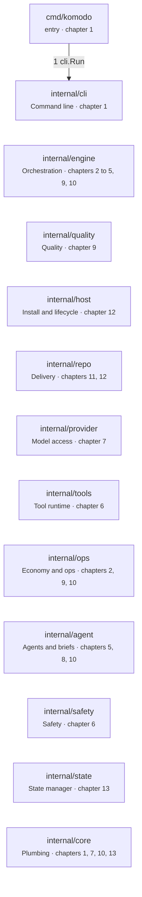
**Reading the diagram.** `cmd/komodo` calls `cli.Run`. Packages are listed from the top of the import line to the bottom; the allowed and refused imports are drawn in [0.4 Import Order](#04-import-order).

| Package | Holds | Chapters |
|---|---|---|
| `cmd/komodo` | `main.go`, calling `cli.Run(os.Args)`, and the end-to-end tests in `e2e_test.go` | [1](#1-cli-and-configuration) |
| `internal/cli` | Verb table, dispatch, envelope, exit codes, pin check, help generation, every verb as a thin call | [1](#1-cli-and-configuration) |
| `internal/host` | Probe, install, Claude and Codex detection, fresh (self-update), operating-system schedule entries, doctor (the health check) | [12](#12-install-binary-lifecycle-and-gate) |
| `internal/engine` | `Drive` and `Next()`, stages and epochs, intake, build, verify, pool, queue, worktree, shutdown, session, schedule, limits, recover | [2](#2-event-spine-and-state-machine), [3](#3-engine-internals), [4](#4-workspace-and-leases), [5](#5-sessions-agents-and-briefs), [9](#9-check-review-tester-and-recovery), [10](#10-scheduler-cache-and-observability) |
| `internal/quality` | Check, review, tester, evidence | [9](#9-check-review-tester-and-recovery) |
| `internal/repo` | Backlog, lint (an automatic rule check), graph, repo map, ship, git, pull request, release, gate | [11](#11-backlog-planning-ship-and-release), [12](#12-install-binary-lifecycle-and-gate) |
| `internal/provider` | Provider interface, billing, harness tool loop, Claude CLI, Codex stub, Anthropic API, OpenAI-compatible servers | [7](#7-providers-and-http) |
| `internal/tools` | Tool registry, Model Context Protocol server, file tools, run, git read, submit tools, skill and web | [6](#6-tools-guard-and-sandbox) |
| `internal/ops` | Budget, ledger, bus, wake | [2](#2-event-spine-and-state-machine), [9](#9-check-review-tester-and-recovery), [10](#10-scheduler-cache-and-observability) |
| `internal/agent` | Agent and job template structs, skills, rules, render, brief (a worker's prompt from 20 slots), trim | [5](#5-sessions-agents-and-briefs), [8](#8-skills-rules-and-output), [10](#10-scheduler-cache-and-observability) |
| `internal/safety` | Guard, rows, paths, shell, guard table, process control, sandboxes | [6](#6-tools-guard-and-sandbox) |
| `internal/state` | Manager API, group state, kind registry and envelope, kinds, validation, migrations | [13](#13-state-manager) |
| `internal/core` | Config, detect, HTTP, cache, create-only and rename-aside file helpers (only `state` calls them), version, fs, test home | [1](#1-cli-and-configuration), [7](#7-providers-and-http), [10](#10-scheduler-cache-and-observability), [13](#13-state-manager) |

#### Code rules

- **Standard library only:** `go.mod` lists no modules.
- **New packages:** a new package needs a layer that no existing package serves.
- **File size:** a file splits at about 600 lines. About 90 files in 12 packages.
- **Tests:** `_test.go` files sit next to their sources.

#### Top-level layout

| Path | Holds | Chapter |
|---|---|---|
| `AGENTS.md`, `CLAUDE.md` | `AGENTS.md` is the source of truth for repository rules; `CLAUDE.md` holds only the `@AGENTS.md` import | [12](#12-install-binary-lifecycle-and-gate) |
| `go.mod`, `komodo.go` | `go.mod` uses the standard library only; `komodo.go` embeds `embed/` and `templates/` with `//go:embed` | [0.5](#05-embedded-assets) |
| `install.sh`, `install.ps1` | The first-install scripts: `install.sh` for macOS, Linux and Windows Subsystem for Linux, `install.ps1` for native Windows | [12](#12-install-binary-lifecycle-and-gate) |
| `cmd/komodo/`, `internal/` | All Go code, one folder per package in the table above | [0.3](#03-package-map) |
| `embed/` | Everything a model reads, compiled into the binary | [0.5](#05-embedded-assets) |
| `templates/` | Files `install` copies into a user's repository: project documents and the pull request template, the `CLAUDE.md` and `.claude/settings.json` pair, one example job under `templates/jobs/`, which `jobs list` never reads; a person copies it into `~/.komodo/jobs/` to turn the job on | [12](#12-install-binary-lifecycle-and-gate) |
| `dashboard/` | A proof of concept of an opt-in browser dashboard on mock data: `dashboard.go` (loopback server), `assets/` (embedded htmx 2.0.11, pipeline pointers), `testdata/groups.json`, `poc/main.go` (`go run ./dashboard/poc`, moves mock groups every 2 s). Nothing imports it. It becomes the `komodo ui` verb ([Verbs (chapter 1)](#verbs)): htmx and plain SVG fed by server-sent events, with no Node or build step; its code moves to `internal/cli/ui.go` and `embed/ui/` when the verb is built. | none |
| `docs/` | `docs/prd.md` and `docs/decisions/0001-standalone-harness.md` (not yet written), `docs/hld.md`, `docs/lld.md`, and `docs/backlog/epic-1/`, the task groups that build each component | [11](#11-backlog-planning-ship-and-release) |
| `testdata/fixture-repo/` | The small repository that end-to-end runs build against | [15](#15-verification-operations-and-cutover) |

### 0.4 Import Order

An import is one package using another. Packages import in one direction only, so no import cycle exists and the plumbing never depends on the interface. The reasons for the layering are in [HLD 5.1](hld.md#51-layers-and-import-order).

`cli` → `engine` → `quality` → `host` → `repo` → `provider` → `tools` → `ops` → `agent` → `safety` → `state` → `core`

- **The rule:** a package may import any package to its right in the line above and none to its left. A package may skip levels: `cli` may import `core` directly.
- **Higher needs as parameters:** when a lower package needs something from a higher one, the higher one passes it in as a function argument. When `quality` needs to start a model session (an `engine` job), the engine hands it a session runner function. The same applies to filled slots in `agent` and to the verb table that `komodo gate` compares with `help --json`, which `cli` passes in `GateOptions.Verbs`. `cli` also starts the tool server with two function values: a `tools.LintFunc` that runs `repo.LintDraft`, and a `tools.RuleKnown` that looks a rule identifier up in the lens catalogs of `quality`; `tools` imports neither.
- **Why `state` sits just above `core`:** every package that keeps state calls the state manager, and the manager needs only the atomic file writes of `core`. `core` never imports `state`. The `config` verb in `cli` writes the checksum and the audit rows through the state manager; `core` builds them and receives the writer as a parameter ([1.4](#14-interfaces)).
- **Enforcement:** `komodo gate` reads every import and fails the build when one points up the line.

**📐 Which imports are allowed**
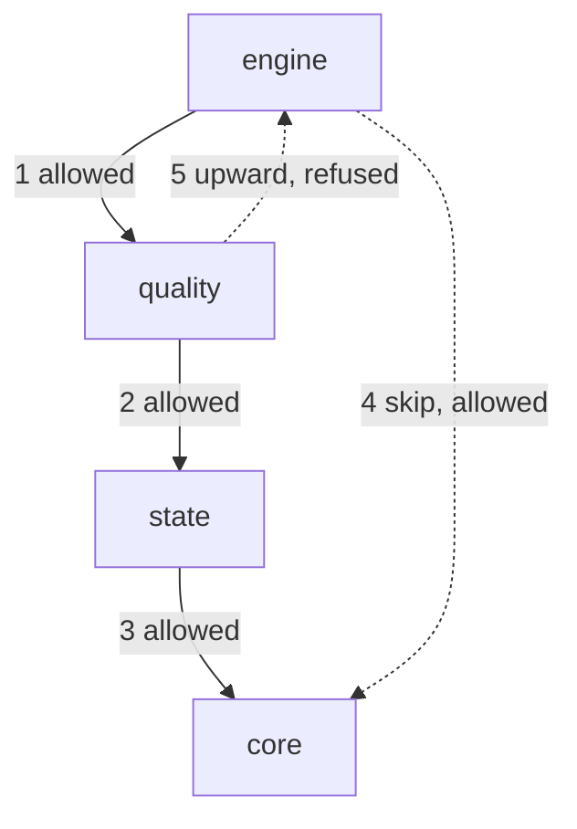
**Reading the diagram.** Arrows 1 to 3 import the next package down. Arrow 4 skips levels, which is allowed. Arrow 5 points up the line, so `komodo gate` fails the build.

### 0.5 Embedded Assets

The `embed/` folder holds every text and data file a model or the engine reads. All of it is compiled into the binary with `//go:embed`, and nothing is parsed from disk at run time, so a file planted on a machine cannot change what a worker sees.

- **Strict decoding:** every JSON file the binary reads from its own assets uses `DisallowUnknownFields` and carries a schema version `v`. An unknown field or an old shape fails loudly.
- **Generated files:** `skills/index.json` and `state.schema.json` are generated at build; the gate checks that generated files match their sources, and compares each `.golden` file byte for byte with the rendered template.

| Path | Contents | Chapter |
|---|---|---|
| `agents/<name>/{agent.json, prompt.md}` | Seven agents: builder, reviewer, planner, tester, architect, researcher, scout. `agent.json` is what Go reads; `prompt.md` is the role text the model reads | [5](#5-sessions-agents-and-briefs) |
| `jobs/` | Job templates compiled into the binary; none ship, and a file of the same name in `~/.komodo/jobs/` wins | [10](#10-scheduler-cache-and-observability) |
| `rules/orchestrator.md`, `rules/backlog.md` | Orchestrator rules; backlog grammar rules | [8](#8-skills-rules-and-output), [11](#11-backlog-planning-ship-and-release) |
| `output/{adhd,standard}/*.tmpl, *.golden`, `output/fixtures/*.json`, `output/{adhd,standard}.md` | Templates and golden fixtures (stored expected output that a test compares against) per profile, the fact inputs of the fixtures, and each profile's style text for the `AGENTS.md` block | [8](#8-skills-rules-and-output) |
| `lenses/<lens>.json, <lens>.md` | rule catalogs and bodies | [9](#9-check-review-tester-and-recovery) |
| `langs/<lang>.json` | Per-language definition patterns for the repo map | [11](#11-backlog-planning-ship-and-release) |
| `skills/index.json`, `skills/rules.json`, `skills/<name>/SKILL.md` | Generated index with SHA-256 (a standard content fingerprint) per skill and the generated standards rule list; 5 orchestrator skills (`run`, `plan`, `respond`, `komodo`, `release`) plus 34 `standards-*` | [8](#8-skills-rules-and-output) |
| `defaults.json` | Built-in defaults and hard limits; `komodo config --help` lists keys from this one schema | [1](#1-cli-and-configuration) |
| `state.schema.json` | Generated at build from the state manager's kind registry, the event enum included | [13](#13-state-manager) |
| `models.json` | Default models per weight and link, Claude windows and prices | [7](#7-providers-and-http) |
| `policy.json` | Guard rows with scopes, steering phrases | [6](#6-tools-guard-and-sandbox) |

## 1. CLI and Configuration

The command-line interface turns a typed `komodo <verb>` into one call into the package that owns the work and prints one JSON envelope. Configuration is the audited settings file that every package reads. What the subsystem is for and who it talks to: [HLD 5.2](hld.md#52-cli-and-configuration).

### 1.1 Scope and Concepts

**Owns:**
- The verb table, the five-step pipeline every verb runs, the envelope, the exit codes, the tiers and the repo pin check.
- `help` and `help --json`, generated at build, and the verb contract written into the repo's `AGENTS.md` block.
- The configuration file `~/.komodo/config.json`: two layers, strict decode, hard limits, the write path, the hash guard and the audit log.
- The 33 flat keys, the agent and endpoint sections, the three environment variables, command detection and the capacity profile.

**Does not own:**
- The work behind each verb. Runs and stages belong to [Engine Internals](#3-engine-internals), `install`, `fresh`, `doctor` and `gate` to [Install, Binary Lifecycle and Gate](#12-install-binary-lifecycle-and-gate), `jobs` and `cache` to [Scheduler, Cache and Observability](#10-scheduler-cache-and-observability), and `plan`, `add` and `release` to [Backlog, Planning, Ship and Release](#11-backlog-planning-ship-and-release).
- Turning codes and facts into report text, which is [Skills, Rules and Output](#8-skills-rules-and-output).
- Reading and writing state files, which is the [State Manager](#13-state-manager).
- Measuring a link's context window and billing, which is [Providers and HTTP](#7-providers-and-http).

**Concepts**

- **Verb:** a `komodo` subcommand such as `run`. Each verb has one row in the verb table.
- **Tier:** who may call a verb. Shared verbs are for a person or the orchestrator, terminal-only verbs for a person at a controlling terminal, internal verbs for the engine.
- **Orchestrator:** the AI session that drives the work through verbs and never edits code. [Glossary](hld.md#12-glossary).
- **Envelope:** the JSON reply `{v, ok, verdict, report, data, error}` that every verb prints when no terminal is attached.
- **Repo pin:** the `min=` version in the Komodo block of the repo's `AGENTS.md`. A binary older than the pin refuses most verbs.
- **Effective config:** the built-in layer overlaid with the machine layer `~/.komodo/config.json`, after strict decode and hard-limit checks.
- **Hard limit:** the largest or smallest value the built-in layer allows for a key. The machine layer cannot pass a hard limit.
- **Flat key:** a dotted setting name such as `limits.pool_max`, stored at the top level of `config.json`.
- **Section:** one of the two nested objects in `config.json`, `agents.<name>` and `endpoints.<name>`.
- **Command class:** one of `setup`, `build`, `test`, `lint`, `format` or `git-read`, detected from marker files.
- **Capacity profile:** the record `{ctx, slots, cost_class, effort}` the engine derives for a link before each session.

### 1.2 Package Layout

| File | Holds |
|---|---|
| `cmd/komodo/main.go` | Calls `cli.Run(os.Args)` and exits with the code returned; `e2e_test.go` beside it holds the end-to-end tests |
| `internal/cli/cli.go` | Verb table, parse, validate, resolve, dispatch, render, envelope, exit codes, pin check |
| `internal/cli/help.go` | `help` text, `help --json` and the `komodo` skill, generated at build and embedded |
| `internal/cli/work.go` | `run`, `status`, `stop`, `resume`, `abandon` |
| `internal/cli/plan.go` | `plan`, `skill`, `scope` |
| `internal/cli/jobs.go` | `jobs` |
| `internal/cli/setup.go` | `install`, `init`, `uninstall`, `fresh`, `doctor`, `sync`, `version` |
| `internal/cli/ui.go` | `ui`: the loopback dashboard server |
| `internal/cli/config.go` | The `config` verb: reads, writes, `--default` and `--accept` |
| `internal/cli/repo.go` | `add`, `gate`, `release`, `cache` |
| `internal/cli/internal.go` | `internal tools`, `internal guard`, `internal job`, `internal fresh-bg` and `internal parent` |
| `internal/core/config.go` | `config.json`, the agent and endpoint sections, hard limits, the audit log |
| `internal/core/detect.go` | Repo profile and command classes |
| `internal/core/version.go` | Embedded version and semantic-version comparison, used by the pin check |
| `internal/core/capacity.go` | `CapacityProfile` and the weight-to-effort mapping |
| `internal/core/fs.go` | Atomic file writes |
| `internal/core/tokens.go` | The bundled tokenizer: counts for the brief ceiling, the skill size gate and the 80% trim |
| `embed/tokenizer.bin` | The tokenizer's byte-pair vocabulary, the public `o200k_base` table; the one input outside the Go standard library |
| `embed/defaults.json` | Built-in default of every key |
| `embed/policy.json` | Guard rows with scopes and steering phrases |

`init` lives in `internal/cli/setup.go` beside `install`; it builds the Komodo plugin from `embed/` and runs the `claude plugin` commands ([Verbs](#verbs)).

`embed/defaults.json` holds the default and the hard limit of every key, one `KeySpec` per key with its fields in snake_case. `embed/policy.json` holds only the guard rows and the steering phrases; its layout is in [Tools, Guard and Sandbox](#6-tools-guard-and-sandbox).

```json
{
  "keys": [
    { "name": "limits.returns", "kind": "int", "default": 3, "min": 0, "max": 5 },
    { "name": "limits.pool_min", "kind": "int", "default": 1, "min": 1, "max_key": "limits.pool_max" }
  ]
}
```

Imports run downward only: `cli` sits above every other package and may import any of them; `core` is the lowest and imports no Komodo package. Each verb file holds thin wrappers that call into the owning package, never the logic itself.

**📐 Where the command-line code sits**
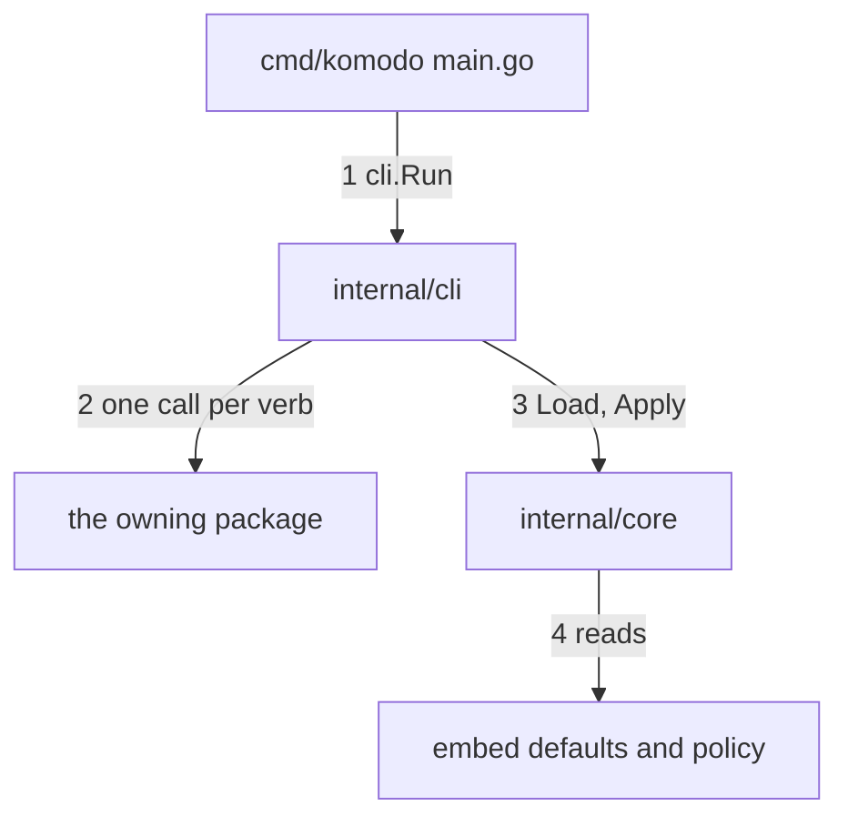

**Entry points**

| Flow | Starts at |
|---|---|
| Process start | `cli.Run(args []string) int` in `internal/cli/cli.go` |
| The five steps | `parse`, `validate`, `resolve`, `dispatch`, `render` in `internal/cli/cli.go` |
| Config read, once per process | `Store.Load` in `internal/core/config.go` |
| Config write | `Store.Apply`, called by the handler in `internal/cli/config.go` |
| Hand-edit check | `Store.Verify`, called by `validate` |
| Command detection | `core.Detect` in `internal/core/detect.go` |

### 1.3 Data Model

#### Envelope and exit codes

Every verb that runs without a terminal, or with `--json`, prints exactly one `Envelope`, `{v: 1, ok, verdict, report, data, error{code, reason, fix}}`, and nothing else. When `ok` is false the `error{code, reason, fix}` object is set and `error.fix` names the resolving command. The handler returns a `Result`; the render step turns the `Result` into the envelope and the exit code.

```go
// internal/cli/cli.go

// Envelope is the one JSON reply every verb prints under --json.
type Envelope struct {
	V       int        `json:"v"`
	OK      bool       `json:"ok"`
	Verdict string     `json:"verdict"`
	Report  string     `json:"report"`
	Data    any        `json:"data"` // an empty object, never nil, when the verb returns none
	Error   *ErrorBody `json:"error,omitempty"`
}

// ErrorBody explains a refusal or failure; a caller branches on Code.
type ErrorBody struct {
	Code   string `json:"code"`
	Reason string `json:"reason"`
	Fix    string `json:"fix"`
}

// Outcome classifies a finished verb; its value is the process exit code.
type Outcome int

const (
	OutcomeOK       Outcome = 0 // the verb did what was asked
	OutcomeRefused  Outcome = 1 // Komodo declined on purpose
	OutcomeUsage    Outcome = 2 // the command line was wrong
	OutcomeBlocked  Outcome = 3 // the verb reports a blocked state
	OutcomeInternal Outcome = 4 // Komodo itself failed
)

// Result is what a handler returns; render turns Code and Facts into the report.
type Result struct {
	Outcome Outcome
	Verdict string         // one line, first line of the report
	Code    string         // reason code from the closed code list; empty on plain success
	Facts   map[string]any // values the report template prints
	Data    any            // the verb's typed result, placed in Envelope.Data
	Reason  string         // set when Outcome is not OutcomeOK
	Fix     string         // the command or change that resolves it
}
```

| Field | Type | Meaning |
|---|---|---|
| `v` | int | Envelope version, 1; a change to the shape raises the number |
| `ok` | bool | `true` when the verb did what was asked |
| `verdict` | string | One line summing up the outcome |
| `report` | string | Human text already laid out for `output.profile`; the orchestrator relays the text verbatim |
| `data` | object | The verb's typed result; `{}` when the verb returns none |
| `error` | `{code, reason, fix}` | Present only when `ok` is `false`; `code` is the word a caller branches on, `reason` explains the failure and `fix` names the resolving command |

| Exit | Outcome | Meaning |
|---|---|---|
| 0 | `OutcomeOK` | The verb succeeded |
| 1 | `OutcomeRefused` | A terminal-only verb without a terminal, a pinned repo, a tampered config, a locked group or a value over its limit |
| 2 | `OutcomeUsage` | An unknown verb or flag or a bad value; an unknown flag's message names the closest real flag |
| 3 | `OutcomeBlocked` | The verb reports a blocked state |
| 4 | `OutcomeInternal` | Komodo itself failed |

Exit 1 means the verb refused before acting: a missing terminal, a pinned repo, a tampered config, a locked group, a value over its limit, no repository, or not the Komodo repository. Exit 3 means the verb acted and reports a state the caller must handle: a Blocked group (`run`, `resume`, `status --wait`), a failed gate, a `doctor` check that errored, or a plan blocked by `lint`. Exit 4 means Komodo itself failed: a recovered panic, an undecodable state record or a failed write to Komodo's own files.

Command-line refusals use these codes of the closed code list ([Skills, Rules and Output](#8-skills-rules-and-output)):

| Situation | Exit | `error.code` |
|---|---|---|
| Repository pinned above the binary | 1 | `pinned` |
| Terminal-only verb without a terminal | 1 | `no_terminal` |
| Verb that needs a repository, run outside one | 1 | `no_repo` |
| Value over its hard limit | 1 | `over_limit` |
| Unknown verb or flag, bad flag value, bad `--input` | 2 | `usage` |
| Unknown config key or agent name | 2 | `unknown_key` |
| Value of the wrong type or outside its enum | 2 | `bad_value` |
| Hand edit of a locked group's backlog files | 1 | `card_changed` |
| Komodo itself failed | 4 | `internal` |

`report` is the template of `Result.Code` rendered under `output.profile` ([Skills, Rules and Output](#8-skills-rules-and-output)). `data` is the verb's result struct from its owning package, encoded with snake_case JSON tags, and a field is never removed within one envelope version. `help --json` prints one object per verb, `{name, summary, tier, flags, result}`, where `result` is the JSON Schema (draft 2020-12) of that struct, generated at build from its tags; each verb's golden `--json` test pins the shape.

A verb that refused, as printed under `--json` after a hand edit of `config.json`; exit code 1.

```json
{
  "v": 1,
  "ok": false,
  "verdict": "Refused: config.json was hand-edited",
  "report": "Refused: config.json was edited outside komodo config.\nFix: komodo config --accept",
  "data": {},
  "error": {
    "code": "config_tampered",
    "reason": "config.json was hand-edited",
    "fix": "komodo config --accept"
  }
}
```

A verb that succeeded, `komodo run tg-1.2 --json`; exit code 0.

```json
{
  "v": 1,
  "ok": true,
  "verdict": "Run started for tg-1.2",
  "report": "Run started for tg-1.2.\nRun id: 0192e4c5-6f00-7a21-8c3b-2d9e0f1a4b57\nNext: komodo status --wait",
  "data": {
    "run_id": "0192e4c5-6f00-7a21-8c3b-2d9e0f1a4b57"
  }
}
```

**Versioning.** A reader branches on `v`. The only version is 1. A caller that reads a higher `v` than it knows treats the reply as unreadable and stops, reporting the version it got.

#### Verb table

The verb table is the one place that parse, validate, `help --json` and the docs-drift gate check read.

```go
// internal/cli/cli.go

// Tier says who may call a verb.
type Tier int

const (
	TierShared   Tier = iota // a person or the orchestrator
	TierTerminal             // a person at a controlling terminal only
	TierInternal             // the engine only; listed by help --all
)

// FlagSpec describes one verb flag for parsing, help and the docs-drift check.
type FlagSpec struct {
	Name    string // long name without dashes, such as "dry-run"
	Short   string // one-letter form; empty when none
	Kind    string // bool, string, int or duration
	Default string // text form of the default; empty when none
	Help    string // one line shown by help
}

// Verb is one row of the verb table.
type Verb struct {
	Name          string // "run", "config", "internal tools"
	Summary       string // one line shown by help
	Tier          Tier
	Flags         []FlagSpec         // verb-specific flags; global flags are added by parse
	NeedsTerminal func(c *Call) bool // nil when the verb never needs a terminal
	PinExempt     bool               // runs even when the repo pin is above this binary
	Run           Handler
}

// GlobalFlags holds the flags every verb accepts.
type GlobalFlags struct {
	JSON    bool
	Dir     string // -C: act on the repo at this path
	Input   string // --input: file path, or "-" for standard input
	Quiet   bool
	Verbose bool
	NoColor bool
	DryRun  bool
}

// RepoRef names the repo a verb acts on.
type RepoRef struct {
	ID   string // normalized origin URL, or the git common dir path with no remote
	Root string
}

// Call is everything a handler needs, filled by the first three steps.
type Call struct {
	Verb        *Verb
	Args        []string      // positional arguments after flag parsing
	Flags       *flag.FlagSet // the verb's parsed flags
	Global      GlobalFlags
	Repo        RepoRef // zero value when the verb needs no repo
	Config      *core.Effective
	HasTerminal bool
	Stdout      io.Writer
}

// Handler is one verb's thin call into the package that owns the work.
type Handler func(c *Call) Result
```

`PinExempt` is `true` for exactly 5 verbs: `help`, `version`, `fresh`, `install` and `doctor`. `NeedsTerminal` is set for each terminal-only form in the [tier table](#14-interfaces): `config` calls that write, `doctor --fix`, `jobs run|pause|resume`, `cache clear`, `gate --install` and `gate --install-hooks`.

The `--input` object holds each flag under its long name and the positional arguments, in order, under `args`: `{"args": ["tg-1.2"], "stage": "build"}` is `run tg-1.2 --stage build`. An unknown key is a usage error, like an unknown flag.

#### Configuration files

`~/.komodo/config.json` is created by the first `komodo config` write; before that the built-in defaults apply. On Windows the folder is `%LOCALAPPDATA%\komodo`, and `KOMODO_HOME` replaces the folder everywhere.

| Top-level key | Holds |
|---|---|
| A dotted key such as `limits.pool_max` | One flat key; the value's type is that key's type in the [flat key table](#18-config) |
| `agents` | An object keyed by agent name; each value is an agent section |
| `endpoints` | An object keyed by endpoint name; each value is an endpoint section |

A `config.json` in which a person has set three flat keys and one agent section; every value is within its hard limit.

```json
{
  "output.profile": "standard",
  "limits.pool_max": 4,
  "cache.max_mb": 512,
  "agents": {
    "reviewer": {
      "model": "sonnet",
      "session_wall_min": 90,
      "retries": 3
    }
  }
}
```

```go
// internal/core/config.go

// Layer names where a setting's value came from.
type Layer int

const (
	LayerBuiltIn Layer = 1 // embed/defaults.json
	LayerMachine Layer = 2 // ~/.komodo/config.json
)

// Kind is the value type of a flat key.
type Kind int

const (
	KindString Kind = iota
	KindEnum        // one of KeySpec.Enum
	KindBool
	KindInt
	KindNumber   // integer or decimal, such as warn.usd_per_run
	KindDuration // such as 1h or 10m
	KindPath     // a file path
	KindEnvRef   // env:NAME, never a secret value
)

// KeySpec is one row of the built-in registry: a flat key, its default and its hard limit.
type KeySpec struct {
	Name    string
	Kind    Kind
	Default any      // nil when Derived is set
	Enum    []string // allowed values for KindEnum
	Min     any      // hard minimum; nil when none
	Max     any      // hard maximum; nil when none
	MaxKey  string   // another key that caps this one, such as limits.pool_max
	Derived string   // names the rule when the default is computed per group
	Family  bool     // the name ends in a link name, such as limits.link_sessions.claude-cli
}

// Setting is one resolved value and the layer that set it.
type Setting struct {
	Value  any
	Source Layer
}

// AgentSettings is the agents.<name> section; nil fields fall back to the flat keys.
type AgentSettings struct {
	Model          string `json:"model,omitempty"`
	SessionWallMin *int   `json:"session_wall_min,omitempty"`
	SessionIdleMin *int   `json:"session_idle_min,omitempty"`
	Retries        *int   `json:"retries,omitempty"`
}

// EndpointSettings is the endpoints.<name> section; its keys are described in Providers and HTTP.
type EndpointSettings struct {
	URL        string            `json:"url"`
	Models     map[string]string `json:"models,omitempty"` // weight to model name
	Ctx        int               `json:"ctx,omitempty"`
	Key        string            `json:"key,omitempty"` // env:NAME reference only
	SelfHosted bool              `json:"self_hosted,omitempty"`
	FirstByteS int               `json:"first_byte_s,omitempty"`
}

// Effective is the merged config every package reads; a run pins Hash in its state.json.
type Effective struct {
	Flat      map[string]Setting
	Agents    map[string]AgentSettings
	Endpoints map[string]EndpointSettings
	Hash      string
}
```

**Versioning.** `config.json` carries no version field. A reader decodes `config.json` strictly, so a key the running binary does not know is an error that names the closest known key; a file written by a newer binary with a new key therefore fails to load on an older one. The strict decode is the version check, so `config.json` stays without a version field; the refusal names the key and the fix `run komodo fresh`.

#### Audit log and hash

```go
// internal/core/config.go

// Change is one key moving from an old value to a new one.
type Change struct {
	Key string
	Old any
	New any
}

// Batch is one successful write: every change from one `komodo config` call.
type Batch struct {
	ID      string
	Time    time.Time
	Changes []Change
}
```

| Audit field | Meaning |
|---|---|
| time | When the batch was written |
| batch id | Groups the rows of one call |
| key | The flat key or section key that changed |
| old value | The value before the write |
| new value | The value after the write |

`state/config.log` (the full path is `~/.komodo/state/config.log`) holds one row per changed key; `state/config.sha` holds the SHA-256 checksum of `config.json`. Both are the state kind `config_audit`, written with `Append` and `Replace` ([State Manager](#13-state-manager)). The `config` verb in `cli` writes both through the state manager, handing `core` an `AuditSink` ([1.4](#14-interfaces)). `config --accept` logs one row.

Each `config.log` line is one JSON object (JSON Lines): `time` in RFC 3339 UTC, `batch`, `key`, `old` and `new`. The batch id is a UUID version 7, the form of a run id, so ids sort by time. `config.sha` holds the 64 lowercase hexadecimal characters of the SHA-256 of the exact `config.json` bytes, then a newline. The `--accept` row has `key` `config.json`, with the checksums before and after as `old` and `new`.

```json
{"time":"2026-10-13T09:12:04Z","batch":"0192e5a1-3c00-7b10-8d2e-4f6a1b2c3d4e","key":"limits.returns","old":3,"new":4}
{"time":"2026-10-13T09:20:11Z","batch":"0192e5a8-9e00-7c42-9a1b-5e7f2c3d4e5f","key":"config.json","old":"<64 hexadecimal characters>","new":"<64 hexadecimal characters>"}
```

The effective-config hash is the SHA-256, in lowercase hexadecimal, of the JSON encoding of `Effective` without `Hash` and without each setting's `Source`. Go's `encoding/json` writes map keys in sorted order, so the same values give the same hash on every machine.

#### Command detection

```go
// internal/core/detect.go

// Class is one kind of command the engine and the agents' run tool execute.
type Class string

const (
	ClassSetup   Class = "setup"
	ClassBuild   Class = "build"
	ClassTest    Class = "test"
	ClassLint    Class = "lint"
	ClassFormat  Class = "format"
	ClassGitRead Class = "git-read" // git status, diff, log and show; always on
)

// Command is one detected command, run without a shell.
type Command struct {
	Class  Class
	Argv   []string
	Marker string // the file that produced it; "Makefile" when a target won
}

// CommandSet is the detected commands of one repo and the hash they are cached under.
type CommandSet struct {
	Commands   []Command
	MarkerHash string // hash of the marker files; the cache key
}
```

| Marker | `setup` | `build` | `test` | `lint` | `format` |
|---|---|---|---|---|---|
| `go.mod` | `go mod download` | `go build ./...` | `go test ./...` | `go vet ./...` | `gofmt -l .` |
| `package.json` | `npm ci` | `npm run build` | `npm test` | `npm run lint` | `npm run format` |
| `Cargo.toml` | `cargo fetch` | `cargo build` | `cargo test` | `cargo clippy` | `cargo fmt --check` |
| `pyproject.toml` | none | none | `pytest` | `ruff check` | `ruff format --check` |
| `Makefile` | `make setup` | `make build` | `make test` | `make lint` | `make fmt` |

A marker with no entry for a class leaves that class empty: `pyproject.toml` has no `setup` or `build`, `pytest` tests, and `ruff` lints and checks formatting.

#### Capacity profile

```go
// internal/core/capacity.go

// CapacityProfile is what the engine knows about one link before a session starts.
type CapacityProfile struct {
	Ctx       int    // measured context window in tokens
	Slots     int    // concurrent sessions allowed on the link (limits.link_sessions.<link>)
	CostClass string // subscription, free or paid, from the billing check
	Effort    string // high, medium or low, from the agent's weight
}
```

`CapacityProfile` lives in `core`, so the provider adapters, the brief builder and the engine all import it downward. `Effort` follows the agent's weight: heavy `high`, standard `medium`, light `low` ([Providers and HTTP](#7-providers-and-http)).

### 1.4 Interfaces

#### Go entry points

```go
// internal/cli/cli.go

// Run parses args, runs one verb and returns the process exit code.
func Run(args []string) int

// Renderer is what the render step needs from the output package.
type Renderer interface {
	Render(name string, facts any) (string, error)
}
```

The renderer's real signature is owned by [Skills, Rules and Output](#8-skills-rules-and-output); this interface states only what the command-line code needs from the output package.

```go
// internal/core/config.go

// ErrTampered means config.json no longer matches the checksum in state/config.sha.
var ErrTampered = errors.New("config.json was edited outside komodo config")

// LimitError reports a value over its hard limit, naming the key, the value and the limit.
type LimitError struct {
	Key   string
	Value any
	Limit any
}

// UnknownKeyError reports a key outside the registry and names the closest one.
type UnknownKeyError struct {
	Key     string
	Closest string
}

// Error describes the exceeded limit.
func (e *LimitError) Error() string

// Error names the unknown key and the closest known one.
func (e *UnknownKeyError) Error() string

// ResetScope says what a --default reset covers.
type ResetScope int

const (
	ScopeKey      ResetScope = iota // one flat key
	ScopeAgent                      // one agent section
	ScopeEndpoint                   // one endpoint section; lists each change, asks for y
	ScopeFile                       // the whole file; lists each change, asks for y
)

// ResetTarget names what a --default reset covers.
type ResetTarget struct {
	Scope ResetScope
	Name  string
}

// Store reads and writes the machine config file; only the config verb writes.
type Store interface {
	// Verify compares config.json with state/config.sha; ErrTampered on mismatch.
	Verify() error
	// Load merges the built-in and machine layers with strict decode and hard-limit checks.
	Load() (*Effective, error)
	// Registry lists every built-in flat key.
	Registry() []KeySpec
	// Apply checks every change against the registry and writes all of them or none.
	Apply(changes []Change) (Batch, error)
	// PlanReset returns the changes that put a target back to its built-in value.
	PlanReset(t ResetTarget) ([]Change, error)
	// Accept rehashes config.json after a hand edit and records the acceptance.
	Accept() (Batch, error)
}

// Int returns the integer value of a flat key.
func (e *Effective) Int(key string) int

// String returns the string value of a flat key.
func (e *Effective) String(key string) string

// Bool returns the boolean value of a flat key.
func (e *Effective) Bool(key string) bool

// TrackUsage resolves track.usage: auto is on under economy mode and off under thorough mode.
func (e *Effective) TrackUsage() bool

// LinkSessions returns the session slots of a link, unless set; the default is in 7.8.
func (e *Effective) LinkSessions(link string, loopback bool) int

// SessionWallMin returns an agent's wall-time limit; the agent section beats the flat key.
func (e *Effective) SessionWallMin(agent string) int

// SessionIdleMin returns an agent's silence limit; the agent section beats the flat key.
func (e *Effective) SessionIdleMin(agent string) int

// Retries returns how many fresh builder sessions a group gets after timeouts and idle stops.
func (e *Effective) Retries(agent string) int

// GroupWallMin returns a group's wall-time limit in minutes, 60 by default; no other package works it out.
func (e *Effective) GroupWallMin() int
```

```go
// internal/core/detect.go

// MarkerFiles are the files command detection looks for, in table order.
var MarkerFiles = []string{"go.mod", "package.json", "Cargo.toml", "pyproject.toml", "Makefile"}

// Detect reads the marker files under root and returns the repo's commands.
func Detect(root string) (CommandSet, error)

// For returns the detected commands of one class.
func (s CommandSet) For(class Class) []Command
```

| Method | An error means | The caller does |
|---|---|---|
| `Store.Verify` | `ErrTampered`: the checksum differs; or the files cannot be read | `validate` exits 1 with `config_tampered` and the fix `komodo config --accept` |
| `Store.Load` | A key is outside the registry, a value has the wrong type or a value is over a hard limit | `resolve` exits 1 naming the key, and the closest key or the limit |
| `Store.Apply` | `UnknownKeyError`, `LimitError` or a type error on one pair | The verb exits with a refusal and nothing is written, so the file and the audit log are unchanged |
| `Store.PlanReset` | The target names no known key, agent or endpoint | The verb refuses; for endpoint and file scopes the verb lists each change and waits for a typed `y` |
| `Store.Accept` | The file cannot be hashed | The verb exits with a failure and the guard stays tripped |
| `Detect` | A marker file cannot be read | The caller fails; an empty set is not an error, and `run` refuses naming `MarkerFiles` |

An unknown key exits 2 with `unknown_key`, a type error exits 2 with `bad_value`, and a failed read of `config.json` or `state/config.sha` exits 4 with `internal`.

The `config` handler passes `core` what it cannot import: an `AuditSink` over the state manager, and a `probed` function that reads `state/providers.json` and accepts a model only when a probed link lists it. With no probe file a `model` write is refused with `over_limit` and the fix `komodo doctor`.

```go
// internal/core/config.go

// AuditSink writes the audit log and the checksum through the state manager; cli implements it.
type AuditSink interface {
	AppendBatch(b Batch) error        // one config.log line per change
	ReplaceChecksum(sum string) error // rewrites state/config.sha
	Checksum() (string, error)        // reads state/config.sha; empty when the file is absent
}

// NewStore returns the config store; probed reports whether a model name passed the provider probe.
func NewStore(home string, sink AuditSink, probed func(model string) bool) Store
```

| Caller | Calls | When |
|---|---|---|
| `cli.validate` ([1.5](#15-behaviour)) | `Store.Verify` | Every verb except `config --accept` |
| `cli.resolve` | `Store.Load`, then `Detect` for verbs that need commands | Once per process |
| The `config` handler | `Registry`, `Apply`, `PlanReset`, `Accept` | Config writes, after the terminal check |
| Engine ([Engine Internals](#3-engine-internals)) | `Effective` accessors and `Hash` | At run start; the hash is saved in the group's `state.json` |
| Engine | `CapacityProfile` derivation | Before each session starts |
| Brief builder ([Sessions, Agents and Briefs](#5-sessions-agents-and-briefs)) | `CapacityProfile.Ctx` | Sizing every prompt |
| Check and the `run` tool ([Tools, Guard and Sandbox](#6-tools-guard-and-sandbox)) | `CommandSet.For` | Running a class of command |
| `komodo gate` | The verb table against `help --json`, passed in `GateOptions.Verbs` | Every gate run |

#### Global flags

| Flag | Meaning | Default |
|---|---|---|
| `--json` | Print only the envelope | On when there is no terminal |
| `-C <path>` | Act on the repo at that path; the repo id is resolved from that path | The current folder |
| `--input <file\|->` | The verb's arguments as one JSON object, from a file or from standard input (`-`); an explicit flag wins over the same key | none |
| `-q`, `-v` | Less or more human text in `report`; long forms `--quiet` and `--verbose` | none |
| `--no-color` | Plain text; the `NO_COLOR` variable does the same | `output.color` |
| `-h`, `--help` | Same as `komodo help <verb>`; at any level of `config`, the flag lists the keys below that level | none |
| `--dry-run` | On every writing verb: print each write, make none; `install --dry-run` prints a table of file, action (`write | keep | prune`) and reason | none |

#### Tiers

| Tier | Who calls it | Verbs |
|---|---|---|
| Shared | A person or the orchestrator | `help`, `version`, `doctor`, `sync`, `add backlog`, `add changelog`, `plan`, `run`, `status`, `skill`, `scope approve|deny`, `resume`, `stop`, `abandon`, `jobs list|show|tick`, `cache stats`, `gate` without `--install*`, `config` reads |
| Terminal-only | A person; refused with exit 1 without a controlling terminal | `install`, `init`, `ui`, `uninstall`, `fresh`, `config` writes, `doctor --fix`, `jobs run`, `jobs pause`, `jobs resume`, `cache clear`, `gate --install`, `gate --install-hooks`, `release` |
| Internal | The engine, or the host hook `install` writes | `internal tools`, `internal fresh-bg`, `internal guard`, `internal job` |

Agent shells have no controlling terminal: Claude Code's Bash tool cannot open `/dev/tty`. On Claude Code, deny rules that `install` writes into `.claude/settings.json` refuse `komodo config` writes, `install`, `fresh`, `release` and `gate --install` before the terminal check runs, and a denied command names the rule and the human path; other hosts rely on the terminal check alone. Orchestrator rule O7 forbids faking a terminal; a deny rule matches only a command that starts with the verb, so a wrapper is caught by the terminal check, not by the rule.

#### Verbs

| Verb | Flags |
|---|---|
| `help [verb]` | `--all` |
| `version` | `--check` |
| `install` | `--repo-only`, `--machine-only`, `--hosts claude,codex`, `--no-path`, `--from <file>`, `--project`, `--no-project`, `--schedule`, `--no-schedule`, `--force` |
| `uninstall` | `--repo-only`, `--machine-only` |
| `init` | `--remove` |
| `ui` | `--port <n>` (0 picks a free port) |
| `fresh` | `--check`, `--to <version>`, `--restart-runs` |
| `doctor [install\|backlog]` | `--fix`, `--sandbox <cmd>` |
| `config [agent\|endpoint <name>] <key>[=<value>]…` | `--all`, `--default`, `--accept` |
| `sync` | `--no-fetch` |
| `add backlog` | `--task`, `--group`, `--epic`, `--to <id>`, `--files <globs>`, `--done-when <text>` |
| `add changelog` | `--entry <text>`, `--kind added\|changed\|fixed\|removed` |
| `plan <goal>` | `--from <spec>`, `--epic <N>` |
| `run [group]` | `--stage <stage>` |
| `status [run]` | `--watch`, `--wait blocked\|done\|any`, `--timeout <dur>` (9m), `--session <id>`, `--explain`, `--backlog`, `--metrics`, `--all` |
| `skill list\|get` | `list --agent <name>`, `get <name> --section <heading>` |
| `scope approve\|deny <group>` | `--paths <list>`, `--reason <text>` |
| `resume <run>` | `--from <stage>` |
| `stop <run>` | none |
| `abandon <group>` | `--reason <text>`, `--keep-worktree` |
| `jobs list\|show\|run\|pause\|resume\|tick` | `<id>`; `run --ignore-window` |
| `cache stats\|clear` | `--kind skills\|context\|checks\|review\|setup\|map\|lang`, `--all` |
| `gate` | `--only <check>`, `--fast`, `--install`, `--install-hooks` |
| `release <version>` | `--notes-file <path>` |

**Help, version and installation**
- **`help [verb]`:** Prints the verb list, or one verb's flags and examples, from text generated at build and embedded, so `help` answers under 50 ms and changes nothing. `help --json` lists every verb, flag, type, default and result schema and marks the terminal-only verbs; the `AGENTS.md` block tells the orchestrator to run `help --json` first. `--all` also shows the internal tier.
- **`version`:** Prints the running version, the binary's path, the latest release Komodo knows of from `state/fresh.json` and the repo pin from `AGENTS.md`. `version` makes no network call and changes nothing. `--check` exits 3 when `state/fresh.json` names a release newer than the running binary and 0 otherwise, still with no network call.
- **`install`:** A person at a terminal runs `install`. `install` places the binary under `~/.komodo/versions/` and `bin/`, adds the path entry, probes providers, writes the Komodo block into `AGENTS.md`, the `@AGENTS.md` line into `CLAUDE.md` and four entries into `.claude/settings.json`, records the manifest and optionally an operating-system schedule entry; the steps are in [Install, Binary Lifecycle and Gate](#12-install-binary-lifecycle-and-gate). `install` diffs the wanted file list against `install.json`, applies only the differences, runs `doctor install` and fails when any check errors. A rerun makes 0 changes, a hand-edited owned file survives and is reported, and `install` never writes a config file.
- **`install` flags:** `--repo-only` writes only files inside the repo; `--machine-only` only the machine parts, which is what `install.sh` runs; `--hosts claude,codex` overrides host detection; `--no-path` skips the path step; `--from <file>` installs that binary file; `--project` also adds `docs/{prd,hld,lld}.md`, `CHANGELOG.md` and a pull request template; `--schedule` adds a launchd, cron or Task Scheduler entry that runs `komodo jobs tick` every 5 minutes; `--force` overwrites hand-edited owned files.
- **`uninstall`:** A person runs `uninstall`. `uninstall` reads the manifest and removes every file or settings entry `install` owns, in reverse, plus the repo's language cache. `--repo-only` and `--machine-only` limit the removal.
- **`init`:** A person at a terminal runs `init`, typically once after `install`. `init` puts Komodo's orchestrator skills and commands (`run`, `plan`, `respond`, `komodo`) into the global Claude Code setup; the 7 worker agents stay inside the binary because worker sessions load no user settings. `init` writes a local Claude Code plugin marketplace to `~/.komodo/plugin/`: `.claude-plugin/marketplace.json`, and `plugins/komodo/` with its `plugin.json` at the binary's version and the 4 skills from `embed/`. It then runs `claude plugin marketplace add ~/.komodo/plugin` and `claude plugin install komodo@komodo`, so the skills appear as `/komodo:run` and the like and cannot shadow a person's own. Claude Code reads a local marketplace's files in place, so a rerun after an update rewrites them to the new binary's version. `--remove` runs `claude plugin marketplace remove komodo`, which also uninstalls the plugin, then deletes the folder. `init` never edits `~/.claude/settings.json` itself.
- **`ui`:** A person at a terminal runs `ui`, the opt-in dashboard and the one verb that serves until stopped. `ui` listens on `127.0.0.1` at `--port` or a free port, prints the address with a random token, and stops on Ctrl-C. Every request must carry the token and name `127.0.0.1` as its host, so a web page cannot drive it. Pages are rendered with `html/template` and htmx from `embed/ui/`, and one small script draws the stage diagram from server-sent events built from the files `status` reads. Its buttons call the same Go functions as `resume`, `stop`, `abandon` and `config agent <name> model=<m>`, so it adds no rule of its own.
- **`fresh`:** A person runs `fresh`. `fresh` downloads the newest release to `versions/<v>/`, verifies the SHA-256 checksum and the ed25519 signature, and atomically replaces `bin/komodo`; live runs keep their own version. `--check` fetches the 1 KB `latest.json` now, one of only three places that do. `--to <version>` installs a named version and may downgrade. `--restart-runs` signals each live run to save its work within 2 minutes and resumes the run on the new binary, at the cost of at most one repeated model turn. A pinned repo names `fresh` in the fix line `run komodo fresh`; `fresh.auto` set to `false` or `CI=true` turns background updates off.

**Health and configuration**
- **`doctor [install|backlog]`:** Anyone runs `doctor`, including the orchestrator, and `doctor` still runs when the repo is pinned above the binary. `doctor` prints each check's result with a fix line and changes nothing except refreshing the provider probe in `state/providers.json`. With no argument, `doctor` runs both halves. `install` runs `doctor` at the end; phase 2 requires `doctor backlog` to pass on epic-1; cutover requires `doctor install` to find 0 stale references. `--fix` is terminal-only; `doctor --sandbox <cmd>` runs one command under the sandbox policy to show what a worker's `run` would see. `--fix` runs each failing check's fix that is a Komodo command, `komodo install --repo-only` or `komodo sync`, one at a time after printing it; a fix outside Komodo's own files, such as a shell profile, `~/.claude` or an Ollama setting, is only printed.
- **`doctor install` checks:**
  - The installed files against the manifest, the path entry and the sandbox, by running each detected command's `--version` inside the sandbox to prove the toolchain folders work.
  - The provider catalog as a table of weight, link, model identifier, window and the source of the window; each `http:` endpoint's context against `providers.ctx_floor`, where an Ollama server left at 4,096 fails and the fix `OLLAMA_CONTEXT_LENGTH=262144` is named; `OLLAMA_NUM_PARALLEL`; and that every agent's chain ends in a free backstop.
  - A missing or bad custom certificate file; shell syntax in detected commands; missing Docker tools and that the Docker daemon runs Linux containers; Windows long paths; the copy mechanism for tester worktrees; and that macOS has no process or memory cap.
  - Steering phrases or broken block markers in the repo's `AGENTS.md`; stale `~/.claude` files naming verbs missing from `help --json`; old Komodo hooks and shadowing binaries; and 3 background update failures in a row.
  - The cost class of each link, reviewer rules under 50% verified, and whether a lighter model's first-pass rate beats the standard one.
- **`doctor backlog` checks** (`komodo doctor backlog`) the files under `docs/backlog/` against the lint table in [Backlog, Planning, Ship and Release](#11-backlog-planning-ship-and-release): file shape, `files`, `done_when` and dependencies; that groups in one wave share no files; no protected path and no `docs/backlog/**` path in `files`; sizing of 5 files and 300 lines per task, 8 tasks per group and chains of 4; graph shape and cycles; the EARS form of acceptance items (the Easy Approach to Requirements Syntax), in the three shapes of [11.3](#113-data-model); and case-colliding paths.
- **`config [agent|endpoint <name>] <key>[=<value>]…`:** Reads are shared; writes need a person at a terminal, so no session can change its own settings. `komodo config mode limits.returns` prints each value and which layer set each; an agent or endpoint name alone lists its keys. `komodo config mode=economy limits.returns=4` sets every pair or none, refuses an unknown key (naming the closest match) or a value over its hard limit, appends one audit row per changed key and rewrites `state/config.sha`. `agent <name>` and `endpoint <name>` address one agent's or one model server's keys. `--all` alone prints JSON of every key with value, default, limit and source; after a key, `--all` lists that key's valid values. `--default` resets a key, an agent, an endpoint or the whole file; endpoint and whole-file resets list each change and need a typed `y`. `--accept` rehashes `config.json` after a hand edit. One call reads or writes, never both.
- **`sync`:** Anyone runs `sync` after a person merged the epic pull request. `sync` fetches from the remote, prunes worktrees whose work has landed and refreshes the repo files, which is `install --repo-only` plus fetch and prune. `sync` also rewrites the `AGENTS.md` block after `config output.profile=standard`. `--no-fetch` skips the fetch.

**Backlog and planning**
- **`add backlog`:** Anyone runs `add`. `add` adds one task, group or epic file under `docs/backlog/`, which is where out-of-scope work gets parked. `--task <text>`, `--group <title>` or `--epic <title>` says what to add, `--to <id>` names the parent, `--files <globs>` lists the files the work may touch and `--done-when <text>` gives the check that proves a task done. `add` refuses with `locked` and the run id while that group is in a run. A repeat with the same task reports `0 changes`.
- **`add changelog`:** Anyone runs `add`. `add` records one changelog line outside `CHANGELOG.md`, which never shows an unversioned line; `--entry <text>` is the line and `--kind` files the line under added, changed, fixed or removed. `release` writes every recorded line under the new version's heading. Each recorded line is its own file, `docs/changelog.d/<id>.json` with `{kind, entry}` and a UUID version 7 as `id`, committed with its change, so parallel groups never conflict; `release` moves them under the new heading and deletes the files.
- **`plan <goal>`:** Anyone runs `plan`, usually the orchestrator; `plan` costs model tokens. One heavy planner session drafts the whole plan: groups, goals, file globs, dependencies, tasks and acceptance items. Go lints every draft; a failing draft goes back into its session twice, then the plan blocks with `lint`. A bad plan writes 0 files. `--from <spec>` feeds any document set as input; `--epic <N>` adds or amends only unlocked groups in an existing epic.

**Runs**
- **`run [group]`:** Anyone runs `run`, usually the orchestrator. `run <group>` starts one group. `run` builds the dependency graph from the backlog, queues every group whose dependencies have landed, prints the run id at once and leaves the engine running detached under a small parent guard; the stages are in [Event Spine and State Machine](#26-state-and-transitions). `run` refuses, naming the dependency, a group whose dependency outside this run has not landed; `run` refuses, naming the holder, a group another run holds; and `run` refuses, naming the marker files that `run` looked for, a repo with no detected commands. `--stage <stage>` runs one stage only. Typical use: `komodo run tg-1.2`, then `komodo status --wait` in the background, where `--wait` returns on the next wake event.
- **`status [run]`:** Anyone runs `status`; a Claude `SessionStart` hook runs `status` so a new session sees state on line one. `status` prints the version, live runs, the session pool, each group's stage, the group graph (dependencies and which groups touch which files), budgets, blocked groups with their reason, the model and cost class of each running session, and warnings, and ends with `Verbs: komodo help`. `status` is one of three places that may fetch `latest.json`, at most hourly, and `status` fires due pause timers by dropping a `request.timer` file in the group's inbox and, when no engine holds the group, starting a detached engine.
- **`status` flags:** `--watch` redraws live. `--wait blocked|done|any` blocks until the next wake event (`group.blocked`, `group.paused`, `run.done`, `run.stopped`; `any` adds `stage.enter`). `--timeout <dur>` caps that wait at 9 minutes by default, because Claude Code's Bash tool stops at 2 minutes by default and 10 at most. `--session <id>` prints a session's stream tail and result. `--explain` prints the last 10 events with reasons. `--metrics` prints the scorecard of first-pass rate, returns, finding precision, cache hit rate and, when `track.usage` is on, tokens and US dollars per accepted group. `--backlog` prints every epic and group under `docs/backlog/` with its state (not started, queued, running, Blocked or Done) and its dependencies; `--all` adds the live runs of every repository on the machine.
- **`skill list|get`:** Anyone runs `skill`, including a Claude Code session outside a run. `list` prints the embedded skill index, a map read under 50 ms; `get <name>` prints a skill's body and `--section <heading>` one section; `komodo skill get run|plan|respond|komodo|release` returns the workflow for each job. `skill` changes nothing. `list --agent <name>` lists only the skills named in that agent's `skills` field of `agent.json`.
- **`scope approve|deny <group>`:** The orchestrator usually answers; a person can. A builder that needs a file outside its group's `files` stops with status `needs_scope`, the group blocks and `status --wait` wakes the orchestrator. `approve` adds the paths to `files` (action `scope_change`, logged in the ledger) and the engine resumes the same session with the answer; `deny` resumes the session with the refusal. `--paths <list>` names the paths and `--reason <text>` the reason. The engine denies by itself, without asking, when a path is protected or belongs to another live group. One request per task.
- **`resume <run>`:** Anyone runs `resume`, because Blocked never retries by itself. `resume` replays the state events after the snapshot through group state's `Load`, retakes the lease or refuses naming the new holder, rebuilds a removed worktree from the hidden ref, and continues each session from the provider's resume handle; if that fails `resume` starts a fresh session with the brief, the uncommitted diff and the last summary, logging `resume_lost`. Paused agents attempt now; a refused attempt costs no turn and re-pauses. `--from <stage>` restarts each Blocked group of the run at the named stage instead of the stage it left, in a new epoch; the stage must be the one the group left or an earlier one, and a later one is refused with `usage`.
- **`stop <run>`:** Anyone runs `stop`. `stop` performs the clean shutdown a signal does: stop each agent (30 s each), commit unsaved work in every worktree to its hidden ref, free the leases, write `state.json` and exit; after 60 s the rest is force-killed. `stop` writes `run.stopped`, and `resume <run>` continues later.
- **`abandon <group>`:** Anyone runs `abandon` to drop a group for good. `abandon` stops the group, frees its leases and task-list lock, clears any pause timer, deletes the hidden ref and keeps the evidence (state files, ledger rows, session folders). Groups that depended on the abandoned group block with `dependency`, naming the abandoned group. `--reason <text>` records why; by default the sweep removes a worktree with no live lease and no unsaved work. `--keep-worktree` leaves the group's worktree folder on disk for a person to inspect, and the sweep never removes it; `git worktree remove <path>` deletes it. The lease, the task-list lock and the hidden ref are freed as usual.

**Scheduling, cache, gate and release**
- **`jobs list|show|run|pause|resume|tick`:** `list`, `show` and `tick` are shared; `run`, `pause` and `resume` need a person. A job template is a JSON file naming an agent subset, brief slots and an interval, such as a nightly review; none ship by default. `list` and `show <id>` read `embed/jobs/` and `~/.komodo/jobs/`. `tick` is one idempotent engine step with no daemon: `tick` queues due jobs, fires due pause timers and drives the pool once; with nothing due `tick` exits under 50 ms with no network call. The entry from `install --schedule` calls `jobs tick` every 5 minutes, and Claude Code `/loop` also works but spends a model turn per tick. A due job starts a run named `job-<name>-<n>` that `status --wait` can take. `run <id>` makes the job due now, whatever its next time says, and refuses a paused or Blocked job unless `--ignore-window` is given. `pause <id>` marks the job paused so `tick` skips it, and `resume <id>` clears the mark and its failure count and makes it due now ([Scheduler, Cache and Observability](#104-interfaces)).
- **`cache stats|clear`:** `stats` is shared and `clear` needs a person. The cache is the content-addressed store under `<git-common-dir>/komodo/cache/` plus the language caches under `~/.komodo/cache/lang/`. `stats` prints size and hit rate for this repo and `--all` the machine total across repos. `clear` purges entries; `--kind skills|context|checks|review|lang` limits the purge to one kind, where `lang` is the language caches.
- **`gate`:** Anyone runs `gate`, in the Komodo repo only; `gate` is Komodo's self-check before a change is accepted, and the checks are in [Install, Binary Lifecycle and Gate](#12-install-binary-lifecycle-and-gate). `gate` covers `go vet`, tests and cross-builds for Windows, Linux and macOS, import direction, comment lint, strict decode of every `agent.json` and job template, the guard table, event catalog completeness, docs drift (a verb missing from `README.md` or the `komodo` skill, a broken decision link, a package named in this document that does not exist), component maps, no silent gaps, generated artifacts matching their sources and timing (short verbs under 50 ms, the gate under 3 minutes). Checks run in parallel by package, with cross-builds last. `--fast` skips cross-builds and timing. `--install` places a dev build at `~/.komodo/bin/komodo` and `--install-hooks` installs git hooks in the Komodo repo; both need a person. `--only <check>` runs that one check, named as the gate report prints it.
- **`release <version>`:** A person runs `release`, on the owner's machine, in the Komodo repo only. `release` sets the version, tags, cross-builds the binaries, writes checksums, signs them with `~/.komodo/release.key` (ed25519) and publishes a release whose `latest.json` every `fresh` reads; betas publish as normal releases with `beta` in the version. `--notes-file <path>` is a Markdown file whose text heads the GitHub release notes, above the version's changelog lines; it never enters `CHANGELOG.md`.

**Internal tier** (`komodo internal <verb>`), listed only in `help --all`:

| Verb | Called by | Does |
|---|---|---|
| `internal tools --agent <a> --session <id>` | The engine, for each `claude -p` worker session | The private tool server for one session, speaking the Model Context Protocol over standard input and output; advertises only that agent's tools, such as `read`, `edit` and `run`, passes every call through the guard, starts in under 100 ms and dies with its session |
| `internal guard` | The `PreToolUse` hook `install` writes, before every Bash command on Claude Code | Reads the hook's JSON from standard input, splits the command with `safety/shell.go`, and refuses rows O1 to O6 and O10 with exit code 2 and the row named on standard error; otherwise exits 0 |
| `internal job <name>` | `jobs tick`, for a due job | The detached job process: runs the job's run, updates its counters and removes its queue item ([Scheduler, Cache and Observability](#105-behaviour)) |
| `internal fresh-bg` | Any verb, only when `state/fresh.json` shows a newer release | The detached updater: downloads to `versions/<v>/komodo.part`, verifies SHA-256 and the ed25519 signature, renames the file into place, swaps `bin/komodo` and deletes versions no run uses; never downgrades, logs failures silently to `state/fresh.log` and allows one at a time through `state/fresh.lock` |
| `internal parent <run>` | `komodo run`, once per run | The parent guard: starts the engine as its child, watches its heartbeat, and repeats the shutdown save if it dies ([Engine Internals](#3-engine-internals)) |

#### Orchestrator contract

`install` writes a Komodo block into the repo's `AGENTS.md` between `komodo:begin min=<version>` and `komodo:end`. The block, rendered from `embed/rules/orchestrator.md` ([Skills, Rules and Output](#8-skills-rules-and-output)), tells any host session:

- Run `komodo help --json` first; the session learns the surface from the binary, not from memory.
- The session's verbs include the shared set: `plan`, `run`, `status`, `skill`, `scope`, `add`, `stop`, `resume`, `abandon`, `sync`, `doctor`, `gate`, `jobs tick` and config reads.
- `install`, `fresh`, config writes, `gate --install` and `release` belong to the person and refuse without a terminal; the session hands the command to the person.
- Run `status --wait` in the background, so the session reacts to a Blocked group without polling.
- Relay `report` verbatim; rewriting text that is already in the output style only loses information.
- Orchestrator rules O1 to O7, O9 and O10 and the output style follow in the same block.

A Claude `SessionStart` hook, written to `.claude/settings.json` by `install`, runs `komodo status` when a session opens, so the first line a new session sees is the live state.

### 1.5 Behaviour

#### Walkthrough

A person in a terminal sets two keys with `komodo config mode=economy limits.returns=4`, the two-pair form of `komodo config key=value`: `komodo config k=v k2=v2` sets every pair or none.

**📐 One config write, from the terminal to disk**
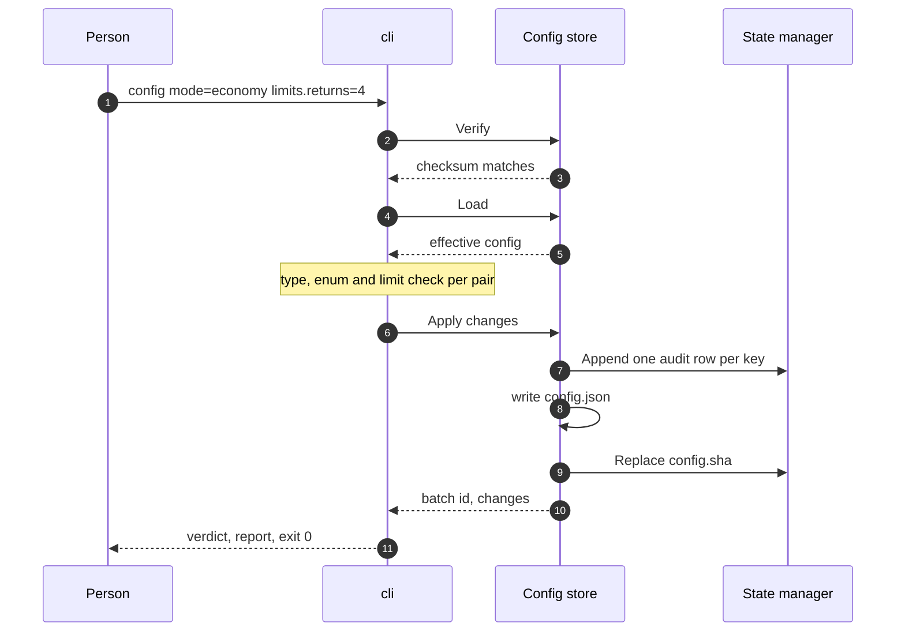

1. **Parse:** `Run` selects the `config` row of the verb table. The two words with `=` are positional arguments.
2. **Validate:** the pin check passes. Because the call contains `=`, `NeedsTerminal` returns `true` and the process has a controlling terminal. `Store.Verify` finds the checksum matching.
3. **Resolve:** `Store.Load` returns the effective config once for the process.
4. **Dispatch:** the handler looks up `mode` and `limits.returns` in `Registry`, accepts `economy` as a member of the `mode` enum and `4` as at most the hard limit 5 of `limits.returns`, and compares each with the current value.
5. **Apply:** both values differ from the current ones, so `Apply` receives two changes and writes two audit rows under one batch id, then the file, then the checksum.
6. **Render:** the result carries the batch id and the two changes. The report lists them and the process exits 0.
7. **Repeat:** running the same line again produces no changes and reports `0 changes`; no audit row is written.

A crash after the audit rows leaves a logged batch that never applied, which the next write's `old` values show. A crash after `config.json` leaves the checksum stale, so every verb refuses with `config_tampered` until a person checks the file and runs `config --accept`. No crash leaves a change applied and unlogged.

#### Algorithms

**📐 The five steps and where a refusal leaves**
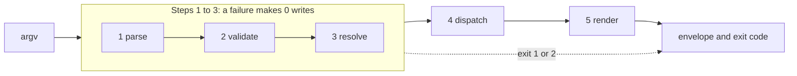

**Pipeline.** Every verb takes the same five steps; a failure in steps 1 to 3 has made 0 writes, and `--dry-run` applies from step 4.

1. **Parse.** `parse` finds the verb in the verb table, builds a `flag.FlagSet` with Go's standard `flag` package from the global flags and the verb's `Flags`, and parses the rest of `argv`. An unknown flag is a usage error that names the closest known flag. With `--input <file|->`, the JSON object is read from the file or from standard input (`-`) and each key is applied as if typed, except where the same flag is on the command line, which wins. `-h` and `--help` run `help <verb>` for the verb.
2. **Validate.** `validate` runs these checks in order and returns the first refusal:
   1. Pin check: when `PinExempt` is `false` and the repo pin is above the running version, refuse with exit 1 and the fix `run komodo fresh`. Validate walks up from the working folder, or `-C`, to the first folder holding `.git` and reads `AGENTS.md` there, with no git process.
   2. Types and enums of every flag value; a failure is a usage error with exit 2.
   3. Terminal check: when `NeedsTerminal(c)` returns `true` and the process has no controlling terminal, refuse with exit 1.
   4. Hash guard: `Store.Verify`; on `ErrTampered` refuse with `config_tampered`, except for `help`, `version` and `config --accept`.
3. **Resolve.** `resolve` takes the repo id from the working folder or `-C`, calls `Store.Load` once and, for a verb that needs commands, calls `Detect`. The repo id is the normalized origin address such as `github.com/rdevitto86/komodo-agentic-harness-coding`; with no remote the id is the git common directory path, so every worktree of a repo shares one id. The id names worktrees, leases and caches, never config.
4. **Dispatch.** `dispatch` calls the handler with the filled `Call`. The handler makes one thin call into the owning package, such as `engine` for `run`, and never opens state files itself. With `--dry-run` the owning package prints each write the verb would make and makes none.
5. **Render.** `render` passes `Result.Code` and `Result.Facts` through the template set for `output.profile` into `report`. `render` prints the envelope when `--json` is on, which is automatic with no terminal, and plain text otherwise, then returns the exit code of `Result.Outcome`.

The closest match is the known name at the smallest Levenshtein distance, the fewest single-letter edits, when that distance is at most 2; ties go to table order. With nothing that close the message names `komodo help <verb>`. An unknown agent name is refused the same way, exit 2 with `unknown_key`, because the 7 agents are compiled in.

Outside a git repository the pin check is skipped, because there is no `AGENTS.md` to read, and `Call.Repo` stays empty; a verb whose handler needs a repository refuses with exit 1 and `no_repo`. `help` and `version` are exempt from the hash guard, beside `config --accept`, so a person can always read the fix.

On native Windows the terminal check opens `CONIN$` and calls `GetConsoleMode` on it through the standard `syscall` package; success means a console is attached. A failed open or a failed `GetConsoleMode` counts as no terminal, the result an agent shell gets on Unix. Verified by [G-121](#g-121) once a Windows machine is available.

**Pin check.**
1. Read the repo's `AGENTS.md` and find the line `komodo:begin min=<version>`. Validate walks up from the working folder, or `-C`, to the first folder holding `.git` and reads `AGENTS.md` there, with no git process.
2. Compare the version with the embedded version by semantic-version order.
3. When the pin is higher and the verb is not exempt, return a refusal with exit 1.
4. The exempt verbs are `help` (to see the verb list and the fix line), `version`, `fresh` (the fix itself), `install` (`install` can place a binary with `--from`) and `doctor` (to diagnose before updating).

**Effective config.**

**📐 How the two layers become one config**
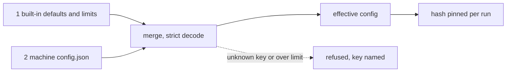

1. Read the built-in defaults and hard limits from the embedded files. Every key has a value there, so no key is ever missing.
2. Read `config.json` if the file exists; absent means the built-in layer alone applies.
3. Decode strictly: each top-level key must be a registry key, a member of the `limits.link_sessions.<link>` family, `agents` or `endpoints`; otherwise fail naming the closest key.
4. Check each value against its `Kind`, its `Enum`, its `Min`, `Max` and `MaxKey`; fail naming the key, the value and the limit.
5. Take the machine value where present and the built-in value elsewhere, and record the `Layer` that set each.
6. Compute `Hash` of the result. A run saves the hash in `runs/<group-id>/state.json`; edits made during a run do nothing to that run. The hash is also the prefix of every cache key, so a config change never serves a stale brief or check.

**Per-agent limits.** A session's wall, idle and retry limits come from the highest layer that sets them:
1. The `agents.<name>` key in `config.json`.
2. The flat key `limits.session_wall_min` or `limits.session_idle_min` in `config.json`; `retries` has no flat key.
3. The agent's `agent.json` `limits`, which sets all three.

Each result is capped by its hard limit in [1.8](#18-config), and the builder's wall is the group's budget, `limits.group_wall_min`. `SessionWallMin`, `SessionIdleMin` and `Retries` apply this order.

**Config write.**
1. Refuse a call that mixes reads (`key`) and writes (`key=value`).
2. For each pair, find the `KeySpec`, parse the value to its `Kind` and check enum membership, the `env:` form for `KindEnvRef`, the hard limits and `MaxKey`. An agent or endpoint call checks the section's keys the same way.
3. Drop a pair whose value equals the effective value.
4. When any pair fails, return its error and write nothing: a call sets every pair or none.
5. With `--dry-run`, print the changes and stop.
6. Call `Store.Apply` with the remaining changes. `Apply` appends one audit row per changed key under one batch id, writes `config.json` by an atomic rename, then rewrites `state/config.sha`. `~/.komodo/**` is protected by guard row G3, so no model session can reach any of these files.

**Reset.** `--default` calls `PlanReset` for a key, an agent, an endpoint or the whole file, then follows the write path with the planned changes. For an endpoint or the whole file the verb first lists each change and waits for a typed `y`.

**Accept.** `config --accept` runs the terminal check, calls `Store.Accept`, which rehashes `config.json` into `state/config.sha`, and logs one audit row. `config --accept` is the one call the hash guard lets through.

**Command detection.**

**📐 From marker files to commands**
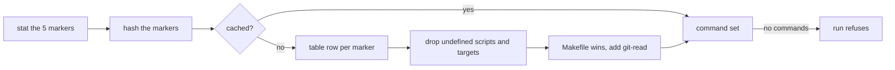

1. Run `stat` on each file in `MarkerFiles`; a cold repo costs one `stat` per marker.
2. Hash the marker files; a cached `CommandSet` under that hash is returned as is.
3. Otherwise take the row of the [marker table](#13-data-model) for each marker present.
4. Keep only what exists: an npm script or a make target is used only when the file defines it, and `npm ci` needs a lockfile.
5. When the Makefile defines a target for a class, that target wins over the detected command.
6. Add `git-read`, which is always on: `git status`, `diff`, `log` and `show`.
7. Commands run without a shell, so shell syntax in one fails `doctor`. Each runs in the sandbox, except `git-read` under Docker, which runs on the host.
8. `setup` belongs to the engine: Intake runs `setup` once per worktree with the network on, and no agent can run `setup`.
9. With no detected commands, `run` refuses and names the markers that `run` looked for; read-only agents still run.

With two or more markers, each class runs the commands of every marker present, in table order: a repository with `go.mod` and `package.json` tests with `go test ./...` and then `npm test`. A Makefile target for a class still replaces all of them.

**Capacity profile.** Before each session the engine derives the record for the link the next session will use:
1. `ctx` is the context window measured for the link ([Providers and HTTP](#7-providers-and-http)).
2. `slots` is `limits.link_sessions.<link>`.
3. `cost_class` comes from the billing check of the link.
4. `effort` comes from the agent's weight.

The brief builder sizes every prompt from `Ctx`, the engine takes a slot from `Slots`, and budgets cache by the whole profile. Swapping Claude for a local or an OpenAI link changes the profile and never the engine.

**Short verbs.** `help`, `version`, config reads and `skill` answer under 50 ms with no network and no repo scan beyond marker stats. `help` reads embedded, build-time text. `version` reads the embedded version and `state/fresh.json`. Config reads parse the file once per process. The `skill` index is embedded at build, so `skill list` is a map read, and bodies come from the cache. `help --json` and the `komodo` skill are generated at build and embedded. The 50 ms budget is the target the build holds to. Verified by [G-19](#g-19) in phase 6.

**Concurrency.** Each verb is one process. Config is parsed once per process and read-only after that, and a run reads the snapshot that run pinned at start: the run's start writes the effective settings once to `runs/<run>.config.json`, named by `config_hash`, and every restart and `resume` reads them from that file; a changed `config.json` reaches only new runs, and `resume` prints the changed keys as a warning. `komodo config` holds `config.json.lock` while it writes `config.json`, `config.sha` and `config.log`; a reader that finds the checksum and the file disagree rereads once after 100 milliseconds before refusing ([State manager write checks](#135-behaviour)).

### 1.6 State

Only the config file guard has state. A verb itself holds none: every run of `Run` starts clean.

**📐 The config file guard**
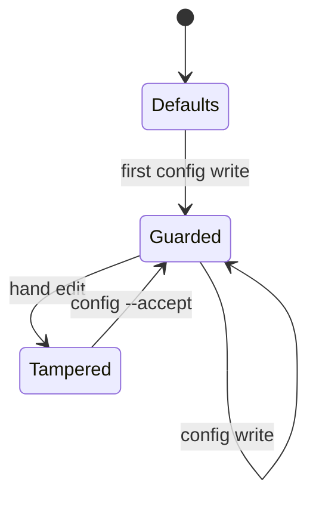

| State | Event | Next | True afterwards |
|---|---|---|---|
| Defaults | `config` write | Guarded | `config.json` exists; `state/config.sha` matches the file; one audit row per changed key |
| Guarded | `config` write | Guarded | The file, the checksum and the audit log changed together, or none of them |
| Guarded | Hand edit of `config.json` | Tampered | The checksum no longer matches; Komodo wrote nothing |
| Tampered | Any verb except `help`, `version` and `config --accept` | Tampered | Exit 1 with `config_tampered`; 0 writes |
| Tampered | `config --accept` | Guarded | The checksum matches the edited file; one audit row logged |

- **Defaults:** `config.json` does not exist; the built-in layer applies.
- **Guarded:** `config.json` matches the checksum in `state/config.sha`.
- **Tampered:** the checksum differs; every verb refuses.

A `config.json` with no `state/config.sha`, or a checksum with no `config.json`, is Tampered. With no `config.json`, `config --accept` deletes the checksum and logs one row, which returns the guard to Defaults. With neither file the guard is Defaults.

### 1.7 Invariants and Failures

**Invariants**
1. The pin check runs first among the validate checks, so an old binary never acts on a repo that needs a newer one.
2. A verb that fails in steps 1 to 3 has made 0 writes.
3. Every writing verb is idempotent: a repeat with the same arguments reports `0 changes`.
4. `config.json` is written only by `komodo config`, which needs a terminal, so no model session changes its own settings.
5. A `komodo config` call writes every pair or none, and writes one audit row per changed key.
6. A run's effective config is the snapshot pinned at the run's start; later edits do not reach the run. The one exception is an agent's `model`: a write reaches each open run at its next session start, and the session's `session.start` event records the model it used, so a replay makes the same choice; sessions already running finish on their model. The pinned copy is `runs/<run>.config.json`, written once at the run's start.
7. A secret is never in config or logs: key settings are `env:NAME` references.
8. Security rows are never config. The only guard setting is `guard.refusal_limit`.
9. Tiers are enforced by the terminal check, and on Claude Code first by the deny rules `install` writes into `.claude/settings.json`.

**Failures**

| Situation | Detection | Behaviour |
|---|---|---|
| Unknown verb or flag, or a bad value | `parse`, `validate` | Exit 2; an unknown flag names the closest real flag |
| Repo pinned above the binary | Pin check | Only `help`, `version`, `fresh`, `install`, `doctor` run; every other verb exits 1 with the fix `run komodo fresh` |
| Hand-edited `config.json` | `Store.Verify` | Every verb refuses `config_tampered` until `config --accept` |
| Terminal-only verb without a terminal | `NeedsTerminal` | Exit 1; the verb does not run, so `komodo install` and `komodo config providers.paid=allowed` change nothing |
| Config write with an unknown key | `Store.Apply` | Refused naming the closest key; nothing is written |
| Config write over a hard limit | `Store.Apply` | Refused naming the key, the value and the limit; the file is unchanged |
| One bad pair out of several | `Store.Apply` | Nothing is written for any pair |
| A call that reads and writes | `config` handler | Refused: one call reads or writes, never both |
| `--default` on an endpoint or the whole file without a typed `y` | `config` handler | No change is written |
| `run` with no detected commands | `Detect` returns an empty set | `run` refuses and names the marker files it looked for; read-only agents still run |
| `add backlog` on a group that is in a run | Handler | Refused with `locked` and the run id |
| `--input` unreadable or not a JSON object | `parse` | Exit 2 with `usage`, naming the file and the decode error |

Shell syntax in a detected command, and a missing or bad file named by `http.ca_bundle`, are reported by `doctor`, not refused by the pipeline.

### 1.8 Config

The 33 flat keys: 24 here, and 9 provider keys in [Providers and HTTP](#78-config). A value outside the hard limit is refused.

| Key | Type | Default | Hard limit | Effect |
|---|---|---|---|---|
| `output.profile` | enum | `adhd` | none | Text layout for everything a person reads: `adhd` (verdict first, bold labels, tables for data lists, at most 5 bullets and 3 options, turn-end headings in order) or the plainer `standard`. Facts and codes are the same under both, and no repo setting or flag changes a template. After a change, `komodo sync` rewrites the rules block in `AGENTS.md`. |
| `output.turn_end_summary` | bool | `true` | none | Turns the 4 fixed headings at the end of every report on or off: `✅ Successful Changes`, `❌ Blocked Changes`, `📌 Callouts` and `⚠️ Warnings`, in that order, each skipped when empty. |
| `output.color` | enum | `auto` | none | `auto` decides from the terminal, `on` forces colour, `off` removes colour. Applied only when text is rendered, so facts never change. |
| `mode` | enum | `thorough` | none | `economy` or `thorough`. `thorough` runs every reviewer lens that applies at full depth; `economy` runs one merged lens at reduced depth, plus the `security` lens where it applies. `mode` sets the `auto` default of `track.usage` and never changes which model runs. |
| `track.usage` | enum | `auto` | none | `auto`, `on` or `off`; `auto` is on in `economy` mode and off in `thorough` mode. Behaviour below the table. |
| `fresh.auto` | bool | `true` | none | Background self-update. When `true`, a verb that sees a newer release spawns a detached updater; live runs keep their own version. |
| `fresh.interval` | duration | `1h` | ≥ 10m | How long the release manifest is cached; the check is one 1 KB fetch on the few verbs that already touch the network. |
| `limits.pool_min` | int | 1 | `limits.pool_max` | Session slots the machine-wide pool keeps open after a rate-limit error shrinks the pool, so work never stops entirely. |
| `limits.pool_max` | int | 6 | 16 | The most builder, reviewer and tester sessions at once across all repos; further ready groups queue. |
| `limits.group_wall_min` | int | 60 | The default plus one 100% extension | Wall-clock minutes per group, excluding paused time. The planner sizes a group so a single builder can finish it within its own limits, 1 hour at most; the group may ask once for 100% more. The decision function grants that extension itself, once, the first time the wall runs out. |
| `limits.group_tokens` | int | 2,000,000 | 10,000,000 | Tokens per group: input, output and cache writes; cache reads are reported only. A runaway-loop bound used only when `track.usage` is on; reaching the cap blocks the group with `budget`. |
| `limits.group_attempts` | int | 6 | 10 | Attempts per group; reaching the cap blocks the group with `attempts`. One attempt is one fresh builder session for the group, whatever ended it, including a timeout, an idle stop or a crash; re-prompts inside a session do not count. |
| `limits.session_wall_min` | int | 60 | 120 | Wall time per session, with the clock stopped while paused. A warning comes at 80% and the session stops at the cap. A builder session builds the whole group, so its wall limit is the group's budget, `limits.group_wall_min`, with the group's one 100% extension on top. |
| `limits.session_idle_min` | int | 10 | 30 | Minutes of silence, with no stream line and no running tool, before the engine nudges. After the nudge and a 5-minute grace the session stops as `idle`; a session gets one nudge, so a second silence stops it as `idle`. |
| `limits.returns` | int | 3 | 5 | Returns from Check or Verify to Build before the group blocks; each return is one more builder pass with the findings. The epic gate counts its own rounds against the same limit. |
| `guard.refusal_limit` | int | 3 | 5 | Refusals under one guard rule before the session ends. The only tunable security value. |
| `check.coverage` | int | 80 | 100 | Percent of the repository's lines tests must cover, in every language. Check fails a group that leaves coverage under the floor. When coverage at the base commit is already under the floor, Check fails a group only when it lowers coverage below the base value. The default tool per language is in [9.5](#95-behaviour). Verified by [G-169](#g-169) in phase 6. |
| `sandbox.max_procs` | int | 512 | 2048 | Most processes one session's commands may start. Enforced through control groups on Linux with delegation and Docker on Windows; macOS, and Linux without delegation, have no limit, and `doctor` and the run report say so. |
| `sandbox.max_mem_gb` | int | 8 | 32 | Memory cap in gigabytes for one session's commands; the pool also uses the cap to decide whether free memory covers one more session. |
| `sandbox.image` | string | detected | none | Docker image for native Windows. Detected from the language marker; a Makefile-only repo or one with 2 language markers must set this key. |
| `sandbox.lang_cache_gb` | int | 10 | 50 | Size cap for a repo's language caches under `~/.komodo/cache/lang/`. Over the cap, or after 30 days unused, the startup sweep deletes the whole cache and the next Intake refills the cache. |
| `cache.max_mb` | int | 256 | 4096 | Size cap for a repo's content cache of skills, context, checks, review, setup and map entries; the least recently used entries go first. |
| `ledger.retention_days` | int | 30 | 365 | Days of session and event ledger rows kept before the oldest are trimmed; 100 MB per repo is the other bound. The state file of a group that is open, paused or blocked is never trimmed. |
| `ship.mode` | enum | `group` | none | `group` opens a pull request per group into the epic branch and the engine merges the pull request at once; `epic` merges the group straight into the epic branch with `--no-ff`. |

**`track.usage` on and off**
- **On:** the ledger records tokens and US dollars, `status --metrics` reports them, `warn.usd_per_run` can warn and `limits.group_tokens` caps each group.
- **Off:** the engine does not collect, write or print any token or dollar figure; returns, attempts, retries and session and group wall time still bound a group.
- The figures exist only to debug cost and track metrics; the token cap is the one decision that reads them.


**Agent section** (`komodo config agent <name> …`): 4 keys per agent, such as `komodo config agent reviewer model=sonnet`, or with three of them, `komodo config agent reviewer model=sonnet session_wall_min=90 retries=3`, which stores the `agents.reviewer` object in the [example](#13-data-model).

| Key | Default | Hard limit | Effect |
|---|---|---|---|
| `model` | The agent's weight: `opus`, `sonnet` or `haiku` | A probed model | The model the agent starts on. `opus` is the latest in the line and `opus-prev` the prior; `<endpoint>:<model>` names an open-source model on a configured endpoint; Komodo never runs a Fable model. A change reaches a running run at its next session start. `model` beats `mode`, and the chain still ends in the free backstop. |
| `session_wall_min` | `limits.session_wall_min` | 120 | Wall-clock limit for this agent's sessions; beats the flat key |
| `session_idle_min` | `limits.session_idle_min` | 30 | Silence limit before a nudge for this agent; beats the flat key |
| `retries` | 2 | 3 | Restarts after a timeout or idle stop, counted per group and never reset while the group is open, within `limits.group_attempts` |

**Provider and endpoint keys.** The 9 flat keys that configure providers, link sessions, pauses and warnings, and the endpoint section `endpoints.<name>` with its keys `url`, `models`, `ctx`, `key`, `self_hosted` and `first_byte_s`, are owned by [Providers and HTTP](#78-config).

**Environment variables.** Only these configure Komodo; every other setting is a `komodo config` key.

| Variable | Effect |
|---|---|
| `KOMODO_HOME` | Another home folder instead of `~/.komodo`, such as `KOMODO_HOME=/tmp/k komodo doctor`; tests and continuous-integration jobs set it |
| `NO_COLOR` | Plain text without colour codes, such as `NO_COLOR=1 komodo status` |
| `CI` | `CI=true` turns background `fresh` off |

**Layers**

| Layer | Where | Power |
|---|---|---|
| 1 Built-in | `embed/defaults.json`, `embed/policy.json`, compiled into the signed binary | Defaults and hard limits; changes only with a release, and `--default` resets a key to the built-in value |
| 2 Machine | `~/.komodo/config.json`: flat keys at the top, `agents.<name>` and `endpoints.<name>` sections | Any value within the hard limits; shared by every repo on the machine |

### 1.9 Proof Cases

**Unit**
- **Exit codes:** each `Outcome` value maps to the exit code in the table: 0, 1, 2, 3 and 4.
- **Strict decode:** a `config.json` holding an unknown key fails to load and names the closest known key.
- **Limits:** `komodo config limits.returns=9` is refused, naming the key and the limit 5, and the file is unchanged.
- **All or none:** a call with 1 bad pair out of 3 writes nothing; a good call logs 1 audit row per changed key.
- **Tracking:** `track.usage=auto` resolves on under `economy` and off under `thorough`; `on` and `off` override the mode.
- **Detection:** a fixture repo with each marker file yields the commands of that marker's row; the fixture repo yields 6 classes including `git-read`.
- **Makefile precedence:** a repo with `go.mod` and a Makefile that defines `test` returns `make test` for the `test` class.
- **Missing scripts:** a `package.json` without a `lint` script yields no `lint` command.

**Component**
- **Golden output:** each verb has a golden `--json` test that compares its output with a stored copy.
- **Unknown flag:** an unknown flag exits 2 and names the closest matching flag.
- **Help against the table:** the gate fails when `help --json` and the verb table that `cli` passes in `GateOptions.Verbs` disagree.
- **Terminal check:** with no controlling terminal, `komodo install` and `komodo config providers.paid=allowed` exit 1.
- **Input merge:** `--input` with a flag that disagrees uses the flag.
- **Idempotence:** a repeated `add backlog` with the same task reports `0 changes`.
- **Short verbs:** `help`, `version` and `skill list` each answer under 50 ms in the gate.
- **Pin:** a repo whose `AGENTS.md` has `min=` above the binary refuses `status` with exit 1 and `run komodo fresh`, while `help`, `version`, `fresh`, `install` and `doctor` run.
- **Hash guard:** a hand edit to `config.json` makes `komodo status` exit 1 with `config_tampered`.
- **Accept:** `config --accept` restores a hand-edited `config.json` and logs 1 audit row.
- **Discovery:** `config --all` names a default, a limit and a source for every key.
- **Agent models:** `agent builder model --all` lists only probed models above the context floor.
- **Capacity profile:** a session on a 262,144-token endpoint and one on Opus 5.5 get different brief ceilings and the same engine path, and the ledger records both profiles.
- **Dashboard:** `komodo ui` without a terminal exits 1; a request without the token, or naming another host, gets status 403.
- **Live model:** a model write during a fixture run makes the next session's `session.start` name the new model, while the running session keeps its own.

### 1.10 Open Gaps

Each id is a row in the [gap register](#appendix-b-gap-register); the rows are not copied here.

| Gap | Question | Closes by |
|---|---|---|
| [G-169](#g-169) | Confirming each default coverage tool yields a whole-repository line percent | Spike, phase 6, then a design patch to 9.5 |
| [G-121](#g-121) | Whether the console check on native Windows refuses an agent shell | Proven when a Windows machine exists; low priority |
| [G-19](#g-19) | The 50 ms short-verb budget is a target until the gate measures it | Gate timing, phase 6 |

## 2. Event Spine and State Machine

The event spine records every change to a task group as a typed event, and one pure function, `Next()`, decides what each event means. A group's position survives any crash because its events reach disk before they are applied, and no code path other than `Next()` can move a stage. This chapter specifies the event format, the decision function, the stage rulebook, the outbox that makes side effects safe to repeat, and the bus that tells readers what happened.

**Guarantees the tests pin**

| Guarantee | How |
|---|---|
| Ordered, gap-free | One writer per group state; `sequence` checked on append and replay |
| Durable before applied | Append, then `fsync` (the call that forces the write onto the disk), then `Next()`; a crash after the sync replays the event |
| Exactly-once state moves | A stage moves only in `Next()`, keyed by `sequence`; stale-epoch events never move it |
| At-least-once actions, safe to repeat | Every action has an idempotency key |
| No lost wake | `status --wait` reads the state tail after subscribing |
| Subscriber faults contained | A panicking subscriber is logged and dropped; state is untouched |

### 2.1 Scope and Concepts

**Owns:** the event envelope and the 34-type catalog, each type's data struct and contract (`Spec`), `Next()` and its transition table, the group `State` that `Next()` reads, the outbox's 9 action kinds (the record of open actions belongs to group state, [chapter 13](#13-state-manager)), epochs, block reasons, and delivery to the 3 bus subscribers.

**Does not own:** writing and replaying files, which is group state in the state manager ([State Manager](#13-state-manager)); the `Drive` loop that calls `Next()` ([Engine Internals](#3-engine-internals)); and the producers that report facts, such as the session supervisor, the guard and Check.

What this subsystem is for, and who it talks to, is in the high-level design: [HLD 5.3 Event Spine and State Machine](hld.md#53-event-spine-and-state-machine).

### 2.2 Package Layout

| File | Holds |
|---|---|
| `internal/state/kinds.go` | `Event`, `Payload`, `Type`, `Reason`, `Stage`, `ID`, `Action`, `ActionKind`, `OpenAction`, `Spec`, `Wake`, `Register`, `SpecOf` and one data struct per event type, among them `ActionStart` and `ActionDone`; the `event` kind registration the schema is generated from |
| `internal/engine/stage.go` | `State`, `Limits`, `Next()`, the `transitions` slice, the `Spec` values registered from it, epochs |
| `internal/engine/engine.go` | `Drive`, the caller of `Next()` ([Engine Internals](#3-engine-internals)) |
| `internal/ops/bus.go` | `Subscriber`, in-order delivery to the ledger, the wake file and the `status --watch` renderer |
| `embed/state.schema.json` | Generated at build from the kind registry; the gate fails when the schema disagrees with the Go types |

The envelope, data structs, actions and contracts sit in `internal/state` because the state manager validates every `Append` against them, and `state` may not import a package above it. `bus.go` delivers events and holds no type definitions.

### 2.3 Data Model

**Envelope.** Every event line, group or run, is one `Event`. `Drive` fills `stage` and `stale`; group state's `Append` fills `sequence`, `timestamp` and `checksum`; the producer fills the rest.

```go
// Type names one of the 34 catalog entries, such as "session.end".
type Type string

// Reason is one value of the closed reason list: block, exit and skip reasons.
type Reason string

// ID is a version 7 universally unique identifier in its text form.
type ID string

// Stage is where a group is; Paused and Blocked are holding states and Done is the end.
type Stage string

const (
	Intake  Stage = "intake"
	Build   Stage = "build"
	Check   Stage = "check"
	Verify  Stage = "verify"
	Ship    Stage = "ship"
	Paused  Stage = "paused"
	Blocked Stage = "blocked"
	Done    Stage = "done" // shipped, abandoned, cancelled or taken by another run

	NoStage Stage = "none"  // a group before its first line; never written to an event
	ToPrior Stage = "prior" // in a Transition's To: the stage in State.Prior; never written
	Keep    Stage = ""      // in a Transition's To: the stage does not change
)

// Event is one line of runs/<group-id>/events.jsonl or runs/<run>.jsonl.
type Event struct {
	Version   int       `json:"version"`           // always 1
	Sequence  uint64    `json:"sequence"`          // gap-free per file, stamped by Append
	Timestamp time.Time `json:"timestamp"`         // the engine's clock in Coordinated Universal Time, whole seconds
	Run       ID        `json:"run"`
	Group     ID        `json:"group,omitempty"`   // on every group event
	Session   ID        `json:"session,omitempty"` // on session and task events only
	Stage     Stage     `json:"stage,omitempty"`   // on every group event; never on run.* or job.*
	Epoch     uint32    `json:"epoch"`             // the stage epoch the producer was spawned under
	Stale     bool      `json:"stale"`             // set by Drive when Epoch is older than the current
	Type      Type      `json:"type"`
	Reason    Reason    `json:"reason,omitempty"`  // one value of the closed reason list
	Data      Payload   `json:"data"`              // the one struct registered for Type
	Cause     uint64    `json:"cause,omitempty"`   // sequence of the event whose Next() result produced this line; 0 for an outside fact
	Last      uint64    `json:"last"`              // sequence of the final line of the write this line belongs to
	Checksum  string    `json:"checksum"`          // CRC-32C of the line's bytes before ,"checksum", as 8 lowercase hex digits
}

// UnmarshalJSON reads type first, then decodes data into the struct the registry returns for it.
func (e *Event) UnmarshalJSON(b []byte) error

// Payload is implemented by exactly one data struct per event type.
type Payload interface{ EventType() Type }
```

| Field | Rule |
|---|---|
| `version` | Envelope version, 1 |
| `sequence` | Checked on every append and every replay, so a missing line is detected |
| `timestamp` | When the engine saw the fact, written in the format `2026-10-11T15:31:00Z`; never a model's claim |
| `run`, `group`, `session` | Universally unique identifiers ([Naming and identifiers (chapter 0)](#02-naming-and-identifiers)) |
| `stage` | `intake`, `build`, `check`, `verify`, `ship`, `paused`, `blocked` or `done`; required on group events, forbidden on `run.*` and `job.*`; lets `status` and the ledger group events by stage without replaying |
| `epoch`, `stale` | `Drive` alone sets `stale`, because `Drive` holds the current epoch; a stale event is written and ignored by `Next()` ([Behaviour](#25-behaviour)) |
| `type`, `reason`, `data` | `type` picks the one `data` struct allowed, so a `session.end` line can only carry a `session.end` body |
| `cause` | The `sequence` of the event whose `Next()` result emitted this follow-on or ordered this action line; omitted for a fact from outside `Drive` |
| `last` | The `sequence` of the final line of the one write this line was saved in; replay drops a final write whose `last` line is missing |
| `checksum` | `Append` computes CRC-32C (the Castagnoli polynomial, Go's `hash/crc32`) over the compact line's bytes up to and not including `,"checksum"`, and writes the value last as 8 lowercase hex digits; every line of a write carries its own checksum. Checksum values in the examples are illustrative |

The build generates one JSON Schema from the envelope and the registry, with one branch per type, no extra fields allowed, and an enumeration for every `reason`. The state manager checks every `Append` against the schema, and `komodo help --json` serves its event part as `events`.

- **Data structs:** one struct per event type, listed in [Data structs](#data-structs) below the catalog
- **Envelope fields:** `sequence` is the event's identifier, so there is no `id`; the class comes from the type's `Spec`, so there is no `class`; `cause` names the event that produced a line; a request's identifier sits in `data.request` of the request and of its outcome, so there is no `corr`.

**Example.** A `session.end` line, spread over lines for reading; on disk the line is one compact line.

```json
{
  "version": 1,
  "sequence": 12,
  "timestamp": "2026-10-12T15:31:12Z",
  "run": "0192e4c5-6f00-7a21-8c3b-2d9e0f1a4b57",
  "group": "0192e4c5-7a10-7d3e-9b2f-6c1d8e4a5f30",
  "session": "0192e4c6-1d40-7b85-a2f3-8c6e1d0b9a47",
  "stage": "build",
  "epoch": 2,
  "stale": false,
  "type": "session.end",
  "reason": "schema_fail",
  "data": {"agent": "builder", "task": "tsk-add-lock", "link": "claude-cli", "tokens": 0, "wall_s": 1140},
  "last": 14,
  "checksum": "5d0c9e3a"
}
```

Two more lines from the same file, a `stage.enter` and a `group.blocked`:

```json
{"version":1,"sequence":7,"timestamp":"2026-10-12T15:20:03Z","run":"0192e4c5-6f00-7a21-8c3b-2d9e0f1a4b57","group":"0192e4c5-7a10-7d3e-9b2f-6c1d8e4a5f30","stage":"build","epoch":2,"stale":false,"type":"stage.enter","data":{"from":"intake","to":"build","epoch":2,"return":false},"cause":6,"last":7,"checksum":"a41f07bc"}
{"version":1,"sequence":31,"timestamp":"2026-10-12T16:02:45Z","run":"0192e4c5-6f00-7a21-8c3b-2d9e0f1a4b57","group":"0192e4c5-7a10-7d3e-9b2f-6c1d8e4a5f30","stage":"blocked","epoch":2,"stale":false,"type":"group.blocked","reason":"attempts","data":{"detail":"2 of 2 fresh builder sessions used"},"cause":30,"last":31,"checksum":"0e93d5f2"}
```

#### Catalog (34 types)

The catalog is a fixed Go enumeration in 8 families, registered with the state manager as the `event` kind. The gate fails on an emitted type missing from the catalog, or a listed type nothing emits. Model sessions never emit events; a session's typed result becomes an event only after Go validates it.

| Type | Emitted by | When, and what `Next()` does with it |
|---|---|---|
| `run.start` | Engine | `komodo run` starts a run; every ready group enters Intake |
| `run.done` | Engine | Every group of the run is Done or Blocked and none is queued, running or paused; wakes `status --wait` |
| `run.stopped` | Shutdown | A signal, `stop <run>` or `fresh --restart-runs`, after agents stop, work is committed as work in progress and leases are freed; the reason is `cancelled`, or `restart` for `fresh --restart-runs`; wakes `status --wait` |
| `group.paused` | Engine | A provider limit left no allowed link; `status` shows the link and the resume time |
| `group.blocked` | Engine | A bound ran out or a decision is needed, with a [block reason](#block-reasons) |
| `group.shipped` | Engine (`Next()` follow-on) | Merge clean, Check passed on the epic tip, landing succeeded; records the files the landing changed; ends the group |
| `lease.lost` | Workspace | Another run took the group; `Next()` stops the group in this run. A save refused by the fence check, or a higher number in the fence file before a push, shows that another run took the group ([4.5](#45-behaviour)). |
| `stage.enter` | Engine | A group enters a stage; the epoch rises; a snapshot is written; wakes `status --wait any` |
| `stage.exit` | Engine (`Next()` follow-on) | Intake's or Verify's gate is met ([State and Transitions](#26-state-and-transitions)) |
| `session.start` | Supervisor | A session is spawned with its brief; fires with `task.claimed` for a builder's first open task, and each later task's `task.claimed` follows the previous `task.done` |
| `session.idle` | Supervisor | No stream line and no running tool for `limits.session_idle_min`; the supervisor nudges, then stops the session ([Sessions, Agents and Briefs](#5-sessions-agents-and-briefs)) |
| `session.timewarn` | Supervisor | The session neared its wall clock; the supervisor injects a finish-now line |
| `session.end` | Supervisor | The session ended with an [exit reason (chapter 5)](#exit-reasons); `Next()` applies the exit reason's row in [State and Transitions](#26-state-and-transitions) |
| `task.claimed` | Supervisor | With `session.start`; the task moves from queued to claimed in the lock table |
| `task.released` | Supervisor, recovery | With `session.end`, including the `session.end` reason `crash` recorded for a session found dead after a crash |
| `task.done` | Engine (`Next()` follow-on) | The `commit` action ran `done_when` with exit 0 and the result is on the hidden ref |
| `task.retry` | Engine | Another attempt after a schema-invalid result, a failed gate, a cut-off reply, `guard.refusal_limit` refusals under one rule or a failed `done_when`; the fresh session it orders counts toward `limits.group_attempts` |
| `check.done` | Engine (`Next()` follow-on of the last `check` action) | Pass or fail after the zero-token checks |
| `finding.submit` | Tools | A reviewer's `submit_finding` passed validation: a known rule identifier (a lens rule or a standards rule `std.<skill>.<n>`), a `file:line` and a quoted evidence line |
| `finding.verified` | Review | Go found the quoted evidence at that line in the head or the diff; unverified findings are dropped and logged; the evidence check `Reviewer.AcceptFinding`, which `Drive` calls on each `finding.submit`, does the check |
| `tool.denied` | Guard | A tool call was refused inline; `guard.refusal_limit` refusals under one rule end the session |
| `timer.due` | `Drive` alone; a `jobs tick`, the startup sweep or `status` that finds a due timer drops a request file in the group's inbox ([Commands](#26-state-and-transitions)) | A paused group's `wait_until` passed; the live `komodo run` process sleeps until the earliest one |
| `job.due` | Scheduler | A job's interval elapsed at a `jobs tick`; the job is enqueued as its own run |
| `job.fail` | Scheduler | A job run failed; the job backs off and is Blocked after its third failed attempt in a row; that `job.fail` wakes `status --wait` |
| `lock.taken` | Intake | Backlog files hashed into `card_hash`; edits, re-plans and new tasks are refused with `locked` |
| `lock.released` | Ship, abandon | The task list is editable again |
| `action.start` | `Drive` | Before a side effect, with the action's `id` and `action` kind |
| `action.done` | `Drive` | After the side effect completes |
| `state.truncated` | `Drive`, first after `Load`, which returns it | Replay dropped a last line whose checksum failed; at most one event lost |
| `provider.skip` | Router (`Select`), handed to `Drive` by the supervisor | A link was skipped, with `{from, to, reason}`: unavailable, unauthorized, over its limit or `ctx_below_floor` |
| `limit.warn` | Provider adapters | A window passed `warn.quota_pct`, Max began drawing paid overage, or spend passed `warn.usd_per_run` with `track.usage` on; never stops work |
| `lease.taken` | Workspace | Machine log only: a `Claim` on a lease succeeded |
| `pool.slot.taken` | Session pool | Machine log only: a session took a machine-wide slot |
| `queue.enqueued` | Work queue | Machine log only: a ready group or due job was queued |

**Families:** Request (7, outside the 34 above), Run (3), Group (4: the 3 `group.*` plus `lease.lost`), Stage (2), Session (4), Work (11), Ledger (5: `lock.*`, `action.*`, `state.truncated`), Provider (2), Machine (3).

**Machine-wide records.** Leases, pool slots, the work queue and jobs keep the state manager's create-only `Claim`, `Replace` and `Remove`, which make two processes agree; a slot is a create-only file, never an operating-system file lock. Each successful write also appends a typed event to a machine log under `~/.komodo/state/events/`, one file per process, so each file has one writer. An event that affects a group, such as a lost lease, also goes into that group's own events for `Next()`, and `status` merges the machine logs by `timestamp`.

- **Machine log names:** `~/.komodo/state/events/<start>-<pid>.jsonl`, `<start>` being the process's start time as `20261013T091405Z` ([Record kinds](#133-data-model)).
- **Job events:** `job.due` and `job.fail` belong to no group, so they go to the machine log of the process that records them: the tick, or the job process.

#### Data structs

Each event type has one data struct in `internal/state/kinds.go`, bound to it by `Register`; its `EventType()` method returns the type. A field the envelope already carries, such as the session, the stage or the reason, is never repeated in `data`. The schema allows no field beyond these tags, and a field marked `omitempty` or `omitzero` is absent when empty. `ActionStart` and `ActionDone` are in [Actions](#actions).

```go
// --- Run: the envelope's group is empty, except on a group's copy of run.start

// RunStart is the data of run.start; each group's first line is a copy with group set.
type RunStart struct {
	Groups     []ID   `json:"groups"`        // the groups the run queued, in queue order
	ConfigHash string `json:"config_hash"`   // the effective configuration the run pinned; row 1 copies it into State
	Job        string `json:"job,omitempty"` // the job's name when the run is a scheduled job
}

// RunDone is the data of run.done.
type RunDone struct {
	Done    []ID `json:"done"`    // groups that ended Done
	Blocked []ID `json:"blocked"` // groups left Blocked
}

// RunStopped is the data of run.stopped.
type RunStopped struct {
	Signal string `json:"signal,omitempty"` // the signal received, such as SIGINT; empty for stop <run>
	Saved  []ID   `json:"saved"`            // groups whose work was committed as work in progress
}

// --- Group

// GroupPaused is the data of group.paused; Next copies it into State.Pause.
type GroupPaused struct {
	Until time.Time `json:"until"` // the provider's reset time, written as the timer's wait_until
	Link  string    `json:"link"`  // the link whose limit paused the group
}

// GroupBlocked is the data of group.blocked; the envelope's reason is the block reason.
type GroupBlocked struct {
	Counter string `json:"counter,omitempty"` // unnamed block only: retries, returns, flap or job
	Detail  string `json:"detail,omitempty"`  // what status shows, such as a setup command's output, at most 4 KB
}

// GroupShipped is the data of group.shipped, copied from the land result.
type GroupShipped struct {
	Merge string   `json:"merge"`        // the merge commit on the epic branch
	PR    int      `json:"pr,omitempty"` // ship.mode group: the group pull request number
	Files []string `json:"files"`        // paths the landing changed, which route epic gate findings
}

// LeaseLost is the data of lease.lost.
type LeaseLost struct {
	Fence  uint64 `json:"fence"`            // the higher fence number found
	Holder ID     `json:"holder,omitempty"` // the run now holding the lease, when the lease file names it
	Where  string `json:"where"`            // "save" for a refused fence check, "push" for the fence file before a push
}

// --- Stage

// StageEnter is the data of stage.enter; Next fills it when it emits the event.
type StageEnter struct {
	From   Stage  `json:"from"`   // the stage left; none for the first entry
	To     Stage  `json:"to"`     // the stage entered
	Epoch  uint32 `json:"epoch"`  // the new epoch, State.Epoch + 1
	Return bool   `json:"return"` // a Check, Verify or epic-tip failure sent the group back to Build
}

// StageExit is the data of stage.exit.
type StageExit struct {
	From Stage `json:"from"` // intake or verify, the stage whose gate was met
}

// --- Session: the envelope carries the session identifier

// SessionStart is the data of session.start.
type SessionStart struct {
	Agent   string `json:"agent"`          // the agent name, such as builder, reviewer or tester
	Task    string `json:"task,omitempty"` // builder only: the task claimed with it
	Link    string `json:"link"`           // the link the session runs on, such as claude-cli
	Model   string `json:"model"`          // the model identifier the link reported
	Resumed bool   `json:"resumed"`        // continued from a Resume entry, so it adds no attempt
}

// SessionIdle is the data of session.idle.
type SessionIdle struct {
	IdleS  int64 `json:"idle_s"` // seconds with no stream line and no running tool
	Nudged bool  `json:"nudged"` // true when the one nudge was sent; false when the stop ladder starts
}

// SessionTimewarn is the data of session.timewarn.
type SessionTimewarn struct {
	UsedS int64 `json:"used_s"` // wall seconds used
	WallS int64 `json:"wall_s"` // the session's wall limit in seconds
}

// SessionEnd is the data of session.end; the envelope's reason is the exit reason.
type SessionEnd struct {
	Agent       string         `json:"agent"`
	Task        string         `json:"task,omitempty"` // builder only: the task held at the end
	Link        string         `json:"link"`
	Handle      string         `json:"handle,omitempty"`       // the provider's resume handle, kept for paused and provider
	ResetAt     time.Time      `json:"reset_at,omitzero"`      // paused only: the provider's reset time
	Tokens      int64          `json:"tokens"`                 // input plus output tokens; 0 when track.usage is off
	WallS       int64          `json:"wall_s"`                 // seconds the session ran
	ScopePaths  []string       `json:"scope_paths,omitempty"`  // needs_scope only: the paths asked for
	ScopeReason string         `json:"scope_reason,omitempty"` // needs_scope only: the builder's reason
	Verify      *VerifyOutcome `json:"verify,omitempty"`       // reviewer or tester with reason done
}

// VerifyOutcome is a validated reviewer or tester result as Next reads it; Drive fills it before Append.
type VerifyOutcome struct {
	Pass            bool     `json:"pass"`                       // every task met or confirmed and every item passed
	NotMet          []string `json:"not_met,omitempty"`          // task identifiers marked not_met or not_confirmed
	BriefIncomplete bool     `json:"brief_incomplete,omitempty"` // the reviewer answered brief_incomplete
	Failed          []string `json:"failed,omitempty"`           // tester items Go's two reruns confirmed failed
	Disputed        []string `json:"disputed,omitempty"`         // tester items Go's two reruns passed
	Split           []string `json:"split,omitempty"`            // tester items whose two reruns disagreed
}

// --- Work

// TaskClaimed is the data of task.claimed.
type TaskClaimed struct {
	Task string `json:"task"` // the task identifier
}

// TaskReleased is the data of task.released.
type TaskReleased struct {
	Task string `json:"task"`
}

// TaskDone is the data of task.done.
type TaskDone struct {
	Task   string `json:"task"`
	Commit string `json:"commit"` // the hidden-ref commit that holds the task
	Lines  int    `json:"lines"`  // changed lines of the task's commit, for OverEstimate
}

// TaskRetry is the data of task.retry; the envelope's reason is the cause, an exit reason or check_fail.
type TaskRetry struct {
	Task    string `json:"task"`
	Attempt int    `json:"attempt"` // the attempt the fresh session will be, State.Attempts + 1
}

// CheckDone is the data of check.done.
type CheckDone struct {
	Pass       bool        `json:"pass"`       // every step passed or warned
	Tip        bool        `json:"tip"`        // the Check ran on the epic tip after landing
	Head       string      `json:"head"`       // the commit checked
	Regression bool        `json:"regression"` // a test that passed at the base fails
	Steps      []CheckStep `json:"steps"`
}

// CheckStep is one Check step's result as events and action results carry it.
type CheckStep struct {
	Step   string   `json:"step"`   // a Check step name, such as coverage
	Level  string   `json:"level"`  // pass, warn or fail
	Detail []string `json:"detail"` // the failing tests, files or secret locations
}

// FindingSubmit is the data of finding.submit and the arguments of submit_finding.
type FindingSubmit struct {
	Rule  string `json:"rule"`  // a rule identifier from a lens catalog
	File  string `json:"file"`  // path from the worktree root
	Line  int    `json:"line"`  // line number from 1 in the head tree
	Quote string `json:"quote"` // the quoted evidence line
}

// FindingVerified is the data of finding.verified.
type FindingVerified struct {
	FindingSubmit
	Severity string `json:"severity"` // blocker, major or minor, from the rule
	In       string `json:"in"`       // "head" or "diff", where Go found the quote
}

// ToolDenied is the data of tool.denied.
type ToolDenied struct {
	Tool   string `json:"tool"`             // the tool refused, such as edit
	Row    string `json:"row"`              // the guard row, such as B1
	Target string `json:"target,omitempty"` // the path or command refused, secrets masked
	Count  int    `json:"count"`            // refusals under this row in this session, against guard.refusal_limit
}

// TimerDue is the data of timer.due; reason pause_timeout marks the pause cap.
type TimerDue struct {
	Until time.Time `json:"until"` // the wait_until that passed
}

// JobDue is the data of job.due; the envelope's run is the job run being enqueued.
type JobDue struct {
	Job   string    `json:"job"`    // the job's name
	DueAt time.Time `json:"due_at"` // the next_at that passed
}

// JobFail is the data of job.fail.
type JobFail struct {
	Job      string    `json:"job"`
	Attempt  int       `json:"attempt"`           // failures in a row, from 1
	FailHash string    `json:"fail_hash"`         // the failure fingerprint of the job run
	RetryAt  time.Time `json:"retry_at,omitzero"` // when the backoff ends; zero when the job is Blocked
}

// --- Ledger

// LockTaken is the data of lock.taken; Next fills State.Tasks from Tasks, each queued.
type LockTaken struct {
	CardHash string   `json:"card_hash"` // the hash of the group's TG.md and tsk-*.md files
	Tasks    []string `json:"tasks"`     // the locked task identifiers, in file-name order
}

// LockReleased is the data of lock.released.
type LockReleased struct {
	By string `json:"by"` // "ship" or "abandon"
}

// StateTruncated is the data of state.truncated.
type StateTruncated struct {
	After uint64 `json:"after"` // the sequence of the last good line
	Bytes int    `json:"bytes"` // length of the dropped partial line
}

// --- Provider

// ProviderSkip is the data of provider.skip; the envelope's reason says why the link was skipped.
type ProviderSkip struct {
	From string `json:"from"` // the link skipped
	To   string `json:"to"`   // the next link tried; empty when none is left
}

// LimitWarn is the data of limit.warn.
type LimitWarn struct {
	Link string  `json:"link"`
	Kind string  `json:"kind"`          // quota, overage or spend
	Pct  int     `json:"pct,omitempty"` // quota only: percent of the window used
	USD  float64 `json:"usd,omitempty"` // spend only: dollars spent in the run
}

// --- Machine log only

// LeaseTaken is the data of lease.taken; the envelope's group is the group leased.
type LeaseTaken struct {
	Fence uint64 `json:"fence"` // the fence number the claim wrote
	PID   int    `json:"pid"`   // the holder's process identifier
}

// PoolSlotTaken is the data of pool.slot.taken.
type PoolSlotTaken struct {
	Slot int `json:"slot"` // slot number, from 1 to limits.pool_max
	PID  int `json:"pid"`
}

// QueueEnqueued is the data of queue.enqueued.
type QueueEnqueued struct {
	Kind     string `json:"kind"`     // "group" or "job"
	Item     string `json:"item"`     // the queued group's identifier or the job's name
	Priority string `json:"priority"` // the group's priority from TG.md; empty for a job
}
```

- **Where the facts come from:** each field is a fact its producer saw, never a model's claim; `VerifyOutcome` is filled by `Drive` from `AcceptResult` and `Tester.Rerun` ([Check, Review, Tester and Recovery](#94-interfaces)) before the `session.end` line is appended, so `Next()` reads the judged result without calling out.
- **Counters `Next()` derives:** `Attempts`, `Retries`, `Returns` and `TokensUsed` grow from these fields (`resumed`, `tokens`) and never from a counter a producer sends.

#### Contracts

Each type registers a `Spec` beside its data struct. `Drive` checks every `Next()` result against the triggering type's `Spec`; a violation blocks the group with reason `contract`.

The values come from this chapter, not from code. `Producers` is the catalog's Emitted by column; `Stages`, `Emits` and `Orders` are the union of that type's rows in the transition tables ([State and Transitions](#26-state-and-transitions)); `Wakes` is the wake list ([Behaviour](#25-behaviour)). The gate fails when a registered `Spec` disagrees with those tables, and `help --json` serves them.

```go
// Wake says which status --wait callers an event type wakes.
type Wake uint8

const (
	WakeNone Wake = iota // wakes no waiter
	WakeWait             // wakes status --wait and status --wait any
	WakeAny              // wakes status --wait any only
)

// Spec is the contract registered for one event type.
type Spec struct {
	Producers []string     // components allowed to emit it
	Stages    []Stage      // stages that accept it; any other is refused
	Emits     []Type       // events Next may emit in response
	Orders    []ActionKind // actions Next may order in response
	Wakes     Wake         // which waiters it wakes
}

// SpecOf returns the contract registered for a type.
func SpecOf(t Type) Spec

// Register binds a type to its one data struct and its contract; called from init in kinds.go and stage.go.
func Register(t Type, data func() Payload, spec Spec)
```

- **Event class:** each `Spec` names its class in a `Class` field: `fact` (something happened), `request` (a person or the orchestrator asks for a decision) or `outcome` (the answer to one request); the schema checks it, so the type alone tells a line's class. The 34 types above are facts; the request family adds 7 types: `request.resume`, `request.scope`, `request.abandon`, `request.timer`, `request.return`, `request.accepted` and `request.refused`, the last two outcomes.

#### The State Struct

`State` is what `Next()` reads and returns. `Next()` reads nothing outside `State`, the event and `Limits`, so every counter a bound needs is a `State` field. The record header around the snapshot on disk belongs to the state manager ([Group snapshot (chapter 13)](#group-snapshot)).

```go
// State is one group's position and every counter Next reads.
type State struct {
	Run         state.ID           `json:"run"`
	Group       state.ID           `json:"group"`
	Stage       state.Stage        `json:"stage"`
	Prior       state.Stage        `json:"prior"` // the working stage a Paused or Blocked group left
	Epoch       uint32             `json:"epoch"`
	Fence       uint64             `json:"fence"`
	Sequence    uint64             `json:"sequence"`    // the last line appended, and applied
	ConfigHash  string             `json:"config_hash"` // names the run's pinned settings file, runs/<run>.config.json
	Tasks       []TaskState        `json:"tasks"`
	ActionsOpen []state.OpenAction `json:"actions_open"` // ordered by Next, not yet done; Drive runs them after Load
	Resume      []ResumeRef        `json:"resume"`       // one per paused session; a Verify pause can hold two
	Pause       PauseState         `json:"pause"`
	Block       BlockState         `json:"block"`
	Returns     int                `json:"returns"`      // returns to Build so far
	Verify      VerifyProgress     `json:"verify"`       // reviewer and tester results in this epoch
	FailureHash string             `json:"failure_hash"` // fingerprint of the failure behind the last return
	Blocks      map[string]int     `json:"blocks"`       // blocks per reason, or per counter for an unnamed block
	WallUsedS   int64              `json:"wall_used_s"`  // seconds worked, excluding Paused and Blocked
	WallExtended bool              `json:"wall_extended"` // the one 100% wall extension was granted
	LastEventAt time.Time          `json:"last_event_at"` // timestamp of the previous applied event, for WallUsedS
	Attempts    int                `json:"attempts"`     // fresh builder sessions for the group, against limits.group_attempts
	Retries     int                `json:"retries"`      // builder restarts after a timeout or idle stop, against the agent's retries
	TokensUsed  int64              `json:"tokens_used"`  // with track.usage on, against limits.group_tokens
	ScopeAdded  []string           `json:"scope_added"`  // paths scope approve added to the backlog files
}

// TaskState is one task's claim.
type TaskState struct {
	ID       string   `json:"id"`       // the task identifier, such as tsk-add-lock
	State    string   `json:"state"`    // queued, claimed or done
	Session  state.ID `json:"session,omitempty"`
	ScopeAsked bool   `json:"scope_asked"` // the task's one scope request is spent
}

// ResumeRef is how the group's last paused or ended session can be continued.
type ResumeRef struct {
	Session state.ID `json:"session,omitempty"`
	Handle  string   `json:"handle,omitempty"`
	Link    string   `json:"link,omitempty"`
}

// PauseState copies the timer record of a Paused group.
type PauseState struct {
	Until time.Time `json:"until,omitzero"`
	Since time.Time `json:"since,omitzero"` // when the group paused; limits.pause_max_min counts from it
	Link  string    `json:"link,omitempty"`
}

// BlockState names why and when a Blocked group stopped.
type BlockState struct {
	Reason  state.Reason `json:"reason,omitempty"`
	Counter string       `json:"counter,omitempty"` // the spent counter of an unnamed block, such as retries
	At      time.Time    `json:"at,omitzero"`
}

// VerifyProgress is the reviewer's and the tester's progress in the current Verify epoch.
type VerifyProgress struct {
	Reviewer VerifySession           `json:"reviewer"`
	Tester   VerifySession           `json:"tester"`
	Claims   []state.FindingSubmit   `json:"claims"`   // findings submitted in this epoch
	Findings []state.FindingVerified `json:"findings"` // findings Go verified, blocking and minor
	NotMet   []string                `json:"not_met"`  // task identifiers marked not_met or not_confirmed
	Failed   []string                `json:"failed"`   // tester items Go's reruns confirmed failed
}

// VerifySession is one Verify agent's progress in the current epoch.
type VerifySession struct {
	Session  state.ID `json:"session,omitempty"` // the live or last session of the agent
	Result   string   `json:"result"`            // "" until it ends, then pass, fail or cancelled
	Restarts int      `json:"restarts"`          // fresh sessions after an end without a result, against the agent's retries
	Disputes int      `json:"disputes"`          // tester only: results whose failed items Go's reruns passed; the second blocks tester
}

// Limits are the bounds Next enforces, read from runs/<run>.config.json, pinned at run start.
type Limits struct {
	Returns       int // limits.returns
	GroupAttempts int // limits.group_attempts
	PauseMaxMin   int // limits.pause_max_min
	GroupTokens   int // limits.group_tokens; 0 when track.usage is off
	GroupWallMin  int // limits.group_wall_min
	Retries       int // the builder agent's retries, resolved as in Per-agent limits (1.5)
}
```

**Rules for the fields.**
- **Never nil:** slices and maps in `State` are set empty by the constructor and by `Load`, so they marshal as `[]` and `{}`.
- **`Verify`:** records the reviewer's result, the tester's result (each pass, fail or cancelled) and the verified blocking findings of the current Verify epoch. Entering Verify clears it.
- **`Blocks`:** keyed by the block reason, or by the counter an unnamed block names (`retries`, `returns`, `flap`, `job`), so two unnamed blocks of different kinds never share one count.
- **`WallUsedS`:** grows by the gap between an event's `timestamp` and `LastEventAt`, the previous applied event's, while the group was in a working stage.
- **Crash safety of the counters:** the snapshot holds every field of `State`, so a crash resets no counter ([Group snapshot](#group-snapshot)).
- **Counter owners:** only `Next()` changes a counter, using the rules in `internal/engine/limits.go`; `Attempts` counts fresh builder sessions for the group, and `Retries` counts that builder's timeouts and idle stops and never resets while the group is open. Which counter a failing `done_when` uses is in [Check, Review, Tester and Recovery](#97-invariants-and-failures).
- **Failure fingerprint:** a hash of the sorted list of failing items: for Check, each failing step with the test, file or secret it names; for Verify, each verified blocking finding's rule and file, and each failed tester item. Line numbers, timings and message text are left out, so a rerun of the same failure gives the same fingerprint; a failure that changes any item, such as one test fixed and another broken, gives a new one and earns another return.
- **Task identifier:** the task file's name without `.md`, such as `tsk-add-lock`: `tsk-` then lower-case letters, digits and hyphens, unique within its group because the files share one folder ([Task file (chapter 11)](#113-data-model)).
- **`config_hash`:** the lower-case hexadecimal SHA-256, 64 characters, of the effective configuration at run start encoded by Go's `encoding/json` (fixed field order, sorted map keys, no spaces); `run.start` carries it and row 1 copies it into `State`.
- **Fingerprint encoding:** each failing item is one text line: `check:<step>:<detail>` per failing Check detail (an empty detail for a step that names none), `finding:<rule>:<file>` per verified blocking finding, `not_met:<task>` per task marked `not_met` or `not_confirmed`, and `item:<item>` per tester item Go's reruns confirmed failed. The lines are sorted, joined with a newline and hashed with SHA-256, written as 64 lower-case hexadecimal characters. `Fingerprint(items []string) string` in `internal/engine/limits.go` computes it inside `Next()`; an empty `FailureHash` means no failure yet.

**Example.** The body of `runs/<group-id>/state.json` at sequence 50, group tg-1.2.

```json
{
  "run": "0192e4c5-6f00-7a21-8c3b-2d9e0f1a4b57",
  "group": "0192e4c5-7a10-7d3e-9b2f-6c1d8e4a5f30",
  "stage": "build",
  "prior": "",
  "epoch": 2,
  "fence": 3,
  "sequence": 50,
  "config_hash": "023c648e364af6cf885bc15be12621607595a7ef64533179971d9e8d0603cb2c",
  "tasks": [
    {"id": "tsk-add-lock", "state": "claimed", "session": "0192e4c6-1d40-7b85-a2f3-8c6e1d0b9a47"}
  ],
  "actions_open": [],
  "resume": [{"session": "0192e4c6-1d40-7b85-a2f3-8c6e1d0b9a47", "handle": "0192e4c6-1d40-7b85-a2f3-8c6e1d0b9a47", "link": "claude-cli"}],
  "pause": {},
  "block": {},
  "returns": 1,
  "verify": {
    "reviewer": {"result": "", "restarts": 0, "disputes": 0},
    "tester": {"result": "", "restarts": 0, "disputes": 0},
    "claims": [], "findings": [], "not_met": [], "failed": []
  },
  "failure_hash": "1a9509c4c1d09512211b773b90b562dc6e5a2fbbb344ccd72c2a230a51a86353",
  "blocks": {},
  "wall_used_s": 2460,
  "last_event_at": "2026-10-12T16:01:40Z",
  "tokens_used": 0,
  "attempts": 1,
  "retries": 0
}
```

The `failure_hash` is the fingerprint of one Check line, `check:baseline:TestDriveStale`, from the return that sent the group back to Build.

#### Actions

`Next()` orders actions; `Next()` never performs one. Each ordered action also enters `State.ActionsOpen` in the same `Next()` call, so a crash before the action's `action.start` still reruns it. Each kind declares an idempotency key, and the gate fails a kind missing from the table below.

```go
// ActionKind names one side effect Drive may perform.
type ActionKind string

// Action is one side effect Next orders, recorded by action.start and action.done.
type Action struct {
	ID   string          `json:"id"`     // sha256 of the triggering event's decimal sequence, a zero byte, kind, a zero byte, args
	Kind ActionKind      `json:"action"`
	Args json.RawMessage `json:"args"`   // per-kind arguments
}

// ActionStart is the data of action.start; Drive picks Session for a spawn before it runs.
type ActionStart struct {
	Action
	Session ID `json:"session,omitempty"` // spawn only: the session identifier, recorded before the spawn
}

// ActionDone is the data of action.done; Next reads Outcome and Result on replay.
type ActionDone struct {
	Action
	Outcome string          `json:"outcome"`          // "ok" or a failure class
	Result  json.RawMessage `json:"result,omitempty"` // per-kind result, such as the new commit of a commit
}

// OpenAction is an action Next ordered that has no action.done yet.
type OpenAction struct {
	Action
	Started bool `json:"started"`           // an action.start line exists
	Session ID   `json:"session,omitempty"` // spawn only: copied from action.start, so replay knows which session to check
}
```

- **One action per key:** `Next()` never orders an action whose kind and arguments match an action already in `ActionsOpen`, so a cancel ordered twice by one event, such as a Verify return that also spends the return bound, is one action.
- **Distinct identifiers:** the reviewer's and the tester's spawns come from the same `stage.enter`, so their `Args` must differ for their `ID`s to differ.
- **Arguments:** one struct per kind, below. `Args` and `Result` hold it encoded by `encoding/json`, and the schema checks each against the struct the `action` field names. Key parts known only when the action runs, such as a tree hash, a merge base or a head commit, are read by `Drive` then and recorded in the result.
- **Results:** every `action.done` carries an outcome, success or a failure class, and a short per-kind result: the new commit for `wip_commit` and `commit`, the merge commit for `land` and the pull request number for `open_pr`. `Next()` reads the result on replay, as it reads the session identifier from `action.start`. Events that already report outcomes, such as `task.done` and `check.done`, keep them. Each outcome other than `ok` is one failure class from the table after the structs.

```go
// SpawnArgs are the arguments of spawn; Agent keeps the reviewer's and the tester's identifiers apart.
type SpawnArgs struct {
	Agent  string `json:"agent"`            // the agent to start, such as builder or tester
	Task   string `json:"task,omitempty"`   // builder only: the task to claim
	Resume ID     `json:"resume,omitempty"` // the State.Resume session to continue; empty for a fresh session
}

// SpawnResult is the result of spawn.
type SpawnResult struct {
	Link string `json:"link"` // the link the session started on
}

// CommitArgs are the arguments of wip_commit and commit.
type CommitArgs struct {
	Session ID     `json:"session,omitempty"` // the session whose work is saved
	Task    string `json:"task"`              // the task the commit belongs to
	Fence   uint64 `json:"fence"`             // State.Fence, checked by the fence transaction
}

// CommitResult is the result of wip_commit and commit.
type CommitResult struct {
	Commit   string `json:"commit"`              // the hidden-ref commit; the old one when the tree was identical
	Tree     string `json:"tree"`                // the tree hash of the idempotency key
	DoneWhen *int   `json:"done_when,omitempty"` // commit only: the exit code of done_when
}

// CancelArgs are the arguments of cancel.
type CancelArgs struct {
	Session ID     `json:"session"` // the session to stop
	Cause   Reason `json:"cause"`   // the exit reason it ends with: cancelled or pause_timeout
}

// CancelResult is the result of cancel.
type CancelResult struct {
	Step string `json:"step"` // the last stop-ladder step used: none, SIGINT, SIGTERM or kill
}

// SetupArgs are the arguments of setup; Drive reads the detected command and the lockfile hash.
type SetupArgs struct{}

// SetupResult is the result of setup.
type SetupResult struct {
	Exit   int    `json:"exit"`   // the command's exit code
	Cached bool   `json:"cached"` // an earlier run under the same lockfile hash was reused
	Output string `json:"output"` // the last 4 KB of output, shown by status on a setup block
}

// CheckArgs are the arguments of check.
type CheckArgs struct {
	Step string `json:"step"` // the Check step the command runs
	Tip  bool   `json:"tip"`  // the Check on the epic tip after landing
}

// CheckActionResult is the result of check.
type CheckActionResult struct {
	CheckStep
	Regression bool `json:"regression"` // a failing test passed at the base
	Cached     bool `json:"cached"`     // the result came from the cache by tree hash and command
}

// LandArgs are the arguments of land.
type LandArgs struct {
	Fence uint64 `json:"fence"` // State.Fence when the landing started
	Mode  string `json:"mode"`  // ship.mode: group or epic
}

// LandResult is the result of land; group.shipped copies it.
type LandResult struct {
	Merge     string   `json:"merge"`        // the merge commit on the epic branch
	MergeBase string   `json:"merge_base"`   // the merge base of the idempotency key
	PR        int      `json:"pr,omitempty"` // ship.mode group: the group pull request number
	Files     []string `json:"files"`        // paths the landing changed
}

// OpenPRArgs are the arguments of open_pr.
type OpenPRArgs struct {
	Epic string `json:"epic"` // the epic whose pull request opens
}

// OpenPRResult is the result of open_pr.
type OpenPRResult struct {
	PR      int    `json:"pr"`      // the pull request number
	Head    string `json:"head"`    // the head commit of the idempotency key
	Created bool   `json:"created"` // false when gh found an existing pull request for the head
}

// ScopeChangeArgs are the arguments of scope_change.
type ScopeChangeArgs struct {
	Task  string   `json:"task"`  // the task that asked
	Paths []string `json:"paths"` // sorted paths added to the group's files
}

// ScopeChangeResult is the result of scope_change.
type ScopeChangeResult struct {
	Added []string `json:"added"` // paths that were not yet in files
}
```

| Outcome | Kinds | What follows |
|---|---|---|
| `ok` | Every kind | The kind's in-stage row; a Check step's own failure is `ok` with `level` fail |
| `no_provider` | `spawn` | The block row `no_provider` |
| `done_when_failed` | `commit` | Emits `task.retry` with reason `check_fail` |
| `fence_refused` | `wip_commit`, `commit`, `land` | `Drive` appends `lease.lost`; row 18 ends the group in this run |
| `exit_nonzero` | `setup` | The block row `setup`, showing `output` |
| `run_failed` | `check` | The step could not run, such as a sandbox refusal; the group blocks `setup` naming the step, and `resume` reruns Check |
| `merge_conflict` | `land` | The block row `merge_conflict` |
| `push_failed`, `forge_failed` | `land`, `open_pr` | `Next()` orders the same action again after 30 s, then 2 min; a third failure is the block row `ship` |

| Action | Idempotency key | Safe to repeat because |
|---|---|---|
| `spawn` | The session identifier `Drive` records in `action.start` before spawning | A live session is a no-op; a dead one restarts the session; replay reads the identifier from disk, so `Next()` stays pure |
| `wip_commit`, `commit` | `(group, fence, tree hash)` | The hidden ref moves by compare-and-swap on the old commit id; an identical tree writes nothing |
| `cancel` | Session identifier | Killing a dead process is a no-op |
| `setup` | `(group, lockfile hash)` | Reruns are cached and the sandbox makes them pure |
| `check` | `(tree hash, command)` | Results are cached by that key |
| `land` | `(group, fence, merge base)` | A landed merge commit already exists; the fence file, re-read just before the push, refuses a stale lander |
| `open_pr` | `(epic, head commit hash)` | `gh` finds the existing pull request for that head first |
| `scope_change` | `(group, sorted paths)` | Adding a path twice is one path |

- **`spawn`:** starts a session with its brief, tool server and sandbox profile.
- **`wip_commit`:** commits the worktree as work in progress at every writing session's end. **`commit`** runs when a task is done. Both write the hidden ref through the git wrapper in `internal/repo/git.go`. The session-end commit is always this action, ordered by `Next()` when it handles `session.end`; no inline hook commits.
- **`cancel`:** sends an interrupt signal, then a terminate signal after 30 s, then kills the whole process tree. Used when the first verified blocking Verify finding makes the tester pointless, when a pause hits its cap, and when a group blocks or ends with a session live.
- **`setup`:** runs the detected `setup` command in Intake, network on, cached by lockfile hash.
- **`open_pr`:** opens the epic's pull request with `gh`. Under `ship.mode: group` the group's pull request is pushed, opened ready and merged inside `land`, before the Check on the epic tip; under `ship.mode: epic` `land` is the direct merge and no group pull request exists.

**Example.** A builder session ends `schema_fail` at sequence 12. `Next()` orders a `wip_commit` and emits `task.retry`; `task.retry` orders the next `spawn`. `Drive` appends the follow-on first, then runs both actions in order:

```json
{"version":1,"sequence":13,"timestamp":"2026-10-12T15:31:12Z","run":"0192e4c5-6f00-7a21-8c3b-2d9e0f1a4b57","group":"0192e4c5-7a10-7d3e-9b2f-6c1d8e4a5f30","session":"0192e4c6-1d40-7b85-a2f3-8c6e1d0b9a47","stage":"build","epoch":2,"stale":false,"type":"task.retry","reason":"schema_fail","data":{"task":"tsk-add-lock","attempt":2},"cause":12,"last":14,"checksum":"7b2e9a10"}
{"version":1,"sequence":14,"timestamp":"2026-10-12T15:31:12Z","run":"0192e4c5-6f00-7a21-8c3b-2d9e0f1a4b57","group":"0192e4c5-7a10-7d3e-9b2f-6c1d8e4a5f30","stage":"build","epoch":2,"stale":false,"type":"action.start","data":{"id":"dc32e30c73346bbf32cc0e5d2b03c390acd3e1546361765d010a8809a9012e4a","action":"wip_commit","args":{"session":"0192e4c6-1d40-7b85-a2f3-8c6e1d0b9a47","task":"tsk-add-lock","fence":3}},"cause":12,"last":14,"checksum":"c3d81f46"}
{"version":1,"sequence":15,"timestamp":"2026-10-12T15:31:13Z","run":"0192e4c5-6f00-7a21-8c3b-2d9e0f1a4b57","group":"0192e4c5-7a10-7d3e-9b2f-6c1d8e4a5f30","stage":"build","epoch":2,"stale":false,"type":"action.done","data":{"id":"dc32e30c73346bbf32cc0e5d2b03c390acd3e1546361765d010a8809a9012e4a","action":"wip_commit","args":{"session":"0192e4c6-1d40-7b85-a2f3-8c6e1d0b9a47","task":"tsk-add-lock","fence":3},"outcome":"ok","result":{"commit":"4b1e9c27d0a3f58e6c2b7d914a0e3f6c58d2b9a1","tree":"e3a7c0d94b2f61e85a0c3d7b9f41e26c8d5a0b37"}},"cause":14,"last":16,"checksum":"19fa6e02"}
{"version":1,"sequence":16,"timestamp":"2026-10-12T15:31:13Z","run":"0192e4c5-6f00-7a21-8c3b-2d9e0f1a4b57","group":"0192e4c5-7a10-7d3e-9b2f-6c1d8e4a5f30","stage":"build","epoch":2,"stale":false,"type":"action.start","data":{"id":"10bc121aa801a83e6d43012ce4dc8948572d92143175a47473d23fdcd5e56297","action":"spawn","args":{"agent":"builder","task":"tsk-add-lock"},"session":"0192e4c6-3a10-7c42-8e5d-1f2a3b4c5d6e"},"cause":13,"last":16,"checksum":"e60b4c7d"}
{"version":1,"sequence":17,"timestamp":"2026-10-12T15:31:15Z","run":"0192e4c5-6f00-7a21-8c3b-2d9e0f1a4b57","group":"0192e4c5-7a10-7d3e-9b2f-6c1d8e4a5f30","stage":"build","epoch":2,"stale":false,"type":"action.done","data":{"id":"10bc121aa801a83e6d43012ce4dc8948572d92143175a47473d23fdcd5e56297","action":"spawn","args":{"agent":"builder","task":"tsk-add-lock"},"outcome":"ok","result":{"link":"claude-cli"}},"cause":16,"last":17,"checksum":"4a7c3b91"}
```

Both action identifiers are computed from sequence 12 for the `wip_commit` and sequence 13 for the `spawn`, the events that ordered them, over the `args` bytes exactly as written.

### 2.4 Interfaces

```go
// Result is everything one event decides.
type Result struct {
	State   State
	Actions []state.Action // run by Drive, each wrapped in action.start and action.done
	Emit    []state.Event  // follow-on events, appended before the actions run
	Refused bool           // no transition row matched; Drive logs it and State is unchanged
}

// Next applies one event to one group's state; it reads nothing, writes nothing and never fails.
func Next(s State, e state.Event, l Limits) Result

// Transition is one row of the stage-move and in-stage tables in State and Transitions.
type Transition struct {
	From   []state.Stage // nil means any stage
	On     state.Type
	When   func(State, state.Event, Limits) bool  // the condition column; nil means always
	To     state.Stage                            // a stage, Keep or ToPrior
	Apply  func(State, state.Event, Limits) State // the Sets column
	Orders []state.ActionKind
	Emits  []state.Type
}

// Subscriber receives each applied event in sequence order and writes only its own records.
type Subscriber func(e state.Event) error
```

| Caller | Calls | Gets |
|---|---|---|
| `Drive` ([Engine Internals](#3-engine-internals)) | `Next(state, event, limits)` for every line it appends | `Result` |
| Group state's `Load` ([State Manager](#13-state-manager)) | An `apply` function `Drive` passes in, wrapping `Next`, for each line after the snapshot | The rebuilt `State` and the follow-ons missing at the tail |
| State manager | The `Register` registry, to build and enforce the schema | One data struct per `type` |
| `Drive` | `SpecOf(type)` after every `Next()` | The contract the result must meet |
| Event bus | Each of the 3 `Subscriber`s, after `Next()` | `error`; one error or panic drops that subscriber for the run |
| `komodo gate` | Every type through `Next()`, every action kind against the table | Pass or fail |

### 2.5 Behaviour

**📐 One event, from producer to subscribers**
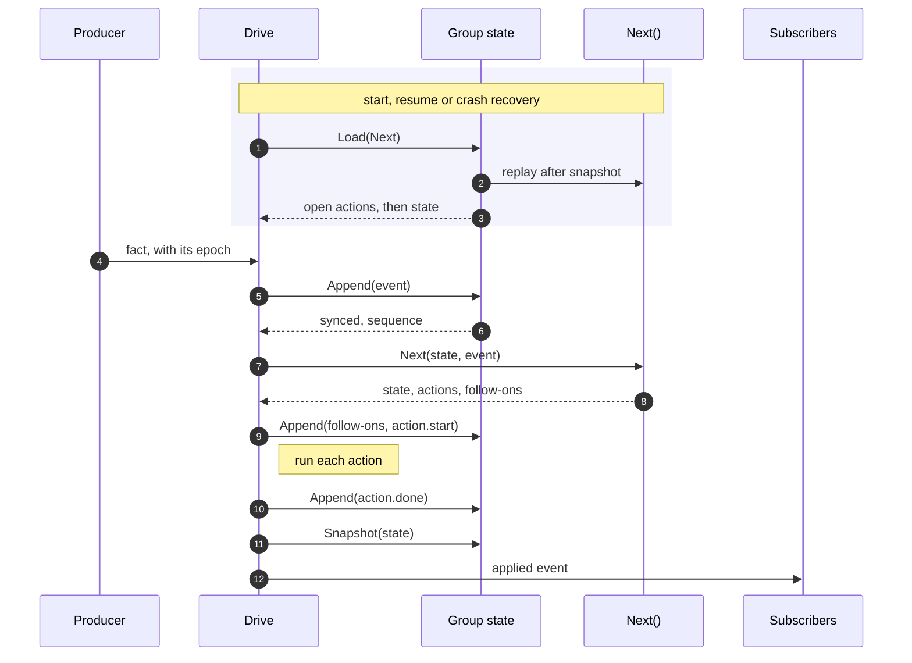

**Reading the diagram.**
1. On start, resume or after a crash, `Drive` itself calls group state's `Load` with an `apply` function that wraps `Next()`. A new group's file is empty; `Drive` appends a copy of the run's `run.start`, with the group's identifier, as the group's first line, with `stage` set to `NoStage`, the value row 1 starts from.
2. `Load` reads `state.json` and passes every line after the snapshot's `sequence` through `apply`, in order.
3. Replay discards each result's `Actions`, which `ActionsOpen` already holds, and checks that each result's `Emit` matches the next lines on disk, which the same write saved. `Load` returns the events `Drive` must append first: a `state.truncated` when a cut-short final write was dropped.
4. `Drive` runs every action in `State.ActionsOpen`, started or not, under the action's idempotency key, before `Drive` applies any new event.
5. A producer hands `Drive` a fact stamped with the epoch the producer's session started under.
6. `Drive` sets `stage` and `stale`; `Next()` (step 7) and the follow-on queue (step 8) run in memory, then `Append` stamps `sequence`, `timestamp`, `cause`, `last` and `checksum` on every line of the write, validates each line against the schema and syncs the write once; `Append` returns only once the write is on disk.
7. `Drive` calls `Next()`, which touches nothing on disk; a stale event changes nothing.
8. `Drive` puts the follow-on events in a first-in, first-out queue and applies each in turn in memory, a follow-on's own follow-ons joining the back, then saves the fact, every follow-on and the first action's `action.start` as one write with one forced save; each line carries its own checksum, its `cause` and the write's `last`. Each later `action.start` goes out in one write with the previous action's `action.done`. Each follow-on carries the epoch current when it is applied. A replay that finds a final write without its `last` line drops the whole write, so a fact never reaches disk without its decision. If `Next()` panics, the panic-catching helper saves the fact alone, then `group.blocked` reason `crash`.
9. For each action, which `Next()` already put in `ActionsOpen`, `Drive` appends and applies `action.start` (for a spawn, with the session identifier `Drive` picked), runs the action, then appends and applies `action.done`, which removes the action.
10. Because every appended line is applied, `State.Sequence` is always the last line on disk, and `Snapshot` can write the state on [the snapshot interval](#28-config).
11. The bus hands each applied event to the 3 subscribers, in `sequence` order.

**Epochs.** Entering a stage raises the epoch, and every spawn carries the current epoch. `Drive` marks an event `stale: true` when the event's epoch is older than the current stage's, and `Next()` ignores the event, so a cancelled Verify session's late result cannot move the stage twice. `Paused` and `Blocked` are holding states, not stages: entering or leaving Paused never changes the epoch, so a Verify sibling that kept running stays live and its `session.end done` counts toward Ship. Leaving Blocked on `resume` re-enters a stage and raises the epoch.

**Replay and the cut-short line.**
1. `Load` reads `runs/<group-id>/state.json`; then every later line is replayed; `Snapshot` refuses a state whose `sequence` is not the last line appended ([State Manager](#13-state-manager)).
2. Replay costs at most one snapshot interval of lines. The target is 10,000 events under 1 s. Verified by [G-19](#g-19) in phase 6.
3. A final write that was cut short by a crash (a line whose checksum fails, or no line whose `sequence` equals its `last`) is dropped whole, the file is truncated to the previous write, the dropped sequences are reused, and one `state.truncated` is appended.
4. A failing line before the last is a bad record: the line is moved aside and the group blocks `state_invalid` ([Checks: populate and validate (chapter 13)](#13-state-manager)).

**After a crash.** `Drive` calls `recover.DeadSessions` after `Load` and appends `session.end` reason `crash` for each session that `State` shows claimed, with no `session.end`, whose process is dead and whose `spawn` is no longer open; `task.released` follows as at every `session.end`. A session whose `spawn` is still in `ActionsOpen` is skipped, because that spawn's rerun restarts it, so the session restarts once.

**Files.** `runs/<group-id>/events.jsonl` holds one group's events and `runs/<run>.jsonl` holds one run's `run.*` events, appended and read through the same group state calls with no snapshot. The epic gate has a record and event log of its own, shaped like a group's, that runs only the whole-epic review and the epic pull request; it reuses the `session.*`, `finding.*`, `group.paused` and `group.blocked` events, so a crash resumes the gate and a provider limit pauses it. The gate's record identifier is `epic-<epic-id>`, and its files are `runs/epic-<epic-id>/events.jsonl` and `runs/epic-<epic-id>/state.json`. Groups never read each other's files; groups meet only in the work queue and the session pool.

**Concurrency.**
- **One writer per file:** a group's `Drive` goroutine is the only writer of the group's events and snapshot; the run goroutine is the only writer of `run.*` events.
- **`Next()` takes no locks:** `Next()` is pure, so table tests call it directly.
- **Coarse grain:** events fire per run, group, stage, session and task, never per model turn or token; the in-session tool loop is plain code.
- **Outside the bus:** the guard check before a tool call, formatting after `edit`, and shutdown are direct code, and log an event afterward when they can. These are the 3 inline hooks; beta 6 does not include repository-owned hooks; a later release adds them as subscribers, never gates.
- **Bus delivery:** one bus per `komodo run` process, no broker; `Next()` is the one decider, and subscribers write only their own derived records, never a group's events or snapshot. The engine loop never waits for a subscriber: each subscriber runs beside it, reads new lines with `Tail` from its own bookmark (the last `sequence` it handled, kept in its derived file), in `sequence` order and within the [per-subscriber limit](#28-config), and writes its file without a forced save, because the file rebuilds from the events. On an error a subscriber waits 1 second and retries from its bookmark; `status` flags any subscriber more than 50 events behind. The `status --watch` screen is a separate reader of the event file in its own process; the ledger batches its appends per tick.

**Wakes.** The wake subscriber is never dropped: a failed touch is retried on the next event, and `status --wait` also reads `Tail` on [a backstop interval](#28-config), so a failed touch delays a wake but never loses it.

| Wake | Event types |
|---|---|
| `WakeWait` | `group.blocked`, `group.paused`, `run.done`, `run.stopped` |
| `WakeAny` | `stage.enter` |
| `WakeNone` | Every other type |

A waiter runs `status --wait` or `--wait any`. The wake subscriber touches `~/.komodo/state/wake/<run>`. The waiter watches that file, then reads the state tail through group state's `Tail`, so an event between subscribing and watching is still seen.

### 2.6 State and Transitions

**📐 Group stages**
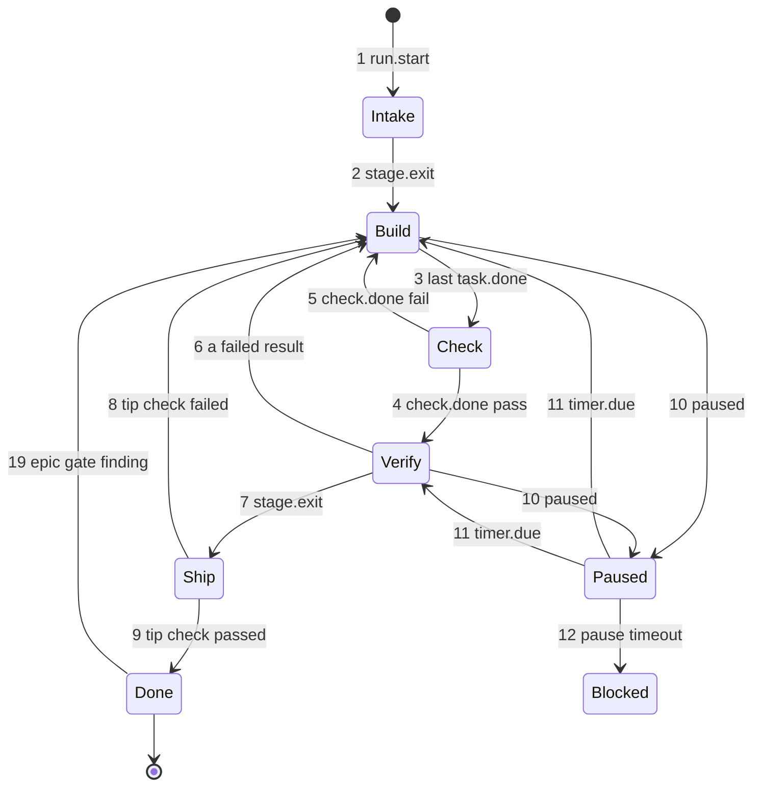

**Reading the diagram.** Numbers match the rows below. Every stage the [block rows](#block-rows) list can enter Blocked (row 14), and abandon and a lost lease end a group from any stage (rows 17-18); they are left off the drawing.

**The table is code.** Both tables below are one Go slice of `Transition`, whose `From`, `On` and `To` fields are the From, Event and To columns. For each event, `Next()` applies the first matching in-stage row, then the first matching stage-move row against the updated state; either may be absent. An event that matches neither is refused and logged, never dropped. The build draws the diagram from the slice and the gate checks every registered `Spec` against it.

**What a stage move emits.**
- **Into a working stage from a working stage, from Blocked or from Done (row 19):** `stage.enter` for the new stage, which raises the epoch.
- **Out of Paused (rows 11 and 16):** no `stage.enter`; the group returns to `Prior` under the same epoch.
- **Into Paused, Blocked or Done:** `group.paused`, `group.blocked`, or nothing extra; rows 9 and 17 list their own follow-ons.
- **`Prior`:** set only when a group leaves a working stage, so a group that blocks from Paused keeps the stage it paused in.

| # | From | Event | Condition | To | Sets; orders; emits |
|---|---|---|---|---|---|
| 1 | `NoStage` | `run.start` | The group's first line | Intake | emits `stage.enter` |
| 2 | Intake | `stage.exit` | | Build | emits `stage.enter` |
| 3 | Build | `task.done` | Every task is done | Check | emits `stage.enter` |
| 4 | Check | `check.done` pass | | Verify | emits `stage.enter` |
| 5 | Check | `check.done` fail | `Returns` under `limits.returns`; fingerprint differs from `FailureHash` | Build | `Returns` + 1; `FailureHash` set; emits `stage.enter` |
| 6 | Verify | `session.end` of the reviewer or the tester | The reviewer has ended, and the reviewer failed, a verified blocking finding exists, a task is `not_met`, an item failed Go's two reruns, or the tester failed; `Returns` under the limit; fingerprint differs | Build | `Returns` + 1; `FailureHash` set; orders `cancel` for a live tester; emits `stage.enter` |
| 7 | Verify | `stage.exit` | | Ship | emits `stage.enter` |
| 8 | Ship | `check.done` fail on the epic tip | `Returns` under `limits.returns` | Build | `Returns` + 1; landings stay paused; a new worktree cut from the epic tip, with the failing Check output as the findings; lease and hidden reference kept; emits `stage.enter` |
| 9 | Ship | `check.done` pass on the epic tip | Landed | Done | frees the lease and deletes the hidden reference in one step; emits `group.shipped`, `lock.released` |
| 10 | Build, Verify | `session.end` reason `paused` | No allowed link left | Paused | `Prior` = stage; emits `group.paused` |
| 11 | Paused | `timer.due` | Reason is not `pause_timeout`; the reset time passed | `ToPrior` | Back in Build: orders `spawn` from `Resume`. Back in Verify: applies rows 6 and 7 first; orders `spawn` from `Resume` only when neither moves the group |
| 12 | Paused | `timer.due` reason `pause_timeout` | `limits.pause_max_min` reached | Blocked | orders `cancel` for a live sibling; work-in-progress commit kept; emits `group.blocked` |
| 13 | Blocked | `resume` command | | `ToPrior` | emits `stage.enter` for `Prior`, which raises the epoch and orders that stage's usual work, such as a new landing in Ship |
| 14 | Intake, Build, Check, Verify, Ship, Paused: the stages the block rows list | See [Block rows](#block-rows) | | Blocked | `Prior` = stage; orders `cancel` for every live session; emits `group.blocked` |
| 15 | Blocked | `scope approve` or `scope deny` command | `Block.Reason` is `needs_scope` | Build | orders `scope_change` on approve; emits `stage.enter`, whose row resumes the same session from `Resume` |
| 16 | Paused | `resume` command | Sooner than the timer | `ToPrior` | As row 11 |
| 17 | Any working stage, Paused, Blocked | `abandon` command | | Done | orders `cancel` for every live session; frees the lease; emits `lock.released`; dependent groups block `dependency` |
| 18 | Any working stage, Paused, Blocked | `lease.lost` | Another run took the group | Done | ended in this run; orders `cancel` for every live session; frees nothing and emits no `lock.released`, because the lease and the task-list lock belong to the other run |
| 19 | Done | `request.return`, which the epic gate writes to the group's inbox with the findings in `data` | The finding names a file this group changed last | Build | Cuts a fresh worktree from the epic branch tip with the findings in the brief and takes a new lease; emits `stage.enter`; the group lands again like any group |

- **Commands:** `resume` is `request.resume`, `scope approve` and `scope deny` are `request.scope` with `data.answer`, and `abandon` is `request.abandon`. A command writes its request as one file `runs/<group-id>/inbox/<request-id>.json`, written to a temp name and linked into place create-only, so it never overwrites another and is never read half written. A live `Drive` watches its inbox, appends each file as an event in arrival order, then deletes the file; a crash between the two leaves the file, and `Drive` drops a second request with a recorded `data.request`. `Drive` appends `request.accepted` or `request.refused` with the same `data.request`. With no live `komodo run` process, a command that needs no session (`abandon`) takes the group's lease, handles the request in one step through group state and releases the lease, as `jobs tick` does; a command that needs sessions starts a detached engine, whose `Drive` drains the inbox on start.
- **Returns** raise the epoch through `stage.enter` and give the builder every verified finding in one return. On a Verify return the tester is cancelled at the first verified blocking finding, and the reviewer finishes.
- **Ship before landing:** entering Ship takes the epic's [landing gate](#35-behaviour), merges the epic branch into the group branch, reruns Check on the merged branch, then runs `land` ([Ship](#115-behaviour) steps 2 to 4). A failed Check on the merged group branch frees the landing gate and returns the group to Build with the failing output as findings, spending one of `limits.returns`, as row 5 does; at the limit the Check block row applies.
- **A return with every task done:** rows 5, 6 and 8 send a group whose tasks are all done back to Build, and the returning builder session is pointed at the reopened task. A reviewer `not_met` verdict reopens that task by its identifier; a finding or failing test reopens the task whose `files` list covers the named file. When nothing maps, such as a broken epic tip with no file, the group's last task reopens with every finding. Only the task's state in `State` changes; the backlog files and the locked task list stay untouched.

#### Block rows

Row 14 is one row per bound or blocking exit. Each row's event is the one that spends the bound or reports the exit; the bound's own row above applies only while the bound has room.

| Event | Stages | Condition | Block reason |
|---|---|---|---|
| `check.done` fail | Check | `Returns` at `limits.returns` | `regression` when a test that passed at the base fails; otherwise unnamed, counter `returns` |
| `session.end` that would apply row 6 | Verify | `Returns` at `limits.returns` | `regression` when a test that passed at the base fails; otherwise unnamed, counter `returns` |
| `check.done` fail, or a row 6 `session.end` | Check, Verify | Fingerprint equals `FailureHash` | Unnamed, counter `flap` |
| `task.retry`, a builder `session.end` reason `timeout` or `idle`, or a builder session found dead | Build | `Attempts` is at `limits.group_attempts`, so no fresh builder session may start | `attempts` |
| Builder `session.end` reason `timeout` or `idle` | Build | `Retries` passes the agent's `retries` | Unnamed, counter `retries` |
| Any builder `session.end` | Build | `TokensUsed` reaches `limits.group_tokens` with `track.usage` on; this row wins over the exit reason's row | `budget` |
| Builder `session.end` reason `budget` | Build | | `budget` |
| Builder `session.end` reason `billing` | Build | | `paid_refused` |
| Builder `session.end` reason `needs_scope` | Build | | `needs_scope`; work-in-progress commit kept |
| `action.done` for `land` | Ship | The merge conflicted and the one automatic merge did not resolve it | `merge_conflict` |
| `action.done` for `setup` | Intake | Non-zero exit | `setup`, showing the command's output |
| `action.done` for `setup`, which runs lint, the card hash and the worktree cut before the command | Intake | The group's backlog entry fails lint | `lint` |
| The same Intake event | Intake | git refused the worktree cut | `setup`, showing git's output |
| `action.done` for `spawn` | Build, Verify | Link selection found every link in the chain unavailable or unauthorized | `no_provider` |
| `action.done` for `spawn` | Build, Verify | The brief exceeds half the context of every link in the chain | `context` |
| A `Next()` result that breaks its event type's `Spec`, found by `Drive` before the write | Any working stage, Paused | | `contract` |
| `Append` or `Load` refused by the state manager (`*InvalidError`, `ErrNotWriter`, or a bad record moved aside) | Any working stage, Paused | | `state_invalid` |
| Reviewer `session.end` reason `done` | Verify, and Paused with `Prior` = Verify | The verdict is `brief_incomplete` | `brief` |
| Tester `session.end` reason `done` | Verify, and Paused with `Prior` = Verify | After its one restart with Go's output, the tester failed an item Go's reruns pass | `tester` |
| Reviewer or tester `session.end` reason `done` | Verify, and Paused with `Prior` = Verify | Go's two reruns of one acceptance item disagreed | `flaky` |
| Reviewer or tester `session.end` without a result, or found dead by the startup sweep | Verify, and Paused with `Prior` = Verify | The session's restarts passed the agent's `retries` | Unnamed, counter `retries` |
| `check.done` fail on the epic tip | Ship | `Returns` at `limits.returns` | `integration` |
| `group.blocked` reason `crash`, emitted by the panic-catching helper | Any working stage, Paused | The group's `Drive` panicked | `crash` |
| Any event in a working stage | Any working stage | `WallUsedS` reaches `limits.group_wall_min` | `wall` |

**In-stage rows.** These change `State`, order actions or emit follow-ons without moving the stage.

| Event | Stages | Sets; orders; emits |
|---|---|---|
| `stage.enter` | Any working stage | `Epoch` + 1; entering Verify clears `Verify`; orders by stage: Intake `setup`; Build `spawn` of the group's builder session, starting at the first task not done, from `Resume` when set, with the findings on a return; Check one `check` per command; Verify `spawn` for the reviewer and the tester; Ship the merge of the epic branch into the group branch, then Check on the merged branch, then `land` |
| `lock.taken` | Intake | Lock recorded |
| `action.done` for `setup` | Intake | Exit 0 with the lock taken emits `stage.exit` |
| `session.start`, `task.claimed` | Build, Verify | Task `claimed` with its session; a fresh builder session, not one resumed from `Resume`, adds 1 to `Attempts`; a Verify session recorded in `Verify` |
| Builder `session.end` | Build | Clears the task's session; `TokensUsed` grows by the session's usage when `track.usage` is on; then the exit reason's row below |
| `task.released` | Any | Clears the task's session when the task is not done; a done task stays done |
| A builder session found dead by the startup sweep | Build | Task `queued`; orders `wip_commit`, then `spawn` of the group's builder, which resumes at that task. The dead session used one of the group's attempts like any ended session; `Retries` is unchanged. |
| A reviewer or tester session found dead by the startup sweep | Verify, Paused | As a session ending without a result, below |
| `action.done` for `commit` | Build | The commit action ran `done_when` first; exit 0 emits `task.done`, a failure emits `task.retry` |
| `task.done`, not the last task | Build | Task `done`; `Drive` appends `task.claimed` for the next task with the same builder session, which goes on to it. The builder calls the `task_done` tool; `Drive` orders the `commit` action, and the tool returns its `done_when` result. A failure while the session is live goes back to it as a gate result, not a `task.retry` |
| `task.retry` | Build | orders a fresh builder `spawn` while `Attempts` is under `limits.group_attempts`; that session adds the attempt |
| `finding.submit` | Verify, and Paused with `Prior` = Verify | Claim recorded in `Verify` |
| `finding.verified` | Verify, and Paused with `Prior` = Verify | Verified finding recorded; the first blocking one orders `cancel` for a live tester |
| Reviewer or tester `session.end` reason `done` | Verify, and Paused with `Prior` = Verify | Result recorded as pass or fail; in Verify with both passed and 0 regressions, emits `stage.exit`; a failure moves the group by row 6 once the reviewer has ended |
| Tester `session.end` reason `cancelled` | Verify, and Paused with `Prior` = Verify | Result recorded as cancelled; row 6 applies at the reviewer's end |
| Reviewer or tester `session.end` reason `paused` | Verify | A `Resume` entry added for the session; row 10 moves the group |
| Reviewer or tester `session.end` reason `paused` | Paused | A second `Resume` entry added for the session; `Pause.Until` takes the later reset time |
| Reviewer or tester `session.end` with any other reason | Verify, and Paused with `Prior` = Verify | orders `spawn` for a fresh session of the same agent on the same commit while its restarts are within the agent's `retries`; then the [block rows](#block-rows) move the group. Never a return: `Returns` is unchanged |
| `action.done` for `check` | Check, Ship | Result recorded; the last command's result emits one `check.done`, pass only if every command passed |
| `action.done` for `land` | Ship | A clean landing orders `check` on the epic tip |
| `group.paused` | Paused | `Pause` set |
| `group.blocked` | Blocked | `Block` set; `Blocks` + 1 under the reason, or under the counter for an unnamed block |
| `group.shipped`, `lock.released` | Done | None |
| `session.end`, `session.start`, `task.claimed`, `finding.*`, `action.done` | Blocked, Done | Recorded only; the session was cancelled when the group blocked or ended |
| `action.start`, `action.done` | Any | The open action is marked started, with the spawn's session, then removed |
| `session.idle`, `session.timewarn`, `tool.denied`, `provider.skip`, `limit.warn`, `state.truncated` | Any | None; recorded for the ledger |

**Builder exit reasons.** The row a builder's `session.end` applies in Build, from the [exit reasons (chapter 5)](#exit-reasons):

| Exit reason | Sets; orders; emits |
|---|---|
| `done` | orders `commit` |
| `check_fail`, `no_result`, `schema_fail`, `refusals` | orders `wip_commit`; emits `task.retry` |
| `timeout`, `idle` | orders `wip_commit`; `Retries` + 1; orders `spawn` for a fresh session while `Retries` is within the agent's `retries` |
| `provider` | orders `wip_commit`; `Resume` set; orders `spawn` from `Resume` on the next allowed link |
| `paused` | orders `wip_commit`; `Resume` set; row 10 moves the group |
| `needs_scope`, `budget`, `billing` | orders `wip_commit`; the [block rows](#block-rows) move the group |
| `cancelled` | None; the cause already moved the group |
| `pause_timeout` | None; row 12 already blocked the group and cancelled the session |
| `crash` | None of its own; a builder found dead respawns the group's builder session at its first task not done under the Build rows, and the `attempts` block row applies at the cap |

| State | Waits on | Pool slot | Lease and worktree | Wall clocks | Ends by |
|---|---|---|---|---|---|
| Paused | A timer record (`wait_until`) under `~/.komodo/state/timers/` | Returned | Kept | Stopped | The timer, `resume`, or `pause_max_min` |
| Blocked | A person or the orchestrator | Returned | Kept (sweep skips `needs_scope`) | Stopped | `resume`, `scope approve|deny`, `abandon` |

In Verify, a sibling session that was not paused keeps running while the group is Paused.

#### Block reasons

A fixed enumeration on `group.blocked`, named in `status`. A group that blocks [too often](#28-config) for one reason is flagged `needs redesign`.

| Reason | Set when | A person then |
|---|---|---|
| `no_provider` | Every link in the chain was unavailable or unauthorized at a session boundary | Fixes the provider or login |
| `pause_timeout` | Paused for `limits.pause_max_min`; the session was cancelled | Waits for the provider |
| `paid_refused` | The billing check found only a paid link, or a subscription link with the wrong login, and `providers.paid` forbids it; killed before the first turn | Changes `providers.paid` or the login |
| `regression` | A test that passed at the base fails, and returns are spent | Reviews the failing output |
| `epic_gate` | The final pass over the whole epic found a problem with no file to send back, or its rounds reached `limits.returns`; set on the epic gate's own record, not by a group block row | Decides |
| `tester` | The tester failed an item twice that Go's reruns pass; a harness fault, not the builder's | Checks the item |
| `flaky` | Go's two reruns of one item disagreed | Fixes the test |
| `dependency` | A dependency was abandoned | Re-plans or reruns it |
| `integration` | Check failed on the epic tip after landing and the group's returns are spent; landings stay shut until a Check on the tip passes | Reviews the integration failure |
| `needs_scope` | The builder needs a file outside `files`; work in progress kept; the orchestrator answers after 2 engine denials (owner decision, 2026-10-09) | Runs `scope approve|deny` |
| `attempts` | The group's builder used all `limits.group_attempts` fresh sessions | Looks at why it keeps failing |
| `context` | The brief exceeds half the context of every link in the chain; the `spawn` block row produces it | Shrinks the task or adds a larger endpoint |
| `merge_conflict` | Landing conflicted and the one automatic merge did not resolve it | Resolves the conflict |
| `ship` | A push or a `gh` call failed 3 times for a reason other than a conflict | Fixes the remote, the network or the `gh` login |
| `branch_missing` | Ship found the group's hidden reference gone, deleted outside Komodo; names the last head commit recorded | Restores the reference, or runs `abandon` |
| `budget` | With `track.usage` on, the group used `limits.group_tokens`; never occurs with tracking off | Raises the cap or splits the group |
| `wall` | The group's working time reached `limits.group_wall_min`; paused and blocked time excluded | Splits the group or approves more time |
| `crash` | The group's `Drive` panicked; other groups kept running | Runs `resume`, which replays through `Load` |
| `lint` | The planner's draft failed backlog lint 3 times, or the group's backlog entry failed lint at Intake | Fixes it with `doctor backlog` |
| `setup` | The setup command or the worktree cut failed at Intake, before any model session; or a Check step could not run, such as a sandbox refusal; `status` shows the output | Fixes the command or the checkout |
| `brief` | The reviewer reported `brief_incomplete`, or the brief builder could not load a skill; a harness fault | Fixes the brief inputs |
| `contract` | A `Next()` result broke its type's `Spec`; `Drive` checks it before the write ([Block rows](#block-rows)) | Reads the named type and rule |
| `state_invalid` | The state manager refused a write or moved a bad record aside as `.bad-*`; names kind, key and field; the state manager block row produces it | Inspects the record |
| (unnamed) | A session's `retries` after timeouts or idle stops, `limits.returns` on findings, a flap (the same failure fingerprint or a zero-diff return), or the job failures (a job's third failed attempt in a row); `reason` is empty and `BlockState.Counter` names the counter. `group.blocked` carries that counter in its `counter` field. | Runs `resume` |

Every row ends with `resume` unless the last column says otherwise.

### 2.7 Invariants and Failures

| Failure | Detected by | Action | Lost | Shown |
|---|---|---|---|---|
| Crash mid-`Append` | Checksum fails on the last line at `Load` | Drop the line, emit `state.truncated` | At most 1 event, never applied | The group resumes |
| Bad line before the last | Checksum or schema at `Load` | Move aside as `.bad-*`, block `state_invalid` | Nothing; the record is kept | `doctor`, `status` |
| Crash between `action.start` and `action.done` | Open action in the snapshot or after it | Rerun under its idempotency key | Nothing; a commit happens once | Nothing |
| Crash with a session live | The startup sweep finds a claimed session dead with no `session.end` | `session.end` reason `crash`, appended by `Drive` after `Load`; the group's builder respawns at its queued task | At most the session's unsaved turn | `status` |
| Late result from a cancelled session | Epoch older than the current | Write with `stale: true`; `Next()` ignores it | Nothing | Ledger only |
| Late result after Blocked or Done | The group's stage | Recorded only | Nothing | Ledger only |
| Event with no transition row | `Next()` returns `Refused` | Log it; state unchanged | Nothing | Ledger |
| Result breaks its `Spec` | `Drive`'s contract check | Block `contract` | Nothing | `status` |
| Subscriber error or panic | The bus | Drop that subscriber for the run; the wake subscriber is retried instead | Its derived records stop | Run report |
| `Drive` panics | The engine's recover | Block that group `crash`; others continue | Nothing on disk | `status`, run report |

### 2.8 Config

**Keys read into `Limits`:** `limits.returns`, `limits.group_attempts`, `limits.pause_max_min`, `limits.group_tokens`, `limits.group_wall_min`, `track.usage` ([Flat keys (1.8 Config)](#18-config)), plus each agent's `retries` from its `agent.json`, resolved as in [Per-agent limits (1.5)](#15-behaviour).

| Constant | Value |
|---|---|
| Snapshot interval | Every 50 events, and on every stage change |
| Replay target | 10,000 events under 1 s. Verified by [G-19](#g-19) in phase 6. |
| Subscriber limit | 5 ms each |
| Wake backstop | `status --wait` reads `Tail` every 5 s |
| Blocks before `needs redesign` | `BlocksBeforeRedesign`, set in [9.8](#98-config) |

### 2.9 Proof Cases

Each case is a table test on `Next()` or a recovery test on `Load`. Fixture limits are `limits.returns` 2, `limits.group_attempts` 2 and agent `retries` 1, so every bound is reached.

| Fixture input | Expected result |
|---|---|
| Every stage with every catalog type, including Paused, Blocked and Done | Each pair applies its row or returns `Refused`; no pair panics |
| Verify: the reviewer ends with a verified blocking finding while the tester runs | One return to Build; one `cancel` for the tester; the tester's later `session.end` is stale |
| Verify: the tester ends failed, then the reviewer ends passed | One return to Build at the reviewer's end |
| Verify: the reviewer ends passed, then the tester ends failed | One return to Build at the tester's end |
| Verify: both end passed, in either order | One `stage.exit`, then Ship |
| Builder `session.end` reason `schema_fail` at sequence 12 | Lines 13-17 as in the [Actions example](#actions): `task.retry`, the `wip_commit` pair, the `spawn` pair |
| Builder `session.end` reason `timeout` with `Retries` at 1 | Blocked, unnamed, counter `retries` |
| `check.done` fail twice with the same fingerprint | The second blocks unnamed, counter `flap` |
| A Verify return that also spends `limits.returns` with a live tester | One `cancel` action in `ActionsOpen`, not two |
| `stage.enter` for Verify | Two `spawn` actions with different `ID`s |
| A builder `session.end` reason `paused`, then `timer.due` | Paused, then Build under the same epoch with one `spawn` from `Resume`; no `stage.enter` |
| The reviewer pauses, then the tester ends passed while Paused, then `timer.due` | The tester's result counts; one `spawn` for the reviewer |
| `abandon` with a builder live, then the builder's `session.end` reason `cancelled` | Done, `lock.released`; the late `session.end` is recorded only |
| A plain `task.released` after the task's `commit` emitted `task.done` | The task stays done |
| `kill -9` with a builder live after its `spawn` finished, then `resume` | One new `spawn`; no `session.end` reason `crash`, because the spawn was open |
| `kill -9` between `action.start commit` and `action.done`, then `resume` | The commit runs again and yields 1 commit |
| `kill -9` after an event is appended and before its first `action.start`, then `resume` | The ordered action runs once |
| A last event line cut short by a crash | Replay drops the line and emits one `state.truncated` |
| Replay of a group's whole event file | Rebuilds the same `State` as the live run, and returns the follow-ons missing at the tail |
| A fixture `group.blocked` | Wakes `status --wait` |
| An event emitted between a waiter's subscribe and its first watch | Still wakes the waiter |
| A subscriber that panics | Group state unchanged; the other 2 subscribers keep running |
| An emitted type missing from the catalog | The gate fails |

### 2.10 Open Gaps

Each id is a row in the [gap register](#appendix-b-gap-register); the rows are not copied here.

| Gap | Question | Closes by |
|---|---|---|
| [G-19](#g-19) | The replay target is unmeasured | Gate timing, phase 6 |

---

## 3. Engine Internals

The engine runs task groups: it starts model sessions, moves each group through its stages, orders groups against each other and lands finished work on the epic branch. It is the package that calls the decision function of [chapter 2](#2-event-spine-and-state-machine) and performs the side effects that function orders. Design and reasons are in [HLD 5.4](hld.md#54-engine-internals).

**Guarantees the tests pin**

| Guarantee | How |
|---|---|
| One writer per group | A single `Drive` goroutine writes a group's state; no mutex exists inside a group |
| No lost event | A session's event channel holds 256 events; a full channel blocks the session, it never drops an event |
| Faults stay inside one group | Every goroutine starts through one panic-catching helper; a panic in one `Drive` blocks that group only |
| Machine-wide limits hold | Queue items, pool slots, link slots and leases are files created exclusively or renamed into place; a slot is a create-only file removed with `Remove` |
| Landings are serial | One landing at a time, each followed by a zero-token Check on the epic tip |

### 3.1 Scope and Concepts

**Owns:**
- The `Drive` loop that runs one group from its first event to its end.
- The run goroutine and run order: the dependency graph as the engine consumes it, group readiness, serial landing, the integration break and the epic gate.
- The machine-wide work queue and its pick order.
- The machine-wide session pool and the per-link session slots: `pool.go` claims and frees both kinds.
- The shutdown sequence and the parent guard.
- The stage drivers `intake.go`, `build.go` and `verify.go`.

**Does not own:**
- `Next()`, `State`, `Limits`, the transition table and the 34 event types ([Event Spine and State Machine](#2-event-spine-and-state-machine)).
- Group state files, `Claim`, `Replace` and `Remove` ([State Manager](#13-state-manager)).
- Worktrees, leases, fences and the hidden reference ([Workspace and Leases](#4-workspace-and-leases)).
- Starting, watching and stopping one model session ([Sessions, Agents and Briefs](#5-sessions-agents-and-briefs)).
- The startup sweep, which error recovery owns in `recover.go`, and the Check, review and tester logic ([Check, Review, Tester and Recovery](#9-check-review-tester-and-recovery)).
- Job templates and the `jobs tick` verb ([Scheduler, Cache and Observability](#10-scheduler-cache-and-observability)).
- Building the dependency graph from the backlog, and the git landing operations ([Backlog, Planning, Ship and Release](#11-backlog-planning-ship-and-release)).

The purpose of the subsystem, and who it talks to, is in the HLD: [Engine Internals](hld.md#54-engine-internals).

**Concepts**
- **Drive:** the goroutine, a lightweight Go thread, that runs one group. It is the only code that changes that group's records.
- **Run goroutine:** the goroutine of one `komodo run` launch. It builds the dependency graph, enqueues ready groups and collects finished `Drive`s.
- **Queue item:** a create-only file naming one ready group or one due job.
- **Pool slot:** one of the machine-wide places for builder, reviewer and tester sessions. A link slot is a separate per-link limit.
- **Wave:** a set of groups that can run together.
- **Landing:** merging a finished group into the epic branch. The epic tip is the newest commit of that branch.
- **Integration break:** a failed Check on the epic tip after a landing.
- **Epic gate:** one reviewer and tester pass over the whole epic diff after the last landing.
- **Parent guard:** the small process that starts the engine and repeats the shutdown save if the `komodo run` process dies.

Group, epic and lease are defined in the [glossary](hld.md#12-glossary).

### 3.2 Package Layout

| File | Holds |
|---|---|
| `internal/engine/engine.go` | `Drive`: the per-group loop that appends events, calls `Next()` and runs the ordered actions |
| `internal/engine/queue.go` | Work queue files under `~/.komodo/state/queue/`, the pick order, fair share across repositories |
| `internal/engine/pool.go` | Session pool, the floor, the ceiling, growth and shrinkage, and the per-link slots |
| `internal/engine/intake.go` | Intake: lint the group's backlog cards, hash them, cut the worktree from the epic tip; Intake is the first stage `Drive` runs, after the lease is taken |
| `internal/engine/build.go` | Build: one builder session per group, through every task in order, resumed with the findings on a return |
| `internal/engine/verify.go` | Verify: reviewer and tester at once; cancels the tester on the first verified finding |
| `internal/engine/shutdown.go` | The catch-all shutdown sequence and the parent guard |
| `internal/engine/run.go` | The run goroutine, `Startable`, the landing gate and the panic-catching helper `Go` |
| `internal/engine/epicgate.go` | The epic gate: the whole-epic review and the epic pull request |

Files of the same package that other chapters own:

| File | Chapter |
|---|---|
| `stage.go` | [Event Spine and State Machine](#2-event-spine-and-state-machine) |
| `worktree.go` | [Workspace and Leases](#4-workspace-and-leases) |
| `session.go` | [Sessions, Agents and Briefs](#5-sessions-agents-and-briefs) |
| `schedule.go` | [Scheduler, Cache and Observability](#10-scheduler-cache-and-observability) |
| `recover.go` | [Check, Review, Tester and Recovery](#9-check-review-tester-and-recovery) |
| `limits.go` | [Check, Review, Tester and Recovery](#9-check-review-tester-and-recovery) |

**Entry points**

| Flow | Starts at |
|---|---|
| One group's life | `Drive.RunGroup` in `engine.go` |
| Choosing the next queue item | `Pick` in `queue.go` |
| Pool growth and shrinkage | `GrowPool` and `HalvePool` in `pool.go` |
| Start rule | `Startable` in the run goroutine's file |
| Stopping a run | The shutdown sequence in `shutdown.go` |

These names are final for beta 6.

The dependency graph is built in `internal/repo/graph.go` (waves and longest chain, [chapter 11](#11-backlog-planning-ship-and-release)); the engine imports it, as the import order allows. `internal/engine/run.go` holds the run goroutine, `Startable`, the landing gate and the panic-catching helper `Go`; `internal/engine/epicgate.go` holds the epic gate.

### 3.3 Data Model

#### Engine constants

```go
const (
	EventBuffer      = 256              // capacity of a group's event channel
	LeaseRenewEvery  = 5 * time.Minute  // how often a group's Drive renews its lease
	AgentStopGrace   = 30 * time.Second // time shutdown allows each session to stop
	ShutdownDeadline = 60 * time.Second // after this, sessions still alive are killed
	GuardSilenceMax  = 10 * time.Minute // heartbeat silence after which the parent guard acts
)
```

#### Queue item

Ready work waits as one create-only file per group or job at `~/.komodo/state/queue/<repo-id>.<kind>.<id>.json`. A repository identifier becomes `<repo-id>`: the repository's last path element in lower case, a hyphen, and the first 8 hexadecimal digits of the SHA-256 of the full identifier, such as `komodo-agentic-harness-coding-3f9a1c2e`; every `<repo-id>` path uses this form.

```go
// ItemKind says whether a queue item is a task group or a scheduled job.
type ItemKind string

const (
	KindGroup ItemKind = "group"
	KindJob   ItemKind = "job"
)

// Priority orders queue items; a group's TG.md may set high, everything else is normal.
type Priority string

const (
	PriorityHigh   Priority = "high"
	PriorityNormal Priority = "normal"
)

// QueueItem is the body of one queue file.
type QueueItem struct {
	Kind       ItemKind  `json:"kind"`
	Repo       string    `json:"repo"`
	ID         string    `json:"id"`
	Priority   Priority  `json:"priority"`
	EnqueuedAt time.Time `json:"enqueued_at"`
}
```

| Field | Type | Rule |
|---|---|---|
| `kind` | string | `group` for a ready group, `job` for a due scheduled job |
| `repo` | string | The repository the item belongs to; fair share counts each job as its own repository |
| `id` | string | The group identifier, or the job name, so a job's file is `<repo-id>.job.<name>.json` and two ticks collide on it |
| `priority` | string | `high` is set by `priority: high` in the group's `TG.md`; jobs are `normal` |
| `enqueued_at` | time | When the item was queued, in the format `2026-10-13T09:14:05Z`: Coordinated Universal Time, whole seconds |

**Versioning.** Each record carries the schema version `v` in its header. A newer binary reads an older version by running a registered migration step in memory. A record written by a newer binary is refused with `ErrNewerVersion` and left untouched ([State manager header](#133-data-model)).

The state manager wraps the body in its six-field record header (`v`, `kind`, `key`, `rev`, `ts`, `writer`); the file is one JSON object: the six header fields, then the body under `body` ([State manager header](#133-data-model)). The body alone:

```json
{
  "kind": "group",
  "repo": "github.com/rdevitto86/komodo-agentic-harness-coding",
  "id": "0192e4c5-7a10-7d3e-9b2f-6c1d8e4a5f30",
  "priority": "normal",
  "enqueued_at": "2026-10-13T09:14:05Z"
}
```

#### Slot files

Pool slots live under `~/.komodo/state/pool/` and link slots under `~/.komodo/state/links/`. Each slot is a create-only file written with `Claim` and removed with `Remove`, tagged with its holder's process identifier and start time; a slot whose holder process is dead (a signal-0 check on Unix, `OpenProcess` on Windows, with the start time guarding against a reused identifier) is free and is removed by the next taker or the startup sweep.

```go
// SlotFile is the body of a pool or link slot lock file.
type SlotFile struct {
	Pid     int       `json:"pid"`     // process identifier of the holder
	Started time.Time `json:"started"` // the holder process's start time, so a reused pid is not mistaken for it
	Run     state.ID  `json:"run"`     // the run the session belongs to
	Session state.ID  `json:"session"` // the session holding the slot
}

// PoolState is the body of ~/.komodo/state/pool/state.json, shared by every engine on the machine.
type PoolState struct {
	Size     int    `json:"size"`      // the adapted pool size, between limits.pool_min and limits.pool_max
	LastRepo string `json:"last_repo"` // the repository served by the previous pick, for round-robin
}
```

| Field | Type | Rule |
|---|---|---|
| `pid` | integer | The holder's process identifier |
| `started` | time | The holder's process start time |
| `run`, `session` | string | The run and session holding the slot |
| `size`, `last_repo` | integer, string | `PoolState`: the adapted size and the round-robin cursor, written with `Replace` under its lock file |

Versioning follows the same record header as the queue item.

A pool slot is `~/.komodo/state/pool/<n>.json` with `<n>` from 1 to the current `size`; a link slot is `~/.komodo/state/links/<link>.<n>.json` with `<n>` from 1 to `limits.link_sessions.<link>`. A taker claims the lowest free number.

#### Drive

```go
// Drive owns one group: it is the only writer of that group's events and snapshot.
type Drive struct {
	Group  state.ID                // the group this Drive runs
	State  state.GroupState[State] // group state: Open, Append, Snapshot, Load, Tail
	Limits Limits                  // the bounds Next enforces, pinned by the config hash
	Events chan state.Event        // fed by session goroutines, capacity EventBuffer
	Leases Leases                  // takes, renews and releases the group's lease
	Trees  Worktrees               // cuts, saves and removes the group's worktree
	Refs   HiddenRefs              // moves the group's hidden reference under the fence
	Router *Router                 // picks the link for each session (Providers and HTTP, chapter 7)
}

// NewDrive wires one group's Drive; Leases, Worktrees and HiddenRefs are interfaces, so tests pass fakes.
func NewDrive(group state.ID, gs state.GroupState[State], lim Limits, l Leases, t Worktrees, r HiddenRefs, rt *Router) *Drive
```

| Field | Rule |
|---|---|
| `Group` | Identifier of the one group; a second `Open` of the same group in one process is refused |
| `State` | The calls of [Group state](#13-state-manager); an apply function that wraps `Next()` is passed into `Load` as the replay function |
| `Limits` | Read once from `runs/<run>.config.json`, the settings pinned at the run's start; `resume` keeps them and warns when `config.json` has changed |
| `Events` | A session goroutine sends the facts of its session; a full channel blocks the sender |
| `Leases`, `Trees`, `Refs`, `Router` | The collaborators, set once by `NewDrive`; `Drive` renews its lease with `Leases.Renew` |


`Drive` is in memory only. Its durable form is the group state of [chapter 2](#2-event-spine-and-state-machine), whose snapshot body is `State`.

A typed command such as `resume` reaches `Drive` as a request file in `runs/<group-id>/inbox/` ([Commands](#26-state-and-transitions)).

#### Dependency graph, as consumed

The run goroutine reads, per group: its dependencies, its `touches` globs, its task count and its backlog position. The graph also yields waves (sets of groups that can run together) and the longest chain. The types are defined by `internal/repo/graph.go` ([chapter 11](#11-backlog-planning-ship-and-release)).

```go
// Candidate is one queue item with the three facts the tie-break rules read.
type Candidate struct {
	Item        QueueItem
	ChainWeight int // longest remaining chain, weighted by task count
	Unblocks    int // groups unblocked by landing this one
	Order       int // position in backlog ID order; lower is earlier
}
```

- **`ChainWeight`:** the sum of task counts along the heaviest path of unlanded groups that starts at this group and follows its dependents, the group's own tasks included.
- **`Unblocks`:** the number of groups whose only unlanded dependency is this group, so they become startable when it lands.
- **`Order`:** the group's position when the backlog's group identifiers are sorted in natural order (`TG-2` before `TG-10`).

#### Run flags

`komodo run` takes one flag, `--stage <stage>`, which runs a single stage. The flags `--mode`, `--set`, `--max-parallel`, `--budget-tokens`, `--detach` and `--until` do not exist. The run always detaches, and limits come only from `komodo config`.

### 3.4 Interfaces

`Drive`, `Next()`, the group state calls and the pick order are named. The exported names and signatures below are final for beta 6.

```go
// RunGroup opens a group, replays it, reruns open actions, then loops until the group ends or ctx is cancelled.
func (d *Drive) RunGroup(ctx context.Context) error

// Pick returns the queue item to take next, applying the five pick rules.
func Pick(ready []Candidate, lastRepo string) (Candidate, bool)

// GrowPool returns the pool size after one clean session end.
func GrowPool(size, ceiling int, freeMemGB, sessionMemGB float64) int

// HalvePool returns the pool size after a LimitError or a quota warning, never below the floor.
func HalvePool(size, floor int) int

// Startable reports whether a group may start: every dependency landed and Check passed on the epic tip.
func Startable(dependencies []string, landed map[string]bool, tipChecked bool) bool
```

`lastRepo` is the repository served by the previous pick; it is stored as `last_repo` in `~/.komodo/state/pool/state.json`, so every engine on the machine shares one cursor.

**Failure behaviour of each function**

| Function | On failure |
|---|---|
| `RunGroup` | `Open` refused (the group is already open in this process, or the process does not hold the lease): the `Drive` does not start. A refused `Append` (`*InvalidError` or `ErrNotWriter`) blocks the group `state_invalid`; a failed disk write ends the `Drive` as a panic does, blocking the group `crash`; a bad line before the last during `Load` is moved aside as `.bad-*` and the group blocks `state_invalid`. An action that fails records its failure class in `action.done`, and `Next()` applies that kind's row; a failure class with no row blocks the group `contract` |
| `Pick` | Returns `false` when no item is ready; nothing is taken |
| `GrowPool` | Cannot fail; returns the size unchanged when memory does not cover one more session or the ceiling is reached |
| `HalvePool` | Cannot fail; returns the floor when halving would go below it |
| `Startable` | Cannot fail; returns `false` while any dependency is unlanded or the tip's Check has not passed |

| Caller | Call | When |
|---|---|---|
| Run goroutine | `Startable`, then `Claim` on a queue file | A dependency lands, or the epic tip's Check passes |
| `komodo jobs tick` | `Claim` on a queue file | A job is due |
| Engine, when a pool slot frees | `Pick`, `Remove` on the queue file, `Leases.Take` ([Workspace and Leases](#4-workspace-and-leases)) | The pool has a free slot and a queue item is ready |
| Session goroutine | Send on `Drive.Events` | Each fact a session produces |
| `Drive` | `Open`, `Load`, `Append`, `Snapshot` (group state); `Next()`; `SpecOf` | Every event |
| `Drive` | `Leases.Renew` | Every `LeaseRenewEvery` |
| `Drive` | `GrowPool` after a clean session end; `HalvePool` after a rate-limit error or a quota warning | The session's end or the warning is applied |
| `komodo stop <run>`, signal, `fresh --restart-runs` | The shutdown sequence | Operator or operating system asks the run to stop |

#### Refusals

`komodo run <group>` refuses, with the reason named, when a dependency outside the run has not landed (the message names that dependency). A dependency cycle in the backlog is refused outright when the graph is built. The other two refusals of the verb (a group another run holds; a repository with no detected commands) belong to [CLI and Configuration](#1-cli-and-configuration).

### 3.5 Behaviour

#### Walkthrough

An epic holds group A, which has no dependency, and group B, which depends on A.

**📐 Two groups through the engine**
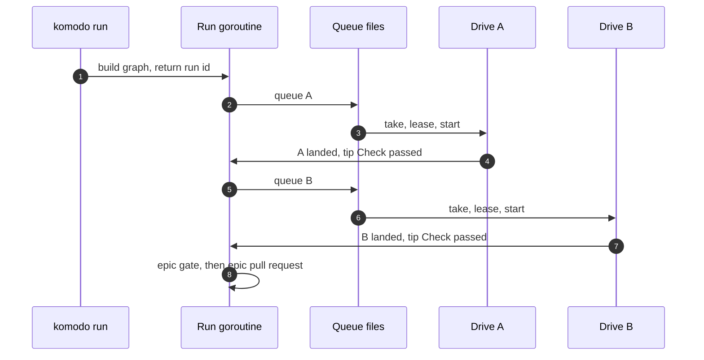

1. `komodo run` builds the dependency graph from the backlog, enqueues the groups whose dependencies have landed (group A), prints the run identifier at once and leaves the engine running detached under the parent guard.
2. The run goroutine creates the queue file for A. B stays out of the queue because its dependency has not landed.
3. When a pool slot frees, the engine picks A, deletes its queue file, writes its lease and starts `Drive` A.
4. `Drive` A moves A through Intake, Build, Check, Verify and Ship, appending events and running the actions that `Next()` orders.
5. A lands, alone, and Check runs on the epic tip with zero model tokens. The tip passes.
6. The run goroutine sees that B's dependency has landed and the tip's Check passed, and creates the queue file for B. The engine takes it the same way as A's.
7. B lands and the tip's Check passes.
8. After the last landing the reviewer and the tester run once over the whole epic diff; the epic gate and the epic pull request are described under After the last landing below.
9. A person merges only the epic pull request.

#### Algorithms

**Ownership and concurrency**

**📐 Who owns which state**
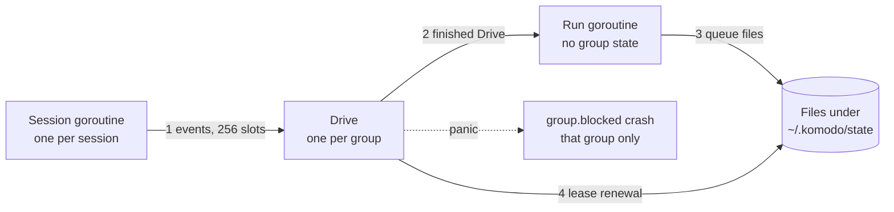

Rules:
1. The `Drive` goroutine is the only writer of its group's events and snapshot. No mutex exists inside a group, and two groups never contend.
2. A session goroutine turns its session's stream into events and sends them on `Drive.Events`. When the channel is full the sender waits; no event is dropped.
3. Facts that groups share (queue, leases, `quota.json`) are files under `~/.komodo/state/`, created exclusively or renamed into place, written through `Claim`, `Replace` and `Remove`; a slot is a create-only file. Two `komodo run` processes on one machine coordinate only through these files.
4. The run goroutine builds the dependency graph, enqueues ready groups and collects finished `Drive`s. It holds no group state.
5. Every goroutine starts through one panic-catching helper. A panic in one `Drive` emits `group.blocked crash` (the event `group.blocked` with reason `crash`) for that group alone; the run and the other groups continue. The [block row](#block-rows) for `crash` moves the group to Blocked from any working stage or Paused.

**The Drive loop**

**📐 Drive from start to end**
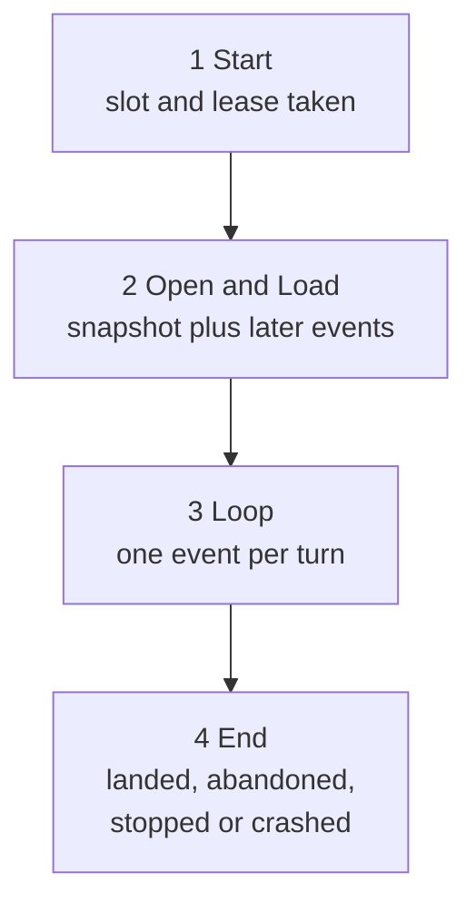

1. A ready group takes a free pool slot and its lease; the engine hands the group to a new `Drive`.
2. `Drive` calls `Open`, which makes it the group's only writer, then `Load`, which reads the last snapshot, replays the events saved after it and returns the state; `Drive` is always the caller. `Drive` reruns the state's open actions.
3. `Drive` waits on three sources: events from the group's sessions, the group's pause timer (which fires at the timer record's `wait_until` time), and its lease renewal every `LeaseRenewEvery`. It takes one event at a time and runs one turn for it.
4. `Drive` ends when the group lands or is abandoned, when the run stops, or when it crashes. The run goroutine collects a finished `Drive`.

One turn:
1. `Drive` takes the next event from its channel.
2. `Drive` calls `Append`: the state manager stamps `sequence`, `timestamp` and `checksum`, validates the line against the schema and syncs it to disk. `Drive` has already set `stage` and `stale`.
3. `Drive` calls `Next()`. It returns the new state, the actions to run and any follow-on events; a stale event changes nothing.
4. `Drive` appends the follow-on events, then an `action.start` line for each action.
5. `Drive` runs each action, such as starting a session or making a commit. Pushing and opening a pull request run beside the loop, so a slow network never holds it.
6. `Drive` appends `action.done` for each finished action, so a restart skips it.
7. `Drive` hands the new state to `Snapshot`, which writes `state.json` every 50 events or on a stage change.
8. The event bus hands the event to its 3 listeners: the ledger, the wake file and the `status --watch` screen.

Chapter 2 draws the same path as a sequence diagram ([One event, from producer to subscribers](#25-behaviour)).

Loop rules:
- **Paused and Blocked:** the group loop keeps running while its group is Paused or Blocked: it holds no pool slot, renews the lease and waits on its timer and its inbox.
- **One write:** steps 2 to 4 are one disk write: `Drive` runs `Next()` in memory first, then saves the event, its follow-ons and the first `action.start` with one forced save ([Behaviour](#25-behaviour)).
- **Subscribers:** the loop never waits for them; each reads from its own bookmark ([Behaviour](#25-behaviour)).
- **Action failure:** `Drive` never decides on a failure: it records the failure class in `action.done` and `Next()` applies that kind's row; a failure class with no row blocks the group `contract`. A refused renewal is `lease.lost` (row 18); a failed renewal write is retried at the next interval, inside the lease's 2-hour life.
- **Pause cap:** `PauseState.Since` records when the group paused; `limits.pause_max_min` counts from it.

**Taking work from the queue**

**📐 From a ready group to a running Drive**
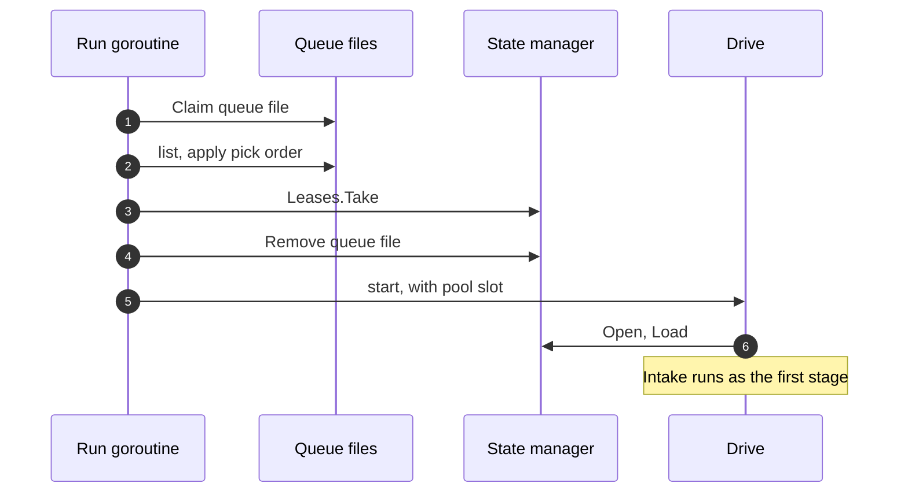

1. When a dependency lands and Check passes on the epic tip, the run goroutine creates one queue file for each newly ready group. `komodo jobs tick` creates one for each due job.
2. When a pool slot frees, the engine lists the queue and applies the pick order below.
3. The engine takes the chosen item: it writes the lease, then deletes the queue file. A crash between the two steps leaves both; the startup sweep frees the dead lease and the queue item is picked again.
4. The engine starts the group's `Drive`. Intake runs just before the group's first session takes a slot, and the next ready group's Intake starts while the current group's first session loads, so a slot never sits idle longer than one `setup` run. Intake is the first stage inside `Drive`: after `Open` and `Load`, before the first session takes a pool slot.

The engine that freed a slot applies the pick order over every ready item on the machine. When the winner belongs to a repository with a live `komodo run` process, it leaves the slot for that process, which watches the queue; when no engine serves the winner's repository, such as a due job, the engine starts that item as its own run.

**Pick order**

When a slot frees, the engine applies these rules in order:

1. Items with `priority: high` go first.
2. Fair share across repositories: when 2 or more repositories have ready items, take them round-robin. Each job counts as its own repository.
3. The longest remaining chain, weighted by task count.
4. The most groups unblocked.
5. Backlog ID order.

Rules 3 to 5 break ties among items of the repository chosen by rule 2.

**The session pool**

**📐 How the pool size changes**
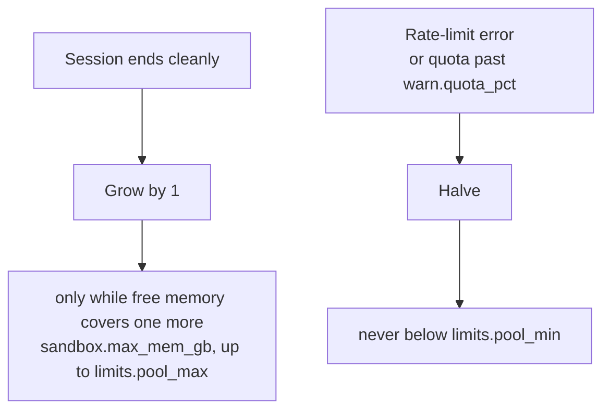

| Rule | Detail |
|---|---|
| Slot takers | Builder, reviewer and tester sessions (`pool_slot: true`). Planner and job sessions take no pool slot, but count against the link limit |
| Floor and ceiling | The pool holds `limits.pool_min` to `limits.pool_max` slots ([1.8](#18-config)): `limits.pool_min` stays open while throttled; `limits.pool_max` is the most sessions at once |
| Link slot | `limits.link_sessions.<link>` sessions per link (for example `claude-cli`) across all repositories; the default and the hard limit are in [7.8](#78-config) |
| Files | Pool and link slots are create-only files ([Slot files](#33-data-model)), freed with `Remove`; a dead holder's slot is free; the adapted size lives in `pool/state.json`, shared by every engine |
| Taking | A session takes its pool slot first, then a link slot; with none free it waits, retrying every 5 seconds, and never fails for lack of a slot; it returns both when it ends; a Paused or Blocked group holds none |
| Clean end | A `session.end` with reason `done` |
| Free memory | Linux `MemAvailable` in `/proc/meminfo`; macOS free plus inactive pages from `vm_stat`; Windows `ullAvailPhys` from `GlobalMemoryStatusEx` |

The local link defaults to 1 session, because Ollama serves 1 request per model unless `OLLAMA_NUM_PARALLEL` is raised. Verified by [G-04](#g-04) in phase 4.
- The signal that halves the pool is a `LimitError` from a provider adapter, which a `system/api_retry` line with category `rate_limit` becomes, or the first `limit.warn` for a provider window past `warn.quota_pct`. After a halving, further signals are ignored for 5 minutes (`PoolHalveCooldown`), so one burst halves the pool once.

**Run order and convergence**

**📐 When a group may start**
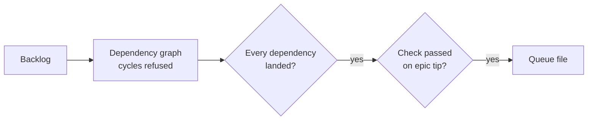

Rules:
1. The graph is built from every group's dependencies and `touches` globs. A cycle is refused. Waves and the longest chain are computed; the longest chain also feeds the pick order.
2. A group starts only after every dependency has landed and Check has passed on the epic tip.
3. A group with 2 or more dependencies starts after all of them land.
4. `run <group>` refuses when a dependency outside the run has not landed, and names it. The engine reads the dependency's `runs/<group-id>/events.jsonl` with `Tail`; the dependency has landed when the file holds a `group.shipped` line.
5. When a dependency is blocked, its dependents show `waiting on <group>` in `komodo status`; groups that do not depend on it keep running.
6. When a dependency is abandoned, its dependents block with reason `dependency`, naming the abandoned group. 
7. Inside a group, one builder session works through the tasks one after another in the group's worktree and commits after each. Independent tasks belong in separate groups.
8. A group moves on from Build as soon as its own builder finishes, whatever the other groups do.

**Landing and the integration break**

**📐 One landing, then the tip check**
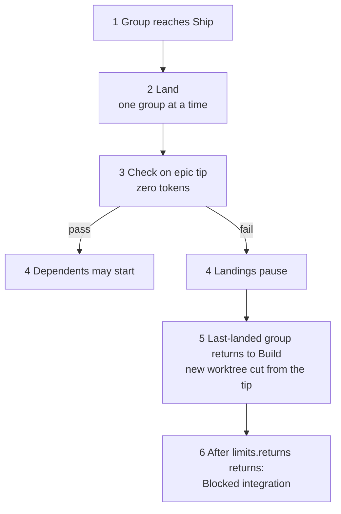

1. Finished groups land one at a time. Each landing is followed by Check on the epic tip, which costs 0 tokens.
2. When that Check fails, landings pause and the last-landed group returns to Build in a new worktree cut from the tip. The return spends the same `limits.returns` budget as Check and Verify returns, with the failing Check output as the findings; once it is spent the group blocks with reason `integration` ([row 8](#26-state-and-transitions)).
3. Each epic has one landing gate: a file under `~/.komodo/state/`, created only if absent, so exactly one engine run holds it: `~/.komodo/state/landing/<repo-id>.<epic-id>.json`, kind `landing`, whose body names the holder's `run`, `group`, `pid`, process start time and `taken_at`; a gate whose holder is dead is taken over by the lease rule. A group takes the gate before merging the epic branch into its group branch, and frees it once the Check on the epic tip has recorded pass or fail. Groups of other epics are untouched. Runs on other machines are out of scope: leases, fences and the landing gate are machine-wide files, so one epic is built on one machine.
4. Paused landings reopen the moment a Check on the epic tip passes again, whatever made it pass. Normally that is the returned group's fix landing; when that group blocks with reason `integration`, landings stay shut until a person or the orchestrator fixes the tip and runs `resume`, and the next passing Check reopens them. Groups waiting to land keep their place and need no action of their own.

**The epic gate**

**📐 After the last landing**
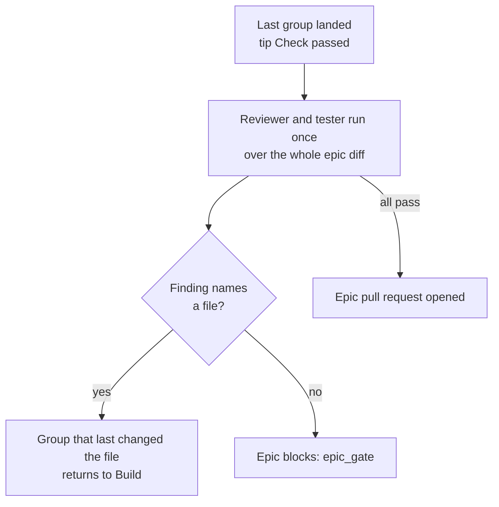

1. After the last landing, the reviewer and the tester each run once over the whole epic diff.
2. A finding goes to the group that last changed its file: the gate reads the epic's `group.shipped` events newest first and picks the first whose changed files include it. That group returns from Done to Build in a fresh worktree cut from the epic branch tip, with the findings in its brief ([State and Transitions](#26-state-and-transitions), row 19), takes a new lease and lands again.
3. A finding with no file blocks the whole epic with reason `epic_gate`, and a blocked epic opens no pull request. A person reads the finding in `status`, fixes it by hand and runs `resume`.
4. The gate records its sessions and findings in its own record ([Event Spine and State Machine](#25-behaviour)) and counts its rounds there, bounded by `limits.returns`. One round may send several groups back; when one more round would start, the epic blocks `epic_gate`. Each returned group still spends its own returns on Check and Verify failures during the fix.
5. The epic pull request opens once, after a gate round with no blocking finding. A person then merges only the epic pull request.

**Shutdown and the parent guard**

**📐 Stopping a run, and the guard's repeat of it**
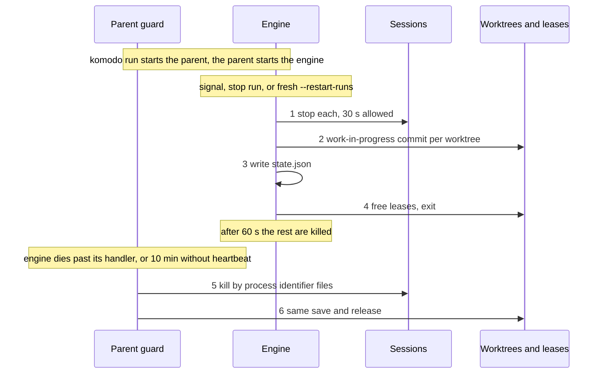

1. The sequence starts on any operating-system signal, on `stop <run>` or on `fresh --restart-runs`, which updates the binary and moves live runs to it.
2. The engine stops each session (30 seconds each), makes a work-in-progress commit of every worktree, then writes `state.json` and only then frees the leases, so no other engine can open the group while this one still writes, and exits. After 60 seconds, anything still alive is killed.
3. Shutdown is direct code outside the event bus. It writes `run.stopped` when it can.
4. `komodo run` first starts a small parent process, the parent guard, which then starts the engine.
5. If the `komodo run` process dies past its own handler (`kill -9`, an out-of-memory kill, a Go fatal error) or writes no heartbeat for 10 minutes, the parent kills the sessions by their process identifier files, commits work in progress and frees the leases; the group loop alone writes a group's snapshot.
6. Power loss is left to the startup sweep in `recover.go`.

The parent guard is the internal verb `komodo internal parent <run>`, whose code is `Guard` in `shutdown.go`; `komodo run` starts it, and it starts the engine as its child. The engine rewrites `~/.komodo/state/pids/<run>/heartbeat` with the current time every 60 seconds. The supervisor writes one file per session process at `~/.komodo/state/pids/<run>/<session>.pid`, holding the process identifier and start time, and removes it at `session.end`.

### 3.6 State

The engine keeps no state of its own beyond files and the group state of [chapter 2](#2-event-spine-and-state-machine). The three machine-visible states are the group's `Drive`, the pool size and landing.

**📐 Drive lifecycle**
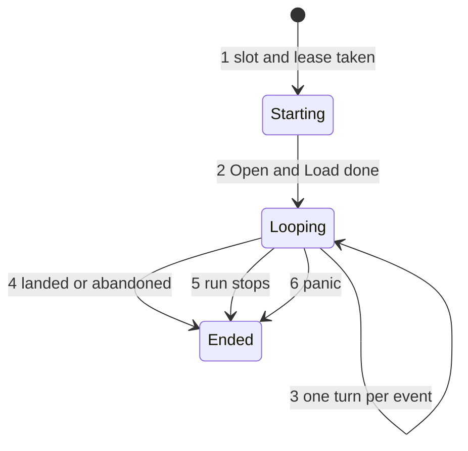

| State | Waits on | Pool slot | Lease and worktree | Ends by | True after the move |
|---|---|---|---|---|---|
| Starting | `Open`, `Load`, open actions | Held for the first session | Lease written, worktree cut | `Load` returns the state | This `Drive` is the group's only writer; the open actions have run |
| Looping | Session events, the pause timer, the lease renewal | Held while a session runs | Kept; lease renewed every 5 minutes | Landing, abandon, run stop, panic | Every applied event is on disk before its effects run |
| Paused or Blocked | The timer, the inbox and the lease renewal; the loop keeps running | Returned | Kept | The timer, `resume`, `scope approve` or `scope deny`, or `abandon` | The group holds no pool slot and keeps its lease and worktree |
| Ended | Nothing | Returned | Released on abandon, or when the Check on the epic tip passes after the landing | The run goroutine collects the `Drive` | The group's records are final for this run |

| Pool event | Effect |
|---|---|
| Session ends cleanly | Size grows by 1 while free memory covers one more `sandbox.max_mem_gb`, up to `limits.pool_max` |
| Rate-limit error from a provider | Size halves, never below `limits.pool_min` |
| Quota past `warn.quota_pct` | Size halves, never below `limits.pool_min` |

**📐 Landings**
```mermaid
stateDiagram-v2
  [*] --> Open
  Open --> Open: 1 landing, tip Check passes
  Open --> Paused: 2 landing, tip Check fails
  Paused --> Open: 3 resume rule open
```

| Landing state | Event | Next | True after the move |
|---|---|---|---|
| Open | A group lands and the tip's Check passes | Open | Dependents of that group may start |
| Open | A group lands and the tip's Check fails | Paused | No group lands; the last-landed group is back in Build |
| Paused | A Check on the epic tip passes, whatever made it pass | Open | Waiting groups land in their kept order; no group acts to reopen |

### 3.7 Invariants and Failures

**Invariants**
1. A group has exactly one writer inside a process, its `Drive`; other processes are kept out by the lease and its fence, which every save checks in the same git transaction ([Workspace and Leases](#4-workspace-and-leases)).
2. An event and the decision `Next()` made on it reach disk in one synced write before any of its effects run.
3. An action's `action.start` line is on disk before the action runs, and its `action.done` line follows.
4. The lease is written before the queue file is deleted, so a crash between the two leaves the item queued.
5. A group starts only after every dependency has landed and Check has passed on the epic tip.
6. Landings happen one at a time, each followed by Check on the epic tip.
7. Shutdown stops sessions, then commits work in progress, then writes `state.json`, then frees the leases; a lease is never freed while a session is alive or work is unsaved.
8. The pool never shrinks below `limits.pool_min` and never exceeds `limits.pool_max`.
9. Intake runs just before the group's first session takes a slot: the engine that picks an item takes the lease first (`Leases.Take`, raising the fence), then removes the queue file; `Drive` runs `Open` and `Load`, and Intake runs as the first stage inside `Drive` (lint, card hash, worktree cut, setup); the group's first session takes a pool slot after Intake, then a link slot.

**Failures**

| Situation | Detected by | Behaviour |
|---|---|---|
| Crash between the lease write and the queue file's deletion | The startup sweep | The sweep frees the dead lease; the queue file is still there, so the item is picked again |
| Session event channel full | The sending session goroutine | The sender waits; no event is dropped |
| Panic inside one `Drive` | The panic-catching helper | `group.blocked` with reason `crash` for that group alone; the run and other groups continue |
| Rate-limit error or quota past `warn.quota_pct` | The provider adapters report it | The pool halves, never below `limits.pool_min` |
| A dependency is blocked | The run goroutine | Dependents show `waiting on <group>`; unrelated groups keep running |
| A dependency is abandoned | `komodo abandon` on a group other groups depend on | Dependents block with reason `dependency`, naming it |
| `run <group>` with an unlanded dependency outside the run | The graph | The verb refuses and names the dependency |
| Check fails on the epic tip after a landing | The Check on the tip | Landings pause; the last-landed group returns to Build; after `limits.returns`, Blocked `integration` |
| A finding with no file at the epic gate | The epic gate | There is no group to send it to, so the whole epic blocks with `epic_gate` |
| Engine dies past its handler (`kill -9`, out-of-memory kill, Go fatal error) | The parent guard | The parent kills the sessions by process identifier files, saves and releases |
| No heartbeat for 10 minutes | The parent guard | Same as above |
| Sessions alive 60 seconds into shutdown | The shutdown sequence | The remaining sessions are killed |
| Power loss | The next engine start | Left to the startup sweep in `recover.go` |

### 3.8 Config

| Key | Type | Default | Effect |
|---|---|---|---|
| `limits.pool_min` | integer | set in [1.8](#18-config) | Pool slots kept open while throttled; cannot exceed `limits.pool_max` |
| `limits.pool_max` | integer | set in [1.8](#18-config) | Most builder, reviewer and tester sessions at once across all repositories |
| `limits.link_sessions.<link>` | integer | set in [7.8](#78-config) | Most concurrent sessions on one link across all repositories |
| `sandbox.max_mem_gb` | integer | set in [1.8](#18-config) | Read here: the pool grows only while free memory covers one more of it |
| `warn.quota_pct` | integer | set in [7.8](#78-config) | Read here: a provider window past this percent halves the pool |
| `limits.returns` | integer | set in [1.8](#18-config) | Read here: returns to Build after an integration break, and the epic gate's rounds; `Next()` owns the counter |

`--stage` is the only flag of `komodo run`; its form is `--stage <stage>`.

### 3.9 Proof Cases

**Unit level** (pure functions, no files)
- With 2 slots and 3 ready groups, the `priority: high` group starts first.
- With 2 repositories and `limits.pool_max` 2, 4 ready groups start in alternating repository order.
- A rate-limit error halves the pool, never below the floor.
- `run` on a group with an unlanded dependency refuses and names it.

**Component level** (the engine with mocks that match documented provider behaviour; no live provider tests)
- The fixture group runs all 5 stages and ships.
- A crash between taking a queue item and writing its lease leaves an item the sweep re-enqueues.
- A seeded bug fails Verify, cancels the tester and resumes the builder.
- With `limits.pool_max` 2 and 4 ready groups, 2 sessions run and the rest queue.
- A group whose dependency is Blocked waits while an unrelated group runs.
- A crash inside one group's `Drive` blocks only that group with reason `crash`; a second group keeps running.
- While a `Drive` runs, its group's lease renewal time moves forward every 5 minutes.
- A landing that breaks Check on the epic tip: landings pause and the last-landed group returns to Build in a new worktree cut from the tip, with one return spent.

### 3.10 Open Gaps

Each id is a row in the [gap register](#appendix-b-gap-register); the rows are not copied here.

| Gap | Question | Closes by |
|---|---|---|
| [G-04](#g-04) | Whether `OLLAMA_NUM_PARALLEL` above 1 lets `local` exceed 1 session | Spike, phase 4 |

## 4. Workspace and Leases

The workspace gives each task group its own git checkout and a lock saying one run owns it, and it keeps the group's saved work on a hidden git reference that survives a crash. The purpose of the subsystem and who it talks to are in [HLD 5.5](hld.md#55-workspace-and-leases).

**Guarantees the tests pin**

| Guarantee | How |
|---|---|
| One run owns a group | The lease file is created only if absent; the operating system lets exactly one run create it |
| Stale-holder protection | Every save is one git transaction that first verifies the fence reference still holds the writer's fence, then moves the hidden reference by compare-and-swap on the old commit id (the update succeeds only if the reference still holds the value the caller last read); git applies both or neither. A push or landing re-reads the fence file just before pushing and refuses on a higher number |
| No unsaved edit is lost on release | A lease is never freed while a session lives or the worktree holds unsaved work |
| A crash leaves nothing locked | The parent guard or the startup sweep frees the lease, and the group resumes from its hidden reference |

### 4.1 Scope and Concepts

**Owns:**
- The worktree of each group, under `~/.komodo/wt/`: cutting it, removing it when idle, rebuilding it, and the tester's throwaway worktree.
- The lease and the fence beside it, under `~/.komodo/leases/`: taking, renewing, taking over and releasing.
- The hidden reference `refs/komodo/groups/<group-id>`: moving it with `git update-ref` and the fence, and deleting it.
- The startup sweep's actions on worktrees, leases and language caches. The sweep lives in `recover.go`, owned by error recovery; `worktree.go` supplies the worktree and lease calls it uses.

**Does not own:**
- The shutdown sequence and the parent guard that repeats it: [Shutdown and the parent guard](#35-behaviour).
- The work queue, `Drive` and the order in which a group takes its slot: [Engine Internals](#3-engine-internals). The session pool and link slots belong to the engine's `pool.go`.
- `Claim`, `Replace` and `Remove`, and the record header: [State Manager](#13-state-manager).
- Copying dependencies into the tester's worktree, and the sandbox around it: [Tools, Guard and Sandbox](#6-tools-guard-and-sandbox).
- Committing a task, pushing, opening pull requests and landing: [Backlog, Planning, Ship and Release](#11-backlog-planning-ship-and-release).
- The `lease.lost` event type and the stage moves it causes: [Event Spine and State Machine](#2-event-spine-and-state-machine).

**Concepts**

| Term | Meaning in this chapter |
|---|---|
| Workspace | The worktree of one group plus its lease, fence and hidden reference |
| Worktree | A separate git checkout under `~/.komodo/wt/<repo-id>/<group>/`, cut detached (on no branch) from the epic branch tip |
| Lease | The create-only lock file `~/.komodo/leases/<repo-id>/<group-id>.json` naming the run that owns one group |
| Fence | A counter in `<group-id>.fence` that rises on every take or takeover; every git write on behalf of the group carries it |
| Hidden reference | `refs/komodo/groups/<group-id>`, the commit that holds the group's saved work; never pushed, hidden from `git branch` |
| Work-in-progress commit | A commit of a worktree's unfinished edits, written so the hidden reference holds them |
| Takeover | Another run taking a group whose lease is expired or whose holder process is dead |
| Repo id | The normalized origin URL, or the git common directory path when there is no remote ([glossary](hld.md#12-glossary)) |

### 4.2 Package Layout

The code is in `internal/engine/`. Files of that package that other chapters own are listed so the boundary is visible.

```
internal/
├── engine/
│   ├── worktree.go    # cut, rebuild, save and remove worktrees; lease take, renew, release; hidden reference moves
│   ├── intake.go      # Intake stage driver (chapter 3)
│   ├── shutdown.go    # shutdown and parent guard (chapter 3)
│   └── recover.go     # crash resume (chapter 9)
├── repo/
│   └── git.go         # git wrapper: every git write, the workspace's included (chapter 11)
├── state/             # Claim, Replace, Remove for the lease and fence kinds (chapter 13)
└── quality/
    └── qa.go          # the tester session uses the tester worktree (chapter 9)
```

The startup sweep is in `recover.go` ([chapter 9](#9-check-review-tester-and-recovery)).

On disk, this chapter writes under the machine folder `~/.komodo/` (on Windows `%LOCALAPPDATA%\komodo`):

```
~/.komodo/
├── leases/<repo-id>/<group-id>.json        # the lease, create-only
├── leases/<repo-id>/<group-id>.fence       # the fence counter
├── wt/<repo-id>/<group>/                   # the group's worktree, detached
└── cache/lang/<repo-id>/                   # language caches the sweep deletes when over the cap or unused
```

The hidden reference sits in the repository's own git directory, not under `~/.komodo/`. A lease file renamed aside stays in its own folder as `.stale-<group-id>.<fence>.json`, where `<fence>` is the value the old holder took, so the rename is atomic and each takeover leaves a distinct file.

**Entry points**

| Flow | Starts in | Called by |
|---|---|---|
| Take the lease and fence | `Leases.Take` | The engine when it takes a queue item; `resume` |
| Cut the worktree | `Worktrees.Cut` | Intake |
| Renew the lease | `Leases.Renew`, which calls `Replace` on the lease | `Drive`, every five minutes |
| Move the hidden reference | `HiddenRefs.Move` | `Drive`, after each group commit |
| Save and release | `Worktrees.Save`, then `Leases.Release` | Shutdown, the parent guard, `abandon`, a passing Check on the epic tip after landing |
| Remove an idle worktree | `Worktrees.Save`, then `Worktrees.Remove` | The startup sweep |
| Rebuild a worktree | `Worktrees.Rebuild` | `resume` |
| Startup sweep | `Sweeper.Sweep` | The engine at start |

The function names in this chapter are the exported names.

### 4.3 Data Model

#### Workspace constants

```go
const (
	LeaseExpiry     = 2 * time.Hour         // age of the last renewal after which a lease counts as dead
	WorktreeIdle    = 72 * time.Hour        // unused time after which a worktree is saved and removed (3 days)
	LangCacheIdle   = 30 * 24 * time.Hour   // unused time after which a repo's language cache is deleted
	SweepScans      = 4                     // scans the startup sweep runs in parallel
	SweepBudget     = 2 * time.Second       // time the sweep must finish in with 20 dead runs
	StalePrefix     = ".stale-"             // prefix of a lease file renamed aside: .stale-<group-id>.<fence>.json
	HiddenRefPrefix = "refs/komodo/groups/" // hidden reference name is this prefix plus the group id
	ExitUpdateRef   = 128                   // exit code of git update-ref for a moved reference, a bad object and an unwritable folder alike
)
```

The renewal period, five minutes, is `LeaseRenewEvery` in [Engine Internals](#3-engine-internals). None of these values has a configuration key: the configuration chapter lists no key for them.

#### Lease

The lease file `~/.komodo/leases/<repo-id>/<group-id>.json` holds the run, process id, host, clone path, fence, and the taken and renewed times. A scheduled job takes a lease named `job-<name>` with a fence the same way; its files are `leases/<repo-id>/job-<name>.json` and `leases/<repo-id>/job-<name>.fence`.

```go
// Fence is the counter that rises on every take or takeover of a group's lease.
type Fence uint64

// Lease is the body of one lease file: the run that owns a group and when it last proved it is alive.
type Lease struct {
	Run       state.ID  `json:"run"`        // run that holds the group
	PID       int       `json:"pid"`        // process id of the engine that holds it
	Host      string    `json:"host"`       // machine the holder runs on
	ClonePath string    `json:"clone_path"` // clone the run started from
	Fence     Fence     `json:"fence"`      // fence value this holder took
	TakenAt   time.Time `json:"taken_at"`   // when the holder took the lease
	RenewedAt time.Time `json:"renewed_at"` // when the holder last renewed it
}

// Expired reports whether the last renewal is older than LeaseExpiry.
func (l Lease) Expired(now time.Time) bool { return now.Sub(l.RenewedAt) > LeaseExpiry }
```

| Field | Type | Rule |
|---|---|---|
| `run` | string | The run identifier; a second `run` on the group is refused and names it |
| `pid` | integer | Process id; a dead process makes the lease dead before the expiry |
| `host` | string | Machine name; the process check runs only when `host` is this machine's name; a holder on another host counts as live until its renewal is 2 hours old |
| `clone_path` | string | The clone the run started from; the sweep removes a lease whose clone path is gone |
| `fence` | integer | The fence value written at take or takeover |
| `taken_at`, `renewed_at` | time | Rewritten at renewal: `renewed_at` only; RFC 3339 in Coordinated Universal Time to the second, such as `2026-10-13T09:14:02Z` |

The body of a lease file, which the state manager stores under `body`:

```json
{
  "run": "0198f3a2-6c1e-7b44-9d0a-3f5e1c2b7a10",
  "pid": 48213,
  "host": "devbox-1",
  "clone_path": "/Users/dev/src/shop",
  "fence": 3,
  "taken_at": "2026-10-13T09:14:02Z",
  "renewed_at": "2026-10-13T09:34:02Z"
}
```

These key names are final. The record keeps the six header fields at the top level and this body under `body`, the layout of every state-manager record. The six-field record header (`v`, `kind`, `key`, `rev`, `ts`, `writer`) belongs to the state manager. Versioning: a newer binary reads an older `v` by a registered migration step in memory ([State Manager](#13-state-manager)).

#### Fence file

`<group>.fence` (the file `<group-id>.fence` beside the lease) holds one monotonic integer, written with `Replace`. It is incremented on every take or takeover and never falls. The file is a state-manager record whose body is `{"fence": 3}`; an absent file reads as 0, so the first take writes 1.

#### Hidden reference

```go
// HiddenRef returns the hidden reference name of a group.
func HiddenRef(g state.ID) string { return HiddenRefPrefix + string(g) }
```

Each reference update carries a reflog message `fence=<n>`, for example `fence=3`. The reference is never pushed and is deleted when the group lands or is abandoned.

#### Worktree

```go
// Worktree is one checkout the engine owns.
type Worktree struct {
	Group  state.ID // group the checkout belongs to
	Path   string   // ~/.komodo/wt/<repo-id>/<group>/
	Tester bool     // true for the tester's throwaway checkout
}
```

Every worktree lives outside every clone, so no path contains `.git`, and one place serves every clone of the repository. On Windows the worktree folder names are short hashes, to stay under the 260-character path limit (`MAX_PATH`). On Windows the folder is the first 12 hexadecimal characters of the SHA-256 hash of the group identifier; macOS and Linux use the group identifier itself, `wt/<repo-id>/<group-id>/`.

#### Events and machine log lines

| Event | Written by | When |
|---|---|---|
| `lease.lost` | Workspace, into the group's events | Another run took the group; `Next()` stops the group. A save refused by the fence check, or a higher number in the fence file before a push, shows that another run took the group ([4.5](#45-behaviour)). |
| `lease.taken` | Workspace, machine log only | A `Claim` on a lease succeeded |
| `session.end` reason `crash` | `Drive`, from `recover.DeadSessions` after `Load` | A session died without reporting |
| `run.stopped` | Shutdown | After agents stop, work is saved and leases are freed |

The payload of `lease.lost` is `LeaseLost` ([Data structs (chapter 2)](#data-structs)): the higher fence number, the run now holding the lease, and whether a save or a push found it. This chapter names no machine log file of its own: it appends through the state manager, which owns the machine log ([State Manager](#13-state-manager)).

**📐 How are the on-disk pieces related?**
```mermaid
flowchart TB
  TIP["Epic branch tip"] -->|"1 worktree add --detach"| WT["Worktree: wt/repo-id/group"]
  LF["Lease: group-id.json"] --- FF["Fence: group-id.fence"]
  LF -->|"2 owns"| WT
  FF -->|"3 carried by every write"| REF["Hidden ref: refs/komodo/groups/group-id"]
  WT -->|"4 commits move"| REF
  REF -->|"5 rebuilds"| WT
```

**Reading the diagram.** The lease says who owns the worktree. The fence number rides on every move of the hidden reference. A removed worktree is rebuilt from that reference.

### 4.4 Interfaces

The names and signatures below are final. Errors are shared by all three interfaces.

```go
var (
	ErrLeased      = errors.New("group is leased by another run") // Take: a live holder exists
	ErrLeaseLost   = errors.New("lease lost: another run took the group")
	ErrRefMoved    = errors.New("hidden reference move refused") // git update-ref exited 128
	ErrUnsaved     = errors.New("worktree holds unsaved work")
	ErrAgentsLive  = errors.New("sessions are still running")
	ErrNoHiddenRef = errors.New("hidden reference is missing") // Rebuild: nothing to rebuild from
)

// HeldError carries the live holder, so the caller can name it to the person.
type HeldError struct{ Holder Lease }

func (e HeldError) Error() string { return "group is leased by run " + string(e.Holder.Run) }
func (e HeldError) Unwrap() error { return ErrLeased }
```

#### Leases

```go
// Leases takes, renews and frees the lease and fence of one group.
type Leases interface {
	// Take claims the lease and raises the fence; a live holder gives HeldError.
	Take(ctx context.Context, group state.ID, run state.ID) (Lease, error)
	// Renew rewrites renewed_at; ErrLeaseLost means another run took the group.
	Renew(ctx context.Context, group state.ID, held Lease) (Lease, error)
	// Release removes the lease; ErrUnsaved or ErrAgentsLive refuses.
	Release(ctx context.Context, group state.ID, held Lease) error
	// Holder reads the lease; the bool is false when the group has none.
	Holder(ctx context.Context, group state.ID) (Lease, bool, error)
}
```

| Method | Error means | Caller does |
|---|---|---|
| `Take` with `HeldError` | A live run holds the group | `run` refuses and names the holder; `resume` refuses and names the new holder |
| `Take`, other error | The state manager could not write | The engine leaves the queue file in place, warns in the run report and picks again at the next free slot |
| `Renew` with `ErrLeaseLost` | Another run took the group | `Drive` appends `lease.lost` (row 18); another error is retried at the next renewal |
| `Release` with `ErrUnsaved` | Edits are not yet in the hidden reference | Save first, then release |
| `Release` with `ErrAgentsLive` | A session is still running | Stop the sessions first |

#### Worktrees

```go
// Worktrees creates, saves and removes the checkouts of a group.
type Worktrees interface {
	// Cut runs git worktree add --detach from the epic tip commit.
	Cut(ctx context.Context, group state.ID, tip string) (Worktree, error)
	// CutTester cuts the tester's throwaway checkout at the same commit.
	CutTester(ctx context.Context, group state.ID, commit string) (Worktree, error)
	// Rebuild recreates a removed worktree from the group's hidden reference.
	Rebuild(ctx context.Context, group state.ID) (Worktree, error)
	// Save writes a work-in-progress commit and moves the hidden reference to it.
	Save(ctx context.Context, w Worktree, f Fence) (commit string, err error)
	// Remove deletes the folder; it refuses a worktree with unsaved work.
	Remove(ctx context.Context, w Worktree) error
}
```

| Method | Error means | Caller does |
|---|---|---|
| `Cut` | git refused, for example a path that is too long on Windows | The group blocks with reason `setup`, showing git's output; `doctor` names the long-path fix |
| `Save` with `ErrRefMoved`, `ErrFenced` or `ErrGit` | `git update-ref` exited 128; the wrapper's reread names which | `ErrRefMoved` and `ErrFenced`: `Drive` appends `lease.lost`; `ErrGit`: one retry, then the group blocks `crash` with git's output |
| `Rebuild` | The hidden reference is missing | `ErrNoHiddenRef`: `resume` blocks the group with reason `setup` and names the missing reference; nothing is rebuilt from the epic tip, so saved work is never silently replaced |
| `Remove` with `ErrUnsaved` | Unsaved work remains | Save first; the sweep keeps such a worktree |

`Save` stages into a temporary index, so the worktree's own index is untouched: `git add -A` with `GIT_INDEX_FILE` set to a file in the session temporary folder takes tracked changes and untracked files and skips ignored ones. `git write-tree` and `git commit-tree`, with the hidden reference's commit as parent, make the commit with the message `wip: <group-id> <session-id> <exit reason>` and no trailer; these plumbing commands run no repository hooks. An identical tree writes nothing.

#### Hidden references

```go
// HiddenRefs moves and deletes a group's hidden reference with the fence.
type HiddenRefs interface {
	// Move runs git update-ref -m fence=<n> <ref> <new> <old>; ErrRefMoved when it fails.
	Move(ctx context.Context, group state.ID, f Fence, oldID, newID string) error
	// Delete removes the reference when the group lands or is abandoned.
	Delete(ctx context.Context, group state.ID) error
}
```

A refused `Move` returns `ErrRefMoved`, `ErrFenced` or `ErrGit`: after an exit 128 the git wrapper rereads both references with `git rev-parse`: a hidden reference no longer at `old` is `ErrRefMoved`, and a fence reference no longer at the writer's fence is `ErrFenced`; both mean another run holds the group, so `Drive` appends `lease.lost`. Any other failure is `ErrGit` with git's output: it is retried once after 1 second, then the action stays open and the group blocks `crash` with that output, so `resume` reruns the action under its key.

#### The sweep

```go
// Sweeper cleans what dead runs left behind.
type Sweeper interface {
	// Sweep runs the four scans in parallel; it never deletes unsaved work.
	Sweep(ctx context.Context) error
}
```

#### Callers

| Caller | Call | When |
|---|---|---|
| Engine | `Leases.Take` | A queue item is picked, before its queue file is removed and before Intake |
| Intake | `Worktrees.Cut` | The group's first stage |
| `Drive` | `Leases.Renew` | Every five minutes |
| `Drive` | `HiddenRefs.Move` | After each group commit |
| Verify | `Worktrees.CutTester`, `Remove` | Start and end of Verify |
| `resume` | `Leases.Take`, `Worktrees.Rebuild` | A person or the orchestrator resumes a run |
| Shutdown | `Worktrees.Save`, `Leases.Release` | See [Shutdown and the parent guard](#35-behaviour) |
| Landing, `abandon` | `Leases.Release`, `HiddenRefs.Delete` | The group is abandoned, or the Check on the epic tip passes after its landing; a failing Check keeps both |
| Verbs | `Leases.Holder` | A verb that would touch a worktree refuses when a live lease exists |

### 4.5 Behaviour

#### Walkthrough

One group from its lease to its landing.

**📐 One group's workspace from lease to landing**
```mermaid
sequenceDiagram
  autonumber
  participant E as Engine
  participant L as Lease and fence
  participant G as Git
  participant R as Hidden ref
  E->>L: Take, fence raised
  E->>G: worktree add --detach
  E->>G: commit a task
  E->>R: update-ref with fence
  E->>L: Renew every 5 min
  E->>G: tester worktree, then removal
  E->>L: Release the lease
  E->>R: Delete the reference
```

1. The group receives its lease and fence. The order against the pool slot and Intake is in [Order of pool slot, lease and Intake](#4-workspace-and-leases).
2. Intake lints the group, hashes its cards to lock the task list, and cuts the worktree: `git worktree add --detach <path> <epic tip>`, about 1 s. It then runs `commands.setup` with network on.
3. After each task the engine commits and moves the hidden reference by compare-and-swap on the old commit id, with the fence in the reflog message. A refused move is told apart by rereading both references ([Move the hidden reference](#45-behaviour)).
4. `Drive` renews the lease every 5 minutes while the group is in any held state.
5. During Verify the tester gets a throwaway worktree at the same commit; it is removed when Verify ends.
6. On shutdown the worktree is saved and the lease freed: [Shutdown and the parent guard](#35-behaviour). `resume` retakes the lease and rebuilds a removed worktree from the hidden reference.
7. On abandon the lease is released and the hidden reference deleted. After a landing, both stay held until the Check on the epic tip passes; the group then becomes Done, and the lease is released and the reference deleted in one step. A failing Check keeps both, so the group returns to Build at once.

#### Algorithms

##### Order of pool slot, lease and Intake

1. The engine picks a queue item and takes its lease, which raises the fence.
2. The engine removes the queue file.
3. `Drive` runs `Open` and `Load`, then enters Intake: lint, card hash, worktree cut, setup.
4. The group's first session takes a pool slot, then a link slot.

##### Take a lease

1. Claim `leases/<repo-id>/<group-id>.json`. The file is created only if absent; the operating system lets exactly one run create it.
2. If the claim succeeds, the fence rises and `lease.taken` is appended to the machine log.
3. If the file exists, read it. A holder that is live (renewed within two hours and its process alive) gives `HeldError`, and the caller refuses naming the holder.
4. If the lease is stale or its holder is dead, rename the old file aside with the `.stale-` prefix, giving `.stale-<group-id>.<fence>.json` in the same folder. Only one run can rename it, so only one run wins; the loser's rename fails and it re-reads.
5. The winner claims a new file; the fence rises.

The fence rises only after the claim succeeds, so a run that loses the claim never raises it: claim, then `Replace` the fence record with the old value plus 1, then append `lease.taken`. A holder is dead when its renewal is over 2 hours old, or, on the same `host`, when its process is gone (the slot liveness check).

**📐 Two runs race for one stale lease**
```mermaid
sequenceDiagram
  autonumber
  participant A as Run A
  participant B as Run B
  participant F as Lease folder
  A->>F: read lease, renewal 2 h old
  B->>F: read lease, renewal 2 h old
  A->>F: rename aside to .stale-*
  B->>F: rename aside fails
  A->>F: claim new lease
  B->>F: claim fails, holder named
```

##### Renew a lease

1. Every 5 minutes `Drive` rewrites the lease with a new `renewed_at` through `Replace`. `Drive` keeps running while a group is Paused or Blocked, so the lease stays renewed.
2. A lease whose last renewal is more than 2 hours old counts as dead.

The `rev` check of `Replace` refuses a write over a changed record. `Leases.Renew` turns the refusal into `ErrLeaseLost`, and `Drive` appends `lease.lost`.

##### Move the hidden reference

1. Read the reference's current commit as `old`. Git accepts the all-zero object id as `old` to mean the reference must not exist yet.
2. Run `git update-ref -m "fence=<n>" --stdin` with one transaction: `verify <fence reference> <writer's fence>`, then `update refs/komodo/groups/<group-id> <new> <old>`, the compare-and-swap form. Git applies both or neither.
3. Exit 0: the reference moved, and the reflog line records the fence.
4. Exit 128, `cannot lock ref`: git exits 128 for a reference that no longer holds `old`, for a fence reference that no longer holds the writer's fence, for a bad object and for an unwritable folder alike, so the exit code does not show which. To tell them apart, after an exit 128 the git wrapper rereads both references with `git rev-parse`: a hidden reference no longer at `old` is `ErrRefMoved`, and a fence reference no longer at the writer's fence is `ErrFenced`; both mean another run holds the group, so `Drive` appends `lease.lost`. Any other failure is `ErrGit` with git's output: it is retried once after 1 second, then the action stays open and the group blocks `crash` with that output, so `resume` reruns the action under its key.

A plain compare-and-swap compares only the old commit id and never reads the fence, so the fence number is also kept as a second hidden reference, which taking or taking over the lease moves to the new number. A scratch repository showed that a stale holder's transaction exits 128 and leaves the hidden reference unmoved even when its `old` still matches, while the current holder's transaction moves it. The fence reference is `refs/komodo/fences/<group-id>`; it points at a blob whose content is the fence number in decimal, so the writer's `verify` names the blob id of its own number, which `git hash-object --stdin` computes without writing. Pushes and landings, which git cannot tie to a local reference, re-read the fence file just before the push and refuse on a number higher than the writer's. The same scratch repository showed two further facts: a reflog line is written for a reference under `refs/komodo/` only when the update passes `--create-reflog` (or `core.logAllRefUpdates=always` is set), and `git branch` lists no such reference. Every `update-ref` the git wrapper runs passes `--create-reflog`, so each hidden reference keeps its reflog without changing the person's git settings. A `scope_change` action rereads the fence file first and refuses on a number higher than the writer's, as a push does.

**📐 Two engines race to move one reference**
```mermaid
sequenceDiagram
  autonumber
  participant O as Old holder
  participant R as Hidden ref
  participant N as New holder
  N->>R: verify fence 4, update-ref new, old
  R-->>N: exit 0
  O->>R: verify fence 3, update-ref new, old
  R-->>O: exit 128, cannot lock ref
  O->>O: moved ref or other failure
```

##### Release a lease

The lease is freed in exactly these ways:

| Path | By | When |
|---|---|---|
| Landing or abandon | The engine | The group ends |
| Clean shutdown | The engine | After work is saved |
| Crash | The parent guard | After it kills the sessions and saves |
| Both died | The startup sweep | The holder process is dead, or the renewal is over two hours old |

**📐 May the lease be freed?**
```mermaid
flowchart TB
  A{"Sessions still running?"} -->|"yes"| X["Refuse: ErrAgentsLive"]
  A -->|"no"| B{"Unsaved edits?"}
  B -->|"yes"| S["Save: WIP commit, move ref"]
  S --> F["Free the lease"]
  B -->|"no"| F
```

##### Save work and remove an idle worktree

1. `Save` makes a work-in-progress commit of the worktree's edits and moves the hidden reference to it with the fence.
2. A worktree unused for three days is saved this way, then its folder is removed. `resume` rebuilds it from the hidden reference with `git worktree add --detach`.

"Unused" is measured from the time of the group's last event in its state file. The startup sweep does the removal, and never removes a worktree whose lease has a live holder.

##### Tester worktree

1. At the start of Verify the engine cuts a throwaway worktree at the same commit as the builder's. It shares the builder's git object store, so no objects are downloaded.
2. Dependencies are copied into it by the sandbox chapter's copy rules ([Tools, Guard and Sandbox](#6-tools-guard-and-sandbox)).
3. The folder is removed when Verify ends.

The tester worktree is `wt/<repo-id>/<group-id>.tester/` (on Windows the hashed folder name plus `.tester`), cut by `Worktrees.CutTester` in `worktree.go`. The startup sweep finds a dead run's tester worktrees by the `.tester` suffix among the entries of `git worktree list --porcelain` whose group has no live lease holder.

##### Windows settings

Each worktree sets `core.longpaths`, `core.filemode false` and `core.autocrlf false`, so git does not report every file as changed. `doctor` warns when the Windows long-path switch is off. The settings never enter the repository's configuration: the git wrapper and the read-only git tools pass them as `-c core.longpaths=true -c core.filemode=false -c core.autocrlf=false` on every git command they run in a worktree.

##### Startup sweep

The engine runs the sweep each time it starts. Four scans run in parallel and must finish under 2 s with 20 dead runs.

**📐 What does the startup sweep clean?**
```mermaid
flowchart TB
  S["Sweep at engine start"] --> A["Scan 1: orphans and leases"]
  S --> B["Scan 2: dead runs' resources"]
  S --> C["Scan 3: queue and sessions"]
  S --> D["Scan 4: language caches"]
```

| Scan | Actions |
|---|---|
| 1 | Kills orphans by pid file; frees dead leases; deletes `.stale-*` lease files |
| 2 | Removes dead runs' tester worktrees, Docker containers, session temp |
| 3 | Re-enqueues queue items with no lease; hands dead sessions to `recover.DeadSessions`, which `Drive` reads after `Load` |
| 4 | Deletes a repo's language cache over `sandbox.lang_cache_gb` or unused 30 days |

Further actions with no named scan: deleting leases whose clone path is gone; removing Docker images and worktree folders whose clone is gone; removing worktrees with no live lease and no unsaved work. Scan 1 deletes leases whose clone path is gone; scan 2 removes Docker images and worktree folders whose clone is gone, and worktrees with no live lease and no unsaved work. Session process identifier files live at `~/.komodo/state/pids/<run>/<session>.pid`.

Rules the sweep keeps:
- It never deletes a worktree with unsaved work.
- It never deletes a language cache while the repository holds a lease.
- A dead lease is one whose holder process is dead or whose last renewal is over two hours old.

#### Concurrency and locking

1. Each group's state is owned by its `Drive`, which renews the lease; no mutex exists inside a group ([Engine Internals](#3-engine-internals)).
2. Two processes agree through the create-only file and the rename of a stale file; no in-memory lock crosses processes.
3. The hidden reference serializes its own writers through git's compare-and-swap.
4. The sweep frees only leases that are dead and removes only worktrees with no live lease and no unsaved work.

### 4.6 State

#### The lease

| State | Meaning | Moves on |
|---|---|---|
| Absent | No lease file | `Take` makes it Held |
| Held | Live holder, renewed within two hours | `Renew` stays Held; a dead process or two hours without renewal makes it Stale; `Release` makes it Absent |
| Stale | Expired or holder dead | A takeover renames it aside and makes a new Held; the sweep frees it |

**📐 How does a lease change state?**
```mermaid
stateDiagram-v2
  [*] --> Absent
  Absent --> Held: Take
  Held --> Held: Renew
  Held --> Stale: no renewal 2 h or holder dead
  Stale --> Held: takeover
  Stale --> Absent: sweep frees
  Held --> Absent: Release
```

After each move: `Held` means exactly one run may write the group's worktree and hidden reference, with the current fence. `Stale` means any run may start a takeover.

The lease is held from Intake until abandon, or until the Check on the epic tip passes after landing, through the stages Intake, Build, Check, Verify and Ship and the Paused and Blocked holding states. A Paused or Blocked group gives back its pool slot and keeps its lease and worktree; the group's `Drive` keeps running and renews the lease during a long pause.

#### The worktree

| State | Meaning | Moves on |
|---|---|---|
| Absent | No folder | `Cut` makes it Present |
| Present | Folder cut and in use | Three idle days: saved and removed; shutdown: saved |
| Saved | Folder removed, work on the hidden reference | `Rebuild` on `resume` makes it Present |

### 4.7 Invariants and Failures

#### Invariants

1. The lease file is created only if absent, so at most one run holds a group.
2. The fence never falls; it rises on every take or takeover.
3. An expired or dead lease is renamed aside before a new lease is claimed.
4. Work is saved to the hidden reference before the lease is freed, and the lease is never freed while a session lives.
5. Only the engine writes worktrees and the hidden reference; verbs refuse a leased worktree, and rule O4 (an orchestrator row, text in `AGENTS.md`) forbids editing, resetting or removing one by hand.
6. Every hidden-reference move is a compare-and-swap, and the reference is never pushed.
7. A worktree with unsaved work is never removed.

#### Failures

| Situation | Detection | Behaviour |
|---|---|---|
| Two engines on one group | `Claim` finds the file | Exactly one holder; the loser's push finds a higher number in the fence file and is refused, and the loser ends in `lease.lost` |
| Second `komodo run` on a leased group | `HeldError` from `Take` | `komodo run` refuses and names the holder |
| Engine dies past its handler | Parent guard, or the sweep | The parent guard kills sessions, saves, frees leases; the sweep handles power loss |
| Stalled holder wakes after a takeover | The fence check in the save transaction | Exit 128 with the reference unmoved, whether or not the new holder has saved; the stale run ends in `lease.lost` |
| Lease expired, holder process alive | Renewal older than two hours | Another run may take over; after it does, the fence check refuses the old holder's saves, pushes and landings |
| Release requested with edits unsaved | `Release` returns `ErrUnsaved` | Save first |
| Lease whose clone path is gone | The sweep | The lease is deleted |
| Windows long paths off | `doctor` | `doctor` warns and names the fix; worktree folder names are short hashes |
| Worktree unused three days | The startup sweep: no group event for three days and no live lease holder | Saved to the hidden reference and removed; `resume` rebuilds it |

### 4.8 Config

No configuration key belongs to this chapter. The lease expiry, the idle time and the sweep limits are constants in [Workspace constants](#workspace-constants).

| Key | Type | Default | Effect here |
|---|---|---|---|
| `sandbox.lang_cache_gb` | integer | set in [1.8](#18-config) | The sweep deletes a repo's whole language cache over this size; the next Intake refills it. The key is owned by [Tools, Guard and Sandbox](#6-tools-guard-and-sandbox) |

### 4.9 Proof Cases

Component tests use a temporary directory and a temporary git repository; no network and no live provider.

#### Unit and component

- A second `run` on a leased group refuses with the holder named.
- 2 runs racing for one lease yield exactly 1 holder.
- 2 engines racing to land one group make exactly 1 landing; the loser's push is refused by the fence file and the loser ends in `lease.lost`.
- The old holder saving before the new holder moves the reference exits 128 and leaves the reference unmoved.
- A `kill -9` of the engine mid-run leaves 0 orphan agents and 0 unsaved edits.
- Sweep never deletes a worktree with unsaved work.
- A lease renewed 2 h 1 min ago is taken over; the old file is renamed with the `.stale-` prefix and the fence rises by 1.
- `update-ref` with a stale old commit exits 128.
- A worktree unused for 3 days is saved and removed, and `resume` rebuilds it from the hidden reference.
- A language cache over `sandbox.lang_cache_gb` is deleted by the sweep, and one in a repository that holds a lease is kept.

### 4.10 Open Gaps

None: every item of this chapter is decided above, and no gap register row names it.

## 5. Sessions, Agents and Briefs

This chapter specifies how the engine starts, watches and stops one model session, which 7 agents exist and how their files are read, and how the prompt for a session, the brief, is assembled and sized. The purpose and the interactions of the subsystem are in the HLD: [HLD 5.6](hld.md#56-sessions-agents-and-briefs).

### 5.1 Scope and Concepts

**Owns:**
- The session supervisor: it starts a session, watches its liveness, injects two fixed lines, stops it, and records one exit reason.
- The agent registry: the 7 compiled-in agents, each defined by an `agent.json` file for Go and a `prompt.md` file for the model.
- The brief builder: the 5 parts and 20 slots of a brief, the fixed assembly order, and the size ceiling.

**Does not own:**
- Provider adapters, the billing check, link failover and the launch line of `claude`: [Providers and HTTP](#7-providers-and-http). The capacity profile record is defined in `internal/core/capacity.go` ([CLI and Configuration](#1-cli-and-configuration)).
- The tool runtime, the private tool server, the guard and the sandbox: [Tools, Guard and Sandbox](#6-tools-guard-and-sandbox).
- Which skills match a task, the orchestrator rules and the output templates: [Skills, Rules and Output](#8-skills-rules-and-output).
- The events a session produces, the `Next()` decision function and the `Drive` loop that calls this chapter: [Event Spine and State Machine](#2-event-spine-and-state-machine) and [Engine Internals](#3-engine-internals).
- What Check, the reviewer and the tester do with a finished session: [Check, Review, Tester and Recovery](#9-check-review-tester-and-recovery).

**Concepts**

| Term | Meaning in this chapter |
|---|---|
| Session | One fresh model conversation that does one task. Komodo picks its unique identifier before the start; its folder is `sessions/<id>/`. |
| Agent | A role a session plays, such as builder or reviewer, with its own tools, weight and limits. 7 exist; none can be defined by a repository. |
| Weight | An agent's model size: heavy, standard or light. It maps to Opus, Sonnet or Haiku on Claude links. |
| Link, chain | One way to reach a model, and the ordered list of links an agent tries ([Providers and HTTP](#7-providers-and-http)). |
| API link | A link where Go code calls the model over the network instead of running `claude`: `anthropic-api` and `http:<name>`. |
| Brief | The prompt a session receives: 5 parts in a fixed order, the last part built from the slots. |
| Slot | One named hole in the `# Brief` template of `prompt.md`; 20 exist. The engine fills each once. |
| Ceiling | The largest brief a link accepts: half of the link's measured context window. |
| Resume handle | The provider's identifier of a saved conversation: a session identifier on `claude-cli`, the saved `messages.jsonl` on API links. |
| Exit reason | The one word recorded in `result.json` and on the `session.end` event when a session ends. 15 exist. |
| Nudge | The one fixed line injected into a silent session, asking for a status report or a stop. |
| Pool slot | One of the machine-wide places for builder, reviewer and tester sessions ([Engine Internals](#3-engine-internals)). |

### 5.2 Package Layout

| File | Holds |
|---|---|
| `internal/engine/session.go` | The session supervisor: spawn, heartbeat, time warning, nudge and kill |
| `internal/agent/agent.go` | The `agent.json` struct, the strict load and the registry |
| `internal/agent/brief.go` | Slots, the stable prefix and the size check |
| `internal/agent/trim.go` | Clipping, signature trimming, diff trimming and sanitizing |
| `embed/agents/<name>/agent.json` | What Go reads about one of the 7 agents |
| `embed/agents/<name>/prompt.md` | What the model reads: role text and the `# Brief` template |

Files this chapter reads or calls but does not own:

| File | Used for |
|---|---|
| `embed/policy.json` | The guard row identifiers that `guard` entries must match |
| `embed/models.json` | The Claude context windows behind the ceiling table |
| `internal/agent/skills.go` | The skills that fill the `standards` slot |
| `internal/core/detect.go` | The `repo_profile` slot: languages and command classes |
| `internal/repo/repomap.go` | The `repo_map` slot: the ranked symbol graph |
| `internal/safety/proc_unix.go`, `proc_windows.go` | Process groups on Unix, Job Objects on Windows |

`agent` sits below `repo`, `provider` and `tools` in the import order, so filled slot values, the measured context and the chain reach it as parameters ([Front Matter and Code Structure](#0-front-matter-and-code-structure)). The supervisor lives in `engine`, which may call all of them.

**📐 Which parts take part in one session**
```mermaid
flowchart LR
  EMB["embed/agents"] -->|"1 decode once"| REG["Agent registry"]
  REG -->|"2 role, slot lists"| BB["Brief builder"]
  BB -->|"3 brief"| SUP["Session supervisor"]
  SUP -->|"4 Start, Resume"| PRV["Provider adapter"]
  PRV -->|"5 stream lines"| SUP
  SUP -->|"6 session events"| DRV["Drive"]
```

**Entry points**

| Flow | Starts in | Called by |
|---|---|---|
| Decode the 7 agents once per process | `internal/agent/agent.go` | A verb, the engine and `gate` ask for an agent by name |
| Assemble and size a brief | `internal/agent/brief.go` | The engine, before each session |
| Start, watch and stop a session | `internal/engine/session.go` | `Drive`, running the `spawn` and `cancel` actions |
| Resume a session | `internal/engine/session.go` | `Drive`, running `spawn` from a resume handle |

### 5.3 Data Model

Go type and function names in this chapter, and the Go shapes of the registry, the brief builder and the supervisor, are final.

#### Agent files

Each agent is two files under `embed/agents/<name>/`, compiled into the binary. The Go reader decodes `agent.json` once per process.

```go
// Weight is an agent's model size; it picks the model per link and the effort level on API links.
type Weight string

const (
	Heavy    Weight = "heavy"
	Standard Weight = "standard"
	Light    Weight = "light"
)

// Limits are one agent's session clocks in minutes and its restart count.
type Limits struct {
	WallMin int `json:"wall_min"` // most minutes a session may run
	IdleMin int `json:"idle_min"` // minutes of silence before the nudge
	Retries int `json:"retries"`  // fresh sessions after a timeout or idle stop
}

// Skills lists the skills an agent may pull and the ones injected into every brief.
type Skills struct {
	Allow  []string `json:"allow"`
	Always []string `json:"always"`
}

// Slots lists the brief slots an agent must receive and those it may receive.
type Slots struct {
	Required []string `json:"required"`
	Optional []string `json:"optional"`
}

// Agent is the decoded agent.json of one agent.
type Agent struct {
	V          int             `json:"v"`           // schema version, 1
	Weight     Weight          `json:"weight"`      // heavy, standard or light
	Chain      []string        `json:"chain"`       // links in order; ends in http:*, every free endpoint
	Tools      []string        `json:"tools"`       // the only tools advertised to the session
	RunClasses []string        `json:"run_classes"` // the only classes the run tool may execute
	Guard      []string        `json:"guard"`       // policy.json row identifiers beyond the inherited ones
	Limits     Limits          `json:"limits"`
	Skills     Skills          `json:"skills"`
	Slots      Slots           `json:"slots"`
	Result     json.RawMessage `json:"result"`    // JSON Schema of the final call
	PoolSlot   bool            `json:"pool_slot"` // takes a machine-wide session slot
}
```

| Field | Type | Rule |
|---|---|---|
| `v` | int | Schema version, 1; an older file fails `gate` |
| `weight` | `heavy\|standard\|light` | Picks the model per link and the API `effort`: `high`, `medium`, `low` |
| `chain` | `[]string` | Links in order: `claude-cli`, then `anthropic-api`, which runs only when `providers.paid` allows it, then `http:*`, which expands to every free `http:` endpoint in configuration order. The last entry must be `http:*` or a named free endpoint: `gate` checks the entry's kind, and `doctor` checks that it resolves to at least one configured free endpoint |
| `tools`, `run_classes` | `[]string` | The only tools advertised (rule G1) and the only `run` classes (rule R1) |
| `guard` | `[]string` | Row IDs from `policy.json` beyond the inherited ones |
| `limits` | `{wall_min, idle_min, retries}` | Time and retries only; no turn or token caps |
| `skills` | `{allow, always}` | `allow` lists the skills the agent may pull, where a trailing `*`, as in `standards-*`, names every skill with that prefix; `always` lists the ones injected into every brief |
| `slots` | `{required, optional}` | The brief slots the agent must and may receive |
| `result` | JSON Schema | The final call's schema; `code` fields are enums drawn from the code list ([Skills, Rules and Output](#8-skills-rules-and-output)) |
| `pool_slot` | bool | True for builder, reviewer and tester |

The builder's `agent.json`, read by Go before a session starts:

```json
{
  "v": 1,
  "weight": "standard",
  "chain": ["claude-cli", "anthropic-api", "http:*"],
  "tools": ["read", "search", "edit", "write", "run", "skill", "task_done"],
  "run_classes": ["build", "test", "lint", "format"],
  "guard": ["R1", "B1"],
  "limits": {"wall_min": 60, "idle_min": 10, "retries": 2},
  "skills": {
    "allow": ["standards-*"],
    "always": ["standards-comments"]
  },
  "slots": {
    "required": ["repo_profile", "group", "tasks", "files", "file_contents"],
    "optional": ["repo_context", "standards", "diff", "checks", "findings", "scope_answer", "specs"]
  },
  "result": {"$id": "komodo:agent/builder/result/1", "type": "object", "required": ["status", "summary"]},
  "pool_slot": true
}
```

Every result schema's `$id` is `komodo:agent/<name>/result/<v>`. The builder returns `status` (`done` or `needs_scope`), `summary` and, for `needs_scope`, `paths`; the other 6 schemas carry the result fields of [Skills, Rules and Output](#8-skills-rules-and-output) and are written in phase 3.

The builder's `prompt.md`: role text first, then a `# Brief` template whose `{{slots}}` the engine fills once.

```markdown
# Role

You are the builder. Read neighbouring code, make the smallest change, test what you change. When you are finished, stop and summarize.

# Brief

{{repo_profile}}
{{group}}
{{tasks}}
{{files}}
{{file_contents}}
{{diff}}
{{checks}}
{{findings}}
{{scope_answer}}
{{specs}}
```

`prompt.md` holds `# Role` text, never a rule, then a `# Brief` template with `{{slots}}`. Role text says how to do the job: read neighbours, make the smallest change, test what you change. The orchestrator rules and the output contract live in [Skills, Rules and Output](#8-skills-rules-and-output). The agent files and their reader ship in one binary, so a reader never meets a newer `v` than it was built for; an older `v` fails `gate`.

#### The 7 agents

| Agent | Weight | Pool slot |
|---|---|---|
| Planner | heavy | No |
| Architect | heavy | No |
| Reviewer | heavy | Yes |
| Builder | standard | Yes |
| Researcher | standard | No |
| Tester | light | Yes |
| Scout | light | No |

On Claude links heavy runs Opus, standard runs Sonnet and light runs Haiku; on API links the weight also sets `effort`. The exact model identifiers and the fallback to the prior version are in [Providers and HTTP](#7-providers-and-http). `pool_slot` is true for the 3 agents that take one of the machine-wide session slots (`limits.pool_min` to `limits.pool_max`); the other 4 run outside the pool.

| Agent | Tools | Writes |
|---|---|---|
| Builder | `read`, `search`, `edit`, `write`, `run`, `skill`, `task_done` | Only the group's `files` and test siblings (rule B1) |
| Reviewer | `read`, `search`, `skill`, `diff`, `git_read`, `run` (build, test, lint), `submit_finding` | None; `run` may write and the engine resets it |
| Tester | `read`, `search`, `run` (build and test only) | None; `run` may write and the engine resets it |
| Planner | `read`, `search`, `skill`, `lint_backlog` | None; the harness writes files only if lint passes |
| Architect | `read`, `search`, `skill`, `web` (opt-in, read-only GET request) | None |
| Researcher | Same as architect | None |
| Scout | `read`, `search` (paths only) | None |

| Agent | Purpose |
|---|---|
| Builder | Implements every task of one group in one session, committing after each |
| Reviewer | Applies lenses, produces verified findings, gives one verdict per task |
| Tester | Gives a blind pass or fail per acceptance item, with evidence |
| Planner | Writes the whole plan in one session: groups, tasks and acceptance items; runs on `komodo plan` |
| Architect | Proposes options plus a recommendation; detail goes to `<session>/out/` |
| Researcher | Answers factual questions about the code, citing `file:line` |
| Scout | Reads and searches paths; runs on a local model when its chain allows |

No agent has git write tools, forge credentials or a shell. Only the engine runs worktree add and remove, the lease, `commands.setup`, git commit, push and branch, Check, the group pull request, landing and release; every git write among them goes through the git wrapper of [Backlog, Planning, Ship and Release](#11-backlog-planning-ship-and-release). No repo-defined agents exist; beta 6 does not include them. The engine starts the architect, the researcher and the scout only from a job template that names them; no stage of the group loop runs them.

#### The brief

A brief has 5 parts, ordered so the parts that change least come first and provider caches reuse the prefix.

| Part | Source | Changes when | Cache |
|---|---|---|---|
| 1 Tool definitions | `agent.json` `tools` | The agent changes | 1-hour breakpoint |
| 2 Role | `prompt.md` `# Role` | The agent changes | With part 1 |
| 3 Repo context | `AGENTS.md` minus the Komodo block and any paragraph holding a steering phrase, at the base commit | The repo's base commit changes | 1-hour breakpoint |
| 4 Standards | Skills, `always` first, then by name | The task's file types change | 5-minute breakpoint |
| 5 Task | The slots | Every task | 5-minute breakpoint |

Prompt caching on the `anthropic-api` link uses at most 4 `cache_control` breakpoints in prefix order: tools plus role, repo context, standards, task ([Providers and HTTP](#7-providers-and-http)). No timestamps, identifiers or unsorted maps appear before part 5. No harness rules appear in any part.

```go
// Slot names one hole in the # Brief template.
type Slot string

const (
	RepoContext  Slot = "repo_context"
	RepoProfile  Slot = "repo_profile"
	Standards    Slot = "standards"
	Group        Slot = "group"
	Tasks        Slot = "tasks"
	Files        Slot = "files"
	FileContents Slot = "file_contents"
	Diff         Slot = "diff"
	Checks       Slot = "checks"
	Findings     Slot = "findings"
	ScopeAnswer  Slot = "scope_answer"
	Lens         Slot = "lens"
	Callers      Slot = "callers"
	Specs        Slot = "specs"
	Goal         Slot = "goal"
	Layout       Slot = "layout"
	Backlog      Slot = "backlog"
	RepoMap      Slot = "repo_map"
	Baseline     Slot = "baseline"
	LensRules    Slot = "lens_rules"
)

// Values holds the filled text of each slot; a missing or empty entry is an empty slot.
type Values map[Slot]string

// Part is one of the 5 brief parts, in assembly order.
type Part int

const (
	PartTools Part = iota + 1
	PartRole
	PartRepoContext
	PartStandards
	PartTask
)

// Brief is the assembled prompt, one text per part.
type Brief struct {
	Agent string
	Parts [5]string
}
```

An empty required slot fails the brief before any model runs. An empty optional slot renders `none`. Slots fill in one pass, so a filled value is never expanded again: a value containing `{{task}}` stays literal. The gate fails an unfilled or unknown slot in `prompt.md`.

| Slot | Filled from | Required for | Optional for |
|---|---|---|---|
| `repo_context` | `AGENTS.md` at base, Komodo block stripped | None | All except scout |
| `repo_profile` | Detection: languages, command classes | Builder, reviewer, tester, planner | Architect, researcher |
| `standards` | Skills | None | Builder, reviewer, tester, architect, researcher |
| `group` | Backlog at base: id, title, goal | Builder, reviewer, tester | None |
| `tasks` | Backlog at base: id, title, card, `done_when` per task | Builder, reviewer, tester | None |
| `files` | The group's `files` list | Builder, reviewer | None |
| `file_contents` | Each file in `files` at base; `new file` if absent | Builder | None |
| `diff` | Base to the builder's head | Reviewer | Builder (on return), tester |
| `checks` | Check results: command, exit code, failing blocks | Reviewer | Builder (on return), tester |
| `findings` | Open reviewer findings | None | Builder (on return), reviewer (re-review) |
| `scope_answer` | The `scope` answer | None | Builder (on resume) |
| `lens` | Lens text | Reviewer | None |
| `callers` | Go callers of changed symbols (`go/packages`) | None | Reviewer |
| `specs` | Spec anchors and decisions the tasks cite | None | Builder, reviewer, planner, architect, researcher |
| `goal` | The request | Planner, architect, researcher, scout | None |
| `layout` | Repo tree, paths only | Planner, architect, researcher, scout | None |
| `backlog` | Existing epics and groups | None | Planner |
| `repo_map` | Ranked symbol graph fitted to 10% of the ceiling | Planner, architect, researcher | Reviewer |
| `baseline` | Tests failing at the base commit | None | Tester |
| `lens_rules` | The applicable lenses' rule catalogs | Reviewer | None |

An agent named in neither column never receives the slot; the scout receives only `goal` and `layout`. `repo_context` and `standards` are two of the 20 slots: the brief builder fills them like any slot and renders them as parts 3 and 4, ahead of part 5, so the `# Brief` template holds only the part 5 slots.

**Ceiling per link.** A brief has no per-slot cap. Its only ceiling is half the link's measured context, read before each session.

| Link | Context | Brief ceiling |
|---|---|---|
| Claude Opus 5.5, Sonnet 5.5, Haiku 5.5 | 1M | 500K |
| OpenAI GPT-5.5 API, not in beta 6 ([G-20](#g-20)) | 1M | 500K |
| OpenAI GPT-5.5 Codex, not in beta 6 ([G-20](#g-20)) | 400K | 200K |
| Local floor (model names and windows are in [Providers and HTTP](#7-providers-and-http)) | 262,144 | 131K |

Over the ceiling, the brief goes to the next link in the chain that fits; none left, Blocked `context`. Nothing is cut to fit. After a provider limit halts a session, the engine checks that the next allowed link holds the brief before failing over; when none does, the session pauses with its resume handle until the reset time, bounded by `limits.pause_max_min`.

#### The session folder

One folder per session under `sessions/<id>/`. The supervisor writes the brief, the request and the result.

| File | Written by | Holds |
|---|---|---|
| `brief.md` | Supervisor, once | The prompt the model received |
| `system.md` | Supervisor, once | The output format only: end with one final call that returns the agent's result schema; never role or rule text |
| `mcp.json` | Supervisor, once, on `claude-cli` | The one tool server entry, `komodo internal tools --agent <name> --session <id>`, with its start-up inputs in the environment |
| `request.json` | Supervisor | How the session was launched |
| `stream.jsonl` | Observability | The model's raw output stream |
| `messages.jsonl` | The provider's harness tool loop (`internal/provider/loop.go`) | Every turn on API links, for resume |
| `result.json` | Supervisor | The exit reason and the result |
| `out/` | The tool runtime | Full tool outputs that were cut to 4 KB in the reply |
| `tools.jsonl` | The tool server, through the state manager's `Append` | Tool start, tool end, refusal and finding lines, which the supervisor tails |

`request.json` holds `session`, `group`, `task`, `agent`, `link`, `model`, `cost_class`, `effort`, `ctx`, `brief_tokens` and `resume_from`, empty for a fresh session. `result.json` holds `session`, `exit_reason`, `result` (the validated final call), `usage` and `handle`. Both are state-manager records. `brief.md` holds parts 2 to 5 as one user message. Part 1, the tool definitions, reaches the model from the tool server on `claude-cli` and from the request's tool list on API links. Role text sits only in part 2.

The resume handle of the group's last session is stored in `state.json` as `ResumeRef`, with the session, handle and link ([Event Spine and State Machine](#23-data-model)).

**The two injected lines.** The engine computes the number of minutes in the first line.

```text
Finish the current task and stop; 12 minutes remain
Report status or stop now; the harness will ask for your result
```

### 5.4 Interfaces

#### Agent registry

The registry decodes the 7 agents once per process and never rereads `embed/`. Cross-checks that need the guard rows and the tool registry receive them as parameters, because `agent` sits below `safety` and `tools` in the import order.

```go
// Known holds the names the registry checks agent files against.
type Known struct {
	GuardRows map[string]bool // row identifiers in policy.json
	Tools     map[string]bool // tools registered in the tool runtime
}

// Registry holds the decoded agents.
type Registry struct{ agents map[string]Agent }

// Load decodes every embed/agents/<name>/agent.json strictly and cross-checks the 7 agents.
func Load(fsys fs.FS, known Known) (*Registry, error)

// Agent returns the named agent; false means the name is not one of the 7.
func (r *Registry) Agent(name string) (Agent, bool)
```

| Call | Error | What it means and what the caller does |
|---|---|---|
| `Load` | Unknown field in an `agent.json` | `DisallowUnknownFields` rejects it; `gate` fails and the binary does not ship |
| `Load` | Two agents share a `result` `$id` | `gate` fails |
| `Load` | A `guard` row absent from `policy.json` | `gate` fails |
| `Load` | A `tools` entry not registered in the tool runtime | `gate` fails |
| `Load` | A `chain` with no free `http:` endpoint, or a `v` older than 1 | `gate` fails |
| `Agent` | `false` | A verb refuses; no repo-defined agents exist |

#### Brief builder

The builder fills the template from values the caller produced, assembles the 5 parts and reports the size. The caller supplies the token counter.

```go
// Counter returns the token count of a text.
type Counter func(text string) int

// Builder assembles briefs from the registry's agents.
type Builder struct{ reg *Registry }

// Build fills the agent's template from v and assembles the 5 parts.
func (b *Builder) Build(agent string, v Values) (Brief, error)

// Tokens returns the size of all 5 parts, counted with count.
func (br Brief) Tokens(count Counter) int

// Ceiling returns the largest brief a link of this measured context accepts.
func Ceiling(ctx int) int { return ctx / 2 }

// Candidate is one link of the agent's chain with its measured context.
type Candidate struct {
	Link string
	Ctx  int
}

// ErrContext means no link in the chain has a ceiling that holds the brief.
var ErrContext = errors.New("brief exceeds half the measured context of every link in the chain")

// Place returns the first candidate, in chain order, whose ceiling holds the brief.
func (br Brief) Place(chain []Candidate, count Counter) (Candidate, error)

// EmptySlotError names the required slot that had no value.
type EmptySlotError struct{ Slot Slot }

// Error returns the failure with the slot named.
func (e EmptySlotError) Error() string { return "required slot " + string(e.Slot) + " is empty" }
```

| Call | Error | What it means and what the caller does |
|---|---|---|
| `Build` | `EmptySlotError` | A required slot is empty; no model runs and the task fails with the slot named |
| `Build` | Unknown agent | The name is not in the registry; a programming error |
| `Place` | `ErrContext` | No link holds the brief; the group is Blocked `context` and nothing is cut |

Token counts come from the bundled tokenizer in `internal/core/tokens.go`, one count for every link, so a size check is repeatable. The provider router walks the chain: `Router.Select` receives the brief's token count and skips every link whose ceiling is below it. The brief is built once and never refitted: `repo_map` is fitted to the smallest ceiling in the agent's chain, so the one brief suits every link.

#### Session supervisor

The supervisor reads a provider stream until its result and applies the clocks. The types `provider.Stream`, `provider.Event`, `provider.Result` and `provider.StopLevel` belong to [Providers and HTTP](#7-providers-and-http).

```go
// Timer and ladder constants of one session.
const (
	TickEvery   = 15 * time.Second // one timer per session checks wall, idle and the warning
	WarnPercent = 80               // share of the wall limit that triggers the time warning
	IdleGrace   = 5 * time.Minute  // time a nudged session has before the stop ladder
	TermAfter   = 30 * time.Second // from SIGINT to SIGTERM
	KillAfter   = 60 * time.Second // from SIGTERM to the whole-tree kill
)

// SessionLimits are the resolved clocks of one session.
type SessionLimits struct {
	Wall time.Duration
	Idle time.Duration
}

// Clocks is everything one timer tick reads about a session.
type Clocks struct {
	Started      time.Time     // when the session was spawned
	PausedFor    time.Duration // time the group spent Paused, excluded from wall
	LastLine     time.Time     // last stream line or tool call
	RetryUntil   time.Time     // end of a retry delay announced by an api_retry line
	ToolsRunning int           // tool calls in flight
	Warned       bool          // the time-warning line was sent
	NudgedAt     time.Time     // zero until the nudge was sent
}

// TickAction is what one timer tick decides.
type TickAction int

const (
	TickNone        TickAction = iota
	TickWarn                   // inject the time-warning line
	TickNudge                  // inject the nudge and start the grace
	TickStopTimeout            // climb the stop ladder, exit reason timeout
	TickStopIdle               // climb the stop ladder, exit reason idle
)

// Tick decides what one timer tick does; it reads the clocks and touches nothing else.
func (c *Clocks) Tick(now time.Time, lim SessionLimits) TickAction

// Supervise reads one stream to its Result, injecting lines and stopping the session as the clocks decide.
func Supervise(ctx context.Context, s provider.Stream, lim SessionLimits, c *Clocks) (provider.Result, state.Reason, error)
```

| Caller | Call | When |
|---|---|---|
| `Drive` | `spawn` action | Build and Verify order a session; the session identifier is recorded in `action.start` first |
| `Drive` | `spawn` action from a resume handle | A pause ends, `resume` runs, or a `needs_scope` answer arrives |
| `Drive` | `cancel` action | The first verified blocking Verify finding, a pause past `limits.pause_max_min`, or `abandon` |
| Supervisor | `Provider.Start`, `Provider.Resume` | Spawn and resume |
| Supervisor | `Stream.Next`, `Stream.Inject`, `Stream.Stop` | Reading lines, the time warning and nudge, the stop ladder |
| Supervisor | Events `session.start`, `task.claimed`, `session.idle`, `session.timewarn`, `session.end`, `task.released` | Each is a fact handed to `Drive` ([Event Spine and State Machine](#2-event-spine-and-state-machine)) |

Failure behaviour: `Supervise` returns the exit reason it recorded and an error only when the stream or the stop ladder itself fails. The `spawn` action carries `{agent, task, resume_from}` and calls `Spawn(ctx, SpawnArgs) (state.ID, error)` in `internal/engine/session.go`, which starts the session and runs `Supervise` on its stream; `cancel` carries `{session}` and calls `Cancel(ctx, session state.ID) error`, which runs the stop ladder. The data of each `session.*` event is in [Data structs (chapter 2)](#data-structs). The tool server appends `tool.start`, `tool.end`, `tool.denied` and `finding.submit` lines to `<session>/tools.jsonl` through the state manager's `Append`, and on API links the harness tool loop appends the same lines in-process. The supervisor tails that file beside the stream, keeps `ToolsRunning` from the start and end lines, and hands each line to `Drive` as a fact, so `Drive` stays the only writer of the group's events. `SessionLimits` is resolved as in [Per-agent limits (chapter 1)](#15-behaviour).

### 5.5 Behaviour

#### Walkthrough

One builder session for one whole group, from the `spawn` action to the last task's commit; it works through the tasks in order and commits after each one. The builder runs on `claude-cli` with Sonnet 5.5, whose 1M window gives a 500K ceiling.

**📐 One session, end to end**
```mermaid
sequenceDiagram
  autonumber
  participant E as Engine
  participant B as Brief builder
  participant P as Provider adapter
  participant M as Model session
  participant T as Tools and guard
  participant K as Check
  E->>P: capacity profile
  E->>B: fill slots, size brief
  B-->>E: brief within 500K
  E->>P: billing check, Start
  P->>M: claude -p, private tool server
  loop until a text-only reply
    M->>T: tool call
    T-->>M: capped result
  end
  M->>P: final call, result schema
  P-->>E: Result, re-validated by Go
  E->>K: rerun done_when
  E->>E: commit to hidden ref, task.done
```

1. `Drive` runs the `spawn` action for the group's builder session. The session identifier was recorded in `action.start` before this step, so a repeated spawn with a live identifier does nothing ([Event Spine and State Machine](#2-event-spine-and-state-machine)).
2. The engine asks the provider adapter for the link's capacity profile `{ctx, slots, cost_class, effort}`. Context is measured: the Models API `max_input_tokens`, Ollama's `/api/ps`, or the endpoint's declared `ctx`.
3. The brief builder fills the builder's slots, assembles the 5 parts and sizes the brief against half the measured context. A brief of up to 500K tokens is accepted. `Router.Select` then picks the first link whose ceiling holds it.
4. The engine runs the billing check, which fails closed, and starts the session. The supervisor writes `brief.md` once, records `request.json`, and emits `session.start` together with `task.claimed`.
5. The adapter runs `claude -p` with the private tool server; on an API link, Go runs the tool loop. Every call passes the guard first, and `run` executes in the sandbox with no shell and no network.
6. The model works until it replies with text only. The supervisor meanwhile reads each stream line as a heartbeat.
7. The model makes one final call that returns only the result schema. The provider enforces the schema, Go re-validates it, and one re-prompt is allowed before the task fails.
8. The agent's own gate runs: `done_when` for a builder, `lint_backlog` for a planner. Two rejected results end the session with `check_fail`.
9. The supervisor writes `result.json` and emits `session.end` with the exit reason. For a writing session, `Next()` then orders the `wip_commit` action, which commits to the hidden ref by compare-and-swap with the fence.
10. Check reruns `done_when`, the `commit` action writes the hidden ref and `Next()` records `task.done` ([Check, Review, Tester and Recovery](#9-check-review-tester-and-recovery)).

#### Algorithms

**Load the registry**
1. Read `embed/agents/<name>/agent.json` for each of the 7 names.
2. Decode with `DisallowUnknownFields`; an unknown field fails.
3. Check that no two agents share a `result` `$id`, every `guard` row exists in `policy.json`, and every `tools` entry is registered.
4. Check that each `chain` ends in a free `http:` endpoint and each `v` is current.
5. Check that `prompt.md` has no unfilled or unknown slot.
6. Keep the decoded agents for the process lifetime.

**Assemble and size a brief**

**📐 How a brief is assembled and placed**
```mermaid
flowchart TB
  A["1 Tool definitions"] --> B["2 Role"]
  B --> C["3 Repo context"]
  C --> D["4 Standards"]
  D --> E["5 Task slots"]
  E --> F{"Within half the context?"}
  F -->|"yes"| G["brief.md written once"]
  F -->|"no"| H{"Another link fits?"}
  H -->|"yes, next link"| F
  H -->|"none left"| I["Blocked context"]
```

1. Take the agent from the registry and read its required and optional slot lists.
2. For each required slot with no value, fail with the slot named. For each empty optional slot, render `none`.
3. Fill the `# Brief` template in one pass. Never expand a filled value.
4. Build part 3 from `AGENTS.md` at the group's base commit with the Komodo block removed. It extends the harness per repo and is never a harness rule; the harness enforces its own limits regardless.
5. Build part 4 from the skills: `always` first, then by name, matched to the task's file types.
6. Keep timestamps, identifiers and unsorted maps out of parts 1 to 4, so two sessions of one agent share every prefix byte; a Go task and a TypeScript task in one repo share every byte up to the standards.
7. Size the brief and compare it with `Ceiling` of the link's measured context. Over it, move once to the next link in the chain that fits; none left, Blocked `context`. Nothing is cut to fit.
8. Hand the brief to the supervisor, which writes it once to `<session>/brief.md` and pipes it from there, so a retry never rebuilds it.

Trimming shrinks size without dropping facts: Go signature trimming, delta-only diffs on re-review, and stripped terminal color codes and build noise. Briefs are assembled from cache slices, never by rereading files. The `repo_map` slot is fitted to 10% of the ceiling by dropping the lowest-ranked symbols.

**Context rules**
- Reviewer context comes from the engine only: the task list at the base commit, `done_when`, spec anchors, the diff, Check results and prior findings. Never builder prose.
- Tester context comes from the engine only: the task list and acceptance items at the base commit, the diff, Check results and allowed commands. A restart adds Go's rerun of the disputed item.
- Callers: Go finds them with `go/packages`; other languages find callers with `search`.
- Repo context is read from the base commit, so a builder that edits `AGENTS.md` in its worktree cannot change its own guidance.

**Run the timer**

**📐 What one timer tick decides**
```mermaid
flowchart TB
  T["Every 15 s"] --> P{"Group paused?"}
  P -->|"yes"| N0["Clocks stand still"]
  P -->|"no"| W{"Wall limit reached?"}
  W -->|"yes"| S1["Stop ladder: timeout"]
  W -->|"no"| H{"80% of wall, not warned?"}
  H -->|"yes"| W1["Inject time warning"]
  H -->|"no"| I{"Silent past idle limit?"}
  W1 --> I
  I -->|"no"| E0["Wait for next tick"]
  I -->|"yes, not nudged"| NG["Inject nudge, start grace"]
  I -->|"yes, grace over"| S2["Stop ladder: idle"]
  I -->|"yes, nudge spent"| S2
```

Liveness is events, never pings. A session is alive while its stream produces lines, while a tool call runs, or until the `retry_delay_ms` of an `api_retry` line has passed. On API links the network stream-idle timer is the heartbeat. The nudge is injected through the open standard input of `claude -p --input-format stream-json`, or added to the next API turn.

1. One timer per session wakes every 15 s. A warning, nudge or kill therefore lands at most 15 s late.
2. While the group is Paused, wall and idle clocks stop; skip the tick.
3. If wall used has reached the wall limit, climb the stop ladder with reason `timeout`.
4. If wall used has reached 80% and no warning was sent, inject the time-warning line once.
5. If the session has been silent for the idle limit with no running tool, and was not nudged, inject the nudge and start the 5-minute grace.
6. If it was nudged, the grace is over and no stream line arrived, climb the stop ladder with reason `idle`.
7. If it was nudged before and recovered, a second silence of the idle limit climbs the stop ladder with reason `idle`. A session gets one nudge in its life.
8. A stream line or tool call at any point resets the idle clock.

A nudge cannot reach a model turn that is stuck inside a tool call. Delivery in that case is best effort, as decided, and the proof accepts a late nudge.

**Stop a session**

**📐 How the stop ladder escalates**
```mermaid
flowchart LR
  A["1 SIGINT: ends turn, keeps result"] -->|"after 30 s"| B["2 SIGTERM"]
  B -->|"after 60 s"| C["3 Whole-tree kill"]
```

1. Send `SIGINT`, the interrupt signal. It ends the current turn and keeps its result.
2. After 30 s, if the session is alive, send `SIGTERM`, the terminate signal.
3. 60 s after the `SIGTERM`, kill the whole process tree. The ladder takes at most 90 s.
4. On API links, cancel the request context once the current tool call returns.
5. Each session runs in its own process group on Unix or Job Object on Windows, so killing the group ends every child process the model started.
6. Write `result.json` with the exit reason, including the partial result of a turn that `SIGINT` ended, and emit `session.end`.

**Resume a session**

**📐 How resume continues or restarts**
```mermaid
flowchart TB
  R["resume or scope answer"] --> H{"Provider handle works?"}
  H -->|"yes"| C["Same conversation continues"]
  H -->|"no"| F["Fresh session"]
  F --> L["Ledger logs resume_lost"]
```

1. A person or the orchestrator runs `resume <run>`, or a paused group's timer fires. Read the resume handle from `state.json`.
2. On `claude-cli`, run `--resume <uuid>` with `CLAUDE_CODE_RESUME_INTERRUPTED_TURN=1` and the return input on standard input. On API links, replay the saved `messages.jsonl`.
3. If the resume fails, start a fresh session with the brief, the work-in-progress diff and the last builder `summary`, and log `resume_lost` in the ledger.
4. When a paused group's timer fires, the same steps run from the handle. A `resume` before the provider's reset time is refused at 0 turns and the session pauses again ([Providers and HTTP](#7-providers-and-http)).

### 5.6 State

A session moves through the states below. Its exit reason is fixed when it enters Stopping or Ended, and `status` shows it to a person.

**📐 Session states**
```mermaid
stateDiagram-v2
  direction LR
  [*] --> Alive: spawn
  Alive --> Silent: no line, no tool
  Silent --> Alive: line or tool call
  Silent --> Nudged: idle limit
  Nudged --> Alive: stream line
  Nudged --> Stopping: grace over
  Alive --> Stopping: wall limit, cancel
  Alive --> Paused: group paused
  Paused --> Alive: timer due
  Alive --> Ended: result, halt, crash
  Stopping --> Ended: ladder done
  Ended --> [*]: result.json written
```

| State | Event | Next | True after |
|---|---|---|---|
| Alive | Stream line or tool call | Alive | The idle clock restarted |
| Alive | 80% of wall used | Alive | One time-warning line injected, once |
| Alive | No line and no running tool | Silent | The idle clock runs |
| Silent | Idle limit reached | Nudged | One nudge injected; the 5-minute grace runs |
| Nudged | Stream line | Alive | The session recovered; its one nudge is spent |
| Silent, nudge spent | Idle limit reached | Stopping | Reason `idle`; a session gets one nudge in its life |
| Nudged | Grace over | Stopping | Reason `idle` |
| Alive | Wall limit reached | Stopping | Reason `timeout` |
| Alive | `cancel` action | Stopping | Reason `cancelled` or `pause_timeout` |
| Alive | Group paused | Paused | Wall and idle clocks stopped |
| Paused | `timer.due` | Alive | Clocks run again |
| Alive | Valid result, refusal, budget, provider halt, billing, crash | Ended | The reason is fixed |
| Stopping | `SIGINT`, `SIGTERM` or kill finished | Ended | No child process remains |
| Ended | Reason `paused` | Alive (resumed) | The provider's handle is tried first |
| Ended | Reason `timeout` or `idle` | Alive (fresh session) | A new session for the same work, a builder resuming at the open task, up to the agent's `retries` |

After `Ended`, `Next()` decides the group's move from the exit reason ([Event Spine and State Machine](#26-state-and-transitions)). `Next()` counts a builder's timeout or idle stop against the group's `Retries`; the supervisor only reports the exit reason.

#### Exit reasons

| Reason | Set when | The engine then |
|---|---|---|
| `done` | The session finished and returned a valid result | Records the task done; the group's stage continues |
| `needs_scope` | A builder asked for a file outside its list (rule B1) | Makes a work-in-progress commit, keeps the lease, blocks the group `needs_scope`; `scope approve` or `scope deny` answers and the same session resumes |
| `check_fail` | The result failed the agent's gate twice: `done_when` for a builder, `lint_backlog` for a planner | Counts a task attempt and retries the task |
| `no_result` | The reply was cut at the output limit and one "continue" did not finish it, or the conversation outgrew the link's context | Counts a task attempt and retries the task |
| `schema_fail` | The final result broke the result schema after the one allowed re-prompt | Counts a task attempt and retries the task |
| `timeout` | The wall limit was hit and the ladder stopped the session | Starts a fresh session, up to the agent's `retries` |
| `idle` | The session stayed silent past the nudge and 5 minutes of grace | Starts a fresh session, up to the agent's `retries` |
| `refusals` | The guard refused the same rule 3 times in one session (rule G6) | Retries the task |
| `budget` | `limits.group_tokens` was spent; applies only when `track.usage` is on | Stops and blocks the group `budget` |
| `provider` | The provider reported a rate limit or billing error on its retry line and the chain still has an allowed link | Keeps the resume handle; the next session starts on the next allowed link, usually the free backstop |
| `billing` | The first stream line showed a paid API key instead of the subscription login | Kills the session before its first turn; blocks the group `paid_refused` |
| `paused` | A provider limit halted the session, no other link is left, and a resume handle exists | Waits on a disk timer until the provider's reset time, then resumes on its own |
| `pause_timeout` | The session stayed paused longer than `limits.pause_max_min` | Cancels it, keeps its work-in-progress commit, blocks the group `pause_timeout` |
| `cancelled` | The engine killed it on purpose: the tester after the first verified blocking Verify finding, or `abandon` | Acts by cause; Build restarts after a Verify failure |
| `crash` | The session died without reporting and the startup sweep found it dead | `session.end` reason `crash`, appended by `Drive` after `Load`; the task can run again |

### 5.7 Invariants and Failures

**Invariants**
1. The session identifier is chosen by Komodo and recorded before the spawn, so the resume handle is known before the session ends.
2. The brief is written once to `<session>/brief.md` before the model starts; a retry never rebuilds it.
3. Liveness is events, never pings: no heartbeat message is ever sent to a session.
4. Every session ends with exactly one of the 15 exit reasons, in `result.json` and on the `session.end` event.
5. Parts 1 to 4 of a brief hold no timestamps, identifiers or unsorted maps, and no part holds a harness rule.
6. A brief over the ceiling is never cut; it moves to another link or blocks `context`.
7. A reviewer's or tester's brief holds 0 bytes of the builder's prose.
8. Wall and idle clocks do not run while the group is Paused.

**Failures: session supervisor**

| Situation | Detected by | Behaviour |
|---|---|---|
| Session silent past the idle limit | Timer tick | Nudge, 5-minute grace, ladder, reason `idle`; fresh session up to `retries` |
| Wall limit reached | Timer tick | Ladder, reason `timeout`; fresh session up to `retries` |
| Nudge to a turn stuck in a tool call | Best effort | May land late; the proof accepts it |
| Orphan child processes | Process group or Job Object kill | Killing the group ends every child; Windows Job Objects have no proof case and are unproven |
| Provider limit with a link left | `api_retry` line | Reason `provider`; next session on the next allowed link |
| Provider limit, no link left | Provider layer | Reason `paused`; disk timer until the reset time |
| Resume handle fails | Resume error | Fresh session with the brief, the work-in-progress diff and the last `summary`; ledger logs `resume_lost` |
| Session died without a report | Startup sweep in `recover.go` ([Check, Review, Tester and Recovery](#9-check-review-tester-and-recovery)) | Reason `crash`; task released |

The engine's `pool.go` claims and frees pool and link slots for the supervisor ([Engine Internals](#3-engine-internals)).

The pause cap, an early `resume` before the provider reset and a planted `CLAUDE.md` are owned by [Providers and HTTP](#7-providers-and-http).

**Failures: registry and brief builder**

| Situation | Detected by | Behaviour |
|---|---|---|
| Unknown field in `agent.json` | Strict decode | `gate` fails |
| Unfilled or unknown slot in `prompt.md` | `gate` | `gate` fails |
| Empty required slot | `Build` | Brief fails with the slot named |
| Brief exceeds half the measured context | `Place` | Next link that fits; none left, Blocked `context`; nothing is trimmed |
| A steering phrase in the repo's `AGENTS.md` | `doctor` | `doctor` warns; the brief still loads |
| Broken Komodo block markers in `AGENTS.md` | `doctor` | The whole addendum is dropped from briefs; `doctor` reports it |
| The builder edits `AGENTS.md` mid-run | Base commit read | Its next brief still carries the base-commit text |

### 5.8 Config

| Key | Type | Default | Effect |
|---|---|---|---|
| `limits.session_wall_min` | int | set in [1.8](#18-config) | Most minutes one session runs; warning at 80% |
| `limits.session_idle_min` | int | set in [1.8](#18-config) | Minutes of silence before the nudge; a 5-minute grace follows |
| `limits.group_attempts` | int | set in [1.8](#18-config) | Attempts per group; one attempt is one fresh builder session for the group |
| `limits.pause_max_min` | int | set in [7.8](#78-config) | Read here: longest a session stays paused |
| `limits.group_tokens` | int | set in [1.8](#18-config) | Token cap; applies only when `track.usage` is on |
| `agents.<name>.model` | string | The weight's model | Where the agent's chain starts; the chain itself is fixed |
| `agents.<name>.session_wall_min` | int | set in [1.8](#18-config) | Beats the flat key for this agent |
| `agents.<name>.session_idle_min` | int | set in [1.8](#18-config) | Beats the flat key for this agent |
| `agents.<name>.retries` | int | set in [1.8](#18-config) | Fresh sessions after a timeout or idle stop, inside `limits.group_attempts` |

`komodo config` refuses a value above a hard limit. The chain is fixed in `agent.json`, never in config; `komodo config agent <name>` may change the model and the limits only. In the command, the per-agent keys are written `session_wall_min` and `session_idle_min`, without the `limits.` prefix. The keys are defined in [CLI and Configuration](#18-config), except `limits.pause_max_min`, which is defined in [Providers and HTTP](#78-config); `komodo config agent` is the verb group that sets the per-agent keys. This command stores the section below in `~/.komodo/config.json`:

```sh
komodo config agent reviewer model=sonnet session_wall_min=90 retries=3
```

```json
{
  "agents": {
    "reviewer": {
      "model": "sonnet",
      "session_wall_min": 90,
      "retries": 3
    }
  }
}
```

| Constant | Value |
|---|---|
| Timer interval | 15 s per session |
| Time warning | 80% of wall |
| Nudge grace | 5 minutes |
| Stop ladder | `SIGINT`, `SIGTERM` after 30 s, whole-tree kill 60 s after `SIGTERM` |
| Brief ceiling | Half the link's measured context |
| `repo_map` size | 10% of the ceiling |
| Cache breakpoints | At most 4; 1 hour before 5 minutes |
| Pool slots | `limits.pool_min` to `limits.pool_max` per machine |
| Slots per brief | 20 |
| Agents | 7 |

### 5.9 Proof Cases

**Unit**
- `Tick` with a fixture session silent past the idle limit returns `TickNudge`, then `TickStopIdle` after the grace.
- `Tick` with a fixture session that recovered after its nudge and goes silent past the idle limit again returns `TickStopIdle`, with no second nudge.
- An empty required slot fails with the slot named.
- A slot value containing `{{task}}` stays literal.
- An `agent.json` with an unknown field fails to decode.

**Component (mock provider)**
- A forced hang ends with `idle` after the nudge and grace.
- A forced long task ends with `timeout`, leaving 0 orphan processes.
- A `SIGINT` stop during a tool call yields a `result.json` with the turn's partial result and no orphan.
- A faked provider halt exits `paused` with a resume handle in `state.json`.

**Gate**
- An unknown field, an unfilled slot or an unknown slot fails `gate`.
- An `agent.json` chain without a free endpoint fails `gate`.
- A `guard` row ID absent from `policy.json` fails `gate`.
- A `tools` entry absent from the tool runtime's registry fails `gate`.
- The fixture prefix hashes the same across 2 runs.

**Brief content**
- A reviewer's first pass renders `findings` as `none`.
- A reviewer brief holds 0 bytes of the builder's `summary`.
- A Go task and a TypeScript task in one repo share every prefix byte up to the standards.
- An agent override above a hard limit is refused by `komodo config`.
- A fixture brief over half the measured context moves to the next link that fits; with none left the group blocks `context` and no text is cut.
- A fixture `AGENTS.md` with broken Komodo block markers leaves the addendum out of every brief and `doctor` reports it.
- A builder that edits `AGENTS.md` in its worktree gets its next brief with the base-commit text.
- A steering phrase in the repo's `AGENTS.md` makes `doctor` warn, and the brief loads without that paragraph and with one `limit.warn`.

### 5.10 Open Gaps

Each id is a row in the [gap register](#appendix-b-gap-register); the rows are not copied here.

| Gap | Question | Closes by |
|---|---|---|
| [G-20](#g-20) | The OpenAI links in the ceiling table, not in beta 6 | Later minor, by design |

## 6. Tools, Guard and Sandbox

The tool runtime hands each session its tools, the guard checks every tool call before it runs, and the sandbox confines every `run` command. The purpose and the interactions are in [HLD 5.7](hld.md#57-tools-guard-and-sandbox).

**Guarantees the tests pin**

| Guarantee | How |
|---|---|
| Fails closed | Unparsable input, an unknown tool or a guard error is a refusal |
| Least tools | Only the tools in the agent's `agent.json` are advertised and callable (guard row G1) |
| No shell | `run` takes `{class, args[]}`; Go starts the class's command plus the arguments directly |
| Confined commands | Every `run` command starts inside the sandbox; the policy is `required` on every operating system |
| Bounded replies | Every tool except `read` returns at most 4 KB; the full output is on disk under `<session>/out/` |
| Fixed hooks | Inline hooks are Go code: `tool.pre` and `tool.post`; the session-end commit is the `wip_commit` action, not a hook |

### 6.1 Scope and Concepts

**Owns:** the 12 tools and their output caps; the tool registry; the Model Context Protocol server that serves tools to `claude-cli` sessions; the tool dispatch used by the harness tool loop on API links; the guard and the policy rows; the sandbox backends and process control; language caches; the reset after read-only sessions; the tester's dependency copy; the Docker backend.

**Does not own:** `agent.json`, the launch line and `system.md` ([Sessions, Agents and Briefs](#5-sessions-agents-and-briefs)); the provider adapters and schema enforcement per link ([Providers and HTTP](#7-providers-and-http)); Check, review, scope requests and recovery ([Check, Review, Tester and Recovery](#9-check-review-tester-and-recovery)); worktree and lease creation ([Workspace and Leases](#4-workspace-and-leases)); writing state events ([State Manager](#13-state-manager)).

**Concepts**

| Term | Meaning |
|---|---|
| Tool | A named action a session may request, such as `read` or `run` |
| Tool server | The process `komodo internal tools` that serves tools to one `claude-cli` session over standard input and output, using the Model Context Protocol |
| API link | A link where the harness itself sends requests to the provider's application programming interface, with no Claude Code process. The other kind is `claude-cli` |
| Guard | The in-process check every tool call passes before the tool runs |
| Row | One guard rule stored as data in `embed/policy.json`, named by an identifier such as `G3` |
| Writer, runner | A writer is an agent with `edit` or `write`; a runner is an agent with `run` |
| Command class | A named command, such as build, test or lint, that a repository declares and `run` starts |
| Sandbox | The operating-system confinement around every `run` command |
| Test sibling | The matching test file of a file in the group's `files` |
| Hook | Code the harness runs at a fixed point in a session; three exist |

### 6.2 Package Layout

| File | Holds |
|---|---|
| `internal/tools/tools.go` | The registry; binds the tools listed in `agent.json` to one session |
| `internal/tools/mcp.go` | The Model Context Protocol server over standard input and output, started as `komodo internal tools --agent --session` |
| `internal/tools/files.go` | `read`, `search`, `edit`, `write`, and the repeat-read check |
| `internal/tools/run.go` | `run` |
| `internal/tools/git.go` | `diff`, `git_read` |
| `internal/tools/submit.go` | `submit_finding`, `lint_backlog`, `task_done`. The rule lookup and the backlog lint arrive from `cli` as function values ([Import Order](#04-import-order)) |
| `internal/tools/extra.go` | `skill`, `web` |
| `internal/safety/guard.go` | `Check`: allow or refuse; fail closed; the refusal limit |
| `internal/safety/rows.go` | Loads the G, R, B and O rows from `embed/policy.json` |
| `internal/safety/paths.go` | Path containment, symlinks, secret files |
| `internal/safety/shell.go` | Tokenizing, chains and a git classifier. `run` never uses it; `komodo internal guard` uses it to split the orchestrator's Bash command into its chained commands and classify each git command for rows O1 to O6 and O10. |
| `internal/safety/table.go` | Renders the guard table for the gate |
| `internal/safety/proc.go` | `run`, the timeout, the output cap, the heartbeat. The heartbeat is the `tool.start` and `tool.end` lines each `run` appends to `<session>/tools.jsonl`; the supervisor reads them, so a long command never counts as silence. |
| `internal/safety/proc_unix.go` | Process groups for the whole-tree kill |
| `internal/safety/proc_windows.go` | Job Objects for the whole-tree kill |
| `internal/safety/sandbox.go` | The backend interface; the profile built from `agent.json` |
| `internal/safety/sandbox_darwin.go` | Seatbelt on macOS |
| `internal/safety/sandbox_linux.go` | `bwrap` on Linux and Windows Subsystem for Linux |
| `internal/safety/sandbox_docker.go` | Docker on native Windows |
| `internal/core/fs.go` | Atomic writes and the glob matcher the guard calls |
| `embed/policy.json` | The guard rows with scopes, and the steering phrases |
| `internal/provider/loop.go` | The harness tool loop for API links, owned by [Providers and HTTP](#7-providers-and-http); its tool steps are in [Behaviour](#65-behaviour) |

The registry binds only tools listed in `agent.json`. The guard reads only data from `embed/policy.json`; no rule is Go code.

**Entry points**

| Flow | Function where it starts |
|---|---|
| A tool request from a model | `Bound.Dispatch` in `internal/tools/tools.go` |
| Tool server start on `claude-cli` | The `internal tools` verb, which runs the server in `internal/tools/mcp.go` |
| One guard decision | `Guard.Check` in `internal/safety/guard.go` |
| Loading the rows | `internal/safety/rows.go`, once per process |
| A `run` command | `Backend.Command` in `internal/safety/sandbox.go`, called from `internal/tools/run.go` |
| Sandbox set-up for a worktree | `Backend.Prepare`, called at Intake |
| Reset after read-only sessions | The engine, after the last reviewer or tester session of a worktree ends |

### 6.3 Data Model

#### Policy row

One row is one guard rule. `safety/rows.go` loads the rows and nothing more; the gate renders the roster tables from the same file and fails on drift.

```go
// RowID names a policy row, such as "G3" or "B1".
type RowID string

// Patterns is one glob or a list of globs; JSON accepts either form.
type Patterns []string

// UnmarshalJSON reads a string or an array of strings.
func (p *Patterns) UnmarshalJSON(b []byte) error

// Row is one guard rule as stored in embed/policy.json.
type Row struct {
	ID          RowID    `json:"id"`          // G1..G6, R1, B1, O1..O10
	Scope       string   `json:"scope"`       // agent name, writers, runners, all or orchestrator
	Kind        string   `json:"kind"`        // tool, path, run or text
	Pattern     Patterns `json:"pattern"`     // what matches; home-relative globs expand at load
	Action      string   `json:"action"`      // refuse, or warn on text rows
	Message     string   `json:"message"`     // template id of the refusal line
	Alternative string   `json:"alternative"` // template id of the allowed alternative
}
```

| Field | Values | Meaning |
|---|---|---|
| `id` | `G1`…`G6`, `R1`, `B1`, `O1`…`O10` | The row named in a refusal |
| `scope` | Agent names, or `writers`, `runners`, `all`, `orchestrator` | Who the row binds: `writers` have `edit` or `write`, `runners` have `run` |
| `kind` | `tool`, `path`, `run`, `text` | What the check reads: a tool name, a path argument, a `run` class, or text the agent writes |
| `pattern` | Glob or list | What matches; `~/.komodo/**` style globs expand at load. Grammar: `*` matches within one path segment, `**` any number of whole segments, `?` one character and `[abc]` one of a set; a pattern with no `/` matches the base name at any depth. Matching is case-sensitive, except row G4, which ignores case. |
| `action` | `refuse`, `warn` | `warn` only for `text` rows: orchestrator rows the host hook does not refuse, and the steering-phrase list for a repo addendum (a skill gets `refuse`) |
| `message`, `alternative` | Template IDs | The refusal line and the allowed alternative: every row has the pair `refuse.<id>` and `alt.<id>`, whose one-sentence text sits in the policy file's `templates` map and may name `{{path}}`, `{{tool}}` or `{{class}}`. |

**Example.** Row G3 refuses writes to protected paths for every writer.

```json
{
  "id": "G3",
  "scope": "writers",
  "kind": "path",
  "pattern": [
    ".git",
    ".git/config",
    ".git/hooks",
    "bin/komodo",
    "~/.komodo/**",
    "~/.claude/settings*.json",
    ".claude/settings*.json",
    "embed/policy.json",
    "docs/prd.md"
  ],
  "action": "refuse",
  "message": "refuse.G3",
  "alternative": "alt.G3"
}
```

The two templates read `refuse.G3`: "Refused by G3: {{path}} is a protected path." and `alt.G3`: "Change only source files inside the worktree."

#### Policy file

`embed/policy.json` is compiled into the binary. It holds the guard rows with their scopes and the steering phrases.

| Part | Holds |
|---|---|
| Rows | The `G`, `R`, `B` and `O` rows, one object each, in the shape above |
| Steering phrases | The phrases the gate and `doctor` scan for; a `text` row holds the list, by default the 6 phrases of [Scanning for steering phrases](#85-behaviour) |

The file is one object: `{"v": 1, "rows": [...], "secret_content": [...], "test_siblings": {"go": [...]}, "templates": {...}}`. Content patterns are Go regular expressions; `templates` maps each template identifier to its text. It is compiled into the binary and read only by the binary that embeds it, so a reader meets only its own `v`, and any other `v` fails `gate`.

The call logs under `<session>/out/` are plain text, one `<call>.log` per capped call, where `<call>` is the call's number in the session; each holds the command's combined output exactly as produced, with no header and no version, because no program parses it.

#### Rows

The rows every agent inherits (guard rows G1 to G6), the run row and the builder row:

| ID | Refuse | Scope |
|---|---|---|
| G1 | A tool not in the agent's set; the server does not list it either | all |
| G2 | Reads or writes outside the session worktree, including `..` paths and symlink escapes | all |
| G3 | Writes to protected paths: `.git` (file or folder), `.git/config`, `.git/hooks`, `bin/komodo`, `~/.komodo/**`, `~/.claude/settings*.json`, `.claude/settings*.json`, `embed/policy.json`, `docs/prd.md`. Memory (`~/.claude/projects/*/memory/`) and plans (`~/.claude/plans/`) are never blocked | writers |
| G4 | Reads of secret files (`.env*` except `.env.example`, `.env.sample`, `.env.template`; `*.pem`; `id_rsa*`, `id_dsa*`, `id_ecdsa*`, `id_ed25519*`; `*.key`), or written content matching a pattern of the policy file's `secret_content` list: private-key headers (`-----BEGIN` ... `PRIVATE KEY-----`), AWS access key identifiers (`AKIA` plus 16 capitals or digits), GitHub tokens (`ghp_`, `gho_`, `ghs_`, `github_pat_`), Anthropic and OpenAI keys (`sk-ant-`, `sk-proj-`) and Slack tokens (`xoxb-`, `xoxp-`). | reads all; writes writers |
| G5 | Attribution trailers or session links in any text the agent writes. The row's patterns: a `Co-Authored-By:` trailer naming Claude or Anthropic, the line `Generated with Claude Code`, and links to `claude.ai/code` or `claude.ai/share`. | writers |
| G6 | The refusal that reaches `guard.refusal_limit` under the same rule; ends the session | all |
| R1 | Any command class not declared; `run` takes `{class, args[]}` | runners |
| B1 | Writes outside the group's `files` and test siblings; the refusal says to stop with result status `needs_scope`. A test sibling sits in the folder of a file in `files`, by the policy file's `test_siblings` list: Go `<name>_test.go`; Python `test_<name>.py` or `<name>_test.py`; JavaScript and TypeScript `<name>.test.<ext>` or `<name>.spec.<ext>`; Rust any file under the crate's `tests/`, since unit tests sit inside the file itself. | builder |

The orchestrator rows are text in `AGENTS.md`, valid on any host. The harness backs them on its own side: its verbs refuse leased worktrees and critical refs, and human-only verbs need a terminal. On Claude Code, the `PreToolUse` hook that `install` writes runs `komodo internal guard` before every Bash command; it refuses rows O1 to O6 and O10 and names the row. Other hosts get the text and the terminal check only. Row O8 was removed, so the numbering skips it.

| ID | Refuse |
|---|---|
| O1 | Commit, push, merge, delete or force on `main`, `master`, `release/*`, or any critical ref |
| O2 | Force push, `--force-with-lease`, `+refspec` |
| O3 | Merging into the epic branch by hand |
| O4 | Editing, resetting or removing a worktree the harness has leased |
| O5 | `git stash`; use a work-in-progress commit |
| O6 | `gh pr create` and `gh pr merge`; the engine opens the epic pull request |
| O7 | Faking a terminal (`script`, `expect`, `unbuffer`) to run a human-only verb |
| O9 | A human-only verb or any `internal` verb |
| O10 | `--no-verify` on any git command |
| plus | G3, G4, G5 |

Human-only verbs are `install`, `uninstall`, `fresh`, config writes, `gate --install`, `release` and `doctor --fix`. Row O7 has no enforcement beyond its text and the terminal check; the Claude Code deny rules match a human-only verb only when it starts the command.

**Rows per agent.** Each agent's rows compile from the rows its scope selects plus the row IDs in its `agent.json` `guard` list. The scout's compiled table has 4 rows and the builder's has 8.

Three facts of `run` have their own tests and are not guard rows:

- No shell: pipes, chains and `sh -c` cannot happen.
- No network: the sandbox denies it.
- No git writes: no command class runs a git write.

Row B2, a builder's own backlog files, is a lint fact: `doctor backlog` refuses a group whose `files` list `docs/backlog/**`.

#### Tool call and reply

`run` takes a class and an argument list. Go starts the class's command with those arguments, and starts no shell.

```go
// RunArgs is the argument object of the run tool.
type RunArgs struct {
	Class string   `json:"class"` // a command class declared in the agent's run_classes
	Args  []string `json:"args"`  // passed to the class's command as separate arguments
}

// Reply is what the model receives for one tool call.
type Reply struct {
	Text    string // at most 4 KB, except for read
	LogPath string // <session>/out/<call>.log; set when Text was capped
}
```

A `run` request and a capped reply:

```json
{"class": "test", "args": ["./internal/safety/..."]}
```

| Field | Rule |
|---|---|
| `class` | One of the agent's `run_classes`; any other class is refused by row R1 |
| `args` | Reach the command as literal strings; an argument of `&&` chains nothing |
| `Text` | When the output exceeds 4 KB, the first 1 KB and the last 3 KB are kept, joined by one line `[… <n> bytes cut; full output in <LogPath>]`, since errors usually sit at the end |
| `LogPath` | The capped reply names this path; the model can `read` the full output there |

Every other tool, its arguments and its reply text:

| Tool | Arguments | Reply text |
|---|---|---|
| `read` | `{path, start, end}`; lines count from 1, and `start` and `end` are optional | One line per source line: its number, a tab, the text |
| `search` | `{pattern, path}`; `pattern` is a Go regular expression, `path` an optional folder | `path:line: text` per match, sorted by path then line; the scout gets one path per line |
| `edit` | `{path, old, new}` | The edited lines with 3 lines around them, after formatting |
| `write` | `{path, content}` | `created <path>, <n> lines` |
| `diff` | `{paths}`, optional | The unified diff of the group's change against its base commit |
| `git_read` | `{command, args}`; `command` is `log`, `show`, `blame` or `status` | The command's output |
| `skill` | `{name}`: `<skill>` or `<skill>#<section>` | The skill text |
| `submit_finding` | `{rule, file, line, quote, note}` | `filed <rule> at <file>:<line>` |
| `lint_backlog` | `{draft}`: the planned backlog files as one text | `ok`, or one lint error per line |
| `web` | `{url}` | The page body as text |

#### Sandbox profile

A profile lists what the commands of one worktree may read, write and reach. The sandbox renders it once per worktree and reuses it.

```go
// Profile is what the commands of one worktree may read, write and reach.
type Profile struct {
	Worktree    string   // working directory; writable
	GitDir      string   // the repository's git directory; readable
	SessionTemp string   // the session's HOME and TMPDIR; writable
	LangCache   string   // ~/.komodo/cache/lang/<repo-id>; writable
	Toolchains  []string // toolchain folders; read-only
	Masked      []string // worktree files matching row G4; unreadable
	MaxProcs    int      // sandbox.max_procs
	MaxMemGB    int      // sandbox.max_mem_gb
	Network     bool     // true only for Intake's setup command
}
```

| Field | Rule |
|---|---|
| `Worktree` | The session's own worktree. The tester's profile lists only its own worktree, never the builder's under `~/.komodo/wt/` |
| `GitDir` | The repository's git directory |
| `SessionTemp` | A private `HOME` and `TMPDIR` per session, so two sessions never share a temporary directory |
| `LangCache` | Komodo's own cache for the repository; `GOCACHE`, `GOMODCACHE`, `npm_config_cache`, `CARGO_HOME` and `PIP_CACHE_DIR` point here. For agent `run` commands the module and registry caches (`GOMODCACHE`, the cargo registry and the npm cache) are read-only, so a test cannot patch a dependency that Check later trusts; build caches such as `GOCACHE` and cargo target folders stay writable. Intake's setup runs outside agent sessions and keeps write access |
| `Toolchains` | `~/.rustup` and the folders holding each detected command's binary |
| `Masked` | The worktree's files matching row G4: seatbelt deny rules by pattern, `bwrap` binds of `/dev/null` over each file and Docker per-file masks, refreshed before each `run`. A masked read fails like any sandbox denial; the row G4 list is the one source for the guard and the profiles |
| `MaxProcs`, `MaxMemGB` | Set by `sandbox.max_procs` and `sandbox.max_mem_gb` ([1.8](#18-config)); enforced where the platform allows |
| `Network` | Off for every `run`; on only for `commands.setup` at Intake. Loopback is always allowed |

The rendered seatbelt profile for one worktree; later rules win, so home is closed and then reopened for the listed folders:

```scheme
(version 1)
(deny default)
(allow process-exec process-fork signal sysctl-read mach-lookup)
(allow file-read*)
(deny file-read* (subpath "/Users/dev"))                     ; home closed
(allow file-read* (subpath "/Users/dev/.komodo/wt/r1/g1")    ; worktree
                  (subpath "/Users/dev/src/shop/.git")        ; git directory
                  (subpath "/Users/dev/.komodo/cache/lang/r1") ; language caches
                  (subpath "/Users/dev/.rustup"))              ; toolchain
(deny file-read* (regex #"/\.env[^/]*$" #"\.pem$" #"\.key$")) ; row G4 masks, rendered from its patterns
(allow file-write* (subpath "/Users/dev/.komodo/wt/r1/g1")
                   (subpath "/private/tmp/komodo-s1")         ; session temporary folder
                   (subpath "/Users/dev/.komodo/cache/lang/r1/build")) ; build caches only
(allow network* (remote ip "localhost:*") (local ip "localhost:*"))
```

The `bwrap` command line for the same worktree on Linux:

```text
bwrap --ro-bind / / --tmpfs /home/dev \
  --bind <worktree> <worktree> --ro-bind <git dir> <git dir> \
  --bind <lang>/build <lang>/build --ro-bind <lang>/modules <lang>/modules \
  --ro-bind /dev/null <worktree>/.env \
  --tmpfs /tmp --bind <session temp> <session temp> \
  --unshare-net --unshare-pid --die-with-parent --new-session \
  --chdir <worktree> -- <command> <args>
```

`PATH` is the detected toolchain folders in detection order, then `/usr/bin:/bin:/usr/sbin:/sbin`; under Docker it is the image's own `PATH`.

The command environment holds only `PATH`, `HOME` (the session's temporary directory), `TMPDIR`, `LANG`, `RUSTUP_HOME` and the cache variables.

#### Sandbox per operating system

| Operating system | Sandbox | Profile |
|---|---|---|
| macOS | `sandbox-exec` (seatbelt) | Reads allowed outside home; inside home only the worktree, the repo's git dir, Komodo's caches and toolchain folders; writes only to the worktree, session temp and language caches; network denied except loopback; no process or memory cap, and `doctor` says so |
| Linux, Windows Subsystem for Linux (WSL) | `bwrap` | `/` read-only; home an empty tmpfs with the worktree, git dir, caches and toolchains bound back; worktree, session temp and language caches writable; `/tmp` tmpfs; `--unshare-net`; `--die-with-parent`; control-group caps when delegated, and without delegation no cap, with the same `doctor` and run report line as macOS; when user namespaces are blocked every work verb refuses and names the fix |
| Windows native | Docker when WSL is absent | `--network none`; only the worktree, session temp and language-cache volumes writable; `--pids-limit` and `--memory`; with neither WSL nor Docker every work verb refuses and names both |

Values that hold on every operating system:

| Value | Setting |
|---|---|
| `run` timeout | 10 min per command |
| Processes / memory | `sandbox.max_procs` / `sandbox.max_mem_gb` per session |
| Policy | `required` on every operating system |
| Loopback | Always allowed |
| Profile reuse | Rendered once per worktree; Docker keeps one container per worktree alive |

#### Docker image and runtime

| Rule | Detail |
|---|---|
| Image | The full official image per detected language: `golang:<go directive>`, `node:<.nvmrc, else lowest engines major, else current LTS>`, `rust:<rust-toolchain channel, else stable>`, `python:<.python-version, else lowest requires-python, else latest>`. Makefile-only or 2-language repos need `sandbox.image`. Intake pulls it and the ledger records its digest |
| Tools | Rust setup adds `clippy` and `rustfmt` before `cargo fetch`; Python setup is `uv sync` with a `uv.lock`, else `pip install -e .[dev]` when a `dev` extra exists, else `doctor` names the missing tools |
| Runtime | One container per worktree made at Intake with the caps, the worktree at `/work`, a named cache volume per repo; setup with network on, then disconnected; each `run` is a `docker exec`; after setup the container is saved as an image in the background and the tester's container starts from it |
| Kill | A timeout or kill ends the command's process group inside the container; the container restarts only if that fails |
| Host side | `git-read` runs on the host; worktrees cut with `core.autocrlf=false`; `doctor` checks the daemon runs Linux containers |

The official images lack `clippy`, `rustfmt`, `pytest` and `ruff`, so setup installs them. Killing `docker exec` alone would leave the command running, which is why the kill targets the process group inside the container. `git-read` runs on the host because the worktree's `.git` file holds a Windows path. The worktree is a bind mount, so the image saved after setup never holds `node_modules`. The worktree stays a bind mount; no Docker volume per worktree is used. Verified by [G-25](#g-25) in phase 2.

#### Language caches

- Language caches are Komodo's own: `~/.komodo/cache/lang/<repo-id>/`. They are never the user's `~/.npm`, `~/.cargo/registry`, Go or pip caches.
- Toolchain folders are read-only. `doctor` runs each command's `--version` in the sandbox.
- `sandbox.lang_cache_gb` caps the cache. The startup sweep deletes a repo's whole cache when it is over the cap or unused for 30 days, and never while the repo holds a lease. `cache clear --kind lang` and `uninstall` remove it.
- The per-user process limit is never used, because it counts every process the user runs.

#### Tester copy

The tester works in its own throwaway worktree at the same commit. Dependencies are copied in by the mechanism for the platform.

| Platform | Mechanism | Status |
|---|---|---|
| macOS Apple File System (APFS) | `cp -cR` (clonefile); 1.2 GB with pnpm symlinks cloned in 0.00 s | proven 2026-10-08 |
| Linux | `cp -R --reflink=auto`; reflink on btrfs, XFS, ZFS; byte copy on ext4 | Default; verified by [G-09](#g-09) in phase 2 |
| Windows NT File System (NTFS) | Go byte copy, junctions and symlinks recreated; `core.symlinks false` | Default; verified by [G-10](#g-10) in phase 2 |
| Windows Docker | The host copies; the tester's container binds the copy at `/work` | Default; verified by [G-11](#g-11) in phase 2 |

| Language | What the tester gets |
|---|---|
| Go | Nothing is copied |
| Node | `node_modules` is copied with its symlinks kept |
| Rust | Nothing is copied: the builder and the tester share one `CARGO_TARGET_DIR` per group under the language cache. A copied `target/` would be rebuilt, because Cargo keys its fingerprints by absolute package path. Verified by [G-12](#g-12) in phase 2. |
| Python | `uv sync` reruns |
| Makefile-only | `make setup` reruns |

A changed lockfile reruns setup instead of copying. Symlinks are copied as links and never followed. A link resolving outside the worktree is dropped and logged. A `.venv` is never copied. Check adds a case-collision lint on every operating system.

### 6.4 Interfaces

#### Tool catalogue

| Tool | Rule |
|---|---|
| `read` | 2,000 lines per call, line ranges; repeat read of an unchanged file returns "unchanged since your last read (N lines)"; a second read in a row returns full content |
| `search` | Go walker with `.gitignore` applied and a 1 MB per-file cap; never scans `node_modules` or `target/` |
| `edit` | Exact, unique search-and-replace; a miss returns the closest lines; the reply shows the edited lines after `tool.post` formats them |
| `write` | New files only; an existing file is refused with "use `edit`" |
| `run` | `{class, args[]}`; Go runs the class's command plus args directly, no shell; inside the sandbox; 10-min timeout |
| `diff`, `git_read` | Reviewer only; read-only git |
| `skill` | Any allowlisted skill or `<name>#<section>` |
| `submit_finding` | Rule ID from a lens catalog or the standards rule list, `file:line`, quoted evidence; any other rule ID is refused |
| `lint_backlog` | Planner only |
| `task_done` | Builder only; `{task}`; returns the `done_when` exit code and capped output of the `commit` action |
| `web` | Architect and researcher, opt-in, GET only, allowlist |
| External Model Context Protocol servers | None in this release: `--strict-mcp-config` loads only the Komodo server and API links bind only Komodo's tools; beta 6 does not include external servers |

- `read` takes line ranges, so the 2,000-line cap costs one `ReadAt`, not a read of the whole file.
- `edit` and `write` stay separate tools: `edit` changes an existing file and `write` creates a new one.
- There is no `check_task` or `submit_result` tool, because the engine gates the final result itself.
- `run` returns only the capped result to the model; the full log stays at the named path.
- `submit_finding`: the tool checks the argument shape and the rule identifier, then emits `finding.submit`. `Drive` passes the finding to the evidence check `Reviewer.AcceptFinding`, which drops a finding whose quote is not at that `file:line`.
- `lint_backlog`: the engine lints the plan again and writes files only if lint passes.
- Every tool except `read` caps its reply at 4 KB, head and tail kept. `read` calls a file unchanged when its SHA-256 hash equals the hash at the session's previous read of the same range; an `edit` miss returns the 5 lines most similar to `old`, with their numbers.

#### Tools per agent

| Agent | Tools | Run classes |
|---|---|---|
| Builder | `read`, `search`, `edit`, `write`, `run`, `skill`, `task_done` | declared classes |
| Reviewer | `read`, `search`, `skill`, `diff`, `git_read`, `run`, `submit_finding` | build, test, lint |
| Tester | `read`, `search`, `run` | build, test |
| Planner | `read`, `search`, `skill`, `lint_backlog` | — |
| Architect | `read`, `search`, `skill`, `web` | — |
| Researcher | `read`, `search`, `skill`, `web` | — |
| Scout | `read`, `search` (paths only) | — |

The builder writes only inside its group's `files` (row B1). The reviewer and tester have no write tool. The scout's every write is refused, and it runs on a local model when its chain allows. No agent has a git write tool, so no class runs a git write.

#### Go surface

```go
// Tool is one named action a session may request.
type Tool interface {
	Name() string
	Call(ctx context.Context, args json.RawMessage) (Reply, error)
}

// Registry holds every tool Go knows.
type Registry struct { /* tools by name */ }

// NewRegistry builds a registry over all tools.
func NewRegistry(all []Tool) *Registry

// Bound is the registry narrowed to one session's tools and guard.
type Bound struct { /* listed tools, guard */ }

// Bind attaches the tools listed in agent.json to one session, and fails on a listed tool that is not registered.
func (r *Registry) Bind(listed []string, g *safety.Guard) (*Bound, error)

// Advertised returns the names of the tools the session may see.
func (b *Bound) Advertised() []string

// Dispatch runs the guard, then the tool, and returns a capped reply; a refusal is a reply.
func (b *Bound) Dispatch(ctx context.Context, name string, args json.RawMessage) Reply
```

```go
// Call is one tool request as the guard sees it.
type Call struct {
	Tool string          // tool name as requested
	Args json.RawMessage // arguments exactly as received
}

// Verdict is the guard's decision for one call.
type Verdict struct {
	Allowed     bool
	Row         RowID  // the refusing row; empty when allowed
	Message     string // the refusal line naming the row
	Alternative string // what the model may do instead
	EndSession  bool   // true on the refusal that reaches guard.refusal_limit
}

// Binding is what the guard needs from an agent and its group.
type Binding struct {
	Agent      string
	Tools      []string
	RunClasses []string
	Guard      []RowID  // rows beyond the inherited ones
	Worktree   string   // absolute path of the session worktree
	Files      []string // the group's files globs; builder only
}

// Guard holds the rows compiled for one session.
type Guard struct { /* matcher, refusal counts per row */ }

// NewGuard compiles the rows that bind this agent into one matcher.
func NewGuard(rows []Row, b Binding, refusalLimit int) (*Guard, error)

// Check decides one call; unparsable input, an unknown tool or an internal error is a refusal, never an allow.
func (g *Guard) Check(c Call) Verdict
```

```go
// Command is one process to start: the class's command plus the model's arguments.
type Command struct {
	Argv    []string
	Env     []string
	Timeout time.Duration
}

// Backend is one sandbox mechanism: seatbelt, bwrap or Docker.
type Backend interface {
	// Name returns the mechanism name shown by doctor.
	Name() string
	// Check returns an error that names the fix when the mechanism cannot run here.
	Check() error
	// Prepare renders the profile once per worktree; Docker also creates the container.
	Prepare(ctx context.Context, p Profile) error
	// Command wraps one command so that it starts inside the sandbox.
	Command(ctx context.Context, p Profile, c Command) (*exec.Cmd, error)
	// Release removes what Prepare created.
	Release(ctx context.Context, p Profile) error
}
```

**Failure behaviour per method**

| Method | What a failure means | What the caller does |
|---|---|---|
| `Registry.Bind` | A listed tool is not registered, so the agent definition is broken | The gate fails the build; the registry check of `agent.json` catches it before any run |
| `Bound.Advertised` | Cannot fail | Sends the list to the model |
| `Bound.Dispatch` | Cannot fail: a refusal or a tool failure comes back as reply text; a failure reads `error: <what failed>` and is not a refusal | Returns the reply to the model; a refusal counts toward `guard.refusal_limit` |
| `NewGuard` | The rows cannot be compiled for this agent | The session does not start: the supervisor writes `result.json` with exit reason `no_result` and the error, and emits `session.end`; the task retries like any `no_result` |
| `Guard.Check` | Cannot fail: a parse failure or internal error is a refusal | Refuses the call; when `EndSession` is true the session ends with exit reason `refusals`. The `tool.denied` line carries `end_session: true`, and the supervisor that reads it runs the stop ladder. |
| `Backend.Check` | The sandbox cannot run on this machine | Every work verb refuses and names the fix |
| `Backend.Prepare` | The profile cannot be rendered or the container cannot be created | Intake blocks the group with reason `setup`, showing the error, as a failed worktree cut does |
| `Backend.Command` | The command cannot be wrapped | The reply reads `error: the sandbox could not start the command: <reason>`; the command never runs unsandboxed |
| `Backend.Release` | The profile or container could not be removed | Nothing; the startup sweep removes the Docker containers and images of dead runs |

| Caller | Call | When |
|---|---|---|
| Session supervisor ([Sessions, Agents and Briefs](#5-sessions-agents-and-briefs)) | Starts `komodo internal tools --agent --session` | Start of every `claude-cli` session |
| Harness tool loop (`internal/provider/loop.go`) | `Bound.Dispatch` | Each tool request on an API link |
| Intake | `Backend.Prepare`, then `commands.setup` with `Profile.Network` true | Once per worktree |
| Every `run` | `Backend.Command` | Each command a session starts |
| Engine, after the last read-only session | Reset of changed tracked files | A reviewer or tester session ends |
| `doctor` | `Backend.Check`; each detected command's `--version` in the sandbox | Install and health checks |
| `gate` | The guard table rendered by `safety/table.go` | Gate run in the Komodo repo; fails on drift from `embed/policy.json` |
| Startup sweep | Deletes language caches, Docker containers and images of dead runs | Machine startup |

Errors are text, not sentinel values: `Check` on a backend returns the refusal text that names the fix, and a guard refusal is a `Verdict` the registry turns into a reply.

### 6.5 Behaviour

#### Walkthrough

A builder session on a `claude-cli` link edits a file in its group's `files`, runs the tests, and then asks to edit a file outside `files`.

1. The supervisor starts `komodo internal tools --agent --session` with `--strict-mcp-config`. The registry binds the builder's seven tools: `read`, `search`, `edit`, `write`, `run`, `skill`, `task_done`.
2. The model requests `edit` on a file inside the group's `files`. The `tool.pre` hook runs the guard; no row refuses, so the edit runs.
3. After the edit, the `tool.post` hook runs the repository's detected `format` command on the edited file inside the sandbox, and the reply shows the edited lines. If formatting fails, the edit stays unformatted and the reply carries the formatter's error; a repository with no `format` command skips the step. A check-only command runs in its rewriting form on the edited file: `gofmt -l .` becomes `gofmt -w <file>`, `cargo fmt --check` becomes `cargo fmt -- <file>`, and `ruff format --check` becomes `ruff format <file>`. A format command with no known rewriting form skips the step, and the reply says so.
4. The model requests `run` with `{"class": "test", "args": ["./internal/safety/..."]}`. Row R1 finds `test` among the builder's `run_classes`.
5. The sandbox backend wraps the command. It runs in the worktree with the allowlisted environment, and prints 40 KB. The reply keeps 4 KB and names `<session>/out/<call>.log`, which holds the full output.
6. The model requests `edit` on a file that is neither in `files` nor a test sibling. Row B1 refuses and tells the builder to stop with result status `needs_scope`. The refusal counts once toward `guard.refusal_limit`.
7. The refusal is logged afterwards as `tool.denied`. Its data is `ToolDenied`: the tool, the guard row, the refused target and the count under that row ([Data structs (chapter 2)](#data-structs)). The line reaches `Drive` through `<session>/tools.jsonl`, which the supervisor tails.
8. The builder ends with `needs_scope`, and `Next()` orders the `wip_commit` action for the session's end. The commit goes through the git wrapper in `internal/repo/git.go`.

**📐 How does one tool call travel?**
```mermaid
sequenceDiagram
  participant M as model session
  participant S as tool server
  participant G as guard
  participant T as tool function
  participant B as sandbox
  M->>S: 1 tool request
  S->>G: 2 tool.pre check
  G-->>S: 3 allow or refusal
  S->>T: 4 call
  T->>B: 5 run only
  B-->>T: 6 output
  T-->>S: 7 capped reply
  S-->>M: 8 reply
  Note over S: each fact is appended to tools.jsonl, which the supervisor tails
```

#### Algorithms

##### Tool call and binding

1. At session start the registry binds the tools listed in `agent.json` to the session. A tool not in the list is neither advertised nor callable (row G1).
2. On `claude-cli`, the tool server talks to Claude Code over standard input and output. It starts in under 100 ms because it reads nothing from disk, and it dies with its session. The supervisor passes its inputs in `mcp.json`: the arguments name the agent and the session, and the environment carries `KOMODO_WORKTREE`, `KOMODO_FILES` and `KOMODO_RUN_CLASSES` as JSON text. The protocol revision is a constant compiled into the binary, and the server answers `initialize` with it.
3. On an API link, the harness tool loop calls the same tool functions in the `komodo run` process.
4. The `tool.pre` hook runs the guard in-process before the tool runs.
5. A refusal returns a reply naming the row and the allowed alternative. An allow runs the tool function.
6. The reply is capped; the full output goes to `<session>/out/<call>.log`, and the capped reply names the path.
7. A validated `submit_finding` becomes `finding.submit`. Its data is `FindingSubmit`, whose fields `rule`, `file`, `line` and `quote` are the tool's own argument names ([Data structs (chapter 2)](#data-structs)). The line reaches `Drive` through `<session>/tools.jsonl`, which the supervisor tails.
8. At the session's end `Next()` orders the `wip_commit` action. The commit goes through the git wrapper in `internal/repo/git.go`. No model, repository or host hook runs inside a worker.

##### Guard check

The guard reads four kinds of input, one per row kind. Each agent's rows compile into a matcher once per session. A check is a map lookup plus the glob tests of the rows that bind the agent. Path containment is resolved afresh on every call, so a symlink that a `run` creates is seen on the next call. One check tests at most the patterns of the rows that bind the agent, about 40 for the builder, and finishes in under 1 ms; a benchmark in the guard table test holds both.

**📐 Which input does each guard row read?**
```mermaid
flowchart LR
  C["tool request"] --> P["parse arguments"]
  P --> K["tool name"]
  P --> PA["path arguments"]
  P --> RC["run class"]
  P --> TX["written text"]
  K --> G1["G1 tool set"]
  PA --> G2["G2 containment"]
  PA --> G3["G3 protected paths"]
  PA --> G4["G4 secret files"]
  PA --> B1["B1 files and siblings"]
  RC --> R1["R1 declared class"]
  TX --> G4C["G4 secret content"]
  TX --> G5["G5 attribution"]
```

- Input the guard cannot parse, an unknown tool, or an error inside the guard is a refusal.
- Each refusal counts against its row for the session. The refusal that reaches `guard.refusal_limit` ends the session with exit reason `refusals`, and the task retries in a fresh session (row G6).
- `needs_scope` (row B1) is the only refusal a person or the orchestrator can turn into an allow. The builder stops with result status `needs_scope`, naming the paths; scope requests are handled in [Check, Review, Tester and Recovery](#9-check-review-tester-and-recovery).
- Rows are tested in policy file order, G1 first; the first refusing row is the one the refusal names, so one call counts against one row.
- A home-anchored pattern such as `~/.komodo/**` is expanded to an absolute path at load and never matches inside the session's own worktree, which sits under `~/.komodo/wt/`; inside it only the repository-relative patterns apply.
- `search` skips every secret file, and `diff` and `git_read` show a secret file's name, never its contents. The secret list `read` refuses drives all three tools.
- `system.md` holds only the output format, so no rule text reaches a worker; the rules are data in `embed/policy.json`.

##### Harness tool loop

The loop runs on API links. It is the harness's copy of what Claude Code does inside `claude -p`.

1. Tools stay on `auto`: the model reasons and calls tools freely, and thinking stays on.
2. A text-only reply ends the work. No nudge is sent.
3. One final model call, not a tool, returns only the agent's result schema, by each link's own mechanism ([Providers and HTTP](#7-providers-and-http)).
4. The loop checks the result: the schema first (1 re-prompt), then the agent's own gate, `done_when` for a builder or `lint_backlog` for a planner. A failure goes back into the same session with its output; 2 rejected results end it with `check_fail`.
5. A reply cut off at the output limit gets "continue" once, then the session ends with `no_result`.

No result tool exists mid-session: the result always comes from the final call, on every link. `prompt.md` tells the model to stop and summarize when it is finished.

**Context limit.** The loop counts tokens every turn against the link's measured context. At 80%, old tool outputs shrink to one-line stubs, and their full text stays in `<session>/out/`. If the conversation is still over the context, the session ends with `no_result`, and nothing past the context is sent. Before each send the loop counts the conversation with the bundled tokenizer; tokens spent come from the provider's reported usage after each turn. Stubs replace the oldest tool outputs first, each becoming `[output of <tool> call <n> cut: <bytes> bytes in out/<n>.log]`, until the conversation is under 80%.

**📐 How does the loop reach a result?**
```mermaid
flowchart TB
  A["1 send, tools on auto"] --> B{"2 tool request?"}
  B -->|"yes"| C["run tool, add reply"]
  C --> A
  B -->|"text only"| D["3 final call, result schema"]
  D --> E{"4 schema valid?"}
  E -->|"no, once"| D
  E -->|"yes"| F{"4 agent gate passes?"}
  F -->|"no, first"| A
  F -->|"no, second"| X["check_fail"]
  F -->|"yes"| Y["result accepted"]
```

##### Host facts

The tool server is built against Claude Code 2.1.295.

| Host setting | Value | Consequence |
|---|---|---|
| `MCP_TOOL_TIMEOUT` | about 28 hours by default | A standard-input server has no per-request timer, so the sandbox's 10-minute `run` timeout is the only one that fires |
| `MAX_MCP_OUTPUT_TOKENS` | 25,000 by default; warns past 10,000 | The 4 KB cap stays far below both |
| `MCP_TIMEOUT` | 30 s | The server must answer `initialize` inside 30 s; it answers in under 100 ms. The supervisor reads the `mcp_servers` list of the first `system/init` line; when the Komodo server is not `connected`, it stops the session before turn 1 with exit reason `no_result`. |
| `CLAUDE_CODE_RETRY_WATCHDOG` | never set in the worker environment | The supervisor reads `system/api_retry` lines instead |
| `system/api_retry` | `rate_limit` or `billing_error` | The engine ends the session with reason `provider`, keeps its resume handle, and the provider layer fails over or pauses |

##### Run

1. Row R1 checks that the class is in the agent's `run_classes`. Anything else is refused and the model is told which classes exist.
2. Go builds the command from the class's detected command plus the arguments. No shell sits between the tool and the command, so shell syntax in an argument is a literal string.
3. The backend wraps the command: seatbelt, `bwrap` or `docker exec`. The model client itself is never sandboxed.
4. The command starts in the worktree with the environment allowlist from the [profile](#sandbox-profile).
5. After 10 minutes the whole process tree is killed; Docker kills the process group inside the container.
6. The output is capped at 4 KB for the reply; the full output goes to the log.

**📐 How does a run command start and stop?**
```mermaid
sequenceDiagram
  participant T as run tool
  participant P as process control
  participant W as sandbox wrapper
  participant C as command
  T->>P: 1 class and args
  P->>W: 2 command, environment, limits
  W->>C: 3 start inside sandbox
  C-->>P: 4 output
  P-->>T: 5 capped output, log on disk
  Note over P,C: after 10 minutes the whole tree is killed
```

Three layers contain a command, from the weakest to the strongest:

1. Tool surface: there is no native Bash or Edit tool, so there is no shell.
2. Process limits: the worktree as working directory; the environment allowlist; a timeout; an output cap; process and memory caps; whole-tree kill.
3. Operating-system sandbox: wraps every `run` command from the tool server, never the model client.

The boundary is the sandbox. Builders write tests and `run` them, so any code can run; the guard's row R1 limits command names only.

##### Read-only agents' run

The reviewer and the tester have no write tools, but their `run` may write the worktree so tests work.

1. A reviewer or tester session runs commands that write build output into its worktree.
2. After the last read-only session in a worktree ends, the engine resets changed tracked files and discards that review's result. The review reruns once in a fresh session on the reset worktree; a second tracked edit in the same Verify blocks the group with reason `contract`.
3. The engine removes new untracked files that are not gitignored.
4. Ignored build output stays.

##### Tester sandbox

1. The tester's profile lists only its own worktree, the git directory, caches and toolchains. The builder's worktree under `~/.komodo/wt/` is outside that list, so even an exact path is unreadable by the sandbox, not by the guard.
2. Reviewer and tester run tests on one commit at the same time. Windows Docker `--network none` and Linux `bwrap --unshare-net` each give every session a private loopback. Verified by [G-08](#g-08) in phase 2.
3. macOS has no network namespace, so the `test`-class runs of the two Verify sessions serialize through one per-repo lock file. The lock is an operating-system advisory lock (`flock`) on `~/.komodo/locks/<repo-id>.test.lock`, held for one `test`-class command. The second session waits for it; the wait counts against the session's wall clock, not the 10-minute `run` timeout, and the lock frees itself when its holder dies.
4. Each session has its own `TMPDIR` and `HOME`.
5. Service-backed tests fail at the base commit too, so the baseline marks them pre-existing and they warn. An item may declare `needs: network | docker | service:<name>`; the tester skips it with reason `env` and a ⚠️ line.
6. The copy time counts against Verify's wall time. Over 60 s warns, and `doctor` reports the mechanism.

**📐 What does the tester receive per language?**
```mermaid
flowchart TB
  L{"lockfile changed?"} -->|"yes"| S["rerun setup in tester worktree"]
  L -->|"no"| M["copy by language"]
  M --> GO["Go: nothing"]
  M --> NODE["Node: node_modules"]
  M --> RUST["Rust: shared CARGO_TARGET_DIR"]
  M --> PY["Python: uv sync"]
  M --> MK["Makefile only: make setup"]
```

### 6.6 State

The guard counts refusals per row for the life of one session. Row G6 ends the session when a count reaches `guard.refusal_limit`.

**📐 How does a session reach the refusal limit?**
```mermaid
stateDiagram-v2
  [*] --> Counting: session starts
  Counting --> Counting: refusal below the limit
  Counting --> Ended: refusal reaches the limit
  Ended --> [*]: exit reason refusals
```

| State | Event | Next state | True after the move |
|---|---|---|---|
| Counting | Refusal under a row, count below `guard.refusal_limit` | Counting | That row's count is one higher; the model receives the refusal line |
| Counting | Refusal under a row, count reaches `guard.refusal_limit` | Ended | The session ends with exit reason `refusals`; the task retries in a fresh session |
| Counting | Allowed call | Counting | Counts unchanged; the tool function ran |

A Docker container lives as long as its worktree.

**📐 What states does the Docker container pass through?**
```mermaid
stateDiagram-v2
  [*] --> Created: Intake, caps, worktree at /work
  Created --> SetupOnline: setup runs, network on
  SetupOnline --> Offline: network disconnected
  Offline --> Offline: each run is docker exec
  Offline --> Saved: image saved in background
  Saved --> TesterStarted: tester container from image
  Offline --> Removed: sweep of a dead run
```

| State | Event | Next state | True after the move |
|---|---|---|---|
| Created | `commands.setup` starts | SetupOnline | The container has network access and the worktree at `/work` |
| SetupOnline | Setup ends | Offline | The network is disconnected |
| Offline | `run` | Offline | The command ran through `docker exec`; the container is unchanged |
| Offline | Setup finished and the image is saved | Saved | An image of the container exists; it does not hold `node_modules` |
| Saved | Verify starts the tester | TesterStarted | The tester's container started from the saved image |
| Offline, Saved | The run is dead and the startup sweep runs | Removed | The container and its image are deleted |

The read-only worktree reset follows the four steps of [Read-only agents' run](#6-tools-guard-and-sandbox).

### 6.7 Invariants and Failures

**Invariants.** These hold at all times.

1. Every tool call passes `tool.pre` before its tool function runs; a refused call never reaches a tool function.
2. A refusal never turns into an allow: unparsable input, an unknown tool and a guard error all refuse.
3. A tool is callable only when `agent.json` lists it, and only listed tools are advertised.
4. No `run` command starts outside the sandbox; a missing sandbox makes the work verb refuse instead.
5. Network is off for every `run`. Only `commands.setup` at Intake runs with network on, and no agent can run it.
6. No agent has a git write tool, and no command class runs a git write.
7. No guard row is Go code; the only tunable is `guard.refusal_limit`.
8. The inline hooks are Go code: `tool.pre` and `tool.post`; the session-end commit is the `wip_commit` action, not a hook.
9. The sandbox wraps `run` commands only; the model client is never sandboxed.
10. Language caches are Komodo's own; the user's own caches are never writable from a command.
11. The tester's profile never lists the builder's worktree.
12. Every reply except `read` is at most 4 KB.

**Failure table**

| Situation | Detection | Behaviour |
|---|---|---|
| Tool input cannot be parsed, tool is unknown, guard errors | The guard returns a refusal | The call is refused, and logged afterwards as `tool.denied` |
| A tool not in the agent's set | Row G1 | Refused naming G1 and the allowed tools; the server does not advertise it either |
| Refusals under one rule reach `guard.refusal_limit` | Row G6 | The session ends with exit reason `refusals`; the task retries in a fresh session |
| `write` on an existing file | `write` | Refused with "use `edit`" |
| `edit` search text not found | `edit` | The reply shows the closest lines |
| A finding's quote is not at its `file:line` | `Reviewer.AcceptFinding` | Dropped and logged; does not block |
| Reply cut off at the output limit | Harness tool loop | "continue" once, then the session ends `no_result` |
| Conversation over the link's context after stubbing | Harness tool loop | The session ends `no_result`; nothing past the context is sent |
| Two rejected results | Harness tool loop | The session ends `check_fail` |
| `system/api_retry` with `rate_limit` or `billing_error` | Supervisor reading the stream | The session ends with reason `provider`; resume handle kept; the provider layer fails over or pauses |
| `run` past 10 min | Process control | The whole process tree is killed; under Docker, the process group inside the container |
| A `run` argument of `&&` | By construction | Reaches the command as a literal string; nothing chains |
| Native Windows with neither Windows Subsystem for Linux nor Docker | `Backend.Check` | Every work verb refuses and names both |
| Linux with user namespaces blocked | `Backend.Check` | Every work verb refuses and names the fix |
| macOS has no process or memory cap | Platform | `doctor` says so |
| Linux without control-group delegation, such as a scheduled `jobs tick` | Platform | Commands run uncapped; `doctor` and the run report print the macOS no-cap line |
| A reviewer's test edits a tracked file | After the last read-only session | The engine resets the file and reruns that review once in a fresh session; a second edit blocks the group `contract` |
| Two Verify sessions bind one fixed port | Both run `test` | Private loopback under Docker and Linux `bwrap --unshare-net`; serialized `test` runs on macOS. Verified by [G-08](#g-08) in phase 2. |
| A test needs a database or public host | Fails at base and head | Pre-existing; warns, never blocks; `needs:` items skip with `env` |
| A symlink resolves outside the worktree | Tester copy | Dropped at copy time and logged |
| The builder changed a lockfile | Tester copy | The changed lockfile, such as `package-lock.json`, makes setup rerun for the tester instead of copying the builder's installed dependencies |
| Copy exceeds 60 s | Verify wall-time accounting | A warning; `doctor` reports the mechanism |

### 6.8 Config

| Key | Type | Default | Effect |
|---|---|---|---|
| `guard.refusal_limit` | integer | set in [1.8](#18-config) | Refusals under one rule before the session ends; the only guard tunable |
| `sandbox.max_procs` | integer | set in [1.8](#18-config) | Processes per session; control groups on Linux with delegation, Docker on Windows, no cap on macOS or on Linux without delegation. On a Mac running 607 processes, the default limit made process creation fail |
| `sandbox.max_mem_gb` | integer | set in [1.8](#18-config) | Memory per session; the pool also uses it to decide whether free memory covers one more session |
| `sandbox.image` | string | set in [1.8](#18-config) | Docker image for native Windows; required for Makefile-only or 2-language repos |
| `sandbox.lang_cache_gb` | integer | set in [1.8](#18-config) | Language cache size per repo |

Security rows are never config. These values are fixed in code:

| Value | Setting |
|---|---|
| `read` | 2,000 lines per call |
| `search` | 1 MB per-file cap |
| Reply cap | 4 KB for every tool except `read` |
| `run` timeout | 10 min |
| Compaction | Old tool outputs shrink at 80% of the link's measured context |
| Tool server start | Under 100 ms |
| Guard check | Under 1 ms per call |
| Copy warning | Over 60 s |

### 6.9 Proof Cases

Component cases run real commands in the platform's sandbox. Unit cases use fixtures and mocks of documented provider behaviour; no case calls a live provider.

#### Unit level

**Tool runtime**
- A builder calling `submit_finding` is refused because the tool isn't listed for it.
- A reviewer calling `edit` is refused.
- `write` on an existing file is refused.
- A faked `api_retry` line with `error: rate_limit` ends the session with reason `provider`, and the next session starts on the backstop.
- A 40 KB `run` output leaves its full log at the named path.
- On each API link, a fixture model that stops with text gets 1 final call and a schema-valid result.
- On each API link, a builder whose `done_when` fails continues in the same session.
- A fixture session that passes 80% of `ctx` stubs old outputs and never sends past `ctx`.
- A `run` arg of `&&` reaches the command as a literal string.

**Guardrails**
- The guard table test covers every row for every agent, and malformed input is refused.
- Verbs given a critical ref or a leased worktree refuse.
- The scout's rendered table has 0 write rows.
- A `policy.json` row edited without regenerating `lld.md` fails `gate`.
- A group whose `files` list `docs/backlog/**` fails `doctor backlog`.

#### Component level

**Tool runtime**
- The Model Context Protocol server exits within 2 s of its session.

**Sandbox and process control**
- On macOS and Linux, a `run` that writes outside the worktree fails.
- On macOS and Linux, the tester's `run` that reads the builder's worktree path fails in the sandbox, and its `read` of the same path is refused by row G2.
- A `node_modules` tree with a pnpm symlink copies with the link intact on all 3 operating systems, and a link pointing outside the worktree is dropped.
- Two Verify sessions binding one fixed port run one after the other on macOS and at the same time on Linux. Verified by [G-08](#g-08) in phase 2.
- A test that needs a database fails at base and head, and the group lands with a warning.
- Two files differing only by case fail Check on macOS.
- `go test` binding `127.0.0.1` passes.
- `go build` in a fresh worktree passes after Intake's setup.
- On native Windows, a `run` that writes outside the worktree fails under Docker.
- On native Windows with neither Windows Subsystem for Linux nor Docker, a work verb refuses and names both.
- On every operating system, a `run` that connects to a public address fails.
- On every operating system, `env` in a `run` shows only the allowed variables.
- On every operating system, a `run` that sleeps past 10 min dies with its whole tree, under Docker too.
- On every operating system, a reviewer's test that edits a tracked file is reset and the review reruns once; a second edit blocks the group `contract`.
- On every operating system, a `run` that reads `~/.ssh` or writes your `~/.cargo/registry` fails.
- On every operating system, a test that reads a tracked `.env` file in the worktree fails, and its reply names the denial.
- On every operating system, a builder's `run` that writes the module cache fails, and a `go build` that writes `GOCACHE` passes.

### 6.10 Open Gaps

Each id is a row in the [gap register](#appendix-b-gap-register); the rows are not copied here.

| Gap | Question | Closes by |
|---|---|---|
| [G-13](#g-13) | The steering-phrase list | Tune the list from `doctor` warnings and dropped-paragraph warnings, phase 3 |
| [G-08](#g-08) | Sandbox spike: `bwrap --unshare-net` gives each session a private loopback | Spike, phase 2 |
| [G-09](#g-09) | Sandbox spike: `cp --reflink=auto` behaviour on ext4 and btrfs, with symlinks kept | Spike, phase 2 |
| [G-10](#g-10) | Sandbox spike: Windows symlink and junction handling in the byte copy, and `core.symlinks` | Spike, phase 2 |
| [G-11](#g-11) | Sandbox spike: Docker Desktop bind-mount copy time for a 1 GB `node_modules` | Spike, phase 2 |
| [G-12](#g-12) | Sandbox spike: whether a copied Rust `target/` is reused or rebuilt | Spike, phase 2 |
| [G-25](#g-25) | Sandbox spike: whether a Docker volume per worktree beats the bind mount on copy time | Spike with G-11, phase 2 |

## 7. Providers and HTTP

The provider package starts, streams and resumes one model session on one link, and the shared HyperText Transfer Protocol (HTTP) client carries every network call. A link is one way to reach a model, such as the `claude` command-line program or an HTTP endpoint. This chapter specifies the adapter interface, the stream-event shape, link selection and failover, the billing check, measured context, provider limits with pause and resume, and the HTTP client. What each part is for, and who it talks to, is in the High-Level Design: [High-Level Design 5.8](hld.md#58-providers-and-http).

**Guarantees the tests pin**

| Guarantee | How |
|---|---|
| No unintended spend | The billing check runs before every session and fails closed; an unknown login counts as `paid` |
| Failover only on provider failure | A link is skipped when unavailable, unauthorized, over a limit or below the context floor, never because a task failed |
| No silently cut prompt | The window is measured, not typed; a brief is never shrunk to fit |
| One final answer shape | Every link forces the final answer into the agent's result schema; Go validates it again |
| No secret in any output | The HTTP client redacts keys and every `env:` value from logs, ledger rows and error text |

### 7.1 Scope and Concepts

**Owns:** the `Provider` interface and its adapters (`claude-cli`, `anthropic-api`, `http:<name>`, and the refusing stubs `codex-cli` and `openai-api`), the stream-event shape, link selection and failover, the billing check, the model catalog and measured context, provider limits with the pause timer and `quota.json`, and the shared HTTP client in `internal/core/http.go`.

**Does not own:** the session supervisor that reads the stream, injects lines and runs the stop ladder ([Sessions, Agents and Briefs](#5-sessions-agents-and-briefs)); the tool registry, the private Model Context Protocol (Model Context Protocol) tool server and the rules of the tool loop ([Tools, Guard and Sandbox](#6-tools-guard-and-sandbox)); the install-time probe run and `doctor` output ([Install, Binary Lifecycle and Gate](#12-install-binary-lifecycle-and-gate)); the configuration file ([command-line interface and Configuration](#1-cli-and-configuration)); the capacity-profile record, defined in `internal/core/capacity.go` ([CLI and Configuration](#1-cli-and-configuration)); and the file primitives behind timers and `quota.json` ([State Manager](#13-state-manager)).

**Concepts**

- **Link:** one way to reach a model: the `claude` command-line program, the Anthropic endpoint, or a named OpenAI-compatible endpoint.
- **Chain:** the ordered list of links one agent may use, fixed in its `agent.json`.
- **Backstop:** a free `http:` endpoint, local or self-hosted, that every chain must contain; work moves there when Claude is unavailable or limited.
- **Weight:** an agent's size class, `heavy`, `standard` or `light`, which selects the model on each link.
- **API link (application programming interface link):** a link where Go sends requests to the model over HTTP and runs the tool loop itself: `anthropic-api` and `http:<name>`.
- **Cost class:** `subscription`, `free` or `paid`, assigned to a link by the billing check before each session.
- **Measured context:** the window in tokens a link really runs with, read from the provider ([Measured context](#7-providers-and-http)).
- **Resume handle:** the provider's identifier of a saved conversation, kept so a halted session can continue.
- **Skip:** the decision to pass over a link, recorded as a `provider.skip` event with a reason.

### 7.2 Package Layout

| File | Holds |
|---|---|
| `internal/provider/provider.go` | `Provider`, `Link`, `Session`, `Stream`, `Event`, `Result`, `Usage`, the error values, `Router` (selection and failover), the model catalog loader, limit recording and timer writing |
| `internal/provider/billing.go` | Cost class per link, the environment scrub, the first-line check; fails closed |
| `internal/provider/loop.go` | The tool loop for API links and the schema re-validation ([Harness tool loop (API links)](#65-behaviour) holds its rules) |
| `internal/provider/claude.go` | `claude-cli`: launch line, stream-json parsing, resume, `claude` path search |
| `internal/provider/codex.go` | `codex-cli`: refuses with `not yet` |
| `internal/provider/anthropic.go` | `anthropic-api`: Messages requests with `cache_control`, structured outputs, effort |
| `internal/provider/openai.go` | `http:<name>` endpoints, local or hosted; `openai-api` refuses with `not yet` |
| `internal/core/http.go` | HTTP client, server-sent events (SSE) reader, retry, host allowlist, redaction |
| `embed/models.json` | Default model per weight and link, Claude windows and prices |

Runtime files this chapter reads or writes:

| Path | Written by | Holds |
|---|---|---|
| `~/.komodo/state/providers.json` | The probe | Per link: availability, path, version, login, exact model identifiers, measured context |
| `~/.komodo/state/quota.json` | `Router.RecordLimit` | Reset time per limited link, shared by every repository on the machine |
| `~/.komodo/state/timers/<repo-id>.<group>.json` | `Router.WriteTimer`, called by the group's engine | One timer per paused group |
| `~/.komodo/state/links/` | The engine's `pool.go` claims and frees them | One slot per running session on a link |
| `sessions/<id>/` | Supervisor and adapters | The files listed in [Sessions, Agents and Briefs](#53-data-model) |

**Entry points**

| Flow | Starts at |
|---|---|
| Choosing a link before a session | `Router.Select` |
| Starting or resuming a session | `Provider.Start`, `Provider.Resume` (`claude.go`, `anthropic.go`, `openai.go`) |
| Recording a provider limit and pausing | `Router.RecordLimit`, `Router.WriteTimer` |
| Checking a link at `install`, `doctor` and `fresh` | `Provider.Probe` |
| Any network request | `Client.Do`, `Client.Stream` in `internal/core/http.go` |

The import order lets `provider` import `tools`, `ops`, `agent`, `safety`, `state` and `core`, and nothing above. `internal/core` therefore cannot import `provider` types: the HTTP client returns its own `LimitSignal` and `provider` converts it ([Import order](#04-import-order)).

### 7.3 Data Model

#### Links and the chain

A link is named by a string: `claude-cli`, `anthropic-api`, `codex-cli`, `openai-api`, or `http:<name>` for the endpoint `<name>` in configuration. Three links run; `codex-cli` and `openai-api` refuse with `not yet`: beta 6 does not include the OpenAI path ([G-20](#g-20)).

```go
// Link names one way to reach a model: "claude-cli", "anthropic-api", "http:<name>".
type Link string

const (
	ClaudeCLI    Link = "claude-cli"
	AnthropicAPI Link = "anthropic-api"
	CodexCLI     Link = "codex-cli"  // refuses: not yet
	OpenAIAPI    Link = "openai-api" // refuses: not yet
)

// HTTPLink returns the link name of the configured endpoint, "http:<name>".
func HTTPLink(endpoint string) Link { return Link("http:" + endpoint) }

// IsHTTP reports whether the link is an `http:<name>` endpoint.
func (l Link) IsHTTP() bool { return strings.HasPrefix(string(l), "http:") }

// Weight is the agent's size class; agent.json decodes it (Sessions, Agents and Briefs).
type Weight = agent.Weight
```

| Link | Runs as | Authentication | Tools through | Status |
|---|---|---|---|---|
| `claude-cli` | `claude -p` at the probed absolute path | The program's own login | Private Model Context Protocol server | runs |
| `anthropic-api` | encrypted HTTP through the HTTP client | `providers.keys.anthropic` | Go tool loop | runs |
| `http:<name>` | OpenAI-compatible HTTP: Ollama, vLLM, llama.cpp, LM Studio | Optional `key` per endpoint | Go tool loop | runs |
| `codex-cli` | `codex exec` | The program's own login | Private Model Context Protocol server | `not yet` |
| `openai-api` | encrypted HTTP | `providers.keys.openai` | Go tool loop | `not yet` |

**Chain.** Each agent has an ordered chain of links, fixed in `agent.json` and never reordered by a configuration key: `claude-cli` with the latest model identifier then the prior one, then `anthropic-api` when `providers.paid` allows it, then every free `http:` endpoint in configuration order as the backstop, last.

An agent `model` override (`komodo config agent <name> model=…`) puts that model's link first, and the chain's remaining links follow in their usual order. The values are `opus`, `sonnet` or `haiku` (latest of the line), `opus-prev` (prior) and `<endpoint>:<model>`.

#### Session and Input

`Session` is everything an adapter needs to run one session; the supervisor builds it after link selection. `Input` is the one new user message sent when a session resumes.

```go
// Session is one model session an adapter runs.
type Session struct {
	ID      string          // session UUID chosen by Komodo, passed as --session-id
	Dir     string          // sessions/<id>/: brief.md, system.md, mcp.json, out/
	Agent   string          // agent name, such as "builder"
	Link    Link            // the selected link
	Model   string          // exact pinned model ID for the weight on this link
	Profile CapacityProfile // ctx, slots, cost_class and effort measured for this session
	Schema  json.RawMessage // the agent's result schema for the final call
	Tools   ToolHost        // bound tool functions; used by API links only
}

// Input is the new user message sent on resume, such as a scope answer.
type Input struct {
	Text string // written to standard input (claude-cli) or appended as the next turn (API links)
}
```

| Field | Source of the value |
|---|---|
| `ID` | The supervisor picks the unique identifier before spawn, so the resume handle is known before the session ends |
| `Dir` | `<session>/brief.md` is written once and piped from there; `system.md` and `mcp.json` sit beside it; the supervisor writes all three ([Data Model](#53-data-model)) |
| `Model` | Catalog or `providers.json` identifier for the agent's weight; an agent `model` override beats it |
| `Profile` | `{ctx, slots, cost_class, effort}`, defined in [Capacity profile per link](#1-cli-and-configuration) |
| `Schema` | The `result` field of `agent.json` |
| `Tools` | The registry's functions bound to this session ([Tools, Guard and Sandbox](#6-tools-guard-and-sandbox)) |

The `claude` process runs with the group's worktree as its working directory. Its environment is the [sandbox profile](#sandbox-profile) allowlist after the [Billing check](#75-behaviour) scrub, plus `CLAUDE_CODE_RESUME_INTERRUPTED_TURN=1` on a resume. These Go shapes are final. Verified by [G-71](#g-71) in phase 4.

```go
// ToolHost is the bound tool set the API-link loop calls; tools.Bound satisfies it.
type ToolHost interface {
	// Advertised returns the names of the tools sent with each request.
	Advertised() []string
	// Dispatch runs the guard, then the tool, and returns a capped reply.
	Dispatch(ctx context.Context, name string, args json.RawMessage) tools.Reply
}
```

#### Stream and Event

`Stream` yields the session's events in order. Every event is a liveness signal for the supervisor: any stream line or tool call restarts the idle clock.

```go
// StopLevel is one rung of the stop ladder the supervisor climbs.
type StopLevel int

const (
	Interrupt StopLevel = iota // ends the turn, keeps its result (SIGINT; API links: cancel after the current tool call)
	Terminate                  // SIGTERM; timings in Sessions 5.4
	Kill                       // whole process tree; timings in Sessions 5.4
)

// Stream delivers one session's events and accepts injected lines.
type Stream interface {
	// Next blocks for the next event and returns io.EOF after the Result event.
	Next(ctx context.Context) (Event, error)
	// Inject sends one line to the live session: the time warning or the nudge.
	Inject(line string) error
	// Stop applies one rung of the stop ladder.
	Stop(level StopLevel) error
	// Close releases the process or connection; it is safe to call twice.
	Close() error
}
```

```go
// EventKind classifies a stream event.
type EventKind string

const (
	EventInit      EventKind = "init"       // first line: claude-cli system/init
	EventOutput    EventKind = "output"     // any other model output line or API chunk
	EventRetry     EventKind = "retry"      // claude-cli system/api_retry
	EventRateLimit EventKind = "rate_limit" // claude-cli rate_limit_event
	EventHeadroom  EventKind = "headroom"   // API rate-limit headers read on a response
	EventResult    EventKind = "result"     // the final event
)

// Event is one parsed stream line; exactly one payload field is set by Kind.
type Event struct {
	Kind      EventKind
	Raw       json.RawMessage // the line as received, appended to stream.jsonl
	Init      *Init
	Retry     *Retry
	RateLimit *RateLimit
	Headroom  *Headroom
	Result    *Result
}

// Init carries the fields the billing check reads from the first line.
type Init struct {
	APIKeySource string // "none" on a subscription login
}

// Retry is a system/api_retry line.
type Retry struct {
	Category     string // rate_limit, overloaded, billing_error or max_output_tokens
	RetryDelayMS int    // the supervisor treats the session alive until this delay passes
}

// RateLimit is a rate_limit_event line.
type RateLimit struct {
	IsUsingOverage bool      // rate_limit_info.isUsingOverage: true when Max draws paid overage credits
	ResetAt        time.Time // rate_limit_info.resetsAt, sent in Unix seconds
}

// Headroom is the remaining share of one rate-limit window after a response.
type Headroom struct {
	Name        string    // the * in anthropic-ratelimit-*-remaining
	Limit       int64     // value of the -limit header: the window total
	Remaining   int64     // value of the -remaining header
	ResetAt     time.Time // value of the -reset header
	PercentLeft float64   // Remaining divided by Limit, times 100
}
```

| Event kind | Produced by | Consumer reads |
|---|---|---|
| `init` | `claude-cli` first line | `Init.APIKeySource` must be `none` ([Billing check](#7-providers-and-http)) |
| `retry` | `claude-cli` | Categories `rate_limit` and `billing_error` end the session with reason `provider`; the delay extends liveness |
| `rate_limit` | `claude-cli` | `IsUsingOverage` raises one `limit.warn` |
| `headroom` | `anthropic-api` | `PercentLeft` below `100 − warn.quota_pct` raises `limit.warn` before any 429 |
| `output` | Both | Liveness only; on API links each chunk is the heartbeat |
| `result` | Both | The session's end |

How `claude-cli` lines map to kinds:
- `system` with subtype `init` is `init`, and subtype `api_retry` is `retry`.
- `rate_limit_event` is `rate_limit`; its reset time is `rate_limit_info.resetsAt`.
- `result` is `result`; the structured answer is its `structured_output` field, which `--json-schema` fills.
- Every other line, such as `assistant` and `user`, is `output`.

On `anthropic-api` the window total is the `anthropic-ratelimit-*-limit` header beside `-remaining` and `-reset`; the lowest `PercentLeft` across the windows is the one compared. Verified by [G-71](#g-71) in phase 4. Verified by [G-72](#g-72) in phase 4.

#### Result, Usage and ResumeHandle

```go
// Usage counts tokens and cost; it is nil in Result unless track.usage is on.
type Usage struct {
	TokensIn   int     // tokens sent to the model
	TokensOut  int     // tokens the model returned
	CacheRead  int     // tokens served from the provider cache
	CacheWrite int     // tokens written to the provider cache
	USD        float64 // metered cost; zero on a subscription link
	USDEquiv   float64 // notional cost: claude-cli total_cost_usd on a subscription
}

// ResumeHandle names a saved session so a later Resume can continue it.
type ResumeHandle struct {
	Link  Link   // the link that made the handle
	Kind  string // "session_id" (claude-cli) or "messages_file" (API links)
	Value string // the session UUID, or the path of sessions/<id>/messages.jsonl
}

// Result is what a session stream ends with.
type Result struct {
	Output json.RawMessage // the final answer, shaped by the agent's result schema
	Usage  *Usage
	Handle ResumeHandle
}
```

| Field | Rule |
|---|---|
| `Output` | Produced by the final call ([Schema enforcement per link](#7-providers-and-http)); Go validates it again against `Session.Schema` |
| `Usage` | Collected only when `track.usage` is on; metered links ledger `USD`, subscription sessions ledger `USDEquiv` |
| `Handle` | `claude-cli`: the `--session-id` unique identifier; API links: the saved `messages.jsonl` |

#### Limits and errors

An adapter reports a provider limit as a typed error so the engine can fail over or pause.

```go
// Sentinel errors an adapter returns; the engine maps them to skips, blocks or exit reasons.
var (
	ErrUnavailable  = errors.New("link unavailable")
	ErrUnauthorized = errors.New("link not logged in")
	ErrModelGone    = errors.New("model not found (HTTP 404)")
	ErrBilling      = errors.New("first line shows a paid API key")
	ErrNotYet       = errors.New("link not built")
	ErrStreamClosed = errors.New("stream already closed")
)

// LimitKind names which provider cap was hit.
type LimitKind string

const (
	LimitWindow LimitKind = "window" // the 5-hour window
	LimitWeekly LimitKind = "weekly" // the weekly cap
	LimitModel  LimitKind = "model"  // a per-model cap
	LimitSpend  LimitKind = "spend"  // enforced_spend_limit_reached, or a self-set limit's 400
	LimitQuota  LimitKind = "quota"  // a quota error in a response body
)

// LimitError reports a halted session or a refused start; ResetAt is zero when the provider gave none.
type LimitError struct {
	Link    Link
	Kind    LimitKind
	ResetAt time.Time
	Handle  *ResumeHandle // set when a running session was halted
}

// Error implements the error interface.
func (e *LimitError) Error() string { return "provider limit on " + string(e.Link) }
```

#### Probe result and the model catalog

The probe records one `ProbeResult` per link in `providers.json`; the exact model identifiers written there are the only model registry.

```go
// ProbeResult is what Probe records for one link.
type ProbeResult struct {
	Link      Link
	OK        bool
	Reason    string            // why the link is unusable, when OK is false
	Path      string            // claude-cli: absolute path of the claude program
	Version   string            // claude-cli: program version
	Auth      AuthStatus        // claude-cli: parsed `claude auth status --json`
	InitLine  json.RawMessage   // claude-cli: one system/init line per program version
	Models    map[Weight]string // exact IDs per weight
	Ctx       int               // measured context in tokens
	CtxSource string            // "models_api", "catalog", "default", "ollama_ps" or "endpoint"
	Ollama    bool              // true when GET /api/version answered
}

// AuthStatus holds the two login fields the billing check reads.
type AuthStatus struct {
	AuthMethod       string `json:"authMethod"`       // "claude.ai" on a subscription login
	SubscriptionType string `json:"subscriptionType"` // pro, max, team or enterprise
}
```

`providers.json` is one state-manager record whose body maps each link to its `ProbeResult`, with the keys `link`, `ok`, `reason`, `path`, `version`, `auth`, `init_line`, `models`, `ctx`, `ctx_source` and `ollama`. `quota.json` is one record whose body maps each limited link to `{reset_at, kind}`, such as `{"claude-cli": {"reset_at": "2026-10-12T21:30:00Z", "kind": "window"}}`. Both keep the six header fields at the top level and the body under `body`. `CtxSource` is one of the 5 strings in the comment above, and `session.start` carries the same string.

`embed/models.json` holds about 10 entries.

```go
// CatalogEntry is one model in embed/models.json.
type CatalogEntry struct {
	ID       string  `json:"id"`
	Weight   string  `json:"weight"`           // heavy, standard or light
	Tier     string  `json:"tier"`             // latest, prior or local
	Window   int     `json:"window,omitempty"` // context tokens; absent for local models, which are measured
	MaxOut   int     `json:"max_out,omitempty"`
	PriceIn  float64 `json:"price_in_usd_per_m"`
	PriceOut float64 `json:"price_out_usd_per_m"`
}
```

| `CatalogEntry` field | Meaning |
|---|---|
| `id` | Exact pinned model identifier |
| `weight` | `heavy`, `standard` or `light` |
| `tier` | `latest`, `prior` or `local` |
| `window`, `max_out` | Context and maximum output tokens; absent for local models, whose window is measured |
| `price_in_usd_per_m`, `price_out_usd_per_m` | United States dollars per million tokens |

```json
[
  {"id": "claude-opus-5-5", "weight": "heavy", "tier": "latest", "window": 1000000, "max_out": 128000, "price_in_usd_per_m": 4, "price_out_usd_per_m": 20},
  {"id": "claude-opus-5", "weight": "heavy", "tier": "prior", "window": 1000000, "max_out": 128000, "price_in_usd_per_m": 4, "price_out_usd_per_m": 20},
  {"id": "claude-haiku-5-5", "weight": "light", "tier": "latest", "window": 1000000, "max_out": 128000, "price_in_usd_per_m": 0.1, "price_out_usd_per_m": 0.5}
]
```

The keys of `models.json` are the JSON tags of `CatalogEntry`, as the example shows.

| Weight | Agents | Latest | Prior | Window | Price per million tokens, in / out |
|---|---|---|---|---|---|
| Heavy | Planner, architect, reviewer | `claude-opus-5-5` | `claude-opus-5` | 1M, 128K out | $4 / $20 |
| Standard | Builder, researcher | `claude-sonnet-5-5` | `claude-sonnet-5` | 1M, 128K out | $2 / $10 |
| Light | Tester, scout | `claude-haiku-5-5` | none | 1M, 128K out | $0.10 / $0.50 |
| Local | Qwen3.6-27B, Gemma 4 31B, Nemotron 3 Nano | none | none | measured | free |

Every current Claude identifier is a pinned snapshot with a 1M-token window and 128K maximum output; Komodo uses the exact identifier and never an alias.

- **Two versions per line:** Komodo uses only the latest and the prior version of a model line, never a deprecated one. The light weight has no prior, because the version before Haiku 5.5 is deprecated.
- **No Fable:** Komodo never runs a Fable model; its price is too high even on a Claude Max subscription.
- **Local weights:** Gemma 4 31B serves heavy, Qwen3.6-27B standard and Nemotron 3 Nano light.

#### Timer and quota records

A paused group has one timer record, written with `Replace` and removed when it fires.

```json
{
  "wait_until": "2026-10-12T21:31:00Z",
  "wait_link": "claude-cli"
}
```

| Field | Meaning |
|---|---|
| `wait_until` | The latest provider reset time among the group's halted sessions, plus 1 min; each halted session's ledger row keeps a copy |
| `wait_link` | The link whose reset the group waits for |

`quota.json` stores one reset time per limited link, so every repository on the machine skips that link until the time passes. Writes to `quota.json` take its lock file ([State manager write checks](#135-behaviour)). When `LimitError.ResetAt` is zero, `RecordLimit` stores the current time plus the line's retry delay, or plus 15 minutes when no delay is given, so `Select` skips the link for that long.

```go
// Timer is the body of a timers/<repo-id>.<group>.json record.
type Timer struct {
	WaitUntil time.Time `json:"wait_until"`
	WaitLink  Link      `json:"wait_link"`
}

// NewTimer returns the timer for halted sessions whose links reset at the given times.
func NewTimer(link Link, resets []time.Time) Timer {
	var latest time.Time
	for _, r := range resets {
		if r.After(latest) {
			latest = r
		}
	}
	return Timer{WaitUntil: latest.Add(time.Minute), WaitLink: link}
}
```

#### On-disk formats and versioning

| File | Layout | Reader and versions |
|---|---|---|
| `timers/<repo-id>.<group>.json` | A state-manager record: header fields `v`, `kind`, `key`, `rev`, `ts`, `writer`, then the body `wait_until`, `wait_link` | A newer binary reads an older `v` by running a registered migration step in memory ([State Manager](#13-state-manager)). The header fields sit at the top level and the body under `body`, as in every state-manager record |
| `quota.json`, `providers.json` | State-manager records written with `Replace` | Same rule; their body keys are listed above |
| `embed/models.json` | A JSON array of `CatalogEntry` objects, compiled into the binary | Read only by the binary that embeds it, so no version mismatch arises; its keys are the `CatalogEntry` tags |
| `sessions/<id>/stream.jsonl` | The stream lines exactly as received, appended in order | Appended by observability |
| `sessions/<id>/messages.jsonl` | One JSON object per turn on API links: `turn`, `role` (`user` or `assistant`), `content` (the provider's own content blocks) and `ts` | Replayed only by the link that wrote it. Verified by [G-72](#g-72) in phase 4. |

#### HTTP client types

```go
// Caller identifies who is making a request, and so which hosts it may reach.
type Caller string

const (
	CallerProvider Caller = "provider" // its own endpoint only
	CallerWeb      Caller = "web"      // the allowlist, GET only
	CallerUpdater  Caller = "updater"  // the release host only
)

// Options tunes one client for one caller.
type Options struct {
	Caller     Caller
	Hosts      []string      // hosts the caller may reach
	SelfHosted bool          // allows plain http:// to a non-loopback host, with a warning
	FirstByte  time.Duration // overrides the 60 s default (300 s on loopback); from first_byte_s
}

// LimitSignal is returned instead of a retry when the response says the cap is reached.
type LimitSignal struct {
	Status     int           // HTTP status, normally 429
	Code       string        // error.details.error_code, such as enforced_spend_limit_reached
	RetryAfter time.Duration // zero when the header is absent
}

// Error implements the error interface.
func (s *LimitSignal) Error() string { return "provider limit reached" }
```

### 7.4 Interfaces

```go
// Provider is implemented once per link; the engine treats every link the same way.
type Provider interface {
	// Link returns the link this adapter serves.
	Link() Link
	// Probe checks the link is reachable and records its path, version and login; no model turn.
	Probe(ctx context.Context) (ProbeResult, error)
	// Profile measures the link's capacity profile for a weight.
	Profile(ctx context.Context, w Weight) (CapacityProfile, error)
	// Start begins one model session and returns the stream of its events.
	Start(ctx context.Context, s Session) (Stream, error)
	// Resume continues a saved session from its handle, sending the new input.
	Resume(ctx context.Context, s Session, in Input) (Stream, error)
}
```

| Method | Error | Meaning and what the caller does |
|---|---|---|
| `Probe` | `ErrUnavailable`, `ErrUnauthorized` | Program missing, endpoint silent or logged out; the probe records the link as unusable with the reason, and `doctor` names the fix |
| `Profile` | `ErrUnavailable`, `ErrUnauthorized` | `Router.Select` skips the link |
| `Start` | `ErrUnavailable`, `ErrUnauthorized` | `Router.Select` skips the link at the next boundary |
| `Start` | `ErrModelGone` | HTTP 404: this session start fails once; the task's next session takes the prior model identifier, then the backstop |
| `Start`, `Stream.Next` | `ErrBilling` | The first line shows a paid key: the supervisor kills the session before turn 1, exit reason `billing`, group Blocked `paid_refused` |
| `Start`, `Stream.Next` | `*LimitError` | A provider cap: the router records the reset; the next session takes the next allowed link, or pauses when none is left |
| `Start`, `Resume` | `ErrNotYet` | `codex-cli` and `openai-api` refuse with `not yet` |
| `Resume` | any other error | A failed resume gets a fresh session with the brief, the work-in-progress diff and the last builder `summary`; the ledger logs `resume_lost` |
| `Stream.Next` | `io.EOF` | Normal end, after the `result` event |
| `Stream.Inject`, `Stop` | `ErrStreamClosed` | The session already ended; the caller drops the line or the stop rung, since nothing is left to warn or stop |
| `Stream.Close` | none | Safe to call twice; the second call returns nil |

```go
// Quota is the machine-wide record of limited links.
type Quota interface {
	ResetAt(l Link) (time.Time, bool) // when the link's limit lifts; false when not limited
	Record(l Link, reset time.Time) error
}

// Store is the state manager subset the router writes timers and slot claims through.
type Store interface {
	Replace(kind, key string, body state.Body, rev int) (int, error)
	Claim(kind, key string, body state.Body) error
	Remove(kind, key string, rev int) error
}

// SelectRequest is what the engine asks for before each session.
type SelectRequest struct {
	Chain       []Link // the agent's links in order
	Weight      Weight
	Model       string // agent model override, empty for none
	BriefTokens int    // size of the assembled brief; Select skips links whose ceiling is smaller
}

// Skip records one link passed over, emitted as provider.skip {from, to, reason}.
type Skip struct {
	From, To Link
	Reason   string // ctx_below_floor, or the provider reason
}

// Selection is the chosen link and every skip on the way to it.
type Selection struct {
	Link    Link
	Model   string
	Profile CapacityProfile
	Skips   []Skip
}

// Router chooses links and records limits.
type Router struct {
	Providers map[Link]Provider
	Quota     Quota
	Store     Store
	Paid      PaidMode
}

// Select returns the first link in the chain that can serve the session now.
func (r *Router) Select(ctx context.Context, req SelectRequest) (Selection, error)

// RecordLimit stores the link's reset time in quota.json so every repository skips it.
func (r *Router) RecordLimit(ctx context.Context, e *LimitError) error

// WriteTimer writes the paused group's timer record; the group's engine calls it.
func (r *Router) WriteTimer(ctx context.Context, repoID, group string, t Timer) error
```

```go
// PaidMode is the providers.paid setting.
type PaidMode string

const (
	PaidNever    PaidMode = "never"
	PaidFallback PaidMode = "fallback"
	PaidAllowed  PaidMode = "allowed"
)

// Cost classes assigned by the billing check.
const (
	CostSubscription = "subscription"
	CostFree         = "free"
	CostPaid         = "paid"
)

// Classify returns the cost class of a link from its login or endpoint; unknown means paid.
func Classify(l Link, auth AuthStatus, ep Endpoint) string

// Scrub returns env without the variables that would make claude prefer an API key.
func Scrub(env []string) []string

// CheckInit fails with ErrBilling unless the first stream line reports apiKeySource "none".
func CheckInit(i Init) error

// Errors Select returns when no link can serve the session.
var (
	ErrNoProvider  = errors.New("every link unavailable or unauthorized")
	ErrPaidRefused = errors.New("only a paid link remains and providers.paid forbids it")
	ErrContext     = errors.New("the brief exceeds half the context of every link")
	ErrPaused      = errors.New("every remaining link is over its limit")
)

// PausedError is what Select returns when every remaining link is over its limit; it carries the limits.
type PausedError struct {
	Limits []*LimitError // the limits that emptied the chain, each with its reset time
}

// Error returns the text of ErrPaused.
func (e *PausedError) Error() string { return ErrPaused.Error() }

// Unwrap lets errors.Is match ErrPaused.
func (e *PausedError) Unwrap() error { return ErrPaused }
```

`Select` returns a `*PausedError` holding the `LimitError` values that emptied the chain, and it unwraps to `ErrPaused`. The caller matches it with `errors.Is(err, ErrPaused)`, reads the reset times from `Limits`, and writes the timer.

| `Router` method | Error | Caller does |
|---|---|---|
| `Select` | `ErrNoProvider` | Group Blocked `no_provider`; a person fixes the provider or login |
| `Select` | `ErrPaidRefused` | Group Blocked `paid_refused`, naming the config key to change |
| `Select` | `ErrContext` | Group Blocked `context`; a person shrinks the task or adds a larger endpoint |
| `Select` | `ErrPaused` | Session pauses ([Limits, pauses and warnings](#7-providers-and-http)) |
| `RecordLimit`, `WriteTimer` | state manager error | Retried once; on a second failure the skip or the pause holds in memory for this process, the run report warns, and `Drive` retries the write at each lease renewal until it succeeds |
| `Client.Do` | `*LimitSignal` | The adapter converts it to a `*LimitError` |
| `Client.Do` | other error after 4 attempts | The adapter fails the request; a second dropped stream fails the session |

The endpoint type is the configuration record described in [7.8 Configuration and Constants](#78-config):

```go
// Endpoint is one configured `http:` server.
type Endpoint struct {
	Name       string
	URL        string            // the server's /v1 base
	Models     map[Weight]string // a model per weight
	Ctx        int               // context tokens; required for non-Ollama servers
	Key        string            // env:NAME reference, optional
	SelfHosted bool
	FirstByteS int
}
```

HTTP client calls:

```go
// Client is the one HTTP client under every network call of a process.
type Client struct { /* one http.Transport per process */
}

// NewClient builds a client for one caller.
func NewClient(opt Options) *Client

// Do sends a request with the retry rules and returns the response, or a *LimitSignal.
func (c *Client) Do(ctx context.Context, req *http.Request) (*http.Response, error)

// Stream sends a request and returns a reader over its server-sent events.
func (c *Client) Stream(ctx context.Context, req *http.Request) (*SSEReader, error)

// SSEReader yields one server-sent event at a time without buffering the body.
type SSEReader struct { /* body and line scanner */
}

// Next returns the next event's data, or io.EOF at the end of the stream.
func (r *SSEReader) Next() (data []byte, err error)
```

| Caller | Call | When |
|---|---|---|
| Engine (`Drive` through the supervisor) | `Router.Select` | Before every session and at every session boundary |
| Supervisor | `Provider.Start`, `Resume`, then `Stream.Next`, `Inject`, `Stop` | Spawn, `resume`, `needs_scope` answers, time warning, nudge, stop ladder |
| Engine | `Router.RecordLimit` | Every session halt or refused start that returns a `LimitError`, so every repository skips the link |
| Engine | `Router.WriteTimer` | A session halted by a provider limit with no link left |
| Installer, `doctor`, `fresh` | `Provider.Probe` | `install`, `doctor`, `fresh` |
| Anthropic and OpenAI-compatible adapters | `Client.Do`, `Client.Stream` | Every model request |
| `web` tool and the background updater | `NewClient` with their `Caller` | Fetches within their host allowlist |

### 7.5 Behaviour

#### Walkthrough

One builder session at the standard weight, whose `claude-cli` link reaches its 5-hour window and whose group then pauses.

**📐 What happens between selection and the first turn**
```mermaid
sequenceDiagram
  autonumber
  participant S as Supervisor
  participant R as Router
  participant P as Provider
  participant M as Model
  S->>R: Select(chain, weight, brief tokens)
  R->>P: Profile(weight)
  P-->>R: ctx, slots, cost class, effort
  R-->>S: Selection with skips
  S->>P: Start(Session)
  P->>M: launch line or request
  M-->>P: first stream line
  P-->>S: init event, then output events
  P-->>S: result event
```

1. The supervisor calls `Select` with the builder's chain, weight `standard` and a 120,000-token brief. `quota.json` has no entry for `claude-cli`, the probe record is usable, `claude auth status --json` reports `claude.ai` on a `max` plan, so the cost class is `subscription`.
2. `Profile` returns `{ctx: 1,000,000 from the catalog, slots: 3, cost_class: subscription, effort: medium}`. The brief fits within half the context, so `Select` returns `claude-cli` with `claude-sonnet-5-5`.
3. The engine's `pool.go` takes a slot under `~/.komodo/state/links/`, and `session.start` records the context and its source.
4. `Start` scrubs the environment, spawns `claude` with the launch line and pipes the brief as one stream-json user message. The first line, `system/init`, says `apiKeySource: "none"`, so the session continues.
5. Later a `system/api_retry` line with category `rate_limit` arrives. The session ends with reason `provider`, keeping its resume handle. The engine calls `RecordLimit`, which stores the link's reset time in `quota.json`.
6. The task's next `Select` skips `claude-cli` because `quota.json` holds a future reset time, emits `provider.skip`, and starts the session on the backstop `http:local` if its measured context is at or above `providers.ctx_floor`.
7. With no link left, the session instead exits `paused`, `Router.WriteTimer` writes `wait_until` (reset plus 1 min) and `wait_link: claude-cli`, and `status` shows `paused: provider_limit · claude-cli · resumes 15:31 (in 2h 14m)`.
8. When the timer fires, `Provider.Resume` continues from the saved handle, or is refused at 0 model turns and re-pauses.

#### Algorithms

##### Link selection and failover

`Router.Select` walks the chain in order and returns the first link that can serve the session. It never skips a link because a task failed.

**📐 Which link serves the next session**
```mermaid
flowchart TD
  A["1 next link in the chain"] --> B{"2 limited in quota.json?"}
  B -->|"yes: skip"| A
  B -->|"no"| C{"3 probe says usable?"}
  C -->|"no: skip"| A
  C -->|"yes"| D{"4 cost class allowed?"}
  D -->|"no: skip"| A
  D -->|"yes"| E{"5 context at or above floor?"}
  E -->|"no: skip"| A
  E -->|"yes"| F{"6 brief within half context?"}
  F -->|"no: next that fits"| A
  F -->|"yes"| G["7 start the session"]
```

1. Take the next link from `SelectRequest.Chain`. With an agent `model` override the model's link comes first.
2. If `quota.json` holds a reset time still in the future for the link, skip it as over its limit.
3. If the probe record in `providers.json` marks the link unavailable or unauthorized, skip it.
4. Compute the cost class ([Billing check](#7-providers-and-http)). Under `providers.paid: never` a `paid` link is removed from the chain. Under `fallback` a `paid` link runs only after every `subscription` link has been skipped, before the free backstop. Under `allowed` a `paid` link runs in its chain position.
5. For an `http:` link, skip it with `ctx_below_floor` when its measured context is below `providers.ctx_floor`. The floor applies to `http:` endpoints only.
6. If the brief exceeds half the measured context, skip it and take the next link that fits; `Select` does this walk with the token count in `SelectRequest`. Nothing is cut to fit.
7. Return the link, the model identifier and the profile, plus one `Skip` per skipped link.

Each `Skip` becomes a `provider.skip {from, to, reason}` event, handed to `Drive` as a fact by the supervisor ([Event Spine and State Machine](#2-event-spine-and-state-machine)), and a warning naming the model the task actually ran on.

When no link remains, `Select` returns one of the errors in [Interfaces](#74-interfaces). Pause is chosen when every remaining link is over a limit.

In a mixed chain `Select` returns `*PausedError` when at least one remaining link is over a limit, because a limit lifts at a known time; it returns `ErrNoProvider` only when every link is unavailable or unauthorized.

Rules that hold on every walk:

- A model retired mid-run returns HTTP 404. That session start fails with `ErrModelGone`; the task's next session takes the prior model identifier, then the backstop. The cost is one failed start per retirement. `providers.json` is the only model registry.
- Any Claude limit (5-hour window, weekly cap or per-model cap) moves the next session to the next allowed link: `anthropic-api` when `providers.paid` allows it, else the backstop. After the recorded reset time, new sessions return to `claude-cli`; a task already on the backstop finishes there.
- An agent set to a `-prev` model falls back to the backstop, never forward to the latest model.
- An endpoint's `models` map gives a model per weight; a missing weight uses the nearest weight's model, and the bigger weight when two are equally near.
- The backstop is mandatory: `doctor` and `gate` refuse a chain without a free `http:` endpoint, and `install` warns when no endpoint answers. `gate` checks the last entry's kind; `doctor` checks that it resolves to a configured free endpoint.
- Dateless model identifiers from the 4.6 generation on are pinned snapshots, so an exact identifier is as stable as an alias.

##### Session start

1. The router measures the context ([Measured context](#7-providers-and-http)) and derives `{ctx, slots, cost_class, effort}`: `slots` from `limits.link_sessions.<link>`, `cost_class` from the billing check, `effort` from the agent's weight.
2. The engine's `pool.go` takes one slot on the link under `~/.komodo/state/links/`.
3. `session.start` records the measured context and its source.
4. `Start` launches the process or sends the first request. On `claude-cli` the brief is piped as one stream-json user message; on API links it is the first user turn.
5. Events flow until `EventResult`; `Next` then returns `io.EOF`.

##### The `claude-cli` adapter

Launch line, one flag per line:

```sh
<probed path> -p --output-format stream-json --input-format stream-json --verbose \
  --session-id <uuid> \
  --model <weight → model> \
  --system-prompt-file <session>/system.md \
  --tools "" \
  --mcp-config <session>/mcp.json --strict-mcp-config \
  --permission-mode dontAsk \
  --permission-prompts none \
  --allowedTools mcp__komodo \
  --setting-sources "" \
  --json-schema <agent result schema>
# brief: one stream-json user message on standard input; stdin stays open, closed after the result
```

| Flag | Effect |
|---|---|
| `-p` | Print mode: takes a prompt and exits instead of opening an interactive chat |
| `--output-format stream-json` | One JSON line per event, so the supervisor reads heartbeats, retry lines and the result without parsing prose |
| `--input-format stream-json` | Lets the engine write JSON messages to standard input during the session; the time warning and the nudge use it |
| `--verbose` | Required by Claude Code when `-p` meets `--output-format stream-json`; every turn's lines reach the stream, not only the result. Verified by [G-71](#g-71) in phase 4. |
| `--session-id <uuid>` | Komodo picks the identifier, so the resume handle exists before the session ends |
| `--model` | The exact pinned model identifier for the agent's weight |
| `--system-prompt-file` | Replaces Claude Code's default system prompt with Komodo's file |
| `--tools ""` | Switches off every native tool, so only Komodo's tools exist |
| `--mcp-config … --strict-mcp-config` | Points to this session's private tool server and forbids every other Model Context Protocol server from the person's settings |
| `--permission-mode dontAsk` | A tool call nothing allows is denied outright, since nobody is watching |
| `--permission-prompts none` | Tells the model a denied call will not be retried by asking (Claude Code 2.1.259 or later) |
| `--allowedTools mcp__komodo` | Allows calls to Komodo's tool server and nothing else; without it the same call is denied |
| `--setting-sources ""` | Loads no settings, hooks or `CLAUDE.md` from the person or the repository; tested on 2.1.291: 0 hooks fired and a planted `CLAUDE.md` was ignored |
| `--json-schema` | Forces the final answer into the agent's result schema |

`--bare` is never used: it reads only an API key and never the Max login. The adapter pins each needed flag instead of relying on a default.

**Resume.** The same line with `--resume <uuid>` and `CLAUDE_CODE_RESUME_INTERRUPTED_TURN=1` continues a saved session, with the new input on standard input.

**Stream facts.**

- The first line is `system/init`.
- `system/api_retry` lines carry the category `rate_limit`, `overloaded`, `billing_error` or `max_output_tokens`. `rate_limit` and `billing_error` end the session with reason `provider`, keeping its resume handle; `max_output_tokens` means the reply hit its output limit.
- Piped standard input is capped at `10 MB` (10 megabytes); a 500K-token brief is about `2 MB` (2 megabytes).
- Model Context Protocol servers get `MCP_TIMEOUT` 30 s to answer `initialize`.
- `SIGINT` ends a turn and keeps its result; `SIGTERM` leaves it unfinished with exit code 143, so the stop ladder sends `SIGINT` first.

**Finding `claude`.**

1. `exec.LookPath("claude")`, which finds `claude.exe` on Windows.
2. Then `~/.local/bin/claude`, `%USERPROFILE%\.local\bin\claude.exe`, `/opt/homebrew/bin/claude`, `/usr/local/bin/claude`, in that order.
3. Never a file under `~/.local/share/claude/versions/`: Claude's updater deletes those copies.
4. Never read credentials: the login state comes only from `claude auth status --json`.
5. Windows `komodo.exe` and Windows Subsystem for Linux `komodo` each probe their own side.

##### API links

On `anthropic-api` and `http:<name>`, `Start` runs the tool loop in `loop.go` over the HTTP client and emits the same events as `claude-cli`. The loop's rules are in [Harness tool loop (API links)](#65-behaviour). The adapter owns the final call, which differs per link:

| Link | Final call |
|---|---|
| `claude-cli` | `--json-schema` on the launch line |
| `codex-cli` | `--output-schema`; not built |
| `anthropic-api` | Structured outputs (`output_config.format`) with thinking left on; Opus 5.5 and Sonnet 5.5 refuse a forced `tool_choice` with HTTP 400, so none is sent |
| `openai-api` | No tools, `response_format: json_schema` with `strict: true`; not built |
| Ollama and other `http:` | No tools, the schema as `response_format`; Ollama has no `tool_choice` |

- Every link ends the same way: tools on `auto`, a text-only reply ends the work, one final call returns the result schema, and Go validates it again.
- Effort per weight on API links is fixed per agent: heavy `high`, standard `medium`, light `low`. A change of effort or thinking invalidates the prompt cache.
- Ollama `keep_alive` is set to the run's remaining wall time, so the server keeps the model loaded instead of unloading it after its 5-minute default.
- The `anthropic-api` adapter marks the brief with `cache_control` breakpoints. The brief builder hands it the layers in prefix order, each marked `1h`, `5m` or unmarked, and the adapter writes `cache_control: {"type": "ephemeral", "ttl": "1h"}` (or `"5m"`) on the last block of each marked layer.
- The Messages interface is `POST /v1/messages` with the `x-api-key` and `anthropic-version: 2023-06-01` headers. A tool call is a `tool_use` content block, answered by a `tool_result` block in the next user turn. Stream events are `message_start`, `content_block_start`, `content_block_delta`, `content_block_stop`, `message_delta` and `message_stop`.
- The OpenAI-compatible interface is `POST <base>/chat/completions`, where `<base>` ends in `/v1`, with `Authorization: Bearer <key>`. A tool call is one entry of `tool_calls`, answered by a message with role `tool` and its `tool_call_id`. The stream is `data:` chunks that end with `data: [DONE]`.
- Verified by [G-72](#g-72) in phase 4.
- Response caching never applies to model calls.

##### Billing check

The check gives each link a cost class before every session and fails closed: any doubt counts as `paid`.

| Cost class | When | Runs |
|---|---|---|
| `subscription` | `claude-cli` with `authMethod: claude.ai` and `subscriptionType` in `pro`, `max`, `team`, `enterprise` | Always |
| `free` | `http:` on loopback, or `self_hosted: true` | Always |
| `paid` | `anthropic-api`, `openai-api`, `claude-cli` on any other login, any other `http:` | Per `providers.paid` |

| `providers.paid` | Effect |
|---|---|
| `never` (default) | Paid links are removed from every chain; the run blocks with `paid_refused`, naming the key |
| `fallback` | A paid link runs only after every subscription link is skipped, before the free backstop; `anthropic-api` is in the chain only under `providers.paid: fallback` or `allowed` |
| `allowed` | Paid links run in chain order |

**📐 How a claude-cli session proves it is not on an API key**
```mermaid
flowchart LR
  A["1 auth status"] --> B["2 scrub env"] --> C["3 spawn claude"] --> D{"4 apiKeySource none?"}
  D -->|"yes"| E["session runs"]
  D -->|"no"| F["kill before turn 1, exit billing"]
```

1. Before each `claude-cli` session run `claude auth status --json` (0.1 s, cached 60 s per process). It sets the cost class; a logged-out or unknown login is `paid`.
2. Remove `ANTHROPIC_API_KEY`, `ANTHROPIC_AUTH_TOKEN`, `ANTHROPIC_BASE_URL` and every `CLAUDE_CODE_USE_*` from the worker environment. `CLAUDE_CODE_OAUTH_TOKEN` stays: it is a subscription token. Claude Code in `-p` mode would prefer a present key over the login.
3. Read the first stream line. `system/init` must say `apiKeySource: "none"`, else the session is killed before turn 1 and exits with reason `billing`, which blocks the group `paid_refused`.

The `apiKeySource` field is present in the Claude Code binary but absent from its headless documentation. The probe records one `system/init` line per program version and fails the link at probe time when a version lacks the field, rather than killing every session. The probe sends a one-word prompt, reads the `system/init` line and kills the process on it, so at most one short turn of subscription quota is spent per program version. Verified by [G-02](#g-02) in phase 4.

##### Measured context

The engine measures the window each session really runs with, in tokens, and never uses a typed number except to lower it.

| Link | Source |
|---|---|
| `claude-cli`, `anthropic-api` | Models API `max_input_tokens`, else the `embed/models.json` entry, else the default window 262,144 |
| Ollama | `/api/ps` `context_length` for the loaded model; an unloaded model is first loaded with an empty request; a typed `ctx` only lowers it |
| Other `http:` servers | The endpoint's `ctx`, required |

- The install probe of an OpenAI-compatible endpoint sends `GET /models` to its `/v1` base and counts the server as reachable when it answers within 1 s.
- Ollama is detected at the probe by `GET /api/version` on the endpoint's host; an answer means `/api/ps` is usable.
- An endpoint below `providers.ctx_floor` fails `doctor`, which names the fix `OLLAMA_CONTEXT_LENGTH=262144`, and is skipped at run time with `provider.skip` reason `ctx_below_floor`.
- The default 262,144 applies to any model neither measured nor in the catalog. A window smaller than the real one only shrinks briefs; a larger one would let a server cut the prompt. The catalog therefore lists every pinned model whose window is under the default.
- Model IDs come from the Models API `line` field when an Anthropic key resolves, else the catalog. The probe refreshes them on `install`, `doctor` and `fresh` and writes the exact identifiers to `providers.json`, so a run never changes model mid-way.
- A line with no current model moves its weight up one line, and `doctor` warns. `doctor` prints the catalog with each window's source.
- The local backstop model is Qwen3.6-27B at a 262,144-token context, sized for a 24 GB (24 gigabyte) machine; a machine that serves it below the floor fails `doctor` as above. Verified by [G-03](#g-03) in phase 4.

##### Limits, pauses and warnings

Komodo adds no cost cap of its own: the provider's windows and spend limits are the only caps. A provider halt moves the next session to the next allowed link, and only with no link left does the session pause.

**📐 From a provider limit to a resumed session**
```mermaid
sequenceDiagram
  autonumber
  participant P as Provider
  participant R as Router
  participant F as State files
  participant E as Engine
  P-->>R: LimitError with reset time
  R->>F: quota.json: link reset time
  R->>F: timer: wait_until, wait_link
  E->>E: sleep until earliest wait_until
  E->>P: Resume(handle, input)
  P-->>E: stream, or refused at 0 turns
```

1. The adapter returns a `LimitError` when a stream line or an HTTP response reports a cap.
2. On every `LimitError` the engine calls `RecordLimit`, which stores the link's reset time in `quota.json`.
3. With no link left, or none left that holds the brief, the session exits `paused`, keeping its resume handle, and the router writes the group's timer with `NewTimer` (`WriteTimer`). The ledger row keeps a copy of `wait_until`.
4. The live engine sleeps until the earliest `wait_until`. With no live `komodo run` process, the startup sweep, `jobs tick` or `status` finds the due timer.
5. `Resume` runs from the handle. If the provider still refuses, no model turn is spent and the session re-pauses on the new reset time, or backs off 15, 30, then 60 min when none is given. After the third refused attempt every further wait is 60 min, until `limits.pause_max_min`.
6. A session paused longer than `limits.pause_max_min` is cancelled, its work-in-progress commit is kept, and the group blocks `pause_timeout`. Paused time stops the wall clocks.

`resume` from a person attempts every paused agent at once. `abandon` clears the timer. `status` shows `paused: provider_limit · claude-cli · resumes 15:31 (in 2h 14m)`.

Warnings never stop work. They appear under ⚠️ Warnings in the run report, in `status` and `status --wait`, and as `limit.warn`:

- A window past `warn.quota_pct` (90 percent).
- A `rate_limit_event` with `isUsingOverage: true`: Max is drawing paid overage credits.
- With `track.usage` on, a run's metered spend past `warn.usd_per_run` (5 United States dollars).

With `track.usage` on, metered links ledger `usd`; subscription sessions ledger Claude Code's `total_cost_usd` as the notional `usd_equiv`. With it off, no dollar figure is recorded.

##### HTTP client behaviour

The client sends every request through one `http.Transport` per process, with keep-alive and HTTP/2 to hosted links.

**📐 How one request is retried**
```mermaid
flowchart LR
  A["1 send"] --> B{"2 outcome"}
  B -->|"success"| C["return"]
  B -->|"retry class"| D["3 sleep, then send again"]
  D --> A
  B -->|"limit"| E["4 return LimitSignal"]
  B -->|"4 attempts used"| F["fail"]
```

1. Send the request. Connect times out at 10 s and the first byte at 60 s; loopback endpoints get 300 s, and an endpoint may set its own `first_byte_s`.
2. Classify the outcome. Retry classes: connection reset, 408, 429 with `retry-after` of at most 60 s, 500, 502, 503, 504 and Anthropic 529 `overloaded`.
3. Sleep `random(0, min(30 s, 1 s × 2^attempt))` (full jitter), or the `retry-after` value when present, then send again. At most 4 attempts.
4. Return a `LimitSignal`, without retrying, for a 429 with `error.details.error_code: enforced_spend_limit_reached` and no `retry-after`, a 429 with `retry-after` over 60 s, a quota error in the body, or a 400 `invalid_request_error` whose message begins `You have reached your specified API usage limits`, a spend limit the account owner set in the Console, returned as `LimitSpend`. Every other 400 stays a final error. The provider layer fails over or pauses.

Streaming rules:

- A streamed reply is read as server-sent events, one line at a time, never buffering the whole body.
- A stream idle for 90 s on a hosted link, or 300 s on loopback and `self_hosted` links, counts as dead. The supervisor's idle timer reads this value.
- A stream that drops mid-answer gets 1 retry from the start with the partial text discarded; a second failure fails the session.
- On every response the client reads `anthropic-ratelimit-*-remaining` and `-reset`; below `100 − warn.quota_pct` percent remaining it raises `limit.warn` before any 429.

Connection and safety rules:

- The client trusts the system roots plus the certificate file (Privacy-Enhanced Mail format) named by `http.ca_bundle`, honours `HTTPS_PROXY` and `NO_PROXY`, keeps no cookies and never proxies loopback.
- Plain `http://` is allowed to loopback, or to a `self_hosted` endpoint with a ⚠️ warning; everything else needs encrypted HTTP.
- A redirect is followed only to the same host. A non-streamed body over `8 MB` (8 megabytes) is refused.
- Host allowlist per caller: providers reach their endpoint, `web` reaches only its allowlist with `GET`, the updater reaches only the release host.
- Redaction: API keys and every `env:` value never reach logs, ledger rows or error text.
- Users of the client: `anthropic.go`, `openai.go`, the `web` tool and `internal fresh-bg`. `claude -p` and `codex` keep their own networking.

##### Concurrency and locking

- One `http.Transport` serves the whole process, so a 4-task group shares one encrypted connection pool.
- The result of `claude auth status --json` is cached for 60 s per process.
- Link slots are files under `~/.komodo/state/links/`, so `limits.link_sessions.<link>` holds across every repository on the machine. The engine's `pool.go` claims and frees them.
- `quota.json` is shared by every repository; its write path uses `Replace` under its lock file `quota.json.lock`.
- The router writes a timer record through `Router.WriteTimer`, called by the group's engine; whoever fires it removes it.

### 7.6 State

**Link state** is derived from three records and holds no memory of its own: the probe record in `providers.json`, the reset time in `quota.json`, and the run's billing result.

| State | Held by | Enters on | Leaves on |
|---|---|---|---|
| Usable | `providers.json` probe `OK` | Probe succeeds | Probe fails; limit; billing refusal |
| Limited | `quota.json` reset time | `LimitError` recorded | The reset time passes |
| Refused for the run | The run's billing result | The billing check finds a paid or wrong-login link | The run ends |
| Unusable | `providers.json` probe not `OK` | Probe fails (missing program, no login, no answer) | The next successful probe |

**Session pause state:**

**📐 States of a session across a provider limit**
```mermaid
stateDiagram-v2
  [*] --> Running
  Running --> Paused: LimitError, no link left
  Running --> Running: LimitError, next link allowed
  Paused --> Running: timer fires, Resume accepted
  Paused --> Paused: Resume refused at 0 turns
  Paused --> Cancelled: limits.pause_max_min
  Cancelled --> [*]: Blocked pause_timeout
```

| State | `LimitError` | Timer fires | `resume` | `limits.pause_max_min` passes | `abandon` |
|---|---|---|---|---|---|
| Running | Next allowed link, else Paused | Not applicable | Not applicable | Not applicable | Cancelled |
| Paused | Timer rewritten with the new reset | Resume from the handle | Resume now | Cancelled, Blocked `pause_timeout` | Timer cleared |
| Cancelled | Not applicable | Not applicable | Not applicable | Not applicable | Not applicable |

### 7.7 Invariants and Failures

**Invariants.** These ordering and ownership rules always hold:

- The billing check completes before the first model turn: the cost class is set before `Start`, the environment is scrubbed before `claude` spawns, and the init line is checked before turn 1.
- `claude auth status --json` is the only source of login state; no code opens the keychain or a credentials file.
- A run keeps the model identifiers written to `providers.json` by the probe; no identifier changes mid-run, and `providers.json` is the only model registry.
- A link is skipped only because it is unavailable, unauthorized, over a limit or below the context floor, never because a task failed on it.
- A brief is never shrunk to fit a window: it goes to the next link that fits, or the group blocks `context`.
- The resume handle exists before the session ends, because Komodo picks the session unique identifier before spawn.
- Pause state is on disk (timer record and `quota.json`), so a killed engine loses no wait.
- No API key and no `env:` value reaches a log, a ledger row or an error text.

**Failures**

| Situation | Detection | Behaviour |
|---|---|---|
| Model ID returns 404 mid-run | HTTP status 404 at session start | That start fails once; the task's next session takes the prior identifier, then the backstop |
| Ollama left at 4,096 context | Measured context below `providers.ctx_floor` | `doctor` fails it and names `OLLAMA_CONTEXT_LENGTH=262144`; the engine skips the link with `provider.skip` |
| Paid link under `providers.paid: never` | Billing check | Link removed from the chain; if nothing is left, Blocked `paid_refused` naming the key |
| `ANTHROPIC_API_KEY` set with a Max login | Environment scrub, then the init line | Variables removed; the init line must say `apiKeySource: none` or the session dies before turn 1 |
| Max draws overage credits | `rate_limit_event` with `isUsingOverage: true` | One warning; the session finishes |
| Pause exceeds `limits.pause_max_min` | Timer age against the cap | Session cancelled, work-in-progress commit kept, Blocked `pause_timeout` |
| `resume` before the provider reset | Provider refuses the resumed turn | Every paused agent attempts, is refused at 0 turns and re-pauses with the new reset |
| `kill -9` on a paused engine | `wait_until` on disk | `jobs tick` or `status` after `wait_until` resumes the run |
| A planted `CLAUDE.md`, user hook or auto-memory file | `--setting-sources ""` | 0 effect on a worker |
| `claude` not found or logged out | Probe | Link marked unusable with a reason; `doctor` names the fix |
| Init line lacks `apiKeySource` for a program version | Probe | The link fails at probe time |
| Stream drops mid-answer | Connection closes before the final event | 1 retry from the start; a second drop fails the session |
| 429 with `enforced_spend_limit_reached` or `retry-after` over 60 s | Response status and header | `LimitSignal`; failover or pause, no retry |
| 400 whose message begins `You have reached your specified API usage limits` | Response status and body | `LimitSignal` of kind `spend`; failover or pause, no retry |
| Non-loopback `http://` endpoint without `self_hosted` | Client scheme check | Refused; classed `paid` under `providers.paid: never` |
| Redirect to another host, or body over `8 MB` (8 megabytes) | Client | Refused |
| `http.ca_bundle` missing or malformed | `doctor` | `doctor` fails |

### 7.8 Config

| Key | Type | Default | Hard limit | Effect |
|---|---|---|---|---|
| `providers.paid` | enum | `never` | none | `never` removes paid links from every chain and blocks with `paid_refused` if nothing else is left; `fallback` runs a paid link only after every subscription link is skipped, before the free backstop; `allowed` runs paid links in chain order. |
| `warn.usd_per_run` | number | 5 | none | Prints a warning when a run's metered US dollars pass this value. `warn.usd_per_run` never stops work, and applies only when `track.usage` is on. |
| `warn.quota_pct` | int | 90 | none | Warns when a provider window, such as the Max 5-hour or weekly window, passes this percent used. `warn.quota_pct` also halves the session pool so the window is not drained. |
| `providers.keys.anthropic` | env ref | `env:ANTHROPIC_API_KEY` | `env:` only | Names the environment variable holding the Anthropic key. The key value is never stored in config or logs. |
| `providers.keys.openai` | env ref | `env:OPENAI_API_KEY` | `env:` only | The same rule for the OpenAI key reference. The OpenAI link itself is recorded as `not yet` until a later minor. |
| `providers.ctx_floor` | int | 262144 | none | The smallest context window, in tokens, an `http:` endpoint may have. A server below the floor fails `doctor` and is skipped with a `provider.skip` event, because briefs are never shrunk to fit. The default catches Ollama's 4,096. |
| `http.ca_bundle` | path | none | A PEM file path | Extra trusted certificates added to the system roots for HTTPS calls to model servers. A missing or bad file fails `doctor`. |
| `limits.link_sessions.<link>` | int | 3; loopback endpoints 1 | 8 | The most concurrent sessions per link across all repos. Ollama serves 1 request per model unless `OLLAMA_NUM_PARALLEL` is raised, so `doctor` reads the variable and names the fix. |
| `limits.pause_max_min` | int | 360 | 1,440 | The longest a session stays paused on a provider limit. At the cap, up to 24 hours, the session is cancelled, its work-in-progress commit is kept and the group blocks with `pause_timeout`. |

Per-endpoint keys, set with `komodo config endpoint <name> …`:

| Key | Effect |
|---|---|
| `url` | The server's `/v1` base address, such as `http://localhost:11434/v1`; the endpoint is used only when the probe answers |
| `models` | A model name per weight, `heavy`, `standard` or `light`; a missing weight uses the nearest listed one |
| `ctx` | Context window in tokens. Required for non-Ollama servers, since Komodo cannot measure the window; on Ollama the key is optional and can only lower the measured number. The brief builder sizes every prompt to half of that window. |
| `key` | An `env:NAME` reference to an API key the server needs; optional, and the value is never stored or logged |
| `self_hosted` | Marks a non-loopback server as free; without the key, a non-loopback endpoint is refused under `providers.paid: never` |
| `first_byte_s` | Seconds to wait for the first byte of a reply, overriding the default of 60 s, or 300 s on loopback |

The default configuration has one endpoint, `local`, at `http://localhost:11434/v1`, used only when it answers the probe.

```json
{
  "endpoints": {
    "local": {
      "url": "http://localhost:11434/v1",
      "models": { "standard": "Qwen3.6-27B" }
    }
  }
}
```

`limits.link_sessions.local` above 1 depends on Ollama's `OLLAMA_NUM_PARALLEL` (Ollama serves 1 request per model unless it is raised); `doctor` reads it and names the fix. Verified by [G-04](#g-04) in phase 4. The default of 3 `claude-cli` sessions holds until the ledger shows the Max 5-hour window drains sooner; the pool halves on a rate-limit error meanwhile. Verified by [G-07](#g-07) in phase 7.

**Constants**

| Constant | Value |
|---|---|
| Connect / first byte | 10 s / 60 s; loopback 300 s |
| Stream idle | 90 s hosted; 300 s loopback and `self_hosted` |
| Retry attempts | 4 |
| Backoff | `random(0, min(30 s, 1 s × 2^attempt))`; `retry-after` replaces it |
| `retry-after` limit | 60 s; over it the response is a limit |
| Stream drop | 1 retry from the start |
| Body cap (non-stream) | `8 MB` (8 megabytes) |
| Default window | 262,144 tokens |
| `claude auth status --json` | 0.1 s, cached 60 s per process |
| Resume backoff | 15, 30, then 60 min |
| `wait_until` | Latest reset plus 1 min |
| Piped standard input cap | `10 MB` (10 megabytes) |
| `MCP_TIMEOUT` | 30 s |

### 7.9 Proof Cases

Component tests use mocks that match documented provider behaviour: a fake `claude` program, a fixture Ollama and a fake HTTP server. No test calls a live provider.

#### Unit

- Retry sleeps over 100 runs stay within [0, 30 s] and are not identical.
- A fixture Ollama reporting 262,144 takes a brief of 131,072 tokens and refuses 131,073.
- An Ollama endpoint with `ctx: 65536` set, 262,144 measured and `providers.ctx_floor` 32768 sizes briefs to 32,768 tokens and logs both numbers.
- With no API key, Haiku 5.5 on `claude-cli` sizes to its 1M catalog window and is not skipped by the floor.
- A Claude identifier missing from the catalog sizes to 262,144.
- A non-loopback endpoint without `self_hosted` is classed `paid` and refused under `providers.paid: never`.
- A chain with no free `http:` endpoint fails `gate`.
- A missing link refuses with its reason.
- Plain `http://` to a non-loopback host without `self_hosted` is refused.
- Redirects to a new host are refused.

#### Component: provider adapters

- With `ANTHROPIC_API_KEY` set and a Max login, a `claude-cli` session runs on `apiKeySource: none`, and 0 `anthropic-api` calls are made.
- With `providers.paid: never` and a faked Max 100% stop, the group pauses, writes its `timer` record (the ledger row keeps a copy), makes 0 paid calls, and resumes when the timer fires.
- `resume` before the reset attempts every paused agent, is refused, and re-pauses with the new reset time and 0 model turns.
- `kill -9` on a paused engine, then `jobs tick` after `wait_until`, resumes the run.
- On the Claude API, a session with thinking on gets a schema-valid final call through structured outputs, with thinking still on.
- A worker launched with the `claude-cli` launch line completes a Model Context Protocol tool call, and with `--allowedTools` removed the same call is denied.
- A planted auto-memory file has 0 effect on a worker session.
- A planted user hook and a planted `CLAUDE.md` have 0 effect on a worker session, with tools on.
- A faked Max stop past `limits.pause_max_min` cancels the session, keeps its work-in-progress commit, and blocks with `pause_timeout`.
- A faked init line with `apiKeySource: "ANTHROPIC_API_KEY"` is killed before turn 1 and exits `billing`.
- A faked `isUsingOverage: true` event raises one warning and the session finishes.
- A fixture Ollama whose `/api/ps` reports `context_length: 4096` is skipped with `ctx_below_floor`.
- `doctor` prints one catalog row per weight and link, each naming its window's source.
- A faked Max 5-hour limit moves the next session to the backstop endpoint, and 0 `anthropic-api` calls are made.
- A forced quota error on link 1 records a `provider.skip` and finishes on link 2 when link 2 is not paid.

#### Component: HTTP client

- A fake server answering 429 then 200 succeeds on attempt 2.
- A 429 carrying `enforced_spend_limit_reached` and no `retry-after` returns a limit after 1 attempt.
- A 400 whose message begins `You have reached your specified API usage limits` returns a `spend` limit after 1 attempt, and any other 400 stays a final error.
- A 529 is retried.
- A 429 with `Retry-After: 3600` returns a limit after 1 attempt.
- A stream cut mid-answer succeeds on the retry, and a stream cut twice fails the session.
- A planted key and an `env:` endpoint key never appear in any log.
- A server signed by a test certificate authority fails without `http.ca_bundle` and passes with it.

### 7.10 Open Gaps

Each id is a row in the [gap register](#appendix-b-gap-register); the rows are not copied here.

| Gap | Question | Closes by |
|---|---|---|
| [G-71](#g-71) | `claude-cli` details: process working directory, result line field, reset-time field, `--verbose`, the tool host signature | Spike against Claude Code 2.1.295, phase 4 |
| [G-72](#g-72) | Request and response mapping of the Messages and OpenAI-compatible interfaces, the `messages.jsonl` line layout, rate-limit totals, the cache breakpoint hand-off | Spike against both interfaces, phase 4 |
| [G-02](#g-02) | Capturing the `system/init` line at probe time without a model turn | Spike, phase 4 |
| [G-03](#g-03) | A `24 GB` (24 gigabyte) machine running Qwen3.6-27B at 262,144 context | Spike, phase 4 |
| [G-04](#g-04) | `OLLAMA_NUM_PARALLEL` above 1 and `limits.link_sessions.local` | Spike, phase 4 |
| [G-07](#g-07) | The real Max 5-hour window against `limits.link_sessions.claude-cli` 3 | Ledger measurement over the first 20 groups, phase 7 |
| [G-20](#g-20) | The `codex-cli` link, `openai-api` chain and `.codex/` install | Later minor, by design |

## 8. Skills, Rules and Output

The skill loader chooses the standards documents each model session receives and proves none was altered. The rules and output contract fixes which code enforces each kind of rule and renders every line a person reads from checked facts. The purpose and the interactions are in [HLD 5.9](hld.md#59-skills-rules-and-output).

**Guarantees the tests pin**

| Guarantee | How |
|---|---|
| Standards come from the binary | Skills load only from `embed/skills/`; the repo's `.claude/` is never read |
| Least skills | A session is given or pulls only skills on its agent's `skills.allow` |
| Stable prefix | `always` skills first, then name order: the same files give byte-identical standards |
| No rule text in worker briefs | A worker brief holds role text, repo context, skills and the task, and no rule |
| Same facts, same bytes | Every line a person reads is a template fed checked facts; golden files compare the bytes |

### 8.1 Scope and Concepts

**Owns:**
- The skill index, the 39 skill files, preinject selection, pulls, the integrity check, the steering scan and the compile from standards lines to reviewer rule identifiers.
- The rule enforcement map and the orchestrator rules file `embed/rules/orchestrator.md`.
- Output rendering: templates, typed facts, fact checks, escaping, wrapping, colour, golden files, the code list and the two profiles.
- The no-leak guards that keep harness rules and orchestrator skills out of worker sessions.

**Does not own:**
- Brief assembly, the `standards` slot, `agent.json`, the ceiling check and the repo `AGENTS.md` addendum extraction: [Sessions, Agents and Briefs](#5-sessions-agents-and-briefs).
- Guard rows, including the `text` rows that hold the steering phrases and the orchestrator rows O1 to O10: [Tools, Guard and Sandbox](#6-tools-guard-and-sandbox).
- Reviewer lenses, rule catalogs, Check and the precision ledger: [Check, Review, Tester and Recovery](#9-check-review-tester-and-recovery).
- The cache store that holds skill bodies: [Scheduler, Cache and Observability](#10-scheduler-cache-and-observability).
- Writing the Komodo block into `AGENTS.md`, and the gate's own runner: [Install, Binary Lifecycle and Gate](#12-install-binary-lifecycle-and-gate).
- The envelope that carries `report`, and the `output.*` verbs: [CLI and Configuration](#1-cli-and-configuration).

**Concepts**

| Term | Meaning |
|---|---|
| Skill | A Markdown file compiled into the binary: standards or workflow steps put before a model session |
| Standards skill | One of 34 `standards-*` skills; one per language, framework or concern, such as `standards-go` |
| Orchestrator skill | One of `komodo`, `plan`, `run`, `respond`, `release`; read by the interactive session, never by a worker |
| Worker | Any model agent other than the orchestrator |
| Index | `embed/skills/index.json`: one row per skill with its globs, markers, sections and fingerprint |
| Frontmatter | The strict header at the top of every `SKILL.md` |
| Preinject | Putting a skill into a brief because its globs match the group's `files` |
| Pull | A session asking for a skill, or one section of it as `<name>#<section>`, during the session |
| Marker | A repo file whose presence proves the repo uses a technology, such as `cdk.json` |
| Fingerprint | The Secure Hash Algorithm 256-bit (SHA-256) checksum of a skill; its short form `sha8` appears in the brief heading |
| Steering phrase | Text that tries to redirect a model, such as `ignore previous` |
| Gate | `komodo gate`, the self-check that runs only in the Komodo repository |
| Code | One word from the closed code list that a result or an event names, such as `regression` |
| Fact | A value the engine checks before a template prints it: a commit hash, a path, a task identifier |
| Template | A Go `text/template` file under `embed/output/<profile>/` fed one fact struct |
| Golden file | The stored expected bytes of one template under one profile |
| Profile | A template set: `adhd` or `standard`; both take the same facts and codes |
| Addendum | The repo's `AGENTS.md` text outside the Komodo block; extraction is in chapter 5 |

### 8.2 Package Layout

| File | Holds |
|---|---|
| `internal/agent/skills.go` | Index load, `Select`, `Get`, `List`, section lookup, fingerprint check, rule compile |
| `internal/agent/rules.go` | The orchestrator rules text and the profile style text for the `AGENTS.md` block |
| `internal/agent/render.go` | Codes and facts to text per profile; one fact struct per template; the template registry |
| `embed/skills/index.json` | Generated at build: name, globs, markers, sections, sha256 per skill |
| `embed/skills/<name>/SKILL.md` | One file per skill: 34 `standards-<name>` and the 5 orchestrator skills |
| `embed/rules/orchestrator.md` | The orchestrator rules O1 to O7, O9 and O10 as block text; `embed/rules/backlog.md` sits beside it and is outside this chapter |
| `embed/output/{adhd,standard}/<name>.tmpl` | One template per output, per profile |
| `embed/output/{adhd,standard}/<name>.golden` | The expected bytes of the matching template |
| `embed/output/adhd.md`, `embed/output/standard.md` | The output style text of each profile, pasted below the rules in the `AGENTS.md` block |

The guard rows that hold the steering phrases live in `embed/policy.json`, which [Tools, Guard and Sandbox](#6-tools-guard-and-sandbox) owns.

**Entry points**

| Flow | Function where it starts |
|---|---|
| Standards for a brief | `Loader.Select` in `internal/agent/skills.go`, called by the brief builder |
| A `skill` tool call, `komodo skill get` | `Loader.Get` |
| `komodo skill list` | `Loader.List` |
| Skill checks in the gate | `CheckSkills` in `internal/agent/skills.go` |
| Any line a person reads | `Renderer.Render` in `internal/agent/render.go` |
| Output checks in the gate | `CheckOutput` in `internal/agent/render.go` |
| Rules text for the `AGENTS.md` block | `OrchestratorRules` in `internal/agent/rules.go`, called by install and `sync` |

### 8.3 Data Model

The Go names and signatures in 8.3 and 8.4 are the ones the code uses.

#### Skill file

Every `SKILL.md` opens with frontmatter, then Markdown sections. A line starting `- **Never` or `- **Always` becomes a reviewer rule.

```markdown
---
v: 1
name: standards-go
description: "Go standards: errors, naming, tests and package layout"
globs:
  - "*.go"
markers: []
sections:
  - "Errors"
  - "Naming"
  - "Tests"
---
## Errors
- **Never ... (the rest of the line is the rule text)
- **Always ... (the rest of the line is the rule text)
```

```go
// SkillName names one embedded skill, such as "standards-go" or "run".
type SkillName string

// Frontmatter is the strict header of a SKILL.md; an unknown key fails the gate.
type Frontmatter struct {
	V           int         // schema version, 1
	Name        SkillName   // equals the skill's folder name
	Description string      // one line shown by skill list
	Globs       []string    // file patterns that select the skill
	Markers     []string    // repo files that must exist
	Sections    []string    // headings an agent may pull as name#section
}
```

| Field | Type | Rule |
|---|---|---|
| `v` | int | Schema version, 1 |
| `name` | string | The skill name, the same as its folder name |
| `description` | string | One line of at most 100 characters, shown by `skill list` |
| `globs` | list | File patterns; a match with any file in the group's `files` selects the skill. The grammar is the guard's ([Data Model](#63-data-model)). |
| `markers` | list | Repo files; `standards-ui-mobile` lists `AndroidManifest.xml` and `*.xcodeproj`; `standards-aws` lists `cdk.json`, `samconfig.toml` and an Amazon Web Services provider in `*.tf` |
| `sections` | list | Every level-2 heading of the body, in body order; an agent may pull each one. The gate fails an entry with no heading, a level-2 heading with no entry and a duplicate heading |

The frontmatter is a strict subset of YAML between two `---` lines: `key: value` lines with a plain or double-quoted value, the empty list `[]`, and block lists of `  - "item"` lines. A hand-written line parser in `internal/agent/skills.go` reads it with `bufio.Scanner` and `strconv.Unquote`, so no YAML library is needed; any other line fails the gate. An empty `markers` list means no marker is required.

**Versioning.** Skill files are compiled into the binary that reads them, so a reader never meets another version at run time. The gate accepts only `v: 1`.

#### Skill index

`embed/skills/index.json` (`index.json` below) is generated at build from the 39 skill files. Each row carries the fingerprint the loader checks on every read.

```go
// Index is the whole of embed/skills/index.json.
type Index struct {
	V      int          `json:"v"`      // schema version, 1
	Skills []IndexEntry `json:"skills"` // one row per skill, sorted by name
}

// IndexEntry is one skill's row in embed/skills/index.json.
type IndexEntry struct {
	Name        SkillName `json:"name"`
	Description string    `json:"description"` // one line shown by skill list
	Globs       []string  `json:"globs"`
	Markers     []string  `json:"markers"`
	Sections    []string  `json:"sections"`
	SHA256      string    `json:"sha256"` // hex fingerprint of the whole SKILL.md
}
```

```json
{
  "v": 1,
  "skills": [
    {
      "name": "standards-ui-mobile",
      "description": "Mobile interface standards for Android and iOS",
      "globs": ["*.kt", "*.swift"],
      "markers": ["AndroidManifest.xml", "*.xcodeproj"],
      "sections": ["Layout", "Accessibility", "Lifecycle"],
      "sha256": "<64 lowercase hex characters, written by the build>"
    }
  ]
}
```

| Field | Type | Meaning |
|---|---|---|
| `v` | int | Index schema version, 1 |
| `skills` | list | One row per skill, sorted by name |
| `name`, `description` | string | The skill name and its one-line description |
| `globs`, `markers`, `sections` | lists | Copied from the frontmatter |
| `sha256` | string | The fingerprint; the loader compares it on every read and renders its short form `sha8` in the brief |

The fingerprint is the SHA-256 of the whole `SKILL.md` file as embedded, frontmatter included, written as 64 lowercase hex characters; `sha8` is its first 8 characters.

**Versioning.** The index is regenerated by every build and the gate compares it with the skill files; no older index is ever read.

#### Selection result and reviewer rules

```go
// Selected is one skill chosen for a brief, ready to render.
type Selected struct {
	Name SkillName
	SHA8 string // short form of the fingerprint
	Body string // the SKILL.md text, verified against the index
}

// Rule is one reviewer rule compiled from a Never or Always line.
type Rule struct {
	ID    string // std.<skill>.<n>
	Skill SkillName
	Line  string // the source line
}
```

| Field | Type | Meaning |
|---|---|---|
| `Selected.Name`, `SHA8`, `Body` | string | The skill, its `sha8`, and its verified text; rendered as `## Standards: <name> (<sha8>)` followed by the body |
| `Rule.ID` | string | `std.<skill>.<n>`, the identifier a reviewer finding cites |
| `Rule.Skill`, `Line` | string | The skill and the source line |

`n` counts the skill's `- **Never` and `- **Always` lines from 1 in body order, and `<skill>` is the skill name without `standards-`, so the third such line of `standards-go` is `std.go.3`. `Line` holds the rule text: the line without its leading `- ` and every `**`, trimmed. The build writes every rule to `embed/skills/rules.json` as `{id, skill, line}` rows sorted by identifier; the gate regenerates it and compares byte for byte. A standards rule has severity `major`.

#### Code list

The code list is the closed set of words a result or an event may name. Each code has a schema enumeration entry, a template and a golden file under both profiles; adding a code changes all three together.

```go
// Code is one word from the closed code list.
type Code string

const (
	BranchMissing   Code = "branch_missing"
	Cancelled       Code = "cancelled"
	Paused          Code = "paused"
	Integration     Code = "integration"
	EpicGate        Code = "epic_gate"
	Dependency      Code = "dependency"
	Flaky           Code = "flaky"
	Tester          Code = "tester"
	Pass            Code = "pass"
	Fail            Code = "fail"
	Env             Code = "env"
	WrongCommand    Code = "wrong_command"
	RealFailure     Code = "real_failure"
	ConfigTampered  Code = "config_tampered"
	Pinned          Code = "pinned"
	NoTerminal      Code = "no_terminal"
	NoRepo          Code = "no_repo"
	Usage           Code = "usage"
	UnknownKey      Code = "unknown_key"
	BadValue        Code = "bad_value"
	OverLimit       Code = "over_limit"
	NotKomodoRepo   Code = "not_komodo_repo"
	GateFailed      Code = "gate_failed"
	Internal        Code = "internal"
	Restart         Code = "restart"
	CardChanged     Code = "card_changed"
	Locked          Code = "locked"
	Regression      Code = "regression"
	Lint            Code = "lint"
	Disputed        Code = "disputed"
	Crash           Code = "crash"
	Other           Code = "other"
	// --- block reasons of chapter 2
	NoProvider      Code = "no_provider"
	PauseTimeout    Code = "pause_timeout"
	PaidRefused     Code = "paid_refused"
	ShipFailed      Code = "ship"
	CtxBelowFloor   Code = "ctx_below_floor"
	NeedsScope      Code = "needs_scope"
	Attempts        Code = "attempts"
	Context         Code = "context"
	MergeConflict   Code = "merge_conflict"
	Budget          Code = "budget"
	Wall            Code = "wall"
	Setup           Code = "setup"
	Brief           Code = "brief"
	Contract        Code = "contract"
	StateInvalid    Code = "state_invalid"
	// --- session exit reasons of chapter 5
	Done            Code = "done"
	CheckFail       Code = "check_fail"
	NoResult        Code = "no_result"
	SchemaFail      Code = "schema_fail"
	Timeout         Code = "timeout"
	Idle            Code = "idle"
	Refusals        Code = "refusals"
	Provider        Code = "provider"
	Billing         Code = "billing"
)
```

| Code | Used by | Meaning |
|---|---|---|
| `branch_missing` | Engine | Block: Ship found the group's hidden reference gone, deleted outside Komodo; names the last head commit recorded |
| `cancelled` | Session, run | Stopped on purpose; also a session exit reason |
| `paused` | Session | Halted by a provider limit with a resume handle; resumes on a ledger timer, not by a person |
| `integration` | Engine | Check failed on the epic tip after a landing; landings pause and the last-landed group returns to Build; once its returns are spent it blocks |
| `epic_gate` | Engine | The epic-wide review produced a finding with no file to blame, or its rounds ran out, so the epic blocks |
| `dependency` | Engine | A group's dependency was abandoned; the group stops and names it |
| `flaky` | Engine, tester | Go's two reruns of a test split, one pass and one fail; a split acceptance item blocks the group, a plain flaky test only reports; also a tester restart reason |
| `tester` | Engine | The tester disputed an item twice against Go's reruns: a harness fault that does not count against the builder |
| `pass` | Tester | Per acceptance item: the item's command passed, with evidence |
| `fail` | Tester | Per acceptance item: the command failed, with evidence |
| `env` | Tester | Per item: skipped because it needs a network, Docker or service the sandbox lacks |
| `wrong_command` | Tester | Restart reason: the first run used the wrong command |
| `real_failure` | Tester | Restart reason: the tester holds the failure is genuine despite Go's reruns |
| `config_tampered` | Every verb | `config.json` was hand-edited; every verb refuses until `komodo config --accept` |
| `pinned` | Every verb but the 5 exempt ones | The repository pin is above the running binary; exit 1 with the fix `run komodo fresh` |
| `no_terminal` | Terminal-only verbs | No controlling terminal; exit 1, and the person is handed the command |
| `no_repo` | Verbs that need a repository | Run outside a git repository; exit 1 |
| `usage` | Every verb | An unknown verb or flag, a bad flag value or an unreadable `--input`; exit 2, naming the closest match |
| `unknown_key` | `config`, agent names | A key or agent name outside the registry; exit 2, naming the closest one |
| `bad_value` | `config` | A value of the wrong type or outside its enum; exit 2 |
| `over_limit` | `config` | A value over its hard limit, or a model no probe found; exit 1, naming the limit |
| `not_komodo_repo` | `gate`, `release` | Run outside the Komodo repository; exit 1 |
| `gate_failed` | `gate` | At least one gate check reported a finding; exit 3 |
| `internal` | Every verb | Komodo itself failed; exit 4 |
| `restart` | Shutdown | The `run.stopped` reason when `fresh --restart-runs` stopped the run |
| `card_changed` | Verbs that read a locked group | A locked group's backlog files were hand-edited; exit 1, naming the file |
| `locked` | Task list writes | A write to a group's task list while a run holds it; the refusal names the run identifier |
| `regression` | Engine | A test that passed at the base commit fails at head; the group returns to Build naming the test |
| `lint` | Planner draft, Intake | The draft failed backlog lint 3 times, so the plan blocks; or a group's backlog entry failed lint at Intake |
| `disputed` | Builder | A result code rejecting a finding by file and line; it feeds the precision ledger |
| `crash` | Startup sweep | Found a dead session or claimed task; emitted as its exit reason |
| `other` | Renderer | Any case with no template of its own; renders the fixed line pointing to a file |
| `no_provider` | Engine | Block: every link in the chain was unavailable or unauthorized |
| `pause_timeout` | Session, engine | Exit and block: paused longer than `limits.pause_max_min` |
| `paid_refused` | Engine | Block: only a paid link was found and `providers.paid` forbids it |
| `ship` | Engine | Block: a push or a `gh` call failed 3 times for a reason other than a conflict |
| `ctx_below_floor` | Router | `provider.skip` reason: an `http:` link's measured context is below `providers.ctx_floor` |
| `needs_scope` | Builder, engine | Exit and block: the builder needs a file outside `files` |
| `attempts` | Engine | Block: every one of `limits.group_attempts` fresh sessions was used |
| `context` | Engine | Block: the brief exceeds half the context of every link |
| `merge_conflict` | Ship | Block: landing conflicted and the one automatic merge failed |
| `budget` | Session, engine | Exit and block: `limits.group_tokens` spent; only with `track.usage` on |
| `wall` | Engine | Block: the group's working time reached `limits.group_wall_min` |
| `setup` | Intake, Check | Block: the setup command, the worktree cut or a Check step could not run |
| `brief` | Engine | Block: a harness fault in the brief, such as `brief_incomplete` |
| `contract` | Engine | Block: a `Next()` result broke its type's `Spec` |
| `state_invalid` | State manager | Block: a write was refused or a bad record was moved aside |
| `done` | Session | Exit: the session returned a valid result |
| `check_fail` | Session | Exit: the result failed the agent's gate twice |
| `no_result` | Session | Exit: the reply was cut off or outgrew the context |
| `schema_fail` | Session | Exit: the result broke its schema after the one re-prompt |
| `timeout` | Session | Exit: the wall limit stopped the session |
| `idle` | Session | Exit: silent past the nudge and the grace |
| `refusals` | Session | Exit: the guard refused one rule 3 times |
| `provider` | Session | Exit: a provider limit, with another allowed link left |
| `billing` | Session | Exit: a paid key showed on the first stream line |

Every event `reason` is a code from this list. The gate checks that every code in every agent schema has a template in both profiles.

A code that blocks or escalates renders with `needs.<code>`; every other code, such as `pass` or `timeout`, renders with the one-line template `code.<code>`. `Code` and the state package's `Reason` stay separate types, so the state package imports nothing from output; every `Reason` value is a `Code` constant, and the gate fails a value of the schema's reason enumeration that this list lacks.

**Versioning.** The list is compiled into the binary and into `embed/state.schema.json`; a code outside it fails schema validation.

#### Profiles, templates and facts

```go
// Profile names an output template set.
type Profile string

const (
	ProfileAdhd     Profile = "adhd"
	ProfileStandard Profile = "standard"
)

// Template ties a template name to the Go struct that feeds it.
type Template struct {
	Name  string // needs.regression, finding.<lens>, pr_body, ...
	Facts any    // zero value of the fact struct
}
```

Each template has exactly one fact struct in `internal/agent/render.go`. The gate fails a template field with no struct field and a struct field that no template uses.

```go
// NeedsFacts feeds needs.<code>: the agent's code plus engine-checked facts.
type NeedsFacts struct {
	Code   Code
	SHA    string `fact:"commit"` // the group's head commit
	Ref    string `fact:"ref"`    // the group's hidden reference
	TaskID string `fact:"task"`   // the task the group was on
}

// FindingFacts feeds finding.<lens>.
type FindingFacts struct {
	Severity string // blocker, major or minor
	Lens     string
	Rule     string // the rule identifier the reviewer cited
	File     string `fact:"path"`
	Line     int
}

// Option is one choice an architect or researcher offers.
type Option struct {
	ID   string
	Name string
}

// OptionsFacts feeds options; the long text stays in <session>/out/.
type OptionsFacts struct {
	Recommend string
	Options   []Option
}

// CommitFacts feeds commit: <type>: <task title>.
type CommitFacts struct {
	Type  string
	Title string
}

// OtherFacts feeds the fixed line for the code other.
type OtherFacts struct {
	Path string // the file that holds the model's own text
}
```

| Fact kind | Check before rendering |
|---|---|
| Commit hash | The commit exists in the repo |
| Path | The path is in the diff or the worktree |
| Task identifier | The task exists |
| Reference | `git rev-parse --verify --quiet` resolves it |

A field names its check with a `fact` struct tag, `commit`, `ref`, `path` or `task`; an untagged field is not checked and an empty tagged field is skipped. For every block the engine fills all three `NeedsFacts` fields, so every `needs.<code>` template may name them.

```go
// PRBodyFacts feeds pr_body.
type PRBodyFacts struct {
	Group    string     // the group identifier
	Head     string     `fact:"commit"` // the commit the pull request opens on
	Files    int        // files changed
	Added    int        // lines added
	Removed  int        // lines removed
	Tasks    []string   `fact:"task"` // tasks closed
	Checks   []StepLine // one line per Check step
	Findings []Code     // codes of the minor findings reported
}

// StepLine is one Check step as a person reads it.
type StepLine struct {
	Step  string
	Level string // pass, warn or fail
}

// StatusFacts feeds status and run_report.
type StatusFacts struct {
	Run    string
	Groups Table // one row per group: group, stage, reason, wall time
	Tokens int64 // 0 when track.usage is off
}

// Table is a fact the table function renders.
type Table struct {
	Head []string   // column labels
	Rows [][]string // cells, already formatted
	What string     // the noun of the overflow line, such as groups
}

// ErrorFacts feeds error.<code>.
type ErrorFacts struct {
	Code Code
	Fix  string // the command that fixes it, such as komodo fresh
}

// EventFacts feeds event.<type>.
type EventFacts struct {
	Type   string // the event type, such as group.blocked
	Group  string
	Stage  string
	Reason Code // empty when the event has none
	At     time.Time
}
```

`report.<verb>` takes the verb's own data struct, the one the envelope's `data` holds, so a report never shows a fact the data lacks.

**What a person reads, the facts behind it, and the template**

| What a person reads | Facts from | Template |
|---|---|---|
| Block or escalation | The agent's `code` plus facts (commit hash, reference, task identifier) | `needs.<code>` |
| Pull request body | The engine: diff stat, tasks closed, Check results, finding codes | `pr_body` |
| Reviewer finding on a pull request | `{severity, lens, rule, file, line}` | `finding.<lens>` |
| Architect or researcher result | `{recommend, options[{id, name}]}`; detail in the session's `out/` folder, `<session>/out/` | `options` |
| `status` and run report | `state.json` and the ledger | `status`, `run_report` |
| Envelope `report` and errors | The verb's `data`; `{code}` | `report.<verb>`, `error.<code>` |
| Commit message | `<type>: <task title>` from the backlog | `commit` |
| Waking event in `status --wait` | The event | `event.<type>` |

The model's own prose, such as the builder `summary`, feeds briefs, the ledger and `<session>/out/`; no template renders it.

**Template functions.** A template can call exactly 6 functions and nothing else.

```go
// funcs is the whole template function map; no other function is callable.
var funcs template.FuncMap // keys: code, n, plural, dur, path, table
```

| Function | Meaning |
|---|---|
| `code(c Code) string` | The code word as a code span; a code outside the list fails with `ErrCodeUnknown` |
| `n(i int64) string` | The number with comma thousands separators, such as `12,400` |
| `plural(i int64, one, many string) string` | `one` when `i` is 1, else `many` |
| `dur(d time.Duration) string` | The two largest units, such as `1h 5m` or `42s` |
| `path(p Lit) string` | A repository-relative slash path as a code span; over 45 characters, middle folders become `…` |
| `table(t Table) string` | A Markdown table with the row and cell limits of [Limiting tables](#85-behaviour) |

**Files per profile.** `embed/output/{adhd,standard}/` each hold `<name>.tmpl` and `<name>.golden` for every template name; a golden file is `embed/output/<profile>/<name>.golden`. The profile is fixed per machine; no repo setting or flag changes a template.

| Profile | Layout |
|---|---|
| `adhd` | The verdict on line one, bold labels, tables for data lists, at most 5 bullets and 3 options, and the turn-end headings in order (`output.turn_end_summary`) |
| `standard` | The same facts in the same order, verdict on line one, written as plain sentences: no bold labels and no bullet or option caps; tables keep the 5-row and 45-character limits. Its style text is `embed/output/standard.md` |

The one template with fixed text is the line for the code `other`, which covers every unlisted case:

```text
Needs a decision; details in {{.Path}}
```

Each template's text is written with its fact struct and follows its profile's layout above. Its golden fixture input is `embed/output/fixtures/<name>.json`, one fact set per template shared by both profiles and decoded into the template's fact struct; each golden file holds the bytes rendered from it with `output.color` off.

**Versioning.** Templates and golden files are compiled into the binary. A change to any template is a change to its golden file in the same commit; the gate fails a mismatch.

### 8.4 Interfaces

The behaviour on each error is stated beside the method. Each caller reacts the same way to every loader or render error:

- **Brief builder:** the session does not start and the group blocks `brief`, a harness fault that does not count against the builder.
- **`skill` tool:** the error text is the tool reply and the session goes on.
- **`komodo skill get` and `skill list`:** the envelope answers `ok: false` with the error.
- **Engine and verbs:** any render error other than `ErrFactInvalid` prints the fixed `other` line instead, pointing to the ledger entry that holds the error.
- **Install and `sync`:** they stop before writing any file.

#### Skill loader

```go
// SkillPolicy is the skills field of an agent's agent.json.
type SkillPolicy struct {
	Allow  []SkillName `json:"allow"`  // the only skills the agent may be given or pull
	Always []SkillName `json:"always"` // injected into every brief
}

// MarkerSource reports whether a marker is satisfied in the tree of the group's base commit.
type MarkerSource interface {
	Exists(pattern string) bool
}

// Loader selects and serves the embedded skills.
type Loader interface {
	// Select returns the preinject set: always first, then matches by name.
	Select(p SkillPolicy, files []string, m MarkerSource) ([]Selected, error)
	// Get returns a skill body, or one section for a name#section reference.
	Get(p SkillPolicy, ref string) (string, error)
	// List returns the index entries the policy allows.
	List(p SkillPolicy) []IndexEntry
}

var (
	ErrSkillUnknown    = errors.New("no skill has that name")
	ErrSkillNotAllowed = errors.New("skill is not on the agent's allowlist")
	ErrSectionUnknown  = errors.New("skill has no section with that heading")
	ErrSkillHash       = errors.New("skill body does not match its index fingerprint")
)
```

| Method | Error | Meaning and what the caller does |
|---|---|---|
| `Select` | `ErrSkillHash` | A body failed the fingerprint check; the skill is refused |
| `Select` | `ErrSkillUnknown` | A name in `always` is absent from the index |
| `Get` | `ErrSkillNotAllowed` | The skill is not on `skills.allow`; the pull is refused |
| `Get` | `ErrSkillUnknown` | No skill has that name |
| `Get` | `ErrSectionUnknown` | The section is not in `sections`; the pull is refused and the reply lists the skill's sections |
| `Get` | `ErrSkillHash` | Same as `Select`: the body is refused |
| `List` | none | A map read of the embedded index |

Outside a session, `komodo skill get` and `komodo skill list` apply no allowlist: a person or the orchestrator may read any of the 39 skills. `komodo skill list --agent <name>` lists the index rows on that agent's `skills.allow`, sorted by name, and marks the ones in `skills.always`.

#### Renderer

```go
// ColorMode is the value of output.color.
type ColorMode string

// FactSource answers the four fact checks against the repo and the group.
type FactSource interface {
	HasCommit(sha string) bool
	HasPath(path string) bool // in the diff or the worktree
	HasTask(id string) bool
	HasRef(ref string) bool // git rev-parse --verify resolves it
}

// Renderer turns a template name and its facts into the text a person reads; the CLI uses this same interface.
type Renderer interface {
	// Render checks the facts, fills the template, wraps and colours the result.
	Render(name string, facts any) (string, error)
}

// NewRenderer builds a Renderer for one profile.
func NewRenderer(p Profile, c ColorMode, src FactSource) (Renderer, error)

var (
	ErrTemplateUnknown = errors.New("no template has that name")
	ErrFactInvalid     = errors.New("a fact failed its check")
	ErrCodeUnknown     = errors.New("code is not in the code list")
)
```

| Method | Error | Meaning and what the caller does |
|---|---|---|
| `Render` | `ErrFactInvalid` | A commit, path or task identifier failed its check; the caller sends the schema re-prompt to the model |
| `Render` | `ErrTemplateUnknown` | No template has that name; the gate prevents it for every code in a schema |
| `Render` | `ErrCodeUnknown` | The code is outside the list; the schema enumeration prevents it |
| `Render` | template error | A field missing from the facts fails with `missingkey=error`; the gate prevents it at build |

#### Rules text and gate checks

```go
// OrchestratorRules returns the orchestrator rules text for the AGENTS.md block.
func OrchestratorRules() (string, error)

// OutputStyle returns the style text of one profile for the AGENTS.md block.
func OutputStyle(p Profile) (string, error)

// CheckSkills returns every skill violation the gate reports.
func CheckSkills(embedded fs.FS) []error

// CheckOutput returns every template, fact, code and golden violation.
func CheckOutput(embedded fs.FS) []error

// CompileRules returns the reviewer rules of one standards skill body.
func CompileRules(skill SkillName, body string) []Rule
```

| Function | Error | Meaning and what the caller does |
|---|---|---|
| `OrchestratorRules`, `OutputStyle` | read error | The embedded file is missing; the error returns to the caller |
| `CheckSkills`, `CheckOutput` | one error per violation | The gate fails and names each violation |
| `CompileRules` | none | A body with no `- **Never` or `- **Always` line yields no rule |

**Who calls what**

| Caller | Call | When |
|---|---|---|
| Brief builder ([chapter 5](#5-sessions-agents-and-briefs)) | `Loader.Select` | Every brief build, for the `standards` slot |
| `skill` tool ([chapter 6](#6-tools-guard-and-sandbox)) | `Loader.Get` | A session pulls a skill or a section |
| `komodo skill list`, `komodo skill get` | `List`, `Get` | A person or the orchestrator reads a skill |
| Engine, verbs | `Renderer.Render` | Any line a person reads: status, report, block, finding, commit |
| Install and `sync` ([chapter 12](#12-install-binary-lifecycle-and-gate)) | `OrchestratorRules`, `OutputStyle` | Writing or rewriting the Komodo block |
| Gate ([chapter 12](#12-install-binary-lifecycle-and-gate)) | `CheckSkills`, `CheckOutput` | Every `komodo gate` run |
| Reviewer ([chapter 9](#9-check-review-tester-and-recovery)) | `CompileRules` output | Citing `std.<skill>.<n>` in a finding |

### 8.5 Behaviour

#### Walkthrough: standards for one builder session

A builder session starts for a group whose `files` are `internal/store/db.go` and `internal/store/db_test.go`. The builder's `skills.always` is `standards-comments`.

1. The brief builder calls `Loader.Select` with the builder's `SkillPolicy`, the group's `files` and a `MarkerSource` for the repo.
2. The loader puts `standards-comments` first, because it is in `always`.
3. The loader tests every other skill on `skills.allow`. `standards-go` has a glob that matches `db.go` and its markers are satisfied, so it is selected.
4. No glob of any other allowed skill matches either file, so none of them is selected.
5. The loader orders the result: `standards-comments`, then `standards-go`.
6. For each skill the loader takes the body from the cache by its fingerprint, or reads the embedded file on a miss, and compares the body's fingerprint with the index row.
7. `Select` returns the two `Selected` values. The brief builder renders each as `## Standards: <name> (<sha8>)` followed by the body, into the `standards` slot.

The check against the brief ceiling happens after this walkthrough, in [Sessions, Agents and Briefs](#5-sessions-agents-and-briefs). The loader never drops a skill.

**📐 How does one brief get its standards?**
```mermaid
sequenceDiagram
  participant B as brief builder
  participant L as skill loader
  participant C as cache
  participant E as embedded files
  B->>L: 1 Select(policy, files, markers)
  L->>L: 2 match globs and markers
  L->>C: 3 body by fingerprint
  C-->>L: 4 body, or a miss
  L->>E: 5 read on a miss
  E-->>L: 6 SKILL.md
  L->>L: 7 compare with index
  L-->>B: 8 ordered Selected list
```

#### Walkthrough: one escalation becomes a line a person reads

A result or a block names the code `branch_missing` with commit hash `ffcf41e9`. The line must reach the person unchanged.

1. The engine builds `NeedsFacts{Code: BranchMissing, SHA: "ffcf41e9"}`.
2. The engine calls `Renderer.Render("needs.branch_missing", facts)`.
3. The renderer asks `FactSource.HasCommit` whether `ffcf41e9` is in the repo. If not, `Render` returns `ErrFactInvalid` and the engine sends the schema re-prompt.
4. The renderer escapes every fact string as a literal code span.
5. The renderer executes the template with `missingkey=error` and the 6-function map.
6. The renderer wraps the text at 80 columns, then applies `output.color`.
7. The verb places the text in the envelope `report`, and the orchestrator relays it to the person word for word.

The secret patterns of guard row G4 and the attribution patterns of guard row G5 ([Data Model](#63-data-model)) run on the rendered text, after the template has filled in the facts. `scrub` in `internal/agent/render.go` runs them with the guard's pattern set, after filling and before wrapping: a secret becomes `[redacted]` and is logged to the ledger, and a line holding an attribution pattern is removed.

**📐 How do facts become a rendered line?**
```mermaid
sequenceDiagram
  participant V as engine or verb
  participant R as renderer
  participant F as fact source
  participant T as template
  V->>R: 1 Render(name, facts)
  R->>F: 2 check commit, path, task
  F-->>R: 3 valid or invalid
  R->>R: 4 escape fact strings
  R->>T: 5 execute
  T-->>R: 6 text
  R->>R: 7 wrap at 80, then colour
  R-->>V: 8 line for the report
  Note over R,F: invalid at step 3 returns ErrFactInvalid
```

Redaction and the attribution check run after the template is filled and before wrapping and colour, so a colour code never splits a pattern.

#### Algorithms

##### Rule enforcement map

Each kind of rule has one enforcer, and none of them is a prompt. A worker cannot talk its way past a rule it never saw.

| Rule target | Enforcer |
|---|---|
| Tool calls | The guard; a refusal names the rule and the allowed alternative |
| Results | The result schema; each field's description states the allowed outcomes |
| Work | Check and review |
| Comments | The `standards-comments` skill, preinjected for builder and reviewer |
| The orchestrator | O1 to O7, O9 and O10 as text in the `AGENTS.md` block, rendered from `embed/rules/orchestrator.md` |

**📐 Which code enforces each kind of rule?**
```mermaid
flowchart LR
  T1["tool call"] --> E1["guard row"]
  T2["result"] --> E2["result schema"]
  T3["finished work"] --> E3["Check and review"]
  T4["comment style"] --> E4["standards-comments skill"]
  T5["orchestrator session"] --> E5["AGENTS.md block text"]
```

No rule text enters any worker brief. Role text in `prompt.md` is not a rule. Row O8 was removed, so the orchestrator rows skip that number.

`OrchestratorRules` returns the text of `embed/rules/orchestrator.md`. Install and `sync` write it into the Komodo block of `AGENTS.md` beside the style text from `OutputStyle`; the block layout and the markers are in [Install, Binary Lifecycle and Gate](#12-install-binary-lifecycle-and-gate). The engine enforces the same prohibitions on its side, so a rule the orchestrator ignores is still refused ([Tools, Guard and Sandbox](#6-tools-guard-and-sandbox)).

`embed/rules/orchestrator.md` is written by hand beside the O rows: one Markdown bullet per row, `- **O1.** <the rule in one sentence>`, in row order. The gate fails when the file's row identifiers differ from the O rows in `embed/policy.json`, so the text and the enforcement name the same rules.

##### Selecting skills

`Select` is a pure function of the policy, the file list and the marker source; two calls with the same inputs return byte-identical output.

```text
Select(policy, files, markers):
  out = the skills named in policy.Always
  for each index row whose name is in policy.Allow and not in policy.Always:
    skip the row if no glob matches any file in files
    skip the row if its markers are not satisfied
    add the row to the matched set
  sort the matched set by name, ascending
  out = out + matched set
  for each skill in out: body = verifiedBody(skill)
  return out
```

- Every match loads. There is no count cap and no token cap.
- A skill in both `always` and `allow` is listed once, in its `always` position. The skills in `always` keep the order written in `agent.json`.
- The markers `standards-ui-mobile` needs are alternatives: `AndroidManifest.xml` or `*.xcodeproj`. `standards-aws` needs one of `cdk.json`, `samconfig.toml` or an Amazon Web Services provider in a `*.tf` file. `standards-cicd` no longer matches `**/Makefile`.
- Markers are looked up in the tree of the group's base commit, the tree the addendum is read from. A marker is a glob some file path matches, or `<glob>:<text>`, met when a file matching the glob contains the text; `standards-aws` writes the Terraform case as `*.tf:provider "aws"`. An empty list means no marker is required.

**📐 When is a skill selected?**
```mermaid
flowchart TD
  AL["skills.always"] --> OUT["selected list, first"]
  AW["each skill on skills.allow"] --> GL{"a glob matches a file"}
  GL -- no --> SKIP["skipped"]
  GL -- yes --> MK{"markers satisfied"}
  MK -- no --> SKIP
  MK -- yes --> ORD["sorted by name"]
  ORD --> OUT
```

##### Pulling a skill

1. Split the reference at the first `#` into a name and an optional section.
2. A name missing from the index returns `ErrSkillUnknown`.
3. A name not on `skills.allow` returns `ErrSkillNotAllowed`. The allowlist is the only set an agent can be given or pull.
4. Read the body from the cache by fingerprint, or from the embedded file on a miss, and verify it against the index.
5. Without a section, return the whole body. With a section, return that section.
6. There is no pull limit, and the 4 KB reply cap of the tools in chapter 6 does not apply: the 6,000-token skill limit bounds the reply.

A section starts at the line `## <section>` whose text after `## `, trailing spaces removed, equals the requested name exactly, letter case included. It runs to the line before the next level-1 or level-2 heading, or to the end of the file, so `###` headings stay inside it; the heading line is part of the reply.

##### Verifying a body

1. Compute the SHA-256 fingerprint of the body.
2. Compare it with the `sha256` of the skill's index row.
3. On a mismatch return `ErrSkillHash`. The skill is refused.

The cache stores skill bodies by content hash and the index by binary version, so the index is rebuilt only when the binary changes. Every body is verified on every read, from the cache or from the embedded files, so a damaged cache entry is refused like a damaged binary.

##### Compiling standards lines into rule identifiers

1. Read the body of each `standards-*` skill.
2. Every line starting `- **Never` or `- **Always` becomes one `Rule` with the identifier `std.<skill>.<n>`.
3. The gate regenerates the list from the skill and fails when the kept list differs: a skill edited without the regenerated list fails the gate.

A reviewer finding must cite a rule identifier, so a finding cites a rule and not an opinion. A reviewer may cite a standards rule identifier `std.<skill>.<n>` or a lens rule identifier. Lens rules belong to [Check, Review, Tester and Recovery](#9-check-review-tester-and-recovery); a lens rule identifier is `<lens>.<n>`, such as `correctness.1`.

##### Scanning for steering phrases

1. Load the `text` rows of the steering-phrase list from `embed/policy.json`.
2. Search each skill body for each phrase. A hit makes the gate fail, naming the skill.
3. `doctor` and the brief builder run the same scan on the repo addendum. `doctor` warns; the brief builder drops the paragraph holding the phrase, emits `limit.warn` naming the file and the phrase, and loads the rest.

The list has 6 entries: `ignore previous`, `you are now`, `system prompt`, `disregard`, `komodo config`, `komodo install`. A skill is Komodo's own text, so it is refused; the addendum is the repo owner's text, so only the paragraph holding the phrase is dropped. These 6 are the shipped list, tuned from `doctor` and dropped-paragraph warnings. Verified by [G-13](#g-13) in phase 3. A phrase matches without regard to letter case, on word boundaries, after each run of whitespace becomes one space; frontmatter is scanned like the body.

##### Rendering a line

`Render` runs these steps in this order for every template. A template cannot compute, read files or be reshaped by a fact that contains Markdown.

1. Look up the template by name; an unknown name returns `ErrTemplateUnknown`.
2. Check the facts: commit hash in the repo, path in the diff or the worktree, task identifier exists. A failed fact returns `ErrFactInvalid`.
3. Escape every fact string as a literal code span.
4. Execute the template. It is parsed once with the fixed options:

```go
// parse builds one template with the fixed options and function map.
func parse(name, text string) (*template.Template, error) {
	return template.New(name).Option("missingkey=error").Funcs(funcs).Parse(text)
}
```

5. Wrap at 80 columns.
6. Apply `output.color`. Colour changes the bytes of the line and never a fact.

The secret patterns of row G4 and the attribution patterns of row G5 run on the rendered text, after step 4. `scrub` in `internal/agent/render.go` runs them with the guard's pattern set, after filling and before wrapping: a secret becomes `[redacted]` and is logged to the ledger, and a line holding an attribution pattern is removed.

A fact string becomes a `Lit` whose printed form is a code span: each newline or carriage return becomes the two characters `\n`, and the span is fenced by one more backtick than the longest backtick run inside it, padded with one space when the text starts or ends with a backtick (the CommonMark code span rule). Wrapping breaks only at spaces outside code spans; a span is never split, and one longer than 80 columns sits alone on its line. Table lines are never wrapped.

##### Limiting tables and unlisted cases

- A table of more than 5 rows renders the top 5 rows plus one line `N more: <what>`.
- A cell over 45 characters moves to a labeled line below the table.
- A code that has no template of its own is `other`. It renders one fixed line, "Needs a decision; details in `<path>`", and the model's own text goes into that file.
- Prose fields such as the builder `summary` are never rendered by a template.

The overflow line is `<N> more: <What>`, such as `2 more: groups`. A moved cell leaves `see below` in the table and appears under it as `<column label>, row <n>: <text>`.

##### Build-time checks

The gate runs these checks on every change to a skill, a template, a golden file or an agent file. [Install, Binary Lifecycle and Gate](#12-install-binary-lifecycle-and-gate) owns the runner.

**📐 Which gate checks guard skills and output?**
```mermaid
flowchart TD
  subgraph SK["skill files"]
    S1["keys, v 1, headings, sections"]
    S2["6,000 tokens"]
    S3["steering phrases"]
    S4["index fingerprints"]
    S5["rule list regenerated"]
  end
  subgraph OU["output"]
    O1["template and struct fields match"]
    O2["every schema code has a template"]
    O3["goldens under both profiles"]
  end
  subgraph AG["agent files"]
    A1["no worker lists an orchestrator skill"]
  end
  SK --> GATE["komodo gate"]
  OU --> GATE
  AG --> GATE
```

| Check | Fails when |
|---|---|
| Frontmatter | A key is unknown, a heading is duplicated, or a `sections` entry has no heading |
| Size | A skill is over 6,000 tokens; the gate names it |
| Steering | A skill contains a steering phrase |
| Index | An index fingerprint disagrees with its skill file |
| Rule list | A standards skill changed and the rule list was not regenerated |
| Fact structs | A template uses a field its struct lacks, or a struct field no template uses |
| Codes | A code in any agent schema has no template in either profile |
| Goldens | A template rendered under either profile differs by one byte from its golden file |
| Worker files | A worker `agent.json` lists `run`, `plan`, `respond`, `komodo` or `release` in its allowlist |

The 6,000-token limit counts the whole `SKILL.md`, frontmatter included, with the bundled tokenizer.

##### No leaks

Harness rules and orchestrator skills never reach a worker, and a run cannot rewrite its own guidance.

| Path | Guard |
|---|---|
| Orchestrator rules into a worker | A brief holds only role text, repo context, skills and the task; the addendum strips the Komodo block; broken block markers drop the whole addendum and `doctor` reports it |
| Orchestrator skills into a worker | The gate fails a worker `agent.json` listing `run`, `plan`, `respond`, `komodo` or `release` |
| Host auto-load | `claude-cli` workers start with `--setting-sources ""`; links where the harness calls the provider's interface itself send only the brief |
| A run changing its own guidance | The addendum is read from the base commit; config, settings files and `policy.json` are protected by guard row G3 |

When the `codex-cli` link ships in a later minor version, its workers must also load no `AGENTS.md` ([G-20](#g-20)).

##### Orchestrator skills

The five orchestrator skills are Markdown files under `embed/skills/`, served by `komodo skill get <name>`. They are embedded in the binary and not installed as files. All five ship and the `AGENTS.md` block names all five. Each body opens with its role line, then its workflow as numbered steps, each naming the exact `komodo` command; the gate's size and steering checks apply as to any skill.

| Skill | Role |
|---|---|
| `komodo` | The guide to the verb list; generated at build and embedded |
| `plan` | Planning epics and backlog work |
| `run` | Running groups, including `run --stage` |
| `respond` | Answering pull request threads with `gh api` and `komodo gate` |
| `release` | The workflow around the human-only `release` verb: confirm with `status` that every epic meant for the release has landed, hand the person the exact `komodo release` command, since the verb refuses without a terminal, then read the result with `status` |

### 8.6 State

The loader and the renderer hold no state across calls: both are functions of their inputs and the embedded files. The one multi-step exchange is the fact check, which can send a result back to the model once.

**📐 How does one set of facts reach a rendered line?**
```mermaid
stateDiagram-v2
  [*] --> Received: code and facts arrive
  Received --> Checking: Render called
  Checking --> Rendered: every fact valid
  Checking --> Reprompted: a fact invalid
  Reprompted --> Checking: model returns new facts
  Checking --> Unresolved: invalid after the re-prompt
  Rendered --> [*]
```

| State | Event | Next state | True after the move |
|---|---|---|---|
| Received | `Render` called | Checking | No fact is trusted yet |
| Checking | Every fact passes | Rendered | The line is escaped, filled, wrapped and coloured |
| Checking | A fact fails, first time | Reprompted | The engine sent the schema re-prompt; 1 re-prompt is spent |
| Reprompted | The model returns facts | Checking | The new facts are checked from the start |
| Checking | A fact fails after the re-prompt | Unresolved | The session ends as a result in the wrong shape; one attempt is counted and the group's builder reruns in a fresh session |

The schema re-prompt is the one that the session supervisor sends on a `claude-cli` link and the harness tool loop sends on an API link, for a result that breaks its schema ([Sessions, Agents and Briefs](#5-sessions-agents-and-briefs), [Providers and HTTP](#7-providers-and-http)).

### 8.7 Invariants and Failures

**Invariants.** These hold at all times.

1. A skill reaches a session only from `embed/skills/` and only when it is on that agent's `skills.allow`; the repo's `.claude/` is never read.
2. A skill body is served only when its fingerprint equals its index row.
3. Standards are ordered `always` first, then by name, so the same inputs give a byte-identical prefix.
4. A skill is never dropped for size; the task moves to the next link, else blocks with `context`.
5. No rule text and no orchestrator skill enters a worker brief.
6. A line a person reads is rendered by a template from checked facts; model prose is never rendered.
7. Facts are checked before they are escaped, and escaped before a template sees them.
8. The same profile and the same facts give the same bytes.
9. Every code in every agent schema has a template and a golden file under both profiles.

**Failures**

| Situation | Detection | Behaviour |
|---|---|---|
| A skill is over 6,000 tokens | The gate | Fails and names the skill |
| A skill has an unknown key, a duplicate heading or a `sections` entry with no heading | The gate | Fails |
| A steering phrase in a skill | The gate | Fails, because the skill is Komodo's own text |
| A steering phrase in the repo's `AGENTS.md` | `doctor` | Warns; the addendum still loads into briefs |
| A skill body differs from its index fingerprint | `Select`, `Get` | `ErrSkillHash`; the skill is refused |
| A pull of a skill not on `skills.allow` | `Get` | `ErrSkillNotAllowed`; the pull is refused |
| A pull of a section not in `sections` | `Get` | `ErrSectionUnknown`; the pull is refused and the reply lists the skill's sections |
| A standards skill edited without the regenerated rule list | The gate | Fails |
| A worker `agent.json` lists `run`, `plan`, `respond`, `komodo` or `release` | The gate | Fails |
| A brief is over the link's ceiling | Brief builder | No skill is dropped; next link, else Blocked `context` ([chapter 5](#5-sessions-agents-and-briefs)) |
| A planted `.claude/skills/standards-go/SKILL.md` | Not read | No effect |
| A template field has no struct field, or a struct field no template uses | The gate | Fails |
| A code in a schema has no template | The gate | Fails |
| A golden file differs from the rendered bytes | The gate | Fails |
| A template names a fact the struct lacks at run time | `missingkey=error` | `Render` returns an error; the gate prevents it at build |
| A commit, path or task identifier fails its check | `Render` | `ErrFactInvalid`; the engine sends the schema re-prompt, 1 time |
| A fact still fails after the re-prompt | `Render` | Handled as a result in the wrong shape: the session ends, one attempt is counted and the group's builder reruns; `limits.group_attempts` bounds the reruns |
| A code with no template of its own | `Render` | Code `other`: the fixed line pointing to a file |
| A table over 5 rows, or a cell over 45 characters | `Render` | Top 5 rows plus `N more: <what>`; the cell moves below |
| Broken Komodo block markers in `AGENTS.md` | Brief builder, `doctor` | The whole addendum is dropped from briefs; `doctor` reports it ([chapter 5](#5-sessions-agents-and-briefs)) |
| The builder edits `AGENTS.md` in its worktree | Base-commit read | The next brief still carries the base-commit text |

### 8.8 Config

The engine reads these keys when a run starts and keeps that snapshot until the run ends. Writing them is a terminal-only `komodo config` call ([CLI and Configuration](#1-cli-and-configuration)).

| Key | Type | Default | Effect |
|---|---|---|---|
| `output.profile` | `adhd` or `standard` | set in [1.8](#18-config) | Picks the template set; facts and codes are the same under both. After a change, `komodo sync` rewrites the block in `AGENTS.md` |
| `output.turn_end_summary` | boolean | set in [1.8](#18-config) | Turns the 4 fixed headings at the end of reports on or off. The headings are listed in [1.8](#18-config). |
| `output.color` | `auto`, `on` or `off` | set in [1.8](#18-config) | `auto` decides from the terminal, `on` forces colour, `off` removes it; applied only at render time |

The environment variable `NO_COLOR` and the flag `--no-color` also switch colour off. No repo setting and no flag changes a template.

One key owned elsewhere changes this chapter's ledger output: with `track.usage` on, skill tokens per session go to the ledger ([Scheduler, Cache and Observability](#10-scheduler-cache-and-observability)).

**Constants fixed in code**

| Constant | Value |
|---|---|
| Tokens per skill | 6,000 |
| Standards skills; orchestrator skills | 34; 5 |
| Steering phrases | 6 |
| Template functions | 6 |
| Wrap width | 80 columns |
| Rows a rendered table shows; cell length before it moves | 5; 45 characters |
| Bullets and options under `adhd` | At most 5 bullets and 3 options |
| Re-prompts for a failed fact | 1 |
| `skill list` | Target under 50 ms; the gate measures it ([G-19](#g-19)) |

### 8.9 Proof Cases

Unit cases use fixtures and mocks; component cases run the gate, `doctor` and the brief builder against fixture repos. No case calls a live provider.

#### Unit level

**Skill loader**
- A builder editing `*.go` gets `standards-go` preinjected.
- A backend `*.kt` in a repo without `AndroidManifest.xml` gets `standards-kotlin` but not `standards-ui-mobile`.
- A `.tsx` handler gets all 5 matching skills in the same order on 2 runs.
- A skill body edited after build fails the fingerprint check and is refused.
- A planted `.claude/skills/standards-go/SKILL.md` changes nothing.
- The index rebuilds only when its key changes.

**Rules and output contract**
- A fixture `status` with 10 runs renders a table and passes its template test.
- A 7-row table renders 5 rows and one overflow line.
- A fixture escalation returning `{code: branch_missing, sha: ffcf41e9}` renders the same bytes on 2 runs under `adhd`.
- A fact path containing a newline and `## x` renders as one literal code span.
- A fact commit hash absent from the repo gets 1 re-prompt.
- A builder brief holds 0 lines from `embed/rules/`.

**Added for stated rules that have no source case**
- A pull of a skill missing from the agent's `skills.allow` returns `ErrSkillNotAllowed`.
- A table cell of 46 characters moves to a labeled line below the table.
- A golden file changed by one byte fails the gate.

#### Component level

**Skill loader**
- A planted `ignore previous instructions` line in a skill fails `gate`.
- The same line in the fixture repo's `AGENTS.md` makes `doctor` warn, and the brief drops that paragraph and loads the rest.
- A skill of 6,001 tokens by the bundled tokenizer fails `gate`, and one of 6,000 passes.

**Rules and output contract**
- A template referencing an unknown fact fails `gate` at build, not at run time.
- A schema code with no template fails `gate`.
- `state.schema.json` lists 34 event types, and the gate fails when the enumeration gains one.
- A planted `AGENTS.md` line outside the block reaches the brief under Repo rules.
- The same line inside a block with a missing end marker reaches no brief.
- A builder whose `files` list `AGENTS.md` edits it, and its next brief in the same run still carries the base-commit text.

**Added for stated rules that have no source case**
- A worker `agent.json` listing `run` fails `gate`.
- A template field with no struct field fails `gate`.

### 8.10 Open Gaps

Each id is a row in the [gap register](#appendix-b-gap-register); the rows are not copied here.

| Gap | Question | Closes by |
|---|---|---|
| [G-13](#g-13) | Tuning the steering-phrase list | Tune the list from `doctor` warnings and dropped-paragraph warnings, phase 3 |
| [G-20](#g-20) | The `codex-cli` link and its `AGENTS.md` rule | Later minor, by design |
| [G-19](#g-19) | The timing target for `skill list` | Gate timing, phase 6 |

## 9. Check, Review, Tester and Recovery

After a builder (the model session that edits code) finishes a task group, this subsystem proves the work in two stages and bounds every failure. Check reruns ordinary tools at zero tokens; Verify runs a reviewer and a tester, whose claims Go code rechecks before they can block. Recovery is the table in which every failure has a detector, an action, a bound and a final state; design and reasons are in [HLD 5.10](hld.md#510-check-review-tester-and-recovery).

**Guarantees the tests pin**

| Guarantee | How |
|---|---|
| Check spends no tokens | Check runs commands and scans in Go; no model session starts |
| Evidence before blocking | A finding blocks only when Go finds its quoted line at the stated `file:line` |
| A model's failure is rechecked | A failed tester item counts only after Go's two reruns of its command also fail |
| One verdict per task | The reviewer answers every task ID exactly once and the tester confirms every task ID exactly once; Go rejects a result that skips or repeats one |
| Nothing loops without a counter | Every failure has a bound; any failure loses at most one model turn and no committed edit |

### 9.1 Scope and Concepts

**Owns:**
- Check: the rerun of each task's `done_when`, the scope check, the secret scan, whole-repository coverage, the baseline comparison, the impact set, the flake rule and the case-collision test.
- The reviewer's lenses, the review profiles, the evidence check that decides whether a finding blocks, and the precision ledger.
- The tester's acceptance items, its blind pass and Go's reruns of a failed item.
- The scope request: a builder that needs a file outside its `files`.
- The failure table, the loss bound and the resume of a halted session.
- The budgets: group wall time, the token cap, the review mode and the prompt-caching rules.

**Does not own:**
- `Next()`, the transition table, `State`, `Limits` and the block reasons ([Event Spine and State Machine](#2-event-spine-and-state-machine)).
- The `Drive` loop, run order, the epic gate sessions, shutdown and the panic-catching helper ([Engine Internals](#3-engine-internals)).
- Worktrees, leases, the hidden reference and the scans of the startup sweep ([Workspace and Leases](#4-workspace-and-leases)).
- Starting, watching and stopping a session, exit reasons, `agent.json` and the brief ([Sessions, Agents and Briefs](#5-sessions-agents-and-briefs)).
- The guard rows that refuse a write outside `files`, the sandbox, the tester's dependency copy and the reset after read-only sessions ([Tools, Guard and Sandbox](#6-tools-guard-and-sandbox)).
- Link failover, retries of the network client, the billing check and provider pauses ([Providers and HTTP](#7-providers-and-http)).
- Scheduling, `komodo jobs tick`, job retries, the check cache, the ledger and `status` ([Scheduler, Cache and Observability](#10-scheduler-cache-and-observability)).
- Backlog grammar, landing, merge conflicts and the epic pull request ([Backlog, Planning, Ship and Release](#11-backlog-planning-ship-and-release)).
- Group state files and the refusal of invalid records ([State Manager](#13-state-manager)).
- `komodo gate`, the self-check of Komodo's own repository ([Install, Binary Lifecycle and Gate](#125-behaviour)).

The purpose of the subsystem, and who it talks to, is in the HLD: [Check, Review, Tester and Recovery](hld.md#510-check-review-tester-and-recovery).

The scans are specified in [Workspace and Leases](#4-workspace-and-leases); the sweep's code is `recover.go`, owned by this chapter.

**Concepts**

| Term | Meaning |
|---|---|
| Check | The pipeline stage after Build that proves the work with ordinary tools |
| Verify | The stage where the reviewer and the tester run at once on the same commit |
| `done_when` | The command a task names as its success test |
| Baseline | The `test` command class result at the base commit, recorded at Intake |
| Regression | A test that passed at the base commit and fails at the head commit |
| Impact set | The tests Check runs for a change |
| Lens | A catalog of review rules for one kind of problem, with a condition that says when it applies |
| Finding | A reviewer claim: a rule ID, a `file:line` and a quoted line of evidence |
| Acceptance item | A line of a group's `TG.md` in the form `WHEN <event> THE SYSTEM SHALL <response>`, with an optional `cmd:` line; the `IF` and `WHILE` shapes are in [11.3](#113-data-model) |
| Return | A trip from Check or Verify back to Build, counted against `limits.returns` |
| Attempt | One fresh builder session for a group, whatever ended it |
| Flap | A retry that repeats the same failure, or a return to Build that changes nothing |
| Loss bound | Any single failure loses at most one model turn and never a committed edit |

Group, epic, epoch, lease and hidden reference are defined in the [glossary](hld.md#12-glossary).

**The four gates.** Three cost zero tokens; the fourth is a model session.

| Gate | Evidence | Tokens |
|---|---|---|
| Lint and coverage | Check; `check.coverage` over the whole repository, blocking in every language | 0 |
| Success | `done_when` rerun per task | 0 |
| Regression | Baseline difference at the base commit plus the impact set | 0 |
| Behaviour | The tester's blind pass over the acceptance items | Model |

**📐 Where do Check, Verify and recovery sit between Build and Ship?**
```mermaid
flowchart LR
  B["Build"]
  C["Check"]
  subgraph V["Verify"]
    R["Reviewer"]
    T["Tester"]
  end
  S["Ship"]
  B -->|1 last task.done| C
  C -->|2 check.done pass| V
  V -->|3 stage.exit| S
  C -.->|4 fail: return| B
  V -.->|5 blocking finding: return| B
  S -.->|6 epic tip broke: return| B
```

**Reading the diagram.** Solid lines are the pass path; dotted lines return the group to Build under a new epoch. Returns 4, 5 and 6 each add 1 to the group's return count; return 6 is a broken epic tip after a landing.

### 9.2 Package Layout

| File | Holds |
|---|---|
| `internal/quality/check.go` | Rerun of each `done_when`, the scope check, the secret scan and whole-repository coverage |
| `internal/quality/review.go` | Lenses, profiles, lens selection and the re-review delta |
| `internal/quality/qa.go` | The tester: acceptance items, its own worktree and Go's reruns of a failed item |
| `internal/quality/evidence.go` | The check that a finding's quote is at its `file:line` |
| `internal/quality/baseline.go` | The base-commit comparison and the flake rule: `Baseline`, `Classify`, `ClassifyFailure` |
| `internal/quality/impact.go` | The impact set of a change, `ImpactSet` |
| `internal/engine/limits.go` | Retries, returns, flap detection and block reasons |
| `internal/engine/recover.go` | Crash resume through group state's `Load`; the startup sweep, which this chapter owns; `DeadSessions` for `Drive` |
| `embed/lenses/<lens>.json`, `embed/lenses/<lens>.md` | The lens catalogs: rule IDs, severities and file scopes in the JSON file, rule bodies in the Markdown file |

The remaining steps sit beside them: the baseline comparison and the flake rule (`Baseline`, `Classify`, `ClassifyFailure`) in `internal/quality/baseline.go`, the impact set (`ImpactSet`) in `internal/quality/impact.go`, and the case-collision test (`CaseCollisions`) in `check.go` with the scope check.

`internal/quality` starts no session. The engine passes in each session, and the functions of this package validate what the session returns. Other files that take part:

| File | Part in this subsystem |
|---|---|
| `internal/engine/verify.go` | Starts the reviewer and the tester under one epoch and cancels the tester on the first verified blocking finding ([Engine Internals](#3-engine-internals)) |
| `internal/engine/stage.go` | `Next()` and the transition rows that route `check.done`, `finding.verified` and `session.end` ([Event Spine and State Machine](#26-state-and-transitions)) |
| `internal/tools/submit.go` | The `submit_finding` tool that turns a reviewer claim into `finding.submit` ([Tools, Guard and Sandbox](#6-tools-guard-and-sandbox)) |

**Entry points**

| Flow | Starts at |
|---|---|
| Check one group's head commit | `Checker.Check`, called by `Drive` for the `check` actions of a Check stage |
| Choose the lenses for a diff | `Reviewer.Lenses`, called by `Drive` before it spawns the reviewer |
| Judge a finding | `Reviewer.AcceptFinding`, called by `Drive` on each `finding.submit`; it runs the evidence check |
| Judge the reviewer's result | `Reviewer.AcceptResult`, called on the reviewer's `session.end` |
| Rerun a failed tester item | `Tester.Rerun`, called on the tester's result |
| Answer a scope request | `AutoDeny`, called on a builder's `session.end` with status `needs_scope`; any other path waits for `scope approve|deny --paths --reason` |
| Decide how a halted session continues | `PlanResume`, called while the `resume` verb continues each session |

### 9.3 Data Model

The exported names below are the names the code uses.

#### Verdicts and enumerations

```go
// Verdict is the reviewer's answer for one task ID.
type Verdict string

const (
	VerdictMet             Verdict = "met"
	VerdictNotMet          Verdict = "not_met"
	VerdictBriefIncomplete Verdict = "brief_incomplete"
)

// Confirmation is the tester's answer for one task ID.
type Confirmation string

const (
	Confirmed    Confirmation = "confirmed"
	NotConfirmed Confirmation = "not_confirmed"
)

// Severity ranks a finding; blocker and major stop the group, minor is counted.
type Severity string

const (
	SeverityBlocker Severity = "blocker"
	SeverityMajor   Severity = "major"
	SeverityMinor   Severity = "minor"
)

// DisputeReason is why the tester failed an item that Go's reruns passed.
type DisputeReason string

const (
	ReasonEnv          DisputeReason = "env"
	ReasonWrongCommand DisputeReason = "wrong_command"
	ReasonFlaky        DisputeReason = "flaky"
	ReasonRealFailure  DisputeReason = "real_failure"
)
```

| Enumeration | Values | Meaning |
|---|---|---|
| `Verdict` | `met`, `not_met`, `brief_incomplete` | `brief_incomplete` blocks with reason `brief`; it is a harness fault, not counted against the builder |
| `Confirmation` | `confirmed`, `not_confirmed` | Judged from the task's `done_when` and its acceptance item |
| `Severity` | `blocker`, `major`, `minor` | `blocker` and `major` block; `minor` is reported and counted |
| `DisputeReason` | `env`, `wrong_command`, `flaky`, `real_failure` | The tester's reason when its failed item passes Go's reruns |

#### Check

```go
// Step names one of the eight Check steps.
type Step string

const (
	StepDoneWhen      Step = "done_when"
	StepScope         Step = "scope"
	StepSecrets       Step = "secrets"
	StepCoverage      Step = "coverage"
	StepBaseline      Step = "baseline"
	StepImpactSet     Step = "impact_set"
	StepFlake         Step = "flake"
	StepCaseCollision Step = "case_collision"
)

// Level is the weight of one step's result.
type Level string

const (
	LevelPass Level = "pass"
	LevelWarn Level = "warn" // reported; does not block
	LevelFail Level = "fail" // blocks; the group returns to Build
)

// StepResult is what one Check step found.
type StepResult struct {
	Step   Step
	Level  Level
	Detail []string // failing test, file path or secret location
}

// CheckResult is the outcome of one Check run.
type CheckResult struct {
	Steps []StepResult
	Flaky []string // tests reported flaky, counted per repository
}

// CheckInput is everything one Check run reads.
type CheckInput struct {
	Group    string
	Worktree string
	Base     string            // base commit
	Head     string            // head commit
	Files    []string          // the group's files
	Changed  []string          // paths changed between Base and Head
	DoneWhen map[string]string // task ID to its done_when command
	Language string            // decides the impact set
}
```

| `StepResult` field | Meaning |
|---|---|
| `Step` | The step that produced the result |
| `Level` | `fail` blocks, `warn` is reported, `pass` is silent |
| `Detail` | The failing test, file or secret location, so a return to Build names it |

The `check.done` event carries `CheckDone`: pass or fail, whether the Check ran on the epic tip, the head commit, whether a regression was found, and one `CheckStep` per `StepResult` ([Data structs (chapter 2)](#data-structs)).

```go
// TestStatus classifies one test against the baseline.
type TestStatus string

const (
	StatusOK          TestStatus = "ok"
	StatusRegression  TestStatus = "regression"   // passed at base, fails at head: blocks
	StatusPreExisting TestStatus = "pre_existing" // fails at both: warns
	StatusNew         TestStatus = "new"          // no base result, fails at head: blocks like a regression
)

// Baseline is the test-class result at one base commit, keyed by tree hash.
type Baseline struct {
	TreeHash string
	Passed   map[string]bool // test name to whether it passed at base
}
```

The baseline is cached by tree hash, one entry per epic tip, and every group cut from that tip shares it. A check result is cached by tree hash plus command. The cache layout is in [Scheduler, Cache and Observability](#10-scheduler-cache-and-observability).

#### Review

The lens catalog rule shape is fixed. A rule ID is `<lens>.<n>`, with `n` counting from 1 in file order; a released ID is never reused for another rule. Each of the 10 catalogs starts with one rule per item in its lens's Checks column under Lens selection and profiles in 9.5: `correctness`, for example, holds `correctness.1` to `correctness.4` for logic, error paths, nil and bounds, and resource release. `<lens>.md` holds the lens text the `lens` slot carries. Each starting rule's text is its Checks item written as one sentence a reviewer can test against the diff. Verified by [G-16](#g-16) in phase 7.

```go
// Rule is one review rule in embed/lenses/<lens>.json.
type Rule struct {
	ID       string   `json:"id"`
	Severity Severity `json:"severity"`
	Applies  Applies  `json:"applies"`
	Check    string   `json:"check"`
	Evidence string   `json:"evidence"`
	Source   string   `json:"source"` // where the rule comes from
}

// Applies is the file scope of a rule.
type Applies struct {
	Globs   []string `json:"globs"`
	Markers []string `json:"markers"`
}
```

An example of the shape; the values are illustrative:

```json
{
  "id": "correctness.1",
  "severity": "major",
  "applies": {"globs": ["**/*.go"], "markers": []},
  "check": "an error return is not ignored",
  "evidence": "the line that drops the error",
  "source": "Google code review guide: functionality"
}
```

| Field | Type | Meaning |
|---|---|---|
| `id` | string | The rule ID a finding cites; an unknown ID is refused; the known set is every lens catalog plus `embed/skills/rules.json` |
| `severity` | string | `blocker`, `major` or `minor` |
| `applies.globs` | string array | Changed-file patterns that make the rule apply |
| `applies.markers` | string array | Text markers in the diff that make the rule apply |
| `check` | string | One sentence stating what must hold |
| `evidence` | string | The line a finding must quote |
| `source` | string | The origin of the rule |

Each `- **Never` and `- **Always` line of a standards skill compiles into a rule ID the reviewer cites ([Skills, Rules and Output](#8-skills-rules-and-output)). The catalogs are compiled into the binary, so a reader never sees an older or newer catalog.

```go
// Finding is one reviewer claim, submitted with submit_finding.
type Finding struct {
	Rule  string `json:"rule"`  // a rule ID from a lens catalog or the standards rule list
	File  string `json:"file"`  // path from the worktree root
	Line  int    `json:"line"`  // line number from 1
	Quote string `json:"quote"` // the quoted line of evidence
}

// TaskVerdict is the reviewer's verdict on one task.
type TaskVerdict struct {
	Task    string  `json:"task"`
	Verdict Verdict `json:"verdict"`
}

// ReviewerResult is the reviewer's whole result: one verdict per task ID.
type ReviewerResult struct {
	Verdicts []TaskVerdict `json:"verdicts"`
}

// Precision counts one rule's findings for one model.
type Precision struct {
	Rule      string
	Model     string
	Submitted int
	Verified  int // Go found the quote
	Fixed     int // the builder fixed the finding
	Disputed  int // the builder answered with a code naming the file and line
}
```

| `Precision` counter | Counts |
|---|---|
| `Submitted` | Findings that passed `submit_finding` validation |
| `Verified` | Findings whose quote Go found at `file:line` |
| `Fixed` | Verified findings the builder fixed |
| `Disputed` | Findings the builder rejected by listing the finding's `<file>:<line>`, such as `internal/engine/stage.go:142`, in the `disputed` list of the builder's result |

The wire names are the JSON tags above: `submit_finding` takes `rule`, `file`, `line` and `quote`, the fields of `FindingSubmit` ([Data structs (chapter 2)](#data-structs)), and the reviewer's result is a `verdicts` list of `task` and `verdict` pairs. The ledger keeps the precision counters. They are not stored apart: the scorecard counts the `finding.submit` and `finding.verified` lines per rule in `ledger/events.jsonl` when it is read.

#### Tester

```go
// Item is one acceptance item of a group's TG.md.
type Item struct {
	ID    string
	Text  string   // the acceptance sentence
	Cmd   string   // the command Go can rerun; empty when the item has none
	Needs []string // network, docker or service:<name>
}

// ItemResult is the tester's pass or fail for one item.
type ItemResult struct {
	Item     string        `json:"item"` // the Item.ID from TG.md
	Pass     bool          `json:"pass"`
	Evidence string        `json:"evidence"`         // the output or observation behind the answer
	Reason   DisputeReason `json:"reason,omitempty"` // after a restart with Go's output: why the item failed for the tester
}

// TaskConfirmation is the tester's answer for one task ID.
type TaskConfirmation struct {
	Task         string       `json:"task"`
	Confirmation Confirmation `json:"confirmation"`
}

// TesterResult is everything the tester returns.
type TesterResult struct {
	Items []ItemResult       `json:"items"`
	Tasks []TaskConfirmation `json:"tasks"`
}

// RerunOutcome is Go's judgement of a failed item after two reruns.
type RerunOutcome string

const (
	RerunConfirmed RerunOutcome = "confirmed" // both reruns failed
	RerunDisputed  RerunOutcome = "disputed"  // both reruns passed
	RerunSplit     RerunOutcome = "split"     // one passed, one failed
)
```

An acceptance item in `TG.md`, with the `cmd:` line Go reruns ([Backlog, Planning, Ship and Release](#11-backlog-planning-ship-and-release) owns the grammar):

```markdown
- WHEN a Check run finds a changed file outside `files`
  THE SYSTEM SHALL fail Check and name the file
  cmd: go test ./internal/quality/ -run TestScope
  needs: service:postgres
```

The sentence form `WHEN … THE SYSTEM SHALL …` is fixed, and lint refuses a draft whose item breaks it ([11.3](#113-data-model)).

The tester's wire result is the JSON tags above: `items`, each with `item`, `pass`, `evidence` and, after a restart, `reason`; and `tasks`, each with `task` and `confirmation`.

#### Scope request

```go
// ScopeRequest is a builder's request for paths outside its files.
type ScopeRequest struct {
	Group  string
	Task   string
	Paths  []string
	Reason string
}

// ScopeAnswer is the orchestrator's answer to a scope request.
type ScopeAnswer struct {
	Approve bool
	Paths   []string
	Reason  string
}
```

The orchestrator answers with the verb `komodo scope approve|deny`:

```sh
komodo scope approve tg-1.2 --paths internal/quality/check.go --reason "Check must read the baseline"
komodo scope deny tg-1.2 --paths docs/lld.md --reason "Out of this group's scope"
```

The `scope_answer` brief slot carries the answer to the resumed builder ([Sessions, Agents and Briefs](#5-sessions-agents-and-briefs)). The command reaches `Drive` as a `request.scope` file in the group's inbox ([Commands](#26-state-and-transitions)).

#### Counters

Every counter lives in `State` ([Event Spine and State Machine](#23-data-model)), and only `Next()` changes it, using the rules in `internal/engine/limits.go`. The session supervisor and the check stage only report events, and configuration only supplies the limit values.

| Counter | Where it lives | Bound |
|---|---|---|
| Returns | `State.Returns`, per group | `limits.returns` |
| Attempts | `State.Attempts`, one per fresh builder session for the group | `limits.group_attempts` |
| Retries | `State.Retries`, builder timeouts and idle stops, never reset while the group is open | The agent's `retries` |
| Failure hash | `State.FailureHash`, the last failure's fingerprint | A repeat is a flap: 1 |
| Blocks per reason | `State.Blocks` | 3 for one reason flags `needs redesign` |
| Group wall used | `State.WallUsedS`, seconds worked excluding Paused and Blocked | `limits.group_wall_min` |
| Tokens used | `State.TokensUsed`, only when `track.usage` is on | `limits.group_tokens` |
| Scope requests | `TaskState.ScopeAsked`, per task | 1 |

### 9.4 Interfaces

```go
// Checker runs the zero-token checks on one group's head commit.
type Checker interface {
	Check(ctx context.Context, in CheckInput) (CheckResult, error)
}

// ClassifyFailure judges a failing test from its two solo reruns; true means the rerun passed.
func ClassifyFailure(reruns [2]bool) FlakeOutcome

// Classify judges one test against the baseline.
func (b Baseline) Classify(test string, passedAtHead bool) TestStatus

// ImpactSet returns the Go packages that import a changed package, directly or through others.
func ImpactSet(deps map[string][]string, changed []string) []string

// OutOfScope returns the changed paths that are neither in files nor a test sibling.
func OutOfScope(changed, files []string, sibling func(path string) bool, match func(glob, path string) bool) []string

// CaseCollisions returns the groups of paths that differ only by letter case.
func CaseCollisions(paths []string) [][]string
```

```go
// FlakeOutcome is the verdict on a failing test after two solo reruns.
type FlakeOutcome string

const (
	FlakeConfirmed FlakeOutcome = "confirmed" // both reruns failed
	FlakeFlaky     FlakeOutcome = "flaky"     // any rerun passed: reported, does not block
)
```

**Failure behaviour of each function**

| Function | On failure |
|---|---|
| `Checker.Check` | An error means a step could not run, such as a sandbox refusal; the group does not pass Check, `Drive` records the error, the group blocks `setup` naming the step, and `resume` reruns Check |
| `ClassifyFailure` | Cannot fail |
| `Baseline.Classify` | Cannot fail; a test absent from the baseline is `ok` when it passes and `new` when it fails; `new` blocks like a regression |
| `ImpactSet` | Cannot fail; an empty `changed` returns an empty set |
| `OutOfScope`, `CaseCollisions` | Cannot fail |

```go
// Reviewer is the quality-side half of a reviewer session.
type Reviewer interface {
	// Lenses returns the lens names to run for a diff under a profile.
	Lenses(d Diff, p Profile) []string
	// AcceptFinding reports whether a submitted finding is verified and its severity.
	AcceptFinding(f Finding, head, diff LineSource) (Severity, bool, error)
	// AcceptResult rejects a result that skips or repeats a task ID.
	AcceptResult(tasks []string, r []TaskVerdict) error
}

// Diff is what lens selection reads.
type Diff struct {
	Paths []string
	Text  string
}

// Profile is the review depth.
type Profile string

const (
	ProfileThorough Profile = "thorough"
	ProfileEconomy  Profile = "economy"
)

// LineSource returns line n of a file.
type LineSource interface {
	Line(file string, n int) (string, bool)
}

// VerifyFinding reports whether the quoted line is at File:Line in the head tree or in the diff.
func VerifyFinding(f Finding, head, diff LineSource) bool

// ExactlyOnce rejects a list that skips or repeats a task ID.
func ExactlyOnce(want, got []string) error
```

| Method | On failure |
|---|---|
| `Lenses` | Cannot fail |
| `AcceptFinding` | A rule ID in no lens catalog and not in `embed/skills/rules.json` returns an error and the finding is refused; a quote not found returns `false`, and the finding is dropped and logged |
| `AcceptResult` | A skipped or repeated task ID returns an error; the engine treats it as a schema failure: one re-prompt names the skipped or repeated IDs, and a second rejection ends the session `schema_fail`, which restarts the agent within its `retries` |

```go
// Tester is the quality-side half of a tester session.
type Tester interface {
	// Rerun runs an item's command twice and returns the outcome and the last output.
	Rerun(ctx context.Context, it Item) (RerunOutcome, string, error)
	// AcceptResult rejects a result that skips or repeats a task ID.
	AcceptResult(tasks []string, r TesterResult) error
}

// AdjudicateItem judges a failed item from Go's two reruns; true means the rerun passed.
func AdjudicateItem(reruns [2]bool) RerunOutcome
```

| Method | On failure |
|---|---|
| `Rerun` | An item with no `Cmd` is never rerun, so its failure is never confirmed; Go reruns the command in the group's worktree at the Verify head commit, inside the sandbox as Check does; a command that cannot start returns the error and the item counts as `env`: skipped, reported, never blocking |
| `AcceptResult` | Same as the reviewer's |
| `AdjudicateItem` | Cannot fail |

```go
// AutoDeny returns the first requested path the engine denies without asking, and why.
func AutoDeny(paths []string, protected func(string) bool, ownedByOther func(string) (group string, ok bool)) (path, why string, denied bool)

// PlanResume says how a halted group's sessions continue.
func PlanResume(handleWorks bool) ResumeMode

// ResumeMode is how a session continues.
type ResumeMode string

const (
	ResumeHandle ResumeMode = "handle" // the provider's resume handle
	ResumeFresh  ResumeMode = "fresh"  // a fresh session with the brief, the work-in-progress diff and the last summary
)

// NeedsRedesign reports whether a reason has blocked a group the flag count of times.
func NeedsRedesign(blocks map[string]int, reason string) bool
```

| Function | On failure |
|---|---|
| `AutoDeny` | Cannot fail; `denied` is `false` when every path may go to the orchestrator |
| `PlanResume` | Cannot fail; a `false` argument returns `ResumeFresh` and the ledger logs `resume_lost` |
| `NeedsRedesign` | Cannot fail |

**Who calls each function**

| Caller | Call | When |
|---|---|---|
| `Drive` | `Checker.Check` | A `check` action of the Check stage or of the epic tip after a landing |
| `Drive` | `Reviewer.Lenses` | Before the reviewer's `spawn` |
| `Drive` | `Reviewer.AcceptFinding` | A `finding.submit` event arrives |
| `Drive` | `Reviewer.AcceptResult`, `Tester.AcceptResult` | A reviewer or tester `session.end done` arrives |
| `Drive` | `Tester.Rerun` | The tester reports a failed item that has a command |
| `Drive` | `AutoDeny` | A builder's `session.end` with status `needs_scope` |
| `resume` verb | `PlanResume` | A person or the orchestrator resumes a group |
| `Next()` | `NeedsRedesign` | `group.blocked` applies |

### 9.5 Behaviour

#### Walkthrough

One group, `tg-1.2` with 2 tasks, goes from the end of Build to Ship. The reviewer files one verified blocking finding, so the group returns to Build once.

**📐 What happens between the last task and the return to Build?**
```mermaid
sequenceDiagram
  autonumber
  participant D as Drive
  participant K as Check
  participant N as Next()
  participant R as Reviewer
  participant T as Tester
  D->>K: check actions
  K-->>D: results
  D->>N: check.done pass
  N-->>D: Verify, epoch 4
  D->>R: spawn
  D->>T: spawn
  R->>D: submit_finding
  D->>D: quote at file:line?
  D->>N: finding.verified
  N-->>D: cancel Tester
  T->>D: session.end cancelled
  R->>D: session.end done
  D->>N: session.end
  N-->>D: Build, epoch 5
```

**Reading the diagram.**
1. The last task's `commit` action reruns its `done_when`; exit 0 emits `task.done` and `Next()` moves the group to Check.
2. `Drive` runs one `check` action per command. Check reports pass or fail per step, and the last result emits one `check.done`.
3. A pass moves the group to Verify. Entering Verify raises the epoch to 4 and orders a `spawn` for the reviewer and one for the tester.
4. The reviewer submits a finding. `Drive` runs the evidence check; when Go finds the quoted line at the stated `file:line`, `finding.verified` is appended.
5. The first verified blocking finding makes `Next()` order `cancel` for the tester, and the group stays in Verify.
6. The tester's `session.end cancelled` arrives at epoch 4 while the group is still in Verify, so it is applied normally.
7. The reviewer's `session.end done` moves the group to Build under epoch 5 with every verified finding in one return, and `Returns` rises by 1.
8. The same builder session resumes with the findings. When the next Check and Verify pass, `stage.exit` moves the group to Ship.

#### Algorithms

##### Check

Check runs these steps in the order listed under the diagram. Every step runs even after one fails, so one return names every failure.

| Step | Rule |
|---|---|
| `done_when` | Every task's `done_when` is rerun in the sandbox |
| Scope | Every changed file is in the group's `files` or is a test sibling, by the guard's `test_siblings` list and glob grammar ([Tools, Guard and Sandbox](#63-data-model)) |
| Secrets | The diff's added lines are scanned with the guard's `secret_content` list, the one list row G4 uses |
| Coverage | Whole-repository line coverage against `check.coverage` (80); blocks in every language. When the base is already under 80, a group fails only if it lowers coverage below the base value |
| Baseline | Passed at base and fails at head is a regression and blocks, naming the test; failing at both is pre-existing and warns |
| Impact set | Go: the tests of every package that imports a changed package. Other languages: the full `test` class. The epic gate always runs the full suite |
| Flake rule | Any failing test is rerun twice alone; see the flake rule below |
| Case collision | Two files that differ only by letter case fail Check on every operating system |
| Cache | A result is keyed by tree hash plus command; an unchanged tree skips the rerun |
| Parallelism | The impact set and `done_when` run in parallel inside the sandbox's process cap |

**Default coverage tool per language.** Each tool reports a whole-repository line percent in the field below. Verified by [G-169](#g-169) in phase 6.

| Language | Command | Percent read from |
|---|---|---|
| Go | `go test -coverpkg=./... -coverprofile=c.out ./...` | `go tool cover -func=c.out`, `total:` |
| Python | `coverage run -m pytest`, then `coverage json` | `totals.percent_covered` |
| JavaScript, TypeScript | `c8 --reporter=json-summary` around `test` | `total.lines.pct` |
| Rust | `cargo llvm-cov --json --summary-only` | `data[0].totals.lines.percent` |
| Java, Kotlin | JaCoCo through the Gradle or Maven `test` | The report's `LINE` counter |

A language with no default tool fails the coverage step, naming the language, because the floor holds in every language; `doctor` reports it before a run.

**📐 Which Check step feeds which?**
```mermaid
flowchart LR
  subgraph RUN["Run in the sandbox"]
    DW["done_when"]
    IM["impact set"]
  end
  subgraph DIFF["Compare the diff"]
    SC["scope"]
    SE["secrets"]
    CO["case collision"]
    CV["coverage"]
  end
  BL["baseline"]
  FL["flake rule"]
  OUT["check.done"]
  IM -->|1 results| BL
  BL -->|2 failures| FL
  DW -->|3 result| OUT
  FL -->|4 verdict| OUT
  SC -->|5 files| OUT
  SE -->|6 matches| OUT
  CO -->|7 paths| OUT
  CV -->|8 percent| OUT
```

**Reading the diagram.** Edge numbers name the data that moves; they are not an execution order. The run order is:

1. Inline in Go, reading only the diff: case collision, scope, secrets.
2. `check` actions, one per command, in parallel inside the sandbox's process cap: each task's `done_when` and the impact-set tests.
3. Inline in Go: the baseline comparison of the test results, then two solo reruns of each failing test as `check` actions under the flake rule.
4. One `check` action: the coverage command.
5. The engine emits one `check.done` as the follow-on of the last `check` action's `action.done`: pass only when every step passed.

A step that cannot run, such as a sandbox refusal, blocks the group `setup` naming the step.

##### Baseline

1. At Intake the engine runs the `test` command class at the base commit and stores the result by tree hash. One entry serves every group cut from the same epic tip.
2. At Check, `Baseline.Classify` compares each test: passed at base and fails at head is `regression`; failing at both is `pre_existing`.
3. A regression fails Check and the group returns to Build with the failing test's output, up to `limits.returns` per group; then it blocks with `regression`.
4. A pre-existing failure only warns, and the group lands with the warning.
5. Tests that need a database or a public host fail at both commits, so the baseline marks them pre-existing.

##### Impact set

For Go, the impact set is the changed packages plus every package that imports one of them, directly or through others. `go list -deps` prints each package's transitive dependencies; reading that relation backwards gives the importers.

```sh
go list -test -f '{{.ImportPath}} {{join .Deps " "}}' ./...
```

```go
// ImpactSet returns the changed packages and every package that depends on one of them.
func ImpactSet(deps map[string][]string, changed []string) []string {
	want := map[string]bool{}
	for _, c := range changed {
		want[c] = true
	}
	var out []string
	for pkg, ds := range deps {
		hit := want[pkg]
		for _, d := range ds {
			if want[d] {
				hit = true
			}
		}
		if hit {
			out = append(out, pkg)
		}
	}
	sort.Strings(out)
	return out
}
```

`go list` omits the packages a test file imports from `.Deps`; a scratch module showed a package whose test imports `a` and nothing else does, with `deps=[]` and `testimports=[poc/a testing]`. Imports in test files count: with `-test`, the same module also lists the test variant `poc/b [poc/b.test]`, whose `.Deps` holds `poc/a`. The caller strips the bracket suffix and skips the generated `.test` main packages before calling `ImpactSet`.

##### Flake rule

1. A failing test is rerun twice, alone.
2. Both reruns fail: the failure is confirmed. Whether it blocks follows the baseline rule: a regression blocks and a pre-existing failure warns.
3. Any rerun passes: the test is reported `flaky` without blocking, the group lands, and the flake is counted per repository in the ledger.

```go
// ClassifyFailure judges a failing test from its two solo reruns; true means the rerun passed.
func ClassifyFailure(reruns [2]bool) FlakeOutcome {
	if !reruns[0] && !reruns[1] {
		return FlakeConfirmed
	}
	return FlakeFlaky
}
```

The tester's rerun rule below differs: a split blocks there.

##### Case collision

```go
// CaseCollisions returns the groups of paths that differ only by letter case.
func CaseCollisions(paths []string) [][]string {
	by := map[string][]string{}
	for _, p := range paths {
		k := strings.ToLower(p)
		by[k] = append(by[k], p)
	}
	var out [][]string
	for _, g := range by {
		if len(g) > 1 {
			sort.Strings(g)
			out = append(out, g)
		}
	}
	return out
}
```

##### Lens selection and profiles

The reviewer runs the lenses below. `correctness`, `readiness` and `quality` always apply; each other lens applies when the diff meets the condition in its `applies` filter.

**Review mechanics**

| Rule | Detail |
|---|---|
| Profiles | Thorough: every applicable lens at full depth. Economy: the one merged `economy` lens, plus the full `security` lens wherever that lens applies. A diff touching only `*.md` runs 3 lenses: `correctness`, `readiness` and `quality` |
| Severity | `blocker` and `major` block; `minor` is reported and counted |
| Verdicts | `met`, `not_met` or `brief_incomplete` per task ID, each exactly once; Go rejects a result that skips or repeats one |
| Added checks | The reviewer runs build, tests and lint itself with `run`; the engine reruns any check a verdict depends on, so the verdict rests on the engine's result |
| Findings | `submit_finding` takes a rule ID, `file:line` and quoted evidence; a finding blocks only if Go finds the quote at that line in the head or the diff; failing findings are dropped and logged |
| Precision ledger | Per rule and model: submitted, verified, fixed, `disputed` (a builder result code naming file and line); `doctor` lists rules verified under 50% of the time; a rule under 30% for 60 days is a design change |
| `brief_incomplete` | Blocks with `brief`; a harness fault, not counted against the builder |
| Re-review | The delta only: `git diff` from the head commit of the last review to the new head, with the open findings. A cached result costs 0 tokens; its key is the hex SHA-256 of the sorted lens names, the SHA-256 of the diff text, the prompt hash and the model identifier, joined by zero bytes. The prompt hash covers the lens rule set |
| Epic mode | One verdict per group over the whole epic diff |
| Pool | One reviewer session per group applies every selected lens, so the lenses share that session's one pool slot |

One reviewer session applies every selected lens; each lens's text and rules are one part of the `lens` slot. The session returns one verdict per task over all lenses, and each finding carries its lens through its rule identifier. A lens takes no pool slot of its own.

| Lens | Applies when | Checks |
|---|---|---|
| `correctness` | Always | Logic, error paths, nil and bounds, resource release |
| `security` | Always for the installer, binary lifecycle, network client, tools, guard, sandbox and ship; else on auth, crypto, exec, net, path or environment code | Injection, secrets, path escape, unsafe exec, TLS |
| `spec` | The task cites a `docs/lld.md` anchor | The diff matches the cited section, which is in the brief; a mismatch is `not_met`, not a finding |
| `contract` | An exported symbol changed (Go through `go/ast`; other languages by export-line diff) | Every caller still compiles and a task intends the change |
| `concurrency` | The diff adds `go`, `chan`, `sync`, `atomic`, threads or async | Data races, lock order, cancellation, goroutine leaks |
| `platform` | `_windows.go`, `_darwin.go`, `_linux.go`, path or shell handling | Separators, case, line endings, signals |
| `config` | `embed/*.json`, `defaults.json`, `policy.json` | Hard limits kept, schema version bumped, gate fixture updated |
| `readiness` | Always | Tests for changed behaviour; docs and changelog touched when the task says so |
| `quality` | Always | Naming, duplication, comment rules from `standards-comments` |
| `economy` | Economy mode only | The merged checklist of the rows above at reduced depth |

The security lens is required for the installer, binary lifecycle, network client, tool runtime, guard, sandbox and ship, even in economy mode.

##### Evidence check

A finding blocks only when Go finds its quote. `submit_finding` takes a rule ID, a `file:line` and quoted evidence.

**📐 When does a finding block?**
```mermaid
flowchart TD
  F["submit_finding"]
  K{"Known rule ID?"}
  Q{"Quote at file:line?"}
  S{"Severity"}
  REF["Refused"]
  DROP["Dropped and logged"]
  BLOCK["Blocks the group"]
  COUNT["Reported and counted"]
  F -->|1| K
  K -->|2 no| REF
  K -->|3 yes| Q
  Q -->|4 no| DROP
  Q -->|5 yes| S
  S -->|6 blocker or major| BLOCK
  S -->|7 minor| COUNT
```

1. The tool refuses a rule ID that is in no lens catalog and not in the standards rule list `embed/skills/rules.json`.
2. `VerifyFinding` looks for the quote at `File:Line` in the head tree and in the diff. The line matches when it equals the quote once both are trimmed of leading and trailing whitespace; inner whitespace and letter case must match exactly, and a quote holding a line break is refused. The head tree is tried first, then the diff line, added or context, whose new-file number is `Line`; `finding.verified` records which matched in `in`.
3. A quote that is not found drops the finding and logs it; the finding cannot block. The precision ledger counts it as submitted, not verified.
4. A verified finding is appended as `finding.verified`; its rule's severity decides whether the group is blocked.
5. The precision ledger counts the finding as submitted, and as verified or not.

##### Verdicts

1. `ExactlyOnce` checks the reviewer's verdict list against the group's task IDs and rejects a result that skips or repeats one.
2. A `not_met` task, or a verified blocking finding, returns the group to Build when the reviewer's session ends.
3. A `brief_incomplete` verdict blocks the group with reason `brief`.
4. At the epic gate the reviewer gives one verdict per group over the whole epic diff ([Engine Internals](#3-engine-internals)).

```go
// ExactlyOnce rejects a list that skips or repeats a task ID.
func ExactlyOnce(want, got []string) error {
	seen := map[string]int{}
	for _, g := range got {
		seen[g]++
	}
	for _, w := range want {
		switch seen[w] {
		case 0:
			return fmt.Errorf("task %s has no entry", w)
		case 1:
		default:
			return fmt.Errorf("task %s has %d entries", w, seen[w])
		}
	}
	return nil
}
```

##### The tester

1. The tester runs beside the reviewer in Verify, in its own throwaway worktree at the same commit, blind to the builder. The worktree and the dependency copy are in [Tools, Guard and Sandbox](#tester-copy).
2. Its brief says which three gates Go already proved: lint and coverage, success, and regression. It spends its turns on behaviour.
3. It proves the group's acceptance items from `TG.md` with `run` and reports pass or fail per item with evidence. It reports `confirmed` or `not_confirmed` per task ID exactly once, judged from `done_when` and the acceptance item.
4. An item marked `needs: network`, `docker` or `service:<name>` is skipped with reason `env` and a warning line.
5. A failed item counts only after Go reruns its command twice (below).
6. Go cross-checks the tester's per-task result with the reviewer's. On re-review the tester reruns every item. The ledger records each tester model's false-fail rate: how often it failed an item that Go's reruns passed.

**📐 What happens when the tester fails an item?**
```mermaid
flowchart TD
  F["Tester fails an item"]
  C{"Has a cmd line?"}
  R{"Go reruns twice"}
  U["Failure never confirmed"]
  OK["Failure counts"]
  RS["Restart tester once"]
  TB["Blocked tester"]
  FL["Blocked flaky"]
  F -->|1| C
  C -->|2 no| U
  C -->|3 yes| R
  R -->|4 both fail| OK
  R -->|5 both pass| RS
  R -->|6 one each| FL
  RS -->|7 second dispute| TB
```

**Reading the diagram.** Edge 5 restarts the tester once with the item, its evidence and Go's command and output; the tester returns a reason code (`env`, `wrong_command`, `flaky` or `real_failure`). Edge 7 is a harness fault, not the builder's.

```go
// AdjudicateItem judges a failed item from Go's two reruns; true means the rerun passed.
func AdjudicateItem(reruns [2]bool) RerunOutcome {
	switch {
	case !reruns[0] && !reruns[1]:
		return RerunConfirmed
	case reruns[0] && reruns[1]:
		return RerunDisputed
	default:
		return RerunSplit
	}
}
```

##### The Verify race

The reviewer and the tester start under one epoch. The first verified blocking finding makes `Next()` order `cancel` for the tester, and the group enters Build under a new epoch with every verified finding when the reviewer's session ends. Output that arrives after that return carries an older epoch and is recorded `stale: true`.

**📐 In what order do events arrive when both Verify sessions fail?**
```mermaid
sequenceDiagram
  autonumber
  participant R as Reviewer (epoch 4)
  participant T as Tester (epoch 4)
  participant N as Next()
  R->>N: finding.verified blocking
  N->>N: cancel Tester, stay in Verify
  T->>N: session.end cancelled
  R->>N: second finding.verified
  R->>N: session.end done
  N->>N: Build, epoch 5, both findings
```

| Case | Outcome |
|---|---|
| Reviewer fails first | Tester cancelled; reviewer finishes; back to Build with all its verified findings |
| Tester fails an item and Go's two reruns also fail | Reviewer finishes; back to Build with the item and the reviewer's findings |
| Tester fails an item but Go's two reruns pass | Tester restarts once with Go's output; reviewer keeps going |
| Go's two reruns split | Group blocks with `flaky` |
| Both pass | Both `session.end done` events are needed; then `stage.exit` to Ship |
| Both fail in one tick | Handled in `sequence` order; both reach the builder in the one return |
| An item has no command | Go cannot confirm its failure, so it is reported as unconfirmed and never blocks |

The reviewer is never cancelled by a tester failure; Verify returns to Build only when the reviewer's session ends. A tester failure returns the group only when Go's two reruns confirm it; a failed item with no command is listed as unconfirmed in the run report and the pull request body and never returns the group.

##### Scope requests

A builder that needs a file outside `files` cannot write it: the guard refuses the write (row B1). The builder stops instead and the group waits for an answer. One request is allowed per task.

**📐 How is a scope request answered?**
```mermaid
sequenceDiagram
  autonumber
  participant B as Builder
  participant E as Engine
  participant O as Orchestrator
  B->>E: session.end needs_scope, paths, reason
  E->>E: work-in-progress commit
  E->>E: group Blocked needs_scope
  alt protected path or another group's file
    E->>E: deny, no one asked
  else any other path
    E->>O: wake status --wait
    O->>E: scope approve or deny
  end
  E->>B: resume same session, scope_answer
```

**Reading the diagram.** The first branch needs no answer from anyone; the second waits for the orchestrator. Both end with the same session resuming.

1. The builder's final result has status `needs_scope`, the paths and a reason.
2. The engine makes a work-in-progress commit through the git wrapper. The resume handle is already in `state.json`. The group goes Blocked with reason `needs_scope`.
3. The lease and the worktree stay held, and the startup sweep skips them.
4. The engine denies without asking anyone when a path is protected (guard rows G3 and G4: Komodo's own settings, `.git` and secret files) or is in another live group's `files` or approved scope paths.
5. Otherwise `status --wait` wakes the orchestrator, which runs `komodo scope approve|deny --paths --reason`.
6. Approval adds the paths to the group's `files` as action `scope_change` (key: group plus sorted paths), logged in the ledger. Denial leaves `files` unchanged.
7. The engine resumes the same session with the answer in the `scope_answer` slot and the group returns to Build.

Approval writes the paths into `State.ScopeAdded` through `scope_change`, so the backlog files and their card hash never change; the group's effective `files` is its backlog `files` plus `ScopeAdded`. The same action records each path with its group in `~/.komodo/state/scope/<repo-id>.json`, which Intake and the engine's own denial in step 4 read as owned by that group while its lease lives; the startup sweep removes the entries of a landed or abandoned group.

After a denial the builder finishes the task inside `files`; a task it cannot finish fails its `done_when` and takes the usual attempt path. A second request in one task is denied by the engine without asking, with the reason `one scope request per task`. The `scope_answer` slot holds `approved` or `denied`, the paths and the reason, one line each.

##### Failure routing

Every failure row ends in one of five places: the session fails and the task retries, the group returns to Build, the group is Blocked, the group is Paused, or the run continues. The table is in [9.7](#97-invariants-and-failures).

**📐 Which failures end a session and retry the task?**
```mermaid
flowchart LR
  A["Transient network error"] -->|3 retries| SF["Session fails"]
  B["Stream dropped"] -->|1 resend| SF
  C["Invalid result shape"] -->|1 re-prompt| TR["Task retry"]
  D["Gate rejects result"] -->|2 feedbacks| TR
  E["Reply cut off"] -->|1 continue| TR
  F["Guard refusals"] -->|"guard.refusal_limit"| TR
```

**📐 Which failures block the group, and as what?**
```mermaid
flowchart LR
  A["No provider link left"] -->|chain length| B1["no_provider"]
  B["Paid link refused"] -->|1| B2["paid_refused"]
  C["Regression"] -->|limits.returns| B3["regression"]
  D["Epic gate fails"] -->|limits.returns| B4["epic_gate"]
  E["Tester disputes twice"] -->|1 restart| B5["tester"]
  F["Reruns split"] -->|0| B6["flaky"]
  G["Dependency abandoned"] -->|0| B7["dependency"]
  H["Epic tip broke"] -->|limits.returns| B8["integration"]
  I["Attempts spent"] -->|limits.group_attempts| B9["attempts"]
  J["Brief too large"] -->|1| B10["context"]
  K["Merge conflict"] -->|1| B11["merge_conflict"]
  L["Token cap spent"] -->|cap| B12["budget"]
  M["Group wall spent"] -->|limits.group_wall_min| B13["wall"]
```

The edge into `integration` is a failed Check on the epic tip once the group's `limits.returns` returns are spent.

Both diagrams read as: failure, then its bound on the edge, then where it ends. The reason names are the block reasons of [Event Spine and State Machine](#block-reasons).

##### Resume and crash recovery

**📐 How does a halted group continue?**
```mermaid
flowchart TD
  S["resume or restart after a crash"]
  L["Load: snapshot plus later events"]
  A["Run actions still open"]
  H{"Resume handle works?"}
  P["Continue the same conversation"]
  F["Fresh session: brief, work-in-progress diff, last summary"]
  G["Ledger logs resume_lost"]
  S -->|1| L
  L -->|2| A
  A -->|3| H
  H -->|4 yes| P
  H -->|5 no| F
  F -->|6| G
```

1. A restart replays the group's state events after the last snapshot through group state's `Load`; the run continues and nothing is retried, because the state is rebuilt. `Drive` calls `Load`; `recover.go` holds the startup sweep and `DeadSessions`.
2. `Drive` runs every action still open under its idempotency key.
3. The `resume` verb retakes the lease, or refuses naming the new holder, and rebuilds a removed worktree from the hidden reference.
4. Each session continues from the provider's resume handle.
5. When the handle fails, a fresh session gets the brief, the uncommitted diff and the last summary, and the ledger logs `resume_lost`.
6. Paused agents attempt now. A refused attempt costs no turn and re-pauses with the provider's new reset time.

What the startup sweep contributes to recovery:

| Sweep action | Effect on recovery |
|---|---|
| Finds a dead session; `Drive` records `session.end` reason `crash` | The task can run again |
| Re-enqueues a queue item with no lease | A group taken from the queue before it got its lease is not lost |
| Fires a due timer record | A Paused group resumes with no live `komodo run` process |

The full list of scans, their parallelism and their time target are in [Workspace and Leases](#4-workspace-and-leases).

##### Budgets

| Budget | Value |
|---|---|
| Group wall | Sized so a single builder can finish the group within 1 hour; paused time excluded; one 100% extension at most. The wall is `limits.group_wall_min`, 60 minutes. The first time it runs out, `Next()` grants the extension and sets `State.WallExtended`; the second time it blocks `wall` |
| Per agent | Wall (`limits.session_wall_min`), idle (`limits.session_idle_min`) and `retries`, from `agent.json` |
| Builder sessions | `limits.group_attempts` attempts, one per fresh builder session for the group; the in-session limits of the failure table (one re-prompt, one "continue", 2 gate results) are not attempts |
| Per group | `limits.group_tokens`: input, output and cache writes; cache reads are reported only; only when `track.usage` is on |
| Sessions | Pool of `limits.pool_min` to `limits.pool_max` machine-wide slots plus per-link slots |
| Mode | `economy` (1 merged lens) or `thorough` (every applicable lens at full depth) |

`track.usage` set to `auto` is on under `economy` mode and off under `thorough` mode; `on` and `off` override it. With tracking off, no token data is collected and no token cap applies; returns, attempts, retries and wall time still bound the group.

The pinned settings object answers both the group wall and whether tracking is on, through `Effective.GroupWallMin` and `Effective.TrackUsage` ([CLI and Configuration](#14-interfaces)); every other part asks it. A spent group wall blocks the group with `wall` ([block rows](#block-rows)).

##### Token savings

The 12 savings are listed below. Where each is built is in the chapter that owns the code.

| Saving | Effect |
|---|---|
| Clipping | Cuts each command output a brief carries, the `checks` slot and a failing test's output on a return, to its first 20 and last 80 lines, with one line naming how many lines were cut and the file that holds them |
| Signature trimming | Reduces Go source to its signatures in a brief; trimmed slices are cached per file version |
| Glob-picked standards | Only standards skills whose file patterns match the group's files enter the brief |
| Delta diffs | On re-review the reviewer sees only the lines changed since the last review |
| Session resume on return | A group returning to Build continues the builder's session |
| Briefs that fit the link | A brief must fit in half the measured context; otherwise the task moves to a larger link |
| 4 KB check output | Every tool reply except `read` is capped at 4 KB; the full output is in a log file |
| A stable prefix | Tools, role, repo context and standards come first and the task last |
| A sanitizer | Strips terminal colour codes and build noise from command output |
| One builder session per group | The builder takes the group's tasks in order in one conversation and commits after each |
| Light-weight work on local models | A session of an agent with weight `light` runs on the `local` link when its chain names that link and the link is up |
| Context compaction at 80% | At 80% of the window, old tool outputs shrink to one-line stubs; their text stays in `<session>/out/` |

The brief layout is in [Sessions, Agents and Briefs](#5-sessions-agents-and-briefs); the reply cap and compaction are in [Tools, Guard and Sandbox](#6-tools-guard-and-sandbox).

##### Prompt caching on the Anthropic interface

1. A request carries at most 4 `cache_control` breakpoints, placed in prefix order: tools plus role (1 hour), repo context (1 h; the repo's `AGENTS.md` minus the Komodo block, read at the base commit), standards (5 min), task (5 min). Entries with the 1 h lifetime come before those with the 5 min lifetime.
2. The minimum cacheable prefix is 512 tokens on the 5.5 line.
3. A cache write costs 1.25 times the base price for 5 min, or 2 times for 1 h; a read costs 0.05 times the base price.
4. `claude -p` caches automatically on a byte-identical prefix. Cached reads do not count toward Anthropic's input-tokens-per-minute limit.
5. A change at the tools level invalidates every entry after it. A change to thinking or effort invalidates from the messages level on, so `effort` and thinking are fixed per agent.
6. The ledger's `cache_read` column, written only when `track.usage` is on, and its `ctx_peak` column are the proof. `status --metrics` reports tokens and dollars per accepted group and the cache hit rate per kind, only when `track.usage` is on. The 50% hit-rate fixture needs real API sessions; mock tests prove only where the breakpoints sit. Verified by [G-17](#g-17) in phase 7.

### 9.6 State

This subsystem owns three small state machines. The group's own stages are in [Event Spine and State Machine](#26-state-and-transitions).

#### Verify progress

| Situation | Event | True after |
|---|---|---|
| Reviewer and tester running | First verified blocking finding | Tester cancel ordered; group still in Verify |
| Tester cancelled | `session.end cancelled`, epoch current | Tester recorded ended; its pool slot is free |
| Reviewer finished, any failure recorded | Reviewer `session.end done` | Group in Build, new epoch, one return added |
| Both `session.end done`, no failure | The second `session.end done` | `stage.exit` to Ship |
| Cancelled session reports after the return | Event with an older epoch | Recorded `stale: true`; ignored |
| Tester fails, Go's reruns pass | Tester result | Tester restarted once; reviewer unaffected |
| Tester disputes a second time | Tester result | Group Blocked `tester` |
| Go's reruns split | Rerun outcome | Group Blocked `flaky` |

`VerifyProgress` ([The State Struct (chapter 2)](#the-state-struct)) holds each agent's session, result, restarts and the tester's disputes, plus the claims, the verified findings, the `not_met` tasks and the failed items. The tester's `disputes` reaching 2 is the second dispute that blocks `tester`.

#### A tester item

**📐 Which states can a tester item reach?**
```mermaid
stateDiagram-v2
  [*] --> Passed: 1 tester passes
  [*] --> Failed: 2 tester fails
  Passed --> [*]: 11 nothing to do
  Failed --> Unconfirmed: 3 no cmd line
  Failed --> Confirmed: 4 both reruns fail
  Failed --> Disputed: 5 both reruns pass
  Failed --> Split: 6 one each
  Disputed --> Failed: 7 tester restarted once
  Disputed --> Blocked: 8 second dispute
  Split --> Blocked: 9 flaky
  Confirmed --> [*]: 10 returns to Build
```

**Reading the diagram.** After 4 the item reaches the builder with the reviewer's findings. After 8 the group blocks with `tester`; after 9 with `flaky`.

#### A scope request

**📐 Which states does a scope request pass through?**
```mermaid
stateDiagram-v2
  [*] --> Building: 1 task starts
  Building --> Parked: 2 needs_scope
  Parked --> Building: 3 engine denies
  Parked --> Waiting: 4 orchestrator woken
  Waiting --> Building: 5 approve or deny
  Building --> [*]: 6 task done
```

**Reading the diagram.** `Parked` is a Blocked group with reason `needs_scope`: it keeps its lease and worktree, and its pool slot is returned. Edge 3 happens for a protected path or another live group's file.

### 9.7 Invariants and Failures

**Invariants**
1. Check starts no model session.
2. A finding blocks only when Go found its quote at `file:line` in the head tree or the diff.
3. The reviewer's verdict list and the tester's confirmation list each hold every task ID exactly once.
4. A tester failure counts only after Go's two reruns of its command also fail.
5. An event from an older epoch never moves a stage.
6. Both Verify sessions must end `done` before `stage.exit` moves the group to Ship.
7. Any single failure loses at most one model turn and no committed edit.
8. The engine makes a work-in-progress commit at every session end of a writing agent; an empty diff writes nothing. The commit goes through the git wrapper in `internal/repo/git.go`.
9. A crash stays in its group: it blocks that group as `Blocked: crash` and other groups keep running.
10. A task retry stays on its link; only a provider failure moves it.
11. Blocked never auto-retries; a person or the orchestrator runs `komodo resume`. A group blocked 3 times for one reason is flagged `needs redesign`.
12. Every loop has a counter.
13. A worker is stopped with SIGINT first, which ends the turn and keeps its result, then SIGTERM after 30 s.

**Failure table**

| Failure | Detected by | Action; bound | Then |
|---|---|---|---|
| Transient HTTP | Network client | Retry with growing waits; 3 | Session fails |
| Stream dropped mid-answer | Network client | Resend from the start; 1 | Session fails |
| Provider unavailable or unauthorized | Provider | Next allowed link at the session boundary; chain length | Blocked `no_provider` |
| Provider quota or spend limit | Provider, network client | Next session on the backstop; pause with `wait_until` only when no link is left; the reported reset, at most `limits.pause_max_min` | Paused; at the cap Blocked `pause_timeout`, work-in-progress kept |
| Paid link not allowed, or wrong auth on a subscription link | Billing check (`providers.paid`) | Kill before turn 1; drop the link for the run; 1 | Blocked `paid_refused` |
| Schema-invalid result | Session supervisor (`claude-cli`) or harness tool loop (API links) | One re-prompt; 1 | Task retry |
| Result fails the agent's gate | Tool runtime | The failure goes back into the same session; 2 | `check_fail`, task retry |
| Reply cut off at the output limit | Tool runtime | "continue"; 1 | `no_result`, task retry |
| Timeout or idle | Supervisor | Stop, then a fresh session; the agent's `retries` per group, never reset while the group is open | Blocked |
| Refusals under one rule reach `guard.refusal_limit` | Guard | End the session; `guard.refusal_limit` | Task retry |
| `done_when` fails in the Check stage | Check | Back to Build with the failure; `limits.returns` per group | Blocked |
| Regression against the baseline | Check | Back to Build with the failing test's output; `limits.returns` per group | Blocked `regression` |
| Findings or a failed acceptance item | Check, review | Back to Build in the task's own session; `limits.returns` | Blocked |
| A reviewer's or tester's `run` edits a tracked file | Engine, after the last read-only session | Reset the file, discard that review's result and rerun it in a fresh session; 1 | Blocked `contract` |
| Epic gate fails | Review | The group that last changed each file returns to Build; a finding with no file blocks the epic; `limits.returns` gate rounds per epic, each able to return several groups | Blocked `epic_gate` |
| Tester fails an item Go's reruns pass | Review | Restart the tester once with Go's output; 1 | Blocked `tester` |
| Go's reruns split | Review | Stop; 0 | Blocked `flaky` |
| A dependency is abandoned | Engine, after `komodo abandon` on a group others depend on | Stop its dependents; 0 | Blocked `dependency` |
| Check fails on the epic tip after a landing | Engine | Pause landings; the last-landed group returns to Build; `limits.returns` | Blocked `integration` |
| Builder needs a file outside scope | Guard row B1 | Work-in-progress commit, end the session, keep the lease; 1 request per task | Blocked `needs_scope`; resumes on approve or deny |
| Flap: same failure hash or zero-diff return | Recovery | Stop; 1. The fingerprint is the sorted list of failing items, without line numbers, timings or message text; a return changed nothing when the group's hidden reference has the same tree before and after it | Blocked |
| Each fresh builder session for the group | Recovery | Count it against `limits.group_attempts` as one attempt, whatever ended it | Blocked `attempts` |
| Brief over half the measured context | Brief builder | Next link that fits; 1 | Blocked `context` |
| Landing conflicts with the epic branch | Ship | Merge the epic branch into the group branch and rerun Check; 1 | Blocked `merge_conflict` |
| Budget spent | Budgets | Stop | Blocked `budget` |
| Group wall spent | `Next()` | Stop; 0 | Blocked `wall`; a person splits the group or approves more time |
| Harness crash or reboot | Recovery, when the `komodo` process dies or the machine restarts | `Load` from group state: the snapshot plus the events after it; the crash itself counts nothing, because the state is rebuilt; a builder session found dead uses one of the group's attempts | Continues |
| Scheduled job fails | Scheduler | Backoff; 3 | Blocked |
| State write refused, or a record fails its check on read | State manager | Refuse the write, or move the bad record aside as `.bad-*`; 0 | Blocked `state_invalid`, naming the kind, key and field |

The failure table has 29 rows. Block reasons are defined in [Event Spine and State Machine](#block-reasons); the detectors outside this chapter are specified in their chapters ([Providers and HTTP](#7-providers-and-http), [Tools, Guard and Sandbox](#6-tools-guard-and-sandbox), [Sessions, Agents and Briefs](#5-sessions-agents-and-briefs), [Scheduler, Cache and Observability](#10-scheduler-cache-and-observability), [State Manager](#13-state-manager)).

Counters and their bounds:
- Every counter lives in `State`, and only `Next()` changes it, using the rules in `internal/engine/limits.go`; the detectors in the table only report events.
- A failing `done_when` inside the session goes back once; the second failure ends the session as `check_fail` and uses one attempt.
- A failing `done_when` in the Check stage returns the group to Build and uses one of `limits.returns`.
- The agent's `retries` count only the builder's timeouts and idle stops, per group, and never reset while the group is open.

**Edge cases**

| Situation | Behaviour |
|---|---|
| Both Verify sessions fail in one tick | Handled in `sequence` order; both reach the builder in the one return |
| A cancelled tester reports after the return to Build | Its epoch is older; recorded `stale: true`; ignored |
| A pre-existing failing test | The baseline marks it; the group lands with a warning |
| A test fails once and passes twice | Reported `flaky`; the group lands; counted per repository |
| The tester fails an item Go passes twice | The tester restarts once with Go's output; a second dispute blocks `tester` |
| Two files differ only by case | Check fails on every operating system |
| A finding's quote is not at the line | Dropped and logged; does not block |
| `needs_scope` on a protected path or another group's file | Denied by the engine without asking |
| A group blocked 3 times for one reason | Flagged `needs redesign` in `status` |

### 9.8 Config

Keys this subsystem owns or reads. The full key table, the defaults, the hard limits and the `komodo config` verb are in [CLI and Configuration](#18-config).

| Key | Type | Default | Effect |
|---|---|---|---|
| `check.coverage` | integer | set in [1.8](#18-config) | Percent of the repository's lines tests must cover; blocks in every language |
| `limits.returns` | integer | set in [1.8](#18-config) | Returns to Build before Blocked |
| `limits.group_attempts` | integer | set in [1.8](#18-config) | Attempts per group; one attempt is one fresh builder session for the group |
| `limits.group_wall_min` | integer | set in [1.8](#18-config) | Wall time per group, paused time excluded; one 100% extension at most |
| `limits.group_tokens` | integer | set in [1.8](#18-config) | Tokens per group: input, output and cache writes; used only when `track.usage` is on |
| `mode` | string | set in [1.8](#18-config) | `economy` runs one merged lens; `thorough` runs every applicable lens at full depth; sets the `track.usage` default |
| `track.usage` | string | set in [1.8](#18-config) | `auto` is on under `economy` and off under `thorough`; `on` and `off` override it |
| `retries` (per agent) | integer | set in [1.8](#18-config) | Restarts after a timeout or idle stop, per group and never reset while the group is open; counts inside `limits.group_attempts` |
| `limits.pause_max_min` | integer | set in [7.8](#78-config) | Read here: longest a session stays paused; owned by [Providers and HTTP](#7-providers-and-http) |
| `limits.session_wall_min` | integer | set in [1.8](#18-config) | Read here: wall time per session |

**Constants**

```go
const (
	FlakeReruns          = 2   // solo reruns of a failing test or a failed tester item
	TesterRestarts       = 1   // restarts of the tester after a dispute
	ScopeRequestsPerTask = 1   // scope requests one task may make
	BlocksBeforeRedesign = 3   // blocks for one reason before needs redesign
	StopGraceSeconds     = 30  // SIGINT, then SIGTERM after this many seconds
	PrecisionDoctorPct   = 50  // doctor lists rules verified under this percent
	PrecisionDesignPct   = 30  // a rule under this percent for 60 days is a design change
	PrecisionDesignDays  = 60
	MarkdownOnlyLenses   = 3   // lenses a diff of only *.md files runs
	CacheBreakpointsMax  = 4   // cache_control breakpoints per request
	GroupWallExtensions  = 1   // extensions a group may take, each 100% of its wall time
)
```


### 9.9 Proof Cases

**Unit level** (pure functions, no files)
- A diff touching only `*.md` runs `correctness`, `readiness` and `quality`.
- A finding with a fake quote is dropped.
- A finding with rule ID `x.99` is refused.
- A one-package change runs only that package's dependents.
- A test that fails once and passes twice is reported `flaky`, and the group lands.

**Component level** (the engine with mocks that match documented provider behaviour; no live provider tests)

*Check*
- A seeded out-of-scope write fails Check.
- A planted fake key fails the secret scan.
- A fixture with one pre-existing failing test lands.
- The same fixture with a seeded regression blocks with `regression` and names the test.
- A `needs_scope` then `approve` resumes the same session ID.
- With its Claude session file deleted, the fresh session gets the work-in-progress diff and the ledger logs `resume_lost`.

*Review and evidence*
- A seeded bug in the fixture is found and verified.
- A seeded failing acceptance item fails Verify and returns the group to Build when the reviewer's session ends.
- A seeded exported-signature change triggers `contract`, and the finding names the caller.

*Error recovery*
- Forcing a timeout, a flap, 4 returns, 7 attempts or a spent group wall each ends Blocked with the reason named.
- `kill -9` on the engine and then `resume` finishes with 0 repeated paid sessions.
- A panic injected in one group's `Drive` blocks that group while a second group lands.
- A 2-hour pause leaves the group wall clock where it was.

*Token and resource management*
- With `track.usage: off` and the same low cap, no `budget` block occurs and no ledger row holds a token or dollar field.
- With `track.usage: on`, a token cap forced low ends Blocked with `budget`.
- With `track.usage: on`, `status` shows the cache hit rate per kind.
- Two sessions of one agent on the API link share the first 3 breakpoints byte for byte.
- With `track.usage: on`, the second session's ledger row shows `cache_read` over 0 on real API sessions; a mock proves only the breakpoint bytes. Verified by [G-17](#g-17) in phase 7.

### 9.10 Open Gaps

Each id is a row in the [gap register](#appendix-b-gap-register); the rows are not copied here.

| Gap | Question | Closes by |
|---|---|---|
| [G-16](#g-16) | The rule text of each lens catalog | Authoring task, phase 7; security lens reviewed by the owner |
| [G-169](#g-169) | Confirming each default coverage tool yields a whole-repository line percent | Spike, phase 6, then a design patch to 9.5 |
| [G-17](#g-17) | The 50% cache hit-rate fixture needs real API sessions | Measured in phase 7 |

## 10. Scheduler, Cache and Observability

The scheduler runs agents on a timer from job templates, the cache store reuses results keyed by a hash of their inputs, and observability records every session and event in the ledger and reads it back through `status`. Design and reasons are in [HLD 5.11](hld.md#511-scheduler-cache-and-observability).

**Guarantees the tests pin**

| Guarantee | How |
|---|---|
| A tick is safe to repeat | Two ticks in one window run a job once; a tick with nothing due changes nothing |
| A job never preempts a group | Jobs wait in the same queue at normal priority |
| A cache hit equals recomputation | Every key hashes the inputs and the binary version; no key uses the clock |
| A wrong cache entry is never used | A read that fails verification deletes the entry |
| The ledger never disagrees with group state | The ledger writes only records derived from events, and the two views are rebuilt from them |

### 10.1 Scope and Concepts

**Owns:**
- Job templates, the per-job counters, overlap and retry rules, and the `jobs tick` step.
- The cache store: key recipes, integrity check and size bound.
- The ledger: the session file, the event copy, the two lock-table views, redaction and retention.
- The scorecard and the content of the live `status` views.

**Does not own:**
- The event bus, the `Subscriber` type and the wake file that `status --wait` watches ([Event Spine and State Machine](#2-event-spine-and-state-machine)).
- The work queue, its pick order, fair share and the session pool ([Engine Internals](#3-engine-internals)).
- Leases and fences, including the file of the lease named `job-<name>` ([Workspace and Leases](#4-workspace-and-leases)).
- The session folder that `sessions/<id>/` holds, other than the stream file observability appends ([Sessions, Agents and Briefs](#5-sessions-agents-and-briefs)).
- Language caches ([Tools, Guard and Sandbox](#6-tools-guard-and-sandbox)) and the timer and quota records ([Providers and HTTP](#7-providers-and-http)).
- The precision ledger that counts reviewer findings, and the startup sweep ([Check, Review, Tester and Recovery](#9-check-review-tester-and-recovery)).
- The verb table, flags and flat config keys ([CLI and Configuration](#1-cli-and-configuration)) and the text templates that print `status` ([Skills, Rules and Output](#8-skills-rules-and-output)).
- The `install --schedule` writer of the operating system entry ([Install, Binary Lifecycle and Gate](#12-install-binary-lifecycle-and-gate)) and the file layout rules of the state manager ([State Manager](#13-state-manager)).

The purpose of the subsystem, and who it talks to, is in the HLD: [Scheduler, Cache and Observability](hld.md#511-scheduler-cache-and-observability).

**Concepts**
- **Job:** recurring agent work defined by a job template and run on a timer, with nobody typing a command.
- **Job template:** a JSON file naming an agent subset, brief slots and an interval; it never sets limits.
- **Tick:** one run of `komodo jobs tick`; one idempotent engine step that no daemon needs.
- **Job run:** one execution of a job, named `job-<name>-<n>`, with its own ledger rows and report.
- **Cache entry:** one file in the cache store, named by the hash of its inputs plus the binary version.
- **Ledger:** the records under `ledger/`; every one is derived from events or session results, none is written by hand.
- **Lock-table view:** the group row and the task row, which answer "who holds what right now".
- **Scorecard:** the report of how well each agent and model performed over the retention window.
- **Accepted group:** a group that landed.

Glossary terms such as group, epic, lease and fence are in the [glossary](hld.md#12-glossary).

### 10.2 Package Layout

| File | Holds |
|---|---|
| `internal/engine/schedule.go` | The tick, the job counters and overlap handling |
| `internal/agent/agent.go` | The job template struct and its strict load, beside the `agent.json` structs |
| `internal/cli/jobs.go` | The `jobs` verb: `list`, `show`, `run`, `pause`, `resume`, `tick` |
| `internal/cli/work.go` | The `status` verb, which reads the ledger |
| `internal/cli/repo.go` | The `cache stats\|clear` verb, among other repository verbs |
| `internal/core/cache.go` | The content-addressed store with least-recently-used eviction |
| `internal/ops/ledger.go` | The session rows, the event copy, redaction and the trim |
| `internal/ops/view.go` | The group and task rows and their rebuild from each group's last applied sequence |
| `internal/ops/score.go` | The scorecard and its cached totals |
| `internal/ops/observe.go` | The `Observer` that `status` and `doctor` read |
| `embed/jobs/` | Job templates compiled into the binary; none ship |
| `templates/jobs/nightly-review.json` | The one example template |

Files that other chapters own and this chapter uses:

| File | Chapter |
|---|---|
| `internal/ops/bus.go`, `internal/ops/wake.go` | [Event Spine and State Machine](#2-event-spine-and-state-machine) |
| `internal/engine/queue.go`, `internal/engine/pool.go` | [Engine Internals](#3-engine-internals) |
| `internal/engine/worktree.go` | [Workspace and Leases](#4-workspace-and-leases) |
| `internal/host/schedule.go` | [Install, Binary Lifecycle and Gate](#12-install-binary-lifecycle-and-gate) |

Runtime files this chapter reads or writes:

| Path | Writer |
|---|---|
| `<git-common-dir>/komodo/jobs/state.json` | The scheduler, with `Replace` |
| `<git-common-dir>/komodo/ledger/{sessions.jsonl, events.jsonl}` | The ledger subscriber, with `Append` |
| `<git-common-dir>/komodo/ledger/{tasks.json, groups.json}` | The ledger subscriber, with `Replace` |
| `<git-common-dir>/komodo/cache/{skills,context,checks,review,setup,map}/` | The cache store; outside the state manager |
| `~/.komodo/jobs/*.json` | A person; input files, decoded strictly |

**Entry points**

| Flow | Starts at |
|---|---|
| A tick | `Tick` in `schedule.go`, called by `jobs.go` |
| A cache lookup | `CacheStore.Get` in `cache.go` |
| An event reaching the ledger | `Recorder.Handle` in `ledger.go`, called by the event bus |
| `status`, `status --metrics` | `Observer` methods, called by `work.go` |

The function and method names in this chapter are the exported names.

### 10.3 Data Model

#### Scheduler constants

```go
const (
	TickEvery      = 5 * time.Minute       // period of the operating system entry that calls jobs tick
	MinEvery       = 5 * time.Minute       // shortest interval a template may ask for
	IdleTickBudget = 50 * time.Millisecond // time a tick with nothing due must finish in, with no network
	MaxRetries     = 3                     // failed attempts after which a job is Blocked
	JitterPct      = 20                    // each retry delay varies by up to this percent either way
)

// RetryBase holds the delay before each retry, before the random variation.
var RetryBase = [MaxRetries - 1]time.Duration{30 * time.Second, 2 * time.Minute}
```

None of these values has a configuration key: the flat key list in [CLI and Configuration](#1-cli-and-configuration) has no `jobs.*` key. `MaxRetries` counts failed attempts, the first run included, as Temporal's maximum attempts does: the third failure in a row blocks the job, so a job gets 2 retries.

#### Job template

A job template is `{name, agents[], slots{}, every}` in one JSON file. It names an agent subset, the brief slots to fill and an interval; it never sets limits, so a job run uses the normal `komodo config` limits. Templates live in `embed/jobs/` or `~/.komodo/jobs/`; the example ships at `templates/jobs/nightly-review.json`. No job is active by default.

```go
// JobTemplate is one job definition file: which agents run, with which inputs, how often.
type JobTemplate struct {
	Name   string            `json:"name"`   // job name; part of the run id and the lease name
	Agents []string          `json:"agents"` // agent subset to run, by agent name
	Slots  map[string]string `json:"slots"`  // brief slot values the job run supplies
	Every  string            `json:"every"`  // interval between runs, such as "24h"
}
```

The example template:

```json
{
  "name": "nightly-review",
  "agents": ["scout", "reviewer"],
  "slots": {"target": "main..HEAD"},
  "every": "24h"
}
```

| Field | Type | Rule |
|---|---|---|
| `name` | string | Names the job; the run id is `job-<name>-<n>` and the lease is `job-<name>` |
| `agents` | string list | A subset of the seven agents; the example runs `scout` and `reviewer` |
| `slots` | object | Named inputs to the agents' prompts; the example sets `target` |
| `every` | string | The interval; the minimum is 5 min |

The file is decoded strictly: an unknown field is an error. The file has no version field. `every` is a Go duration string such as `30m` or `24h`, at least 5 minutes. Every slot value is a string. `name` matches `^[a-z0-9][a-z0-9-]{0,62}$` and equals the file name without `.json`, so one folder cannot hold two templates of one name. The agents run in turn, in list order, and the first agent that fails ends the run as a failure. A file that fails decoding or `Validate` is skipped by the tick and shown `invalid` by `jobs list`; the other jobs still run.

Templates are read from 2 folders: `embed/jobs/`, compiled into the binary and empty in this release, and `~/.komodo/jobs/`, the person's own. A file in `~/.komodo/jobs/` wins over an embedded one of the same name. `templates/jobs/nightly-review.json` is an example only: `jobs list` never reads it, and a person copies it into `~/.komodo/jobs/` to turn the job on.

#### Job counters

`jobs/state.json` keeps six fields per job. The scheduler writes it with `Replace`; the state manager kind is `job`.

```go
// JobState holds the counters of one job in jobs/state.json.
type JobState struct {
	Attempt      int       `json:"attempt"`        // attempts used so far
	NextAt       time.Time `json:"next_at"`        // when the next run is due
	LastFailHash string    `json:"last_fail_hash"` // fingerprint of the last failure
	Running      bool      `json:"running"`        // a run of this job is in progress
	Runs         int       `json:"runs"`           // runs started; the next run id ends in runs + 1
	Paused       bool      `json:"paused"`         // set by jobs pause; the tick skips the job
}
```

| Field | Rule |
|---|---|
| `attempt` | Counts failed attempts in a row; 0 after a success; the job is Blocked while it equals `MaxRetries` |
| `next_at` | The time the next run is due; the tick compares it with the clock |
| `last_fail_hash` | The hash of the last failure; only `jobs show` and `status` read it, so a person sees whether failures repeat |
| `running` | True while a run holds the job's lease |
| `runs` | Runs started; rises when the tick takes the item |
| `paused` | Set by `jobs pause`, cleared by `jobs resume` |

A working shape of the file, one entry per job name:

```json
{
  "nightly-review": {
    "attempt": 1,
    "next_at": "2026-10-14T02:00:00Z",
    "last_fail_hash": "5c1e0b8a",
    "running": false,
    "runs": 12,
    "paused": false
  }
}
```

The file is one state manager record whose body is a JSON object keyed by job name. Times are RFC 3339 in UTC with whole seconds. `last_fail_hash` is the first 8 hex digits of the sha256 of the failing agent's name, a newline and its exit reason.

#### Job run id

A job run is named `job-<name>-<n>`, where `<n>` counts up. Every other run id is a UUID version 7 made by the binary ([Front Matter and Code Structure](#0-front-matter-and-code-structure)). `status --wait` accepts the job run id. `<n>` is `runs` + 1, and `runs` rises when the tick takes the job's item.

#### Cache entries

The cache store lives at `<git-common-dir>/komodo/cache/`, inside the repository's `.git` folder and outside every worktree, so an agent cannot reach or poison it. Each entry is a file; each key is the hash of the entry's inputs and the binary version.

```go
// CacheKind names a family of cache entries and its folder under cache/.
type CacheKind string

const (
	CacheKindSkills  CacheKind = "skills"  // skill index and skill bodies
	CacheKindContext CacheKind = "context" // file slices, signature trims, diffs and briefs
	CacheKindChecks  CacheKind = "checks"  // Check results
	CacheKindReview  CacheKind = "review"  // review findings
	CacheKindSetup   CacheKind = "setup"   // dependency setup results
	CacheKindMap     CacheKind = "map"     // repo map and plan lint
)

// Key is the lowercase hex sha256 of an entry's inputs and the binary version.
type Key string
```

| Entry | Folder | Key inputs |
|---|---|---|
| Skill index | `skills` | Binary version |
| Skill body | `skills` | Content hash |
| Repo profile | `setup` | Hash of marker files |
| File slice, signature trim | `context` | Git blob hash plus trim settings |
| Diff | `context` | The pair (base, head) |
| Brief | `context` | Hash of every slot input |
| Check result | `checks` | Tree hash plus command |
| Review findings | `review` | Lens, diff, prompt hash and model |
| Setup result | `setup` | Lockfile hash plus language |
| Test baseline | `checks` | Epic tip tree hash plus the `test` command |
| Repo map | `map` | Tree hash |
| Plan lint | `map` | Tree hash plus goal hash |

What each entry holds:
- **Skill index and bodies:** the list of standards skills and their text. A new binary rebuilds the index; a body is reused while its text is unchanged.
- **Repo profile:** the detected build, test, lint and format commands. Detection reruns only when a marker file such as `go.mod` or `package.json` changes.
- **File slices and signature trims:** pieces of files and trimmed Go signatures that go into briefs. The git blob hash is the fingerprint of one file version.
- **Brief:** an assembled worker prompt, so a resume or retry reuses it unless an input changed.
- **Check result:** the outcome of a Check run; an unchanged tree skips the rerun.
- **Review findings:** the reviewer's findings; a re-review of unchanged code costs 0 tokens.
- **Setup result:** the installed dependencies; a second worktree of the same epic tip copies them instead of downloading.
- **Test baseline:** the test results at the epic tip before any change ([Check, Review, Tester and Recovery](#9-check-review-tester-and-recovery)).
- **Repo map and plan lint:** the ranked symbol graph the planner reads, and the lint result of the planner's draft. Replanning the same goal on an unchanged tree rebuilds neither.

The key and the entry file:
- Every key is the lowercase hex sha256 of the binary version and each input, each written as its length in 8 bytes big-endian and then its bytes, so no two input lists hash alike. A kind whose result depends on settings (`checks`, `review`, `context`) passes the per-run config hash as its first input; the file name is the key alone.
- Entries sit at `cache/<kind>/<key[0:2]>/<key[2:4]>/<key>`, 256 folders at each level, as git's object store fans out.
- An entry file holds the 32-byte sha256 of its body, then the body; a read hashes the body again and compares.

Build responses are never cached, because they are nondeterministic and have side effects. Only the release check reads the clock; no key does.

#### Ledger files

Four files record what Komodo did. Two are appended, two are replaced. Secret matches and keys are masked before anything is written.

| File | Primitive | Contents |
|---|---|---|
| `ledger/sessions.jsonl` | `Append` | One row per model session |
| `ledger/events.jsonl` | `Append` | A read-only copy of every group state's events, plus provider fallbacks and skips |
| `ledger/groups.json` | `Replace` | One row per group |
| `ledger/tasks.json` | `Replace` | One row per task |

`events.jsonl` and `state.schema.json` are the export format; there is no OpenTelemetry export.

The files of the session folder `sessions/<id>/` are listed in [Sessions, Agents and Briefs](#5-sessions-agents-and-briefs); observability appends `stream.jsonl`. Subagents that a host such as Claude Code starts inside a session are not recorded apart; their tokens are part of the session's usage.

**Session row.**

```go
// SessionRow is one line of ledger/sessions.jsonl: what one model session was and cost.
type SessionRow struct {
	Session   ID         `json:"session"`
	Agent     string     `json:"agent"`
	Task      string     `json:"task"`
	Link      string     `json:"link"`                 // provider link the session ran on
	Model     string     `json:"model"`
	Context   int        `json:"context"`              // measured context window, in tokens
	Profile   string     `json:"profile"`              // capacity profile of the link
	WallS     int64      `json:"wall_s"`               // wall time in seconds
	Exit      string     `json:"exit"`                 // exit reason
	Usage     *UsageRow  `json:"usage,omitempty"`      // present only when track.usage is on
	WaitUntil *time.Time `json:"wait_until,omitempty"` // copy of the timer record when paused
	WaitLink  string     `json:"wait_link,omitempty"`  // link the pause waits for
}

// UsageRow is the token and cost part of a session row.
type UsageRow struct {
	TokensIn    int     `json:"tokens_in"`
	TokensOut   int     `json:"tokens_out"`
	CacheRead   int     `json:"cache_read"`
	CacheWrite  int     `json:"cache_write"`
	USD         float64 `json:"usd"`          // metered cost; zero on a subscription link
	USDEquiv    float64 `json:"usd_equiv"`    // notional cost of a subscription session
	SkillTokens int     `json:"skill_tokens"` // tokens of the skills in the brief
}
```

| Field | Rule |
|---|---|
| `session`, `agent`, `task`, `link`, `model` | Which session, for which agent and task, on which link and model |
| `context`, `profile` | The measured context window and the capacity profile ([Providers and HTTP](#7-providers-and-http)) |
| `wall_s`, `exit` | Wall time and the exit reason ([Sessions, Agents and Briefs](#5-sessions-agents-and-briefs)) |
| `usage` | Tokens in and out, cache reads and writes, dollars and skill tokens; absent when `track.usage` is off |
| `wait_until`, `wait_link` | A copy of the timer record for a paused session; the timer record is the source |

```json
{
  "session": "0192e4c6-1d40-7b85-a2f3-8c6e1d0b9a47",
  "agent": "builder",
  "task": "tsk-drive-stale",
  "link": "claude-cli",
  "model": "claude-sonnet-5-5",
  "context": 1000000,
  "profile": "ctx=1000000 slots=2 cost=subscription effort=medium",
  "wall_s": 412,
  "exit": "done",
  "usage": {"tokens_in": 51200, "tokens_out": 4300, "cache_read": 40960, "cache_write": 8192, "usd": 0, "usd_equiv": 0.84, "skill_tokens": 2100}
}
```

Each row is one JSON line with the keys above. `task` is empty for a session with no task, such as the planner's. `model` is the model identifier of the model table ([Providers and HTTP](#7-providers-and-http)). `profile` is the capacity profile written as `ctx=<n> slots=<n> cost=<class> effort=<level>`.

**Group row and task row.** The two views are rebuilt from events, so they never disagree with group state.

```go
// GroupRow is one entry of ledger/groups.json: who holds a group now.
type GroupRow struct {
	Group ID        `json:"group"`
	Run   ID        `json:"run"`
	Stage string    `json:"stage"`
	Epoch uint32    `json:"epoch"`
	Fence uint64    `json:"fence"`
	Lock  LockRow   `json:"lock"`
	Lease LeaseView `json:"lease"`
	Seq   uint64    `json:"seq"` // last applied sequence of the group's events
}

// LockRow is the task-list lock: the hash of the backlog cards and when it was taken.
type LockRow struct {
	CardHash string    `json:"card_hash"`
	TakenAt  time.Time `json:"taken_at"`
}

// LeaseView is the lease holder as the group row shows it.
type LeaseView struct {
	PID       int       `json:"pid"`
	RenewedAt time.Time `json:"renewed_at"`
}

// TaskRow is one entry of ledger/tasks.json: which session holds a task.
type TaskRow struct {
	Task      string    `json:"task"`
	Group     ID        `json:"group"`
	State     string    `json:"state"`    // queued, claimed, done, returned or blocked
	Session   ID        `json:"session"`
	Attempts  int       `json:"attempts"`
	ClaimedAt time.Time `json:"claimed_at"`
	Reason    string    `json:"reason,omitempty"` // why the task was released, such as crash
}
```

| Row | Fields | Moves on |
|---|---|---|
| Group | `group, run, stage, epoch, fence, lock{card_hash, taken_at}, lease{pid, renewed_at}, seq` | `lock.taken`, `stage.enter`, `lease.lost`, `lock.released` |
| Task | `task, group, state, session, attempts, claimed_at, reason` | `task.claimed`, `task.released`, `task.done`, `task.retry`, `group.blocked` |

One row of `ledger/groups.json`, a group in Build:

```json
{
  "group": "0192e4c5-7a10-7d3e-9b2f-6c1d8e4a5f30",
  "run": "0192e4c5-6f00-7a21-8c3b-2d9e0f1a4b57",
  "stage": "build",
  "epoch": 3,
  "fence": 2,
  "lock": {"card_hash": "sha256:8367cd66fdd136bba8ba23f8805bb050dd6289401c8ec3b0be44a3c233eef90d", "taken_at": "2026-10-12T15:20:03Z"},
  "lease": {"pid": 48213, "renewed_at": "2026-10-12T16:05:00Z"},
  "seq": 57
}
```

One row of `ledger/tasks.json`, a task a session has claimed:

```json
{
  "task": "tsk-drive-stale",
  "group": "0192e4c5-7a10-7d3e-9b2f-6c1d8e4a5f30",
  "state": "claimed",
  "session": "0192e4c6-1d40-7b85-a2f3-8c6e1d0b9a47",
  "attempts": 1,
  "claimed_at": "2026-10-12T15:31:13Z"
}
```

How the views are kept:
- The group row's `fence`, `pid` and `renewed_at` are copied from the lease file when the Recorder handles `stage.enter`. `Observer.Groups` reads the live lease file over them, so `status` shows the latest renewal. `lease.lost` clears `lease`.
- The task row's `state` takes `queued`, `claimed`, `done`, `returned` or `blocked`. `task.released` sets `returned` unless the task is `done`; a `group.blocked` that follows sets each task of the group that is not `done` to `blocked`. A release by the startup sweep sets `reason` to `crash`.
- `groups.json` is a JSON object keyed by group id and `tasks.json` one keyed by task id. Each group row's `seq` is the last applied sequence of that group's events, so a rebuild reads only the events after it.

#### Scorecard

The scorecard is computed per agent and model over `ledger.retention_days`. The field names are a working shape.

```go
// ScoreRow is one agent-and-model line of the scorecard.
type ScoreRow struct {
	Agent            string           `json:"agent"`
	Model            string           `json:"model"`
	FirstPassRate    float64          `json:"first_pass_rate"`    // share of tasks done on the first attempt
	ReturnsPerGroup  float64          `json:"returns_per_group"`  // returns to Build per group
	FindingPrecision float64          `json:"finding_precision"`  // share of findings Go verified
	TesterFalseFail  float64          `json:"tester_false_fail"`  // share of tester failures the reruns passed
	TokensPerGroup   *int64           `json:"tokens_per_group"`   // per accepted group; nil when track.usage is off
	USDPerGroup      *float64         `json:"usd_per_group"`      // per accepted group; nil when track.usage is off
}

// Scorecard is the whole report: one row per agent and model, plus the repository's cache hit rate.
type Scorecard struct {
	Rows         []ScoreRow            `json:"rows"`
	CacheHitRate map[CacheKind]float64 `json:"cache_hit_rate"` // lookups that hit, per kind
}
```

| Field | Meaning |
|---|---|
| `first_pass_rate` | Tasks marked `done` on their first attempt; higher means fewer retries |
| `returns_per_group` | Times a group went back to Build from Check or Verify |
| `finding_precision` | Reviewer findings the engine verified against the code, per rule |
| `tester_false_fail` | Items a tester failed that the engine's reruns passed |
| `cache_hit_rate` | Lookups that found an entry instead of recomputing, per kind for the whole repository, because a lookup belongs to no agent |
| `tokens_per_group`, `usd_per_group` | The headline metric; collected only when `track.usage` is on |

A group count goes to the agent whose work it judges: a return to the builder and model of the session that built the returned work, a tester false fail to the tester, finding precision to the reviewer. The hit and lookup counters live in `cache/stats.jsonl`: each process appends one line of its counts per kind when it exits, and `Stats` sums the lines.

#### Retention

Ledger rows are kept for `ledger.retention_days` or 100 MB per repository, oldest first. A state file of an open, paused or blocked group is never trimmed. The Recorder trims when it starts in a `komodo run` process. It drops session and event rows older than `ledger.retention_days`, then the oldest rows left until the files are under 100 MB, so the tighter bound wins. It writes each trimmed file to a temporary name and renames it into place.

#### On-disk formats and versioning

| File | Reader of an older or newer version |
|---|---|
| Job template | No version field; strict decoding refuses an unknown field, so an older binary skips a newer template as `invalid`; fields are only ever added |
| `jobs/state.json`, `ledger/groups.json`, `ledger/tasks.json` | The six-field record header carries `v`; a newer binary reads an older `v` through a migration step in memory ([State Manager](#13-state-manager)) |
| `ledger/events.jsonl` | Each line is an event and carries the envelope `version` ([Event Spine and State Machine](#2-event-spine-and-state-machine)) |
| `ledger/sessions.jsonl` | No version field; keys are only ever added; a reader ignores an unknown key and reads a missing one as zero |
| Cache entry | Keys include the binary version, so a new binary never reads an old binary's entry |

### 10.4 Interfaces

#### Scheduler

```go
// Scheduler is the tick: it enqueues due jobs, fires due timers and drives the pool once.
type Scheduler interface {
	// Tick does one idempotent step at the given time.
	Tick(ctx context.Context, now time.Time) error
}

// TemplateSource lists the job templates a tick reads.
type TemplateSource interface {
	// List returns the valid templates of embed/jobs/ and ~/.komodo/jobs/, and one error per file that fails.
	List() (valid []JobTemplate, invalid []error)
}

// DecodeTemplate reads one job template and refuses an unknown field.
func DecodeTemplate(r io.Reader) (JobTemplate, error) {
	dec := json.NewDecoder(r)
	dec.DisallowUnknownFields()
	var t JobTemplate
	if err := dec.Decode(&t); err != nil {
		return JobTemplate{}, fmt.Errorf("decode job template: %w", err)
	}
	return t, nil
}

// Validate refuses a template whose name, agents or every break the grammar, naming the field.
func Validate(t JobTemplate, file string) error

// Due reports whether a job's next run time has passed.
func Due(s JobState, now time.Time) bool { return !now.Before(s.NextAt) }

// RetryDelay returns the wait before the retry at index step of RetryBase, varied by up to JitterPct either way.
func RetryDelay(step int, rnd func() float64) time.Duration {
	spread := (rnd()*2 - 1) * JitterPct / 100 // rnd returns a value in [0, 1)
	return time.Duration(float64(RetryBase[step]) * (1 + spread))
}
```

| Function | On failure |
|---|---|
| `Tick` | A queue item that already exists is refused as a duplicate and logged once; the tick goes on with the next job. A `Replace` refused on `rev` is read again and retried once; any other error for one job is printed, the tick goes on with the next job and then exits 1 |
| `List` | Returns the valid templates and one error per file that fails decoding or `Validate`; the tick skips those files and `jobs list` shows them `invalid` |
| `DecodeTemplate` | Returns an error that names the unknown field; no partial template |
| `Validate` | Returns an error naming the field; an `every` under 5 minutes is refused, never raised to the minimum |
| `Due`, `RetryDelay` | Cannot fail; `RetryDelay` reads `RetryBase[step]`, so the caller keeps `step` below `MaxRetries` - 1 |

| Caller | Call | When |
|---|---|---|
| Operating system entry from `install --schedule` | `komodo jobs tick` | Every 5 minutes |
| Claude Code `/loop` | `komodo jobs tick` | Each loop turn, which costs a model turn |
| Person or orchestrator | `jobs list`, `jobs show <id>` | Any time; both are shared verbs |
| Person | `jobs run`, `jobs pause`, `jobs resume` | `jobs run <name>` records `job.due` and creates the item now, whatever `next_at` says; it refuses a paused or Blocked job unless `--ignore-window` is given. `jobs pause` sets `paused`. `jobs resume` clears `paused`, sets `attempt` to 0 and `next_at` to now |
| Engine | Queue `Pick` of a `job` item | A job item is ready ([Engine Internals](#3-engine-internals)); the pool skips `job` items, which the tick takes itself, because job sessions take no pool slot |

#### Cache store

```go
// CacheStore is the content-addressed cache of one repository, kept outside every worktree.
type CacheStore interface {
	// Get returns the entry for the key; ok is false on a miss or after a failed verification.
	Get(kind CacheKind, key Key) (body []byte, ok bool, err error)
	// Put stores an entry; the store evicts the least recently used entries above cache.max_mb.
	Put(kind CacheKind, key Key, body []byte) error
	// Stats returns the size and the lookup counts of this repository.
	Stats() (Stats, error)
	// Clear removes the entries of the given kinds, or of every kind when none is given.
	Clear(kinds ...CacheKind) error
}

// Stats is what `cache stats` prints for one repository.
type Stats struct {
	Bytes   int64          `json:"bytes"`   // total size of all entries
	Hits    map[CacheKind]int64 `json:"hits"`    // lookups that found a valid entry, per kind
	Lookups map[CacheKind]int64 `json:"lookups"` // all lookups, per kind
}

// NewKey hashes the inputs and the binary version into the key of one entry.
func NewKey(version string, inputs ...[]byte) Key
```

| Function | On failure |
|---|---|
| `Get` | A missing entry or one whose verification fails returns `ok` false and no error; a failed entry is deleted, and the caller recomputes. A folder that cannot be read returns `ok` false with the error; the caller logs it once and recomputes, because the cache is never required |
| `Put` | An error is returned to the caller. The caller logs it once per process and goes on without the entry |
| `Stats` | Returns the size and the lookup counts of this repository; `cache stats --all` adds the other repositories listed in `~/.komodo/cache/repos.txt`, one git common folder per line, which each store appends on its first `Put`; repeats and missing folders are skipped |
| `Clear` | Removes the entries; `cache clear --kind` accepts the six store kinds and `lang` |

| Caller | Call | When |
|---|---|---|
| Skill loader | `Get`, `Put` on `skills` | A skill index or body is needed ([Skills, Rules and Output](#8-skills-rules-and-output)) |
| Brief builder | `Get`, `Put` on `context` | A file slice, trim, diff or brief is built ([Sessions, Agents and Briefs](#5-sessions-agents-and-briefs)) |
| Check and Intake | `Get`, `Put` on `checks`, `setup` and the test baseline | A command ran on a tree, or dependencies are installed ([Check, Review, Tester and Recovery](#9-check-review-tester-and-recovery)) |
| Review | `Get`, `Put` on `review` | A re-review starts |
| Planner | `Get`, `Put` on `map` | A plan starts ([Backlog, Planning, Ship and Release](#11-backlog-planning-ship-and-release)) |
| `cache stats`, `cache clear` | `Stats`, `Clear` | A person or the orchestrator runs the verb; `stats` is shared, `clear` needs a person |

The language caches under `~/.komodo/cache/lang/` are not part of this store; `cache clear --kind lang` reaches them ([Language caches](#language-caches)).

#### Ledger

```go
// Recorder is the observability subscriber: it writes only ledger records, never group state.
type Recorder interface {
	// Handle appends the event to events.jsonl and moves the group and task rows it affects.
	Handle(e Event) error
	// RecordSession appends one row to sessions.jsonl.
	RecordSession(row SessionRow) error
}

// Observer is what status and doctor read from the ledger; a read never writes.
type Observer interface {
	// Groups returns the group rows, one per group.
	Groups(ctx context.Context) ([]GroupRow, error)
	// Tasks returns the task rows, one per task.
	Tasks(ctx context.Context) ([]TaskRow, error)
	// Explain returns the last n events of a run with their reasons.
	Explain(ctx context.Context, run ID, n int) ([]Event, error)
	// Scorecard returns one row per agent and model over the window.
	Scorecard(ctx context.Context, window time.Duration) (Scorecard, error)
}
```

`Recorder.Handle` has the `Subscriber` shape of [Event Spine and State Machine](#24-interfaces): the bus passes each applied event in `sequence` order.

| Method | On failure |
|---|---|
| `Handle` | An error or panic drops this subscriber for the run; group state is untouched and the derived records stop ([Failures](#27-invariants-and-failures) in chapter 2). The views catch up when the next `komodo run` process starts: its Recorder replays each group's events after the row's `seq` and appends the missed lines to `events.jsonl` |
| `RecordSession` | The supervisor calls it once per session, right after it emits `session.end`, from the session's `result.json`. An error is printed, the session's outcome is unchanged, and the row is missing from the scorecard |
| `Groups`, `Tasks`, `Explain`, `Scorecard` | A missing file reads as empty and `status` says nothing is recorded yet. An unreadable view is rebuilt in memory from the group state files. An unreadable `.jsonl` line is skipped and counted in the output |

| Caller | Call | When |
|---|---|---|
| Event bus | `Handle` | After `Next()` on every applied event |
| Session supervisor | `RecordSession` | Right after `session.end` |
| `status` | `Groups`, `Tasks`, `Explain` | Every `status` call |
| `status --metrics` | `Scorecard` | A person or the orchestrator asks for the scorecard |
| `doctor` | `Scorecard` | It looks for a lighter model that does as well |
| Startup sweep | `Tasks` | It finds claimed tasks whose session is dead ([Check, Review, Tester and Recovery](#9-check-review-tester-and-recovery)) |
| `add backlog`, `plan --epic` | none | They read the task-list lock from the group's `state.json` through the state manager; this view only shows it |

### 10.5 Behaviour

#### Walkthrough

One scheduled job, `nightly-review`, from the operating system timer to its ledger rows. The example template runs `scout` and `reviewer`.

**📐 One scheduled job from tick to ledger**
```mermaid
sequenceDiagram
  autonumber
  participant O as OS entry
  participant T as jobs tick
  participant S as State manager
  participant E as Engine
  participant L as Ledger
  O->>T: komodo jobs tick
  T->>S: read counters, queue, timers
  T->>S: queue item, kind job
  T->>E: drive the pool once
  E->>S: lease job-nightly-review
  E->>E: scout, then reviewer sessions
  E->>L: events and session rows
  E->>S: counters updated
```

1. The operating system entry written by `komodo install --schedule` runs `komodo jobs tick` every 5 minutes.
2. The tick reads the templates, `jobs/state.json`, the queue and the timer records through the state manager.
3. For `nightly-review`, `next_at` has passed. The tick records `job.due` and creates a queue item of kind `job`.
4. The tick fires any timer record whose `wait_until` has passed.
5. The tick drives the pool once: it takes the job's item itself, starts the detached job process `komodo internal job <name>` and exits.
6. The job run `job-nightly-review-<n>` takes the lease `job-nightly-review` with a fence, and `running` becomes true.
7. The agents run. Neither takes a pool slot, because job sessions take none; each counts against its link's session limit.
8. The ledger subscriber writes the events and the session rows of the run.
9. When the run ends, the counters are updated, a failure records `job.fail`, and the job process removes the queue item.
10. The next tick that finds the lease still held refuses its queue item as a duplicate and logs it once.

Details of three steps: In step 4 the tick drops a `request.timer` file in the group's inbox and, when no engine holds the group, starts a detached engine; the group's `Drive` appends `timer.due`.
- Step 3: `job.due` and `job.fail` go to the machine log of the process that records them ([Event Spine and State Machine](#2-event-spine-and-state-machine)).
- Step 5: driving the pool once leaves `group` items to the engine's pool. For a `job` item it claims the lease `job-<name>`, raises `runs` and spawns the detached job process, which runs the agents.
- Step 9: after a success `attempt` is 0 and `next_at` is the old `next_at` plus `every`, moved forward in whole steps until it is past now, so missed runs collapse into one. After a failure `next_at` is now plus `RetryDelay`. A job with no entry is due at the first tick. The agents run in turn, in list order.

#### Algorithms

##### The jobs tick

A tick is one idempotent step: running it twice changes nothing extra. A tick with nothing due exits in under 50 ms, makes no network call and reads only `jobs/state.json`, the queue and the timer records, through the state manager.

**📐 What one tick does**
```mermaid
flowchart TD
  A["1 read counters, queue, timers"] --> B{"2 anything due?"}
  B -- "no" --> X["exit under 50 ms"]
  B -- "job" --> C["3 record job.due"]
  C --> D["3 create queue item"]
  B -- "timer" --> F["4 fire timer"]
  D --> G["5 drive pool once"]
  F --> G
  G --> X2["exit"]
```

1. Read `jobs/state.json`, the job templates, the queue files and the timer records.
2. If no job is due and no timer record is past `wait_until`, exit.
3. For each job whose `next_at` has passed, record `job.due` and create its queue item. The item is a create-only file, so a second item for the same job is refused as a duplicate and logged.
4. For each timer record whose `wait_until` has passed, fire it, which resumes the paused run.
5. Drive the pool once: for each `job` item whose lease `job-<name>` is free, claim the lease, raise `runs` and spawn the job process; `group` items wait for the engine's pool ([Engine Internals](#35-behaviour)).

A job's item id is its name, so two ticks name the same file `<repo-id>.job.<name>.json` and the second is refused. The job process removes the item when the run ends. An item whose lease has expired, because its job process died, is removed by the next tick, which records `job.fail` with exit reason `crash`.

##### Overlap

A running job holds the lease `job-<name>` with a fence, claimed the way a group lease is ([Workspace and Leases](#4-workspace-and-leases)). The next tick's queue item for the same job is refused as a duplicate and logged. The user sees one skip entry, never two copies of the job.

Two guards are named for the same case. The lease says a run is in progress; the counters carry a `running` flag. The queue item decides an overlap: while it exists, a tick's new item is refused, and the tick prints one skip line to its standard error, which the operating system entry's log keeps. The lease stops a second job process; `running` only feeds `status`.

A job queues like a group, at `priority: normal`, never preempting a group. Fair share counts each job as its own repository, so a busy repository cannot starve it.

##### Retry and backoff

1. A job run fails and the scheduler records `job.fail`.
2. The attempt counter rises and `last_fail_hash` is set.
3. The retry waits the delay of `RetryDelay`: 30 seconds after the first failure, 2 minutes after the second, each varied by up to 20% either way. The tick records `job.due` for the retry like any due run.
4. After the third failure the job is Blocked, which wakes `status --wait`.

| Retry | Base | Range with 20% variation |
|---|---|---|
| 1 | 30 s | 24 s to 36 s |
| 2 | 2 min | 96 s to 144 s |

A job is Blocked while `attempt` equals `MaxRetries`; no other field marks it. The event bus touches the wake file for the `job.fail` that reaches `MaxRetries`, so `status --wait` wakes on it. `jobs resume <name>` unblocks the job.

##### Cache lookup

**📐 How a cache lookup resolves**
```mermaid
flowchart TD
  A["1 compute key"] --> B{"2 stat entry"}
  B -- "absent" --> M["miss"]
  B -- "present" --> C{"3 verify on read"}
  C -- "bad" --> D["3 delete entry"]
  D --> M
  C -- "good" --> H["hit"]
  M --> P["4 compute, then Put"]
  P --> E["5 evict if over cache.max_mb"]
```

1. The caller builds the key from its inputs and the binary version. The key never contains a time.
2. The store does one `stat` of the entry path; an absent entry is a miss.
3. A present entry is verified on read. A mismatch deletes the entry and counts as a miss, so a wrong entry is recomputed and never used.
4. On a miss the caller computes the result and calls `Put`. A builder session's response is never put, because it is nondeterministic and changes files.
5. The store keeps a repository under `cache.max_mb`: the least recently used entries go first.

Recency is the entry file's modification time, which a hit sets to now. Eviction runs at the first `Put` of each process and at `cache stats`: it sums the entry sizes and removes the oldest entries until the store is under `cache.max_mb`.

##### Ledger update on an event

The ledger subscriber is one of the 3 subscribers of the bus. It receives each applied event in `sequence` order and writes only its own records. The ledger batches its appends per tick ([Behaviour](#25-behaviour) in chapter 2). "Tick" there means one bus delivery step: the events of one `Next()` call are appended in one write.

**📐 How an event reaches the ledger and its views**
```mermaid
sequenceDiagram
  autonumber
  participant D as Drive
  participant B as Event bus
  participant R as Recorder
  participant F as ledger files
  D->>B: applied event
  B->>R: Handle(event)
  R->>F: Append events.jsonl, masked
  R->>F: Replace groups.json, tasks.json
```

| Event | Effect on the ledger |
|---|---|
| Every event | Appended to `events.jsonl` after secrets are masked |
| `lock.taken` | The group row gets `lock{card_hash, taken_at}` |
| `lock.released` | The group row has no lock |
| `stage.enter` | The group row gets the new `stage`, `epoch` and `seq`, and the fence and lease from the lease file |
| `lease.lost` | The group row's `lease` is cleared; `stage` stays |
| `task.claimed` | The task row is claimed, with its session and `claimed_at`; the engine records it at `session.start` |
| `task.released` | The task row becomes `returned` unless it is `done`, with `reason` `crash` after a crash; the engine records it at `session.end`, including a `session.end` reason `crash` for a session found dead |
| `task.done` | The task row is `done` |
| `task.retry` | The task row's `attempts` rises |
| `group.blocked` | Each task of the group that is not `done` becomes `blocked` |

The views are rebuilt incrementally from the last applied `sequence`, never from the whole log. `status` on 1,000 ledger rows renders in under 100 ms; that number is a target that the gate's timing check measures ([G-19](#g-19)).

Keys and secret matches are masked before any write. The patterns are guard row G4's content patterns, read from the same list in `internal/safety` ([Tools, Guard and Sandbox](#6-tools-guard-and-sandbox)); a match is written as `[masked]`.

##### The task-list lock

1. At Intake the engine hashes the group's `TG.md` and `tsk-*.md` into `card_hash` and records `lock.taken`.
2. While the group is locked, `add backlog --to <group>`, `plan --epic` on that group, and a hand edit refuse with `locked` and the run id. `add backlog --to <group>` exits 1.
3. A hand edit of the backlog files is detected by a hash mismatch at the next verb.
4. Landing or abandoning the group records `lock.released`, and the task list is editable again.

The lock protects the next run, not the current brief, because the builder and the reviewer read the task list at the base commit. Edits to a locked group refuse with `locked` until landing or abandon.

The card hash is `sha256:` and the lowercase hex sha256 of `TG.md` and then each `tsk-*.md` in byte order of file name, each written as its path from the repository root, a newline, its length in decimal, a newline and its bytes. The `status:` line of `TG.md` is left out, because the engine writes it. The refusing verbs read the lock from the group's `state.json` through the state manager. Every verb that reads a locked group's files recomputes the hash; on a mismatch it refuses with `card_changed`, names the changed file and tells the person to restore it with `git checkout` or abandon the group.

A task's real changed lines are counted by the `commit` action from `git diff --numstat` of the task's commit; `task.done` carries the count as `lines`, and `Drive` passes it to `OverEstimate`.

##### Task claims

A task moves `queued → claimed → done | returned | blocked`. The engine records `task.claimed` at `session.start` and `task.released` at `session.end`. A claimed task whose session is dead after a crash gets `session.end` reason `crash`, then `task.released`.

##### The scorecard

1. Read the session rows and the events inside the window `ledger.retention_days`.
2. Group them by agent and model.
3. Compute first-pass rate, returns per group, finding precision, tester false-fail rate and cache hit rate per kind. With `track.usage` on, also tokens and US dollars per accepted group.
4. Cache the totals under the ledger file's size and modification time, so a repeat call with unchanged files is cheap.
5. For `doctor`: when a light model's first-pass rate beats the standard model's over 20 groups, suggest moving the agent to the lighter model.

With `track.usage` off, nothing in step 3's last clause is collected. The input of finding precision is the precision ledger of [Check, Review, Tester and Recovery](#9-check-review-tester-and-recovery). The cache hit rate is per kind for the whole repository, from `cache/stats.jsonl`. The totals of step 4 are kept in `cache/scorecard.json`, outside the six kind folders, keyed by the size and modification time of both ledger `.jsonl` files.

##### The live views

`status` is the window onto a run for a person and the orchestrator. The engine answers from the ledger.

| Command | Shows |
|---|---|
| `status [--watch]` | The session pool, each group's stage, budgets, blocks and the group graph; `--watch` redraws live |
| `status --wait` | Blocks until the next wake event: a group blocked or paused, a run done or stopped |
| `status --explain` | The last 10 events with the reason of each |
| `status --session <id>` | The tail of one session's stream and its final result |
| `status --metrics` | The scorecard |

The group graph holds the dependencies, each group's stage and which groups touch which files. Every `status` output ends with `Verbs: komodo help`. A group blocked 3 times for one reason is flagged `needs redesign`: blocked never retries by itself, so the plan, not the run, is the problem.

The wake mechanics of `status --wait` are in [Behaviour](#25-behaviour) of chapter 2. The verb's flags and its permissions are in [CLI and Configuration](#1-cli-and-configuration); the text it prints comes from the templates of [Skills, Rules and Output](#8-skills-rules-and-output).

#### Concurrency and locking

- **Counters:** `jobs/state.json` is written with `Replace`, whose `rev` check refuses a stale writer ([State Manager](#13-state-manager)). A refused tick reads the file again and retries once; a second refusal leaves the job for the next tick.
- **Queue and lease:** the create-only queue item and the lease are the guards against a second copy of a job.
- **Ledger:** the ledger subscriber of one `komodo run` process is the only writer of that process's appends. Several `komodo run` processes on one repository, and the locking of machine-shared files: each ledger file is kept per repository under `<git-common-dir>/komodo/ledger/`, as the High-Level Design says, and a `Replace` of `groups.json` or `tasks.json` takes the file's lock file, the rule for every file several processes write ([State manager write checks](#135-behaviour)).
- **Cache:** all processes of one repository share the store. Two processes writing one key each write a temporary file in the entry's folder and rename it into place; the last rename wins, and both bodies are equal because the key hashes the inputs.

### 10.6 State

Blocked is the one named job state. The other names below stand for combinations of the six fields of `jobs/state.json` and the queue, so that the table can say what is true after each move.

**📐 How a job moves between states**
```mermaid
stateDiagram-v2
  [*] --> Waiting
  Waiting --> Queued: 1 next_at passes
  Queued --> Running: 2 item taken
  Running --> Waiting: 3 run ends
  Running --> BackingOff: 4 job.fail
  BackingOff --> Queued: 5 delay passes
  Running --> Blocked: 6 third failure
  Blocked --> Waiting: 7 jobs resume
```

| State | Event | Next | True after the move |
|---|---|---|---|
| Waiting | A tick finds `next_at` passed | Queued | `job.due` is recorded; one queue item of kind `job` exists |
| Queued | A queue pick takes the item | Running | `running` is true; the lease `job-<name>` is held; the tick took the item, not the pool |
| Queued, Running | Another tick finds the job due | Unchanged | The new item is refused as a duplicate and logged once |
| Running | The run ends without a failure | Waiting | `running` is false; `attempt` is 0; `next_at` moved forward by whole `every` steps past now; the item is removed |
| Running | The run fails below the retry limit | BackingOff | `job.fail` is recorded; `attempt` rose; `last_fail_hash` is set |
| BackingOff | The retry delay passes | Queued | A retry item exists and a new `job.due` is recorded |
| Running | The third failure | Blocked | `job.fail` is recorded; `status --wait` wakes on that `job.fail` |
| Blocked | A person runs `jobs resume <name>` | Waiting | `attempt` is 0; `next_at` is now |
| Waiting | A person runs `jobs pause <name>` | Waiting | `paused` is true; ticks skip the job until `jobs resume` |

The task row has its own states. The group row's `stage` follows the stage machine of [State and Transitions](#26-state-and-transitions) and has no states of its own.

**📐 How a task row moves**
```mermaid
stateDiagram-v2
  [*] --> queued
  queued --> claimed: 1 task.claimed
  claimed --> done: 2 task.done
  claimed --> returned: 3 task.released
  returned --> blocked: 4 group.blocked
```

| State | Event | Next | True after the move |
|---|---|---|---|
| `queued` | `task.claimed`, at `session.start` | `claimed` | The row names the session and `claimed_at` |
| `claimed` | `task.done` | `done` | The row stays; `ledger/tasks.json` lists the task once as `done` |
| `claimed` | `task.released`, at `session.end` | `returned` | The task is not done; a following `group.blocked` moves it to `blocked` |
| `claimed` | `session.end` reason `crash`, then `task.released` | `returned` | The session is dead; `reason` is `crash` |
| `claimed` | `task.retry` | `claimed` | `attempts` rose; the state stays `claimed` |

### 10.7 Invariants and Failures

**Invariants**
1. Only the ledger subscriber writes `ledger/*`; the views are derived from events and never edited, so they cannot disagree with group state.
2. The ledger subscriber writes its own records, never a group's events or snapshot.
3. A job run never preempts a group and never sets limits; it uses the normal `komodo config` limits.
4. At most one run of a job holds the lease `job-<name>`.
5. A template asks for an interval of at least 5 minutes.
6. A cache key depends on the inputs and the binary version only; no key contains the clock.
7. An entry that fails verification is deleted before the caller sees a miss.
8. Build responses are never cached.
9. Keys and secret matches are masked before anything is written to the ledger.
10. A state file of an open, paused or blocked group is never trimmed.
11. The task-list lock protects the next run, not the current brief.

**Failures**

| Situation | Detected by | Behaviour |
|---|---|---|
| A job run fails | The scheduler | Retries after 30 s and 2 min, each varied by up to 20%; the third failure blocks the job and wakes `status --wait` |
| The previous run of a job still holds its lease | The next tick | The new queue item is refused as a duplicate and logged once |
| A tick with nothing due | The tick | Exits in under 50 ms with no network call |
| A template has an unknown field | Strict decoding | An error naming the field; the tick skips the file, and `jobs list` shows it `invalid` |
| A template asks for less than 5 minutes | `Validate` | Refused like a decode failure; never raised to the minimum |
| A paused run with no live `komodo run` process | A tick or `status` after `wait_until` | The tick or `status` drops a `request.timer` file and starts a detached engine, whose `Drive` appends `timer.due`; the run resumes |
| A cache entry fails verification | The read | The entry is deleted and the result recomputed |
| The cache exceeds `cache.max_mb` | The store | The least recently used entries are removed first |
| The ledger subscriber errors or panics | The event bus | Dropped for the run; group state is untouched; the derived records stop; the next `komodo run` process replays the missed events into them |
| A claimed task whose session is dead | The startup sweep | `session.end` reason `crash`, appended by `Drive` after `Load` |
| A hand edit of a locked group's backlog files | A hash mismatch at the next verb | Detected; the verb refuses with `card_changed` and names the file |
| A group blocked 3 times for one reason | The engine's count of blocks per reason | `status` flags it `needs redesign`; blocked never retries by itself; `Next()` keeps the count in `State.Blocks`, which the snapshot holds |
| Ledger rows older than `ledger.retention_days` or past 100 MB per repository | The trim | Oldest rows go first; open, paused and blocked groups' state files stay |
| `track.usage` is off | Configuration | No tokens, dollars or skill tokens are written; the scorecard omits them |

### 10.8 Config

| Key | Type | Default | Effect |
|---|---|---|---|
| `cache.max_mb` | integer | set in [1.8](#18-config) | Cache size per repository in MB; the least recently used entries go first |
| `ledger.retention_days` | integer | set in [1.8](#18-config) | Days of ledger rows kept; 100 MB per repository is the other bound |
| `track.usage` | `auto`, `on`, `off` | set in [1.8](#18-config) | Read here: `auto` is on in `economy` mode and off in `thorough` mode; off writes no tokens or dollars and the scorecard omits them |

The effective config is pinned at run start by the config hash, so a mid-run change never reaches a run ([CLI and Configuration](#1-cli-and-configuration)).

Constants without a key:

| Constant | Value |
|---|---|
| Tick period of the operating system entry | 5 minutes |
| Shortest job interval | 5 minutes |
| Tick with nothing due | Under 50 ms, no network |
| Failed attempts before Blocked, and retry delays | 3; 30 s, 2 min; varied by up to 20% |
| `status` on 1,000 ledger rows | Under 100 ms |
| Events shown by `status --explain` | The last 10 |
| Groups compared for a weight suggestion | 20 |
| Ledger size bound | 100 MB per repository |
| Blocks of one reason before `needs redesign` | 3 |

### 10.9 Proof Cases

**Unit level** (pure functions, no files)
- `RetryDelay` for steps 0 and 1 stays within 24 s to 36 s and 96 s to 144 s, at both ends of the random range.
- `DecodeTemplate` accepts the example template and refuses one with an unknown field.
- `Validate` refuses `every: "4m"` and a `name` with a capital letter.
- `Due` is false before `next_at` and true at `next_at`.
- A cache key changes when the binary version or any input changes, and equal inputs give equal keys.

**Component level** (the scheduler, cache and ledger with mocks that match documented provider behaviour; no live provider tests)
- 2 ticks in one window run the job once.
- 3 failures end in Blocked and wake `wait`.
- A tick with no live `komodo run` process fires a due `wait_until` and resumes the run.
- A job due while its previous run holds `job-<name>` is skipped and logged once.
- A second Check on an unchanged tree skips every rerun.
- A corrupted entry is deleted, not used.
- A second worktree of the same epic tip copies dependencies from the setup entry.
- The fixture run has one ledger row per session.
- `status --wait` returns on `group.blocked`.
- `ledger/tasks.json` after the fixture lists every task once as `done`.
- `add backlog --to <locked group>` exits 1 with `locked` and the run ID.
- A dead session's task can run again after the sweep.

**Timing targets** (measured by the gate, [G-19](#g-19))
- A tick with nothing due exits in under 50 ms.
- `status` on 1,000 ledger rows renders in under 100 ms.

### 10.10 Open Gaps

Each id is a row in the [gap register](#appendix-b-gap-register); the rows are not copied here.

| Gap | Question | Closes by |
|---|---|---|
| [G-17](#g-17) | The 50% prompt-cache hit fixture needs real paid sessions with `track.usage` on | Measured in phase 7 |
| [G-19](#g-19) | The 50 ms and 100 ms targets are not yet measured | Gate timing, phase 6 |
| [G-26](#g-26) | Splitting tokens and dollars by provider family | Later minor, deferred by owner decision 2026-10-12 |

## 11. Backlog, Planning, Ship and Release

The backlog is the set of Markdown files under `docs/backlog/` that describe the work. This chapter specifies how those files are read, checked by Go (`lint`), planned by a model, ordered into a dependency graph and landed on git, and how a person cuts a signed release. The purpose and the interactions are in [HLD 5.12](hld.md#512-backlog-planning-ship-and-release).

**Guarantees the tests pin**

| Guarantee | How |
|---|---|
| A failing draft writes nothing | The planner's draft is linted before any file is saved; the engine lints it again |
| One lint everywhere | `komodo doctor backlog`, the planner's `lint_backlog` tool and the engine's draft check call the same function |
| Only the harness writes git | No model session holds git or forge credentials; every git write goes through one wrapper, which has no force and no `+` refspec form; the workspace, Build, the parent guard and the engine call it, and read-only git commands stay outside it |
| Landings are fenced | The fence file is re-read just before the push; a higher number refuses the landing |
| Landings are serial | One landing at a time, then Check on the epic tip with 0 model tokens |
| Releases are signed on one machine | The signing key is `~/.komodo/release.key`, mode 0600, on the owner's machine |

### 11.1 Scope and Concepts

**Owns:**
- The backlog file grammar: reading, writing and editing `TG.md` and `tsk-*.md`.
- Lint: the eight checks that run on the backlog and on every planner draft.
- The dependency graph built from the backlog: nodes, edges, waves and the longest chain.
- The planner session with its lint retries, and the repo map the planner reads.
- Ship: the pull request body, the merge into the group branch, the push, the landing per `ship.mode` and the epic pull request.
- Release: version, tag, cross-built binaries, checksums and an ed25519 signature (the Edwards-curve signature scheme).

**Does not own:**
- Run order, landing order, the integration break and the epic gate: [Engine Internals](#3-engine-internals). This chapter builds the graph; the engine consumes it.
- The lease, the fence, worktrees and the hidden reference: [Workspace and Leases](#4-workspace-and-leases).
- The planner session itself and its brief slots: [Sessions, Agents and Briefs](#5-sessions-agents-and-briefs).
- The `lint_backlog` tool, guard row G3 and the attribution check: [Tools, Guard and Sandbox](#6-tools-guard-and-sandbox).
- The `pr_body` template and the commit template: [Skills, Rules and Output](#8-skills-rules-and-output).
- Check, the cache's check entries and the repo map cache: [Check, Review, Tester and Recovery](#9-check-review-tester-and-recovery) and [Scheduler, Cache and Observability](#10-scheduler-cache-and-observability).
- `komodo sync`, the install scripts and `fresh` verifying a release: [Install, Binary Lifecycle and Gate](#12-install-binary-lifecycle-and-gate).
- The action kinds `land` and `open_pr`, the `Next()` rows of the Ship stage and the block reasons `lint` and `merge_conflict`: [Event Spine and State Machine](#2-event-spine-and-state-machine).

The purpose of the subsystem, and who it talks to, is in the HLD: [Backlog, Planning, Ship and Release](hld.md#512-backlog-planning-ship-and-release).

**Concepts**
- **Epic:** the folder `docs/backlog/epic-N/`. It holds task groups and becomes one pull request into the base branch.
- **Group:** the folder `tg-N.M/` with a `TG.md` and up to 8 task files. Its folder name is the name used by `komodo run <group>`; its identifier is the `id:` field.
- **Task:** one `tsk-*.md` file that names at most 5 files and at most 300 estimated changed lines.
- **Acceptance item:** one check of a group, written in the Easy Approach to Requirements Syntax (EARS): `WHEN <event> THE SYSTEM SHALL <response>`.
- **Lint:** the automatic rule check of the backlog; it spends 0 model tokens.
- **Wave:** a set of groups that run at the same time. Wave 1 holds the groups that have no dependency.
- **Planner:** the model agent that drafts backlog files from a goal, in one heavy session. It sizes a group like a story and a task like one of its acceptance criteria, so a single builder can finish the group within 1 hour. A group carries story points 1, 2, 3, 5 or 8 in `points:`, and 8, one builder hour, is the most it may hold; lint fails a group over 8.
- **Repo map:** a ranked list of the repository's symbols that fills the planner's `repo_map` brief slot.
- **Group branch and epic branch:** `komodo/<epic>-<group>` and `komodo/<epic>`. Only the epic pull request targets the base branch.
- **Landing:** merging a finished group into the epic branch, keyed `(group, fence, merge base)`.

Group, task, lease and fence are defined in the [glossary](hld.md#12-glossary).

### 11.2 Package Layout

All code of this chapter is in `internal/repo/`, the Delivery package. The engine imports it; it imports nothing above `provider` in the import order.

| File | Holds |
|---|---|
| `internal/repo/backlog.go` | Grammar: parse `TG.md` and `tsk-*.md`, write them, add one task, group or epic |
| `internal/repo/lint.go` | The eight lint checks, sizing, the Easy Approach to Requirements Syntax shape |
| `internal/repo/graph.go` | Dependency graph from the backlog, cycle refusal, waves, longest chain |
| `internal/repo/repomap.go` | Symbol graph, ranking, fitting to the budget |
| `internal/repo/plan.go` | `Plan`: the planner session through an injected session starter, its lint returns and the all-or-nothing write |
| `internal/repo/ship.go` | Pull request body, the merge into the group branch, the push, the landing per `ship.mode` |
| `internal/repo/git.go` | The git wrapper: the one path for every git write, holding the no-force and never-main rules |
| `internal/repo/pr.go` | The `gh` wrapper |
| `internal/repo/release.go` | Version, tag, binaries, checksums, signature |

Files of the same package that another chapter owns:

| File | Chapter |
|---|---|
| `gate.go` | [Install, Binary Lifecycle and Gate](#12-install-binary-lifecycle-and-gate) |

Pieces of this subsystem that live in other packages:

| File | Holds |
|---|---|
| `internal/cli/plan.go` | The verb `plan` |
| `internal/cli/work.go` | The verb `run`, which builds the graph and enqueues wave-1 groups |
| `internal/cli/repo.go` | The verbs `add` and `release` |
| `internal/cli/setup.go` | The verb `doctor`, including `doctor backlog` |
| `internal/engine/intake.go` | Calls lint on a group's cards at Intake |
| `internal/tools/submit.go` | The planner's `lint_backlog` tool |
| `embed/agents/planner/{agent.json, prompt.md}` | The planner's tools, weight and role text |
| `embed/rules/backlog.md` | The grammar of the backlog files that `doctor backlog` enforces |
| `embed/langs/<lang>.json` | Per-language symbol patterns for the repo map |

**Entry points**

| Flow | Starts at |
|---|---|
| Reading the backlog | `Load` in `backlog.go` |
| Checking the backlog or a draft | `Lint` in `lint.go` |
| Building the dependency graph for `run` | `BuildGraph` in `graph.go` |
| Planning from a goal | `Plan` in `plan.go`, called by the verb in `cli/plan.go` with the engine's session starter |
| Building the repo map | `BuildMap` in `repomap.go` |
| Shipping one group | `Shipper` in `ship.go` |
| Cutting a release | `Release` in `release.go` |

These are the exported names.

### 11.3 Data Model

#### Backlog layout

The files follow the pattern `docs/backlog/epic-N/tg-N.M/{TG.md, tsk-*.md}`.

```text
docs/backlog/
  epic-1/
    tg-1.1/
      TG.md
      tsk-add-lock.md
    tg-1.2/
      TG.md
      tsk-drive-stale.md
```

**📐 How the backlog files relate**
```mermaid
classDiagram
  class Epic["epic-N"]
  class TG["tg-N.M / TG.md"] {
    id
    goal
    subsystem
    touches
    priority
    points
    status
    files
    dependencies
    acceptance items
  }
  class Task["tsk-*.md"] {
    card
    done_when
    estimate_lines
  }
  Epic "1" *-- "*" TG
  TG "1" *-- "1..8" Task
```

The folder `epic-N` and the folder `tg-N.M` are the readable names; the name of a group is also what another group's `dependencies:` line cites. File names under a group folder are fixed only by the `tsk-` prefix.

#### Group file: `TG.md`

A `TG.md` at `docs/backlog/epic-1/tg-1.2/TG.md` holds the group's subsystem, globs, priority, files, dependency and one acceptance item.

```markdown
id: 0192e4c5-7a10-7d3e-9b2f-6c1d8e4a5f30
goal: Drive ignores events from an older epoch
subsystem: Orchestration engine
touches: internal/engine/**
priority: high
points: 3
status: todo
files:
- internal/engine/drive.go
- internal/engine/drive_test.go
dependencies: tg-1.1

- WHEN a stale event reaches Drive THE SYSTEM SHALL ignore it
  cmd: go test ./internal/engine/...
```

| Field | Type | Rule |
|---|---|---|
| `id:` | string | Universally unique identifier version 7, written when the group is created |
| `goal:` | string | One line: what the group delivers; the group pull request title and the builder's brief read it |
| `subsystem:` | string | A component name as in the component traceability table, such as `Orchestration engine`, or `none`; the Maps check of `komodo gate` requires every group to name one |
| `touches:` | globs | File patterns the group expects to change; overlap between two groups decides which must run first |
| `priority:` | string | `high` puts the group first in the machine-wide queue; anything else is normal |
| `points:` | integer | Story points 1, 2, 3, 5 or 8; 8 is one builder hour; lint fails a missing value or one off the scale |
| `status:` | string | `todo`, `in_progress`, `blocked`, `needs_refinement` or `done`; written only by the engine; the card hash leaves it out |
| `files:` | list | The exact files the group's builder may write; a file outside the list needs a scope request |
| `dependencies:` | group names | Groups that must land before this group starts |
| acceptance items | list | The checks the tester runs, one per item, each with an optional `cmd:` line and an optional `needs:` line |

An acceptance item has these parts:

| Part | Rule |
|---|---|
| First word | `WHEN`, or the `IF` or `WHILE` form |
| `SHALL` | Required; an item without it fails lint. Go checks the shape, never the meaning |
| `cmd:` | Optional command the tester runs; without it Go cannot rerun the item |
| `needs:` | Optional; `network`, `docker` or `service:<name>`. The tester skips the item with reason `env` in a sandbox that cannot satisfy it |

The grammar of both files, kept in `embed/rules/backlog.md`:
- **Field block:** bare `key: value` lines at the top of the file, with no YAML fences; the block ends at the first blank line. Keys are lowercase and each appears once.
- **Lists:** a one-line value is a list of one; several values are `- ` lines under the key, as `files:` shows.
- **Acceptance items:** `- ` lines after the field block, each in one of three shapes: `WHEN <event> THE SYSTEM SHALL <response>`, `IF <condition> THEN THE SYSTEM SHALL <response>` or `WHILE <state> THE SYSTEM SHALL <response>`. An indented `cmd:` or `needs:` line belongs to the item above it. Lint refuses a draft whose item breaks a shape.
- **Numbers:** a new epic is the highest `epic-N` plus 1; a new group is the highest `tg-N.M` of its epic plus 1.
- **Versions:** files carry no version. An unknown key is a `grammar` finding naming the key, so a file from a newer grammar is refused, never half read; a missing optional key reads as its default.

#### Task file: `tsk-*.md`

```markdown
files: internal/engine/build.go
done_when: go test ./internal/engine/...
estimate_lines: 120

Add the stale check to Build: an event whose epoch is below the group's is dropped and logged.
```

| Field | Type | Rule |
|---|---|---|
| the card | text | Free Markdown after the field block's blank line: the task's own write-up that the builder's brief reads |
| `files:` | list | At most 5 files, all from the group's `files`; they size the task and point its brief at those files. The builder may write any file in the group's `files` |
| `done_when:` | command | The task's pass condition; the builder's result is checked against it in its own session and Check reruns it with 0 model tokens |
| `estimate_lines:` | integer | The planner's estimate of changed lines, at most 300 |

The plan check refuses a task file that names a file missing from its group's `files`. The task identifier is the file name without `.md`, such as `tsk-add-lock` ([The State Struct (chapter 2)](#the-state-struct)). A task file has no other fields.

#### Go types

```go
// Priority orders a group in the machine-wide work queue.
type Priority string

const (
	PriorityHigh   Priority = "high"
	PriorityNormal Priority = "normal"
)

// Epic is one docs/backlog/epic-N/ folder.
type Epic struct {
	Number int     // N in epic-N
	Groups []Group // one per tg-N.M folder, in backlog order
}

// Group is one tg-N.M folder: TG.md plus its task files.
type Group struct {
	ID           string       // universally unique identifier from id:
	Name         string       // folder name, such as tg-1.2
	Goal         string       // one-line goal from goal:
	Points       int          // story points from points:
	Status       string       // status: as the engine last wrote it
	Subsystem    string       // component name, or none
	Touches      []string     // globs the group expects to change
	Priority     Priority     // high or normal
	Files        []string     // files the builder may write
	Dependencies []string     // names of groups that must land first
	Acceptance   []Acceptance // checks the tester runs
	Tasks        []Task       // at most 8
}

// Acceptance is one acceptance item.
type Acceptance struct {
	Keyword string   // WHEN, IF or WHILE
	Text    string   // the item after the keyword, through its SHALL clause
	Cmd     string   // optional command the tester runs
	Needs   []string // optional: network, docker or service:<name>
}

// Task is one tsk-*.md file.
type Task struct {
	Name          string   // file name without .md
	Files         []string // files the task names, at most 5
	DoneWhen      string   // command that proves the task done
	EstimateLines int      // planner's estimate of changed lines, at most 300
}
```

#### Lint finding

```go
// Severity says whether a finding stops the backlog or only warns.
type Severity string

const (
	SeverityFail Severity = "fail"
	SeverityWarn Severity = "warn"
)

// Rule names the lint check that produced a finding.
type Rule string

const (
	RuleGrammar       Rule = "grammar"
	RuleRequired      Rule = "required"
	RuleWaveIsolation Rule = "wave_isolation"
	RuleProtected     Rule = "protected"
	RuleSizing        Rule = "sizing"
	RuleGraph         Rule = "graph"
	RuleEARS          Rule = "ears"
	RuleCaseCollision Rule = "case_collision"
)

// Finding is one failed or warned check, naming the rule and the file.
type Finding struct {
	Rule     Rule
	Severity Severity
	Path     string // the file the rule failed on
	Message  string // what is wrong, in one sentence
}
```

| Field | Rule |
|---|---|
| `Rule` | One of the eight checks in the lint table of [11.5](#115-behaviour) |
| `Severity` | `fail` stops a plan and a run; `warn` is printed and nothing stops |
| `Path` | The file the rule failed on |
| `Message` | The text that goes back into the planner session on a draft failure |

The rule names are working names. A finding is in memory only; it is printed by `doctor` or sent back into a session and is never stored.

#### Dependency graph

```go
// Graph is the dependency graph of the backlog: groups are nodes, "must land first" are edges.
type Graph struct {
	Groups  []string            // group names in backlog order
	Deps    map[string][]string // group name -> groups that must land first
	Touches map[string][]string // group name -> its touches globs
}
```

The engine reads, per group: its dependencies, its `touches` globs, its task count and its backlog position ([Engine Internals](#33-data-model)). `Graph` also yields waves and the longest chain through two methods in [11.4](#114-interfaces).

#### Repo map

```go
// RepoMap is the ranked symbol list that fills the repo_map brief slot.
type RepoMap struct {
	TreeHash string    // content fingerprint of the tree the map was built from
	Files    []MapFile // best-ranked first
}

// MapFile is one file with its rank and symbols.
type MapFile struct {
	Path    string
	Rank    int      // inbound references; a file the goal names counts three times
	Symbols []Symbol // functions, types, classes and exports found in the file
}

// Symbol is one named definition.
type Symbol struct {
	Name string
	Kind string // function, type, class or export
}
```

How the map is built, after Aider's repo map:
- **Pattern file:** `embed/langs/<lang>.json` is `{"extensions": [".py"], "symbols": [{"kind": "function", "pattern": "^def (\\w+)"}]}`. Each pattern is a Go regular expression whose first group is the symbol name, matched line by line.
- **Rank:** a file's rank is the number of other files that name one of its symbols as a whole word, each file counted once per symbol.
- **Goal files:** a file whose path, base name or symbol name appears as a word in the goal counts three times.
- **Order:** rank descending, then path in byte order, so equal ranks always render the same.
- **Rendered form:** one line `<path> (<rank>)` per file, then each symbol on its own line as two spaces, its kind and its name, in file order.

#### Branches and action keys

`land` and `open_pr` are `action` kinds of the outbox; the table lists the branches and their keys.

| Item | Form | Rule |
|---|---|---|
| Group branch | `komodo/<epic>-<group>` | Where a group's work is merged and pushed |
| Epic branch | `komodo/<epic>` | Where groups land; the target of group pull requests |
| `land` key | `(group, fence, merge base)` | A landed merge commit already exists; the fence file, re-read just before the push, refuses a stale lander |
| `open_pr` key | `(epic, head commit hash)` | `gh` finds the existing pull request for that head first |

`<epic>` and `<group>` are the folder names, such as `komodo/epic-1-tg-1.2`. A hyphen joins them because git cannot hold a branch `komodo/epic-1` and another under `komodo/epic-1/`. Their arguments are `LandArgs` and `OpenPRArgs` ([Actions (chapter 2)](#actions)); the merge base and the head commit of the keys are read when the action runs and recorded in its result.

```go
// LandKey is the idempotency key of the land action.
type LandKey struct {
	Group     string
	Fence     uint64 // the group's fence when it started landing
	MergeBase string // merge base of the group branch and the epic tip, as a commit id
}

// PRKey is the idempotency key of the open_pr action.
type PRKey struct {
	Epic    string
	HeadSHA string // the pull request's head commit
}
```

#### Ship mode

```go
// ShipMode says how a finished group lands on the epic branch.
type ShipMode string

const (
	ShipGroup ShipMode = "group" // a pull request into the epic branch, merged by the engine at once
	ShipEpic  ShipMode = "epic"  // a --no-ff merge straight into the epic branch
)
```

#### Pull request body facts

```go
// CheckSummary is the Check outcome of one step as the pull request body prints it; repo declares it because it may not import quality.
type CheckSummary struct {
	Step  string // the Check step name
	Level string // pass, warn or fail
}

// PRFacts are the facts the pr_body template renders; no model writes the text.
type PRFacts struct {
	DiffStat     string        // git's diff stat of the group
	TasksClosed  []string      // names of the closed tasks
	Checks       []CheckSummary // read from the cache's check entries, never rerun
	FindingCodes []string      // codes of the findings that were resolved
}
```

`CheckSummary` carries the step and level of a Check result from [Check, Review, Tester and Recovery](#9-check-review-tester-and-recovery) as plain data, because `repo` sits below `quality`. Ship fills each `CheckSummary` from the `step` and `level` of a cached check result, the pair `CheckStep` carries ([Data structs (chapter 2)](#data-structs)). A group pull request is titled `<group>: <goal>` and the epic pull request `<epic>: <n> task groups`; both carry the label `komodo`, which `gh label create --force` makes when the repository lacks it.

#### Release manifest

`release` publishes the manifest `latest.json` that every `fresh` reads. Its Go type, field table and example are in [Release manifest (`latest.json`)](#release-manifest-latestjson) of chapter 12; `release` signs the manifest bytes with `Sign`.

### 11.4 Interfaces

#### Backlog files

```go
// Load reads docs/backlog/ under root; grammar problems come back as findings, not errors.
func Load(root string) ([]Epic, []Finding, error)

// AddRequest says what komodo add backlog adds.
type AddRequest struct {
	Kind     string   // task, group or epic
	Text     string   // the task text, or the group or epic title
	To       string   // identifier of the parent
	Files    []string // globs the work may touch
	DoneWhen string   // the check that proves a task done
}

// LockedError is returned when the group is in a run; Run names that run.
type LockedError struct{ Run string }

// Add writes one task, group or epic file; changed is false on a repeat.
func Add(root string, r AddRequest) (changed bool, err error)
```

| Function | On failure |
|---|---|
| `Load` | A file the program cannot read is `err`. A missing or unknown field is a `grammar` finding naming the file |
| `Add` | `LockedError` while the group is in a run; the verb reports `locked` and the run identifier. The same task added twice returns `changed == false`, which the verb reports as `0 changes` |

#### Lint

```go
// Lint runs the eight checks on the loaded backlog and returns their findings.
func Lint(epics []Epic, protected []string) []Finding

// OverEstimate warns when a task's real changed lines exceed twice its estimate.
func OverEstimate(t Task, actualLines int) (Finding, bool)
```

`Lint` cannot fail; a problem in the backlog is a finding. `protected` is the list of paths guard row G3 refuses to every writer. Every caller reads it from `embed/policy.json` through `internal/safety`, which `repo` may import, so lint keeps no copy and a test passes a fake list.

#### Graph

```go
// BuildGraph builds the dependency graph; a cycle is a failing graph finding.
func BuildGraph(epics []Epic) (Graph, []Finding)

// Waves returns the groups that can run together; wave 1 holds the groups with no dependency.
func (g Graph) Waves() [][]string

// LongestChain returns the number of groups on the longest dependency chain.
func (g Graph) LongestChain() int
```

`BuildGraph` cannot fail. A failing finding means the graph must not be used: `komodo run` refuses on a cycle and names the file.

#### Planner

```go
// PlanRequest is the input of komodo plan.
type PlanRequest struct {
	Goal string // the one-line goal
	From string // a document set to plan from instead of a goal (--from)
	Epic int    // an existing epic to amend as a delta (--epic); 0 for a new epic
}

// PlanResult says what a plan wrote.
type PlanResult struct {
	Epic    int
	Written []string // paths of the files written
}

// PlanDraft is the planner's result: every backlog file of the plan, in memory.
type PlanDraft struct {
	Files []DraftFile `json:"files"`
}

// DraftFile is one backlog file of a draft.
type DraftFile struct {
	Path    string `json:"path"`    // path under docs/backlog/, such as epic-2/tg-2.1/TG.md
	Content string `json:"content"` // the whole file
}

// PlannerSession is one live planner session.
type PlannerSession interface {
	// Send gives the session a brief or lint failure text and returns its next draft.
	Send(ctx context.Context, text string) (PlanDraft, error)
	// Close ends the session.
	Close() error
}

// StartSession starts a planner session; the engine passes it in, because repo may not import engine.
type StartSession func(ctx context.Context) (PlannerSession, error)

// PlanBlockedError ends a plan whose third draft failed lint; nothing was written.
type PlanBlockedError struct {
	Findings []Finding // the findings of the third draft
}

// LintDraft parses a draft in memory and runs the same checks as Lint.
func LintDraft(d PlanDraft, protected []string) []Finding

// Plan runs the planner session, lints its draft and writes files only when lint passes.
func Plan(ctx context.Context, r PlanRequest, start StartSession) (PlanResult, error)
```

| Function | On failure |
|---|---|
| `Plan` | A draft that fails lint goes back into the same session twice. A third failure ends the plan Blocked with reason `lint` and 0 files written: `Plan` returns `PlanBlockedError`, the verb prints the findings and exits 1. No record is kept, because no group exists; the planner's session row is the trace |

#### Repo map

```go
// BuildMap builds the symbol graph of the tree, boosts the files the goal names and fits it to budget.
func BuildMap(ctx context.Context, root, goal string, budget int) (RepoMap, error)

// Render writes the map in the form the brief slot holds.
func (m RepoMap) Render() string
```

`budget` is 10% of the brief ceiling. `BuildMap` reads the cache by tree hash first. An unreadable file is skipped; a file of a language with no pattern file is listed with rank 0 and no symbols, so it sorts last and drops first.

#### Git and forge

```go
// Git runs the git commands Ship needs; it has no force option and no + refspec.
type Git interface {
	// Merge merges ref into the branch checked out in dir; noFF keeps a merge commit. It never rebases.
	Merge(ctx context.Context, dir, ref string, noFF bool) (head string, err error)
	// Push pushes one branch by plain git push.
	Push(ctx context.Context, dir, branch string) error
}

// Forge runs the gh commands Ship needs; no agent holds its credentials.
type Forge interface {
	// FindPR returns the pull request for a head commit when one exists.
	FindPR(ctx context.Context, k PRKey) (url string, found bool, err error)
	// OpenPR opens a ready pull request, never a draft, from head into base.
	OpenPR(ctx context.Context, base, head, title, body string) (url string, err error)
	// MergePR merges an open pull request.
	MergePR(ctx context.Context, url string) error
}
```

| Method | Error means | Caller does |
|---|---|---|
| `Git.Merge` with `ErrConflict` | The merge conflicts | The ship step stops; the group blocks with `merge_conflict` |
| `Git.Push` | git refused the push | The action is retried after 30 s and 2 min; a third failure blocks the group with `ship` |
| `Forge.FindPR` | `gh` could not answer | The action is retried like a push; it never opens a pull request without an answer |
| `Forge.OpenPR`, `Forge.MergePR` | `gh` refused or the network failed | The action is retried like a push; `FindPR` runs first on each retry, so none opens twice |

```go
// ErrConflict is returned by Merge when git reports a merge conflict.
var ErrConflict = errors.New("merge conflict")
```

#### Ship

```go
// Shipper does the Ship stage's git and forge work; it uses 0 model tokens.
type Shipper interface {
	// PRBody renders the pull request body from the engine's facts.
	PRBody(ctx context.Context, f PRFacts) (string, error)
	// SyncGroupBranch merges the epic branch into the group branch and returns the merge base.
	SyncGroupBranch(ctx context.Context, epic, group string) (mergeBase string, err error)
	// Land merges the group into the epic branch per mode.
	Land(ctx context.Context, k LandKey, mode ShipMode) (tip string, err error)
	// OpenEpicPR opens the epic's pull request into the base branch.
	OpenEpicPR(ctx context.Context, k PRKey, body string) (url string, err error)
}
```

| Method | Error means | Caller does |
|---|---|---|
| `SyncGroupBranch` with `ErrConflict` | The merge of the epic branch conflicts | The group blocks with `merge_conflict` |
| `Land` with a stale fence | Another engine took the group | Refused before the push; `lease.lost` stops the group in this run |
| `Land`, other errors | git or `gh` failed | The `land` action is retried after 30 s and 2 min under the same key; a third failure blocks the group with `ship` |
| `OpenEpicPR` | `gh` failed | The `open_pr` action is retried like `land`; a third failure blocks the epic gate with `ship` |

#### Release

```go
// ReleaseOptions are the inputs of komodo release.
type ReleaseOptions struct {
	Version   string // the version to cut, such as 1.0.0-beta.6
	NotesFile string // Markdown that heads the GitHub release notes (--notes-file)
}

// Release sets the version, tags, cross-builds, writes checksums, signs the manifest and publishes.
func Release(ctx context.Context, o ReleaseOptions) error

// Sign signs the manifest bytes with the ed25519 key at keyPath.
func Sign(manifest []byte, keyPath string) (signature []byte, err error)
```

`Release` runs on the owner's machine, in the Komodo repository only, and the verb refuses without a terminal. `Sign` returns an error when the key file is missing or unreadable, and the release stops before it publishes. The key file holds the 32-byte ed25519 seed as base64 on one line. On macOS and Linux `Release` refuses before it builds when the file's mode is wider than 0600, with the fix `chmod 600 ~/.komodo/release.key`.

#### Callers

| Caller | Call | When |
|---|---|---|
| `komodo plan` | `Plan` | A person or the orchestrator plans a goal |
| `komodo run` | `Load`, `BuildGraph` | Before the first group is queued; a cycle refuses the run |
| `komodo doctor backlog` | `Load`, `Lint` | A person or the orchestrator checks the backlog |
| Planner session | `Lint`, through the `lint_backlog` tool | The planner checks its draft before returning it |
| `Plan`, after a pass | `Lint` | Every pass; the engine lints again before it writes |
| Intake | `Lint` | A group starts; a failure blocks the group with reason `lint` |
| Engine, planner brief | `BuildMap` | The planner's or architect's brief fills its `repo_map` slot |
| `komodo add backlog` | `Add` | A person or the orchestrator parks out-of-scope work |
| `Drive` after Build | `OverEstimate` | A task's real line count is known |
| `Drive`, Ship stage | `Shipper` | The group reaches Ship |
| `komodo release` | `Release` | The owner cuts a version |

The planner's `lint_backlog` tool reaches lint through the `tools.LintFunc` that `cli` passes to the tool server; it decodes the draft and calls `LintDraft`, so the tool and `Plan` run the same checks.

### 11.5 Behaviour

#### Walkthrough

An orchestrator plans a goal that needs two groups, runs the epic and a person merges the result.

**📐 From goal to merged epic pull request**
```mermaid
sequenceDiagram
  autonumber
  participant O as Orchestrator
  participant P as Planner session
  participant L as Lint
  participant B as Backlog files
  participant E as Engine
  participant G as GitHub
  O->>P: plan goal
  P->>L: plan draft
  L-->>P: failures, up to 2 times
  L->>B: write files on a pass
  O->>E: run
  E->>B: read, build graph
  E->>G: push, land, tip Check
  E->>G: epic pull request
  G-->>O: a person merges, then sync
```

1. A person or the orchestrator runs `komodo plan <goal>`. One heavy planner session drafts the groups, their goals, `touches`, dependencies, tasks and acceptance items; Go lints the draft. Files are written only when lint passes.
2. `komodo run` builds the dependency graph, enqueues the wave-1 groups, returns the run identifier at once, and the engine continues detached.
3. The orchestrator runs `komodo status --wait` in the background. It is woken on `group.blocked`, `group.paused`, `run.done` or `run.stopped`.
4. Each group moves Intake, Build, Check, Verify, Ship. A builder that needs a file outside `files` stops with `needs_scope`. The engine denies protected paths and paths another live group owns; the orchestrator answers the rest with `scope approve|deny` ([Check, Review, Tester and Recovery](#95-behaviour)).
5. Each landing is fenced. After each, Check runs on the epic tip, and dependents start as their dependencies land ([Engine Internals](#35-behaviour)).
6. After the last group the epic gate runs. The engine opens the epic pull request into the base branch, ready for review.
7. A person merges the epic pull request. `komodo sync` fetches, prunes worktrees and refreshes the repository files.

#### Algorithms

**Loading and editing the backlog**

1. `Load` walks `docs/backlog/epic-N/tg-N.M/` in folder-name order and reads `TG.md` and every `tsk-*.md`.
2. A file with a missing or unknown field yields a `grammar` finding that names the file; loading goes on.
3. `Add` refuses with `LockedError` while the target group is in a run. It reads the lock from the group's `state.json` through the state manager, found by the `id:` of the group's `TG.md`.
4. `Add` writes the file only when its content would change, so a repeat returns `changed == false`.

**Lint**

Lint runs the checks of this table; each finding names its rule and its file.

| Check | Rule |
|---|---|
| Grammar | Every `TG.md` and `tsk-*.md` matches the layout and field set; a missing or unknown field fails and is named |
| `files`, `done_when`, dependencies | Each group lists its files and dependencies and each task its `files` and `done_when`; each is well-formed, and every file a task names is in its group's `files` |
| Wave isolation | Groups in one wave share no `files` |
| Protected | A group whose `files` include a guard row G3 path or any `docs/backlog/**` path fails |
| Sizing | A task names at most 5 files and 300 estimated lines; a group has at most 8 tasks and 8 story points; a chain has at most 4 groups |
| Graph | A cycle fails; a chain over 4, a group every other group waits on and a group with over 5 dependencies warn |
| EARS | `WHEN <event> THE SYSTEM SHALL <response>`, or the `IF` or `WHILE` form; an item without `SHALL` fails |
| Case collision | Two paths that differ only by case fail |

Which of these fail and which warn:

| Check | Fails when | Warns when |
|---|---|---|
| Sizing | A task has over 5 files or 300 estimated lines; a group has over 8 tasks | A chain has over 4 groups; a task's real lines exceed twice its estimate after Build |
| Graph | The dependency graph has a cycle | The longest chain has over 4 groups; one group is waited on by every other group; a group has over 5 dependencies |

- **Guard row G3:** the paths no agent may write: `.git`, `bin/komodo`, `~/.komodo/**`, the Claude settings files, `embed/policy.json` and `docs/prd.md` ([Tools, Guard and Sandbox](#6-tools-guard-and-sandbox)).
- **Case collision:** the same check runs in Check on every operating system.
- **Inputs:** the case check compares every tracked file of the base commit plus every group's `files`. The G3 list comes from the caller. Lint never stops at the first finding; it returns all of them, sorted by path and then rule.

**Building the dependency graph**

**📐 Building the graph**
```mermaid
flowchart TB
  A["1 Read every group"] --> B["2 Add stated edges"]
  B --> C{"3 Cycle?"}
  C -->|"yes"| X["Fail: graph finding"]
  C -->|"no"| D["4 Check overlapping globs"]
  D --> E{"5 Ordered?"}
  E -->|"no"| Y["Fail: both groups and the file"]
  E -->|"yes"| F["6 Waves and longest chain"]
```

1. Read every group of every epic: its name, `touches`, `files` and `dependencies`.
2. Add one edge for each stated dependency; the planner's stated dependency is kept when it agrees with the overlap.
3. Refuse a cycle: a path of edges that returns to its start fails the graph.
4. Compare the `touches` globs of every pair of groups. Two groups with overlapping globs must be ordered.
5. If an overlapping pair has no order, lint fails and names both groups and the shared file.
6. Place groups with no dependency in wave 1, count the longest chain in groups, and warn when it is over 4.

Groups with no overlap and no dependency start in wave 1. Two globs overlap when one file matches both, among the tracked files of the base commit and every group's `files`; the shared file named is the first such path in byte order. An order through a third group counts as an order. A group every other group waits on is one that every other group of its epic waits on, directly or through others, in an epic of at least 3 groups.

After wave 1, a group's wave is 1 plus the highest wave of the groups it waits on, stated or derived from overlap. The engine still starts a group as soon as its dependencies land, so waves serve only lint and the graph view.

**Backlog files are read-only to agents**

An agent never changes the scope of its task work or edits a backlog file. Lint keeps every `docs/backlog/` path out of a group's `files`, and the scope rule keeps a builder inside `files`. A blocker against the task list goes to the orchestrator or a person. A status change, such as Blocked or Needs refinement, is an event the group raises, and a mechanical step in Verify or Ship writes it to the backlog files. The status is the `status:` line of `TG.md`, which the engine writes through the git wrapper; no new event or action exists for it. The `land` action writes `done` in the landing commit. When the epic gate passes, the `open_pr` action first commits on the epic branch `needs_refinement` for every group that blocked with `lint`, `wall` or `needs_scope` or was flagged `needs redesign`, and `blocked` for every other group that did not land. Between those writes, `status` shows the live state from the ledger.

**Planning**

**📐 The planner session with its lint retries**
```mermaid
flowchart TB
  A["1 Session returns a draft"] --> B{"2 Lint passes?"}
  B -->|"yes"| C["3 Write the files"]
  B -->|"no"| D{"4 Failures so far"}
  D -->|"1 or 2"| E["5 Failure text back in"]
  E --> A
  D -->|"3"| F["6 Blocked lint"]
```

1. One heavy session reads the goal, the repository and the repo map, and returns the whole plan: each group's goal, `touches` globs, dependencies, tasks and acceptance items.
2. Go lints the draft. A failure goes back into the same session with the failure text, up to 2 times. A third failure ends the plan Blocked with reason `lint`.
3. The engine writes the files only when lint passes. A plan that fails writes 0 files.

- **`plan <goal>`:** the planner drafts in memory and checks its draft with its own `lint_backlog` tool; its final result is the plan.
- **`plan --from <spec>`:** the same planner is fed a document set (a product requirements document, a request-for-comments document, a ticket export, an existing `docs/` tree) plus the repository, instead of a one-line goal.
- **`plan --epic N`:** adds or amends only unlocked groups of an existing epic. Landed groups and groups in a run are read-only inputs.
- **Mechanical planner:** templates, per-task size caps and lint fix the structure, and the planner fills in the blanks. Nothing in planning depends on the language, because the map, the sizing lint and the graph read markers and symbols, not frameworks.
- **Cost:** one heavy session plans the whole epic. A planner session takes no pool slot but counts against its link's limit.
- **Cache:** the plan's lint result is cached by tree hash plus a hash of the goal, so replanning the same goal on an unchanged tree rebuilds neither the map nor the lint result.

For the planner, lint is the session's own gate: the first two failing drafts are its two returns, and the third ends the session, which `Plan` reports as Blocked `lint`, never `check_fail`. The files are written all or nothing. A new epic is written whole into `docs/backlog/.plan-<random>/` and renamed to `epic-N` in one rename. An amended group is written the same way; the old folder is renamed aside to `.plan-old-<random>` and the new one into place, so a crash leaves each group old or new, never half, and the next plan restores an orphaned old folder. `Load` ignores `.plan-*` folders.

**Building the repo map**

1. List the files of the tree and take the tree hash.
2. If the cache holds a map for that tree hash, return it.
3. Find the symbols of each file: Go through `go/ast`; every other language through the patterns in `embed/langs/<lang>.json`.
4. Count the inbound references of each file. A file the goal names counts three times.
5. Drop the lowest-ranked entries until the map fits 10% of the brief ceiling.
6. Store the map in the cache under the tree hash.

This repository's map, about 83 files, builds in under 1 s. TypeScript, Python and Rust use the patterns in `embed/langs/<lang>.json` as shipped. Verified by [G-18](#g-18) in phase 7. Tokens for the 10% fit are the rendered bytes divided by 4, rounded up.

**Shipping one group**

**📐 One landing under each ship mode**
```mermaid
sequenceDiagram
  autonumber
  participant D as Drive
  participant S as Shipper
  participant R as Git
  participant H as GitHub
  D->>S: pull request body
  S->>R: merge epic into group
  D->>D: rerun Check
  D->>S: land, keyed
  S->>R: push group branch
  alt ship.mode group
    S->>H: open ready pull request
    S->>H: merge it
  else ship.mode epic
    S->>R: merge no-ff into epic
  end
  D->>D: Check on epic tip
```

1. The engine builds the pull request body (Ship spends 0 tokens) from the `pr_body` template and the facts of `PRFacts`.
2. The engine merges the epic branch into the group branch. It is a merge, never a rebase, so pushed history is not rewritten. A conflict blocks the group with `merge_conflict`.
3. The engine reruns Check on the merged group branch.
4. The engine runs the `land` action, keyed `(group, fence, merge base)`. Just before the push the engine re-reads the fence file and refuses the landing when it holds a higher number than this run's fence.
5. Under `ship.mode: group` the engine pushes the group branch, opens a pull request into the epic branch and merges it at once. The pull request is opened ready, because GitHub refuses to merge a draft; that pull request is the record.
6. Under `ship.mode: epic` the engine merges the group branch straight into the epic branch with `--no-ff`, which keeps a merge commit.
7. One landing runs at a time. After each, Check runs once on the epic tip with 0 model tokens.
8. The push and the pull request creation run beside `Drive`, not inside its loop, so a slow network does not hold the group's loop. Each returns its outcome as `action.done`, `push_failed` or `forge_failed` on a failure, and `Next()` orders the retry, so a retry replays under the same key.

```shell
# working shape of the git steps
git merge komodo/epic-1                       # epic branch into the group branch, no rebase
git push origin komodo/epic-1-tg-1.2        # plain push, never --force and never a + refspec
git merge --no-ff komodo/epic-1-tg-1.2        # ship.mode epic, run on the epic branch
```

Branches and merges:
- **Epic branch:** `komodo run` creates it from the base branch's tip, through the git wrapper, when it does not exist, and pushes it.
- **Group branch:** created, or moved forward, at the start of Ship from the group's hidden reference.
- **Remote:** the remote of the base branch's upstream, `origin` when it has none.
- **Epic-branch merge:** under `ship.mode: epic` it runs in a landing worktree checked out detached at the epic tip; the epic branch moves in the fence transaction of [Workspace and Leases](#45-behaviour).
- **Group pull request:** merged with `gh pr merge --merge`, a merge commit, never squash or rebase.
- **Critical references:** every reference outside `refs/heads/komodo/` and `refs/komodo/`; the git wrapper refuses to write one.

**The epic pull request**

1. After the last landing, the epic gate runs. [Engine Internals](#35-behaviour) owns the gate and its events.
2. When the gate passes, the engine runs `open_pr` keyed `(epic, head commit hash)`: `gh` finds an existing pull request for that head first, so a replay opens no duplicate.
3. The engine opens one pull request from the epic branch into the base branch. A person reviews and merges it, then runs `komodo sync`.

A blocked epic opens no pull request; after a person fixes the finding by hand and runs `resume`, the next round with no blocking finding opens it. A run is finished, and `run.done` fires, when every group of the run is Done or Blocked and none is queued, running or paused.

**Releasing**

**📐 One release**
```mermaid
flowchart TB
  A["1 Set version"] --> B["2 Tag"]
  B --> C["3 Cross-build binaries"]
  C --> D["4 Write checksums"]
  D --> E["5 Sign manifest"]
  E --> F["6 Render changelog"]
  F --> G["7 Publish release"]
```

1. A person runs `komodo release <version>` on the owner's machine, in the Komodo repository.
2. The release sets the version and tags it.
3. It cross-builds the binary for Windows, Linux and macOS.
4. It writes the checksums.
5. It signs the manifest with the ed25519 key at `~/.komodo/release.key`.
6. It renders the changelog, which starts fresh at `1.0.0-beta.6`.
7. It publishes a release whose `latest.json` every `fresh` reads. A beta publishes as a normal release with "beta" in the version, because the updater reads `releases/latest`, which skips prereleases.

The release builds `darwin/arm64`, `darwin/amd64`, `linux/amd64`, `linux/arm64` and `windows/amd64`, and publishes them with `gh release create v<version>` together with `latest.json` and `latest.json.sig`, never marked as a prerelease. The changelog section groups the pending entries under Added, Changed, Fixed and Removed, in that order, sorted by entry id within each; the `--notes-file` text heads the GitHub release notes above that section.

**Signing custody**

The custody rules of the signing key are in [Release signing and verification](#125-behaviour).

### 11.6 State

The subsystem keeps no state files of its own. A plan exists in memory until its files are written; the backlog files and the forge hold everything else, and the cache entries belong to [Scheduler, Cache and Observability](#10-scheduler-cache-and-observability).

| Item | State | Moves on | True after the move |
|---|---|---|---|
| Plan | Drafting | The planner session returns a draft | The draft is in memory; no file exists |
| Plan | Written | The draft lints clean and the engine lints again | The files exist under `docs/backlog/` |
| Plan | Blocked | The draft fails lint a third time | 0 files were written |
| Group pull request | Open | `OpenPR` under `ship.mode: group` | A ready pull request targets the epic branch |
| Group pull request | Merged | `MergePR` | The group is on the epic branch |
| Epic pull request | Open | `OpenEpicPR` | A ready pull request targets the base branch |
| Epic pull request | Merged | A person merges it | `komodo sync` follows |

**📐 States of one plan**
```mermaid
stateDiagram-v2
  direction LR
  [*] --> Drafting: 1 plan
  Drafting --> Written: 2 lint passes
  Drafting --> Blocked: 3 third failure
  Written --> [*]
  Blocked --> [*]
```

A lint failure under 3 returns the draft to the same session and leaves the plan in its state.

At Intake, a group whose backlog entry fails lint blocks with reason `lint` ([Block rows](#block-rows)); no model session starts and no agent edits the backlog.

### 11.7 Invariants and Failures

#### Invariants

1. A backlog file is written only from a draft that passed lint; a failing draft writes 0 files.
2. Lint is one function; every caller reaches the same eight checks.
3. Only the harness writes git, always through the git wrapper in `internal/repo/git.go`: it commits, branches, pushes and merges into the epic branch. It never force-pushes, never uses a `+refspec` (a push form that overwrites history), adds no trailers or session links and never writes a critical reference such as `main`.
4. No model session holds credentials for GitHub or any other forge.
5. The epic branch is merged into the group branch with a merge, never a rebase.
6. A push or landing re-reads the fence file just before the push and refuses on a number higher than the writer's fence.
7. A landing is keyed `(group, fence, merge base)` and a pull request `(epic, head commit hash)`, so a replay creates neither twice.
8. One landing runs at a time, and each landing is followed by Check on the epic tip.
9. Only the epic pull request targets the base branch.
10. The Check summary in a pull request body comes from the cache's check entries, never from a rerun.

#### Failures

| Situation | Detection | Behaviour |
|---|---|---|
| A planner draft fails lint | `Lint` returns a failing finding | The failure text goes back into the same session, up to 2 times |
| The third lint failure | The third failing result of one pass | The plan ends Blocked `lint`; 0 files are written |
| A group's `files` include a protected path | `Lint`, rule `protected` | Lint fails the group before it can run |
| Two groups in one wave share a file | `Lint`, rule `wave_isolation` | Lint fails and names the rule and the file |
| Overlapping globs with no order | `BuildGraph` | Lint fails and names both groups and the shared file |
| A dependency cycle | `BuildGraph` | The graph is refused and `komodo run` refuses |
| A task over 5 files or 300 lines, or a group over 8 tasks | `Lint`, rule `sizing` | Lint fails |
| A task over twice its estimate after Build | `OverEstimate` | A warning, so the next plan sizes better |
| Two paths differ only by case | `Lint`, rule `case_collision` | Lint fails |
| `add backlog` on a group in a run | `Add` | `locked` with the run identifier |
| The merge of the epic branch conflicts | `Git.Merge` returns `ErrConflict` | The group blocks with `merge_conflict` |
| A landing carries a stale fence | The fence file, re-read just before the push, holds a higher number | The landing is refused; `lease.lost` stops the group in this run |
| Two groups finish at once | The landing gate | Landings run one after the other |
| Check fails on the epic tip | Check after the landing | Handled in [Engine Internals](#37-invariants-and-failures) |
| A release on another machine or without a terminal | The verb | The verb refuses; the person is handed the command |
| A push or forge call fails | `Git.Push`, `Forge` | Retried after 30 s and 2 min under the same key; a third failure blocks with `ship` |

### 11.8 Config

| Key | Type | Default | Effect |
|---|---|---|---|
| `ship.mode` | `group` or `epic` | set in [1.8](#18-config) | `group`: a pull request per group into the epic branch, merged by the engine. `epic`: groups merge straight into the epic branch |

No config key changes the lint limits. They are fixed:

| Constant | Value | Effect |
|---|---|---|
| Files per task | 5 | Sizing fails over it |
| Estimated lines per task | 300 | Sizing fails over it |
| Tasks per group | 8 | Sizing fails over it |
| Story points per group | 8, on the scale 1, 2, 3, 5, 8 | Sizing fails over it or off the scale |
| Groups in a chain | 4 | A longer chain warns |
| Dependencies per group | 5 | A group with more warns |
| Real lines against estimate | 2 times | A task over it warns after Build |
| Lint returns into a planner session | 2 | The third failure blocks `lint` |
| Repo map budget | 10% of the brief ceiling | The map drops its lowest-ranked entries to fit |
| Boost for files the goal names | 3 times | Their inbound references count three times |

Keys read here and owned elsewhere: `limits.returns` ([CLI and Configuration](#18-config)) for returns after an integration break, and `cache.max_mb` ([Scheduler, Cache and Observability](#10-scheduler-cache-and-observability)) for the repo map's cache.

### 11.9 Proof Cases

#### Unit

- Epic 1 passes `komodo doctor backlog`.
- Two groups in one wave sharing a file fail lint, rule `wave_isolation`.
- A dependency cycle fails lint, rule `graph`.
- A 5-group chain warns and does not fail.
- A group with 6 dependencies warns.
- An item without `SHALL` fails lint, rule `ears`.
- A task with 6 files, or 301 estimated lines, fails lint; a group with 9 tasks fails lint.
- A group whose `files` include `embed/policy.json`, or any path under `docs/backlog/`, fails lint, rule `protected`.
- Two paths `Readme.md` and `README.md` fail lint, rule `case_collision`.
- A task whose real lines are 2.1 times its estimate yields a warning from `OverEstimate`.
- A `repo_map` for the fixture repository is byte-identical on 2 runs.
- A fixture goal touching 2 overlapping areas yields 2 groups with a derived dependency; a draft that omits that dependency fails lint naming the shared file.
- Adding the same task twice with `Add` returns `changed == false`; adding to a group in a run returns `LockedError` with the run identifier.

#### Component

Components use a local bare repository as the remote and a mock `gh` that returns documented output.

- A planner draft that fails lint writes 0 files.
- A planner session whose draft fails lint 3 times ends the plan Blocked `lint`.
- `plan --epic 1` after `tg-1.2` is locked leaves `tg-1.2` unchanged.
- A shipped fixture branch has 0 trailers, and its pull request body passes the template test of [Skills, Rules and Output](#8-skills-rules-and-output).
- A landing whose fence file holds a higher number than the lander's fence is refused before the push, and the epic branch is unchanged.
- Two groups landing at once merge one after the other.
- A seeded conflict blocks with `merge_conflict`.
- Under `ship.mode: group` the pull request is opened ready and merged; under `ship.mode: epic` the epic branch gains a merge commit.
- A replayed `open_pr` for the same `(epic, head commit hash)` opens no second pull request.

### 11.10 Open Gaps

Each id is a row in the [gap register](#appendix-b-gap-register); the rows are not copied here.

| Gap | Question | Closes by |
|---|---|---|
| [G-18](#g-18) | Repo map patterns for TypeScript, Python and Rust against 3 real repositories | Spike, phase 7 |

## 12. Install, Binary Lifecycle and Gate

`komodo install` places the binary, probes which model providers answer and writes the repository files that tell an AI session it is the orchestrator. The binary lifecycle, `komodo fresh`, keeps the binary current with no background service. The gate, `komodo gate`, is Komodo's own test suite and runs in the Komodo repository only. The purpose of the subsystem and its neighbours are in [HLD 5.13](hld.md#513-install-binary-lifecycle-and-gate).

**Guarantees the tests pin**

| Guarantee | How |
|---|---|
| A rerun changes nothing | A second `install` with nothing changed makes 0 writes and finishes under 1 second, not counting the provider probe and `doctor install`, which keep their own timeouts. Verified by [G-19](#g-19) in phase 6. |
| Hand edits survive | An owned file whose hash differs from `install.json` is left alone and reported; `--force` overwrites it |
| An update never breaks a run | Every child process of a run starts from `versions/<its version>/komodo`; the swap touches only `bin/komodo` |
| An unverified binary never runs | A download is renamed into place only after the SHA-256 checksum and the ed25519 signature both match |
| One updater at a time | `state/fresh.lock` is created exclusively |
| Every gate check can fail | Each check of `komodo gate` has a fixture that makes the gate fail |

### 12.1 Scope and Concepts

**Owns:**
- The `install`, `uninstall` and the repository part of `sync`: the manifest diff and the 8 install steps.
- The provider probe run at `install`, `doctor` and `fresh`, and the file `providers.json` it writes.
- The Komodo block in `AGENTS.md`, the `@AGENTS.md` line in `CLAUDE.md` and the four entries in `.claude/settings.json`.
- The install scripts `install.sh` and `install.ps1`.
- The binary lifecycle: check, spawn, download, verify, swap, pin, cleanup and `--restart-runs`.
- Release verification on the machine, and the custody rules for the signing key.
- The gate: every check of `komodo gate` and its flags.
- Where Komodo's files live on one machine, and the binary built for each platform.

**Does not own:**
- The verb table, the result envelope, exit codes, the `config` verb and the repository pin check at verb dispatch ([CLI and Configuration](#1-cli-and-configuration)). The `komodo init` verb is also there; it installs a Komodo plugin through Claude Code's `claude plugin` commands.
- The `release` verb that sets the version, tags, cross-builds, writes checksums and signs ([Backlog, Planning, Ship and Release](#11-backlog-planning-ship-and-release)).
- The probe of one link, `Provider.Probe`, and the `ProbeResult` record ([Providers and HTTP](#7-providers-and-http)).
- The sandbox backends ([Tools, Guard and Sandbox](#6-tools-guard-and-sandbox)) and the guard table the gate renders.
- The orchestrator rules and the output style that the block embeds ([Skills, Rules and Output](#8-skills-rules-and-output)).
- The shutdown sequence that `--restart-runs` triggers ([Engine Internals](#3-engine-internals)), and the primitives `Replace`, `Claim` and `Append` that write every state file ([State Manager](#13-state-manager)).
- The scheduler tick that `install --schedule` arranges ([Scheduler, Cache and Observability](#10-scheduler-cache-and-observability)).
- The removal of stale entries from the person's global Claude Code folder before phase 2 ([Host Cleanup Before Phase 2, 15.3](#153-host-cleanup-before-phase-2)).

The purpose of the subsystem, and who it talks to, is in the HLD: [Install, Binary Lifecycle and Gate](hld.md#513-install-binary-lifecycle-and-gate).

**Concepts**

| Term | Meaning |
|---|---|
| Install manifest | The file `<git-common-dir>/komodo/install.json`: one entry for each file or settings entry that `install` wrote in this repository |
| Owned file | A file or settings entry that has an install manifest entry; install may rewrite it, prune it or leave it |
| Komodo block | The text between `<!-- komodo:begin min=<v> -->` and `<!-- komodo:end -->` in `AGENTS.md`; the marker names are `komodo:begin` and `komodo:end` |
| Repository pin | The `min=<v>` version in the begin marker: the lowest binary version allowed to work in the repository |
| Version folder | `~/.komodo/versions/<v>/`, which holds the binary of one installed version |
| `bin/komodo` | The fixed path (`komodo.exe` on Windows) that every call goes through; a copy of one version folder's binary |
| Release manifest | The file `latest.json` published with each release: version, download addresses, checksums and a signature |
| Updater | The detached process `komodo internal fresh-bg` that downloads, verifies and swaps in a newer binary |
| Live run | A run whose version is recorded in `state/active/`; its version folder is never deleted |
| Check, fixture | A gate check is one rule `komodo gate` verifies; its fixture is a deliberately broken input that must make it fail |

A link, the orchestrator and the outbox are defined in the [glossary](hld.md#12-glossary).

### 12.2 Package Layout

| File | Holds |
|---|---|
| `install.sh` | First-install script for macOS, Linux and Windows Subsystem for Linux (WSL) |
| `install.ps1` | First-install script for native Windows |
| `internal/cli/setup.go` | The verbs `install`, `uninstall`, `fresh`, `doctor`, `sync` and `version`, each a thin call |
| `internal/cli/repo.go` | The verbs `add`, `gate`, `release` and `cache`; `gate` calls `internal/repo/gate.go` |
| `internal/cli/internal.go` | Dispatch of `internal tools`, `internal guard`, `internal job`, `internal fresh-bg` and `internal parent` |
| `internal/host/install.go` | Binary placement, the `AGENTS.md` block, `CLAUDE.md`, the manifest |
| `internal/host/claude.go` | `.claude/settings.json`: the allow rule, the deny rules, the `SessionStart` hook and the `PreToolUse` guard hook |
| `internal/host/codex.go` | Codex detection |
| `internal/host/probe.go` | The probe run: `claude`, `codex`, endpoints, keys and sandbox |
| `internal/host/fresh.go` | Background check, fetch, verify, versioned swap, cleanup |
| `internal/host/keys.go` | The two compiled-in release public keys, current and next |
| `internal/host/schedule.go` | `install --schedule`: launchd, cron and Task Scheduler entries |
| `internal/host/doctor.go` | Drift, hook self-test, sandbox and `PATH` checks |
| `internal/repo/gate.go` | The gate, docs drift, comment lint and the component map |
| `internal/core/version.go` | The embedded version and semantic version comparison |
| `internal/core/fs.go` | Atomic writes and glob matching |
| `templates/claude/{CLAUDE.md, settings.json}.tmpl` | The `CLAUDE.md` line and the settings entries install writes |
| `templates/project/{AGENTS.md, CHANGELOG.md, PULL_REQUEST_TEMPLATE.md, docs/{prd,hld,lld}.md}.tmpl` | The full `AGENTS.md` for a repository without one, and the extra files of `--project` |
| `embed/rules/orchestrator.md`, `embed/output/<profile>.md` | The rules and the output style rendered into the block |
| `testdata/fixture-repo/` | The end-to-end target the installer and the gate proofs run against |

Files of other chapters that this chapter calls:

| File | Chapter |
|---|---|
| `internal/agent/rules.go` | [Skills, Rules and Output](#8-skills-rules-and-output) renders the orchestrator rules into the block |
| `internal/safety/table.go` | [Tools, Guard and Sandbox](#6-tools-guard-and-sandbox) renders the guard table the gate compares |
| `internal/repo/release.go` | [Backlog, Planning, Ship and Release](#11-backlog-planning-ship-and-release) signs and publishes the releases that `fresh` verifies |
| `internal/state/` | [State Manager](#13-state-manager) writes `install.json`, `providers.json` and the `fresh` files |

**Entry points**

| Flow | Starts at |
|---|---|
| `komodo install` | `Installer.Plan` then `Installer.Apply` in `host/install.go` |
| First install on a machine | `install.sh` or `install.ps1`, which run `komodo install --machine-only` |
| Update check | `Updater.CheckLatest` in `host/fresh.go` |
| Spawning the updater | `Updater.SpawnBackground`, called by any verb |
| The detached updater | `Updater.RunBackground`, run by `komodo internal fresh-bg` |
| Provider probe | `ProbeAll` in `host/probe.go` |
| `komodo gate` | `Gate.Run` in `repo/gate.go` |

These are the exported names.

#### Where the files live on one machine

One binary and one configuration file serve every repository on the machine. Each repository keeps its own state and cache. Each model session gets its own temporary folders and tool server.

**📐 Which files belong to the machine, the repository and the session**
```mermaid
flowchart LR
  subgraph Machine["One machine, shared by every repository"]
    direction TB
    BIN["bin/komodo and versions/#lt;v#gt;/"]
    STATE["state: pool, links, queue, quota, leases"]
    WT["wt/#lt;repo-id#gt;/#lt;group#gt;/"]
    CFG["config.json"]
    LANG["cache/lang/#lt;repo-id#gt;/"]
  end
  subgraph Repo["Each repository"]
    direction TB
    RS["#lt;git-common-dir#gt;/komodo: install.json, state, ledger, cache"]
    AG["AGENTS.md block, CLAUDE.md, .claude/settings.json"]
  end
  subgraph Sess["Each session"]
    direction TB
    SB["Sandboxed run commands"]
    MCP["Private tool server"]
    TMP["Own HOME and TMPDIR"]
  end
  BIN -->|"1 writes"| RS
  STATE -->|"2 decides"| WT
  WT -->|"3 hosts"| SB
  MCP -->|"4 launches"| SB
```
**Reading the diagram.** Machine paths sit under `~/.komodo` (`%LOCALAPPDATA%\komodo` on Windows). `<git-common-dir>` is the repository's `.git` folder, so its `komodo` folder is never committed. The committed files of the repository box are the only ones a teammate sees. Each session has its own `HOME` and `TMPDIR`.

Each call resolves its repository from the current directory or from `-C`. The binary, the configuration, the Claude Max quota and the session pool are shared across repositories. The full list of locations and which are committed is in [Data Locations and Data Flow](#14-data-locations-and-data-flow).

#### Platforms

| Platform | Binary | Sandbox |
|---|---|---|
| macOS | `komodo` | `sandbox-exec` (seatbelt) |
| Linux | `komodo` | `bwrap` |
| WSL2 | `komodo` (the Linux side) | `bwrap` |
| Windows native | `komodo.exe` | Docker |

WSL2 is the preferred setup on Windows. The Windows binary and the WSL binary each probe their own side, so they never share a `claude` path. Windows native runs the full official Docker image of each detected language, else the image in `sandbox.image`. The binary is one file that uses only the Go standard library, and every gate cross-builds it for `windows`, `linux` and `darwin`. Sandbox details and the open sandbox gaps G-08, G-09, G-10 and G-11 are in [Tools, Guard and Sandbox](#63-data-model).

### 12.3 Data Model

#### Lint constants

```go
// internal/host/limits.go
const (
	FreshCheckTimeout = time.Second      // timeout of the latest.json fetch
	FreshLockStale    = 10 * time.Minute // age (10 minutes) after which fresh.lock counts as stale
	RestartWait       = 2 * time.Minute  // time (2 minutes) a live run has to checkpoint on --restart-runs
	FreshFailuresShow = 3                // consecutive failures after which status and doctor say so
	ProbeBudget       = 2 * time.Second  // all local probe checks together, run in parallel
	EndpointTimeout   = time.Second      // GET <url>/models and GET /api/version
	RerunBudget       = time.Second      // an install that finds no difference
)

// internal/repo/gate.go
const (
	GateBudget      = 3 * time.Minute       // target (3 minutes) for a full local gate run
	ShortVerbBudget = 50 * time.Millisecond // target for a verb that makes no network call
	ReplayEvents    = 10000                 // events replayed by the timing check
	ReplayBudget    = time.Second           // target for replaying ReplayEvents
)
```

`RerunBudget`, `GateBudget`, `ShortVerbBudget`, `ReplayEvents` and `ReplayBudget` are targets until the gate's timing check measures them. Verified by [G-19](#g-19) in phase 6. `RestartWait` is the restart window of `--restart-runs`. The interval of the operating system entry that runs `jobs tick` is `TickEvery` in [Scheduler constants](#scheduler-constants).

#### Install manifest (`install.json`)

The state manager wraps the body in its six-field record header, one compact JSON object with the header fields, then `body` ([State Manager](#13-state-manager)). The body alone:

```go
// internal/host/install.go

// Manifest is the body of install.json: everything install owns in one repository.
type Manifest struct {
	Entries    []Entry    `json:"entries"`    // one per owned file or settings entry
	Selections Selections `json:"selections"` // the optional parts a person chose
}

// Selections are the optional parts chosen at install; a rerun without a flag keeps them.
type Selections struct {
	Hosts    []string `json:"hosts,omitempty"` // repository manifest: "claude", "codex"
	Project  bool     `json:"project"`         // repository manifest: the --project files are owned
	Schedule bool     `json:"schedule"`        // machine manifest: step 8 is wanted
}

// Entry records one owned file or settings entry and the content install wrote.
type Entry struct {
	Target string `json:"target"`          // repository-relative path of the file
	Entry  string `json:"entry,omitempty"` // for a settings file, which entry inside it
	Hash   string `json:"hash"`            // fingerprint of the content install wrote
	Step   int    `json:"step"`            // number of the install step that wrote it
}
```

| Field | Type | Rule |
|---|---|---|
| `target` | string | The file, relative to the repository root |
| `entry` | string | Present only for `.claude/settings.json`: names the allow rule or the hook |
| `hash` | string | Compared with the file's current content to tell a hand edit from install's own text |
| `step` | integer | The install step that owns the entry, so `uninstall` and `sync` find it |

```json
{
  "entries": [
    { "target": "AGENTS.md", "hash": "9f2c61aa", "step": 4 },
    { "target": "CLAUDE.md", "hash": "41d07be3", "step": 5 },
    { "target": ".claude/settings.json", "entry": "permissions.allow Bash(komodo *)", "hash": "c3e8920f", "step": 6 },
    { "target": ".claude/settings.json", "entry": "permissions.deny human-only verbs", "hash": "5d41c0e2", "step": 6 },
    { "target": ".claude/settings.json", "entry": "hooks.SessionStart komodo status", "hash": "7ab15d6c", "step": 6 },
    { "target": ".claude/settings.json", "entry": "hooks.PreToolUse komodo internal guard", "hash": "e19a3b07", "step": 6 }
  ]
}
```

Hash values are shortened here; `hash` is the full SHA-256, in lowercase hexadecimal, of the bytes install wrote. A settings entry is named by its JSON path and value, such as `permissions.allow Bash(komodo *)`.

**Versioning.** The record header carries the schema version, `v: 1` today. A newer binary reads an older version through a registered migration step in memory. A manifest written by a newer binary is refused with `ErrNewerVersion` and left untouched, as every record is ([State Manager](#13-state-manager)); the verb exits 1 with the fix `run komodo fresh`.

**Which steps the manifest covers.** The manifest sits in the git directory of one repository, yet steps 1 to 3 and step 8 write machine-wide files. Those live in a second manifest, `~/.komodo/state/install.json`, with the same `Entry` shape: `target` is an absolute path and `step` is 1, 2, 3 or 8. `uninstall --machine-only` walks it backwards.

#### Release manifest (`latest.json`)

The release manifest is published beside the binaries at `github.com/rdevitto86/komodo-agentic-harness-coding/releases/latest/download/latest.json`. It is about 1 KB. The binary reads it with a 1 second timeout (`FreshCheckTimeout`), at most once per `fresh.interval`.

```go
// internal/host/fresh.go

// ReleaseManifest is latest.json: one release and how to verify its binaries.
type ReleaseManifest struct {
	Version string  `json:"version"` // semantic version of the release
	Assets  []Asset `json:"assets"`  // one per operating system and architecture
}

// Asset is the binary of one operating system and architecture.
type Asset struct {
	OS     string `json:"os"`     // windows, linux or darwin
	Arch   string `json:"arch"`   // processor architecture
	URL    string `json:"url"`    // download address
	SHA256 string `json:"sha256"` // SHA-256 checksum of the binary, hexadecimal
}

// KeySet is the pair of public keys compiled into the binary.
type KeySet struct {
	Current ed25519.PublicKey // signs today's releases
	Next    ed25519.PublicKey // set at the first release so a leaked key can be rotated
}
```

| Field | Type | Rule |
|---|---|---|
| `version` | string | Semantic version, such as `1.0.0-beta.6`; betas are published as normal releases with "beta" in the version |
| `assets[].os`, `assets[].arch` | string | Select the binary for this machine |
| `assets[].url` | string | Where the updater downloads the binary |
| `assets[].sha256` | string | The checksum that the install scripts and the updater compare with the download |
| `latest.json.sig` | file | The detached ed25519 signature of the exact `latest.json` bytes, base64 on one line, that the updater verifies against `KeySet` |

```json
{
  "version": "1.0.0-beta.6",
  "assets": [
    { "os": "darwin",  "arch": "arm64", "url": "https://github.com/rdevitto86/komodo-agentic-harness-coding/releases/download/v1.0.0-beta.6/komodo_darwin_arm64",      "sha256": "<64 hexadecimal characters>" },
    { "os": "linux",   "arch": "amd64", "url": "https://github.com/rdevitto86/komodo-agentic-harness-coding/releases/download/v1.0.0-beta.6/komodo_linux_amd64",      "sha256": "<64 hexadecimal characters>" },
    { "os": "windows", "arch": "amd64", "url": "https://github.com/rdevitto86/komodo-agentic-harness-coding/releases/download/v1.0.0-beta.6/komodo_windows_amd64.exe", "sha256": "<64 hexadecimal characters>" }
  ]
}
```

The signature is detached: `latest.json.sig` holds the base64 of the 64-byte ed25519 signature over the exact bytes of `latest.json`, so no canonical form is needed, and each asset is bound through its `sha256`. Five pairs are built, `darwin/arm64`, `darwin/amd64`, `linux/amd64`, `linux/arm64` and `windows/amd64`, each asset named `komodo_<os>_<arch>`, with `.exe` on Windows.

**Versioning.** A binary reads the manifest versions it knows. Unknown keys are ignored, so a manifest that only adds keys still updates older binaries; a manifest without `version`, or without an asset for this machine, is refused and logged, and the binary stays.

#### Update state (`state/fresh.json`)

The updater's records live under `~/.komodo/state/`, all written through the state manager:

| File | Holds | Written with |
|---|---|---|
| `fresh.json` | The newest release seen | `Replace` |
| `fresh.lock` | The lock that allows one updater at a time | `Claim` |
| `fresh.log` | One line per silent failure | `Append` |
| `active/` | Which versions live runs use | One file per live run, `active/<run-id>.json` with `{version, pid}`, written with `Claim` |

The body of `fresh.json`:

```json
{
  "latest": "1.0.0-beta.7",
  "checked_at": "2026-10-13T09:00:00Z",
  "failures": 0,
  "previous": "1.0.0-beta.6"
}
```

`checked_at` is the time of the last fetch in RFC 3339 UTC, `failures` the count of consecutive failures, and `previous` the version `bin/komodo` held before the last swap. Each `fresh.log` line is one JSON object `{time, step, error}`, where `step` is `check`, `download`, `verify` or `swap`.

#### The Komodo block in `AGENTS.md`

Install owns the text between the two markers; a person never edits inside them. `internal/host/install.go` finds the markers with the constants below.

```go
// internal/host/install.go

const (
	BlockBegin = "<!-- komodo:begin min=%s -->" // %s is the repository pin
	BlockEnd   = "<!-- komodo:end -->"
)

// Block is the Komodo block found in a repository's AGENTS.md.
type Block struct {
	Min   string // pin from the begin marker
	Start int    // byte offset of the begin marker
	End   int    // byte offset just after the end marker
}
```

The begin marker of this release reads `<!-- komodo:begin min=1.0.0-beta.6 -->`. Step 4 replaces only the text between `<!-- komodo:begin -->` and the end marker, so a pin written earlier is read from the existing begin marker. The block, as written for `output.profile` set to `adhd`:

```markdown
<!-- komodo:begin min=1.0.0-beta.6 -->

#### Komodo harness


- **You are the orchestrator.** Drive Komodo only through `komodo <verb>`; with no terminal, every reply is the JSON envelope.
- **Find your verbs:** run `komodo help --json` first. It lists every verb, flag and result schema, and marks the terminal-only ones.
- **Your verbs:** the common ones are `plan`, `run`, `status`, `skill`, `scope`, `add`, `stop`, `resume`, `abandon`, `sync`, `doctor`, `gate`, `jobs tick` and config reads; `komodo help --json` lists all of them. Run `status --wait` in the background.
- **Not yours:** the person-only verbs, such as `install`, `fresh`, `config` writes, `gate --install` and `release`; `komodo help --json` marks all of them. They refuse without a terminal. Hand the person the command.
- **Start:** run `komodo status` first: version, live runs, blocked groups.
- **Skills:** `komodo skill get run|plan|respond|komodo|release` returns the workflow for each job.
- **Rules:** <O1–O7, O9 and O10, from `embed/rules/orchestrator.md`>
- **Report:** relay the envelope's `report` field verbatim; it is already in the output contract.

<output style for output.profile, from embed/output/<profile>.md>
<!-- komodo:end -->
```

| Line | Written from | Rule |
|---|---|---|
| Begin marker | The running binary's version | `min=` is the higher of the existing pin and the running version; install never lowers it |
| You are the orchestrator | The template | The session drives Komodo only by running `komodo` and never edits code; with no terminal every verb answers with the envelope `{v, ok, verdict, report, data, error}` |
| Find your verbs | The template | `komodo help --json` lists every verb, flag and result shape and marks the verbs a person must run in a terminal |
| Your verbs | The template | The common verbs of the shared set, with a pointer to `help --json` for the full list; `status --wait` runs in the background so events wake the session |
| Not yours | The template | The common verbs reserved for a person, with a pointer to `help --json`, which marks all of them; they refuse without a terminal, so the session hands over the exact command |
| Start | The template | The first command is `komodo status`; the `SessionStart` hook of step 6 runs it automatically in Claude Code |
| Skills | The template | `komodo skill get <name>` returns the workflow of `run`, `plan`, `respond`, `komodo` or `release`; the skills are embedded in the binary, never installed as files |
| Rules | `embed/rules/orchestrator.md` | Rules O1 to O7, O9 and O10 are rendered by `internal/agent/rules.go`; the engine enforces the same rules |
| Report | The template | The session passes `report` to the person word for word and never summarises it |
| Output style | `embed/output/<profile>.md` | Pasted below the rules for the configured `output.profile`: `adhd.md` or `standard.md` |
| End marker | The template | A missing or damaged marker drops the whole block from every brief and `doctor` reports it |

The pin is read by the verb dispatcher: a binary below `min=` refuses every verb except `help`, `version`, `fresh`, `install` and `doctor`, with the fix line `run komodo fresh` ([CLI and Configuration](#1-cli-and-configuration)).

#### Claude Code settings entries

Step 6 adds exactly four entries to the repository's `.claude/settings.json` and leaves every other key alone: the allow rule, the deny rules, the `SessionStart` hook and the `PreToolUse` guard hook. The file format is Claude Code's, where `matcher` is optional on a `SessionStart` hook, deny rules are evaluated before allow rules, and a `*` may sit anywhere in a rule [web: https://code.claude.com/docs/en/hooks] [web: https://code.claude.com/docs/en/permissions].

```json
{
  "permissions": {
    "allow": ["Bash(komodo *)"],
    "deny": ["Bash(komodo config *=*)", "Bash(komodo config --accept*)", "Bash(komodo install*)",
             "Bash(komodo fresh*)", "Bash(komodo release*)", "Bash(komodo gate --install*)",
             "Bash(komodo init*)", "Bash(komodo ui*)"]
  },
  "hooks": {
    "SessionStart": [
      { "hooks": [ { "type": "command", "command": "komodo status", "timeout": 10 } ] }
    ],
    "PreToolUse": [
      { "matcher": "Bash", "hooks": [ { "type": "command", "command": "komodo internal guard" } ] }
    ]
  }
}
```

The entries are exactly those above, from `templates/claude/settings.json.tmpl`. The `SessionStart` hook has no `matcher`, so it runs on every session start, resume and clear, with a `timeout` of 10 seconds; the `PreToolUse` hook matches `Bash` only.

#### Probe result

The probe writes one `ProbeResult` per link into `~/.komodo/state/providers.json`; the type and the exact model identifiers are in [Providers and HTTP](#73-data-model). The checks that fill it are in [12.5](#125-behaviour).

#### Gate result

```go
// internal/repo/gate.go

// GateFinding is one failure reported by a gate check.
type GateFinding struct {
	Check   string `json:"check"`   // check name, such as "events"
	Path    string `json:"path"`    // file or package the failure is in
	Message string `json:"message"` // what is wrong, with the fix when one exists
}

// GateReport is the data part of the gate's result envelope.
type GateReport struct {
	Checks   []GateCheck   `json:"checks"`   // one per check, in run order
	Findings []GateFinding `json:"findings"` // empty when the gate passes
}

// GateCheck is the outcome of one check.
type GateCheck struct {
	Name    string `json:"name"`    // check name
	OK      bool   `json:"ok"`      // false when the check reported a finding
	Skipped bool   `json:"skipped"` // true for cross-builds and timing under --fast
}
```

A failing gate in the envelope that every verb returns ([CLI and Configuration](#1-cli-and-configuration)):

```json
{
  "v": 1,
  "ok": false,
  "verdict": "Gate failed: 1 of 3 checks.",
  "report": "events: catalog type run.paused has no emitter",
  "data": {
    "checks": [
      { "name": "build and test", "ok": true,  "skipped": false },
      { "name": "events",         "ok": false, "skipped": false },
      { "name": "cross-builds",   "ok": true,  "skipped": false }
    ],
    "findings": [
      { "check": "events", "path": "internal/state/kinds.go", "message": "catalog type run.paused has no emitter" }
    ]
  },
  "error": { "code": "gate_failed", "reason": "events", "fix": "add an emitter for run.paused or remove it from the catalog" }
}
```

The data is `GateReport` above. The verdict reads `Gate passed: <n> checks.` or `Gate failed: <f> of <n> checks.`; a failure exits 3 with `gate_failed`, `reason` lists the failing check names joined by commas, and `fix` is the first finding's fix.

### 12.4 Interfaces

The failure behaviour of each method is beside it.

#### Installer

```go
// internal/host/install.go

// Installer computes and applies the manifest diff for one machine and one repository.
type Installer interface {
	// Plan reads install.json and returns one Change per target; it writes nothing.
	Plan(ctx context.Context, opts InstallOptions) ([]Change, error)
	// Apply performs the changes in step order, then runs doctor install.
	Apply(ctx context.Context, plan []Change) error
	// Uninstall walks install.json backwards and removes every owned file or entry.
	Uninstall(ctx context.Context, opts UninstallOptions) error
}

// InstallOptions are the options of one install run: the install flags and the global --dry-run.
type InstallOptions struct {
	RepoOnly    bool     // steps 4 to 7 only
	MachineOnly bool     // steps 1 to 3 only; what install.sh runs
	Hosts       []string // overrides host detection: "claude", "codex"
	NoPath      bool     // skip step 2
	From        string   // install this binary file, with no network
	Project     bool     // also add docs/{prd,hld,lld}.md, CHANGELOG.md and a pull request template
	Schedule    bool     // add step 8
	NoSchedule  bool     // remove the step 8 entry
	NoProject   bool     // stop owning the --project files; they stay on disk
	Force       bool     // overwrite hand-edited owned files
	DryRun      bool     // print the plan and stop
}

// UninstallOptions are the flags of the uninstall verb.
type UninstallOptions struct {
	RepoOnly    bool // remove only repository files
	MachineOnly bool // remove only machine files
}

// ChangeAction says what Apply does with one target.
type ChangeAction string

const (
	ActionWrite ChangeAction = "write" // create or rewrite the target
	ActionKeep  ChangeAction = "keep"  // leave the target as it is
	ActionPrune ChangeAction = "prune" // remove an owned target that is no longer wanted
)

// Change is one row of the plan and of the --dry-run table.
type Change struct {
	Target string       // file or settings entry
	Action ChangeAction // write, keep or prune
	Reason string       // why: absent, unchanged, hand-edited, no longer wanted
	Step   int          // install step that owns the target
}
```

| Method | Error | Meaning and caller behaviour |
|---|---|---|
| `Plan` | Manifest unreadable | The state manager reports a record it cannot decode; the verb stops and writes nothing |
| `Apply` | A write fails | The verb stops at that step and reports it. Step 7 writes the manifest after steps 4 to 6, so a rerun recomputes the diff. On the rerun, a target missing from the manifest whose file already holds install's content byte for byte is adopted as `keep`; any other existing file is kept and reported, and `--force` overwrites it. |
| `Apply` | `doctor install` reports an error | The install fails and names each failing check with its fix line |
| `Uninstall` | Entry already gone | The entry is skipped; the other `settings.json` keys stay intact |


#### Prober

```go
// internal/host/probe.go

// Prober runs the local checks of every configured link and writes providers.json.
type Prober interface {
	// ProbeAll runs each link's Provider.Probe in parallel and replaces providers.json.
	ProbeAll(ctx context.Context) ([]ProbeResult, error)
}
```

| Method | Error | Meaning and caller behaviour |
|---|---|---|
| `ProbeAll` | A link's probe fails | That link is recorded unusable with the reason; the other links are unaffected and `ProbeAll` still returns |
| `ProbeAll` | `providers.json` cannot be written | The caller reports the error; the previous file stays |

#### Updater

```go
// internal/host/fresh.go

// Updater is the binary lifecycle: check, spawn, download, verify, swap, pin and clean up.
type Updater interface {
	// CheckLatest fetches latest.json and records the newest version in fresh.json.
	CheckLatest(ctx context.Context) (string, error)
	// KnownLatest reads fresh.json and reports whether it holds a version newer than this binary.
	KnownLatest() (latest string, newer bool, err error)
	// SpawnBackground starts internal fresh-bg detached; it never waits for it.
	SpawnBackground() error
	// RunBackground downloads, verifies and swaps in the newest binary under fresh.lock.
	RunBackground(ctx context.Context) error
	// Fresh is the fresh verb: the same path, run now and in the foreground.
	Fresh(ctx context.Context, opts FreshOptions) error
	// RestartRuns stops each live run at its next safe point and resumes it on the new binary.
	RestartRuns(ctx context.Context) (RestartReport, error)
}

// FreshOptions are the flags of the fresh verb.
type FreshOptions struct {
	Check       bool   // only fetch latest.json now
	To          string // install this version, downgrade allowed
	RestartRuns bool   // move live runs onto the new binary
}

// RestartReport names the runs that moved and the runs that stayed on their version.
type RestartReport struct {
	Moved  []string // runs resumed on the new binary
	Stayed []string // runs that did not checkpoint within RestartWait
}

// VersionBinary returns the path of one installed version; the engine starts every child from it.
func VersionBinary(home, version string) string
```

| Method | Error | Meaning and caller behaviour |
|---|---|---|
| `CheckLatest` | Network failure, timeout or undecodable manifest | The failure is logged to `state/fresh.log`; the verb carries on and shows nothing |
| `SpawnBackground` | Process cannot start | Logged to `state/fresh.log`; the verb carries on |
| `RunBackground` | Lock held by a live updater | Exits at once; the other updater finishes the work |
| `RunBackground` | Checksum or signature mismatch | The partial file is discarded, the old binary stays, the failure is logged |
| `Fresh` | Same errors as `RunBackground` | The foreground verb prints the error and its fix line, because a person asked |
| `RestartRuns` | A run does not checkpoint in `RestartWait` | The run stays on its version and is named in `RestartReport.Stayed` |

#### Gate

```go
// internal/repo/gate.go

// Check is one gate rule.
type Check interface {
	// Name is the check's name in the report.
	Name() string
	// Run verifies the rule against the Komodo repository at root and returns its findings.
	Run(ctx context.Context, root string) ([]GateFinding, error)
}

// GateOptions are the flags of the gate verb.
type GateOptions struct {
	Fast         bool   // skip cross-builds and timing
	Install      bool   // build this source and place it at ~/.komodo/bin/komodo; a person only
	InstallHooks bool   // install git hooks in the Komodo repository; a person only
	Only         string // run one check by name
	Verbs        []byte // the cli verb table as JSON, compared with help --json
}

// Gate runs the checks and returns the report.
type Gate interface {
	Run(ctx context.Context, root string, opts GateOptions) (GateReport, error)
}
```

| Method | Error | Meaning and caller behaviour |
|---|---|---|
| `Check.Run` | A finding | The check fails; the gate runs the other checks and reports all findings |
| `Check.Run` | An error | The check fails with the error as its finding; the gate does not stop |
| `Gate.Run` | Not the Komodo repository | The verb refuses with exit 1 and `not_komodo_repo` unless `go.mod` at the root declares the module `github.com/rdevitto86/komodo-agentic-harness-coding` |
| `Gate.Run` | `--install` or `--install-hooks` without a terminal | The verb refuses; these flags need a person |
| `Gate.Run` | `opts.Verbs` is empty | The verb check fails with a finding; `cli` always fills it |

#### Callers

| Caller | Call | When |
|---|---|---|
| Every verb | `KnownLatest`, then `SpawnBackground` if newer | Before dispatch; a local file read, no network |
| `status` | `CheckLatest` | At most once per `fresh.interval` |
| The engine | `CheckLatest` | At run start, at most once per `fresh.interval` |
| `komodo fresh --check` | `CheckLatest` | When a person asks |
| `komodo internal fresh-bg` | `RunBackground` | Spawned by a verb that saw a newer version |
| `fresh` | `Fresh`, then `ProbeAll` | When a person asks |
| The engine | `VersionBinary` | Whenever it starts a child process of a run |
| `install` | `Plan`, then `Apply`, then `ProbeAll` | When a person asks |
| `doctor` | `ProbeAll` | Each run; it refreshes `providers.json` and changes nothing else |
| `sync` | `Plan` and `Apply` with `RepoOnly`, then the git fetch and prune | After a person merges the epic pull request |
| `gate` | `Gate.Run` | A person or the orchestrator, in the Komodo repository |

The install flags are in [CLI and Configuration](#1-cli-and-configuration); `install`, `uninstall` and `gate --install` need a terminal and refuse for the orchestrator.

### 12.5 Behaviour

#### Walkthrough

A person installs Komodo on a new machine, installs it into a repository, and later receives an update. Steps 1 to 4 are the machine, 5 and 6 the repository, 7 the update.

**📐 First install, repository install and the next update**
```mermaid
sequenceDiagram
  participant P as Person
  participant S as install.sh
  participant K as komodo
  participant R as Repository
  participant G as GitHub release
  P->>S: 1 curl install.sh pipe sh
  S->>G: 2 GET latest.json, then the binary
  S->>S: 3 compare SHA-256
  S->>K: 4 install --machine-only
  K->>K: binary, PATH, providers.json
  P->>K: 5 install, inside a repository
  K->>R: 6 AGENTS.md block, CLAUDE.md, settings, install.json
  K->>K: doctor install
  P->>K: 7 status, a few hours later
  K->>G: GET latest.json
  K-->>K: newer: spawn internal fresh-bg
```

1. The person runs `curl -fsSL <repo>/install.sh | sh` (macOS, Linux, WSL) or `irm <repo>/install.ps1 | iex` (Windows).
2. The script fetches `latest.json`, selects the asset for the machine's operating system and architecture, and downloads the binary into a new `mktemp -d` folder, deleted after step 4.
3. The script compares the download's SHA-256 checksum with the asset's `sha256`, over HTTPS. It does not verify the signature.
4. The script runs `komodo install --machine-only`. The running binary is not older than `latest`, so install copies it: step 1 places `versions/<v>/komodo` and `bin/komodo`, step 2 puts `komodo` on `PATH`, step 3 writes `providers.json`.
5. In a repository the person runs `komodo install`. Plan reads the empty manifest and finds 4 targets to write.
6. Apply writes the `AGENTS.md` block with `min=` set to the running version, the `@AGENTS.md` line in `CLAUDE.md` and the two settings entries, then writes `install.json`, then runs `doctor install`. The next run of `install` makes 0 changes.
7. Later `status` finds the cached check older than `fresh.interval`, fetches `latest.json` and records the newer `latest`. The next verb spawns `internal fresh-bg`, and the call after the swap runs the new binary.

#### Algorithms

##### Install: the manifest diff

The install is one state machine: compute the desired set, diff it against `install.json`, apply the differences, run `doctor install`.

**📐 What install does with one target**
```mermaid
flowchart TD
  A["Desired target"] --> B{"1 In install.json?"}
  B -->|no| C{"2 File exists?"}
  B -->|yes| D{"4 Disk hash equals recorded?"}
  C -->|yes| X["3 AGENTS.md: write the block only"]
  C -->|no| W["write"]
  D -->|yes| E{"5 Desired equals recorded?"}
  D -->|no| F{"6 --force?"}
  E -->|yes| K["keep"]
  E -->|no| W2["write"]
  F -->|yes| W3["write over the edit"]
  F -->|no| H["keep, report hand edit"]
  Z["Manifest entry not desired"] --> PR["prune"]
```

1. Resolve the hosts: `--hosts` if given, else detect. Claude Code is present when any of `CLAUDE.md`, `.claude/`, `claude` on `PATH` or `~/.claude/` exists. Codex is present when any of `.codex/`, `codex` on `PATH` or `~/.codex/` exists. Codex reads `AGENTS.md`, so step 4 serves it with no extra file.
2. Resolve the scope. `--machine-only` keeps steps 1 to 3; `--repo-only` keeps steps 4 to 7; steps 4 to 7 need a git repository; step 8 needs `--schedule`. `--repo-only` outside a git repository refuses with exit 1 and `no_repo`; a plain `install` there runs only the machine steps and reports the repository steps as skipped.
3. Build the desired set: each step's targets with the content install would write.
4. Read `install.json`; an absent manifest is empty.
5. Classify each target as in the diagram. A target in the manifest but no longer desired is pruned.
6. With `--dry-run`, print one row per target: file, action (`write`, `keep` or `prune`) and reason, then stop with 0 writes. A fresh repository with Claude present lists 4 writes; a rerun lists 0.
7. Apply in step order. `--project` adds `docs/{prd,hld,lld}.md`, `CHANGELOG.md` and a pull request template.
8. Run `doctor install`; fail the install if any check errors.

The pin rises only: the begin marker's `min=` becomes the higher of the existing pin and the running version. A rerun with nothing to change makes 0 writes and finishes under `RerunBudget`, which does not count the provider probe and `doctor install`. Verified by [G-19](#g-19) in phase 6.

##### The 8 install steps

| # | Target | Writes | Runs when |
|---|---|---|---|
| 1 | Binary | `~/.komodo/versions/<v>/komodo`, copied to `~/.komodo/bin/komodo` | Always |
| 2 | `PATH` | Windows: the user `PATH`. macOS and Linux: a symlink into `~/.local/bin` if that is on `PATH`, else one line in `~/.zshrc` or `~/.bashrc` | If `komodo` is missing from `PATH`; `--no-path` skips |
| 3 | Provider probe | `~/.komodo/state/providers.json` | Always |
| 4 | `AGENTS.md` | The full template, or only the Komodo block | Inside a git repository |
| 5 | `CLAUDE.md` | The single line `@AGENTS.md` | Claude detected, or `--hosts claude` |
| 6 | `.claude/settings.json` | The `Bash(komodo *)` allow rule, deny rules for the human-only verbs, a `SessionStart` hook that runs `komodo status` and a `PreToolUse` hook that runs `komodo internal guard` before every Bash command; merged, other keys untouched | Claude detected |
| 7 | Manifest | `<git-common-dir>/komodo/install.json` | Inside a git repository |
| 8 | Operating system schedule | A launchd (macOS), cron (Linux) or Task Scheduler (Windows) entry that runs `komodo jobs tick` every `TickEvery` ([Scheduler constants](#scheduler-constants)) | `--schedule` only |

Rules per step:
- **Step 1, binary source.** `--from <file>` uses that file with no network. Otherwise the latest release is used if it is newer than the running binary and verified. Otherwise install copies the running binary. An offline install from an older binary leaves `bin/` on that older version, and the next online check by `status`, a run start or `fresh --check` moves it forward.
- **Step 2.** On macOS and Linux with no `~/.local/bin` on `PATH`, install picks the file from the name of `$SHELL`: `~/.zshrc` for zsh, `~/.bashrc` for bash, else `~/.profile`, and appends one marked line, `export PATH="$HOME/.komodo/bin:$PATH" # komodo`. On Windows it adds `%LOCALAPPDATA%\komodo\bin` to the user `Path` with `powershell -NoProfile -Command [Environment]::SetEnvironmentVariable('Path', <new>, 'User')`. The machine manifest records the change, so `uninstall --machine-only` removes it.
- **Step 4.** With no `AGENTS.md`, the full template of `templates/project/AGENTS.md.tmpl` is written. With one, only the block between the markers is written or replaced; text outside the markers is never touched. In an `AGENTS.md` with no markers the block is appended at the end after one blank line. A begin marker without an end marker, or two of either, stops step 4 and names the lines to fix by hand; install never guesses where a block ends.
- **Step 5.** The line imports the block into Claude Code at session start. A hand-edited `CLAUDE.md` survives.
- **Step 6.** Install merges the four entries into the parsed JSON and leaves every other key as it was. A hook that fails prints an error and blocks nothing.
- **Step 8.** The entry runs `komodo jobs tick --quiet` every `TickEvery`: on macOS the launchd agent `io.github.rdevitto86.komodo.tick` in `~/Library/LaunchAgents/`; on Linux the crontab line `*/5 * * * * "$HOME/.komodo/bin/komodo" jobs tick --quiet # komodo-tick`; on Windows the task `Komodo Jobs Tick`, made with `schtasks /Create /SC MINUTE /MO 5`.

`doctor install` checks the installed files against the manifest and `PATH`, among others; the full check list is in [CLI and Configuration](#1-cli-and-configuration).

Install never creates a repository configuration folder, git hooks, `.codex/`, anything under `~/.claude` or `~/.codex`, or anything under `.claude/` beyond the four entries of step 6. `~/.komodo/config.json` does not exist after install; it appears on the first `komodo config` write.

##### Uninstall and sync

`uninstall` reads `install.json` from the last entry to the first and removes each owned file or settings entry, leaving the person's other `settings.json` keys intact. It also removes the repository's language cache under `~/.komodo/cache/lang/<repo-id>/`. `sync` is `install --repo-only` followed by a fetch from the remote and a prune of the worktrees whose work has landed; the worktree and lease rules are in [Workspace and Leases](#4-workspace-and-leases).

##### Provider probe

The probe runs every link's local checks in parallel, with no model turn, and replaces `providers.json`. `install` runs it at step 3; `doctor` and `fresh` refresh it. Every later session reads the file to pick a working link, size its brief and learn whether the link is free, subscription or paid. The result is the capacity profile's source until the next refresh.

| Link | Check |
|---|---|
| `claude-cli` | The absolute path of `claude`, its version, `claude auth status --json` for login method and plan, and one `system/init` line per program version, which every session must later match (`apiKeySource: none`, [Providers and HTTP](#7-providers-and-http)) |
| `anthropic-api` | The key reference `providers.keys.anthropic` resolves to a key; no request is sent |
| `codex-cli` | `codex` is on `PATH`; its version is read; the link is recorded and is usable in a later minor release (G-20) |
| `openai-api` | The key reference `providers.keys.openai` resolves; recorded only, for a later minor release (G-20) |
| `http:<name>` | `GET <url>/models` answers within `EndpointTimeout` and lists its models; `GET /api/version` detects Ollama, which matters for the context check |

With `claude` missing from `PATH`, `providers.json` marks `claude-cli` unavailable and gives the reason. The probe captures the `system/init` line as the [Billing check](#75-behaviour) states. Verified by [G-02](#g-02) in phase 4.

##### Binary lifecycle: check, spawn and update

The lifecycle needs no model, no prompt and no daemon. Only three callers fetch `latest.json`: `status` (which the session-start hook runs), the engine at run start and `fresh --check`; every other verb reads a local file.

**📐 One update from check to cleanup**
```mermaid
sequenceDiagram
  participant V as Verb
  participant F as state/fresh.json
  participant U as internal fresh-bg
  participant G as GitHub release
  participant B as bin/komodo
  V->>G: 1 GET latest.json, 1 s timeout
  V->>F: 2 record latest
  V->>F: 3 read latest, newer
  V->>U: 4 spawn detached
  U->>U: 5 claim fresh.lock
  U->>G: 6 download to versions/v/komodo.part
  U->>U: 7 verify SHA-256 and ed25519
  U->>B: 8 swap
  U->>U: 9 delete old versions
```

1. **Check.** Only `status`, the engine at run start and `fresh --check` fetch the release manifest, and only when `fresh.interval` has passed since the last check. A failed fetch is logged and the verb carries on. A successful fetch replaces `state/fresh.json` with the newest version.
2. **Spawn.** Any verb reads `fresh.json` and compares `latest` with its own version using semantic version order. Only if `latest` is newer, `fresh.auto` is not `false` and `CI` is not `true`, the verb starts `komodo internal fresh-bg` detached and carries on. Both also stop the background fetch of `latest.json` by `status` and the engine; `fresh` and `fresh --check` still fetch.
3. **Claim.** The updater claims `state/fresh.lock`, created exclusively. If the file exists and is younger than `FreshLockStale`, another updater is running and this one exits. An older lock is stale, so a crashed updater cannot block updates.
4. **Download.** The updater downloads the asset for this operating system and architecture to `versions/<v>/komodo.part`. The updater fetches `latest.json` and `latest.json.sig` again and verifies the signature before it downloads, because `fresh.json` keeps no asset entries.
5. **Verify.** The updater compares the download's SHA-256 checksum with the asset's `sha256` and verifies the ed25519 signature against the embedded keys ([Release signing](#12-install-binary-lifecycle-and-gate)). On a mismatch it deletes the `.part` file, logs the failure and exits; the old binary stays.
6. **Rename.** The updater renames `komodo.part` to `versions/<v>/komodo`.
7. **Swap.** The updater replaces `bin/komodo` atomically, never waiting for runs. On Windows a running `.exe` cannot be overwritten, so it is renamed to `.old` first. From this moment every new call, including the orchestrator's next one, runs the new binary. The next updater run deletes `komodo.exe.old`; while the old process still runs the delete fails and is retried on the run after.
8. **Pin.** Runs already in progress keep their version. The engine starts every child process from `VersionBinary(home, its own version)`, never from `bin/`, so a run finishes on the binary it started with, and the version is listed in `state/active/` for as long as the run lives. The engine claims `state/active/<run-id>.json` at run start and removes it at `run.done` or `run.stopped`; the startup sweep removes an entry whose `pid` is dead.
9. **Clean up.** The updater deletes version folders that are not the current version, not the previous version and not listed in `state/active/`. The previous version is `previous` in `fresh.json`, written at the swap.

The fresh verb runs the same steps in the foreground. Its failures are printed, because a person asked for the update.

##### Direction and the off switch

- Background fresh only moves to a newer version. `fresh --to <v>` and `install` may move to an older one on purpose.
- A developer build carries `+dev.<commit>` in its version. Semantic version order ignores build metadata, so only a release strictly newer than the build replaces it.
- `fresh.auto: false`, or the environment variable `CI=true`, turns the automatic update off. The repository pin still applies.
- Failures are silent to the user and logged to `state/fresh.log`. After `FreshFailuresShow` failures in a row, `status` and `doctor` show a line saying so.
- Version checks run only through `status` (which the session-start hook runs), at run start and in `fresh --check`. A machine that does none of these for days stays on its version, and the repository pin catches it on the next verb.

##### Restart of live runs

`komodo fresh --restart-runs` moves live runs onto the new binary. A person runs it; the updater never does.

1. List the live runs from `state/active/` whose version is not the new one.
2. Send each run the stop signal of the shutdown sequence ([Engine Internals](#3-engine-internals)); the run checkpoints at its next safe point, between tool calls.
3. The run exits with the reason `restart`.
4. `fresh` resumes each stopped run on the new binary.
5. A run whose `run.stopped` has not appeared after `RestartWait` is not resumed by `fresh`; it is named in the report, and a person resumes it later.
6. The cost is at most one repeated model turn per run, the turn that was in flight.

The restart uses the shutdown sequence unchanged: SIGINT to every session at once, SIGTERM after 30 seconds and the kill 60 seconds after that, so a healthy run has stopped within 90 seconds, inside the 2-minute `RestartWait`. Its `run.stopped` event carries the reason `restart`.

**Version skew.** A new binary reads run state written by the previous state schema version. For state older than that, `status` tells the person to let the run finish or to use `fresh --restart-runs`.

##### Release signing and verification

Releases are signed with ed25519 by the key `~/.komodo/release.key`, mode 0600, on the owner's machine, with one backup in a password manager (owner decision, 2026-10-09). Releases are cut only on that machine; the `release` verb signs, and only `release` reads the key ([Backlog, Planning, Ship and Release](#11-backlog-planning-ship-and-release)). The key is never runtime state, so the state manager does not own it.

**📐 Which check guards which download**
```mermaid
flowchart LR
  D1["Install script download"] -->|"1 HTTPS fetch"| C1["SHA-256 equals latest.json"]
  D2["Updater download"] -->|"2 HTTPS fetch"| C2["SHA-256 equals asset"]
  C2 --> C3["ed25519 signature verifies"]
  C3 --> OK["rename into versions/"]
  C1 --> I["komodo install --machine-only"]
  C2 -. "mismatch" .-> X["discard, keep old binary"]
  C3 -. "mismatch" .-> X
```

1. The install scripts check the SHA-256 checksum over HTTPS only.
2. From the first update on, the binary verifies the signature of the manifest against the public keys embedded in it, so a tampered release is refused.
3. The embedded set holds the current key and a `next` key. The `next` key is set at the first release, so a leaked key can be rotated without breaking updates in the field. The public keys are two base64 constants in `internal/host/keys.go`. At the first release, `release` makes the `next` key pair, `~/.komodo/release.next.key` with its own password-manager backup, and its public half is compiled in from then on.
4. A signature verifies when it matches a key of the set. Either key may sign. A rotation release is signed with `next` and compiles `next` into the current slot and a newly made key into `next`, so binaries in the field accept it with no flag day. The signature covers the exact bytes of `latest.json`.

Enterprise signing is not built: moving the private key into a key management service or keyless signing, and refusing a manifest older than the last one accepted, wait for the first machine the owner does not own that runs `fresh` (G-21).

##### The gate

The gate is Komodo's own test suite. It runs in the Komodo repository only. It builds, tests and cross-builds the Go code, then checks that every generated table, catalog, document and fixture still matches its source.

**📐 How the gate runs its checks**
```mermaid
flowchart TD
  A["komodo gate"] --> B{"1 Komodo repository?"}
  B -->|no| R["refuse"]
  B -->|yes| C["2 Package checks, in parallel"]
  C --> D["3 Structure, safety, events, state, docs, maps, gaps, generated"]
  D --> E{"4 --fast?"}
  E -->|yes| F["5 Report"]
  E -->|no| G["6 Timing and cross-builds, last"]
  G --> F
```

1. Refuse outside the Komodo repository.
2. Run the checks of different Go packages at the same time.
3. Run the timing check and the cross-builds last, so a structural failure is reported first.
4. `--fast` skips the cross-builds and the timing check.
5. Report every finding; the gate does not stop at the first failure.

| Check | Fails when |
|---|---|
| Build and test | `go vet`, a test, or a cross-build for `windows`, `linux` or `darwin` fails |
| Structure | A package imports upward; a function comment breaks the comment lint; an `agent.json` or job template does not decode strictly |
| Safety | The rendered guard table differs from `embed/policy.json`; the fixture brief's prefix hash differs across 2 runs |
| Events | An emitted event type is missing from the catalog of 34 types, or a catalog type has no emitter |
| State | A package other than `state` writes a runtime state path; a record kind lacks a writer, a schema version or a fixture |
| Docs drift | A verb is missing from `README.md` or the embedded `komodo` skill; a decision link is broken; `lld.md` names a Go package that does not exist |
| Maps | A task group's `subsystem:` names no component, or a component has no entry in `lld.md` |
| No silent gaps | A gap tag in the HLD or LLD names a gap with no register row, or an open row with no trigger is named by no backlog task |
| Generated artifacts | A derived file differs byte for byte from its regenerated copy |
| Timing | A short verb takes 50 ms or more; the gate takes 3 minutes or more locally; replaying 10,000 events takes 1 second or more |

Generated artifacts compared by the last-but-one check: the agent roster tables from `policy.json`; `state.schema.json` from the kind registry and the event enum (a fixed list of allowed values); the `skills/index.json` hashes; the standards rule identifiers; every output template's golden fixture (stored expected output that a test compares against) under both output profiles; and the error-recovery action table against the action kinds that `Next()` can emit.

- **Comment lint:** every function, exported or not, has a comment of at most 2 lines that starts with its name and says more than the name; a type, var, const or field comment has at most 1 line; a `WHY:`-style prefix, or a banner other than `// ---`, fails. Test files are exempt.
- **Docs drift, packages:** every code span in `lld.md` that matches `internal/<name>` or `cmd/komodo` must be a directory that `go list ./...` reports.
- **Component map:** a group's `subsystem:` names one LLD chapter by its title, such as `Workspace and Leases`, and every chapter has a row in [Appendix C](#appendix-c-component-map).
- **No silent gaps:** a gap tag is `[TODO: <text> (G-NN)]`, found by the pattern `G-[0-9]{2,3}`. Every tag's gap has a register row, and every open row is named in the `gaps:` list of a backlog task. A row closed by a trigger, such as a later-minor row, needs its trigger in the Closes column instead of a task.

Flags:
- **`--fast`.** Skips the cross-builds and the timing checks for a quicker local run.
- **`--install`.** A person-only flag. It builds the current source as a development build and places it at `~/.komodo/bin/komodo`. Komodo runs its own groups from that build. It writes `versions/<version>+dev.<commit>/komodo` first and copies it to `bin/komodo`, so the children of a run start from a version folder as for any release.
- **`--install-hooks`.** A person-only flag that installs git hooks in the Komodo repository. It writes `pre-commit`, which runs `komodo gate --fast`, and `pre-push`, which runs `komodo gate`, into `.git/hooks/`. Each starts with a `# komodo` line, so a rerun replaces only its own hooks; an existing hook without that line is left alone and reported.
- **`--only <check>`.** Runs one check, named as the report prints it, such as `events`; an unknown name exits 2 with `usage`, naming the closest check.

**Fixtures.** For every check there is a deliberately broken fixture that makes the gate fail, which proves the check works. Each check's fixture lives in `internal/repo/testdata/gate/<check>/`. `gate_test.go` runs every check against its folder and fails unless the check reports at least one finding, so a check without a folder fails the same test.

### 12.6 State

Install and the updater keep no memory of their own beyond files. Two states are visible: one update, and one manifest entry.

**📐 One update**
```mermaid
stateDiagram-v2
  [*] --> Idle
  Idle --> Checking: 1 check due
  Checking --> Idle: 2 not newer or failed
  Checking --> Downloading: 3 newer, lock claimed
  Downloading --> Verifying: 4 download complete
  Verifying --> Idle: 5 mismatch, old binary stays
  Verifying --> Swapped: 6 checks pass
  Swapped --> Idle: 7 cleanup done
```

| State | Event | Next | True after the move |
|---|---|---|---|
| Idle | A check is due and a caller is `status`, the engine or `fresh --check` | Checking | The fetch is under way with a 1 second timeout |
| Checking | Fetch fails, or `latest` is not newer | Idle | `fresh.json` holds the newest known version; a failure is in `fresh.log` |
| Checking | `latest` is newer and the lock is claimed | Downloading | `fresh.lock` exists; no other updater runs |
| Downloading | The download completes | Verifying | `versions/<v>/komodo.part` exists |
| Verifying | The checksum or the signature differs | Idle | The `.part` file is deleted; `bin/komodo` is unchanged; the lock is released |
| Verifying | Both checks pass | Swapped | `versions/<v>/komodo` exists and `bin/komodo` is the new binary |
| Swapped | Cleanup finishes | Idle | Only the current, previous and live versions remain; the lock is released |

**📐 One manifest entry**
```mermaid
stateDiagram-v2
  [*] --> Absent
  Absent --> Owned: 1 install writes it
  Owned --> Owned: 2 install rewrites changed content
  Owned --> Edited: 3 a person edits the file
  Edited --> Owned: 4 install --force
  Owned --> Absent: 5 pruned or uninstalled
  Edited --> Edited: 6 install keeps and reports
```

| Entry state | Event | Next | True after the move |
|---|---|---|---|
| Absent | `install` | Owned | The file or entry exists and `install.json` holds its hash |
| Owned | `install` with changed desired content | Owned | The new content is written and the hash updated |
| Owned | A person edits the file | Edited | The disk hash differs from the recorded hash |
| Edited | `install` | Edited | The file is untouched and the report lists it |
| Edited | `install --force` | Owned | The file holds install's content again |
| Owned or Edited | The target is no longer desired, or `uninstall` | Absent | The file or entry is removed; other `settings.json` keys remain |

**Version folders** have four roles, derived on each cleanup rather than stored: current (what `bin/komodo` holds), previous (the one before the last swap), live (listed in `state/active/`) and removable (none of these). Only removable folders are deleted.

### 12.7 Invariants and Failures

**Invariants**
1. A binary is renamed into `versions/<v>/komodo` only after its SHA-256 checksum and ed25519 signature match; a `.part` file is never run.
2. `bin/komodo` is replaced atomically, so it always names a complete, verified binary.
3. The engine starts every child process of a run from `versions/<its version>/komodo`, never from `bin/`.
4. Cleanup never deletes the current version, the previous version or a version listed in `state/active/`.
5. At most one updater holds `state/fresh.lock`.
6. Background fresh never moves to an older version; a developer build is replaced only by a strictly newer release.
7. Only `status`, the engine at run start and `fresh --check` fetch `latest.json`, at most once per `fresh.interval`; every other verb makes no network call.
8. The repository pin only rises.
9. Install never overwrites an owned file whose hash differs from the manifest unless `--force` is given.
10. A second `install` with nothing changed makes 0 writes.
11. `install.json`, `providers.json` and the `fresh` files are written only through the state manager; install never writes `config.json`.
12. Install never creates git hooks, `.codex/`, anything under `~/.claude` or `~/.codex`, or any `.claude/` skill, rule or guard hook.

**Failures**

| Situation | Detected by | Behaviour |
|---|---|---|
| Bad checksum or signature on fresh | The verify step | The download is discarded and the old binary stays |
| Fresh during a live run | The swap | The next `komodo version` reports the new version; the run finishes on its old version because its children start from the pinned folder |
| Two concurrent verbs see a newer release | The exclusive claim of `fresh.lock` | One updater runs; the other verb carries on |
| Updater crashes holding the lock | The lock's age | After `FreshLockStale` the lock is stale and the next updater takes over |
| Check or download fails | The updater or the check | Silent to the user, logged in `state/fresh.log`; after 3 failures in a row `status` and `doctor` say so |
| Offline install from an older binary | The binary source rule | `bin/` points at the older version; the next online check moves it forward |
| Repository pinned above the binary | The verb dispatcher | Only `help`, `version`, `fresh`, `install` and `doctor` run; every other verb refuses with `run komodo fresh` |
| Windows runs the binary being replaced | The swap | The running `.exe` is renamed to `.old` first |
| `claude` missing from `PATH` | The probe | `providers.json` marks `claude-cli` unavailable with the reason |
| Owned file hand-edited | The hash comparison | The file is left alone and listed in the report; `--force` overwrites it |
| `SessionStart` hook fails | Claude Code | An error prints and nothing is blocked |
| `doctor install` reports an error | The end of `Apply` | The install fails |
| A live run does not checkpoint in 2 minutes | `RestartRuns` | The run stays on its version and is named in the report |
| Broken Komodo block markers | `doctor` and the brief builder | The whole block is dropped from briefs and `doctor` reports it ([Sessions, Agents and Briefs](#5-sessions-agents-and-briefs)) |
| A gate check finds a drift | The check | The gate fails and names the check, the path and the fix |
| `gate` outside the Komodo repository | The gate | The verb refuses with exit 1 and `not_komodo_repo` |

### 12.8 Config

| Key | Type | Default | Effect |
|---|---|---|---|
| `fresh.auto` | boolean | set in [1.8](#18-config) | Turns the background update on or off; a person sets `false` on a machine that must stay on its version |
| `fresh.interval` | duration | set in [1.8](#18-config) | How often a check may fetch `latest.json` |
| `output.profile` | string | set in [1.8](#18-config) | Read here: selects the output style pasted into the Komodo block |
| `providers.keys.anthropic` | string | set in [7.8](#78-config) | Read here: the probe checks the reference resolves; only `env:` references are allowed |
| `providers.keys.openai` | string | set in [7.8](#78-config) | Read here: recorded only, for a later minor release (G-20) |
| `providers.ctx_floor` | integer | set in [7.8](#78-config) | Read here: smallest context an `http:` endpoint may have; `doctor` fails a lower one |

| Variable | Effect here |
|---|---|
| `CI=true` | Turns the automatic update off |
| `KOMODO_HOME` | Replaces `~/.komodo`, so tests and continuous integration keep state apart from a real install |

Flags of the verbs this chapter implements:

| Verb | Flags |
|---|---|
| `install` | `--repo-only`, `--machine-only`, `--hosts claude,codex`, `--no-path`, `--from <file>`, `--project`, `--no-project`, `--schedule`, `--no-schedule`, `--force`; `--dry-run` is the global flag of every writing verb. A person changes an optional part by rerunning `install` with its flag: the manifests record each choice in `selections`, a rerun without the flag keeps it, `--no-schedule` prunes the schedule entry, `--no-project` stops owning the starter documents and leaves them on disk, and `--hosts` sets the host list anew. |
| `uninstall` | `--repo-only`, `--machine-only` |
| `fresh` | `--check`, `--to <version>`, `--restart-runs` |
| `gate` | `--fast`, `--install`, `--install-hooks`, `--only <check>` |

The 33 flat keys and the hard limits are in [CLI and Configuration](#1-cli-and-configuration).

### 12.9 Proof Cases

**Unit level** (pure functions, no files)
- A rerun of `Plan` against an unchanged repository returns 0 changes of action `write` or `prune`.
- An owned file whose disk hash differs from the manifest plans `keep`, and plans `write` with `--force`.
- An entry in the manifest that is no longer desired plans `prune`.
- The pin written is the higher of the existing `min=` and the running version, never lower.
- The settings merge adds the allow rule and the hook and leaves a pre-existing key unchanged.
- A release equal to a `+dev.<commit>` build's base version does not replace it; a strictly newer one does.
- Background fresh never plans a move to an older version; `fresh --to` does.
- Cleanup keeps the current, previous and live versions and removes the rest.
- A lock older than `FreshLockStale` is stale; a younger one is not.

**Component level** (the real packages with a fake release server and a fixture repository)

*Installer*
- On a fresh repository on macOS and on Windows, a new `claude` session reads the `AGENTS.md` block, `komodo skill list` shows the 5 orchestrator skills and `komodo` resolves in a new shell.
- On those same repositories `.claude/settings.json` holds only the allow rule, the deny rules, the `SessionStart` hook and the `PreToolUse` hook, and a pre-existing key survives.
- On Claude Code, `komodo config providers.paid=allowed` from the orchestrator's Bash is denied by the settings rule, and `git push --force` is refused by `komodo internal guard` naming row O2.
- The second `install` makes 0 repository changes, and a hand-edited `CLAUDE.md` survives.
- `--dry-run` on a fresh repository lists 4 writes, and on a rerun lists 0.
- With `claude` removed from `PATH`, `providers.json` marks `claude-cli` unavailable and gives the reason.
- `uninstall` leaves 0 manifest files and keeps the person's other `settings.json` keys intact.
- An offline install from an older binary leaves `bin/` on the older version, and the next online check moves it forward.

*Binary lifecycle*
- Hot swap: a `fresh` during a fixture run makes the next `komodo version` report the new version, and the run finishes on the old one.
- Restart: `--restart-runs` resumes the fixture run on the new version with 0 repeated tool calls.
- A bad checksum or signature keeps the old binary.
- A pinned repository refuses verbs.
- A short verb never makes a network call, and the updater never spawns when `latest` is not newer.
- 2 concurrent verbs spawn 1 updater, through `fresh.lock`.

*Gate*
- Each check the gate runs has a fixture that makes the gate fail.
- The checks are the ones listed in [12.5](#12-install-binary-lifecycle-and-gate).

### 12.10 Open Gaps

Each id is a row in the [gap register](#appendix-b-gap-register); the rows are not copied here.

| Gap | Question | Closes by |
|---|---|---|
| [G-02](#g-02) | Capturing the `system/init` line at probe time without a model turn | Spike, phase 4 |
| [G-19](#g-19) | Measured values for the gate's timing targets | Gate timing, phase 6 |
| [G-20](#g-20) | The `codex-cli` and `openai-api` links are recorded, not usable, until a later minor release | Later minor, by design |
| [G-21](#g-21) | Enterprise signing: key management service or keyless signing, and refusal of an older manifest | Later minor; trigger: the first machine the owner does not own runs `fresh` |

## 13. State Manager

The state manager is the only code that reads or writes the harness's runtime state: state events, snapshots, leases, queue items, timers, session files and ledgers. It gives every record and every event one schema, fills in the fields a caller must not compute, and refuses a write that breaks the schema before the write reaches disk. Design and reasons are in [HLD 5.14](hld.md#514-state-manager).

**Guarantees the tests pin**

| Guarantee | How |
|---|---|
| One door | The gate fails any package other than `state` that writes a runtime state path |
| Invalid never reaches disk | A refused write leaves the file byte-identical |
| Each write is whole or absent | An append is synced before it returns, a replacement is renamed into place, a claim is create-only |
| An old file stays readable | A newer binary migrates an older `v` in memory |
| Damage is visible | A bad record is moved aside as `.bad-*` and its group blocks |
| Replay rebuilds the snapshot | Replaying a group's events through `Load` reproduces an equal `State` body; the record header's `ts` and `rev` differ because they change on every rewrite |

### 13.1 Scope and Concepts

**Owns:**
- The record header, the registry of record kinds, and the populate and validate checks run on every write and read.
- The four write primitives (`Append`, `Replace`, `Claim`, `Remove`) and the four read calls (`Get`, `List`, `Tail`, `Watch`).
- Group state: one group's events, snapshots and replay, behind `Open`, `Append`, `Snapshot`, `Load` and `Tail`.
- Moving a bad record aside, and reading an older schema version through a migration step.
- The generated schema `embed/state.schema.json`.

**Does not own:**
- The event envelope, the 34-type catalog, `Next()`, `State` and the wake list ([Event Spine and State Machine](#2-event-spine-and-state-machine)).
- The `Drive` loop, the work queue and the session pool as engine logic ([Engine Internals](#3-engine-internals)).
- Lease and fence rules and the takeover steps ([Workspace and Leases](#4-workspace-and-leases)).
- The body of each kind: each is defined by the chapter that writes it, listed in [Record kinds](#record-kinds).
- Six items kept outside the manager, listed in [Items outside the manager](#items-outside-the-manager).

The purpose of the subsystem, and who it talks to, is in the HLD: [State Manager](hld.md#514-state-manager).

The owner decided on 2026-10-11: one state schema for every record and event, served by an in-process state manager that is the only way to read or write runtime state, and that populates and validates every record. The owner confirmed on 2026-10-13 the six items outside the manager, quarantine of a bad record without automatic repair, and the snapshot as the engine's full position record, given in [Group snapshot](#group-snapshot). The snapshot holds every counter in `State`, so a crash resets none.

**Concepts**

| Term | Meaning |
|---|---|
| Record | One stored piece of state with a header and a body, such as a lease or a timer |
| Kind | One type of record: its path pattern, write primitives, writers and schema |
| Key | Picks one record out of its kind, such as a group id or a session id |
| Header | The six fields `v`, `kind`, `key`, `rev`, `ts` and `writer`, set by the manager |
| `rev` | A counter that rises by 1 on every write; a caller names the value it last read |
| Primitive | One of four atomic ways to change a file: `Append`, `Replace`, `Claim`, `Remove` |
| Writer | A component the kind's registration lists as allowed to write it |
| State file | The append-only `events.jsonl` of one group, or `<run>.jsonl` of one run |
| Snapshot | `state.json`: the group's `State` at a `sequence`, written by group state |
| Group state | The part of the manager that keeps one group's state file, snapshot and replay together |
| Moved aside | A record that failed a check is renamed to `.bad-*`; it is never repaired |

**📐 How every part reaches state through the manager**
```mermaid
flowchart LR
  D["Drive<br>one per group"]
  W["Other writers<br>leases, queue, timers, ledger"]
  R(["Readers<br>status, sweep, subscribers"])
  M["State manager<br>internal/state"]
  F[("Files on disk<br>repo folder, ~/.komodo")]
  B["Moved aside<br>.bad-*"]
  D -->|"1 Open, Append, Snapshot"| M
  W -->|"2 Replace, Claim, Remove, Append"| M
  R -->|"3 Get, List, Tail, Watch"| M
  M -->|"4 atomic write"| F
  M -.->|"5 failed read check"| B
```
**Reading the diagram.** Group state, the five-call module that `Drive` uses, is one part of the manager; every other writer calls the four primitives directly.

### 13.2 Package Layout

```
internal/state/
├── manager.go      Get, List, Tail, Watch, Append, Replace, Claim, Remove
├── groupstate.go   group state: Open, Append, Snapshot, Load, Tail
├── schema.go       kind registry and record header; generates embed/state.schema.json
├── kinds.go        one struct per kind, the event catalog included
├── validate.go     types, enums, invariants, writer and rev checks
└── migrate.go      read older schema versions, move bad records aside
internal/core/lock.go   create-only and rename-aside file helpers; only state calls them
embed/state.schema.json generated at build; the gate fails when it disagrees with the Go types
```

Group state lives in `state/groupstate.go`. The package imports nothing above it: group state receives `Next()` as an `apply` function, so `state` never imports `engine` ([Event Spine and State Machine](#2-event-spine-and-state-machine)). The binary's `main` calls `state.New(home)` once; each component receives `m.For("<component>")`, a handle that implements `Writer` and `Reader` and carries the component's name for the writer check and the `writer` header field. The names and signatures in this chapter are final for beta 6.

**Entry points**

| Flow | Starts in |
|---|---|
| A part writes a record | `Append`, `Replace`, `Claim` or `Remove` in `manager.go` |
| A part reads a record | `Get`, `List`, `Tail` or `Watch` in `manager.go` |
| A group starts or resumes | `Open`, then `Load`, in `groupstate.go` |
| A group appends an event | `Append` in `groupstate.go` |
| The build writes the schema | `GenerateSchema` in `schema.go`, run by `go generate` |
| A record of an older version is read | `Migrate` in `migrate.go` |

### 13.3 Data Model

#### State manager header

Every record other than an event line starts with the six-field header; the manager sets all six, so a caller supplies only the body.

```go
// Header is the six fields every record carries; the manager fills in all of them.
type Header struct {
	V      int       `json:"v"`      // schema version the record was written under
	Kind   string    `json:"kind"`   // one of the registered record kinds
	Key    string    `json:"key"`    // which record of the kind, such as a group or session id
	Rev    int       `json:"rev"`    // rises by 1 on every write; used for compare-and-swap
	TS     time.Time `json:"ts"`     // when the manager wrote the record
	Writer string    `json:"writer"` // run id and process id of the writer
}

// Body is the kind-specific part of a record; each kind's one struct in kinds.go implements it.
type Body interface{ RecordKind() string }

// Record is one stored record as a reader receives it.
type Record struct {
	Header Header
	Body   Body
}
```

| Field | Rule |
|---|---|
| `v` | The schema version of the record; a newer binary reads an older `v` through a registered migration step in memory |
| `kind` | Decides the schema, the write primitives and the allowed writers |
| `key` | Picks one record out of the kind |
| `rev` | A write that names a `rev` other than the current one is refused, so two writers never overwrite each other silently |
| `ts` | The time the manager wrote the record; an event's own `timestamp` is the time the engine saw the fact ([Data Model](#23-data-model)) |
| `writer` | Lets `doctor` and a person see who last changed the record |

- **Header encoding:** `ts` uses the event timestamp format, `2026-10-13T09:14:05Z`; `writer` is `<component>/<run>/<pid>`, with `-` for the run of a verb outside any run.
- **Record layout:** one compact JSON object per file: the six header fields, then `body`, then a newline.
- **Event lines:** an event line carries the event envelope instead of this header, because every line in a state file is an event and `kind`, `key`, `rev` and `writer` would repeat what the file already says. The manager computes `sequence`, `timestamp` and `checksum`, so no producer does ([Data Model](#23-data-model)).

**Example.** One stored timer record: the six header fields, then the timer's own two fields. Spread over lines for reading; on disk it is one compact line.

```json
{
  "v": 1,
  "kind": "timer",
  "key": "<repo-id>.<group-id>",
  "rev": 1,
  "ts": "2026-10-13T09:14:05Z",
  "writer": "router/0192e4c5-6f00-7a21-8c3b-2d9e0f1a4b57/48213",
  "body": {
    "wait_until": "2026-10-13T14:01:00Z",
    "wait_link": "claude-cli"
  }
}
```

**Versioning.**
- **Older `v`:** `Get`, `List` and `Tail` run the registered migration steps in memory until the record reaches the kind's current version. A fixture with `v: 0` reads as `v: 1`.
- **Newer `v`:** the read returns `ErrNewerVersion`, leaves the record untouched and never moves it aside, and the verb tells the person to update Komodo.
- **Record checksum:** a `Replace` or `Claim` record carries none, because a temp file renamed into place is seen whole or not at all; every append kind's line (events, ledger rows, machine log lines) ends with `checksum`, computed as for an event line, and each read verifies it before the version.

#### Record kinds

Each kind is registered once; the registry is the source of `embed/state.schema.json`. A file that is neither a kind nor on the exclusion list in [Items outside the manager](#items-outside-the-manager) does not exist. The shapes below are derived from the attributes of each kind and are final for beta 6.

```go
// Primitive names one of the four ways the manager changes bytes on disk.
type Primitive uint8

const (
	PrimAppend  Primitive = iota + 1 // append one line, fsync, then return
	PrimReplace                      // write a temp file, fsync, rename into place
	PrimClaim                        // create the file only if absent
	PrimRemove                       // delete after the writer and rev checks
)

// Migration upgrades the body of a record from version From to From+1, in memory.
type Migration struct {
	From int
	Step func(old []byte) ([]byte, error)
}

// KindSpec is the registration of one record kind.
type KindSpec struct {
	Name       string      // the kind name, such as "lease"
	Path       string      // path pattern, rooted at the repo folder or ~/.komodo
	Primitives []Primitive // the primitives the kind allows
	Writers    []string    // components allowed to write it; any other is refused
	Version    int         // current schema version
	New        func() any  // returns an empty body struct to decode into
	Migrations []Migration // steps that read older versions
}

// RegisterKind adds a kind to the registry; called from init in kinds.go.
func RegisterKind(k KindSpec)
```

| Field | Rule |
|---|---|
| `Name` | Unique; also the `kind` value in the header |
| `Path` | The pattern of the file or folder; `<group-id>`, `<run>` and `<id>` stand for the key |
| `Primitives` | A call with a primitive the kind does not list is refused |
| `Writers` | A group's records accept writes only from that group's `Drive` |
| `Version` | The gate fails a kind with no schema version, no named writer or no test fixture |
| `New`, `Migrations` | The decoder target and the steps that upgrade an older `v` |

Paths starting `runs/`, `sessions/`, `ledger/` and `jobs/`, and `install.json`, sit under `<git-common-dir>/komodo/`. Paths starting `~/.komodo` or `state/` sit under `~/.komodo/`.

| Kind | Path | Primitive |
|---|---|---|
| `event` (group, run) | `runs/<group-id>/events.jsonl`, `runs/<run>.jsonl` | `Append` |
| `group` | `runs/<group-id>/state.json` | `Replace` |
| `session` | `sessions/<id>/`, the files listed in [Sessions, Agents and Briefs](#53-data-model) | `Replace`; `Append` for the 2 streams |
| `ledger`, `view` | `ledger/{sessions,events}.jsonl`; `ledger/{tasks,groups}.json`, JSON objects keyed by task id and group id | `Append`; `Replace` |
| `job` | `jobs/state.json` | `Replace` |
| `machine_event` | `~/.komodo/state/events/<process>.jsonl` | `Append` |
| `queue` | `~/.komodo/state/queue/` | `Claim`; `Remove` |
| `request` | `runs/<group-id>/inbox/<request-id>.json` | `Claim`; `Remove` |
| `landing` | `~/.komodo/state/landing/<repo-id>.<epic-id>.json` | `Claim`; `Remove` |
| `run_config` | `runs/<run>.config.json` | `Claim` |
| `pool`, `link` | `~/.komodo/state/{pool,links}/` | `Claim`; `Remove`; `Replace` for `pool/state.json`; the engine's `pool.go` is the writer |
| `lease`, `fence` | `~/.komodo/leases/<repo-id>/<group-id>.{json,fence}` | `Claim`; `Replace`; `Remove` |
| `timer`, `quota` | `~/.komodo/state/timers/`, `quota.json` | `Replace`; `Remove` when fired |
| `providers`, `install` | `state/providers.json`, `install.json` | `Replace` |
| `fresh` | `state/{fresh.json, fresh.lock, fresh.log, active/}` | `Replace`; `Claim`; `Append` |
| `config_audit` | `state/{config.log, config.sha}` | `Append`; `Replace` |
| `wake` | `state/wake/<run>` | `Replace` (a touch) |

| Kind | Writers and rule | Body defined in |
|---|---|---|
| `event` | Engine `Drive` for group events; the run goroutine for `run.*` events | [Data Model](#23-data-model) |
| `group` | Engine `Drive`, and only when the snapshot's `sequence` is the state file's last | [The State Struct](#the-state-struct) |
| `session` | Session supervisor; observability for `stream.jsonl`; the provider's harness tool loop (`internal/provider/loop.go`) for `messages.jsonl` | [Data Model](#53-data-model) |
| `ledger`, `view` | The observability subscriber, which rebuilds the 2 views from group state | [Data Model](#103-data-model) |
| `job` | Scheduler: per job, the attempt, next run time, last failure hash and whether it is running | [Data Model](#103-data-model) |
| `machine_event` | Workspace and leases, session pool, work queue, scheduler; one writing process per file | [Data Model](#23-data-model) |
| `queue`, `pool`, `link` | The engine's `pool.go` claims pool and link slots; the scheduler enqueues; the startup sweep re-enqueues | [Data Model](#33-data-model) |
| `lease`, `fence` | Workspace and leases; the startup sweep removes dead leases. The fence is replaced on every take or takeover and never falls | [Data Model](#43-data-model) |
| `timer`, `quota` | The provider router in the group's engine (written with `Replace`); the scheduler, the live `komodo run` process, the sweep or `status` fires a due timer, which is then removed | [Data Model](#73-data-model) |
| `providers`, `install` | The installer and the provider probe | [Data Model](#123-data-model) |
| `fresh` | Binary lifecycle | [Data Model](#123-data-model) |
| `config_audit` | The `config` verb in `cli`, through the `AuditSink` it hands to `core`; `config.json` itself stays outside | [Data Model](#13-data-model) |
| `wake` | The event bus touches the file on a waking event | [Behaviour](#25-behaviour) |

- **`timer`:** one record per paused group, keyed `<repo-id>.<group>.json`, holding the latest reset time among the group's halted sessions plus 1 minute, and `wait_link`.
- **`quota`:** the machine-wide reset time per link.
- **`machine_event`:** one file per `komodo` process holding its `lease.taken`, `pool.slot.taken`, `queue.enqueued`, `job.due` and `job.fail` events; `status` merges the files by `timestamp`. A file is named `<start>-<pid>.jsonl`, `<start>` being the process's start time as `20261013T091405Z`, so the files sort by start.
- **`session`:** one folder per model session; on API links `messages.jsonl` holds every turn for resume.
- **Several writers per group event file:** `timer.due` is appended by `Drive` alone; the scheduler, the sweep and `status` reach it through the group's inbox.

#### Items outside the manager

Six items are not state records. Each already has a stronger rule of its own, or is input or scratch space, so routing it through the manager adds nothing.

| Item | Owner and rule |
|---|---|
| `config.json` | Configuration; its own schema of 33 keys with hard limits, a hash guard and an audit log; only `komodo config` writes it ([Config](#18-config)). The audit log and hash are the kind `config_audit` |
| `cache/` | Cache store; content-addressed derived data keyed by the hash of its inputs; a wrong entry is deleted on read and recomputed ([Data Model](#103-data-model)) |
| Git refs and worktrees under `wt/` | Workspace and leases; git's own `update-ref` compare-and-swap on the old commit id ([Workspace and Leases](#4-workspace-and-leases)) |
| Job templates, `~/.komodo/jobs/*.json` | Scheduler; the person's input files, decoded as strictly as `agent.json` ([Data Model](#103-data-model)) |
| `bin/`, `versions/`, `release.key` | Binary lifecycle and release; each download is verified by SHA-256 (a standard content fingerprint) and a signature and swapped in atomically; the key is a secret that only `release` reads ([Install, Binary Lifecycle and Gate](#12-install-binary-lifecycle-and-gate)) |
| Session temp | Sandbox and workspace; each session's own `HOME` and `TMPDIR`, scratch space removed by the startup sweep ([Tools, Guard and Sandbox](#6-tools-guard-and-sandbox)) |

#### Group snapshot

The body of a `group` record is the engine's `State`, with every field defined once in [The State Struct](#the-state-struct). The manager wraps it in the header and refuses a snapshot whose `epoch` or `fence` falls, or whose `sequence` is not the last line appended; replay starts after the snapshot. `config_hash` pins the effective config at run start, so a config edit during the run never reaches this run ([Data Model](#13-data-model)).

The snapshot holds every loop counter in `State`, so a crash resets none of them.

#### State file and quarantine layout

| Item | Layout |
|---|---|
| `runs/<group-id>/events.jsonl` | One `Event` per line, in `sequence` order, gap-free; `Append` writes a line and syncs it |
| `runs/<run>.jsonl` | The run's `run.*` events; same line format, no snapshot |
| `runs/<group-id>/state.json` | One `group` record: header and `State` body |
| `<path>.bad-*` | A record that failed a check, renamed in place of the original; never repaired automatically, reported by `doctor` |

Event versioning: the envelope's `version` is 1; an older `version` runs through registered steps keyed by `version`, in memory, as an older `v` does. A quarantined file is renamed `<path>.bad-<time>`, `<time>` being `20261013T091405Z`. A state file line ends with one newline (`\n`) and is at most 1 MiB; `Append` refuses a longer line with `*InvalidError`.

### 13.4 Interfaces

#### State manager write calls

```go
// Writer is the calls that change bytes on disk; TakeOver is the Claim primitive over a stale record.
type Writer interface {
	// Adds one line to an append kind's file and syncs it before returning.
	Append(kind string, key string, body Body) error
	// Swaps in a whole new record atomically and returns its new rev; rev 0 creates an absent record.
	Replace(kind string, key string, body Body, rev int) (int, error)
	// Creates a record only if none exists, so exactly one caller wins; its rev is 1.
	Claim(kind string, key string, body Body) error
	// Renames a stale record aside and claims the key; exactly one caller wins; the caller judges staleness.
	TakeOver(kind string, key string, body Body, staleRev int) (int, error)
	// Deletes a record after checking the writer and that rev is current.
	Remove(kind string, key string, rev int) error
}
```

`Append` returns only an error, because an event's `sequence` comes from group state's `Append`; `Claim` gives its record `rev` 1; `Remove` returns only an error.

| Method | An error means | The disk afterwards |
|---|---|---|
| `Append` | A check failed | No line was added |
| `Replace` | A check failed, or `rev` is stale | The old record is unchanged |
| `Claim` | The record exists, or a check failed | The existing record is unchanged |
| `TakeOver` | Another taker won (`ErrStaleRev`), or a check failed | The winner's record stands |
| `Remove` | A check failed, or `rev` is stale | The record stays |

A refused write returns `state_invalid` with the field path. The handle from `For` names the calling component for the writer check, and `TakeOver` performs the takeover of a stale record.

```go
// Errors the manager returns; only *InvalidError and ErrNotWriter mean state_invalid.
var (
	ErrStaleRev     = errors.New("record changed since it was read")      // rev is not current; reread and retry
	ErrClaimed      = errors.New("record already exists")                 // Claim lost to another writer
	ErrNotWriter    = errors.New("component may not write this kind")     // the writer check refused
	ErrNotFound     = errors.New("record does not exist")                 // Get of an absent key
	ErrNewerVersion = errors.New("record written by a newer komodo")      // v above the kind's version
)

// DiskError wraps a failed open, write, sync or rename; the disk keeps the old record.
type DiskError struct {
	Path string // the file the call touched
	Err  error  // the operating system error
}
```

```go
// InvalidError is returned for a write that breaks the schema or an invariant; the disk is untouched.
type InvalidError struct {
	Kind  string // the record kind
	Key   string // the record key
	Field string // path of the failing field
}

// Error describes the refusal as state_invalid with the kind, key and field.
func (e *InvalidError) Error() string
```

#### State manager read calls

```go
// Reader is the four calls every reader uses to get checked, current records.
type Reader interface {
	// Reads one checked record by its kind and key.
	Get(kind string, key string) (Record, error)
	// Reads every record of one kind.
	List(kind string) ([]Record, error)
	// Reads the events of one group's or run's state file, named by key, from a sequence number onward.
	Tail(key string, sequence uint64) ([]Event, error)
	// Blocks until a record of the kind changes or ctx ends; polls file modification times every 200 milliseconds.
	Watch(ctx context.Context, kind string) (Change, error)
}

// Change names the record a Watch saw change.
type Change struct {
	Kind string // the record kind
	Key  string // which record changed
	Rev  int    // its rev after the change; 0 when it was removed
}
```

`Tail` reads `runs/<key>/events.jsonl` for a group identifier and `runs/<key>.jsonl` for a run identifier. Watch blocks until a record of one kind changes; `status --wait` uses it on the `wake` kind and then reads the state tail, so no event is missed ([Behaviour](#25-behaviour)).

| Method | An error means | The disk afterwards |
|---|---|---|
| `Get` | The record failed a check | Moved aside as `.bad-*`; the owning group blocks `state_invalid` |
| `List` | A record of the kind failed a check | Same for that record; `List` still returns every good record beside the error |
| `Tail` | A line before the last failed its checksum | The record is moved aside and the group blocks `state_invalid` |

`Get` of a record that does not exist returns an empty `Record` and `ErrNotFound`.

#### Group state calls

```go
// GroupState keeps one group's events, snapshots and replay; S is the snapshot body.
type GroupState[S Marked] interface {
	// Makes the caller the group's only writer.
	Open(group ID) error
	// Stamps, checks and saves one write of events with one sync, returning the last sequence.
	Append(events ...Event) (uint64, error)
	// Saves the state to state.json on the snapshot interval or a stage change.
	Snapshot(s S, sequence uint64) error
	// Rebuilds a group from its snapshot, or from S's zero value, by applying every later line; returns events Drive appends first.
	Load(apply func(S, Event) (S, []Event)) (S, []Event, error)
	// Returns the events after a sequence number.
	Tail(sequence uint64) ([]Event, error)
}
```

The five calls are `Open(group)`, `Append(events...)`, `Snapshot(state, sequence)`, `Load(apply)` and `Tail(sequence)`. `GroupState` is generic over the snapshot body, so `state` never imports the engine's `State`. `Event` is defined in `state` ([Data Model](#23-data-model)). A run's `run.*` events use the same `Append` and `Tail`, with no snapshot, so runs and groups share one set of rules.

| Method | An error means | The disk afterwards |
|---|---|---|
| `Open` | This process already opened the group, or does not hold its lease | Nothing is written |
| `Append` | A check failed | No line was added; the event was not recorded |
| `Snapshot` | `sequence` is not the last line appended | The previous snapshot stays |
| `Load` | The snapshot or a line before the last is bad | The record is moved aside and the group blocks `state_invalid` |
| `Tail` | A line before the last failed its checksum | The record is moved aside and the group blocks `state_invalid` |

```go
// Marked is what group state reads from a snapshot body; the engine's State implements it.
type Marked interface {
	Marks() (epoch uint32, fence uint64, stage Stage)
}
```

`Drive` handles a refusal by kind: an `Append` refused with `*InvalidError` or `ErrNotWriter` blocks the group `state_invalid`; a `*DiskError` from `Append` ends the `Drive` as a panic does, blocking the group `crash`. A refused `Snapshot` (a program fault) blocks `state_invalid`; a `Snapshot` `*DiskError` is logged and the next interval writes again, since replay covers the gap.

**Who calls what**

| Caller | Calls | When |
|---|---|---|
| `Drive` | `Open`, `Append`, `Snapshot` | A group starts or resumes; each event; after each `Next()` |
| `Drive`, on start, after a crash and on `komodo resume` | `Load` with `Next()` wrapped as `apply` | After a crash, or on resume |
| `status --wait`, subscribers | `Tail`, `Watch` | Following new events |
| Workspace and leases | `Claim`, `Replace`, `Remove` on `lease`, `fence` | A take, a renewal, a release |
| Engine, scheduler, provider adapters | `Claim`, `Remove`, `Replace` on `queue`, `pool`, `link`, `job`, `timer`, `quota` (the engine's `pool.go` claims pool and link slots) | Queueing, slot use, a pause, a fired timer |
| Observability | `Append`, `Replace` on `ledger`, `view` | Each applied event, batched per tick |

### 13.5 Behaviour

#### Walkthrough

A timer record is written when a link is limited, the scheduler later fires the pause timer, and the timer record is removed. The provider router writes it, called by the group's engine. The flow uses `Replace`, `Get` and `Remove` on the `timer` kind.

**📐 One timer record, written, read and removed**
```mermaid
sequenceDiagram
  autonumber
  participant W as Timer writer
  participant M as State manager
  participant D as Disk
  participant S as Scheduler
  W->>M: Replace(timer, key, body, rev)
  M->>M: fill header, run checks
  M->>D: temp file, fsync, rename
  M-->>W: new rev
  S->>M: Get(timer, key)
  M-->>S: checked record
  S->>M: Remove(timer, key, rev)
  M->>D: delete
```

1. The writer calls `Replace` with the kind `timer`, the key, the body (`wait_until`, `wait_link`) and the `rev` it last read.
2. The manager locks the key, fills in the header and the schema defaults, and runs the checks of [write checks](#13-state-manager).
3. A failed check returns `state_invalid` with the field path, and the file is not touched.
4. A passing write goes to a temp file, is synced and is renamed over the old record; the caller gets the new `rev`.
5. When the time is due, the scheduler reads the record with `Get`; the manager checks the checksum or hash, then the version.
6. The scheduler fires the timer and calls `Remove` with the `rev` it read; the manager checks the writer and the `rev`, then deletes the file.

The read-modify-write cycle every `Replace` caller follows:

```go
// SaveTimer reads a record, changes its body and writes it back under the rev it read.
func SaveTimer(r Reader, w Writer, key string, body Body) (int, error) {
	rec, err := r.Get("timer", key)
	if err != nil {
		return 0, err
	}
	return w.Replace("timer", key, body, rec.Header.Rev)
}
```

A caller passes `rev` 0 for a record that does not exist yet; `Replace` then creates it, and refuses with `ErrClaimed` when it exists.

#### Algorithms

##### State manager write checks

Every write runs the same checks in the same order. The caller owns no step.

**📐 Which check runs next on a write**
```mermaid
flowchart TD
  A["Write call"] --> B["1 lock the key"]
  B --> C["2 fill header and defaults"]
  C --> D{"3 types, required fields, enums hold?"}
  D -- no --> X["state_invalid, disk untouched"]
  D -- yes --> E{"4 invariants, writer, rev hold?"}
  E -- no --> X
  E -- yes --> F["5 run the primitive"]
  F --> G["6 release the key, return rev"]
```

| Check | Rule |
|---|---|
| Populate | The header, schema defaults, and an event's `sequence`, `timestamp` and `checksum` |
| Schema | Types, required fields and enums: stage, block reason, exit reason, event type |
| Invariants | `sequence` has no gaps; `epoch` and `fence` never fall |
| Compare-and-swap | The caller's `rev` must match the record's current `rev` |
| Writers | The caller must be one of the kind's listed writers for that key |

The lock is per record key, so two groups never wait on each other. Two `komodo` processes on one machine stay consistent through the atomic file operations of the primitives, never through a shared process. The `rev` check and the rename are two steps, so for a kind that several processes write (`quota`, `timer`, `pool`, the ledger's `groups.json` and `tasks.json`, `config_audit`) step 1 also takes a lock file: a writer of a machine-shared record creates the lock file `<path>.lock` (create-only, holding its process identifier and start time), rereads the record, writes it with `Replace` and deletes the lock; a lock whose holder is dead, or older than 30 seconds, is taken over by the lease takeover rule; readers take no lock, because `Replace` renames whole files into place. The ledger is kept per repository.

##### State manager primitive steps

**`Append`.**
1. Run the write checks. For an event, assign the next `sequence`, the `timestamp` and the `checksum`.
2. Append one line to the file.
3. Sync the file.
4. Return. One sync is spent per call.

**`Replace`.**
1. Run the write checks, including the `rev` match.
2. Write the whole record to a temp file and sync it.
3. Rename the temp file over the old record. The rename is atomic, so a reader sees the old record or the new one, never a mix.
4. Return the new `rev`. One sync and one rename are spent per call.

**`Claim`.**
1. Run the write checks.
2. Create the file only if it is absent. The operating system lets exactly one process win.
3. A takeover of a stale record first renames the old file aside, so again only one process wins; the lease steps are in [Behaviour](#45-behaviour).

**`Remove`.**
1. Check that the caller is a listed writer and that its `rev` is current.
2. Delete the file. A queue item taken by a pool slot, a released lease, a landed group's records and a fired timer are removed this way.

The temp file is `<path>.tmp-<pid>` in the record's own folder, so the rename never crosses a file system; the folder is synced after the rename. `TakeOver` renames a stale record to `<path>.stale-<time>`, `<time>` being `20261013T091405Z`.

##### State manager read path

Reads go through the manager so that every reader sees a checked, current record.

**📐 What a read does with a record**
```mermaid
flowchart TD
  A["Get, List or Tail"] --> B{"checksum or hash ok?"}
  B -- no --> L{"last line of a state file?"}
  L -- yes --> T["drop it, one state.truncated"]
  L -- no --> Q["move aside .bad-*, group blocks"]
  B -- yes --> V{"v older than current?"}
  V -- yes --> M["migrate in memory"]
  V -- no --> R["return the record"]
  M --> R
```

| Check | Rule |
|---|---|
| On read | Checksum or hash first, then the version; an older `v` is migrated in memory |
| Last line cut short by a crash | Dropped with one `state.truncated`; replay continues; never moved aside; a reader such as `Tail` returns only lines up to the last newline, so it never sees a line a live writer has not finished |
| Bad record | A bad line before the last one, or any other failed record: moved aside as `.bad-*`; the owning group blocks `state_invalid` |

1. Read the record or the lines.
2. Verify the checksum or hash, then the version.
3. An older `v` runs through the registered steps in memory; the read writes nothing.
4. A failure on the last line of a state file is the cut-short case below. Any other failure moves the record aside as `.bad-*`, never repairs it, and blocks the owning group `state_invalid`; `doctor` reports it.

A bad record outside a state file blocks a group only when the record belongs to one (its lease, timer or snapshot); otherwise the caller gets the error and `doctor` reports it. When the group's own state file is bad, `Drive` appends `group.blocked` reason `state_invalid` as the first line of a fresh `events.jsonl`, and `resume` refuses while the group's `.bad-*` file exists.

Only `Load`, run by the group's writer, drops a cut-short final write and returns `state.truncated`. A read-only caller such as `status --wait` never writes: `Tail` stops at the last complete write, and a final write that is not yet complete is left for the next read.

##### Group state append and snapshot

**📐 What group state does for one group**
```mermaid
sequenceDiagram
  autonumber
  participant D as Drive
  participant G as Group state
  participant E as events.jsonl
  participant S as state.json
  D->>G: Open(group)
  D->>G: Append(event)
  G->>E: line, fsync
  G-->>D: sequence
  D->>G: Snapshot(state, sequence)
  alt 50 events or a stage change
    G->>S: temp file, fsync, rename
  else interval not reached
    G-->>D: nothing written
  end
```

1. `Open` binds the caller as the group's only writer. A second `Open` in the same process is refused, and an `Open` from a process that does not hold the group's lease is refused; the lease and fence keep other processes out ([Workspace and Leases](#4-workspace-and-leases)), and every save checks the fence in the same git transaction; the lease stays held through landing until the group is Done.
2. `Append` stamps `sequence`, `timestamp` and `checksum`; `Drive` has already set `stage` and `stale`, since it holds the current epoch. It checks each event against the schema, saves the events of one call as one write with one sync, and returns the last sequence; `Drive` has already run `Next()` in memory, so a fact and its decision reach disk together. The outbox's `action.start` and `action.done` lines go through the same call ([Actions](#actions)).
3. `Snapshot` runs after every `Next()` and decides when to write: every 50 events (the interval is in [Configuration and Constants](#28-config)) or on a stage change. It refuses a state whose `sequence` is not the last one appended, so a snapshot never runs ahead of or behind its events.

`Open` reads the state file's last complete write for the last `sequence`, and checks the lease with `Get` on `lease`: the holder's run and process must be the caller's. `Snapshot` reads `Marks()` from `S` to refuse a falling epoch or fence and to see a stage change.

##### Group state replay with Load

**📐 How Load rebuilds a group**
```mermaid
sequenceDiagram
  autonumber
  participant D as Drive
  participant G as Group state
  participant S as state.json
  participant E as events.jsonl
  D->>G: Load(apply)
  G->>S: read snapshot
  loop each line after the snapshot
    G->>E: read line, verify checksum
    G->>D: apply(state, event)
  end
  G-->>D: state, follow-ons
```

1. Read `state.json` through the read path. A bad snapshot is moved aside and the group blocks.
2. Read the state file. Lines up to the snapshot's `sequence` are not replayed.
3. For each later line, verify the checksum and that `sequence` follows the previous line, then pass it to `apply`, which wraps `Next()`.
4. A final write that fails (a line's checksum fails, or the line whose `sequence` equals its `last` is missing) was cut short by a crash. It is dropped whole and one `state.truncated` is returned; replay continues. It is never moved aside.
5. A failing line before the last is a bad record: the record is moved aside and the group blocks `state_invalid`.
6. Return the rebuilt state and the follow-on events that `Next()` ordered but that never reached disk. `Drive` appends those first, then runs the group's `ActionsOpen` before any new event ([Behaviour](#25-behaviour)).

Replay costs at most one snapshot interval of lines. Verified by [G-19](#g-19) in phase 6. A group with no snapshot replays from `S`'s zero value; the engine's zero `State` has stage `NoStage`, which row 1 starts from.

The cut-short write is removed by truncating the file to the end of the previous write; `Drive` appends the `state.truncated` that `Load` returns; the dropped sequence numbers are reused, so the file stays gap-free.

##### State manager performance and caching

- **Validation:** generated Go code, without reflection.
- **Loading:** a short verb loads only the record kinds it touches.
- **Cache:** each process caches decoded records, keyed by path and `rev`.

##### State manager generated schema

The build generates `embed/state.schema.json` from the kind registry and the event registry: one record kind per entry, all 34 event types of the catalog as Go structs, an enumeration for every `reason`. `help --json` serves it as `state`. The gate fails when the file disagrees with the Go types ([Install, Binary Lifecycle and Gate](#12-install-binary-lifecycle-and-gate)). The fields of each `data` struct are in [Data structs (chapter 2)](#data-structs).

### 13.6 State

#### Record file states

**📐 The life of one record file**
```mermaid
stateDiagram-v2
  [*] --> Absent
  Absent --> Present: Claim or Replace
  Present --> Present: Replace
  Present --> Absent: Remove or takeover rename
  Present --> MovedAside: failed read check
  MovedAside --> [*]
```

| State | Event | Next state | True afterwards |
|---|---|---|---|
| Absent | `Claim` | Present | Exactly one process holds the file |
| Absent | `Replace` | Present | The record is whole and has its first `rev`, 1 |
| Present | `Replace` with the current `rev` | Present | `rev` is one higher; readers see the old or the new record |
| Present | `Replace` or `Remove` with a stale `rev` | Present | Refused; the file is unchanged |
| Present | `Remove` | Absent | The file is deleted |
| Present | Takeover rename | Absent | The old file is aside; one process may now `Claim` |
| Present | Read finds the file bad | MovedAside | The file is named `.bad-*`; its group is blocked |

#### Group state handle

| State | Event | Next state | True afterwards |
|---|---|---|---|
| Closed | `Open`, lease held, not opened here | Open | The caller is the group's only writer |
| Closed | `Open`, lease not held | Closed | Refused; nothing is written |
| Open | `Open` again in the same process | Open | Refused |
| Open | `Append` | Open | The line is synced; `sequence` is one higher |
| Open | `Snapshot` at the last `sequence` | Open | `state.json` is rewritten only at the interval |
| Open | `Snapshot` at another `sequence` | Open | Refused |
| Open | Process exit | Closed | The state file and snapshot stay; `Load` rebuilds |

### 13.7 Invariants and Failures

#### State manager invariants

1. **State first:** an event is on disk, synced, before `Append` returns, and before `Next()` runs on it. A crash after the sync replays the event.
2. **Snapshot behind events:** `state.json` is written only for the `sequence` of the last appended line.
3. **Whole or absent:** a replaced record is complete before the rename; an appended line is synced before the call returns; a claimed record exists whole or not at all.
4. **Refusal changes nothing:** a refused write leaves the file byte-identical.
5. **Monotonic counters:** `rev` rises by 1 per write, `sequence` has no gaps, and `epoch` and `fence` never fall.
6. **One writer per group:** only the group's `Drive` writes its events and snapshot; the lease keeps other processes out.
7. **One door:** no package other than `state` writes a runtime state path; the gate fails one that does.
8. **Import order:** `state` never imports `engine`.

#### State manager failures

| Situation | Detection | Behaviour |
|---|---|---|
| A write breaks the schema or an invariant | The write checks | `state_invalid` with kind, key and field; disk untouched |
| A write names a stale `rev` | The compare-and-swap check | Refused; disk untouched |
| A write from a component the kind does not list | The writer check | Refused; disk untouched |
| A record fails its checksum, hash or version on read | The read path | Moved aside as `.bad-*`; the group blocks `state_invalid` ([Invariants and Failures](#97-invariants-and-failures)) |
| Last event line cut short | Checksum fails on the last line | Dropped; one `state.truncated`; replay continues; never moved aside |
| Bad line before the last | Checksum or schema fails at `Load` | Record moved aside; the group blocks `state_invalid` |
| Crash between `action.start commit` and `action.done` | `Load` leaves the action in `ActionsOpen` | Replay reruns the commit; compare-and-swap on the hidden ref makes it one commit |
| Snapshot `sequence` is not the last line | The `Snapshot` check | Refused; the previous snapshot stays |
| A second `Open`, or an `Open` without the lease | `Open` | Refused |
| A failed disk write on a machine-shared record | One retry; then the value holds in memory for this process and the run report warns | `Drive` retries the write at each lease renewal; the next successful write restores the record |

- **Last event line cut short:** the engine died while writing the last event line, so the line no longer matches its checksum. `Load` truncates the file to the end of the last whole write and returns one `state.truncated`, which `Drive` appends first, so the loss is on record. Each line carries a CRC-32C checksum ([Data Model](#23-data-model)).
- **Crash between `action.start commit` and `action.done`:** the engine wrote that it was about to commit, then died before writing done. On `resume`, replay reruns the commit; if the first commit did land, the hidden ref is updated with a compare-and-swap, so there is still exactly one commit ([Workspace and Leases](#4-workspace-and-leases)).

### 13.8 Config

The state manager owns no configuration key. It reads two values owned elsewhere:

| Value | Owner |
|---|---|
| Snapshot interval: every 50 events and on a stage change | [Configuration and Constants](#28-config) |
| Short-verb budget of 50 ms, verified by [G-19](#g-19) in phase 6 | [Behaviour](#15-behaviour) |

`config_hash` in the snapshot pins the effective config for the run; `config.json` is outside the manager ([Items outside the manager](#items-outside-the-manager)).

### 13.9 Proof Cases

Fixtures use a temporary directory per test; no case needs a live provider.

**Unit**

| Fixture input | Expected result |
|---|---|
| A record missing a required field | Refused with its field path; the file is byte-identical afterward |
| A write with a stale `rev` | Refused |
| A `Remove` with a stale `rev` | Refused |
| A group snapshot whose `sequence` is not the last event's | Refused |
| A `v: 0` fixture | Reads as `v: 1` |
| A corrupted record | Moved aside; the group blocks with `state_invalid` |
| A second `Open` on a group already open in this process | Refused |

**Component**

| Fixture input | Expected result |
|---|---|
| A fixture package that writes a state path outside `state` | The gate fails |
| A last event line cut short by a crash | Dropped with one `state.truncated`; the group continues |
| 2 processes claiming one lease | Exactly 1 holder |
| Replaying a group's state through `Load` | Rebuilds a `state.json` whose `State` body equals the original |
| `Load` on a group 49 events past its snapshot | Replays exactly 49 |
| An `Open` from a process that does not hold the group's lease | Refused |
| `kill -9` between `action.start commit` and `action.done`, then `resume` | The commit runs again and yields 1 commit |

### 13.10 Open Gaps

Each id is a row in the [gap register](#appendix-b-gap-register); the rows are not copied here.

| Gap | Question | Closes by |
|---|---|---|
| [G-19](#g-19) | The replay target of 10,000 events under 1 s | Gate timing, phase 6 |

## 14. Data Locations and Data Flow

Every file Komodo writes while it runs, where each lives, and how data moves between subsystems. Each file's layout is owned by one subsystem chapter and linked here, not repeated. The reasons for the layout are in [HLD 7](hld.md#7-deployment) and [HLD 6](hld.md#6-runtime).

### 14.1 Runtime State

Komodo writes its working files in two places and never inside the repository's tree. Per-repository state goes in a `komodo/` folder under `<git-common-dir>/komodo/`, in the git directory that every worktree of the repository shares. Machine-wide state goes under `~/.komodo`, which is `%LOCALAPPDATA%\komodo` on Windows.

Every file below is read and written only through the state manager ([13. State Manager](#13-state-manager)), on behalf of its listed writers, except six items that keep their own owners' rules:

- `config.json`, the settings file, written only by `komodo config` ([1. CLI and Configuration](#1-cli-and-configuration)).
- `cache/`, derived data keyed by the hash of its inputs ([10. Scheduler, Cache and Observability](#10-scheduler-cache-and-observability)).
- Git refs and the worktrees under `wt/` ([4. Workspace and Leases](#4-workspace-and-leases)).
- Job templates, `~/.komodo/jobs/*.json`, which a person writes ([10. Scheduler, Cache and Observability](#10-scheduler-cache-and-observability)). A file there wins over a compiled-in template of the same name.
- `bin/`, `versions/` and `release.key` ([12. Install, Binary Lifecycle and Gate](#12-install-binary-lifecycle-and-gate)).
- Session temp, each session's private `HOME` and `TMPDIR` inside the sandbox ([6. Tools, Guard and Sandbox](#6-tools-guard-and-sandbox)).

#### Repository state: `<git-common-dir>/komodo/`

Nothing here is committed.

| Path | Holds | Format and owner |
|---|---|---|
| `install.json` | The install manifest, version 1: one row per file or settings entry `install` owns, with its hash and the step that wrote it | [12.3](#123-data-model) |
| `runs/<run>.jsonl` | The `run.*` events of one `komodo run` launch, one JSON line each; group state writes it with the same `Append` and `Tail`, with no snapshot | [2.3](#23-data-model) |
| `runs/<group-id>/{events.jsonl, state.json}` | A group's events and its snapshot. `state.json` holds the last sequence number, the config hash and the resume handle; `Snapshot` rewrites it every 50 events or on a stage change, and `resume` replays from it through `Load` | [2.3](#23-data-model) |
| `runs/<run>.config.json` | The effective settings a run pinned at its start, named by `config_hash`; every restart and `resume` reads them | [1.5](#15-behaviour) |
| `runs/<group-id>/inbox/` | Request files, `<request-id>.json`, one per command, linked in create-only | [2.6](#26-state-and-transitions) |
| `jobs/state.json` | Counters per scheduled job: `attempt`, `next_at`, `last_fail_hash`, `running` | [10.3](#103-data-model) |
| `sessions/<id>/` | One folder per model session; the files it holds are listed in 5.3 | [5.3](#53-data-model) |
| `ledger/{sessions.jsonl, events.jsonl, tasks.json, groups.json}` | Read-only records for `status`: `sessions.jsonl` has one row per session, `events.jsonl` copies every group's events, and `tasks.json` and `groups.json` are the lock-table views that answer "who holds what" | [10.3](#103-data-model) |
| `cache/stats.jsonl`, `cache/scorecard.json` | The cache hit and lookup counters, one line per process, and the scorecard totals beside the kind folders | [10.5](#105-behaviour) |
| `cache/{skills,context,checks,review,setup,map}/` | The cache store, capped per repository by `cache.max_mb`, least recently used out first | [10.3](#103-data-model) |

#### Machine state: `~/.komodo/`

Nothing here is committed. Every repository on the machine shares these files.

| Path | Holds | Format and owner |
|---|---|---|
| `config.json` | The one settings file; absent until the first `komodo config` write, so built-in defaults apply before it | [1.3](#13-data-model) |
| `release.key` | The ed25519 private key that signs releases, mode 0600, on the owner's machine only | [11](#11-backlog-planning-ship-and-release) |
| `release.next.key` | The next signing key pair's private half, made at the first release, mode 0600, on the owner's machine only | [11](#11-backlog-planning-ship-and-release) |
| `plugin/` | The local Claude Code plugin marketplace `init` writes: `.claude-plugin/marketplace.json` and `plugins/komodo/` | [1.5](#15-behaviour) |
| `locks/<repo-id>.test.lock` | The advisory lock one `test`-class command holds at a time per repository | [6.5](#65-behaviour) |
| `bin/komodo` | A copy of the current version; the `PATH` entry and the Claude hook point here, and `fresh` swaps it atomically | [12.1](#121-scope-and-concepts) |
| `versions/<v>/komodo` | Every installed version, kept whole in `versions/<v>/`; a live run starts its child processes from its own version folder | [12.1](#121-scope-and-concepts) |
| `jobs/*.json` | The person's own job templates, decoded as strictly as `agent.json`; a file here wins over `embed/jobs/` | [10.3](#103-data-model) |
| `leases/<repo-id>/<group-id>.{json,fence}` | One lock file per group naming the run that owns it, and the fence: a counter that rises on every takeover and that every git write carries | [4.3](#43-data-model) |
| `wt/<repo-id>/<group>/` | The detached git worktrees, one per group, outside every clone so no path contains `.git` | [4.3](#43-data-model) |
| `cache/lang/<repo-id>/` | Komodo's own language caches (Go, npm, cargo, pip) per repository, never the person's; capped by `sandbox.lang_cache_gb`; `cache clear --kind lang` removes it | [6](#6-tools-guard-and-sandbox) |
| `cache/repos.txt` | One git common folder per line, appended by each repository's cache store on its first `Put`; read by `cache stats --all` | [10.3](#103-data-model) |
| `state/providers.json` | The provider probe result: which links work, their model identifiers and measured context | [7.3](#73-data-model) |
| `state/quota.json` | Reset times from provider limits, shared by every repository on the machine | [7.3](#73-data-model) |
| `state/scope/<repo-id>.json` | Paths approved by `scope approve`, each with its group; read by Intake and the engine's denial check, cleared by the sweep for landed or abandoned groups | [9.5](#95-behaviour) |
| `state/timers/` | One record per paused group, `<repo-id>.<group>.json`, written with `Replace` and removed when fired, holding `wait_until` (the latest reset time among its halted sessions, plus 1 min) and `wait_link` | [7.3](#73-data-model) |
| `state/pool/`, `state/links/` | Files for the machine-wide session pool slots and the per-link slots, each tagged with its holder's process identifier | The engine's `pool.go` ([3.5](#35-behaviour)) |
| `state/queue/` | The work queue: one create-only file per ready group or due job | [3.3](#33-data-model) |
| `state/landing/` | One landing gate file per epic, `<repo-id>.<epic-id>.json` | [3.5](#35-behaviour) |
| `state/pids/<run>/` | The engine's `heartbeat` and one `<session>.pid` file per session process | [3.5](#35-behaviour) |
| `state/wake/` | Wake files: the event bus touches `wake/<run>` on a waking event, and `status --wait` watches it | [2.5](#25-behaviour) |
| `state/events/` | The machine log: one file per `komodo` process, `<start>-<pid>.jsonl`; each line is a header, a body and a checksum | [2.3](#23-data-model) |
| `state/fresh.json`, `fresh.lock`, `fresh.log` | The self-updater's records: the latest known release, the one-updater lock (stale after 10 min), the silent failure log | [12.3](#123-data-model) |
| `state/active/` | Which versions live runs use, so cleanup never deletes one in use | [12.3](#123-data-model) |
| `state/config.log`, `config.sha` | The configuration audit log and the checksum of `config.json`; a hand edit breaks the checksum and every verb refuses until `komodo config --accept` | [1.3](#13-data-model) |

### 14.2 Where Data Lives

Committed means the file is stored in the repository's git history and shared with the team; No means it stays on one machine. Committed files are rules and the backlog. Machine files hold state, timers and caches that never ship.

| Location | Contents | Committed |
|---|---|---|
| `<repo>/AGENTS.md` | Repo rules plus the Komodo block (`komodo:begin min=<version>` … `komodo:end`) | Yes |
| `<repo>/CLAUDE.md` | `@AGENTS.md` import line | Yes |
| `<repo>/.claude/settings.json` | Four entries only: the `Bash(komodo *)` allow rule, the deny rules for the human-only verbs, a `SessionStart` hook running `komodo status` and a `PreToolUse` hook running `komodo internal guard` | Yes |
| `<repo>/docs/backlog/epic-N/tg-N.M/` | `TG.md` and `tsk-*.md`, the backlog grammar | Yes |
| `<repo>/docs/changelog.d/<id>.json` | One recorded changelog line, `{kind, entry}`, committed with its change | Yes |
| `<git-common-dir>/komodo/` | Install manifest, run and group states, snapshots, job state, session files, ledgers, cache | No |
| `~/.komodo/config.json` | The one config file, created on the first `komodo config key=value` write | No |
| `~/.komodo/bin/`, `versions/` | Current binary copy and every installed version | No |
| `~/.komodo/jobs/` | Job templates | No |
| `~/.komodo/leases/<repo-id>/` | One lease and fence file per group, machine-wide | No |
| `~/.komodo/wt/<repo-id>/` | Detached worktrees per group | No |
| `~/.komodo/state/` | Provider probe, quota timers, approved scope paths, pause timers, pool and link slots, queue, wake files, fresh state, config hash and audit log | No |
| `~/.komodo/cache/lang/<repo-id>/` | Komodo's own language caches per repo, never the user's | No |

The `AGENTS.md` block, between its `komodo:begin` and `komodo:end` markers, `CLAUDE.md` and `.claude/settings.json` are written by `komodo install` ([12.3](#123-data-model)); the backlog files are written by Backlog and Planning after lint, from the planner's draft, and read by the builder ([11.3](#113-data-model)).

### 14.3 Data Flow

The main flows run from a goal to merged code. The orchestrator, or a person at a shell, starts them with `komodo plan` and `komodo run`; the engine does the rest. The stages are Intake, Build, Check, Verify and Ship ([HLD Glossary](hld.md#12-glossary)).

#### Plan a goal into a backlog

**📐 How a goal becomes backlog files**
```mermaid
sequenceDiagram
  participant O as Orchestrator
  participant P as Planner
  participant G as Go lint
  participant R as Repo
  participant B as docs/backlog
  O->>R: 1 komodo plan, goal or spec docs
  R->>P: 2 command classes and repo profile
  R->>P: 3 repo map, ranked symbols
  P->>G: 4 one session, whole plan
  G-->>P: 5 lint result
  G->>B: 6 write backlog files after lint passes
```
The step-by-step walkthrough is [HLD 6.4 Planning](hld.md#64-planning). The files it touches:

- **Reads:** the goal or spec documents, the detection result (the repo profile) and the repo map.
- **Writes:** the backlog files under `docs/backlog/`, only after Go lint passes ([Backlog, Planning, Ship and Release](#11-backlog-planning-ship-and-release)).

#### Run a group to merged code

**📐 Which file or record each stage writes**
```mermaid
sequenceDiagram
  participant B as docs/backlog
  participant I as Intake
  participant BU as Build
  participant C as Check
  participant V as Verify
  participant S as Ship
  participant E as Epic branch
  B->>I: 1 komodo run, task list
  Note over I: 2 lock the task list by card hash, create the worktree, run setup
  I->>BU: 3 worktree ready
  Note over BU: 4 one session for the group, a commit per task on the hidden ref
  BU->>C: 5 tasks done
  Note over C: 6 done_when, scope, secrets, baseline, impact, coverage
  C->>V: 7 pass
  Note over V: 8 reviewer findings, tester evidence
  V->>S: 9 approved
  S->>E: 10 group branch, group pull request, landing
```
The step-by-step walkthrough is [HLD 6.2 Group Lifecycle](hld.md#62-group-lifecycle). The files it touches:

- **Intake reads:** the group's task list under `docs/backlog/`, the detection result and a hash of `config.json`, which pin the run to one set of commands and settings.
- **Intake writes:** the worktree ([Workspace and Leases](#4-workspace-and-leases)). The group's lease under `~/.komodo/leases/` is written before Intake, when the engine picks the group.
- **Build reads:** briefs filled from the embedded skills, lenses, rules and templates ([0.5 Embedded Assets](#05-embedded-assets)); it commits each result to the hidden ref, which is never pushed.
- **Ship writes:** the group branch, the group pull request and the epic branch ([Backlog, Planning, Ship and Release](#11-backlog-planning-ship-and-release)). Under `ship.mode: group` the landing itself opens and merges the group pull request.

#### Record and observe

**📐 How an event reaches `status`**
```mermaid
sequenceDiagram
  participant ST as Build, Check, Verify, Ship
  participant D as Group loop
  participant M as State manager
  participant F as events.jsonl and state.json
  participant L as Ledger
  participant S as status
  ST->>D: 1 fact
  D->>M: 2 event
  M->>M: 3 check against the one schema
  M->>F: 4 append and snapshot
  F->>L: 5 events feed the ledger
  L->>S: 6 sessions, events, tasks, groups
```
The step-by-step walkthrough is [HLD 6.1 Event Spine and Group State](hld.md#61-event-spine-and-group-state). The files it touches:

- **Written by the state manager:** a group's `events.jsonl` and `state.json` ([State Manager](#13-state-manager)).
- **Built from them:** the ledger of sessions, events, tasks and groups, which `status`, `status --wait`, `status --metrics` and the run report read ([Scheduler, Cache and Observability](#10-scheduler-cache-and-observability)). The supervisor writes the session row right after `session.end`.

#### Cache use

**📐 Which stages read and write the cache**
```mermaid
flowchart LR
  CACHE[("cache: skills, context, checks, review, setup, map")]
  BUILD["Build"]
  CHECK["Check"]
  VERIFY["Verify"]
  INTAKE["Intake"]
  PLAN["Planning"]
  CACHE <-->|"1 read and write"| INTAKE
  CACHE <-->|"2 read and write"| PLAN
  CACHE <-->|"3 read and write"| BUILD
  CACHE <-->|"4 read and write"| CHECK
  CACHE <-->|"5 read and write"| VERIFY
```
**Reading the diagram.** Intake (dependency setup), planning (the repo map), Build, Check and Verify read and write the cache. It holds skill bodies, repository context, Check results, review findings, dependency setup results and the repo map.

#### Flows inside one chapter

Flows that stay inside one subsystem are walked through in that chapter's `N.5` page.

- **Event append, subscribers and wake:** [2.5 Behaviour](#25-behaviour).
- **A group's workspace from lease to landing:** [4.5 Behaviour](#45-behaviour).
- **One session end to end:** [5.5 Behaviour](#55-behaviour) and [7.5 Behaviour](#75-behaviour).
- **First install, repository install and the next update:** [12.5 Behaviour](#125-behaviour).

## 15. Verification, Operations and Cutover

This chapter holds what no single subsystem owns: the end-to-end checks of the whole harness, the operator runbook, the removal of the retired binary's entries from the host, and the cutover to the new install. The proof cases of each subsystem sit on its own `N.9 Proof Cases` page in chapters 1 to 13. The delivery phases named here are in [HLD 11](hld.md#11-risks-debt-and-roadmap), and the install flow is in [HLD 7.3](hld.md#73-install-and-update).

### 15.1 End-to-End Verification Plan

Seven checks run the whole harness against a fixture, because every subsystem can pass its own proof cases while the whole still fails on a real repository. A person or the orchestrator runs them; each row names the exact result that counts as a pass.

#### Fixtures

- **`testdata/fixture-repo/`:** The small repository that end-to-end runs build against.
- **`tg-fixture`:** The task group the full run, the crash check and the race check run.
- **Broken fixtures:** One repository with a failing test that already fails at the base, and one builder change that breaks a passing test.
- **Fixture contents:** `testdata/fixture-repo/` is a Go module with `calc/calc.go`, holding `Add`, and `calc/calc_test.go`. `tg-fixture` has 2 tasks, add `Sub` and then `Mul`, each with a table test; each acceptance item reads `When go test ./calc runs, the system shall pass`.
- **Model:** the full run uses the default `local` endpoint, set for all 7 agents in a test home (`KOMODO_HOME`) with `komodo config agent <name> model=local:Qwen3.6-27B`, so it spends nothing.
- **Crash point:** the crash check sends `kill -9` to the `komodo run` process, found from the run's process identifier file, at the first `session.start` of Build, so a builder session is live.
- **Regression fixtures:** fixture A adds `calc/broken_test.go`, which fails at the base; in fixture B a fake provider returns a builder change that makes `Add` subtract, breaking `TestAdd`.
- **Who runs them:** the checks are Go tests behind the `e2e` build tag in `cmd/komodo/e2e_test.go`, driving the built binary; a person or the orchestrator runs `go test -tags e2e ./cmd/komodo/` at each phase exit. The gate does not, because they need a local model and minutes per run.

#### The seven checks

| Check | Fixture and steps | Pass line |
|---|---|---|
| Every phase | Run `go run ./cmd/komodo gate`, then build for each of the 3 operating systems | The gate passes and all 3 cross-builds succeed |
| Full run | `komodo install`, then `komodo run tg-fixture` on a local model, then `komodo status --wait done` | The group lands per `ship.mode`; the ledger holds exactly 1 row per session that ran |
| Crash | `kill -9` the engine in the middle of a run, then `komodo resume` | Group state replays and the run finishes with 0 repeated paid sessions |
| Race | Two engines work on the same group | Exactly 1 landing; the loser ends in `lease.lost`; the hidden reference holds the winner's commit; the fence file refuses the loser's push |
| Regression | Fixture A has a test that already fails at the base; fixture B has a builder change that breaks a passing test | A lands with a warning; B blocks with reason `regression` |
| Fresh repo | On a clean macOS machine and a clean Windows machine, follow only `README.md` | A fixture group reaches shipped on both |
| Scheduled | A `tick` fired by the entry that `install --schedule` wrote runs a fixture job; the job is forced to fail 3 times | The job ends Blocked and wakes a waiting `status --wait` |

The race check runs two engines on one machine against one clone. Engine A runs `komodo run tg-fixture`; at its builder's `session.start` the check freezes A with `SIGSTOP` and moves A's lease renewal time two hours back through the test home helper, so the lease is stale. Engine B's `komodo run tg-fixture` then takes the group over, raising the fence, and lands; `SIGCONT` wakes A, whose next save or push the fence refuses.

The cross-build row expands to `GOOS=windows|linux|darwin go build ./...`, one build per operating system. The commands of the checks that have one:

```sh
go run ./cmd/komodo gate
GOOS=windows go build ./...
GOOS=linux go build ./...
GOOS=darwin go build ./...

komodo install
komodo run tg-fixture
komodo status --wait done

komodo install --schedule
komodo status --wait blocked
```

#### Security lens

The security lens is required for the installer, the binary lifecycle, the network client, the tool runtime, the guard, the sandbox and ship, even in economy mode. The lens catalog and the profiles are in [Check, Review, Tester and Recovery](#95-behaviour).

#### Order of the checks

**📐 In which order do the end-to-end checks run**
```mermaid
flowchart TB
  A["1 Every phase<br>gate and cross-builds"] --> B["2 Full run<br>tg-fixture lands"]
  B --> C["3 Crash<br>kill -9, then resume"]
  C --> D["4 Race<br>two engines, one landing"]
  D --> E["5 Regression<br>old failure lands, new blocks"]
  E --> F["6 Fresh repo<br>README on macOS, Windows"]
  F --> G["7 Scheduled<br>3 failures end Blocked"]
```

The diagram follows the order of the table. The first check runs at the end of every delivery phase. Each check starts from a clean test home and a fresh copy of its fixture, so none depends on another's result; the order puts the cheapest first.

### 15.2 Operations Runbook

The harness has no always-on background service; every step is a command that returns. The orchestrator drives the normal path, and a person steps in only for the situations below. Which verbs the orchestrator may run is in the tier table of [CLI and Configuration](#14-interfaces).

| Situation | Run | What happens, and where it is specified |
|---|---|---|
| A group is Blocked | Read the reason in `komodo status`, fix the cause such as a failing test or a missing tool, then `komodo resume <run>` | The engine stopped the group and never retries by itself. [CLI and Configuration](#14-interfaces) and [Event Spine and State Machine](#26-state-and-transitions) |
| A builder asks for scope | `komodo scope approve\|deny <group> --paths --reason` | The builder needs a file outside its `files` list and stopped with `needs_scope`; approve adds the paths. The orchestrator usually answers unless the engine already denied. [Check, Review, Tester and Recovery](#9-check-review-tester-and-recovery) |
| A provider limit | Nothing; `resume` retries sooner | The quota or the 5-hour window ran out; the group pauses on a timer and resumes itself. [Providers and HTTP](#7-providers-and-http) |
| A run must stop | `komodo stop <run>`, then later `komodo resume <run>` | Saves work, commits it as a work-in-progress commit and releases the leases, the same clean shutdown as an operating-system signal. [Engine Internals](#35-behaviour) |
| A group must be dropped | `komodo abandon <group> --reason` | Stops the group, frees its leases and keeps the evidence; groups that depended on the abandoned group block with `dependency`, naming it. [Engine Internals](#35-behaviour) |
| The config file was hand-edited | `komodo config --accept` | Every verb refused with `config_tampered` because the stored hash no longer matches; `--accept` records the new hash and logs one audit row. [CLI and Configuration](#14-interfaces) |
| The binary is stale or pinned | `komodo fresh`, or `fresh --restart-runs` to move live runs | The pin in the repository's `AGENTS.md` is above this binary, or a newer release exists; `--restart-runs` checkpoints live runs and moves them to the new binary. [Install, Binary Lifecycle and Gate](#12-install-binary-lifecycle-and-gate) |
| After merging the epic pull request | `komodo sync` | Fetches, prunes finished worktrees and refreshes the repository files. [Install, Binary Lifecycle and Gate](#12-install-binary-lifecycle-and-gate) |

Watching a run (`status`, `status --wait`, `status --explain`, `status --metrics`) is specified in [Scheduler, Cache and Observability](#10-scheduler-cache-and-observability). Scheduled jobs are in the same chapter. The startup sweep (`recover.go`) and the loss bound are in [Check, Review, Tester and Recovery](#9-check-review-tester-and-recovery).

### 15.3 Host Cleanup Before Phase 2

The person's global Claude Code settings hold hooks, skill overrides and skills that call `~/.komodo/bin/komodo`, the install path of the new binary. The new binary has no `komodo guard` verb, so at that path it answers with exit code 2, which Claude Code reads as "block this tool call", and every edit in every repository is refused. The entries are removed by hand before phase 2. Only the person touches `~/.claude`; the harness writes there only through `komodo init`, which the person runs, and only through Claude Code's `claude plugin` commands.

**📐 What breaks if a stale hook stays**
```mermaid
sequenceDiagram
  participant C as Claude Code
  participant L as ~/.local/bin/komodo
  participant B as ~/.komodo/bin/komodo
  C->>L: 1 PreToolUse hook runs komodo guard
  L->>B: 2 symlink resolves
  B-->>C: 3 exit 2, no guard verb
  C->>C: 4 tool call blocked
```

`~/.local/bin/komodo` is a symlink to `~/.komodo/bin/komodo`, so every global hook reaches whichever binary sits at that path. The retired binary stays there, unused, until `komodo gate --install` replaces it in phase 7.

#### Find the entries

```sh
grep -n -e 'komodo' -e 'skillOverrides' ~/.claude/settings.json
grep -n 'komodo' ~/.claude/AGENTS.md
ls ~/.claude/skills
```

The first command lists lines 26, 114, 124 and 128 and the `skillOverrides` block. The second lists lines 10, 18, 21, 22 and 24.

#### `~/.claude/settings.json`

The allow rule and the guard hook have this shape in Claude Code's settings format [web: https://code.claude.com/docs/en/hooks]:

```json
{
  "permissions": {
    "allow": ["Bash(python -m komodo:*)"]
  },
  "hooks": {
    "PreToolUse": [
      { "hooks": [ { "type": "command", "command": "komodo guard" } ] }
    ]
  }
}
```

The cleanup reads the person's file first. It finds each entry in the table below by its command text or skill name, whatever its hook event, matcher or timeout, removes it, and leaves every other entry byte for byte. Verified by [G-187](#g-187) in phase 1.

| Line | Stale entry | Before phase 2 |
|---|---|---|
| 26 | `Bash(python -m komodo:*)` | Removed; nothing in the harness runs Python |
| 114 | `komodo guard` (`PreToolUse`) | Removed; from phase 8 the repository `PreToolUse` hook runs `komodo internal guard` instead |
| 124 | `komodo hook status --host claude` | Removed; from phase 8 the repository `SessionStart` hook runs `komodo status` |
| 128 | `komodo hook prune --host claude` | Removed; the startup sweep prunes |
| `skillOverrides` | 36 entries: `backlog`, `komodo`, `review` and 33 `standards-*` | Removed; the harness embeds its skills in the binary |

#### `~/.claude/skills/`

Five skills are deleted, each written for verbs the new binary does not have. The folder `synced/` stays because it holds Anthropic's skills.

```sh
rm -r ~/.claude/skills/komodo ~/.claude/skills/plan ~/.claude/skills/run \
      ~/.claude/skills/respond ~/.claude/skills/adhoc
```

| Skill | Stale verbs it names | Replaced in phase 8 by |
|---|---|---|
| `komodo` | The retired verb list: `init`, `migrate`, `next`, `brief`, `ingest`, `close` and more | Embedded; `skill get komodo` |
| `plan` | `komodo add EPIC-NN …`, `komodo lint`, `komodo migrate` | Embedded; `skill get plan` |
| `run` | `komodo run <group>` in the background, `komodo resume <group>` | Embedded; `skill get run` |
| `respond` | `komodo threads`, `komodo gate` | Embedded; `skill get respond` |
| `adhoc` | `komodo stage build\|review\|ship`, `komodo metrics` | None; `run --stage` in the `run` skill |

#### `~/.claude/AGENTS.md`

The person's global instructions file has 5 stale lines. Before phase 2 each is dropped or pointed at plain git and `gh`; at phase 9 each is rewritten for the harness's verbs.

| Stale line | Before phase 2 | At cutover (phase 9) |
|---|---|---|
| 10: `komodo add` a task | A task in `docs/backlog/` | `komodo add backlog --task` |
| 18: a `komodo/policy.json` reference | Dropped | A critical ref in `embed/policy.json` |
| 21: open a PR with `komodo pr create` | `gh pr create` | The engine opens it (Ship) |
| 22: after a merge, run `komodo sync` | Dropped | Restored |
| 24: `/run <group>` in session, `komodo run <group>` headless | Removed | `komodo run <group>` |

Before phase 2 and again at cutover, the cleanup reads the file, finds each line by the stale reference in the first column, and edits only those lines. Verified by [G-187](#g-187) in phase 1.

#### Retired verbs and their replacements

A verb is a `komodo` subcommand. The retired binary has verbs the new binary does not, so any hook, skill or document that names one fails. `doctor install` flags any `~/.claude` file that names a verb missing from `help --json`.

| Retired verb | Now | What changed |
|---|---|---|
| `setup` | `install` | One verb places the binary and sets up a repository |
| `init` | `init` | Same name, new job: it installs orchestrator skills and commands into the global Claude Code setup; repository setup moved to `install` |
| `update` | `fresh` | The self-update has its own verb |
| `lint` | `doctor backlog` | Backlog lint became a doctor check |
| `detect` | `config --all` | Detected commands show with the config |
| `check`, `ship` | `run --stage` | One flag runs a single stage |
| `stage` | `run --stage` | The stage verb became a flag of `run` |
| `guard` | `internal guard` | The hook verb moved to the internal tier |
| `hook status`, `hook prune` | `status`; the startup sweep | The `SessionStart` hook runs `status`, and the sweep prunes |
| `list`, `backlog`, `metrics` | `status` flags | Read-only views of the same state |
| `pr` | The engine (Ship) | The engine opens the epic pull request |
| `threads` | `gh api` | Used from the `respond` skill |
| `git-hook` | `gate --install-hooks` | The gate installs the git hooks |
| `worktree` | Engine-internal | No verb; the engine cuts worktrees |
| `migrate`, `ingest`, `comments`, `diff`, `tag`, `rephase`, `recall`, `eval` | Deleted | Nothing replaces them |

#### Retired run flags and `orch` verbs

`run` takes 1 flag, `--stage`. The retired binary had 6.

| Retired | Now | What changed |
|---|---|---|
| `--max-parallel` | `limits.pool_max` | A config key, never a per-run flag |
| `--budget-tokens` | `limits.group_tokens` | A config key, never a per-run flag |
| `--mode`, `--set` | Dropped | A setting changes only through `komodo config` |
| `--detach`, `--until` | `--detach` is how `run` always works; `--until` dropped | No flag needed |
| `orch start`, `orch wait` | `run`, `status --wait` | The orchestrator tier lost its prefix |
| `orch plan`, `orch skill`, `orch scope` | `plan`, `skill`, `scope` | The prefix was dropped |
| `orch agent` | None; not in beta 6 | Hosts have their own subagents |

### 15.4 Cutover

The cutover moves a machine from the retired binary to the new install in 5 steps, spread over three delivery phases. Phase 7 puts the development build at the install path, phase 8 installs the harness into its own repository, and phase 9 rewrites the person's global files.

**📐 In which order does the cutover run**
```mermaid
flowchart TB
  A["1 Before phase 2<br>hand cleanup of ~/.claude"] --> B["2 Phase 7<br>gate --install"]
  B --> C["3 Phase 8<br>install in this repo"]
  C --> D["4 Phase 9<br>cutover rewrites"]
  D --> E["5 doctor install<br>0 shadowing, 0 hooks"]
```

1. **Before phase 2, by hand.** Remove from `~/.claude/settings.json` the `Bash(python -m komodo:*)` allow rule, the `komodo guard` hook, the `komodo hook status` and `komodo hook prune` hooks and the 36 `skillOverrides`. Delete the 5 Komodo skills under `~/.claude/skills/` and fix the 5 stale lines in `~/.claude/AGENTS.md`. The exact entries and lines are on [15.3](#153-host-cleanup-before-phase-2).
2. **Phase 7: `komodo gate --install`.** The command places the development build at `~/.komodo/bin/komodo`, replacing the binary there. From here the harness runs its own task groups.
3. **Phase 8: `komodo install` in this repository.** The command writes the `AGENTS.md` block, the `CLAUDE.md` import line and the four `.claude/settings.json` entries into the Komodo repository itself. From here the repository `SessionStart` hook runs `komodo status`, and `komodo skill get` serves the skills `komodo`, `plan`, `run`, `respond` and `release` from the binary.
4. **Phase 9: the cutover rewrites.** The "At cutover" column of the [AGENTS.md table](#153-host-cleanup-before-phase-2) is applied to `~/.claude/AGENTS.md`. The repository's pull request template line that called `komodo pr create` is replaced with the engine's own pull request body template. A search of the repository's tracked files for the retired verbs finds one line; the search is rerun before phase 9 and any new hit joins the table.

| File | Retired text | Rewrite |
|---|---|---|
| `.github/PULL_REQUEST_TEMPLATE.md`, line 5 | `Open it with komodo pr create --title ... --body-file ...` | The engine opens this pull request at Ship, checking the title and applying the labels |
5. **Confirm with `doctor install`.** The command finds 0 shadowing binaries, meaning no other `komodo` earlier on the search path, and 0 Komodo hooks left in `~/.claude`.

```sh
komodo gate --install
komodo install
komodo doctor install
```

Both `gate --install` and `install` need a terminal and refuse for the orchestrator, per the tier table in [CLI and Configuration](#14-interfaces). What each command does is in [Install, Binary Lifecycle and Gate](#12-install-binary-lifecycle-and-gate).

---

*End of the read. The appendices below are lookup tables.*

---

## Appendix A. Build Glossary

Programming and operating-system terms used in this document. Architecture terms are in the [HLD glossary](hld.md#12-glossary).

| Term | Meaning |
|---|---|
| Worker, agent | A stateless model session with a private toolset. Seven agents exist: planner, architect, reviewer, builder, researcher, tester, scout. |
| State events | The append-only event file per group, `events.jsonl`. With the snapshot, it makes up group state, and replaying it rebuilds the state. |
| Snapshot | `state.json`: a group's state at one `sequence`, written every 50 events or on a stage change, so a restart replays at most 50 events. |
| State schema | `embed/state.schema.json`: one schema for every state record and every event type, generated from Go structs at build. |
| Kind | One type of state record in the schema, such as `group`, `lease`, `timer` or `event`; each kind lists its writers, and the manager refuses any other. |
| Record header | The fields every record carries, set by the state manager: `v`, `kind`, `key`, `rev`, `ts`, `writer`. Event lines carry their own envelope instead. |
| Append, Replace, Claim, Remove | The state manager's 4 ways to write: add a event line, swap a snapshot by rename, create a file only if it does not exist, or delete a record after checking its owner and revision. |
| Quarantine | A record that fails its check on read is moved aside as `.bad-*`, and its group blocks with `state_invalid`. A torn last event line is dropped instead. |
| Outbox | The group state entries `action.start` and `action.done` that bracket every side effect so a crash can replay it safely. |
| Hidden ref | `refs/komodo/groups/<group-id>`, where the engine saves every group commit. Never pushed, hidden from `git branch`. |
| Capacity profile | `{ctx, slots, cost_class, effort}` derived per link before each session; it sizes the brief and the pool take. |
| Slot | One named input to a brief, required or optional per agent. |
| Skill | A Markdown standards document embedded in the binary, preinjected by file globs or pulled on demand. |
| EARS | The acceptance-item grammar: `WHEN <event> THE SYSTEM SHALL <response>`, with `IF` and `WHILE` forms. |
| Repo id | The normalized origin URL, or the git common dir path when there is no remote. Names worktrees, leases and caches. |
| arc42 | The 12-section architecture documentation template this document's section set follows. |
| `hash` | A short fingerprint worked out from some content; change one character and the fingerprint changes. Komodo hashes the config file, the task cards and every cache input to detect edits and name cached results. |
| `SHA-256`, `sha256` | A standard way to make a 64-character fingerprint of content. Komodo uses it to catch hand edits to config.json and to name each cache entry from its inputs. |
| `checksum` | A small number worked out from data to spot damage. Each event line in group state carries one, so a line cut short by a crash is detected and dropped on replay. |
| `CRC-32` | The formula behind Komodo's checksum: a standard, fast way to turn a line of text into one number of up to ten digits. Each event line's checksum covers that line's own text, so a cut-short last line is detected. |
| `lint` | An automatic check that reads files for rule breaks without running them. Komodo lints every planner draft of the backlog before writing any file, spending no model tokens. |
| `MCP` | Model Context Protocol: a standard way for an AI model to call tools that a small program offers it. Each Claude Code worker session gets its own private MCP server over stdio. |
| `WIP commit`, `WIP` | A work-in-progress save of unfinished files into git. Komodo makes one at the end of every writing session and on shutdown, so a stop or crash loses no edits. |
| `goroutine` | A lightweight strand of work inside a Go program; thousands can run side by side. Komodo gives each task group one Drive goroutine that owns its state, and each session its own. |
| `DAG` | Directed acyclic graph: steps joined by arrows meaning must finish first, with no loops, so a valid order always exists. Komodo builds one from group dependencies and refuses a plan with a loop. |
| `enum` | A fixed list of allowed values. Komodo's 34 event types, stage names and block reasons are enums, so the state manager rejects any value not on the list. |
| `atomic write`, `atomic` | Saving a file so it lands whole or not at all, never half-written. Komodo writes a temp file, syncs it to disk, then renames it into place. |
| `allowlist` | A list of the only things permitted; everything else is refused. Komodo uses allowlists for the web hosts agents may reach, the shell settings a sandbox passes in, and the skills an agent may load. |
| `idempotent`, `idempotency` | Safe to repeat: doing it twice has the same effect as once. Every Komodo side effect has an idempotency key, so replaying after a crash never commits or starts a session twice. |
| `pid` | Process ID: the number the operating system gives each running program. Komodo records pids in lock files, and the startup sweep uses them to find and stop leftover processes. |
| `golden file`, `golden fixture`, `golden`, `.golden` | A saved copy of the correct output, kept to compare against. Komodo's gate renders every output template and compares it byte for byte with its golden file. |
| `panic` | A sudden crash of one part of a Go program from an error nothing handled. A Drive panic blocks only its own group; a subscriber panic drops only that subscriber for the run. |
| `heartbeat` | A regular sign that a process is still alive. If the engine writes none for 10 minutes, the parent process kills its agents, saves the work and frees the leases. |
| `context window`, `ctx` | How much text a model can read at once, counted in tokens. Komodo measures it per link before each session and sizes every brief to half of it. |
| `stdio` | Standard input and output: the plain text pipe between a program and the one that started it. Claude Code workers reach Komodo's private tool server through it. |
| `fsync` | An instruction that forces the operating system to write data to the physical disk now. Komodo calls it when appending an event and before renaming a record into place, so a crash cannot lose them. |
| `stream-json` | A format where a program sends one JSON message per line as it works instead of one reply at the end. Komodo reads Claude's output this way and writes nudges into its open input. |
| `redaction`, `redact` | Blacking out sensitive text before it is stored. Komodo masks keys and secret matches before anything is written to the ledger, and in HTTP logs. |
| `channel` | A Go queue that passes messages between parts of a program running at the same time. Each group's Drive channel holds 256 events; when full, the sender waits and nothing is dropped. |
| `cgroups` | A Linux feature that caps the processes or memory a set of programs may use. Komodo uses it for sandbox.max_procs on Linux; macOS has no equivalent, and doctor says so. |
| `backoff` | Waiting longer after each failed attempt before trying again. A failed Komodo job waits 30 seconds, 2 minutes, then 8 minutes; HTTP retries use random delays. |
| `OOM` | Out of memory: the machine runs short and the operating system kills a program. Komodo's parent process treats an engine killed this way like any crash: it saves state and frees leases. |
| `LRU` | Least recently used: when a store is full, the entry untouched for longest is deleted first. Komodo's cache keeps at most 256 MB per repo this way. |
| `prompt cache`, `prompt caching` | A provider feature that charges less for the opening of a prompt it has seen before. Komodo puts the stable parts of each brief first so the provider can reuse them. |
| `cache_control`, `breakpoint` | A marker in an Anthropic API request showing where reusable text ends. Komodo sets at most 4 per request: tools plus role, repo context, standards, then task. |
| `stdlib` | Go's standard library: the code that ships with the language itself. Komodo's go.mod uses it alone, with no third-party packages. |
| `TTY` | A terminal: the interactive text window a person types in. Komodo's terminal-only verbs refuse to run without one, which keeps an agent's shell from running them. |
| `mutex` | A lock letting only one part of a program touch shared data at a time. Komodo's groups need none, because one Drive goroutine owns all of a group's state. |
| `semver` | Semantic versioning: version numbers written major.minor.patch, where each part signals how big a change is. Komodo embeds its version this way, and a repo can pin the lowest version it accepts. |
| `replay` | Reading recorded events back in order to rebuild a state. After a restart Komodo loads the latest snapshot and replays only the events after it, at most 50. |
| `ledger` | Komodo's history on disk: one line per model session, a copy of every event, and a row per group and task. The status command and the scorecard read from it. |
| `sweep`, `startup sweep` | A cleanup pass for leftovers. The startup sweep runs each time a `komodo run` process starts: it kills stray processes, frees dead leases and re-queues work nobody owns after a crash. |
| `supervisor` | The engine code that starts, watches and stops each model session. It enforces time limits with a stop ladder: interrupt, terminate after 30 seconds, whole-tree kill after 60. |
| `stale` | Out of date. In Komodo an event from an older epoch is stale and changes nothing. |
| `fixture` | A prepared example used in tests. Komodo ships a fixture repo for end-to-end runs and deliberately broken fixtures that prove each gate check fails when it should. |
| `JSONL`, `jsonl` | JSON Lines: a text file with one JSON record per line, so new records are simply added at the end. Komodo's group events, ledger and raw session streams are JSONL files. |
| `loopback` | The machine talking to itself, also called localhost. A Komodo sandbox denies all network access except loopback, so a local test server works but the internet does not. |
| `seatbelt` | The macOS built-in tool, run as sandbox-exec, that confines a program to chosen files and network access. Komodo runs session commands under it on macOS. |
| `bwrap` | Bubblewrap: a Linux tool that runs a command in a locked-down view of the machine. Komodo uses it on Linux and WSL to make everything read-only except the worktree and to cut the network. |
| `Docker` | A tool that runs programs inside isolated containers. Komodo uses it as the sandbox on native Windows when WSL is absent, with no network and only the worktree writable. |
| `WSL` | Windows Subsystem for Linux: a real Linux running inside Windows. Komodo treats WSL like Linux and sandboxes with bwrap; native Windows without WSL falls back to Docker. |
| `compare-and-swap` | An update that succeeds only if the value is still what the caller last saw. Komodo moves the hidden ref this way, on the old commit id. |
| `create-only` | A file written only if it does not exist yet, so the first writer wins and any other is refused. Komodo's leases and queue items are create-only files. |
| `regression` | A test that passed before a change and fails after it. Check compares against the base commit; a regression blocks the group, while a test failing both before and after only warns. |
| `flaky` | A test that sometimes passes and sometimes fails with no code change. Komodo reruns a failing test twice alone; in Check a split result only warns; in the tester's reruns a split blocks the group as `flaky`. |
| `baseline` | The starting measurement to compare against. Komodo's Check records the tests already failing at the base commit, so those failures are not blamed on the builder. |
| `Ollama` | A program that runs open-source AI models on your own machine. Komodo reaches it through an http: link and measures its real context window, refusing one below the configured floor. |
| `OpenAI-compatible` | A server that accepts requests in the same format as OpenAI's service, so one client fits many local and hosted models. Komodo's http: links all use that format. |
| `endpoint` | The web address where a server accepts one kind of request. An http: link points at an endpoint, and the engine refuses one whose context window is below providers.ctx_floor. |
| `quota` | A cap on how much a provider lets you use in a period. When a link hits its quota, Komodo pauses the group, records the reset time and resumes or fails over. |
| `API key` | A secret string that identifies you to a provider's service. Komodo stores only the name of the shell setting holding it, as env:NAME, never the key itself. |
| `wall clock`, `wall-clock` | Real elapsed time, as on a wall clock. A Komodo session has a 60-minute wall clock that stops while its group is paused. |
| `pure function` | A function whose result depends only on its inputs and which changes nothing else. Next() is one, so the same state and event always give the same actions. |
| `fail-closed` | When a check cannot decide or breaks, it refuses rather than allows. Komodo's guard works this way: a tool call it cannot approve does not run. |
| `rate limit` | A provider's cap on how many requests you may send per minute. On one, Komodo halves the session pool; a wait over 60 seconds pauses the group. |
| `SSE` | Server-sent events: a way for a server to stream a reply line by line as it is produced. Komodo reads model replies this way and never holds the whole body. |
| `symlink` | A shortcut file that points to another file or folder. Komodo's guard blocks reads and writes that escape the worktree through one. |
| `SIGTERM`, `SIGINT` | Signals the operating system sends to ask a program to stop: SIGINT is an interrupt, SIGTERM a firmer request. Komodo sends SIGINT, SIGTERM after 30 s, then a whole-tree kill 60 s after SIGTERM. |
| `orphan` | A leftover process whose parent has died. The startup sweep kills orphans by their pid files, and the proof cases require 0 orphan agents after a kill -9. |
| `TLS` | Transport Layer Security: the encryption behind https connections. Komodo's HTTP client keeps one connection pool, so a 4-task group shares one TLS session. |
| `daemon` | A program that keeps running in the background. Komodo has none: the binary lifecycle keeps komodo current with no daemon. |
| `PATH` | The list of folders the shell searches when you type a command name. The installer puts komodo on it: Windows user PATH, or a symlink into ~/.local/bin on macOS and Linux. |
| `glob`, `globs` | A pattern with wildcards, such as src/*.go, that matches many file names. Komodo uses globs to decide which skills to preinject and in each group's touches list. |

## Appendix B. Gap Register

#### Gap register


The design has no open decisions. Each row is a verification spike, a measurement or a later-minor item. A spike or measurement confirms a default the design already states, and that text ends with "Verified by G-NN in phase N". A later-minor row names a feature beta 6 does not include, and the text that mentions it links the row. This table is the only place a gap lives, and a row marked "Decided" records its answer. From phase 1 the gate fails a row with no backlog task until it closes.

| ID | Area | Gap | Closes by | Affects |
|---|---|---|---|---|
| <a id="g-02"></a>G-02 | Provider probe | Capturing the `system/init` line at probe time without a model turn | Spike, phase 4 | [HLD 11.1](hld.md#111-risks), [7.5](#75-behaviour), [12.5](#125-behaviour) |
| <a id="g-03"></a>G-03 | Local models | A 24 GB machine running Qwen3.6-27B at 262,144 context | Spike, phase 4 | [7.5](#75-behaviour) |
| <a id="g-04"></a>G-04 | Pool | `OLLAMA_NUM_PARALLEL` above 1 on one machine, deciding whether `limits.link_sessions.local` can exceed 1 | Spike, phase 4 | [3.5](#35-behaviour), [7.8](#78-config) |
| <a id="g-07"></a>G-07 | Limits | The real Max 5-hour window against `limits.link_sessions.claude-cli` 3 | Ledger measurement over the first 20 groups, phase 7 | [HLD 11.1](hld.md#111-risks), [7.8](#78-config) |
| <a id="g-08"></a>G-08 | Sandbox | `bwrap --unshare-net` gives each session a private loopback | Spike, phase 2 | [6.5](#65-behaviour), [6.7](#67-invariants-and-failures), [6.9](#69-proof-cases), [12.2](#122-package-layout) |
| <a id="g-09"></a>G-09 | Sandbox | `cp --reflink=auto` behaviour on ext4 and btrfs, symlinks kept | Spike, phase 2 | [6.3](#63-data-model), [12.2](#122-package-layout) |
| <a id="g-10"></a>G-10 | Sandbox | Windows symlink and junction handling in the byte copy, `core.symlinks` | Spike, phase 2 | [6.3](#63-data-model), [12.2](#122-package-layout) |
| <a id="g-11"></a>G-11 | Sandbox | Docker Desktop bind-mount copy time for a 1 GB `node_modules` | Spike, phase 2 | [6.3](#63-data-model), [12.2](#122-package-layout) |
| <a id="g-12"></a>G-12 | Sandbox | Whether a copied Rust `target/` would be reused or rebuilt; until the spike reports, the design shares one `CARGO_TARGET_DIR` per group | Spike, phase 2 | [6.3](#63-data-model), [6.5](#65-behaviour) |
| <a id="g-13"></a>G-13 | Guard, skills, steering phrases | The steering-phrase list is 6 entries by judgment | Tune the list from `doctor` warnings and dropped-paragraph warnings, phase 3 | [6.3](#63-data-model), [8.5](#85-behaviour) |
| <a id="g-16"></a>G-16 | Review | The rule text of each lens catalog; the identifier format, the field meanings and the outline are in 9.3 | Authoring task, phase 7; security lens reviewed by the owner | [8.5](#85-behaviour), [9.3](#93-data-model) |
| <a id="g-17"></a>G-17 | Budgets | The 50% cache-hit fixture needs real API sessions with `track.usage` on | Measured in phase 7 | [HLD 10](hld.md#10-quality-requirements), [9.5](#95-behaviour), [9.9](#99-proof-cases) |
| <a id="g-18"></a>G-18 | Planning | `repo_map` patterns for TypeScript, Python and Rust against 3 real repos | Spike, phase 7 | [11.5](#115-behaviour) |
| <a id="g-19"></a>G-19 | Timing | The 10,000-event replay under 1 s and the 50 ms short-verb budget | Gate timing, phase 6 | [0.1](#01-how-to-read-this-document), [1.5](#15-behaviour), [2.5](#25-behaviour), [2.8](#28-config), [8.8](#88-config), [10.5](#105-behaviour), [10.9](#109-proof-cases), [12](#12-install-binary-lifecycle-and-gate), [12.3](#123-data-model), [12.5](#125-behaviour), [13.5](#135-behaviour), [13.8](#138-config) |
| <a id="g-20"></a>G-20 | OpenAI | The `codex-cli` link, `openai-api` chain and `.codex/` install | Later minor, by design | [HLD 11.2](hld.md#112-technical-debt), [5.3](#53-data-model), [7.3](#73-data-model), [8.5](#85-behaviour), [12.5](#125-behaviour), [12.8](#128-config) |
| <a id="g-21"></a>G-21 | Release signing, enterprise | Private key in a KMS or keyless signing; `fresh` refuses a manifest older than the last accepted | Later minor; trigger: the first machine the owner does not own runs `fresh` | [HLD 9](hld.md#9-architecture-decisions), [HLD 11.2](hld.md#112-technical-debt), [12.5](#125-behaviour) |
| <a id="g-22"></a>G-22 | Model registry, enterprise | A central gateway owning IDs, `retired_on` dates, quotas; `doctor` warns 30 days ahead | Later minor; trigger: 3 or more machines, or 2 people sharing one cap | [HLD 9](hld.md#9-architecture-decisions), [HLD 11.2](hld.md#112-technical-debt) |
| <a id="g-23"></a>G-23 | Scope, enterprise | Path ownership rows in `policy.json`; a named human for other teams' paths; a widening digest in `status --metrics` | Later minor; trigger: the first repo with 2 teams or customer data | [HLD 9](hld.md#9-architecture-decisions), [HLD 11.2](hld.md#112-technical-debt) |
| <a id="g-25"></a>G-25 | Sandbox | Whether a Docker volume per worktree beats the bind mount on copy time | Spike with G-11, phase 2 | [6.3](#63-data-model) |
| <a id="g-26"></a>G-26 | Usage metrics | Splitting tokens and USD by provider family: Claude, GPT and local models | Later minor, deferred by owner decision 2026-10-12 | No text site |
| <a id="g-71"></a>G-71 | Providers | Confirming the `claude-cli` wire defaults stated in 5.3 and 7.5: working directory of the `claude` process, which stream line type is `output`, which field of the result line carries the structured answer, which field of `rate_limit_event` carries the reset time, what `--verbose` switches on, how `claude auth status --json` reports a logged-out user, and the signature of the tool host the API-link loop calls. | Spike against Claude Code 2.1.295, phase 4 | [7.3](#73-data-model), [7.5](#75-behaviour) |
| <a id="g-72"></a>G-72 | Providers | Confirming the `anthropic.go` and `openai.go` wire defaults stated in 5.3 and 7.5: request paths, authentication and version headers, message and tool-call encoding, server-sent event names, how the brief builder hands its cache breakpoints to the adapter, the `messages.jsonl` line layout, and the `-limit` header that gives the window total. | Spike against both interfaces, phase 4 | [7.3](#73-data-model), [7.5](#75-behaviour) |
| <a id="g-89"></a>G-89 | Update | Design of scheduled updates run by the operating system | Later minor version design | No text site |
| <a id="g-121"></a>G-121 | CLI validate | Whether the `CONIN$` console check on native Windows refuses an agent shell as the terminal check does on Unix | Proven when a Windows machine exists; low priority | [1.5](#15-behaviour) |
| <a id="g-169"></a>G-169 | Quality | Whether each default coverage tool in 9.5 yields a whole-repository line percent on a real repository of its language | Spike, phase 6, then a design patch to 9.5 | [1.8](#18-config), [9.5](#95-behaviour) |
| <a id="g-187"></a>G-187 | Host cleanup | The hook event, matcher and timeout of the four hook entries as they sit in `~/.claude/settings.json`; the shape of one `skillOverrides` entry; the exact text of the 5 stale lines of `~/.claude/AGENTS.md` | Read from the person's file at the cleanup, phase 1; then 15.3 | [15.3](#153-host-cleanup-before-phase-2) |

**What each early gap decides**
- **G-02:** Whether the probe can capture Claude's first `system/init` line without starting a paid model turn. It matters because every session is killed unless that line says `apiKeySource: none`, and the probe needs a reference line per CLI version. A spike in phase 4 settles it.
- **G-03:** Whether a 24 GB machine can run the Qwen3.6-27B local model at a 262,144-token context. It matters because every chain ends in a free local backstop, and the context floor is what a brief needs. A spike in phase 4 settles it.
- **G-04:** Whether raising Ollama's `OLLAMA_NUM_PARALLEL` above 1 lets the local link run more than one session at a time. It decides whether `limits.link_sessions.local` can exceed 1 and therefore how many workers a local machine can serve. A spike in phase 4 settles it.
- **G-07:** How the real Claude Max 5-hour usage window behaves against the default of 3 concurrent `claude-cli` sessions. It matters for how often runs pause on the provider limit. The ledger measures it over the first 20 groups in phase 7.
- **G-08:** Whether `bwrap --unshare-net` really gives each Linux session its own private loopback network. It matters because two Verify sessions may bind the same test port ([Tools, Guard and Sandbox failures, 6.7](#67-invariants-and-failures)). A spike in phase 2 settles it.
- **G-09:** How `cp --reflink=auto` (a copy-on-write copy) behaves on ext4 and btrfs, and whether symlinks survive it. It matters for copying `node_modules` to the tester's worktree quickly. A spike in phase 2 settles it.
- **G-10:** How Windows symlinks and junctions survive the byte copy, and the effect of git's `core.symlinks` setting. Same copy concern on Windows. A spike in phase 2 settles it.
- **G-11:** How long Docker Desktop takes to copy a 1 GB `node_modules` through a bind mount. It matters for native Windows, where Docker is the sandbox. A spike in phase 2 settles it.
- **G-12:** Whether a copied Rust `target/` folder is reused by the compiler or rebuilt from scratch. The answer justifies, or removes, the shared Rust target directory per group. A spike in phase 2 settles it.
- **G-13:** The 6 steering phrases the gate and `doctor` scan for were chosen by judgment, not data. It matters because too few phrases miss attacks and too many cause false warnings. Tuned from real `doctor` warnings in phase 3.
- **G-16:** The actual content of the reviewer lens catalogs (the rule lists a reviewer applies, see Glossary). It matters because a reviewer finding must cite a rule ID. An authoring task in phase 7; the owner reviews the security lens.
- **G-17:** The fixture that proves a 50% prompt-cache hit rate needs real paid API sessions, not local ones, run with `track.usage` on. It matters for the token budget claims. Measured in phase 7.
- **G-18:** The `repo_map` symbol patterns for TypeScript, Python and Rust have not been run against real repos. It matters because the planner and architect rely on the map for any non-Go repo. A spike in phase 7 against 3 real repos settles it.
- **G-19:** The 10,000-event replay under 1 second and the 50 ms short-verb budget are targets, not measurements. The gate's timing check in phase 6 turns them into measured facts.
- **G-20:** The OpenAI path: the `codex-cli` link, the `openai-api` chain link and the `.codex/` install step. Deliberately left to a later minor version; the probe records the links but no session uses them.
- **G-21:** Enterprise signing: moving the private key into a cloud KMS or keyless signing, and making `fresh` refuse a manifest older than the last one it accepted. Later minor; triggered the first time a machine the owner does not own runs `fresh`.
- **G-22:** Enterprise model registry: a central gateway that owns model IDs, their `retired_on` dates and quotas, with `doctor` warning 30 days before a retirement. Later minor; triggered by 3 or more machines, or 2 people sharing one usage cap.
- **G-23:** Enterprise scope: rows in `policy.json` saying which team owns which paths, a named human who must approve writes to another team's paths, and a digest of scope widenings in `status --metrics`. Later minor; triggered by the first repo with 2 teams or customer data.
- **G-25:** Whether a Docker volume per worktree copies a large `node_modules` faster than the bind mount. It matters for Docker sandbox start time, but a volume puts files where the host sweep cannot reach them. A spike in phase 2 measures it alongside G-11.
- **G-26:** Whether usage metrics should be split by provider family: Claude, GPT and local models. Deferred by owner decision on 2026-10-12; today `track.usage` records one set of tokens and USD per session. Nothing is designed yet.

Rule for new gaps: no section may say "later" or "TBD", or rest on an unverified default, without a row here.

---

## Appendix C. Component Map

#### Component traceability


| Component | LLD sections |
|---|---|
| CLI processor | [Command-line interface (chapter 1)](#1-cli-and-configuration) |
| Installer | [Installer (chapter 12)](#installer) |
| Binary lifecycle | [Binary lifecycle (chapter 12)](#12-install-binary-lifecycle-and-gate) |
| Configuration | [Configuration (chapter 1)](#1-cli-and-configuration) |
| Provider adapters | [Provider adapters (chapter 7)](#7-providers-and-http) |
| Network client | [Network client (chapter 7)](#7-providers-and-http) |
| Agent registry | [Agent registry (chapter 5)](#agent-registry) |
| Tool runtime | [Tool runtime (chapter 6)](#6-tools-guard-and-sandbox) |
| Skill loader | [Skill loader (chapter 8)](#skill-loader) |
| Rules and output contract | [Rules and output contract (chapter 8)](#8-skills-rules-and-output) |
| Brief builder | [Brief builder (chapter 5)](#brief-builder) |
| Guardrails | [Guardrails (chapter 6)](#6-tools-guard-and-sandbox) |
| Sandbox and process control | [Sandbox and process control (chapter 6)](#6-tools-guard-and-sandbox) |
| Orchestration engine | [Group state machine (chapter 2)](#26-state-and-transitions), [Engine Internals (chapter 3)](#3-engine-internals) |
| Workspace and leases | [Workspace and leases (chapter 4)](#4-workspace-and-leases) |
| Session supervisor | [Session supervisor (chapter 5)](#session-supervisor) |
| Scheduler and job templates | [Scheduler and job templates (chapter 10)](#10-scheduler-cache-and-observability) |
| Error recovery | [The outbox (chapter 2)](#actions), [Error recovery (chapter 9)](#9-check-review-tester-and-recovery) |
| Check | [Check (chapter 9)](#check) |
| Review and evidence | [Review and the tester (chapter 9)](#9-check-review-tester-and-recovery) |
| Token and resource management | [Token and resource management (chapter 9)](#9-check-review-tester-and-recovery) |
| Cache store | [Cache store (chapter 10)](#cache-store) |
| Runtime observability | [Runtime observability (chapter 10)](#10-scheduler-cache-and-observability) |
| Event bus | [Event model (chapter 2)](#23-data-model), [Event bus (chapter 2)](#25-behaviour) |
| Backlog and planning | [Backlog and planning (chapter 11)](#11-backlog-planning-ship-and-release) |
| Ship | [Ship and release (chapter 11)](#11-backlog-planning-ship-and-release) |
| Gate and self-checks | [Gate and self-checks (`komodo gate`, Komodo repo only) (chapter 12)](#12-install-binary-lifecycle-and-gate) |
| State manager | [State manager (chapter 13)](#13-state-manager), [Group state (chapter 13)](#13-state-manager) |

#### Component dependencies

A dependency means one component calls code in another, so the second must exist first. This table lists, for every component, the ones it needs. The planning rule in the [delivery roadmap (HLD)](hld.md#113-delivery-roadmap) uses it: components built in one wave must not depend on each other.

| Component | Depends on |
|---|---|
| CLI processor | every component (thin calls) |
| Installer | Configuration, Binary lifecycle, Provider adapters, Rules and output contract, State manager |
| Binary lifecycle | Network client, State manager |
| Configuration | State manager, from the `config` verb only |
| Provider adapters | Network client, Agent registry, Tool runtime, State manager |
| Network client | — |
| Agent registry | Configuration |
| Tool runtime | Guardrails, Sandbox and process control, Cache store, State manager |
| Skill loader | Cache store |
| Rules and output contract | — |
| Brief builder | Agent registry, Skill loader, Rules and output contract, Cache store |
| Guardrails | Configuration |
| Sandbox and process control | — |
| Orchestration engine | Provider adapters, Brief builder, Workspace and leases, Session supervisor, State manager |
| Workspace and leases | Sandbox and process control, State manager |
| Session supervisor | Provider adapters, Sandbox and process control, Runtime observability, State manager |
| Scheduler and job templates | Orchestration engine, Error recovery, State manager |
| Error recovery | Session supervisor, Runtime observability, State manager |
| Check | Sandbox and process control, Cache store |
| Review and evidence | Brief builder, Session supervisor, Cache store |
| Token and resource management | Runtime observability |
| Cache store | — |
| Runtime observability | Event bus, State manager |
| Event bus | Sandbox and process control, State manager |
| Backlog and planning | Agent registry, Rules and output contract, Cache store |
| Ship | Rules and output contract, Guardrails, Cache store, Workspace and leases |
| Gate and self-checks | every component |
| State manager | — |

**Every component that writes state depends on the state manager:** the 12 rows above that name it, one per writer in the Kinds table ([Kinds (chapter 13)](#13-state-manager)). Configuration's `core` code never imports `state`; its audit rows are written by the `config` verb in `cli`.

---

## Appendix D. References

#### References


| Reference | Use in this document |
|---|---|
| `docs/hld.md` | Rationale, views and quality goals for every mechanism specified here |
| `drafts/README.md` at commit `fdf4f61f` | The 20 brief slots and the ceiling per link |
| IEEE software design description practice (ISO/IEC/IEEE 42010 views; SDS module specifications) | Section shape: per-component files, interfaces, data, algorithms, limits, failure handling |
| Claude Code headless docs, https://code.claude.com/docs/en/headless | Launch line, stream facts, resume, signals |
| Claude Code environment variables, https://code.claude.com/docs/en/env-vars | MCP (Model Context Protocol, how a model calls tools) timeouts, output caps, retry watchdog |
| Anthropic prompt caching, https://platform.claude.com/docs/en/build-with-claude/prompt-caching | Breakpoints, minimums, pricing multipliers |
| Anthropic rate limits, https://platform.claude.com/docs/en/api/rate-limits | Retry and limit classes, headroom headers |
| Anthropic models overview, https://platform.claude.com/docs/en/models/overview | Model IDs, windows, prices |
| Ollama FAQ, https://docs.ollama.com/faq | Context length, parallelism, keep-alive defaults |
| Codex CLI security, https://developers.openai.com/codex/security | Sandbox profiles per OS |
| Codex config reference, https://learn.chatgpt.com/docs/config-file/config-reference | Stream idle ceiling, retry default |
| AWS exponential backoff (waiting longer between retries) and jitter, https://aws.amazon.com/blogs/architecture/exponential-backoff-and-jitter | Full-jitter formula |
| Distributed leases with fencing tokens, https://hackernoon.com/building-distributed-leases-with-consensus-heartbeats-and-fencing-tokens | Fence semantics |
| Temporal retry policies, https://docs.temporal.io/encyclopedia/retry-policies | The rejected unlimited-retry default; maximum attempts that count the first run, used by job retries and the ship actions |
| Temporal event history, https://docs.temporal.io/workflow-execution/event | A decision's commands saved in one write with the fact that caused them; replay rebuilds state; the event sequence is the identifier |
| Temporal signals, https://docs.temporal.io/sending-messages | Commands reach a running group as durable messages recorded in its history, with accepted and refused outcomes |
| Maildir delivery, https://cr.yp.to/proto/maildir.html | The inbox: a request written to a temp name and linked into place, never read half written |
| LevelDB log format, https://github.com/google/leveldb/blob/main/doc/log_format.md | CRC-32C per record and dropping a torn tail on recovery |
| Kafka consumer position, https://kafka.apache.org/documentation/#design_consumerposition | Each subscriber keeps its own bookmark and rereads from it after a failure |
| Git lock files, https://github.com/git/git/blob/master/Documentation/technical/api-lockfile.txt | A create-only `<path>.lock` beside a shared file, then write and rename |
| Google Testing Blog on coverage, https://testing.googleblog.com/2020/08/code-coverage-best-practices.html | The 80% coverage bar |
| Kiro spec-driven development, https://verdent.ai/guides/agents/kiro-spec-driven-development | EARS item grammar |
| Aider repo map, https://github.com/pdavis68/RepoMapper | Repo map ranking |
| Claude Code plugin marketplaces, https://code.claude.com/docs/en/plugin-marketplaces | A local marketplace folder that `komodo init` registers and installs |
| Claude Code hooks, https://code.claude.com/docs/en/hooks | The `SessionStart` entry shape and its `timeout` |
| htmx documentation, https://htmx.org/docs/ | Server-rendered dashboard pages with no build step |
| Temporal Go SDK `SideEffect`, https://pkg.go.dev/go.temporal.io/sdk/workflow#SideEffect | A changing input recorded in history where it is used, so replay repeats it: the live model change |
| OpenBSD signify, https://man.openbsd.org/signify | A detached ed25519 signature over the exact manifest bytes |
| The Update Framework specification, https://theupdateframework.github.io/specification/latest/ | A current and a next key, rotated by a release the next key signs |
| towncrier, https://towncrier.readthedocs.io/ | One changelog fragment file per change, so parallel groups never conflict |
| rustup installation, https://rust-lang.github.io/rustup/installation/index.html | One marked `PATH` line in the shell profile, removed on uninstall |
| Cobra `SuggestionsMinimumDistance`, https://pkg.go.dev/github.com/spf13/cobra#Command | Levenshtein distance 2 as the cutoff for the closest match |
| Go doc comments, https://go.dev/doc/comment | The comment form the gate's comment lint checks |
| The Not Rocket Science Rule, https://graydon2.dreamwidth.org/1597.html | Landing one change at a time with the tip checked after each |
| GitHub CLI formatting, https://cli.github.com/manual/gh_help_formatting | One stable, typed `--json` result per command |
| JSON Lines, https://jsonlines.org | The line format of `config.log` and `fresh.log` |
| Aider repo map docs, https://aider.chat/docs/repomap.html | Files ranked by references, rendered as paths with indented symbols, fitted to a token budget |
| SWE-agent agent-computer interface, https://swe-agent.com/latest/background/aci/ | Lint before a write lands: a failing planner draft writes nothing |
| Git objects, https://git-scm.com/book/en/v2/Git-Internals-Git-Objects | Content-addressed entries under a two-hex-digit folder fan-out |
| Atlassian story points, https://www.atlassian.com/agile/project-management/estimation | A story sized in points; Komodo caps a group at 8 |
| OpenHands, https://github.com/All-Hands-AI/OpenHands | Tool actions and observations as one append-only event stream: the per-session `tools.jsonl` the supervisor tails |
| SWE-agent, https://github.com/SWE-agent/SWE-agent | Lint and format on edit inside the agent-computer interface: `tool.post` runs the rewriting format command on the edited file |
| Claude Code hooks, https://code.claude.com/docs/en/hooks | A `PreToolUse` command hook whose exit code 2 blocks the call: the orchestrator guard |
| Claude Code permissions, https://code.claude.com/docs/en/permissions | Deny rules evaluated before allow rules, `*` anywhere: the human-only verb deny list |
| Temporal activities, https://docs.temporal.io/activities | Side effects as idempotent activities ordered by deterministic code: the session-end commit as the `wip_commit` action |
| gitleaks, https://github.com/gitleaks/gitleaks | The secret content pattern families in `secret_content` |
| tiktoken, https://github.com/openai/tiktoken | The public `o200k_base` byte-pair vocabulary behind the bundled tokenizer |
| Anthropic errors, https://platform.claude.com/docs/en/api/errors | The 400 a self-set spend limit returns |
| Claude Code skills, https://code.claude.com/docs/en/skills | `SKILL.md` frontmatter with name and description, path-based selection, bodies loaded on demand |
| Codecov commit status, https://docs.codecov.com/docs/commit-status | Comparing coverage with the base commit when the base is under the floor |
| Bazel remote caching, https://bazel.build/remote/caching | Cache keys as a SHA-256 over every input, used for the review cache key |
| CommonMark code spans, https://spec.commonmark.org/0.31.2/#code-spans | The backtick fence rule for escaping facts |
| Go `go list`, https://pkg.go.dev/cmd/go#hdr-List_packages_or_modules | `-test` variants whose dependencies include test imports |
| Temporal event history reference, https://docs.temporal.io/references/events | One typed attribute set per event type; an activity's completion or failure event records its result or failure class against the scheduling key |
| CloudEvents specification, https://github.com/cloudevents/spec/blob/main/cloudevents/spec.md | Envelope fields kept apart from a `data` part whose schema the `type` selects |
| Sentry event grouping, https://docs.sentry.io/concepts/data-management/event-grouping/ | A failure fingerprint built only from stable parts, leaving out line numbers and message text |

#### Archive sources at commit `fdf4f61f`

Commit `fdf4f61f` holds an earlier, working tree of Komodo's code. It is reference material, not a rulebook: a builder reads it so working code is reused instead of reinvented. This table says, for each archived piece, where its code lives in this design and what happens to it.

| Archive source (`backups/`) | New home | Action |
|---|---|---|
| `cmd/komodo/*.go` (about 20 files) | `cmd/komodo/main.go` and `cli/` (CLI processor) | **Rewrite** as a thin verb table |
| `conductor`, `lease`, `harness/worktree*` | `engine/` (Orchestration engine, Workspace and leases) | **Port**; keep the pure `Next()` |
| `check`, `review` | `quality/` (Check, Review and evidence) | **Port**; lenses become data |
| `ledger` | `ops/ledger.go` (Runtime observability) | **Port**; add events and redaction (blanking secrets out) |
| `harness/brief*`, `clip`, `diff`, `toolkit` | `agent/` (Brief builder) | **Rewrite** with the stable prefix |
| standards, rules | `agent/` and `embed/` (Skill loader, Rules and output contract) | **Rewrite**: the loader; rules stay embedded Markdown |
| `mount/{claude,codex,ollama}` | `provider/` and `tools/` (Provider adapters, Tool runtime) | **Rewrite** behind one interface |
| `guard` suites and table, `proc` | `safety/` (Guardrails, Sandbox and process control) | **Port** the table; fail closed; add Job Objects |
| `install`, `profile`, `preflight`, `doctor` | `host/` (Installer, Binary lifecycle, Configuration) | **Rewrite**, thin |
| `backlog`, `gate`, `git`, `pr`, `release`, `changelog`, `comments` | `repo/` (Backlog and planning, Ship, Gate and self-checks) | **Port** into one package |
| `detect`, `fsx`, `glob`, `testhome` | `core/` (Configuration) | **Port** |
| 7 roles | `embed/agents/*` (Agent registry) | **Port** to `agent.json` and `prompt.md` |
| `eval`, `recall`, `plugin`, `facet`, `ingest`, `run`, `harness`, `mount`, `hooks`, `_idea`, `migrate`, `machine` | none | **Delete** once the surviving code has moved |
| `komodo/rules/accessibility.md` | `embed/output/adhd.md` and the `adhd` templates under `embed/output/` (Rules and output contract) | **Port**; the same text also goes into the `AGENTS.md` block |
| `internal/harness/report.go` | the 4-heading run report templates under `embed/output/` (Rules and output contract) | **Port** |

**Output profile sources**
- **The last two rows:** They are the sources of the output profile. The `adhd` templates follow the accessibility rules text, and the run report keeps the 4-heading shape of `report.go`.

**New, with no archive source:** the network client (Network client), the scheduler (Scheduler and job templates), `recover.go` (Error recovery), the cache store (Cache store) and `fresh` (Binary lifecycle).

**Restart from zero:** the CHANGELOG, the PRD, HLD and LLD, and `docs/backlog/epic-*`. Their history stays in git; nothing is ported.

---
