## 0. Front Matter and Code Structure

**Contents**

- [0. Front matter and code structure](#0-front-matter-and-code-structure)
- [1. CLI and configuration](#1-cli-and-configuration)
- [2. Event spine and state machine](#2-event-spine-and-state-machine)
- [3. Engine internals](#3-engine-internals)
- [4. Workspace and leases](#4-workspace-and-leases)
- [5. Sessions, agents and briefs](#5-sessions-agents-and-briefs)
- [6. Tools, guard and sandbox](#6-tools-guard-and-sandbox)
- [7. Providers and HTTP](#7-providers-and-http)
- [8. Skills, rules and output](#8-skills-rules-and-output)
- [9. Check, review, tester and recovery](#9-check-review-tester-and-recovery)
- [10. Scheduler, cache and observability](#10-scheduler-cache-and-observability)
- [11. Backlog, planning, ship and release](#11-backlog-planning-ship-and-release)
- [12. Install, binary lifecycle and gate](#12-install-binary-lifecycle-and-gate)
- [13. State manager](#13-state-manager)
- [T. Verification and cutover](#t-verification-and-cutover)
- [Appendices A to S (lookup tables)](#appendix-a-document-metadata-conventions-code-structure-and-data-locations)

**Owners and controls**
- Owner: the Komodo domain architect (CEO), who decides every open gap; author: the technical lead; reviewers: per component.
- Komodo 1.0.0-beta.6; awaiting sign-off; source of truth: this LLD and `docs/hld.md` together.
- Patches only; no phase 2 code before sign-off; every `[PENDING G-NN]` tag has one row in [Appendix O](#appendix-o-gap-register).

**Related documents:** [docs/hld.md](hld.md) (the High-Level Design), `docs/prd.md` and `docs/decisions/0001-standalone-harness.md` (phase 1 deliverables, not yet written), [Appendix Q](#appendix-q-component-traceability). Terms: the HLD Glossary.

**Code structure.** Komodo is one Go program, the `komodo` binary: 12 packages, about 90 files. A package is a folder of Go code that owns one layer, such as the engine or the guard. Imports run one way, so there are no cycles. Everything a model reads is compiled in, so a planted file cannot change what a worker sees. The gate (`komodo gate`, the self-check) refuses an import that points up.

**📐 Package dependency map**
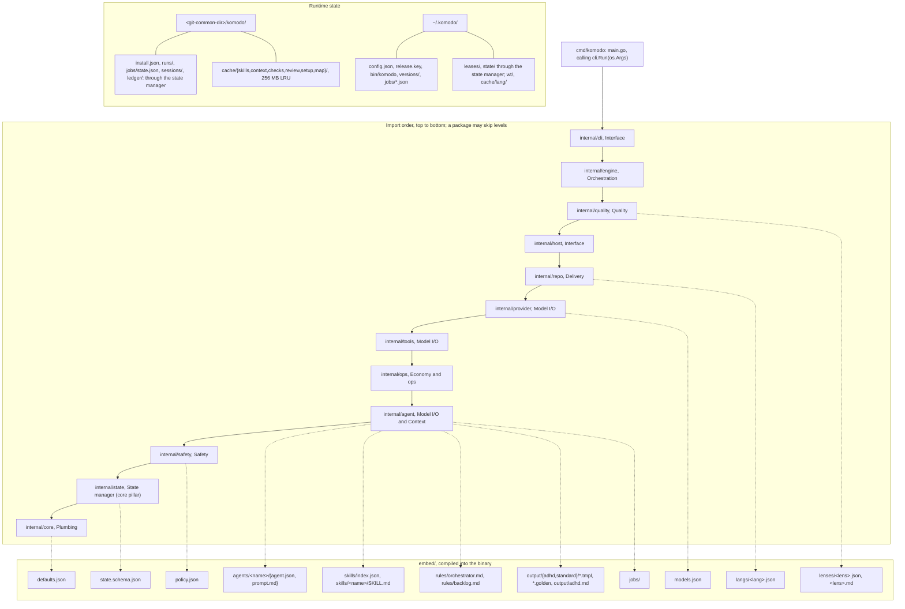
**Reading the diagram.** `cmd/komodo` calls `cli.Run(os.Args)`; the 12 `internal` packages below import only downward and may skip levels. Dotted arrows show which package reads which `embed/` asset, all compiled into the binary. Runtime state splits between `<git-common-dir>/komodo/` and `~/.komodo/`; only `internal/state` reads or writes it, so its boxes say "through the state manager" instead of drawing an arrow.

**What matters**
- `cmd/komodo` is one file, `main.go`, calling `cli.Run(os.Args)`; `go.mod` lists no modules.
- Import order, top down: `cli`, `engine`, `quality`, `host`, `repo`, `provider`, `tools`, `ops`, `agent`, `safety`, `state`, `core`; a file splits at about 600 lines.
- `embed/` holds the 7 agents, 5 workflow skills plus 34 `standards-*`, 10 lenses, `defaults.json`, `policy.json`, `models.json` and the generated `state.schema.json`.
- Per-repo state lives under `<git-common-dir>/komodo/` (state files, sessions, ledger, 256 MB cache); machine state under `~/.komodo/` (config, leases, worktrees).
- Every runtime state file except the 6 exclusions in [Outside the manager (Appendix C)](#outside-the-manager) is read and written only through the state manager ([State manager (Appendix C)](#state-manager)).

**Lookup:** [Appendix A](#appendix-a-document-metadata-conventions-code-structure-and-data-locations) holds the package, embedded asset, runtime state and conventions tables.

## 1. CLI and Configuration

The command-line interface (CLI) is the only way to drive Komodo: a person or the orchestrator types `komodo <verb>`. A verb is a subcommand such as `run`. The orchestrator is the AI session that drives work but never edits code (see Glossary in the HLD). Without a terminal every verb answers with one JSON envelope, `{v, ok, verdict, report, data, error}`. It exits 0 ok, 1 refused, 2 usage, 3 blocked or 4 internal. Configuration is 33 dotted keys, such as `limits.pool_max`.

Every verb runs five steps: parse, validate, resolve repo and config, dispatch to one domain package, render. A verb failing before dispatch has made 0 writes; a repeated writing verb reports `0 changes`. `install` places the binary, probes providers and writes the repo files. `doctor` checks the install or the backlog, both by default, and names a fix for each problem. It runs each detected command's `--version` inside the sandbox, fails an endpoint below `providers.ctx_floor`, and refuses a backlog group whose `files` list `docs/backlog/**`. `plan <goal>` has the planner draft groups, written only if lint (an automatic rule check) passes. `run [group]` starts groups detached and returns a run id. `status` shows the pool, group graph, stages, budgets and blocks. `scope approve|deny` answers a builder's `needs_scope`; `resume`, `stop` and `abandon` continue, save or give up a run. `config` reads or sets keys, `fresh` fetches the newest binary; `gate` and `release` work in the Komodo repo only.

A terminal-only verb refuses with exit 1 without a real terminal; agent shells have none. Config has two layers, built-in `embed/defaults.json` and machine `~/.komodo/config.json`; the machine value wins within hard limits.

**📐 Verb pipeline and configuration**
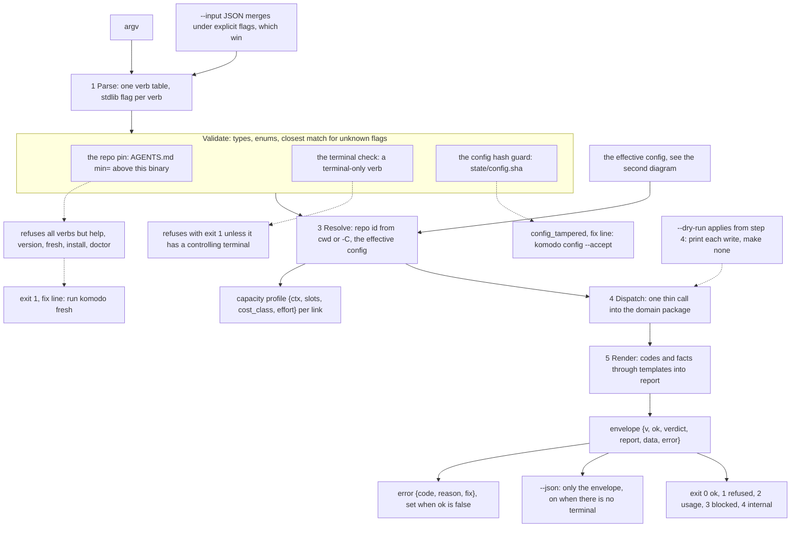
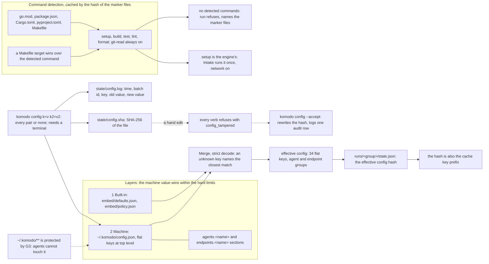
**Reading the diagram.** The first diagram runs one verb from `argv` through five steps to the envelope and exit code; refusals leave 0 writes. The second merges both config layers, then the write path with SHA-256 (a standard content fingerprint) and audit log. Marker-file command detection ends it.

**What matters**
- The pin check runs first: an `AGENTS.md` pin above this binary refuses every verb except `help`, `version`, `fresh`, `install` and `doctor`.
- `komodo config k=v k2=v2` sets every pair or none, needs a terminal, and logs one row per key to `~/.komodo/state/config.log`.
- A hand edit of `config.json` breaks the SHA-256 in `state/config.sha`; every verb refuses with `config_tampered` until `komodo config --accept`.
- Only `KOMODO_HOME` and `NO_COLOR` configure Komodo through the environment; `CI=true` disables background fresh.
- Before each session the engine derives the link's capacity profile `{ctx, slots, cost_class, effort}`.

**Lookup:** [Appendix B](#appendix-b-command-line-interface-and-configuration) holds the verb, global flag, envelope, exit code, tier, 34-key, agent group, endpoint group, environment, command detection and capacity profile tables.

## 2. Event Spine and State Machine

The event spine records every change to a task group as a typed event, and one pure function, `Next()`, decides what each event means. A group's position survives any crash because its events reach disk before they are applied, and no code path other than `Next()` can move a stage. This chapter specifies the event format, the decision function, the stage rulebook, the outbox that makes side effects safe to repeat, and the bus that tells readers what happened.

**Guarantees the tests pin**

| Guarantee | How |
|---|---|
| Ordered, gap-free | One writer per group state; `sequence` checked on append and replay |
| Durable before applied | Append, fsync (forcing the write onto the disk), then `Next()`; a crash after the sync replays the event |
| Exactly-once state moves | A stage moves only in `Next()`, keyed by `sequence`; stale-epoch events never move it |
| At-least-once actions, safe to repeat | Every action has an idempotency key |
| No lost wake | `status --wait` reads the state tail after subscribing |
| Subscriber faults contained | A panicking subscriber is logged and dropped; state is untouched |

### 2.1 Scope

**Owns:** the event envelope and the 35-type catalog, each type's data struct and contract (`Spec`), `Next()` and its transition table, the group `State` that `Next()` reads, the outbox's 10 action kinds, epochs, block reasons, and delivery to the 3 bus subscribers.

**Does not own:** writing and replaying files, which is group state in the state manager ([State Manager](#13-state-manager)); the `Drive` loop that calls `Next()` ([Engine Internals](#3-engine-internals)); and the producers that report facts, such as the session supervisor, the guard and Check.

What this subsystem is for, and who it talks to, is in the HLD: [Event Spine and State Machine](hld.md#event-spine-and-state-machine).

### 2.2 Package Layout

| File | Holds |
|---|---|
| `internal/state/kinds.go` | `Event`, `Type`, `Reason`, `Stage`, `ID`, `Action`, `ActionKind`, `Spec`, `Register`, `SpecOf` and one data struct per event type; the `event` kind registration the schema is generated from |
| `internal/engine/stage.go` | `State`, `Limits`, `Next()`, the `transitions` slice, the `Spec` values registered from it, epochs |
| `internal/engine/engine.go` | `Drive`, the caller of `Next()` ([Engine Internals](#3-engine-internals)) |
| `internal/ops/bus.go` | `Subscriber`, in-order delivery to the ledger, the wake file and the `status --watch` renderer |
| `embed/state.schema.json` | Generated at build from the kind registry; the gate fails when it disagrees with the Go types |

The envelope, data structs, actions and contracts sit in `internal/state` because the state manager validates every `Append` against them, and `state` may not import a package above it. `bus.go` delivers events and holds no type definitions.

### 2.3 Data Model

**Envelope.** Every event line, group or run, is one `Event`. `Drive` fills `stage` and `stale`; group state's `Append` fills `sequence`, `timestamp` and `checksum`; the producer fills the rest.

```go
// Type names one of the 35 catalog entries, such as "session.end".
type Type string

// Reason is one value of the closed reason list: block, exit and skip reasons.
type Reason string

// ID is a UUID version 7 in its text form; groups keep a readable name beside it.
type ID string

// Stage is where a group is; the last two are holding states.
type Stage string

const (
	Intake  Stage = "intake"
	Build   Stage = "build"
	Check   Stage = "check"
	Verify  Stage = "verify"
	Ship    Stage = "ship"
	Paused  Stage = "paused"
	Blocked Stage = "blocked"

	NoStage Stage = "none"  // a group before its first line; never written to an event
	ToPrior Stage = "prior" // in a Transition's To: the stage in State.Prior; never written
	Keep    Stage = ""      // in a Transition's To: the stage does not change
)

// Event is one line of runs/<group-id>/events.jsonl or runs/<run>.jsonl.
type Event struct {
	Version   int       `json:"version"`           // always 1
	Sequence  uint64    `json:"sequence"`          // gap-free per file, stamped by Append
	Timestamp time.Time `json:"timestamp"`         // the engine's clock, RFC 3339 in UTC, whole seconds
	Run       ID        `json:"run"`
	Group     ID        `json:"group,omitempty"`   // on every group event
	Session   ID        `json:"session,omitempty"` // on session and task events only
	Stage     Stage     `json:"stage,omitempty"`   // on every group event; never on run.* or job.*
	Epoch     uint32    `json:"epoch"`             // the stage epoch the producer was spawned under
	Stale     bool      `json:"stale"`             // set by Drive when Epoch is older than the current
	Type      Type      `json:"type"`
	Reason    Reason    `json:"reason,omitempty"`  // one value of the closed reason list
	Data      Payload   `json:"data"`              // the one struct registered for Type
	Checksum  uint32    `json:"checksum"`          // CRC-32 of the line without this field, written last
}

// UnmarshalJSON reads type first, then decodes data into the struct the registry returns for it.
func (e *Event) UnmarshalJSON(b []byte) error

// Payload is implemented by exactly one data struct per event type.
type Payload interface{ EventType() Type }
```

| Field | Rule |
|---|---|
| `version` | Envelope version, 1 |
| `sequence` | Checked on every append and every replay, so a missing line is detected |
| `timestamp` | When the engine saw the fact, such as `2026-10-11T15:31:00Z`; never a model's claim |
| `run`, `group`, `session` | UUIDs ([Naming and identifiers (Appendix A)](#naming-and-identifiers)) |
| `stage` | `intake`, `build`, `check`, `verify`, `ship`, `paused` or `blocked`; required on group events, forbidden on `run.*` and `job.*`; lets `status` and the ledger group events by stage without replaying |
| `epoch`, `stale` | `Drive` alone sets `stale`, because it holds the current epoch; a stale event is written and ignored by `Next()` ([Behaviour](#25-behaviour)) |
| `type`, `reason`, `data` | `type` picks the one `data` struct allowed, so a `session.end` line can only carry a `session.end` body |
| `checksum` | `Append` marshals a copy of the envelope that has no `Checksum` field, takes CRC-32 (IEEE polynomial, Go's `crc32.ChecksumIEEE`) of those bytes, and replaces the closing `}` with `,"checksum":N}`, N in decimal |

The build generates one JSON Schema from the envelope and the registry, with one branch per type, no extra fields allowed, and an enum for every `reason`. The state manager checks every `Append` against it and `komodo help --json` serves its event part as `events`. The fields of each type's data struct are open `[PENDING G-24]`, and the envelope's `id`, `class`, `cause` and `corr` fields wait on the requests and single-write decisions `[PENDING G-29]`.

**Example.** A `session.end` line, spread over lines for reading; on disk it is one compact line.

```json
{
  "version": 1,
  "sequence": 12,
  "timestamp": "2026-10-12T15:31:12Z",
  "run": "0192e4c5-6f00-7a21-8c3b-2d9e0f1a4b57",
  "group": "0192e4c5-7a10-7d3e-9b2f-6c1d8e4a5f30",
  "session": "0192e4c6-1d40-7b85-a2f3-8c6e1d0b9a47",
  "stage": "build",
  "epoch": 2,
  "stale": false,
  "type": "session.end",
  "reason": "schema_fail",
  "data": {},
  "checksum": 1957802145
}
```

Two more lines from the same file, a `stage.enter` and a `group.blocked`:

```json
{"version":1,"sequence":7,"timestamp":"2026-10-12T15:20:03Z","run":"0192e4c5-6f00-7a21-8c3b-2d9e0f1a4b57","group":"0192e4c5-7a10-7d3e-9b2f-6c1d8e4a5f30","stage":"build","epoch":2,"stale":false,"type":"stage.enter","data":{},"checksum":526820511}
{"version":1,"sequence":31,"timestamp":"2026-10-12T16:02:45Z","run":"0192e4c5-6f00-7a21-8c3b-2d9e0f1a4b57","group":"0192e4c5-7a10-7d3e-9b2f-6c1d8e4a5f30","stage":"build","epoch":2,"stale":false,"type":"group.blocked","reason":"attempts","data":{},"checksum":4251528637}
```

#### Catalog (35 types)

The catalog is a fixed Go enum in 8 families, registered with the state manager as the `event` kind. The gate fails on an emitted type missing from it, or a listed type nothing emits. Model sessions never emit events; a session's typed JSON becomes an event only after Go validates it.

| Type | Emitted by | When, and what `Next()` does with it |
|---|---|---|
| `run.start` | Engine | `komodo run` starts a run; every ready group enters Intake |
| `run.done` | Engine | The run finished; wakes `status --wait`. What counts as finished is `[UNKNOWN: not yet designed]` `[PENDING G-31]` |
| `run.stopped` | Shutdown | A signal or `stop <run>`, after agents stop, work is WIP-committed and leases are freed; wakes `status --wait` |
| `group.paused` | Engine | A provider limit left no allowed link; `status` shows the link and the resume time |
| `group.blocked` | Engine | A bound ran out or a decision is needed, with a [block reason](#block-reasons) |
| `group.cancelled` | Engine, workspace, ship | Trigger `[UNKNOWN: not yet designed]` `[PENDING G-31]` |
| `group.shipped` | Engine (`Next()` follow-on) | Merge clean, Check passed on the epic tip, landing succeeded; ends the group |
| `lease.lost` | Workspace | A git write with a stale fence was refused: another run took the group; `Next()` stops it |
| `stage.enter` | Engine | A group enters a stage; the epoch rises; a snapshot is written; wakes `status --wait any` |
| `stage.exit` | Engine (`Next()` follow-on) | Intake's or Verify's gate is met ([State and Transitions](#26-state-and-transitions)) |
| `session.start` | Supervisor | A session is spawned with its brief; fires with `task.claimed` |
| `session.idle` | Supervisor | No stream line and no running tool for `limits.session_idle_min`; the supervisor nudges, then stops the session ([Sessions, Agents and Briefs](#5-sessions-agents-and-briefs)) |
| `session.timewarn` | Supervisor | The session neared its wall clock; the supervisor injects a finish-now line |
| `session.end` | Supervisor | The session ended with an exit reason ([Exit reasons (Appendix F)](#exit-reasons)); `Next()` orders a commit, a retry, a pause or a block; a writing session's end orders a WIP commit |
| `task.claimed` | Supervisor | With `session.start`; the task moves from queued to claimed in the lock table |
| `task.released` | Supervisor, recovery | With `session.end`, or reason `crash` when the startup sweep finds the session dead |
| `task.done` | Engine (`Next()` follow-on) | The `commit` action ran `done_when` with exit 0 and the result is on the hidden ref |
| `task.retry` | Engine | Another attempt after a schema-invalid result, a failed gate, a cut-off reply, 3 refusals under one rule or a failed `done_when`; counts toward `limits.task_attempts` |
| `check.done` | Check | Pass or fail after the zero-token checks |
| `finding.submit` | Tools | A reviewer's `submit_finding` passed validation: a known rule ID, a `file:line` and a quoted evidence line |
| `finding.verified` | Review | Go found the quoted evidence at that line in the head or the diff; unverified findings are dropped and logged |
| `tool.denied` | Guard | A tool call was refused inline; 3 refusals under one rule end the session |
| `timer.due` | Scheduler, engine, sweep, `status` | A paused group's `wait_until` passed; the live engine sleeps until the earliest one |
| `job.due` | Scheduler | A job's interval elapsed at a `jobs tick`; the job is enqueued as its own run |
| `job.fail` | Scheduler | A job run failed; it backs off and is Blocked after 3 failures |
| `lock.taken` | Intake | Backlog files hashed into `card_hash`; edits, re-plans and new tasks are refused with `locked` |
| `lock.released` | Ship, abandon | The task list is editable again |
| `action.start` | `Drive` | Before a side effect, with its `id` and `action` |
| `action.done` | `Drive` | After the side effect completes |
| `state.truncated` | Recovery | Replay dropped a last line whose checksum failed; at most one event lost |
| `provider.skip` | Provider adapters | A link was skipped, with `{from, to, reason}`: unavailable, unauthorized, over its limit or `ctx_below_floor` |
| `limit.warn` | Provider adapters | A window passed `warn.quota_pct`, Max began drawing paid overage, or spend passed `warn.usd_per_run` with `track.usage` on; never stops work |
| `lease.taken` | Workspace | Machine log only: a `Claim` on a lease succeeded |
| `pool.slot.taken` | Session pool | Machine log only: a session took a machine-wide slot |
| `queue.enqueued` | Work queue | Machine log only: a ready group or due job was queued |

**Families:** Run (3), Group (5: the 4 `group.*` plus `lease.lost`), Stage (2), Session (4), Work (11), Ledger (5: `lock.*`, `action.*`, `state.truncated`), Provider (2), Machine (3).

**Machine-wide records.** Leases, pool slots, the work queue and jobs keep the state manager's create-only `Claim`, `Replace` and `Remove`, which make two processes agree. Each successful write also appends a typed event to a machine log under `~/.komodo/state/events/`, one file per process so each file has one writer; file naming is `[UNKNOWN: not yet designed]` `[PENDING G-30]`. An event that affects a group, such as a lost lease, also goes into that group's own events for `Next()`, and `status` merges the machine logs by `timestamp`.

#### Contracts

Each type registers a `Spec` beside its data struct. `Drive` checks every `Next()` result against the triggering type's `Spec`; a violation blocks the group with reason `contract`.

The values come from this chapter, not from code: `Producers` is the catalog's Emitted by column, `Stages`, `Emits` and `Orders` are the union of that type's rows in the transition and in-stage tables ([State and Transitions](#26-state-and-transitions)), and `Wakes` is the wake list ([Behaviour](#25-behaviour)). The gate fails when a registered `Spec` disagrees with those tables, and `help --json` serves them.

```go
// Spec is the contract registered for one event type.
type Spec struct {
	Producers []string     // components allowed to emit it
	Stages    []Stage      // stages that accept it; any other is refused
	Emits     []Type       // events Next may emit in response
	Orders    []ActionKind // actions Next may order in response
	Wakes     bool         // wakes status --wait
}

// SpecOf returns the contract registered for a type.
func SpecOf(t Type) Spec

// Register binds a type to its one data struct and its contract; called from init in kinds.go and stage.go.
func Register(t Type, data func() Payload, spec Spec)
```

Whether a `Spec` also names the event's class (fact, request or outcome) is open `[PENDING G-29]`.

#### The State Struct

`State` is what `Next()` reads and returns, and what the snapshot stores. The record header around it on disk belongs to the state manager ([Group snapshot (Appendix C)](#group-snapshot)).

```go
// State is one group's position and every counter Next reads; it is the snapshot body.
type State struct {
	Run         ID             `json:"run"`
	Group       ID             `json:"group"`
	Stage       Stage          `json:"stage"`
	Prior       Stage          `json:"prior"`        // the stage a Paused or Blocked group returns to
	Epoch       uint32         `json:"epoch"`
	Fence       uint64         `json:"fence"`
	Sequence    uint64         `json:"sequence"`     // the last line appended, and applied
	ConfigHash  string         `json:"config_hash"`  // pins the Limits for this run
	Tasks       []TaskState    `json:"tasks"`
	ActionsOpen []OpenAction   `json:"actions_open"` // ordered by Next, not yet done; Drive runs them after Load
	Resume      ResumeRef      `json:"resume"`
	Pause       PauseState     `json:"pause"`
	Block       BlockState     `json:"block"`
	Returns     int            `json:"returns"`      // returns to Build so far
	Verify      VerifyProgress `json:"verify"`       // reviewer and tester results in this epoch
	FailureHash string         `json:"failure_hash"` // the last failure's fingerprint, for flap detection
	Blocks      map[Reason]int `json:"blocks"`       // blocks per reason
	WallUsedS   int64          `json:"wall_used_s"`  // seconds worked, excluding Paused and Blocked
	TokensUsed  int64          `json:"tokens_used"`  // with track.usage on, against limits.group_tokens
}

// TaskState is one task's claim and attempt count.
type TaskState struct {
	ID       string `json:"id"`
	State    string `json:"state"`    // queued, claimed, done, returned or blocked
	Attempts int    `json:"attempts"`
	Retries  int    `json:"retries"`  // session timeouts and idle stops, against the agent's retries
	Session  ID     `json:"session,omitempty"`
}

// ResumeRef is how the group's last session can be continued.
type ResumeRef struct {
	Session ID     `json:"session,omitempty"`
	Handle  string `json:"handle,omitempty"`
	Link    string `json:"link,omitempty"`
}

// PauseState copies the timer record of a Paused group.
type PauseState struct {
	Until time.Time `json:"until,omitzero"`
	Link  string    `json:"link,omitempty"`
}

// BlockState names why and when a Blocked group stopped.
type BlockState struct {
	Reason Reason    `json:"reason,omitempty"`
	At     time.Time `json:"at,omitzero"`
}

// Limits are the bounds Next enforces, read from the effective config pinned by ConfigHash.
type Limits struct {
	Returns      int // limits.returns
	TaskAttempts int // limits.task_attempts
	PauseMaxMin  int // limits.pause_max_min
	GroupTokens  int // limits.group_tokens; 0 when track.usage is off
	Retries      int // the task's agent's retries, from its agent.json
}
```

Slices and maps in `State` are never nil: the constructor and `Load` set them empty, so they marshal as `[]` and `{}`. `Returns`, `Verify`, `FailureHash`, `Blocks`, `WallUsedS`, `TokensUsed` and each task's `Retries` keep a crash from resetting a loop limit; with `Prior`, they are the default pending the owner `[PENDING G-32]`. The fields of `VerifyProgress`, the task id format and the `config_hash` format are `[UNKNOWN: not yet designed]` `[PENDING G-30]`.

**Example.** The body of `runs/<group-id>/state.json` at sequence 50, group tg-1.2.

```json
{
  "run": "0192e4c5-6f00-7a21-8c3b-2d9e0f1a4b57",
  "group": "0192e4c5-7a10-7d3e-9b2f-6c1d8e4a5f30",
  "stage": "build",
  "prior": "",
  "epoch": 2,
  "fence": 3,
  "sequence": 50,
  "config_hash": "[UNKNOWN: not yet designed] [PENDING G-30]",
  "tasks": [
    {"id": "[UNKNOWN: not yet designed] [PENDING G-30]", "state": "claimed", "attempts": 1, "retries": 0, "session": "0192e4c6-1d40-7b85-a2f3-8c6e1d0b9a47"}
  ],
  "actions_open": [],
  "resume": {"session": "0192e4c6-1d40-7b85-a2f3-8c6e1d0b9a47", "handle": "0192e4c6-1d40-7b85-a2f3-8c6e1d0b9a47", "link": "claude-cli"},
  "pause": {},
  "block": {},
  "returns": 1,
  "verify": {},
  "failure_hash": "",
  "blocks": {},
  "wall_used_s": 2460,
  "tokens_used": 0
}
```

#### Actions

`Next()` orders actions; it never performs one. Each ordered action also enters `State.ActionsOpen` in the same `Next()` call, so a crash before its `action.start` still reruns it. Each kind declares an idempotency key, and the gate fails a kind missing from this table.

```go
// ActionKind names one side effect Drive may perform.
type ActionKind string

// ActionStart is the data of action.start; Drive picks Session for a spawn before it runs.
type ActionStart struct {
	Action
	Session ID `json:"session,omitempty"` // spawn only: the session UUID, recorded before the spawn
}

// ActionDone is the data of action.done; result fields are [UNKNOWN: not yet designed] [PENDING G-24].
type ActionDone struct {
	Action
}

// OpenAction is an action Next ordered that has no action.done yet.
type OpenAction struct {
	Action
	Started bool `json:"started"` // an action.start line exists
}

// Action is one side effect Next orders, recorded by action.start and action.done.
type Action struct {
	ID   string          `json:"id"`     // sha256 of decimal sequence, NUL, kind, NUL, args JSON; 64 lowercase hex digits
	Kind ActionKind      `json:"action"`
	Args json.RawMessage `json:"args"`   // per-kind struct [UNKNOWN: not yet designed] [PENDING G-30]
}
```

| Action | Idempotency key | Safe to repeat because |
|---|---|---|
| `spawn` | The session UUID `Drive` records in `action.start` before spawning | A live UUID is a no-op; a dead one restarts the session; replay reads the UUID from disk, so `Next()` stays pure |
| `wip_commit`, `commit` | `(group, fence, tree hash)` | The hidden ref moves by compare-and-swap; an identical tree writes nothing |
| `cancel` | Session UUID | Killing a dead process is a no-op |
| `setup` | `(group, lockfile hash)` | Reruns are cached and the sandbox makes them pure |
| `check` | `(tree hash, command)` | Results are cached by that key |
| `land` | `(group, fence, merge base)` | A landed merge commit already exists; the fence refuses a stale lander |
| `open_pr` | `(epic, head SHA)` | `gh` finds the existing PR for that head first |
| `scope_change` | `(group, sorted paths)` | Adding a path twice is one path |
| `notify` | Event `sequence` | A wake is a file touch |

- **`spawn`:** starts a session with its brief, tool server and sandbox profile.
- **`wip_commit`:** runs at every writing session's end; **`commit`** runs when a task is done. Both write the hidden ref.
- **`cancel`:** SIGINT, then SIGTERM after 30 s, then a whole-tree kill. Used when the first verified Verify finding makes the tester pointless, and when a pause hits its cap.
- **`setup`:** runs the detected `setup` command in Intake, network on, cached by lockfile hash.
- **`open_pr`:** opens the epic's PR, or the group's under `ship.mode: group`, with `gh`.

The two lines `Drive` writes around one spawn:

```json
{"version":1,"sequence":13,"timestamp":"2026-10-12T15:31:13Z","run":"0192e4c5-6f00-7a21-8c3b-2d9e0f1a4b57","group":"0192e4c5-7a10-7d3e-9b2f-6c1d8e4a5f30","stage":"build","epoch":2,"stale":false,"type":"action.start","data":{"id":"9f2c4e1ab7d05e36c18f4a2b9e7d6c0538a1f4e2d9b7c6a5e4f3d2c1b0a99887","action":"spawn","args":{}},"checksum":328441067}
{"version":1,"sequence":14,"timestamp":"2026-10-12T15:31:15Z","run":"0192e4c5-6f00-7a21-8c3b-2d9e0f1a4b57","group":"0192e4c5-7a10-7d3e-9b2f-6c1d8e4a5f30","stage":"build","epoch":2,"stale":false,"type":"action.done","data":{"id":"9f2c4e1ab7d05e36c18f4a2b9e7d6c0538a1f4e2d9b7c6a5e4f3d2c1b0a99887","action":"spawn","args":{}},"checksum":1635847319}
```

### 2.4 Interfaces

```go
// Result is everything one event decides.
type Result struct {
	State   State
	Actions []Action // run by Drive, each wrapped in action.start and action.done
	Emit    []Event  // follow-on events, appended before the actions run
	Refused bool     // no transition row matched; Drive logs it and State is unchanged
}

// Next applies one event to one group's state; it reads nothing, writes nothing and never fails.
func Next(s State, e Event, l Limits) Result

// Transition is one row of the stage and in-stage tables in State and Transitions.
type Transition struct {
	From   []Stage                          // nil means any stage
	On     Type
	When   func(State, Event, Limits) bool  // the condition column; nil means always
	To     Stage                            // a stage, Keep or ToPrior
	Apply  func(State, Event, Limits) State // the Sets column
	Orders []ActionKind
	Emits  []Type
}

// Subscriber receives each applied event in sequence order and writes only its own records.
type Subscriber func(e Event) error
```

| Caller | Calls | Gets |
|---|---|---|
| `Drive` ([Engine Internals](#3-engine-internals)) | `Next(state, event, limits)` for every line it appends | `Result` |
| Group state's `Load` ([State Manager](#13-state-manager)) | An `apply` function `Drive` passes in, wrapping `Next`, for each line after the snapshot | The rebuilt `State` and the follow-ons missing at the tail |
| State manager | The `Register` registry, to build and enforce the schema | One data struct per `type` |
| `Drive` | `SpecOf(type)` after every `Next()` | The contract the result must meet |
| Event bus | Each of the 3 `Subscriber`s, after `Next()` | `error`; one error or panic drops that subscriber for the run |
| `komodo gate` | Every type through `Next()`, every action kind against the table | Pass or fail |

### 2.5 Behaviour

**📐 One event, from producer to subscribers**
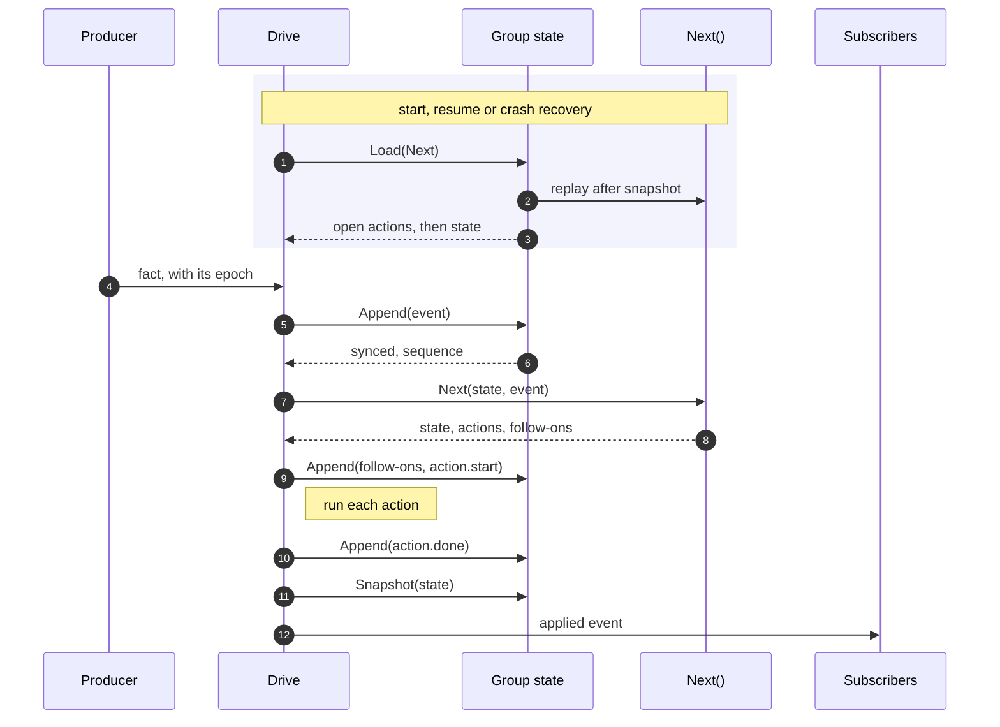

**Reading the diagram.**
1. On start, resume or after a crash, `Drive` calls group state's `Load` with an `apply` function that wraps `Next()`. A new group's file is empty; `Drive` appends a copy of the run's `run.start`, with the group's id, as its first line.
2. `Load` reads `state.json` and passes every line after its `sequence` through `apply`, in order.
3. Replay discards each result's `Actions`, which `ActionsOpen` already holds. It keeps a queue of each result's `Emit`, as `Drive` does live: every follow-on must be the next line on disk. Follow-ons still queued at the end of the file never reached disk; `Load` returns them and `Drive` appends them first.
4. `Drive` runs every action in `State.ActionsOpen`, started or not, under its idempotency key, before it applies any new event.
5. A producer hands `Drive` a fact stamped with the epoch its session started under.
6. `Drive` sets `stage` and `stale`, then calls `Append`, which stamps `sequence`, `timestamp` and `checksum`, validates the line against the schema and syncs it; it returns only once the line is on disk.
7. `Drive` calls `Next()`, which touches nothing on disk; a stale event changes nothing.
8. `Drive` puts the follow-on events in a first-in, first-out queue and appends and applies each in turn, its own follow-ons joining the back, before any action runs. Each follow-on carries the epoch current when it is appended.
9. For each action, which `Next()` already put in `ActionsOpen`, `Drive` appends and applies `action.start` (for a spawn, with the session UUID it picked), runs the action, then appends and applies `action.done`, which removes it.
10. Because every appended line is applied, `State.Sequence` is always the last line on disk, and `Snapshot` can write it on [its interval](#28-configuration-and-constants).
11. The bus hands each applied event to the 3 subscribers, in `sequence` order.

**Epochs.** Entering a stage raises the epoch, and every spawn carries the current one. `Drive` marks an event `stale: true` when its epoch is older than the current stage's, and `Next()` ignores it, so a cancelled Verify session's late result cannot move the stage twice. Paused and Blocked are not stages: entering or leaving Paused never changes the epoch, so a Verify sibling that kept running stays live and its `session.end done` counts toward Ship. Leaving Blocked on `resume` re-enters a stage and raises it.

**Replay and the cut-short line.**
1. `Load` reads `runs/<group-id>/state.json`; a snapshot is refused unless its `sequence` is the group state's last.
2. Replay costs at most one snapshot interval of lines, within the [replay target](#28-configuration-and-constants) `[PENDING G-19]`.
3. A last line whose checksum fails was cut short by a crash: it is dropped and one `state.truncated` is emitted.
4. A failing line before the last is a bad record: it is moved aside and the group blocks `state_invalid` ([Checks: populate and validate (Appendix C)](#checks-populate-and-validate)).

**Files.** `runs/<group-id>/events.jsonl` holds one group's events and `runs/<run>.jsonl` holds one run's `run.*` events, appended and read through the same group state calls with no snapshot. Groups never read each other's files; they meet only in the work queue and the session pool.

**Concurrency.**
- **One writer per file:** a group's `Drive` goroutine is the only writer of its events and snapshot; the run goroutine is the only writer of `run.*` events.
- **`Next()` takes no locks:** it is pure, so table tests call it directly.
- **Coarse grain:** events fire per run, group, stage, session and task, never per model turn or token; the in-session tool loop is plain code.
- **Outside the bus:** the guard check before a tool call, formatting after `edit`, and shutdown are direct code, and log an event afterward when they can. They are the 3 inline hooks; repo-owned hooks arrive in a later minor and will be subscribers, never gates.
- **Bus delivery:** one bus per engine process, no broker; `Next()` is the one decider, and subscribers write only their own derived records, never a group's events or snapshot. Today `Drive` delivers synchronously, in `sequence` order, within the [per-subscriber limit](#28-configuration-and-constants), and logs an overrun in the run report; the ledger batches its appends per tick. Whether `Drive` keeps waiting for subscribers is open `[PENDING G-29]`.

**Wakes.** The wake subscriber is never dropped: a failed touch is retried on the next event, and `status --wait` also reads `Tail` on [a backstop interval](#28-configuration-and-constants), so a failed touch delays a wake but never loses it. `group.blocked`, `group.paused`, `run.done` and `run.stopped` wake `status --wait`; `--wait any` also wakes on `stage.enter`. The wake subscriber touches `~/.komodo/state/wake/<run>`; the waiter watches that file, then reads the state tail through group state's `Tail`, so an event between subscribing and watching is still seen.

### 2.6 State and Transitions

**📐 Group stages**
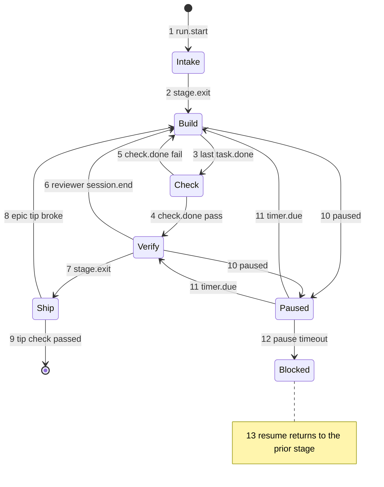

**Reading the diagram.** Numbers match the rows below. Every stage can also enter Blocked when a bound runs out (row 14), and abandon, a lost lease and cancel end a group from any stage (rows 17-19); they are left off the drawing.

**The table is code.** Both tables below are one Go slice of `Transition`. For each event, `Next()` applies the first matching in-stage row, then the first matching stage-move row against the updated state; either may be absent. An event that matches neither is refused and logged, never dropped. The build draws the diagram from the slice and the gate checks every registered `Spec` against it.

**Stage moves.** A row that changes the stage emits `stage.enter` for the new stage, or `group.paused`, `group.blocked` or `group.shipped` when the target is Paused, Blocked or the end; the in-stage rows then apply those follow-ons.

| # | From | Event | Condition | To | Sets; orders; emits |
|---|---|---|---|---|---|
| 1 | none | `run.start` | The group's first line | Intake | emits `stage.enter` |
| 2 | Intake | `stage.exit` | | Build | emits `stage.enter` |
| 3 | Build | `task.done` | The last task's `done_when` exit 0 and a commit on the hidden ref | Check | emits `stage.enter` |
| 4 | Check | `check.done` pass | | Verify | emits `stage.enter` |
| 5 | Check | `check.done` fail | `Returns` under `limits.returns` | Build | `Returns` + 1; emits `stage.enter` |
| 6 | Verify | Reviewer `session.end` | A verified blocking finding, a `not_met` task, an item that failed Go's two reruns, or a recorded tester failure; `Returns` under the limit | Build | `Returns` + 1; orders `cancel` for a live tester; emits `stage.enter` |
| 7 | Verify | `stage.exit` | | Ship | emits `stage.enter` |
| 8 | Ship | `check.done` fail on the epic tip | `Returns` under the limit; a fresh worktree is cut from the tip `[PENDING G-31]` | Build | `Returns` + 1; emits `stage.enter` |
| 9 | Ship | `check.done` pass on the epic tip | Landed with the fence | end | orders `open_pr` under `ship.mode: group`; emits `group.shipped`, `lock.released` |
| 10 | Build, Verify | `session.end` reason `paused` | No allowed link left | Paused | `Prior` = stage; emits `group.paused`; the in-stage `session.end` row has already set `Resume` and ordered `wip_commit` |
| 11 | Paused | `timer.due` | Reason is not `pause_timeout`; the reset time passed | `Prior` | orders `spawn` from the resume handle; the epoch is kept; back in Verify with both results passed, emits `stage.exit` |
| 12 | Paused | `timer.due` reason `pause_timeout` | `limits.pause_max_min` reached | Blocked | orders `cancel`; WIP commit kept; emits `group.blocked` |
| 13 | Blocked | `resume` command `[PENDING G-29]` | | `Prior` `[PENDING G-31]` | emits `stage.enter`, whose row orders the spawn |
| 14 | Any stage | The event that spends a bound's last unit | See the [block reasons](#block-reasons) | Blocked | `Prior` = stage; orders `wip_commit` when a writer was live; emits `group.blocked` |
| 15 | Blocked | `scope approve` or `scope deny` command `[PENDING G-29]` | | Build | orders `scope_change` on approve; emits `stage.enter`, whose row orders the spawn |
| 16 | Paused | `resume` command `[PENDING G-29]` | Sooner than the timer | `Prior` | orders `spawn` from the resume handle |
| 17 | Any stage | `abandon` command `[PENDING G-29]` | Lease freed, evidence kept; dependents block `dependency` `[PENDING G-31]` | end | orders `cancel`; emits `lock.released` |
| 18 | Any stage | `lease.lost` | Another run took the group; no landing `[PENDING G-31]` | end | orders `cancel` |
| 19 | Any stage | `group.cancelled` | Trigger `[UNKNOWN: not yet designed]` `[PENDING G-31]` | end | orders `cancel` |

- **Row 14 is a shape, not one row.** Each bound has a twin of the row that spends it, with the limit reached and `To` = Blocked: rows 5, 6 and 8 at `limits.returns`, `task.retry` at `limits.task_attempts`, and so on through the [block reasons](#block-reasons).
- **Returns** raise the epoch through `stage.enter` and give the builder every verified finding in one return. On a Verify return the tester is cancelled at the first verified blocking finding, and the reviewer finishes.
- **Rows 8 and 12-19** are the default for moves the rulebook did not have, pending the owner `[PENDING G-31]`.
- **Rows 11, 13 and 16** use `ToPrior`; row 1's `From` is `NoStage`.
- **Commands are not catalog types yet.** `resume`, `scope approve|deny` and `abandon` arrive as events whose type names, and route into `Drive`, wait on the commands decision `[PENDING G-29]`; they are outside the 35.

**In-stage rows.** These change `State`, order actions or emit follow-ons without moving the stage.

| Event | Stages | Sets; orders; emits |
|---|---|---|
| `stage.enter` | Any | `Epoch` + 1; entering Verify clears `Verify`; orders by stage: Intake `setup`; Build `spawn` for the first open task, from its resume handle when one is set, with the findings on a return; Check one `check` per command; Verify `spawn` for the reviewer and the tester; Ship `land` |
| `lock.taken` | Intake | Lock recorded |
| `action.done` for `setup` | Intake | Exit 0 with the lock taken emits `stage.exit`; a non-zero exit is `[UNKNOWN: not yet designed]` `[PENDING G-31]` |
| `session.start`, `task.claimed` | Build, Verify | Task `claimed` with its session |
| `session.end` of a writing session | Build | `Resume` set; `TokensUsed` grows by the session's usage when `track.usage` is on; exit `done` orders `commit`, any other exit `wip_commit`; a timeout or idle stop adds 1 to the task's `Retries` |
| `action.done` for `commit` | Build | The commit action ran `done_when` first; exit 0 emits `task.done`, a failure emits `task.retry` (fields `[PENDING G-24]`) |
| `task.done`, not the last task | Build | Task `done`; orders `spawn` for the next task |
| `task.retry` | Build | Task `Attempts` + 1; orders `spawn` |
| `task.released` | Build, Verify | Task back to `queued`, or `blocked` with reason `crash` |
| `finding.submit` | Verify | Claim recorded in `Verify` |
| `finding.verified` | Verify | Verified finding recorded; the first blocking one orders `cancel` for the tester |
| Reviewer or tester `session.end` that passes | Verify, and Paused with `Prior` = Verify | Result recorded; in Verify with both passed and 0 regressions, emits `stage.exit` |
| Tester `session.end` that fails | Verify, and Paused with `Prior` = Verify | Failure recorded; it returns with the reviewer's end (row 6) |
| `action.done` for `check` | Check, Ship | Result recorded; the last command's result emits one `check.done`, pass only if every command passed |
| `land` `action.done` | Ship | Orders `check` on the epic tip |
| `group.paused` | Paused | `Pause` set |
| `group.blocked` | Blocked | `Block` set; `Blocks[reason]` + 1 |
| `group.shipped`, `lock.released` | end | None |
| `action.start`, `action.done` | Any | The open action is marked started, then removed |
| `session.idle`, `session.timewarn`, `tool.denied`, `provider.skip`, `limit.warn`, `state.truncated` | Any | None; recorded for the ledger |

| State | Waits on | Pool slot | Lease and worktree | Wall clocks | Ends by |
|---|---|---|---|---|---|
| Paused | A timer record (`wait_until`) under `~/.komodo/state/timers/` | Returned | Kept | Stopped | The timer, `resume`, or `pause_max_min` |
| Blocked | A person or the orchestrator | Returned | Kept (sweep skips `needs_scope`) | Stopped | `resume`, `scope approve|deny`, `abandon` |

In Verify, a sibling session that was not paused keeps running while the group is Paused.

#### Block reasons

A fixed enum on `group.blocked`, named in `status`. A group that blocks [too often](#28-configuration-and-constants) for one reason is flagged `needs redesign`.

| Reason | Set when | A person then |
|---|---|---|
| `no_provider` | Every link in the chain was unavailable or unauthorized at a session boundary | Fixes the provider or login |
| `pause_timeout` | Paused for `limits.pause_max_min`; the session was cancelled | Waits for the provider |
| `paid_refused` | The billing check found only a paid link, or a subscription link with the wrong login, and `providers.paid` forbids it; killed before the first turn | Changes `providers.paid` or the login |
| `regression` | A test that passed at the base fails, and returns are spent | Reviews the failing output |
| `epic_gate` | The final pass over the whole epic found a problem with no file to send back | Decides |
| `tester` | The tester failed an item twice that Go's reruns pass; a harness fault, not the builder's | Checks the item |
| `flaky` | Go's two reruns of one item disagreed | Fixes the test |
| `dependency` | A dependency was abandoned | Re-plans or reruns it |
| `integration` | Check failed on the epic tip after landing, and returns are spent | Reviews the integration failure |
| `needs_scope` | The builder needs a file outside `files`; WIP kept; the orchestrator answers after 2 engine denials (G-15) | Runs `scope approve|deny` |
| `attempts` | A task used all `limits.task_attempts` | Looks at why it keeps failing |
| `context` | The brief exceeds half the context of every link in the chain | Shrinks the task or adds a larger endpoint |
| `merge_conflict` | Landing conflicted and the one automatic merge did not resolve it | Resolves the conflict |
| `budget` | With `track.usage` on, the group used `limits.group_tokens`; never occurs with tracking off | Raises the cap or splits the group |
| `crash` | The group's `Drive` panicked; other groups kept running | Runs `resume`, which replays through `Load` |
| `lint` | The planner's outline failed backlog lint 3 times; whether an Intake lint failure uses it is `[UNKNOWN: not yet designed]` `[PENDING G-31]` | Fixes it with `doctor backlog` |
| `brief` | The reviewer reported `brief_incomplete`; a harness fault | Fixes the brief inputs |
| `contract` | A `Next()` result broke its type's `Spec` | Reads the named type and rule |
| `state_invalid` | The state manager refused a write or moved a bad record aside as `.bad-*`; names kind, key and field | Inspects the record |
| (unnamed) | A session's `retries` after timeouts or idle stops, `limits.returns` on findings, a flap (the same failure hash or a zero-diff return), or 3 job failures; `reason` is empty and `data` names the counter `[PENDING G-24]` | Runs `resume` |

Every row ends with `resume` unless the last column says otherwise.

### 2.7 Failures

| Failure | Detected by | Action | Lost | Shown |
|---|---|---|---|---|
| Crash mid-`Append` | Checksum fails on the last line at `Load` | Drop the line, emit `state.truncated` | At most 1 event, never applied | The group resumes |
| Bad line before the last | Checksum or schema at `Load` | Move aside as `.bad-*`, block `state_invalid` | Nothing; the record is kept | `doctor`, `status` |
| Crash between `action.start` and `action.done` | Open action in the snapshot or after it | Rerun under its idempotency key | Nothing; a commit happens once | Nothing |
| Late result from a cancelled session | Epoch older than the current | Write with `stale: true`; `Next()` ignores it | Nothing | Ledger only |
| Event with no transition row | `Next()` returns `Refused` | Log it; state unchanged | Nothing | Ledger |
| Result breaks its `Spec` | `Drive`'s contract check | Block `contract` | Nothing | `status` |
| Subscriber error or panic | The bus | Drop that subscriber for the run; the wake subscriber is retried instead | Its derived records stop | Run report |
| `Drive` panics | The engine's recover | Block that group `crash`; others continue | Nothing on disk | `status`, run report |

### 2.8 Configuration and Constants

**Keys read into `Limits`:** `limits.returns`, `limits.task_attempts`, `limits.pause_max_min`, `limits.group_tokens`, `track.usage` ([Flat keys (34) (Appendix B)](#flat-keys-34)), plus each agent's `retries` from its `agent.json`.

| Constant | Value |
|---|---|
| Snapshot interval | Every 50 events, and on every stage change |
| Replay target | 10,000 events under 1 s `[PENDING G-19]` |
| Subscriber limit | 5 ms each |
| Wake backstop | `status --wait` reads `Tail` every 5 s |
| Blocks before `needs redesign` | 3 for one reason |

### 2.9 Proof Cases

- `Next()` has table tests for every stage and event pair, `Paused` and `Blocked`.
- The 4 Verify orderings (reviewer fails first, tester fails first, both pass, both fail in one tick) each move the stage exactly once.
- Replaying a group's state rebuilds its `state.json` exactly.
- `kill -9` between `action.start commit` and `action.done`, then `resume`, runs the commit again exactly once and yields 1 commit.
- `kill -9` after an event is appended and before its first `action.start`, then `resume`, still runs the ordered action once.
- A last event line cut short by a crash replays with one `state.truncated`.
- A fixture `group.blocked` wakes `status --wait`.
- An event emitted between a waiter's subscribe and its first watch still wakes it.
- A subscriber that panics leaves group state unchanged, and the other 2 keep running.
- An emitted type missing from the catalog fails the gate.

### 2.10 Open Gaps

| Gap | Open here |
|---|---|
| G-19 | The 10,000-event replay target is unmeasured |
| G-24 | The fields of each event type's data struct |
| G-29 | Envelope `id`, `class`, `cause`, `corr`; command type names and how they reach `Drive`; whether an event and its follow-ons are one disk write (the tail append in Behaviour is the default); bus delivery timing |
| G-30 | Machine log file names; `Action.Args`; `VerifyProgress`; the `config_hash` and task id formats |
| G-31 | Transition rows 8 and 12-19, the `run.done` condition, the `group.cancelled` trigger, `lint` at Intake |
| G-32 | The crash-safe counters in `State`, `TokensUsed` and each task's `Retries` included |

---


## 3. Engine Internals

The engine runs task groups: it starts model sessions, moves each group through its stages, orders groups against each other and lands finished work on the epic branch. It is the package that calls the decision function of [chapter 2](#2-event-spine-and-state-machine) and performs the side effects that function orders. Design and reasons are in [HLD 5.4](hld.md#54-engine-internals).

**Guarantees the tests pin**

| Guarantee | How |
|---|---|
| One writer per group | A single `Drive` goroutine writes a group's state; no mutex exists inside a group |
| No lost event | A session's event channel holds 256 events; a full channel blocks the session, it never drops an event |
| Faults stay inside one group | Every goroutine starts through one panic-catching helper; a panic in one `Drive` blocks that group only |
| Machine-wide limits hold | Queue items, pool slots, link slots and leases are files created exclusively or renamed into place |
| Landings are serial | One landing at a time, each followed by a zero-token Check on the epic tip |

### 3.1 Scope and Concepts

**Owns:**
- The `Drive` loop that runs one group from its first event to its end.
- The run goroutine and run order: the dependency graph as the engine consumes it, group readiness, serial landing, the integration break and the epic gate.
- The machine-wide work queue and its pick order.
- The machine-wide session pool and the per-link session slots.
- The shutdown sequence and the parent guard.
- The stage drivers `intake.go`, `build.go` and `verify.go`.

**Does not own:**
- `Next()`, `State`, `Limits`, the transition table and the 35 event types ([Event Spine and State Machine](#2-event-spine-and-state-machine)).
- Group state files, `Claim`, `Replace` and `Remove` ([State Manager](#13-state-manager)).
- Worktrees, leases, fences and the hidden reference ([Workspace and Leases](#4-workspace-and-leases)).
- Starting, watching and stopping one model session ([Sessions, Agents and Briefs](#5-sessions-agents-and-briefs)).
- The startup sweep and the Check, review and tester logic ([Check, Review, Tester and Recovery](#9-check-review-tester-and-recovery)).
- Job templates and the `jobs tick` verb ([Scheduler, Cache and Observability](#10-scheduler-cache-and-observability)).
- Building the dependency graph from the backlog, and the git landing operations ([Backlog, Planning, Ship and Release](#11-backlog-planning-ship-and-release)).

The purpose of the subsystem, and who it talks to, is in the HLD: [Engine Internals](hld.md#54-engine-internals).

**Concepts**
- **Drive:** the goroutine, a lightweight Go thread, that runs one group. It is the only code that changes that group's records.
- **Run goroutine:** the goroutine of one `komodo run` launch. It builds the dependency graph, enqueues ready groups and collects finished `Drive`s.
- **Queue item:** a create-only file naming one ready group or one due job.
- **Pool slot:** one of the machine-wide places for builder, reviewer and tester sessions. A link slot is a separate per-link limit.
- **Wave:** a set of groups that can run together.
- **Landing:** merging a finished group into the epic branch. The epic tip is the newest commit of that branch.
- **Integration break:** a failed Check on the epic tip after a landing.
- **Epic gate:** one reviewer and tester pass over the whole epic diff after the last landing.
- **Parent guard:** the small process that starts the engine and repeats the shutdown save if the engine dies.

Group, epic and lease are defined in the [glossary](hld.md#12-glossary).

### 3.2 Package Layout

| File | Holds |
|---|---|
| `internal/engine/engine.go` | `Drive`: the per-group loop that appends events, calls `Next()` and runs the ordered actions |
| `internal/engine/queue.go` | Work queue files under `~/.komodo/state/queue/`, the pick order, fair share across repositories |
| `internal/engine/pool.go` | Session pool and per-link slots, the floor, the ceiling, growth and shrinkage |
| `internal/engine/intake.go` | Intake: lint the group's backlog cards, hash them, take the lease, cut the worktree from the epic tip |
| `internal/engine/build.go` | Build: one session per task, resumed with the findings on a return |
| `internal/engine/verify.go` | Verify: reviewer and tester at once; cancels the tester on the first verified finding |
| `internal/engine/shutdown.go` | The catch-all shutdown sequence and the parent guard |

Files of the same package that other chapters own:

| File | Chapter |
|---|---|
| `stage.go`, `limits.go` | [Event Spine and State Machine](#2-event-spine-and-state-machine) |
| `worktree.go` | [Workspace and Leases](#4-workspace-and-leases) |
| `session.go` | [Sessions, Agents and Briefs](#5-sessions-agents-and-briefs) |
| `schedule.go` | [Scheduler, Cache and Observability](#10-scheduler-cache-and-observability) |
| `recover.go` | [Check, Review, Tester and Recovery](#9-check-review-tester-and-recovery) |

**Entry points**

| Flow | Starts at |
|---|---|
| One group's life | `Drive.RunGroup` in `engine.go` |
| Choosing the next queue item | `Pick` in `queue.go` |
| Pool growth and shrinkage | `GrowPool` and `HalvePool` in `pool.go` |
| Start rule | `Startable` in the run goroutine's file |
| Stopping a run | The shutdown sequence in `shutdown.go` |

The names are working names. `[TODO: confirm the exported names of the engine's functions; the design fixes behaviour, not names (G-35)]`

The dependency graph is built in `internal/repo/graph.go` (waves and longest chain, [chapter 11](#11-backlog-planning-ship-and-release)); the engine imports it, as the import order allows. `[TODO: the file that holds the run goroutine, run-order readiness, the landing gate, the epic gate and the panic-catching helper; the design's file map names none (G-35)]`

### 3.3 Data Model

#### Constants fixed by the design

```go
const (
	EventBuffer      = 256              // capacity of a group's event channel
	LeaseRenewEvery  = 5 * time.Minute  // how often a group's Drive renews its lease
	AgentStopGrace   = 30 * time.Second // time shutdown allows each session to stop
	ShutdownDeadline = 60 * time.Second // after this, sessions still alive are killed
	GuardSilenceMax  = 10 * time.Minute // heartbeat silence after which the parent guard acts
)
```

#### Queue item

Ready work waits as one create-only file per group or job at `~/.komodo/state/queue/<repo-id>.<kind>.<id>.json`. How a repository identifier becomes a file name is `[TODO: repository identifier to file name mapping (G-30)]`.

```go
// ItemKind says whether a queue item is a task group or a scheduled job.
type ItemKind string

const (
	KindGroup ItemKind = "group"
	KindJob   ItemKind = "job"
)

// Priority orders queue items; a group's TG.md may set high, everything else is normal.
type Priority string

const (
	PriorityHigh   Priority = "high"
	PriorityNormal Priority = "normal"
)

// QueueItem is the body of one queue file.
type QueueItem struct {
	Kind       ItemKind  `json:"kind"`
	Repo       string    `json:"repo"`
	ID         string    `json:"id"`
	Priority   Priority  `json:"priority"`
	EnqueuedAt time.Time `json:"enqueued_at"`
}
```

| Field | Type | Rule |
|---|---|---|
| `kind` | string | `group` for a ready group, `job` for a due scheduled job |
| `repo` | string | The repository the item belongs to; fair share counts each job as its own repository |
| `id` | string | The group identifier, or the job name |
| `priority` | string | `high` is set by `priority: high` in the group's `TG.md`; jobs are `normal` |
| `enqueued_at` | time | When the item was queued `[TODO: timestamp format (G-30)]` |

**Versioning.** Each record carries the schema version `v` in its header. A newer binary reads an older version by running a registered migration step in memory. How a reader treats a record written by a newer binary is `[TODO: forward-version handling in the state manager (G-30)]`.

The state manager wraps the body in its six-field record header (`v`, `kind`, `key`, `rev`, `ts`, `writer`); the layout of header and body is `[TODO: how a record's header and body share one file (G-30)]`. The body alone:

```json
{
  "kind": "group",
  "repo": "github.com/rdevitto86/komodo-agentic-harness-coding",
  "id": "0192e4c5-7a10-7d3e-9b2f-6c1d8e4a5f30",
  "priority": "normal",
  "enqueued_at": "[TODO: timestamp format (G-30)]"
}
```

#### Slot files

Pool slots live under `~/.komodo/state/pool/` and link slots under `~/.komodo/state/links/`. Each slot is a lock file tagged with the process identifier of its holder; the slot is free again when that process dies.

```go
// SlotFile is the body of a pool or link slot lock file.
type SlotFile struct {
	Pid int `json:"pid"` // process identifier of the holder
}
```

| Field | Type | Rule |
|---|---|---|
| `pid` | integer | The holder's process identifier; the slot is free when that process is dead |

Versioning follows the same record header as the queue item.

`[TODO: slot file names, the rest of the body, and where the pool's current ceiling is stored (G-33)]`

#### Drive

```go
// Drive owns one group: it is the only writer of that group's events and snapshot.
type Drive struct {
	Group  state.ID                // the group this Drive runs
	State  state.GroupState[State] // group state: Open, Append, Snapshot, Load, Tail
	Limits Limits                  // the bounds Next enforces, pinned by the config hash
	Events chan state.Event        // fed by session goroutines, capacity EventBuffer
}
```

| Field | Rule |
|---|---|
| `Group` | Identifier of the one group; a second `Open` of the same group in one process is refused |
| `State` | The calls of [Group state](#13-state-manager); `Next()` is passed into `Load` as the replay function |
| `Limits` | Read once from the effective configuration that `State.ConfigHash` pins |
| `Events` | A session goroutine sends the facts of its session; a full channel blocks the sender |

`Drive` is in memory only. Its durable form is the group state of [chapter 2](#2-event-spine-and-state-machine), whose snapshot body is `State`.

How a typed command such as `resume` reaches `Drive` is `[TODO: command transport into Drive (G-29)]`.

#### Dependency graph, as consumed

The run goroutine reads, per group: its dependencies, its `touches` globs, its task count and its backlog position. The graph also yields waves (sets of groups that can run together) and the longest chain. The types are defined by `internal/repo/graph.go` ([chapter 11](#11-backlog-planning-ship-and-release)).

```go
// Candidate is one queue item with the three facts the tie-break rules read.
type Candidate struct {
	Item        QueueItem
	ChainWeight int // longest remaining chain, weighted by task count
	Unblocks    int // groups unblocked by landing this one
	Order       int // position in backlog ID order; lower is earlier
}
```

`[TODO: exact definition of ChainWeight (whether the group's own tasks count) and Unblocks, and the key that gives Order (G-41)]`

#### Run flags

`komodo run` takes one flag, `--stage <stage>`, which runs a single stage. The flags `--mode`, `--set`, `--max-parallel`, `--budget-tokens`, `--detach` and `--until` do not exist. The run always detaches, and limits come only from `komodo config`.

### 3.4 Interfaces

The design names `Drive`, `Next()`, the group state calls and the pick order. The exported names and signatures below are the working shape of those parts. `[TODO: confirm the exported names and signatures of the engine's functions; the design fixes behaviour, not names (G-35)]`

```go
// RunGroup opens a group, replays it, reruns open actions, then loops until the group ends or ctx is cancelled.
func (d *Drive) RunGroup(ctx context.Context) error

// Pick returns the queue item to take next, applying the five pick rules.
func Pick(ready []Candidate, lastRepo string) (Candidate, bool)

// GrowPool returns the pool size after one clean session end.
func GrowPool(size, ceiling int, freeMemGB, sessionMemGB float64) int

// HalvePool returns the pool size after a rate-limit error or quota warning, never below the floor.
func HalvePool(size, floor int) int

// Startable reports whether a group may start: every dependency landed and Check passed on the epic tip.
func Startable(dependencies []string, landed map[string]bool, tipChecked bool) bool
```

`lastRepo` is the repository served by the previous pick; where that value is stored is `[TODO: round-robin cursor storage (G-34)]`.

**Failure behaviour of each function**

| Function | On failure |
|---|---|
| `RunGroup` | `Open` refused (the group is already open in this process, or the process does not hold the lease): the `Drive` does not start. A refused `Append` is `state_invalid` and the group blocks; a bad line before the last during `Load` is moved aside as `.bad-*` and the group blocks `state_invalid`. An action that fails is `[TODO: action failure policy (G-40)]` |
| `Pick` | Returns `false` when no item is ready; nothing is taken |
| `GrowPool` | Cannot fail; returns the size unchanged when memory does not cover one more session or the ceiling is reached |
| `HalvePool` | Cannot fail; returns the floor when halving would go below it |
| `Startable` | Cannot fail; returns `false` while any dependency is unlanded or the tip's Check has not passed |

| Caller | Call | When |
|---|---|---|
| Run goroutine | `Startable`, then `Claim` on a queue file | A dependency lands, or the epic tip's Check passes |
| `komodo jobs tick` | `Claim` on a queue file | A job is due |
| Engine, when a pool slot frees | `Pick`, `Remove` on the queue file, `Claim` on the lease | The pool has a free slot and a queue item is ready |
| Session goroutine | Send on `Drive.Events` | Each fact a session produces |
| `Drive` | `Open`, `Load`, `Append`, `Snapshot` (group state); `Next()`; `SpecOf` | Every event |
| `Drive` | `Replace` on the lease | Every `LeaseRenewEvery` |
| `Drive` | `GrowPool` after a clean session end; `HalvePool` after a rate-limit error or a quota warning | The session's end or the warning is applied |
| `komodo stop <run>`, signal, `fresh --restart-runs` | The shutdown sequence | Operator or operating system asks the run to stop |

#### Refusals

`komodo run <group>` refuses, with the reason named, when a dependency outside the run has not landed (the message names that dependency). A dependency cycle in the backlog is refused outright when the graph is built. The other two refusals of the verb (a group another run holds; a repository with no detected commands) belong to [CLI and Configuration](#1-cli-and-configuration).

### 3.5 Behaviour

#### Walkthrough

An epic holds group A, which has no dependency, and group B, which depends on A.

**📐 Two groups through the engine**
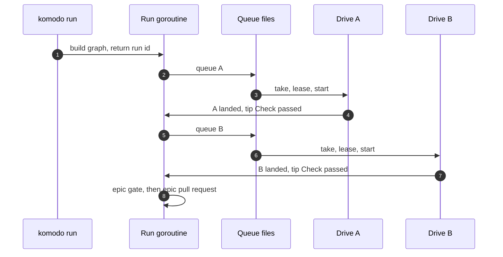

1. `komodo run` builds the dependency graph from the backlog, enqueues the groups whose dependencies have landed (group A), prints the run identifier at once and leaves the engine running detached under the parent guard.
2. The run goroutine creates the queue file for A. B stays out of the queue because its dependency has not landed.
3. When a pool slot frees, the engine picks A, deletes its queue file, writes its lease and starts `Drive` A.
4. `Drive` A moves A through Intake, Build, Check, Verify and Ship, appending events and running the actions that `Next()` orders.
5. A lands, alone, and Check runs on the epic tip with zero model tokens. The tip passes.
6. The run goroutine sees that B's dependency has landed and the tip's Check passed, and creates the queue file for B. The engine takes it the same way as A's.
7. B lands and the tip's Check passes.
8. After the last landing the reviewer and the tester run once over the whole epic diff. `[TODO: epic gate events and the epic pull request step (G-37)]`
9. A person merges only the epic pull request.

#### Algorithms

**Ownership and concurrency**

**📐 Who owns which state**
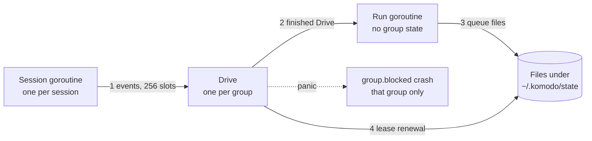

Rules:
1. The `Drive` goroutine is the only writer of its group's events and snapshot. No mutex exists inside a group, and two groups never contend.
2. A session goroutine turns its session's stream into events and sends them on `Drive.Events`. When the channel is full the sender waits; no event is dropped.
3. Facts that groups share (queue, pool slots, link slots, leases, `quota.json`) are files under `~/.komodo/state/`, created exclusively or renamed into place, written through `Claim`, `Replace` and `Remove`. Two engines on one machine coordinate only through these files.
4. The run goroutine builds the dependency graph, enqueues ready groups and collects finished `Drive`s. It holds no group state.
5. Every goroutine starts through one panic-catching helper. A panic in one `Drive` emits `group.blocked crash` (the event `group.blocked` with reason `crash`) for that group alone; the run and the other groups continue. `[TODO: the transition that moves a group to Blocked on a crash (G-31)]`

**The Drive loop**

**📐 Drive from start to end**
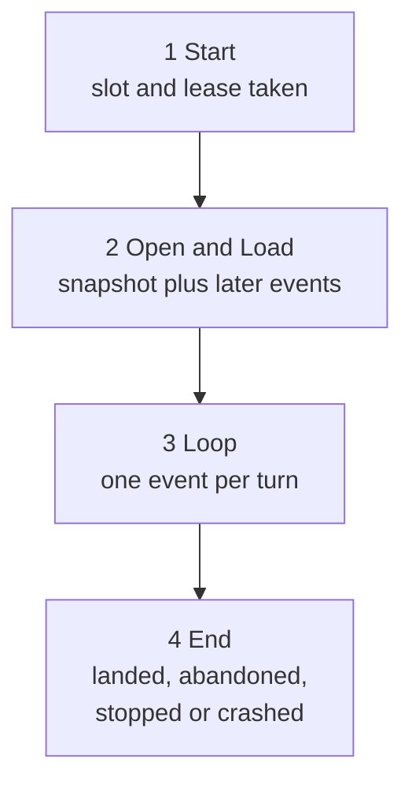

1. A ready group takes a free pool slot and its lease; the engine hands the group to a new `Drive`.
2. `Drive` calls `Open`, which makes it the group's only writer, then `Load`, which reads the last snapshot, replays the events saved after it and returns the state. `Drive` reruns the state's open actions.
3. `Drive` waits on three sources: events from the group's sessions, the group's pause timer (which fires at the timer record's `wait_until` time), and its lease renewal every `LeaseRenewEvery`. It takes one event at a time and runs one turn for it.
4. `Drive` ends when the group lands or is abandoned, when the run stops, or when it crashes. The run goroutine collects a finished `Drive`.

One turn:
1. `Drive` takes the next event from its channel.
2. `Drive` calls `Append`: the state manager stamps `sequence`, `timestamp` and `checksum`, validates the line against the schema and syncs it to disk. `Drive` has already set `stage` and `stale`.
3. `Drive` calls `Next()`. It returns the new state, the actions to run and any follow-on events; a stale event changes nothing.
4. `Drive` appends the follow-on events, then an `action.start` line for each action.
5. `Drive` runs each action, such as starting a session or making a commit. Pushing and opening a pull request run beside the loop, so a slow network never holds it.
6. `Drive` appends `action.done` for each finished action, so a restart skips it.
7. `Drive` hands the new state to `Snapshot`, which writes `state.json` every 50 events or on a stage change.
8. The event bus hands the event to its 3 listeners: the ledger, the wake file and the `status --watch` screen.

Chapter 2 draws the same path as a sequence diagram ([One event, from producer to subscribers](#25-behaviour)).

Open parts of the loop:
- `[TODO: whether Drive keeps running or exits while its group is Paused or Blocked (G-29)]`
- `[TODO: whether steps 2 to 4 become a single disk write (G-29)]`
- `[TODO: whether step 8 waits for each listener (G-29)]`
- `[TODO: what Drive does when an action fails, or when a lease renewal is refused (G-40)]`
- `[TODO: how a paused group's time since pause is kept, for the pause cap (G-40)]`

**Taking work from the queue**

**📐 From a ready group to a running Drive**
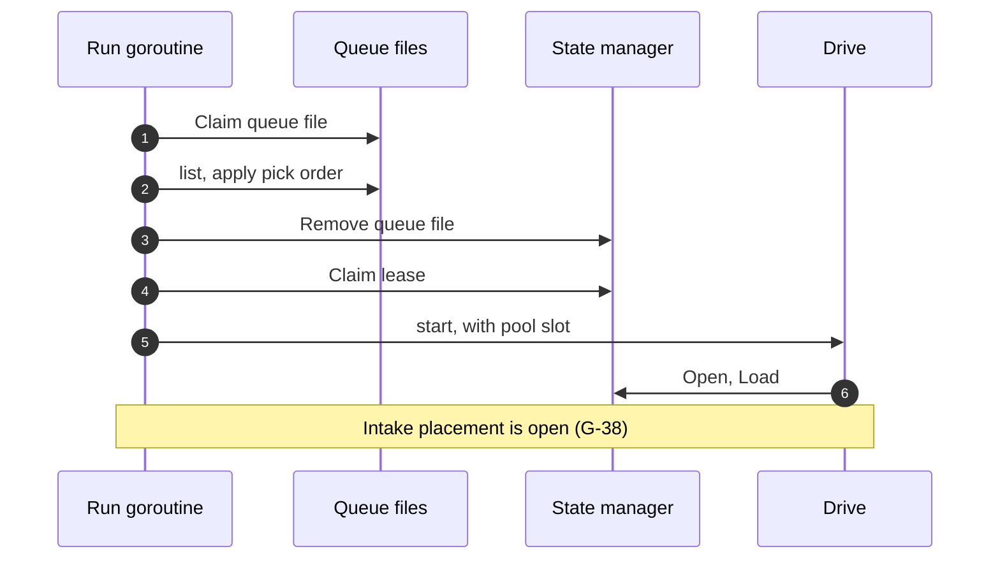

1. When a dependency lands and Check passes on the epic tip, the run goroutine creates one queue file for each newly ready group. `komodo jobs tick` creates one for each due job.
2. When a pool slot frees, the engine lists the queue and applies the pick order below.
3. The engine takes the chosen item: it deletes the queue file, then writes the lease. A crash between the two steps leaves an item for the startup sweep to re-enqueue. `[TODO: the sweep cannot see an item whose file is already deleted and whose lease is not yet written (G-34)]`
4. The engine starts the group's `Drive`. Intake runs just before the group's first session takes a slot, and the next ready group's Intake starts while the current group's first session loads, so a slot never sits idle longer than one `setup` run. `[TODO: where Intake sits between the slot, the lease and the first Drive event (G-38)]`

`[TODO: which process takes an item when queue items from several repositories are ready, and what happens when the winner belongs to another repository (G-34)]`

**Pick order**

When a slot frees, the engine applies these rules in order:

1. Items with `priority: high` go first.
2. Fair share across repositories: when 2 or more repositories have ready items, take them round-robin. Each job counts as its own repository.
3. The longest remaining chain, weighted by task count.
4. The most groups unblocked.
5. Backlog ID order.

Rules 3 to 5 break ties among items of the repository chosen by rule 2.

**The session pool**

**📐 How the pool size changes**
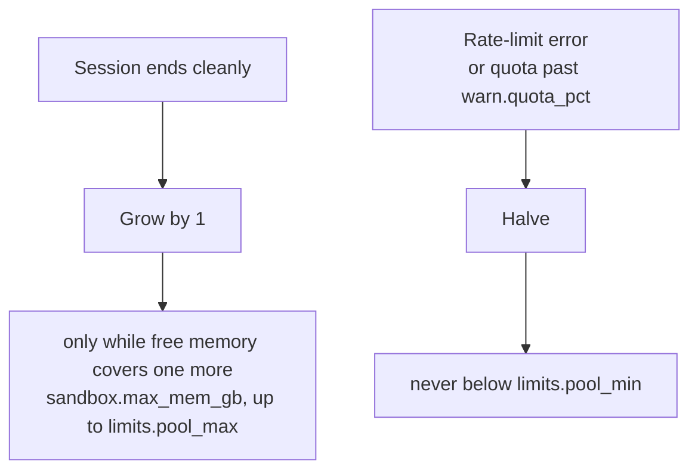

| Rule | Detail |
|---|---|
| Slot takers | Builder, reviewer and tester sessions (`pool_slot: true`). Planner and job sessions take no pool slot, but count against the link limit |
| Floor and ceiling | The pool holds 1 to 6 slots by default: `limits.pool_min` stays open while throttled; `limits.pool_max` is the most sessions at once; the hard limit is 16 |
| Link slot | `limits.link_sessions.<link>` sessions per link (for example `claude-cli`) across all repositories; loopback endpoints get 1; the hard limit is 8 |
| Files | Pool and link slots are lock files; the operating system frees one when its holding process dies |
| Taking | A session takes a pool slot before it starts and returns it when it ends; a Paused or Blocked group holds none |

Open parts of the pool:
- `[TODO: whether `OLLAMA_NUM_PARALLEL` above 1 lets the local link exceed 1 (G-04)]`
- `[TODO: slot file names, the order in which a session takes its pool slot and its link slot, and whether a session waits or fails when none is free (G-33)]`
- `[TODO: where the adapted pool size lives when two engines share a machine (G-33)]`
- `[TODO: what counts as a clean session end, and how free memory is measured on each operating system (G-33)]`

**Run order and convergence**

**📐 When a group may start**
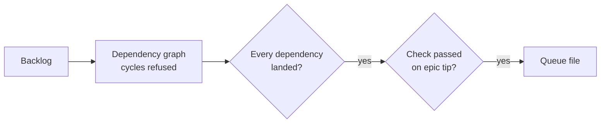

Rules:
1. The graph is built from every group's dependencies and `touches` globs. A cycle is refused. Waves and the longest chain are computed; the longest chain also feeds the pick order.
2. A group starts only after every dependency has landed and Check has passed on the epic tip.
3. A group with 2 or more dependencies starts after all of them land.
4. `run <group>` refuses when a dependency outside the run has not landed, and names it. `[TODO: how the engine learns that a dependency outside the run has landed (G-35)]`
5. When a dependency is blocked, its dependents show `waiting on <group>` in `komodo status`; groups that do not depend on it keep running.
6. When a dependency is abandoned, its dependents block with reason `dependency`, naming the abandoned group. `[TODO: confirm the abandon transition and the dependents' block (G-31)]`
7. Inside a group, tasks run one after another in the group's worktree, with one builder at a time. Independent tasks belong in separate groups.
8. A group moves on from Build as soon as its own builder finishes, whatever the other groups do.

**Landing and the integration break**

**📐 One landing, then the tip check**
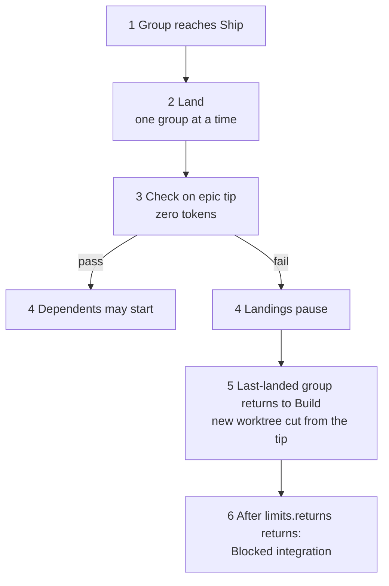

1. Finished groups land one at a time. Each landing is followed by Check on the epic tip, which costs 0 tokens.
2. When that Check fails, landings pause and the last-landed group returns to Build in a new worktree cut from the tip. It has `limits.returns` returns; after that it blocks with reason `integration`. `[TODO: confirm the return from Ship to Build and the new worktree (G-31)]`
3. `[TODO: how one-at-a-time landing is enforced between engine processes, and what holds the gate from the landing until the tip's Check finishes (G-36)]`
4. `[TODO: when paused landings resume, in particular after a group blocks with reason integration (G-36)]`

**The epic gate**

**📐 After the last landing**
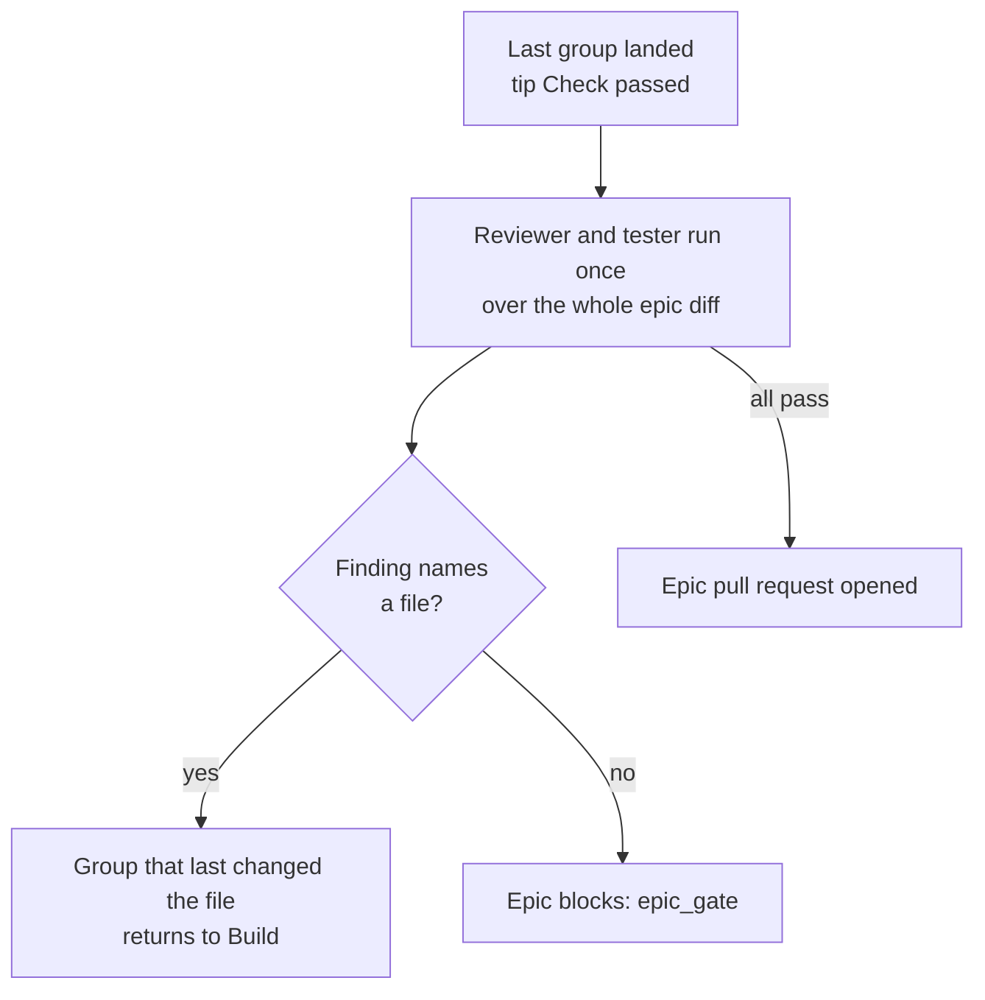

1. After the last landing, the reviewer and the tester each run once over the whole epic diff.
2. A finding goes to the group that last changed its file; that group returns to Build.
3. A finding with no file blocks the whole epic with reason `epic_gate`. A person then merges only the epic pull request.
4. `[TODO: how epic gate sessions and findings are recorded as events, how a landed group re-enters Build, which counter bounds the returns, how the group that last changed a file is found, and when the epic pull request is opened and run.done is written (G-37)]`

**Shutdown and the parent guard**

**📐 Stopping a run, and the guard's repeat of it**
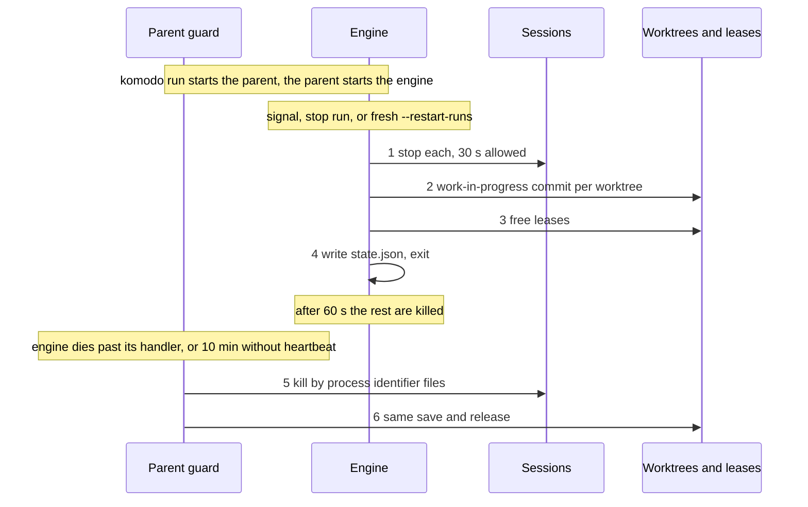

1. The sequence starts on any operating-system signal, on `stop <run>` or on `fresh --restart-runs`, which updates the binary and moves live runs to it.
2. The engine stops each session (30 seconds each), makes a work-in-progress commit of every worktree, frees the leases, writes `state.json` and exits. After 60 seconds, anything still alive is killed.
3. Shutdown is direct code outside the event bus. It writes `run.stopped` when it can.
4. `komodo run` first starts a small parent process, the parent guard, which then starts the engine.
5. If the engine dies past its own handler (`kill -9`, an out-of-memory kill, a Go fatal error) or writes no heartbeat for 10 minutes, the parent kills the sessions by their process identifier files and runs the same save and release.
6. Power loss is left to the startup sweep ([chapter 9](#9-check-review-tester-and-recovery)).

`[TODO: the parent guard's entry point, how the engine writes its heartbeat, and where the process identifier files live (G-39)]`

### 3.6 State

The engine keeps no state of its own beyond files and the group state of [chapter 2](#2-event-spine-and-state-machine). The three machine-visible states are the group's `Drive`, the pool size and landing.

**📐 Drive lifecycle**
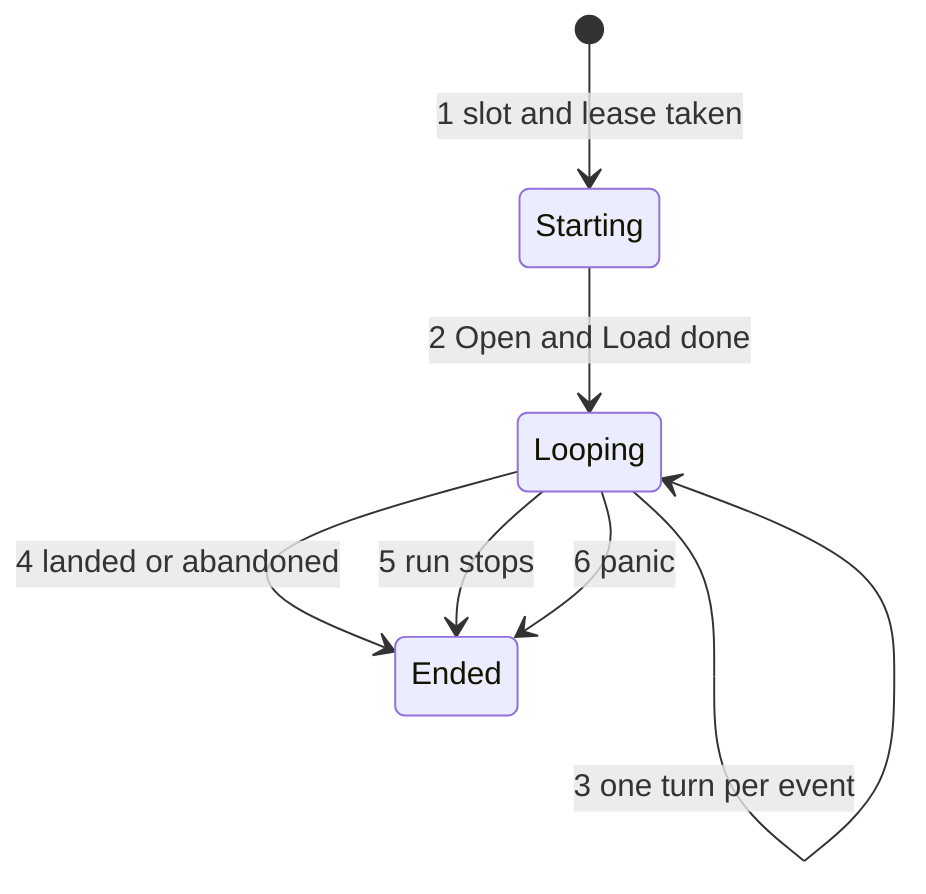

| State | Waits on | Pool slot | Lease and worktree | Ends by | True after the move |
|---|---|---|---|---|---|
| Starting | `Open`, `Load`, open actions | Held for the first session | Lease written, worktree cut | `Load` returns the state | This `Drive` is the group's only writer; the open actions have run |
| Looping | Session events, the pause timer, the lease renewal | Held while a session runs | Kept; lease renewed every 5 minutes | Landing, abandon, run stop, panic | Every applied event is on disk before its effects run |
| Paused or Blocked | `[TODO: whether Drive loops or exits while the group waits (G-29)]` | Returned | Kept | The timer, `resume`, `scope approve` or `scope deny`, or `abandon` | The group holds no pool slot and keeps its lease and worktree |
| Ended | Nothing | Returned | Released on landing or abandon | The run goroutine collects the `Drive` | The group's records are final for this run |

| Pool event | Effect |
|---|---|
| Session ends cleanly | Size grows by 1 while free memory covers one more `sandbox.max_mem_gb`, up to `limits.pool_max` |
| Rate-limit error from a provider | Size halves, never below `limits.pool_min` |
| Quota past `warn.quota_pct` | Size halves, never below `limits.pool_min` |

**📐 Landings**
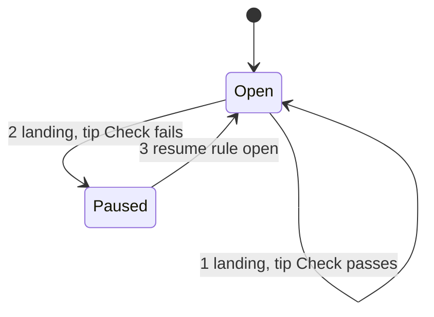

| Landing state | Event | Next | True after the move |
|---|---|---|---|
| Open | A group lands and the tip's Check passes | Open | Dependents of that group may start |
| Open | A group lands and the tip's Check fails | Paused | No group lands; the last-landed group is back in Build |
| Paused | `[TODO: resume conditions (G-36)]` | `[TODO: next state (G-36)]` | `[TODO: (G-36)]` |

### 3.7 Invariants and Failures

**Invariants**
1. A group has exactly one writer inside a process, its `Drive`; other processes are kept out by the lease and its fence.
2. An event is appended and synced to disk before `Next()` runs on it.
3. An action's `action.start` line is on disk before the action runs, and its `action.done` line follows.
4. A queue file is deleted before the lease is written.
5. A group starts only after every dependency has landed and Check has passed on the epic tip.
6. Landings happen one at a time, each followed by Check on the epic tip.
7. Shutdown stops sessions, then commits work in progress, then frees leases, then writes `state.json`; a lease is never freed while a session is alive or work is unsaved.
8. The pool never shrinks below `limits.pool_min` and never exceeds `limits.pool_max`.
9. Intake runs just before the group's first session takes a slot.

**Failures**

| Situation | Detected by | Behaviour |
|---|---|---|
| Crash between the queue file's deletion and the lease write | The startup sweep | The sweep re-enqueues an item that has no lease `[TODO: the sweep's view of a deleted item (G-34)]` |
| Session event channel full | The sending session goroutine | The sender waits; no event is dropped |
| Panic inside one `Drive` | The panic-catching helper | `group.blocked` with reason `crash` for that group alone; the run and other groups continue |
| Rate-limit error or quota past `warn.quota_pct` | The provider adapters report it | The pool halves, never below `limits.pool_min` |
| A dependency is blocked | The run goroutine | Dependents show `waiting on <group>`; unrelated groups keep running |
| A dependency is abandoned | `komodo abandon` on a group other groups depend on | Dependents block with reason `dependency`, naming it `[TODO: (G-31)]` |
| `run <group>` with an unlanded dependency outside the run | The graph | The verb refuses and names the dependency |
| Check fails on the epic tip after a landing | The Check on the tip | Landings pause; the last-landed group returns to Build; after `limits.returns`, Blocked `integration` `[TODO: (G-31)]` |
| A finding with no file at the epic gate | The epic gate | There is no group to send it to, so the whole epic blocks with `epic_gate` |
| Engine dies past its handler (`kill -9`, out-of-memory kill, Go fatal error) | The parent guard | The parent kills the sessions by process identifier files, saves and releases |
| No heartbeat for 10 minutes | The parent guard | Same as above |
| Sessions alive 60 seconds into shutdown | The shutdown sequence | The remaining sessions are killed |
| Power loss | The next engine start | Left to the startup sweep |

### 3.8 Config

| Key | Type | Default | Effect |
|---|---|---|---|
| `limits.pool_min` | integer | 1 | Pool slots kept open while throttled; cannot exceed `limits.pool_max` |
| `limits.pool_max` | integer | 6 | Most builder, reviewer and tester sessions at once across all repositories; hard limit 16 |
| `limits.link_sessions.<link>` | integer | 3; loopback endpoints 1 | Most concurrent sessions on one link across all repositories; hard limit 8 |
| `sandbox.max_mem_gb` | integer | 8 | Read here: the pool grows only while free memory covers one more of it |
| `warn.quota_pct` | integer | 90 | Read here: a provider window past this percent halves the pool |
| `limits.returns` | integer | 3 | Read here: returns to Build after an integration break; counter ownership is `[TODO: (G-32)]` |

`--stage` is the only flag of `komodo run`; its form is `--stage <stage>`.

### 3.9 Proof Cases

**Unit level** (pure functions, no files)
- With 2 slots and 3 ready groups, the `priority: high` group starts first.
- With 2 repositories and `limits.pool_max` 2, 4 ready groups start in alternating repository order.
- A rate-limit error halves the pool, never below the floor.
- `run` on a group with an unlanded dependency refuses and names it.

**Component level** (the engine with mocks that match documented provider behaviour; no live provider tests)
- The fixture group runs all 5 stages and ships.
- A crash between taking a queue item and writing its lease leaves an item the sweep re-enqueues.
- A seeded bug fails Verify, cancels the tester and resumes the builder.
- With `limits.pool_max` 2 and 4 ready groups, 2 sessions run and the rest queue.
- A group whose dependency is Blocked waits while an unrelated group runs.
- A crash inside one group's `Drive` blocks only that group with reason `crash`; a second group keeps running.
- While a `Drive` runs, its group's lease renewal time moves forward every 5 minutes.
- A landing that breaks Check on the epic tip sends the last-landed group back to Build.

### 3.10 Open Gaps

**Blocks building**

| Gap | Open here |
|---|---|
| [G-29](#appendix-o-gap-register) | Whether `Drive` stays alive while Paused or Blocked; command transport; single disk write; listener waiting |
| [G-31](#appendix-o-gap-register) | Return from Ship to Build, abandon, dependents' block, crash block, and the other stage moves the table lacks |
| G-33 | Pool and link slot files, ceiling storage, acquisition order, clean end, free memory |
| G-34 | Queue take crash window, multi-repository pick, round-robin cursor |
| G-35 | Run goroutine file, exported function names, outside-run dependency status |
| G-36 | Serial landing across processes, landing gate span, landing resume |
| G-37 | Epic gate events, returns, file-to-group lookup, epic pull request, `run.done` |
| G-38 | Intake placement relative to slot, lease and first event |
| G-39 | Parent guard entry point, heartbeat, process identifier file location |
| G-40 | Drive action failure, lease renewal refusal, pause start time |
| G-41 | Chain weight, unblocked count and backlog order key |

**Can wait**

| Gap | Open here |
|---|---|
| [G-04](#appendix-o-gap-register) | Whether `OLLAMA_NUM_PARALLEL` above 1 lets `local` exceed 1 session |
| [G-30](#appendix-o-gap-register) | Queue and slot file layout, timestamp format, repository identifier to file name, forward-version handling |
| [G-32](#appendix-o-gap-register) | Which counters the snapshot holds, including `Returns` |

## 4. Workspace and Leases

A workspace is where one group is built: a worktree, a separate git checkout under `~/.komodo/wt/<repo-id>/<group>/`. It is cut detached from the epic tip in about 1 s. A lease is a create-only lock file, `~/.komodo/leases/<repo-id>/<group-id>.json`, saying one run owns the group. Beside it sits the fence, a counter that rises on every take or takeover. Every git write carries it; git refuses an old number. Without the lease two runs could edit one folder; without the fence a stalled holder could overwrite its successor. Only the engine touches these folders; verbs refuse a leased worktree and rule O4 forbids hand edits.

Progress sits on a hidden ref, `refs/komodo/groups/<group-id>`, a commit pointer `git branch` hides, never pushed. The engine moves it with `git update-ref <ref> <new> <old>`, which exits 128 if the ref moved. The loser emits `lease.lost` and `Next()` stops the group. On any signal, `stop <run>` or `fresh --restart-runs`, shutdown stops agents, WIP-commits each worktree, frees leases, writes `state.json` and exits. A small parent process guards the engine. If it dies past its handler or misses its heartbeat (a regular I'm-alive signal) for 10 min, the parent kills its agents and repeats the save. The startup sweep clears what power loss left behind.

**📐 Workspace, leases and fences**
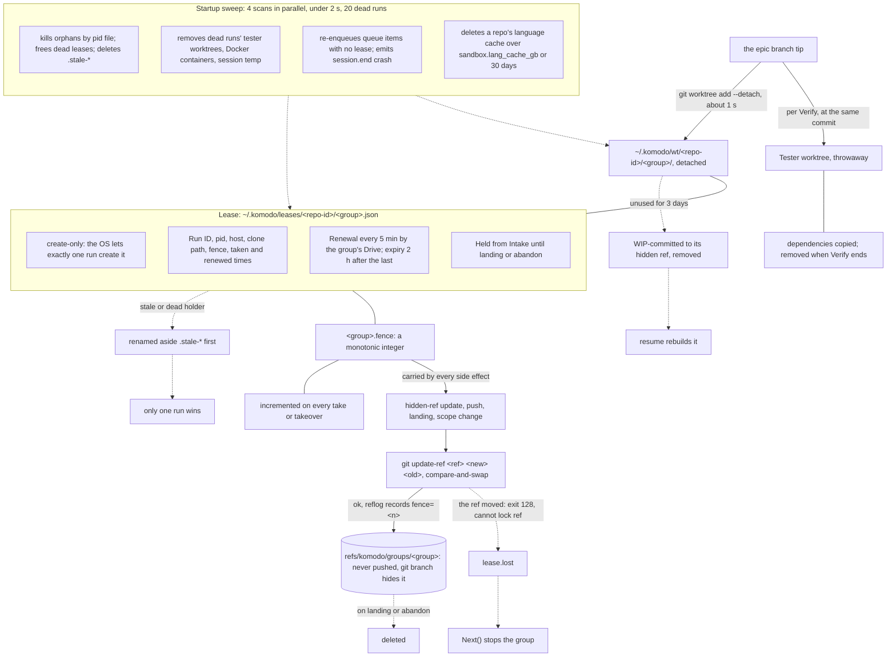
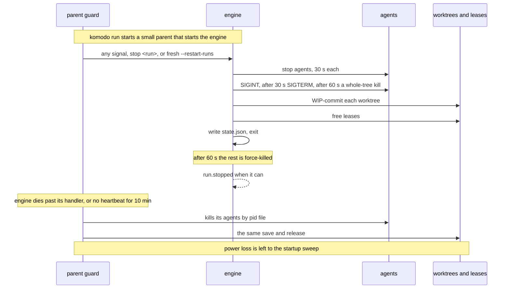
**Reading the diagram.** A worktree comes from the tip; create-only lease and rising fence gate each `git update-ref` compare-and-swap onto the hidden ref. A moved ref emits `lease.lost`; the sweep cleans up. The sequence diagram is shutdown, repeated by the parent guard on crash.

**What matters**
- The lease is held from Intake until landing or abandon, renewed every 5 min, and expires 2 h after the last renewal.
- A stale or dead-holder lease is renamed `.stale-*` before takeover, so only one run wins.
- Shutdown gives each agent 30 s, then force-kills the rest after 60 s.
- A worktree unused for 3 days is WIP-committed to its hidden ref and removed; `resume` rebuilds it.
- The sweep runs 4 scans in parallel, under 2 s with 20 dead runs.

**Lookup:** [Appendix E](#appendix-e-workspace-and-leases) holds the worktree rules, lease fields, shutdown steps and sweep actions.

## 5. Sessions, Agents and Briefs

A session is one fresh model conversation that does one task. The supervisor is the engine code that starts, watches and stops it (see Glossary in the HLD). An agent is a role such as builder or reviewer, defined by two compiled-in files: `agent.json` for Go and `prompt.md` for the model. A brief is the prompt a session receives, assembled from 20 typed slots such as `tasks` and `diff`. Without the supervisor a stuck session would hold a slot forever. Without the registry a session could start with the wrong tools; without the builder each brief would be hand-made. The engine runs all three; a person changes only an agent's model and limits through `komodo config agent <name>`.

A session starts with its brief written once to `<session>/brief.md`, a tool server and a sandbox profile. Liveness is events, never pings: any stream line or tool call counts, and one 15 s timer checks wall, idle and the 80% warning. At 80% of wall one fixed line names the minutes left. After `limits.session_idle_min` (10) of silence come one nudge, a 5-min grace, then a stop. The stop ladder is SIGINT, SIGTERM after 30 s, then a whole-tree kill after 60 s. Every end records one of 15 exit reasons in `result.json`. `resume` tries the provider's handle first, else a fresh session with the WIP diff, logging `resume_lost`.

The 7 agents have fixed weights: planner, architect and reviewer are heavy; builder and researcher standard; tester and scout light. The brief builder assembles 5 parts, most stable first: tool definitions, role, repo context, standards, task. Each slot is required or optional per agent; an empty required slot fails the brief, an empty optional one renders `none`.

**📐 Session lifecycle and brief assembly**
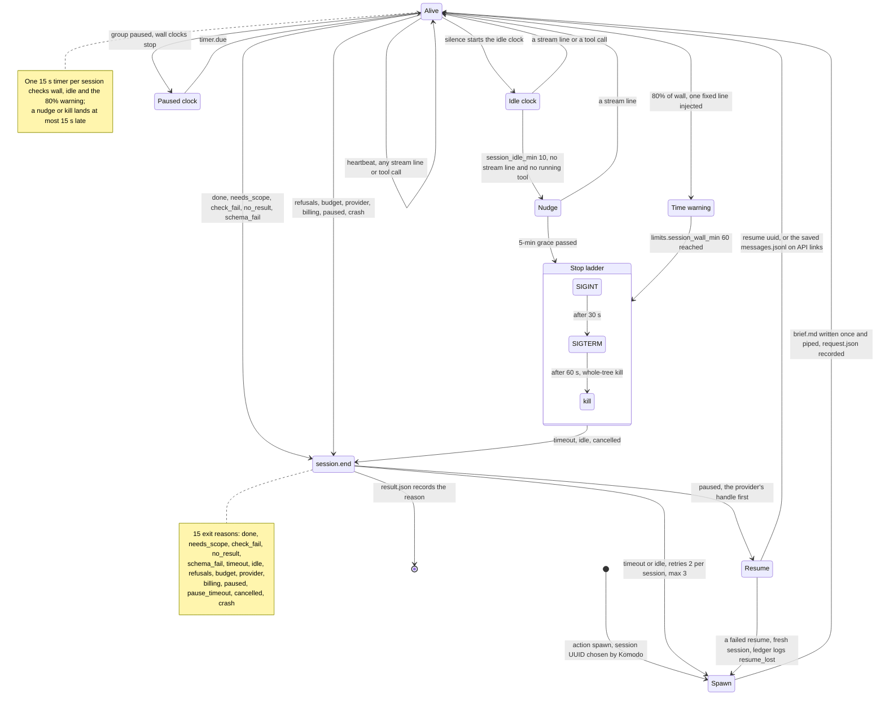
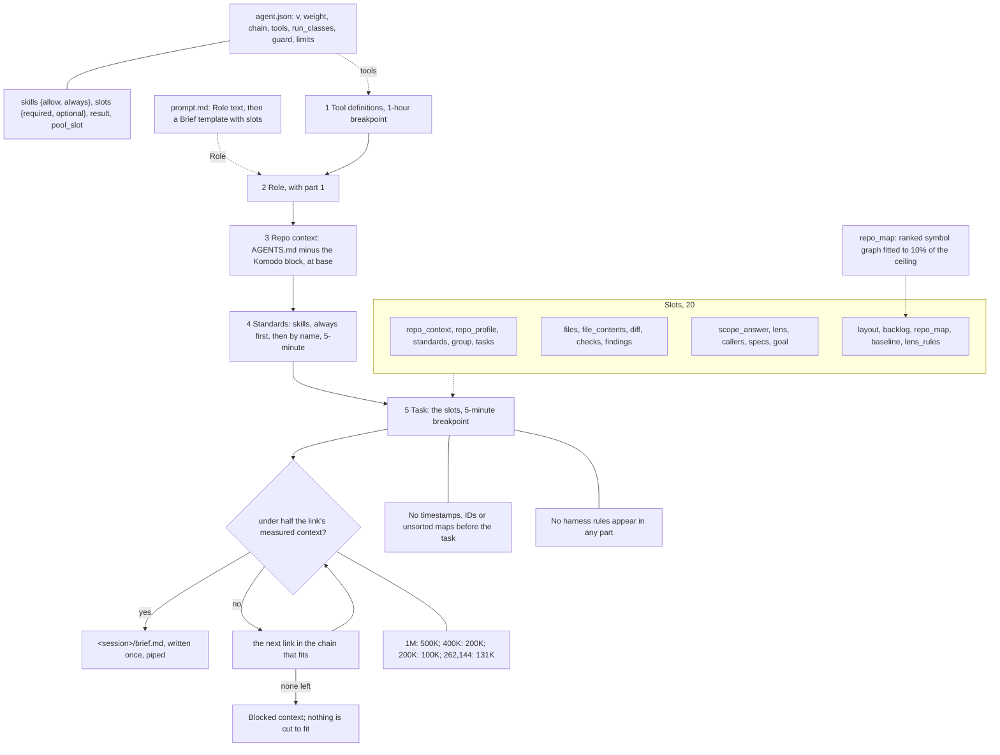
**Reading the diagram.** A session runs from `spawn` through alive, idle, nudge and stop ladder to `session.end` and its 15 reasons. The brief stacks five parts, most stable first, the 20 slots last. Over half the measured context: next link, else Blocked `context`.

**What matters**
- Wall is `limits.session_wall_min` 60, hard limit 120; retries per agent are 2, hard limit 3, inside `limits.task_attempts`.
- A session halted by a provider limit with a resume handle exits `paused`, not `provider`.
- The link chain is fixed in `agent.json`, never in config; the registry strict-decodes the 7 agents once per process.
- A brief has no per-slot cap. Its only ceiling is half the link's measured context: 500K on the 1M Claude models, 131K at the local floor.
- Over the ceiling the brief goes to the next link that fits, then Blocked `context`; nothing is cut to fit.
- Reviewer and tester context comes from the engine only, never from builder prose.

**Lookup:** [Appendix F](#appendix-f-session-supervisor-agent-registry-and-brief-builder) holds the lifecycle, controls, 15 exit reasons, resume, `agent.json` fields, `prompt.md`, roster, limits, assembly order, 20 slots, ceilings and context rules.

## 6. Tools, Guard and Sandbox

The tool runtime hands each session its tools, the guard checks every tool call before it runs, and the sandbox confines every `run` command. The purpose and the interactions are in [HLD 5.7](hld.md#57-tools-guard-and-sandbox).

**Guarantees the tests pin**

| Guarantee | How |
|---|---|
| Fails closed | Unparsable input, an unknown tool or a guard error is a refusal |
| Least tools | Only the tools in the agent's `agent.json` are advertised and callable (guard row G1) |
| No shell | `run` takes `{class, args[]}`; Go starts the class's command plus the arguments directly |
| Confined commands | Every `run` command starts inside the sandbox; the policy is `required` on every operating system |
| Bounded replies | Every tool except `read` returns at most 4 KB; the full output is on disk under `<session>/out/` |
| Fixed hooks | Exactly three inline hooks exist, all Go: `tool.pre`, `tool.post`, `session.end` |

### 6.1 Scope

**Owns:** the 11 tools and their output caps; the tool registry; the Model Context Protocol server that serves tools to `claude-cli` sessions; the tool dispatch used by the harness tool loop on API links; the guard and the policy rows; the sandbox backends and process control; language caches; the reset after read-only sessions; the tester's dependency copy; the Docker backend.

**Does not own:** `agent.json`, the launch line and `system.md` ([Sessions, Agents and Briefs](#5-sessions-agents-and-briefs)); the provider adapters and schema enforcement per link ([Providers and HTTP](#7-providers-and-http)); Check, review, scope requests and recovery ([Check, Review, Tester and Recovery](#9-check-review-tester-and-recovery)); worktree and lease creation ([Workspace and Leases](#4-workspace-and-leases)); writing state events ([State Manager](#13-state-manager)).

**Concepts**

| Term | Meaning |
|---|---|
| Tool | A named action a session may request, such as `read` or `run` |
| Tool server | The process `komodo internal tools` that serves tools to one `claude-cli` session over standard input and output, using the Model Context Protocol |
| API link | A link where the harness itself sends requests to the provider's application programming interface, with no Claude Code process. The other kind is `claude-cli` |
| Guard | The in-process check every tool call passes before the tool runs |
| Row | One guard rule stored as data in `embed/policy.json`, named by an identifier such as `G3` |
| Writer, runner | A writer is an agent with `edit` or `write`; a runner is an agent with `run` |
| Command class | A named command, such as build, test or lint, that a repository declares and `run` starts |
| Sandbox | The operating-system confinement around every `run` command |
| Test sibling | The matching test file of a file in the group's `files` |
| Hook | Code the harness runs at a fixed point in a session; three exist |

### 6.2 Package Layout

| File | Holds |
|---|---|
| `internal/tools/tools.go` | The registry; binds the tools listed in `agent.json` to one session |
| `internal/tools/mcp.go` | The Model Context Protocol server over standard input and output, started as `komodo internal tools --agent --session` |
| `internal/tools/files.go` | `read`, `search`, `edit`, `write`, and the repeat-read check |
| `internal/tools/run.go` | `run` |
| `internal/tools/git.go` | `diff`, `git_read` |
| `internal/tools/submit.go` | `submit_finding`, `lint_backlog`, the final result call |
| `internal/tools/extra.go` | `skill`, `web` |
| `internal/safety/guard.go` | `Check`: allow or refuse; fail closed; the refusal limit |
| `internal/safety/rows.go` | Loads the G, R, B and O rows from `embed/policy.json` |
| `internal/safety/paths.go` | Path containment, symlinks, secret files |
| `internal/safety/shell.go` | Tokenizing, chains and a git classifier. [TODO: what this file does when `run` starts no shell (G-53)] |
| `internal/safety/table.go` | Renders the guard table for the gate |
| `internal/safety/proc.go` | `run`, the timeout, the output cap, the heartbeat. [TODO: what the heartbeat reports and to whom (G-53)] |
| `internal/safety/proc_unix.go` | Process groups for the whole-tree kill |
| `internal/safety/proc_windows.go` | Job Objects for the whole-tree kill |
| `internal/safety/sandbox.go` | The backend interface; the profile built from `agent.json` |
| `internal/safety/sandbox_darwin.go` | Seatbelt on macOS |
| `internal/safety/sandbox_linux.go` | `bwrap` on Linux and Windows Subsystem for Linux |
| `internal/safety/sandbox_docker.go` | Docker on native Windows |
| `internal/core/fs.go` | Atomic writes and the glob matcher the guard calls |
| `embed/policy.json` | The guard rows with scopes, and the steering phrases |
| `internal/provider/loop.go` | The harness tool loop for API links, owned by [Providers and HTTP](#7-providers-and-http); its tool steps are in [Behaviour](#65-behaviour) |

The registry binds only tools listed in `agent.json`. The guard reads only data from `embed/policy.json`; no rule is Go code.

**Entry points**

| Flow | Function where it starts |
|---|---|
| A tool request from a model | `Bound.Dispatch` in `internal/tools/tools.go` |
| Tool server start on `claude-cli` | The `internal tools` verb, which runs the server in `internal/tools/mcp.go` |
| One guard decision | `Guard.Check` in `internal/safety/guard.go` |
| Loading the rows | `internal/safety/rows.go`, once per process |
| A `run` command | `Backend.Command` in `internal/safety/sandbox.go`, called from `internal/tools/run.go` |
| Sandbox set-up for a worktree | `Backend.Prepare`, called at Intake |
| Reset after read-only sessions | The engine, after the last reviewer or tester session of a worktree ends |

### 6.3 Data Model

#### Policy row

One row is one guard rule. `safety/rows.go` loads the rows and nothing more; the gate renders the roster tables from the same file and fails on drift.

```go
// RowID names a policy row, such as "G3" or "B1".
type RowID string

// Patterns is one glob or a list of globs; JSON accepts either form.
type Patterns []string

// UnmarshalJSON reads a string or an array of strings.
func (p *Patterns) UnmarshalJSON(b []byte) error

// Row is one guard rule as stored in embed/policy.json.
type Row struct {
	ID          RowID    `json:"id"`          // G1..G6, R1, B1, O1..O10
	Scope       string   `json:"scope"`       // agent name, writers, runners, all or orchestrator
	Kind        string   `json:"kind"`        // tool, path, run or text
	Pattern     Patterns `json:"pattern"`     // what matches; home-relative globs expand at load
	Action      string   `json:"action"`      // refuse, or warn on text rows
	Message     string   `json:"message"`     // template id of the refusal line
	Alternative string   `json:"alternative"` // template id of the allowed alternative
}
```

| Field | Values | Meaning |
|---|---|---|
| `id` | `G1`…`G6`, `R1`, `B1`, `O1`…`O10` | The row named in a refusal |
| `scope` | Agent names, or `writers`, `runners`, `all`, `orchestrator` | Who the row binds: `writers` have `edit` or `write`, `runners` have `run` |
| `kind` | `tool`, `path`, `run`, `text` | What the check reads: a tool name, a path argument, a `run` class, or text the agent writes |
| `pattern` | Glob or list | What matches; `~/.komodo/**` style globs expand at load. [TODO: the glob grammar, including what `**` matches (G-45)] |
| `action` | `refuse`, `warn` | `warn` only for `text` rows: on the orchestrator, and in the steering-phrase list for a repo addendum (a skill gets `refuse`) |
| `message`, `alternative` | Template IDs | The refusal line and the allowed alternative. [TODO: the template IDs and their text (G-30)] |

**Example.** Row G3 refuses writes to protected paths for every writer.

```json
{
  "id": "G3",
  "scope": "writers",
  "kind": "path",
  "pattern": [
    ".git",
    ".git/config",
    ".git/hooks",
    "bin/komodo",
    "~/.komodo/**",
    "~/.claude/settings*.json",
    ".claude/settings*.json",
    "embed/policy.json",
    "docs/prd.md"
  ],
  "action": "refuse",
  "message": "[TODO: refusal template id and text (G-30)]",
  "alternative": "[TODO: alternative template id and text (G-30)]"
}
```

#### Policy file

`embed/policy.json` is compiled into the binary. It holds the guard rows with their scopes and the steering phrases.

| Part | Holds |
|---|---|
| Rows | The `G`, `R`, `B` and `O` rows, one object each, in the shape above |
| Steering phrases | The phrases the gate and `doctor` scan for; a `text` row holds the list |

Versioning: [TODO: the exact top-level layout of `embed/policy.json`, whether it carries a version number, and how a reader treats an older or newer file (G-57)]. The call logs under `<session>/out/` hold the full output of one call; [TODO: the log layout and its versioning (G-57)].

#### Rows

The rows every agent inherits (guard rows G1 to G6), the run row and the builder row:

| ID | Refuse | Scope |
|---|---|---|
| G1 | A tool not in the agent's set; the server does not list it either | all |
| G2 | Reads or writes outside the session worktree, including `..` paths and symlink escapes | all |
| G3 | Writes to protected paths: `.git` (file or folder), `.git/config`, `.git/hooks`, `bin/komodo`, `~/.komodo/**`, `~/.claude/settings*.json`, `.claude/settings*.json`, `embed/policy.json`, `docs/prd.md`. Memory (`~/.claude/projects/*/memory/`) and plans (`~/.claude/plans/`) are never blocked | writers |
| G4 | Reads of secret files (`.env*` except `.env.example`, `.env.sample`, `.env.template`; `*.pem`; `id_rsa*`, `id_dsa*`, `id_ecdsa*`, `id_ed25519*`; `*.key`), or written content matching a secret pattern. [TODO: the secret content patterns (G-44)] | reads all; writes writers |
| G5 | Attribution trailers or session links in any text the agent writes. [TODO: the patterns that identify a trailer or a session link (G-44)] | writers |
| G6 | The `guard.refusal_limit` (3rd) refusal under the same rule; ends the session | all |
| R1 | Any command class not declared; `run` takes `{class, args[]}` | runners |
| B1 | Writes outside the group's `files` and test siblings; the refusal says to stop with result status `needs_scope`. [TODO: the test-sibling rules per language (G-43)] | builder |

The orchestrator rows are text in `AGENTS.md`, valid on any host. The harness backs them on its own side: its verbs refuse leased worktrees and critical refs, and human-only verbs need a terminal. Row O8 was removed, so the numbering skips it.

| ID | Refuse |
|---|---|
| O1 | Commit, push, merge, delete or force on `main`, `master`, `release/*`, or any critical ref |
| O2 | Force push, `--force-with-lease`, `+refspec` |
| O3 | Merging into the epic branch by hand |
| O4 | Editing, resetting or removing a worktree the harness has leased |
| O5 | `git stash`; use a work-in-progress commit |
| O6 | `gh pr create` and `gh pr merge`; the engine opens the epic pull request |
| O7 | Faking a terminal (`script`, `expect`, `unbuffer`) to run a human-only verb |
| O9 | A human-only verb or any `internal` verb |
| O10 | `--no-verify` on any git command |
| plus | G3, G4, G5 |

Human-only verbs are `install`, `uninstall`, `fresh`, config writes, `gate --install`, `release` and `doctor --fix`. Row O7 has no enforcement beyond its text.

**Rows per agent.** Each agent's rows compile from the rows its scope selects plus the row IDs in its `agent.json` `guard` list. The scout's compiled table has 4 rows and the builder's has 8.

Three facts of `run` have their own tests and are not guard rows:

- No shell: pipes, chains and `sh -c` cannot happen.
- No network: the sandbox denies it.
- No git writes: no command class runs git.

Row B2, a builder's own backlog files, is a lint fact: `doctor backlog` refuses a group whose `files` list `docs/backlog/**`.

#### Tool call and reply

`run` takes a class and an argument list. Go starts the class's command with those arguments, and starts no shell.

```go
// RunArgs is the argument object of the run tool.
type RunArgs struct {
	Class string   `json:"class"` // a command class declared in the agent's run_classes
	Args  []string `json:"args"`  // passed to the class's command as separate arguments
}

// Reply is what the model receives for one tool call.
type Reply struct {
	Text    string // at most 4 KB, except for read
	LogPath string // <session>/out/<call>.log; set when Text was capped
}
```

A `run` request and a capped reply:

```json
{"class": "test", "args": ["./internal/safety/..."]}
```

| Field | Rule |
|---|---|
| `class` | One of the agent's `run_classes`; any other class is refused by row R1 |
| `args` | Reach the command as literal strings; an argument of `&&` chains nothing |
| `Text` | The head and the tail of the output are kept when it exceeds 4 KB. [TODO: how many bytes the head and the tail each keep (G-47)] |
| `LogPath` | The capped reply names this path; the model can `read` the full output there |

[TODO: the argument names and result shape of every tool except `run` (G-47)]

#### Sandbox profile

A profile lists what the commands of one worktree may read, write and reach. The sandbox renders it once per worktree and reuses it.

```go
// Profile is what the commands of one worktree may read, write and reach.
type Profile struct {
	Worktree    string   // working directory; writable
	GitDir      string   // the repository's git directory; readable
	SessionTemp string   // the session's HOME and TMPDIR; writable
	LangCache   string   // ~/.komodo/cache/lang/<repo-id>; writable
	Toolchains  []string // toolchain folders; read-only
	MaxProcs    int      // sandbox.max_procs
	MaxMemGB    int      // sandbox.max_mem_gb
	Network     bool     // true only for Intake's setup command
}
```

| Field | Rule |
|---|---|
| `Worktree` | The session's own worktree. The tester's profile lists only its own worktree, never the builder's under `~/.komodo/wt/` |
| `GitDir` | The repository's git directory |
| `SessionTemp` | A private `HOME` and `TMPDIR` per session, so two sessions never share a temporary directory |
| `LangCache` | Komodo's own cache for the repository; `GOCACHE`, `GOMODCACHE`, `npm_config_cache`, `CARGO_HOME` and `PIP_CACHE_DIR` point here |
| `Toolchains` | `~/.rustup` and the folders holding each detected command's binary |
| `MaxProcs`, `MaxMemGB` | 512 processes and 8 GB per session by default; enforced where the platform allows |
| `Network` | Off for every `run`; on only for `commands.setup` at Intake. Loopback is always allowed |

[TODO: the rendered profile text for seatbelt and `bwrap`, and the value of `PATH` in the command environment (G-49)]

The command environment holds only `PATH`, `HOME` (the session's temporary directory), `TMPDIR`, `LANG`, `RUSTUP_HOME` and the cache variables.

#### Sandbox per operating system

| Operating system | Sandbox | Profile |
|---|---|---|
| macOS | `sandbox-exec` (seatbelt) | Reads allowed outside home; inside home only the worktree, the repo's git dir, Komodo's caches and toolchain folders; writes only to the worktree, session temp and language caches; network denied except loopback; no process or memory cap, and `doctor` says so |
| Linux, WSL | `bwrap` | `/` read-only; home an empty tmpfs with the worktree, git dir, caches and toolchains bound back; worktree, session temp and language caches writable; `/tmp` tmpfs; `--unshare-net`; `--die-with-parent`; cgroups caps when delegated; when user namespaces are blocked every work verb refuses and names the fix |
| Windows native | Docker when WSL is absent | `--network none`; only the worktree, session temp and language-cache volumes writable; `--pids-limit` and `--memory`; with neither WSL nor Docker every work verb refuses and names both |

Values that hold on every operating system:

| Value | Setting |
|---|---|
| `run` timeout | 10 min per command |
| Processes / memory | 512 / 8 GB per session |
| Policy | `required` on every operating system |
| Loopback | Always allowed |
| Profile reuse | Rendered once per worktree; Docker keeps one container per worktree alive |

#### Docker image and runtime

| Rule | Detail |
|---|---|
| Image | The full official image per detected language: `golang:<go directive>`, `node:<.nvmrc, else lowest engines major, else current LTS>`, `rust:<rust-toolchain channel, else stable>`, `python:<.python-version, else lowest requires-python, else latest>`. Makefile-only or 2-language repos need `sandbox.image`. Intake pulls it and the ledger records its digest |
| Tools | Rust setup adds `clippy` and `rustfmt` before `cargo fetch`; Python setup is `uv sync` with a `uv.lock`, else `pip install -e .[dev]` when a `dev` extra exists, else `doctor` names the missing tools |
| Runtime | One container per worktree made at Intake with the caps, the worktree at `/work`, a named cache volume per repo; setup with network on, then disconnected; each `run` is a `docker exec`; after setup the container is saved as an image in the background and the tester's container starts from it |
| Kill | A timeout or kill ends the command's process group inside the container; the container restarts only if that fails |
| Host side | `git-read` runs on the host; worktrees cut with `core.autocrlf=false`; `doctor` checks the daemon runs Linux containers |

The official images lack `clippy`, `rustfmt`, `pytest` and `ruff`, so setup installs them. Killing `docker exec` alone would leave the command running, which is why the kill targets the process group inside the container. `git-read` runs on the host because the worktree's `.git` file holds a Windows path. The worktree is a bind mount, so the image saved after setup never holds `node_modules`; [TODO: whether a Docker volume per worktree is faster than the bind mount (G-25)].

#### Language caches

- Language caches are Komodo's own: `~/.komodo/cache/lang/<repo-id>/`. They are never the user's `~/.npm`, `~/.cargo/registry`, Go or pip caches.
- Toolchain folders are read-only. `doctor` runs each command's `--version` in the sandbox.
- `sandbox.lang_cache_gb` caps the cache at 10 (hard limit 50). The startup sweep deletes a repo's whole cache when it is over the cap or unused for 30 days, and never while the repo holds a lease. `cache clear --kind lang` and `uninstall` remove it.
- The per-user process limit is never used, because it counts every process the user runs.

#### Tester copy

The tester works in its own throwaway worktree at the same commit. Dependencies are copied in by the mechanism for the platform.

| Platform | Mechanism | Status |
|---|---|---|
| macOS APFS | `cp -cR` (clonefile); 1.2 GB with pnpm symlinks cloned in 0.00 s | proven 2026-10-08 |
| Linux | `cp -R --reflink=auto`; reflink on btrfs, XFS, ZFS; byte copy on ext4 | [TODO: behaviour per filesystem (G-09)] |
| Windows NTFS | Go byte copy, junctions and symlinks recreated; `core.symlinks false` | [TODO: symlink and junction handling (G-10)] |
| Windows Docker | The host copies; the tester's container binds the copy at `/work` | [TODO: copy time for 1 GB (G-11)] |

| Language | What the tester gets |
|---|---|
| Go | Nothing is copied |
| Node | `node_modules` is copied with its symlinks kept |
| Rust | One `CARGO_TARGET_DIR` per group under the language cache. [TODO: whether a copied `target/` is reused or rebuilt (G-12)] |
| Python | `uv sync` reruns |
| Makefile-only | `make setup` reruns |

A changed lockfile reruns setup instead of copying. Symlinks are copied as links and never followed. A link resolving outside the worktree is dropped and logged. A `.venv` is never copied. Check adds a case-collision lint on every operating system.

### 6.4 Interfaces

#### Tool catalogue

| Tool | Rule |
|---|---|
| `read` | 2,000 lines per call, line ranges; repeat read of an unchanged file returns "unchanged since your last read (N lines)"; a second read in a row returns full content |
| `search` | Go walker with `.gitignore` applied and a 1 MB per-file cap; never scans `node_modules` or `target/` |
| `edit` | Exact, unique search-and-replace; a miss returns the closest lines; the reply shows the edited lines after `tool.post` formats them |
| `write` | New files only; an existing file is refused with "use `edit`" |
| `run` | `{class, args[]}`; Go runs the class's command plus args directly, no shell; inside the sandbox; 10-min timeout |
| `diff`, `git_read` | Reviewer only; read-only git |
| `skill` | Any allowlisted skill or `<name>#<section>` |
| `submit_finding` | Rule ID, `file:line`, quoted evidence; unknown rule ID refused |
| `lint_backlog` | Planner only |
| `web` | Architect and researcher, opt-in, GET only, allowlist |
| External MCPs | Opt-in allowlist per agent, no credentials. [TODO: where the allowlist lives and how a server is mounted beside the Komodo server (G-54)] |

- `read` takes line ranges, so the 2,000-line cap costs one `ReadAt`, not a read of the whole file.
- `edit` and `write` stay separate tools: `edit` changes an existing file and `write` creates a new one.
- There is no `check_task` or `submit_result` tool, because the engine gates the final result itself.
- `run` returns only the capped result to the model; the full log stays at the named path.
- `submit_finding`: Go checks that the quote is at that `file:line`; a finding whose quote is not found is dropped and logged.
- `lint_backlog`: the engine lints the plan again and writes files only if lint passes.
- Every tool except `read` caps its reply at 4 KB, head and tail kept. [TODO: the unchanged-file test for `read`, the output shape of `search` and the number of closest lines `edit` returns (G-47)]

#### Tools per agent

| Agent | Tools | Run classes |
|---|---|---|
| Builder | `read`, `search`, `edit`, `write`, `run`, `skill` | declared classes |
| Reviewer | `read`, `search`, `skill`, `diff`, `git_read`, `run`, `submit_finding` | build, test, lint |
| Tester | `read`, `search`, `run` | build, test |
| Planner | `read`, `search`, `skill`, `lint_backlog` | — |
| Architect | `read`, `search`, `skill`, `web` | — |
| Researcher | `read`, `search`, `skill`, `web` | — |
| Scout | `read`, `search` (paths only) | — |

The builder writes only inside its group's `files` (row B1). The reviewer and tester have no write tool. The scout's every write is refused, and it runs on a local model when its chain allows. No agent has a git write tool, so no class runs git.

#### Go surface

```go
// Tool is one named action a session may request.
type Tool interface {
	Name() string
	Call(ctx context.Context, args json.RawMessage) (Reply, error)
}

// Registry holds every tool Go knows.
type Registry struct { /* tools by name */ }

// NewRegistry builds a registry over all tools.
func NewRegistry(all []Tool) *Registry

// Bound is the registry narrowed to one session's tools and guard.
type Bound struct { /* listed tools, guard */ }

// Bind attaches the tools listed in agent.json to one session, and fails on a listed tool that is not registered.
func (r *Registry) Bind(listed []string, g *Guard) (*Bound, error)

// Advertised returns the names of the tools the session may see.
func (b *Bound) Advertised() []string

// Dispatch runs the guard, then the tool, and returns a capped reply; a refusal is a reply.
func (b *Bound) Dispatch(ctx context.Context, name string, args json.RawMessage) Reply
```

```go
// Call is one tool request as the guard sees it.
type Call struct {
	Tool string          // tool name as requested
	Args json.RawMessage // arguments exactly as received
}

// Verdict is the guard's decision for one call.
type Verdict struct {
	Allowed     bool
	Row         RowID  // the refusing row; empty when allowed
	Message     string // the refusal line naming the row
	Alternative string // what the model may do instead
	EndSession  bool   // true on the refusal that reaches guard.refusal_limit
}

// Binding is what the guard needs from an agent and its group.
type Binding struct {
	Agent      string
	Tools      []string
	RunClasses []string
	Guard      []RowID  // rows beyond the inherited ones
	Worktree   string   // absolute path of the session worktree
	Files      []string // the group's files globs; builder only
}

// Guard holds the rows compiled for one session.
type Guard struct { /* matcher, refusal counts per row */ }

// NewGuard compiles the rows that bind this agent into one matcher.
func NewGuard(rows []Row, b Binding, refusalLimit int) (*Guard, error)

// Check decides one call; unparsable input, an unknown tool or an internal error is a refusal, never an allow.
func (g *Guard) Check(c Call) Verdict
```

```go
// Command is one process to start: the class's command plus the model's arguments.
type Command struct {
	Argv    []string
	Env     []string
	Timeout time.Duration
}

// Backend is one sandbox mechanism: seatbelt, bwrap or Docker.
type Backend interface {
	// Name returns the mechanism name shown by doctor.
	Name() string
	// Check returns an error that names the fix when the mechanism cannot run here.
	Check() error
	// Prepare renders the profile once per worktree; Docker also creates the container.
	Prepare(ctx context.Context, p Profile) error
	// Command wraps one command so that it starts inside the sandbox.
	Command(ctx context.Context, p Profile, c Command) (*exec.Cmd, error)
	// Release removes what Prepare created.
	Release(ctx context.Context, p Profile) error
}
```

**Failure behaviour per method**

| Method | What a failure means | What the caller does |
|---|---|---|
| `Registry.Bind` | A listed tool is not registered, so the agent definition is broken | The gate fails the build; the registry check of `agent.json` catches it before any run |
| `Bound.Advertised` | Cannot fail | Sends the list to the model |
| `Bound.Dispatch` | Cannot fail: a refusal or a tool failure comes back as reply text. [TODO: the reply shape of a tool failure (G-47)] | Returns the reply to the model; a refusal counts toward `guard.refusal_limit` |
| `NewGuard` | The rows cannot be compiled for this agent | The session does not start. [TODO: how a failed session start is reported (G-56)] |
| `Guard.Check` | Cannot fail: a parse failure or internal error is a refusal | Refuses the call; when `EndSession` is true the session ends with exit reason `refusals`. [TODO: how that reaches the supervisor (G-42)] |
| `Backend.Check` | The sandbox cannot run on this machine | Every work verb refuses and names the fix |
| `Backend.Prepare` | The profile cannot be rendered or the container cannot be created | [TODO: whether the work verb refuses or the session fails (G-56)] |
| `Backend.Command` | The command cannot be wrapped | [TODO: the reply shape of a failed `run` (G-47)] |
| `Backend.Release` | The profile or container could not be removed | Nothing; the startup sweep removes the Docker containers and images of dead runs |

| Caller | Call | When |
|---|---|---|
| Session supervisor ([Sessions, Agents and Briefs](#5-sessions-agents-and-briefs)) | Starts `komodo internal tools --agent --session` | Start of every `claude-cli` session |
| Harness tool loop (`internal/provider/loop.go`) | `Bound.Dispatch` | Each tool request on an API link |
| Intake | `Backend.Prepare`, then `commands.setup` with `Profile.Network` true | Once per worktree |
| Every `run` | `Backend.Command` | Each command a session starts |
| Engine, after the last read-only session | Reset of changed tracked files | A reviewer or tester session ends |
| `doctor` | `Backend.Check`; each detected command's `--version` in the sandbox | Install and health checks |
| `gate` | The guard table rendered by `safety/table.go` | Gate run in the Komodo repo; fails on drift from `embed/policy.json` |
| Startup sweep | Deletes language caches, Docker containers and images of dead runs | Machine startup |

Errors are text, not sentinel values: `Check` on a backend returns the refusal text that names the fix, and a guard refusal is a `Verdict` the registry turns into a reply.

### 6.5 Behaviour

#### Walkthrough

A builder session on a `claude-cli` link edits a file in its group's `files`, runs the tests, and then asks to edit a file outside `files`.

1. The supervisor starts `komodo internal tools --agent --session` with `--strict-mcp-config`. The registry binds the builder's six tools: `read`, `search`, `edit`, `write`, `run`, `skill`.
2. The model requests `edit` on a file inside the group's `files`. The `tool.pre` hook runs the guard; no row refuses, so the edit runs.
3. After the edit, the `tool.post` hook formats the file, and the reply shows the edited lines. [TODO: which command formats the file and what happens when formatting fails (G-50)]
4. The model requests `run` with `{"class": "test", "args": ["./internal/safety/..."]}`. Row R1 finds `test` among the builder's `run_classes`.
5. The sandbox backend wraps the command. It runs in the worktree with the allowlisted environment, and prints 40 KB. The reply keeps 4 KB and names `<session>/out/<call>.log`, which holds the full output.
6. The model requests `edit` on a file that is neither in `files` nor a test sibling. Row B1 refuses and tells the builder to stop with result status `needs_scope`. The refusal counts once toward `guard.refusal_limit`.
7. The refusal is logged afterwards as `tool.denied`. [TODO: how the tool server's events reach the engine (G-42)]
8. The builder ends with `needs_scope`. The `session.end` hook makes the work-in-progress commit.

**📐 How does one tool call travel?**
```mermaid
sequenceDiagram
  participant M as model session
  participant S as tool server
  participant G as guard
  participant T as tool function
  participant B as sandbox
  M->>S: 1 tool request
  S->>G: 2 tool.pre check
  G-->>S: 3 allow or refusal
  S->>T: 4 call
  T->>B: 5 run only
  B-->>T: 6 output
  T-->>S: 7 capped reply
  S-->>M: 8 reply
  Note over S: event report to the engine is a TODO
```

#### Algorithms

##### Tool call and binding

1. At session start the registry binds the tools listed in `agent.json` to the session. A tool not in the list is neither advertised nor callable (row G1).
2. On `claude-cli`, the tool server talks to Claude Code over standard input and output. It starts in under 100 ms because it reads nothing from disk, and it dies with its session. [TODO: how the server learns its worktree, the group's `files`, the command classes and the Model Context Protocol revision without reading disk (G-56)]
3. On an API link, the harness tool loop calls the same tool functions in the engine process.
4. The `tool.pre` hook runs the guard in-process before the tool runs.
5. A refusal returns a reply naming the row and the allowed alternative. An allow runs the tool function.
6. The reply is capped; the full output goes to `<session>/out/<call>.log`, and the capped reply names the path.
7. A validated `submit_finding` becomes `finding.submit`. [TODO: how the tool server's events reach the engine (G-42)]
8. The hook `session.end` makes the work-in-progress commit. No model, repository or host hook runs inside a worker.

##### Guard check

The guard reads four kinds of input, one per row kind. Each agent's rows compile into a matcher once per session. A check is a map lookup plus at most 8 glob tests and takes under 50 µs. Path containment results are cached per session.

**📐 Which input does each guard row read?**
```mermaid
flowchart LR
  C["tool request"] --> P["parse arguments"]
  P --> K["tool name"]
  P --> PA["path arguments"]
  P --> RC["run class"]
  P --> TX["written text"]
  K --> G1["G1 tool set"]
  PA --> G2["G2 containment"]
  PA --> G3["G3 protected paths"]
  PA --> G4["G4 secret files"]
  PA --> B1["B1 files and siblings"]
  RC --> R1["R1 declared class"]
  TX --> G4C["G4 secret content"]
  TX --> G5["G5 attribution"]
```

- Input the guard cannot parse, an unknown tool, or an error inside the guard is a refusal.
- Each refusal counts against its row for the session. The refusal that reaches `guard.refusal_limit` ends the session with exit reason `refusals`, and the task retries in a fresh session (row G6).
- `needs_scope` (row B1) is the only refusal a person or the orchestrator can turn into an allow. The builder stops with result status `needs_scope`, naming the paths; scope requests are handled in [Check, Review, Tester and Recovery](#9-check-review-tester-and-recovery).
- [TODO: the order in which rows are tested when one call breaks several, and so which row a refusal names (G-51)]
- [TODO: how a pattern in a home-anchored row such as `~/.komodo/**` is matched against a path inside the session worktree, which sits under `~/.komodo/wt/` (G-51)]
- [TODO: when the path containment cache is invalidated after a `run` creates a symlink (G-51)]
- [TODO: whether `search`, `diff` and `git_read` hide the contents of secret files (G-52)]
- [TODO: the content of `system.md`, which must not hold rule text (G-46)]

##### Harness tool loop

The loop runs on API links. It is the harness's copy of what Claude Code does inside `claude -p`.

1. Tools stay on `auto`: the model reasons and calls tools freely, and thinking stays on.
2. A text-only reply ends the work. No nudge is sent.
3. One final call returns only the agent's result schema, by each link's own mechanism ([Providers and HTTP](#7-providers-and-http)).
4. The engine checks the result: the schema first (1 re-prompt), then the agent's own gate, `done_when` for a builder or `lint_backlog` for a planner. A failure goes back into the same session with its output; 2 rejected results end it with `check_fail`.
5. A reply cut off at the output limit gets "continue" once, then the session ends with `no_result`.

No result tool exists mid-session: the result always comes from the final call, on every link. `prompt.md` tells the model to stop and summarize when it is finished.

**Context limit.** The loop counts tokens every turn against the link's measured context. At 80%, old tool outputs shrink to one-line stubs, and their full text stays in `<session>/out/`. If the conversation is still over the context, the session ends with `no_result`, and nothing past the context is sent. [TODO: how tokens are counted each turn, and the stub text and order (G-48)]

**📐 How does the loop reach a result?**
```mermaid
flowchart TB
  A["1 send, tools on auto"] --> B{"2 tool request?"}
  B -->|"yes"| C["run tool, add reply"]
  C --> A
  B -->|"text only"| D["3 final call, result schema"]
  D --> E{"4 schema valid?"}
  E -->|"no, once"| D
  E -->|"yes"| F{"4 agent gate passes?"}
  F -->|"no, first"| A
  F -->|"no, second"| X["check_fail"]
  F -->|"yes"| Y["result accepted"]
```

##### Host facts

The tool server is built against Claude Code 2.1.295.

| Host setting | Value | Consequence |
|---|---|---|
| `MCP_TOOL_TIMEOUT` | about 28 hours by default | A standard-input server has no per-request timer, so the sandbox's 10-minute `run` timeout is the only one that fires |
| `MAX_MCP_OUTPUT_TOKENS` | 25,000 by default; warns past 10,000 | The 4 KB cap stays far below both |
| `MCP_TIMEOUT` | 30 s | The server must answer `initialize` inside 30 s; it answers in under 100 ms. [TODO: what the engine does when the server does not answer in time (G-56)] |
| `CLAUDE_CODE_RETRY_WATCHDOG` | never set in the worker environment | The supervisor reads `system/api_retry` lines instead |
| `system/api_retry` | `rate_limit` or `billing_error` | The engine ends the session with reason `provider`, keeps its resume handle, and the provider layer fails over or pauses |

##### Run

1. Row R1 checks that the class is in the agent's `run_classes`. Anything else is refused and the model is told which classes exist.
2. Go builds the command from the class's detected command plus the arguments. No shell sits between the tool and the command, so shell syntax in an argument is a literal string.
3. The backend wraps the command: seatbelt, `bwrap` or `docker exec`. The model client itself is never sandboxed.
4. The command starts in the worktree with the environment allowlist from the [profile](#sandbox-profile).
5. After 10 minutes the whole process tree is killed; Docker kills the process group inside the container.
6. The output is capped at 4 KB for the reply; the full output goes to the log.

**📐 How does a run command start and stop?**
```mermaid
sequenceDiagram
  participant T as run tool
  participant P as process control
  participant W as sandbox wrapper
  participant C as command
  T->>P: 1 class and args
  P->>W: 2 command, environment, limits
  W->>C: 3 start inside sandbox
  C-->>P: 4 output
  P-->>T: 5 capped output, log on disk
  Note over P,C: after 10 minutes the whole tree is killed
```

Three layers contain a command, from the weakest to the strongest:

1. Tool surface: there is no native Bash or Edit tool, so there is no shell.
2. Process limits: the worktree as working directory; the environment allowlist; a timeout; an output cap; process and memory caps; whole-tree kill.
3. Operating-system sandbox: wraps every `run` command from the tool server, never the model client.

The boundary is the sandbox. Builders write tests and `run` them, so any code can run; the guard's row R1 limits command names only.

##### Read-only agents' run

The reviewer and the tester have no write tools, but their `run` may write the worktree so tests work.

1. A reviewer or tester session runs commands that write build output into its worktree.
2. After the last read-only session in a worktree ends, the engine resets changed tracked files and fails that review.
3. The engine removes new untracked files that are not gitignored.
4. Ignored build output stays.

##### Tester sandbox

1. The tester's profile lists only its own worktree, the git directory, caches and toolchains. The builder's worktree under `~/.komodo/wt/` is outside that list, so even an exact path is unreadable by the sandbox, not by the guard.
2. Reviewer and tester run tests on one commit at the same time. Linux `bwrap --unshare-net` and Windows Docker `--network none` give each session a private loopback. [TODO: whether `bwrap --unshare-net` gives each session a private loopback (G-08)]
3. macOS has no network namespace, so the `test`-class runs of the two Verify sessions serialize through one per-repo lock file. [TODO: the lock file path and the waiting rule (G-55)]
4. Each session has its own `TMPDIR` and `HOME`.
5. Service-backed tests fail at the base commit too, so the baseline marks them pre-existing and they warn. An item may declare `needs: network | docker | service:<name>`; the tester skips it with reason `env` and a ⚠️ line.
6. The copy time counts against Verify's wall time. Over 60 s warns, and `doctor` reports the mechanism.

**📐 What does the tester receive per language?**
```mermaid
flowchart TB
  L{"lockfile changed?"} -->|"yes"| S["rerun setup in tester worktree"]
  L -->|"no"| M["copy by language"]
  M --> GO["Go: nothing"]
  M --> NODE["Node: node_modules"]
  M --> RUST["Rust: shared target dir"]
  M --> PY["Python: uv sync"]
  M --> MK["Makefile only: make setup"]
```

### 6.6 State

The guard counts refusals per row for the life of one session. Row G6 ends the session when a count reaches `guard.refusal_limit`.

**📐 How does a session reach the refusal limit?**
```mermaid
stateDiagram-v2
  [*] --> Counting: session starts
  Counting --> Counting: refusal below the limit
  Counting --> Ended: refusal reaches the limit
  Ended --> [*]: exit reason refusals
```

| State | Event | Next state | True after the move |
|---|---|---|---|
| Counting | Refusal under a row, count below `guard.refusal_limit` | Counting | That row's count is one higher; the model receives the refusal line |
| Counting | Refusal under a row, count reaches `guard.refusal_limit` | Ended | The session ends with exit reason `refusals`; the task retries in a fresh session |
| Counting | Allowed call | Counting | Counts unchanged; the tool function ran |

A Docker container lives as long as its worktree.

**📐 What states does the Docker container pass through?**
```mermaid
stateDiagram-v2
  [*] --> Created: Intake, caps, worktree at /work
  Created --> SetupOnline: setup runs, network on
  SetupOnline --> Offline: network disconnected
  Offline --> Offline: each run is docker exec
  Offline --> Saved: image saved in background
  Saved --> TesterStarted: tester container from image
  Offline --> Removed: sweep of a dead run
```

| State | Event | Next state | True after the move |
|---|---|---|---|
| Created | `commands.setup` starts | SetupOnline | The container has network access and the worktree at `/work` |
| SetupOnline | Setup ends | Offline | The network is disconnected |
| Offline | `run` | Offline | The command ran through `docker exec`; the container is unchanged |
| Offline | Setup finished and the image is saved | Saved | An image of the container exists; it does not hold `node_modules` |
| Saved | Verify starts the tester | TesterStarted | The tester's container started from the saved image |
| Offline, Saved | The run is dead and the startup sweep runs | Removed | The container and its image are deleted |

The read-only worktree reset follows the four steps of [Read-only agents' run](#6-tools-guard-and-sandbox).

### 6.7 Failures

**Invariants.** These hold at all times.

1. Every tool call passes `tool.pre` before its tool function runs; a refused call never reaches a tool function.
2. A refusal never turns into an allow: unparsable input, an unknown tool and a guard error all refuse.
3. A tool is callable only when `agent.json` lists it, and only listed tools are advertised.
4. No `run` command starts outside the sandbox; a missing sandbox makes the work verb refuse instead.
5. Network is off for every `run`. Only `commands.setup` at Intake runs with network on, and no agent can run it.
6. No agent has a git write tool, and no command class runs git.
7. No guard row is Go code; the only tunable is `guard.refusal_limit`.
8. Exactly three inline hooks exist: `tool.pre`, `tool.post`, `session.end`.
9. The sandbox wraps `run` commands only; the model client is never sandboxed.
10. Language caches are Komodo's own; the user's own caches are never writable from a command.
11. The tester's profile never lists the builder's worktree.
12. Every reply except `read` is at most 4 KB.

**Failure table**

| Situation | Detection | Behaviour |
|---|---|---|
| Tool input cannot be parsed, tool is unknown, guard errors | The guard returns a refusal | The call is refused, and logged afterwards as `tool.denied` |
| A tool not in the agent's set | Row G1 | Refused naming G1 and the allowed tools; the server does not advertise it either |
| Third refusal under one rule | Row G6 | The session ends with exit reason `refusals`; the task retries in a fresh session |
| `write` on an existing file | `write` | Refused with "use `edit`" |
| `edit` search text not found | `edit` | The reply shows the closest lines |
| A finding's quote is not at its `file:line` | `submit_finding` | Dropped and logged; does not block |
| Reply cut off at the output limit | Harness tool loop | "continue" once, then the session ends `no_result` |
| Conversation over the link's context after stubbing | Harness tool loop | The session ends `no_result`; nothing past the context is sent |
| Two rejected results | Harness tool loop | The session ends `check_fail` |
| `system/api_retry` with `rate_limit` or `billing_error` | Supervisor reading the stream | The session ends with reason `provider`; resume handle kept; the provider layer fails over or pauses |
| `run` past 10 min | Process control | The whole process tree is killed; under Docker, the process group inside the container |
| A `run` argument of `&&` | By construction | Reaches the command as a literal string; nothing chains |
| Native Windows with neither Windows Subsystem for Linux nor Docker | `Backend.Check` | Every work verb refuses and names both |
| Linux with user namespaces blocked | `Backend.Check` | Every work verb refuses and names the fix |
| macOS has no process or memory cap | Platform | `doctor` says so |
| A reviewer's test edits a tracked file | After the last read-only session | The engine resets the file; that review fails |
| Two Verify sessions bind one fixed port | Both run `test` | Private loopback on Linux and Docker; serialized `test` runs on macOS |
| A test needs a database or public host | Fails at base and head | Pre-existing; warns, never blocks; `needs:` items skip with `env` |
| A symlink resolves outside the worktree | Tester copy | Dropped at copy time and logged |
| The builder changed a lockfile | Tester copy | Setup reruns for the tester instead of copying |
| Copy exceeds 60 s | Verify wall-time accounting | A warning; `doctor` reports the mechanism |

### 6.8 Config

| Key | Type | Default | Effect |
|---|---|---|---|
| `guard.refusal_limit` | integer | 3 (hard limit 5) | Refusals under one rule before the session ends; the only guard tunable |
| `sandbox.network` | string | `deny` | Network for run-class commands; loopback is always allowed. [TODO: the values other than `deny` (G-49)] |
| `sandbox.max_procs` | integer | 512 (hard limit 2048) | Processes per session; cgroups on Linux, Docker on Windows, no cap on macOS |
| `sandbox.max_mem_gb` | integer | 8 (hard limit 32) | Memory per session; the pool also uses it to decide whether free memory covers one more session |
| `sandbox.image` | string | detected | Docker image for native Windows; required for Makefile-only or 2-language repos |
| `sandbox.lang_cache_gb` | integer | 10 (hard limit 50) | Language cache size per repo |

Security rows are never config. These values are fixed in code:

| Value | Setting |
|---|---|
| `read` | 2,000 lines per call |
| `search` | 1 MB per-file cap |
| Reply cap | 4 KB for every tool except `read` |
| `run` timeout | 10 min |
| Compaction | Old tool outputs shrink at 80% of the link's measured context |
| Tool server start | Under 100 ms |
| Guard check | At most 8 glob tests, under 50 µs |
| Copy warning | Over 60 s |

### 6.9 Proof Cases

Component cases run real commands in the platform's sandbox. Unit cases use fixtures and mocks of documented provider behaviour; no case calls a live provider.

#### Unit level

**Tool runtime**
- A builder calling `submit_finding` is refused because the tool isn't listed for it.
- A reviewer calling `edit` is refused.
- `write` on an existing file is refused.
- A faked `api_retry` line with `error: rate_limit` ends the session with reason `provider`, and the next session starts on the backstop.
- A 40 KB `run` output leaves its full log at the named path.
- On each API link, a fixture model that stops with text gets 1 final call and a schema-valid result.
- On each API link, a builder whose `done_when` fails continues in the same session.
- A fixture session that passes 80% of `ctx` stubs old outputs and never sends past `ctx`.
- A `run` arg of `&&` reaches the command as a literal string.

**Guardrails**
- The guard table test covers every row for every agent, and malformed input is refused.
- Verbs given a critical ref or a leased worktree refuse.
- The scout's rendered table has 0 write rows.
- A `policy.json` row edited without regenerating `lld.md` fails `gate`.
- A group whose `files` list `docs/backlog/**` fails `doctor backlog`.

#### Component level

**Tool runtime**
- The Model Context Protocol server exits within 2 s of its session.

**Sandbox and process control**
- On macOS and Linux, a `run` that writes outside the worktree fails.
- On macOS and Linux, the tester's `read` of the builder's worktree path is refused by the sandbox, not the guard.
- A `node_modules` tree with a pnpm symlink copies with the link intact on all 3 operating systems, and a link pointing outside the worktree is dropped.
- Two Verify sessions binding one fixed port both pass on Linux and run one after the other on macOS.
- A test that needs a database fails at base and head, and the group lands with a warning.
- Two files differing only by case fail Check on macOS.
- `go test` binding `127.0.0.1` passes.
- `go build` in a fresh worktree passes after Intake's setup.
- On native Windows, a `run` that writes outside the worktree fails under Docker.
- On native Windows with neither Windows Subsystem for Linux nor Docker, a work verb refuses and names both.
- On every operating system, a `run` that connects to a public address fails.
- On every operating system, `env` in a `run` shows only the allowed variables.
- On every operating system, a `run` that sleeps past 10 min dies with its whole tree, under Docker too.
- On every operating system, a reviewer's test that edits a tracked file is reset and the review fails.
- On every operating system, a `run` that reads `~/.ssh` or writes your `~/.cargo/registry` fails.

### 6.10 Open Gaps

Gap rows live in the [gap register](#appendix-o-gap-register); numbers marked G-NEW are assigned by the lead.

#### Blocks building

- G-42: how the tool server's events reach the engine.
- G-43: the test-sibling rules per language.
- G-44: the secret content patterns and the attribution patterns.
- G-45: the glob grammar.
- G-46: the content of `system.md`.
- G-47: tool arguments, results and reply mechanics.
- G-48: token counting and the context stub format.
- G-49: sandbox profile text and environment values.
- G-51: row order and home-anchored matching inside the worktree.
- G-56: tool server start-up inputs and failures.
- G-57: the layout and versioning of `embed/policy.json`.
- [G-24](#appendix-o-gap-register): the data of `tool.denied` and `finding.submit`.
- [G-30](#appendix-o-gap-register): refusal message and alternative templates.

#### Can wait

- [G-08](#appendix-o-gap-register), [G-09](#appendix-o-gap-register), [G-10](#appendix-o-gap-register), [G-11](#appendix-o-gap-register), [G-12](#appendix-o-gap-register), [G-25](#appendix-o-gap-register): sandbox spikes.
- [G-13](#appendix-o-gap-register): the steering-phrase list.
- G-50: the `tool.post` formatting step.
- G-52: secret files reachable through `search`, `diff`, `git_read`.
- G-53: the role of `safety/shell.go` and the heartbeat in `safety/proc.go`.
- G-54: external tool server allowlist.
- G-55: the macOS test lock file.

## 7. Providers and HTTP

A provider is a service that runs an AI model: Anthropic's Claude, OpenAI, or a local server such as Ollama. A link is one way to reach a provider, such as the `claude` command-line tool or an HTTPS API. Adapters are the Go code that starts, streams and resumes a session on a link. The HTTP stack is the one client under every network call. Without them each engine part would carry provider quirks, and a stray API key could bill the wrong account. The engine calls adapters; a person sees them only through `doctor` and `status`.

**📐 Providers and HTTP: from agent weight to a session, then failover and pause**
```mermaid
flowchart TD
  %% Legend: solid = the session start path; dashed = skip, refusal or fallback
  W["agent weight: heavy, standard, light"]
  CAT["embed/models.json: Latest ID, then the prior ID"]
  L1["1: claude-cli"]
  L2["2 (backstop): each free http:#lt;name#gt; in config order"]
  L3["3: anthropic-api, only under providers.paid: fallback or allowed"]
  B1["claude auth status --json, cached 60 s per process"]
  B2["Env scrub: ANTHROPIC_API_KEY, ANTHROPIC_AUTH_TOKEN"]
  B3["First stream line: system/init apiKeySource: none"]
  BK["killed before turn 1 with exit billing"]
  M1["Models API max_input_tokens, else embed/models.json, else 262,144"]
  M2["Ollama /api/ps context_length; a typed ctx only lowers it"]
  M3["Other http: servers: the endpoint's ctx, required"]
  FLOOR["below providers.ctx_floor: provider.skip ctx_below_floor"]
  CP["Capacity profile {ctx, slots, cost_class, effort}"]
  SL["slots from limits.link_sessions.#lt;link#gt;"]
  EF["effort per weight: heavy high, standard medium, light low"]
  SS["session.start: measured context and its source"]
  SE["Schema enforcement per link; one final call; Go re-validates"]
  RS["Result: the output, usage and the resume handle"]
  W --> CAT --> L1
  L1 -. "provider.skip {from, to, reason}" .-> L2
  L2 -. "provider.skip {from, to, reason}" .-> L3
  L1 --> BC
  subgraph BC["Billing check (fails closed)"]
    B1 --> B2 --> B3
  end
  B3 -. "else" .-> BK
  BC --> CP
  L2 --> CP
  L3 --> CP
  M1 --> CP
  M2 --> CP
  M3 --> CP
  M2 -.-> FLOOR
  SL --> CP
  EF --> CP
  CP --> SS --> SE --> RS
```
```mermaid
flowchart LR
  %% Legend: solid = engine action; dashed = timer, retry or return
  H["HTTP stack: 4 attempts, full jitter; retry-after replaces the formula"]
  HD["Stream drop mid-answer: 1 retry from the start, partial discarded"]
  SF["a second failure fails the session"]
  HL["Returned as a limit, not retried: enforced_spend_limit_reached"]
  HR["Headroom: anthropic-ratelimit-*-remaining; limit.warn before any 429"]
  LIM["Any Claude limit: 5-hour window, weekly cap, model cap"]
  NB["The next session starts on the backstop"]
  PA["Paused: a timer record with wait_until (reset plus 1 min) and wait_link"]
  QJ["~/.komodo/state/quota.json, so every repo skips it"]
  FIRE["the live engine sleeps; else the startup sweep, jobs tick or status"]
  RES["resume: a refused attempt backs off 15, 30, then 60 min"]
  PT["Blocked pause_timeout; the session is cancelled, WIP commit kept"]
  BACK["new sessions return to claude-cli"]
  LC["claude-cli launch line: -p, --session-id, --model, --json-schema"]
  H --> HD
  HD -. "second failure" .-> SF
  H --> HR
  H --> HL --> LIM --> NB
  NB -. "only with no link left" .-> PA
  PA --> QJ
  PA --> FIRE
  PA -. "limits.pause_max_min 360" .-> PT
  RES -.-> PA
  LIM -. "After the recorded reset time" .-> BACK
  BACK --> LC
```
**Reading the diagram.** The first block runs agent weight through chain and billing check into the capacity profile. It rides `session.start` to `Result`; the second bounds HTTP retries, then a Claude limit moves work to the backstop. No link left pauses it under `limits.pause_max_min`.

Every adapter offers `Probe`, `Start` and `Resume`; the stream ends in a `Result` with output, usage and the resume handle. Five links exist: `claude-cli`, `anthropic-api` and `http:<name>` are built; `codex-cli` and `openai-api` wait on G-20. Each link forces the final answer into the agent's result schema; Go re-validates it. Before each session the engine measures the real context window, recording its source in `session.start`. `embed/models.json` maps three weights (heavy, standard, light) to exact model IDs, written to `providers.json` so a run never changes model mid-way.

Failover moves work only when a provider is unavailable, unauthorized or over a limit, never because a task failed. The chain is `claude-cli`, every free `http:<name>` endpoint as the backstop, then `anthropic-api` only when `providers.paid` allows. Before every session the billing check gives each link a cost class: `subscription`, `free` or `paid`. It fails closed: an unknown login counts as paid.

**What matters**
- The backstop is mandatory: `doctor` and `gate` refuse a chain without a free `http:` endpoint. A `-prev` model falls back to it, never forward.
- Every skip emits `provider.skip {from, to, reason}` plus a warning naming the model used.
- Before each `claude-cli` session Go runs `claude auth status --json` and scrubs `ANTHROPIC_API_KEY`. A `system/init` line without `apiKeySource: "none"` kills the session with exit `billing`.
- Measured context is the Models API `max_input_tokens`, else the catalog, else 262,144; an endpoint below `providers.ctx_floor` is skipped with `ctx_below_floor`.
- A pause writes a timer record, `~/.komodo/state/timers/<repo-id>.<group>.json`, with `wait_until` (the ledger row keeps a copy), and the reset time to `~/.komodo/state/quota.json`; past `limits.pause_max_min` 360 the group blocks with `pause_timeout`.
- HTTP: connect 10 s, first byte 60 s, 4 jittered attempts, 1 resend on a dropped stream, 8 MB body cap. No key reaches any log.

**Lookup:** [Appendix H](#appendix-h-provider-adapters-and-http-stack) holds the provider and HTTP tables.

## 8. Skills, Rules and Output

A skill is a Markdown file of standards or workflow steps put before a model session. The loader picks each session's skills. The output contract fixes where rules are enforced and how every line a person reads is rendered. Without them, workers would get wrong standards, orchestrator rules would leak into briefs, and model prose would reach the person unchecked. The engine does all of it.

**📐 Skills, rules and output: skill injection by glob and the template pipeline**
```mermaid
flowchart TD
  %% Legend: solid = loads into the brief; dashed = gate check or refusal
  SRC["embed/skills/ only; the repo's .claude/ is never read"]
  IDX["embed/skills/index.json: SHA-256 per skill, verified on read"]
  IX["Index: 34 standards-* plus komodo, plan, run, respond, release"]
  AL["skills.allow: the only set an agent can be given or pull"]
  ALW["always: builder and reviewer preinject standards-comments"]
  FILES["the group's files"]
  MK["markers: AndroidManifest.xml, *.xcodeproj, cdk.json, samconfig.toml"]
  PRE["Preinject: globs match a file in files and markers exist; no cap"]
  ORD["Order: always first, then name order"]
  HDR["## Standards: #lt;name#gt; (#lt;sha8#gt;)"]
  PULL["skill tool or komodo skill get: #lt;name#gt;#35;#lt;section#gt;"]
  BIG["A brief over the ceiling: the next link, else Blocked context"]
  GATE["the gate: frontmatter v: 1, 6,000 tokens per skill, steering scan"]
  RID["reviewer rule IDs std.#lt;skill#gt;.#lt;n#gt;"]
  SRC --> IDX --> IX
  IX --> PRE
  AL --> PRE
  ALW --> PRE
  FILES --> PRE
  MK --> PRE
  PRE --> ORD --> HDR
  AL --> PULL --> HDR
  HDR -. "never drops a skill" .-> BIG
  IX -. "Never and Always lines compile to" .-> RID
  GATE -.-> IX
```
```mermaid
flowchart LR
  %% Legend: solid = the render order; dashed = gate check or re-prompt
  subgraph EN["Where rules are enforced"]
    E1["Tool calls: The guard"]
    E2["Results: The result schema"]
    E3["Work: Check and review"]
    E4["Comments: The standards-comments skill"]
    E5["The orchestrator: O1 to O7, O9, O10 in the AGENTS.md block"]
  end
  CODE["the agent's code from the code list"]
  FACTS["facts: SHA, ref, task ID"]
  FC["fact checks: SHA in repo, path in diff or worktree, task ID exists"]
  RP["the schema re-prompt"]
  ESC["escape: fact strings as literal code spans"]
  TPL["Go text/template, missingkey=error, a 6-function map"]
  T1["needs.#lt;code#gt;, pr_body, finding.#lt;lens#gt;, options, commit"]
  T2["status, run_report, report.#lt;verb#gt;, error.#lt;code#gt;"]
  WRAP["wrap at 80 columns"]
  COL["output.color"]
  ENV["Envelope report, relayed verbatim"]
  GOLD["embed/output/#lt;profile#gt;/#lt;name#gt;.golden"]
  STR["agent/render.go: one Go struct per template"]
  OTH["Code other: Needs a decision; details in #lt;path#gt;"]
  NL["No leaks: no rule text enters any worker brief"]
  CODE --> FC
  FACTS --> FC
  FC -. "a failed fact" .-> RP
  FC --> ESC --> TPL --> WRAP --> COL --> ENV
  T1 --> TPL
  T2 --> TPL
  STR -. "the gate fails an unmatched field" .-> TPL
  GOLD -. "rendered under both profiles, bytes compared" .-> TPL
  CODE -. "Unlisted cases" .-> OTH
  NL -.-> ENV
```
**Reading the diagram.** The first block loads `embed/skills/` by `index.json` hash (a content fingerprint), preinjecting by `skills.allow`, globs and markers. The second lists five enforcement points, then renders checked facts by escape, template, wrap and colour. Golden fixtures gate each template; the envelope carries no rule text.

The index holds 34 `standards-*` skills plus `komodo`, `plan`, `run`, `respond` and `release`, all from `embed/skills/`; the repo's `.claude/` is never read. A skill loads only from the agent's `skills.allow` list, when its globs match the group's `files` and its markers exist. `- **Never` and `- **Always` lines compile into reviewer rule IDs. Rules are enforced in five places: the guard, the result schema, Check and review, `standards-comments`, and the `AGENTS.md` block. No rule text enters a worker brief. Every line a person reads comes from an `embed/output/` template fed checked facts; model prose is never rendered.

**What matters**
- Skills load `always` first, then by name; a brief over the ceiling never drops a skill.
- The gate fails a skill over 6,000 tokens, with an unknown frontmatter key, or with one of 6 steering phrases like `ignore previous`.
- Templates use Go `text/template` with `missingkey=error` and 6 functions; facts are checked, then escaped.
- Every code in every agent schema needs a template and a golden fixture (stored expected output that a test compares against) under both profiles; a new code is a design change.
- `claude-cli` workers start with `--setting-sources ""`; a worker `agent.json` listing `run`, `plan`, `respond` or `komodo` fails the gate.

**Lookup:** [Appendix I](#appendix-i-skill-loader-rules-and-output-contract) holds the skill, rule, output and no-leak tables.

## 9. Check, Review, Tester and Recovery

Once a builder (the model session that edits code) finishes, the harness proves the work in two stages. Check costs zero tokens: ordinary tools rerun each task's `done_when` command, confirm the builder stayed inside its files and scan for secrets. They also measure coverage and compare tests with the base commit. Verify runs two model sessions side by side. The reviewer reads the diff against lenses, catalogs of review rules; the tester tries the acceptance items blind. Error recovery is the table of every failure with its detector, action and bound. Without these, a model's own word would be the only proof and a loop could run forever.

**📐 Check, review, tester and recovery: four gates, the Verify race and failure routing**
```mermaid
flowchart TD
  %% Legend: solid = the pass path; dashed = return to Build or a block
  B["Build"]
  C1["done_when rerun in the sandbox"]
  C2["Scope: every changed file in files or a test sibling"]
  C3["Secrets"]
  C4["Coverage: check.patch_coverage 80"]
  C5["Baseline: passed at base, fails at head is regression"]
  C6["Impact set"]
  C7["Flake rule: rerun twice alone"]
  C8["Case collision"]
  R["Reviewer: lenses in parallel plus a cold pass; submit_finding"]
  GV["Go finds the quote at file:line; failing findings dropped"]
  T["Tester: acceptance items from TG.md with run"]
  GR["Go reruns its command twice"]
  CAN["Next() emits cancel for the other; Build under a new epoch"]
  FL["Blocked flaky"]
  TB["Blocked tester: a second dispute"]
  SH["Ship: land, then Check on the epic tip"]
  IN["Blocked integration"]
  EG["Epic gate: reviewer and tester once over the whole epic diff"]
  EGB["Blocked epic_gate"]
  PR["Epic PR"]
  NS["Blocked needs_scope: scope approve or deny"]
  B --> CK
  subgraph CK["Check"]
    C1 --> C2 --> C3 --> C4 --> C5 --> C6 --> C7 --> C8
  end
  B -. "status needs_scope, 1 request per task" .-> NS
  NS -. "scope_answer slot" .-> B
  CK -. "done_when fails: Agent retries (2)" .-> B
  CK -. "Regression: limits.returns (3)" .-> B
  CK --> V
  subgraph V["Verify: one epoch"]
    R --> GV
    T --> GR
  end
  GV -. "blocker and major block" .-> CAN
  GR -. "both fail" .-> CAN
  CAN -. "limits.returns (3)" .-> B
  GR -. "A split" .-> FL
  GR -. "reruns pass: restart the tester once" .-> T
  T -. "env, wrong_command, flaky or real_failure" .-> TB
  V -- "Both pass" --> SH
  SH -. "Check fails on the epic tip" .-> IN
  SH --> EG
  EG -. "the group that last changed each file" .-> B
  EG -. "a finding with no file" .-> EGB
  EG --> PR
```
```mermaid
flowchart LR
  %% Legend: edge label = Bound; target = Then. Loss bound: one model turn
  subgraph HS["HTTP stack"]
    F1["Transient HTTP"]
    F2["Stream dropped mid-answer"]
  end
  subgraph PV["Provider"]
    F3["Provider unavailable or unauthorized"]
    F4["Provider quota or spend limit"]
  end
  subgraph BC["Billing check"]
    F5["Paid link not allowed"]
  end
  subgraph TR["Tool runtime"]
    F6["Schema-invalid result"]
    F7["Result fails the agent's gate"]
    F8["Reply cut off at the output limit"]
  end
  subgraph SV["Supervisor"]
    F9["Timeout or idle"]
  end
  subgraph GD["Guard"]
    F10["3 refusals under one rule"]
  end
  subgraph CK["Check"]
    F11["done_when fails"]
    F12["Regression against the baseline"]
  end
  subgraph RV["Review"]
    F13["Epic gate fails"]
    F14["Go's reruns split"]
  end
  subgraph EN["Engine"]
    F15["A dependency is abandoned"]
    F16["Check fails on the epic tip after a landing"]
  end
  subgraph RC["Recovery"]
    F17["Flap: same failure hash or zero-diff return"]
    F18["Any model attempt on a task"]
  end
  subgraph BB["Brief builder"]
    F19["Brief over half the measured context"]
  end
  subgraph SP["Ship"]
    F20["Landing conflicts with the epic branch"]
  end
  subgraph BU["Budgets"]
    F21["Budget spent"]
  end
  SF["Session fails"]
  TRY["Task retry"]
  BL["Blocked"]
  NP["Blocked no_provider"]
  PT["Paused; at the cap Blocked pause_timeout"]
  PR["Blocked paid_refused"]
  RG["Blocked regression"]
  EG["Blocked epic_gate"]
  FK["Blocked flaky"]
  DP["Blocked dependency"]
  IG["Blocked integration"]
  AT["Blocked attempts"]
  CX["Blocked context"]
  MC["Blocked merge_conflict"]
  BG["Blocked budget"]
  F1 -- "3" --> SF
  F2 -- "1" --> SF
  F3 -- "Chain length" --> NP
  F4 -- "limits.pause_max_min" --> PT
  F5 -- "1" --> PR
  F6 -- "1" --> TRY
  F7 -- "2" --> TRY
  F8 -- "1" --> TRY
  F9 -- "Agent retries (2) per task" --> BL
  F10 -- "3" --> TRY
  F11 -- "Agent retries (2) per task" --> BL
  F12 -- "limits.returns (3) per group" --> RG
  F13 -- "limits.returns (3)" --> EG
  F14 -- "0" --> FK
  F15 -- "0" --> DP
  F16 -- "limits.returns (3)" --> IG
  F17 -- "1" --> BL
  F18 -- "limits.task_attempts (6)" --> AT
  F19 -- "1" --> CX
  F20 -- "1" --> MC
  F21 --> BG
```
**Reading the diagram.** The first runs Build through Check's eight steps, Verify, landing Check and epic gate to the PR. A verified finding cancels the tester; Build reopens under a new epoch when the reviewer ends. The second routes failures from detector, by bound, to Blocked reason.

A test that passed at base and fails at head is a regression and blocks naming the test; one failing at both only warns. For Go, Check tests every package importing a changed package; other languages run the full `test` class, and the epic gate runs everything. A builder needing a file outside its `files` stops with `needs_scope`, and the engine makes a WIP commit. The engine denies protected paths and paths another live group owns; otherwise the orchestrator answers `scope approve|deny`.

The reviewer runs 10 lenses; `correctness`, `readiness` and `quality` always apply, the rest when the diff triggers them. Thorough mode runs every applicable lens in parallel plus a cold pass; economy runs one merged lens. Each verdict is `met`, `not_met` or `brief_incomplete` per task ID, exactly once. The tester works in its own throwaway worktree at the same commit, blind to the builder. It reports pass or fail per acceptance item and `confirmed | not_confirmed` per task.

Both Verify sessions start under one epoch. The first verified blocking finding cancels the tester; the group returns to Build under a new epoch when the reviewer's session ends, with every verified finding. Later output from the cancelled session carries the old epoch and is recorded `stale=true`. Both passing needs both `session.end done` events, then `stage.exit` to Ship. Recovery's 26 failure rows share one loss bound: any failure loses at most one model turn and no committed edit. A crash stays in its group, and Blocked never auto-retries.

**What matters**
- Check blocks on a regression, coverage under `check.patch_coverage` 80 for Go, a secret, or a file outside `files`. A failing test reruns twice alone; a split reports `flaky` without blocking.
- `blocker` and `major` findings block, `minor` are counted; a finding counts only when Go finds its quoted evidence at the stated `file:line`.
- A tester failure counts only after Go's two reruns also fail. Passing reruns restart the tester once; a second dispute blocks `tester`, a split blocks `flaky`.
- Bounds: `limits.returns` 3 per group, `limits.task_attempts` 6 per task, agent `retries` 2, and a group wall hard limit of 720 min.
- Prompt caching uses at most 4 `cache_control` breakpoints in prefix order: tools plus role, repo context, standards, task.

**Lookup:** [Appendix J](#appendix-j-check-review-tester-error-recovery-and-budgets) holds the Check, scope, lens, review, tester, failure, recovery, budget and caching tables.

## 10. Scheduler, Cache and Observability

The scheduler runs agents on a timer from a job template: a JSON file of agents, slots and interval. The cache store keys results by input hash (a content fingerprint), so nothing is computed twice. Observability is the ledger, two tables rebuilt from the group state, and `status` reading it. Without them, timed work needs a person, work repeats, and a run is a black box.

**📐 Scheduler, cache and observability: the jobs tick, the cache store and the ledger views**
```mermaid
flowchart TD
  %% Legend: solid = data path; dashed = refusal, retry or block
  CR["launchd, cron or Task Scheduler from install --schedule, every 5 minutes"]
  LP["Claude Code /loop, at the cost of a model turn per tick"]
  TPL["{name, agents[], slots{}, every} in embed/jobs/ or ~/.komodo/jobs/"]
  TICK["jobs tick: idempotent, one engine step; nothing due exits under 50 ms"]
  E1["enqueue due jobs: job.due"]
  E2["fire due timer records: wait_until passed"]
  E3["drive the pool once"]
  Q["Queue: same queue as groups, priority: normal, never preempts a group"]
  RUN["Run id job-#lt;name#gt;-#lt;n#gt;"]
  LS["lease job-#lt;name#gt; with a fence"]
  CNT["jobs/state.json: attempt, next_at, last_fail_hash, running"]
  JF["job.fail: Retries 3, backoff 30 s, 2 m, 8 m ±20%"]
  BLK["Blocked, which wakes status --wait"]
  LED["Ledger rows and report"]
  ST["status --watch: pool, stages, budgets, blocks, the group graph"]
  SW["status --wait: blocks until the next wake event"]
  SX["status --explain: the last 10 events with reasons"]
  SM["status --metrics: scorecard per agent and model"]
  CR --> TICK
  LP --> TICK
  TPL --> TICK
  TICK --> E1 --> Q
  TICK --> E2
  TICK --> E3
  Q --> RUN --> LS
  LS -. "the next tick's queue item is refused as a duplicate" .-> TICK
  RUN --> CNT
  RUN -. "Scheduled job fails" .-> JF
  JF -. "then" .-> BLK
  RUN --> LED
  LED --> ST
  LED --> SW
  LED --> SX
  LED --> SM
  subgraph CS["Cache store: sha256(inputs + binary version)"]
    K1["Check result: Tree hash + command"]
    K2["Setup result: Lockfile hash + language"]
    K3["Test baseline: Epic tip tree hash + test command"]
    K4["Review findings: Lens + diff + prompt hash + model"]
    K5["LRU under cache.max_mb 256 per repo; one stat per lookup"]
  end
```
```mermaid
classDiagram
  %% Ledger views, counters and the job template as a data model
  class GroupRow {
    group
    run
    stage
    epoch
    fence
    lock card_hash taken_at
    lease pid renewed_at
    moves on lock.taken stage.enter lease.lost lock.released
  }
  class TaskRow {
    task
    group
    state
    session
    attempts
    claimed_at
    moves on task.claimed task.released task.done task.retry
  }
  class JobsState {
    attempt
    next_at
    last_fail_hash
    running
  }
  class JobTemplate {
    name
    agents
    slots
    every
    Minimum interval 5 min
  }
  class Scorecard {
    first-pass rate
    returns per group
    finding precision
    tester false-fail rate
    tokens and USD per accepted group, if tracked
    cache hit rate per kind
  }
  GroupRow "1" --> "*" TaskRow : group
  JobTemplate --> JobsState : jobs tick
  GroupRow --> Scorecard : ledger.retention_days
  TaskRow --> Scorecard : ledger.retention_days
```
**Reading the diagram.** The first runs scheduler or `/loop` through `jobs tick` to a `job-<name>-<n>` run. Ledger rows feed four `status` views; three failures block; keys are `sha256(inputs + binary version)`. The second maps group and task rows, jobs state, template and scorecard, whose token and USD line needs the `track.usage` setting ([Flat keys (34) (Appendix B)](#flat-keys-34)).

`jobs tick` is one idempotent (safe to repeat with the same result) step: enqueue due jobs, fire due timer records (`wait_until`), drive the pool once. Nothing due: under 50 ms; it reads only `jobs/state.json`, the queue and the timer records, all through the state manager. Each job run is `job-<name>-<n>` and never preempts a group. Every cache key is `sha256(inputs + binary version)`; a lookup is one `stat`. The group row names lock and lease holders; the task row tracks `queued → claimed → done | returned | blocked`. `status --metrics` scores agents and models by first-pass rate, finding precision and USD per accepted group.

**What matters**
- A job template is `{name, agents[], slots{}, every}` in `embed/jobs/` or `~/.komodo/jobs/`; minimum interval 5 min.
- A running job holds lease `job-<name>`; 3 retries at 30 s, 2 m, 8 m ±20%, then Blocked wakes `status --wait`.
- The cache is LRU (least recently used goes first) under `cache.max_mb` 256 per repo; build responses are never cached.
- Intake locks the task list by `card_hash`; edits to a locked group refuse `locked` until landing or abandon.
- `status` on 1,000 rows renders under 100 ms.

**Lookup:** [Appendix K](#appendix-k-scheduler-cache-store-and-observability) holds the scheduler, cache and ledger tables.

## 11. Backlog, Planning, Ship and Release

The backlog is the Markdown files under `docs/backlog/`. An epic holds task groups, and a group holds tasks that name files. The planner, a model session, drafts those files from a goal; Go lints every draft (checks it automatically against the rules) before saving. Ship is the last stage: the engine commits, merges and opens pull requests with 0 model tokens. Release is a person-only act that cuts a signed version. Without these, builders would get oversized or colliding work and a model could push to a shared branch.

**📐 Backlog, planning, ship and release: from goal to merged epic PR**
```mermaid
flowchart TD
  %% Legend: solid = the goal-to-PR path; dashed = lint return or refusal
  G["komodo plan #lt;goal#gt;"]
  RM["repo_map: symbol graph, 10% of the brief ceiling, cached by tree hash"]
  P1["Pass 1, heavy: groups, goals, touches, dependencies"]
  L1["Go lints; a failure goes back into the session, 2 times"]
  LB["Blocked lint"]
  P2["Pass 2, standard, one session per group: tasks and EARS items"]
  L2["Go lints each the same way"]
  WR["writes files only if lint passes: docs/backlog/epic-N/tg-N.M/"]
  DL["komodo doctor backlog: Grammar, Wave isolation, Sizing, Graph, EARS"]
  DAG["DAG from touches: overlapping globs must be ordered; cycles refused"]
  RUN["komodo run: enqueues wave-1 groups, returns the run id at once"]
  ST["Intake, Build, Check, Verify, Ship"]
  LAND["land keyed (group, fence, merge base); one landing at a time"]
  SM1["ship.mode group: a PR into the epic branch, merged by the engine"]
  SM2["ship.mode epic: --no-ff merge straight into the epic branch"]
  TIP["Check on the epic tip; Dependents start as their dependencies land"]
  EG["the epic gate"]
  EPR["Epic PR into the base, keyed (epic, head SHA)"]
  ME["a person merges it"]
  SY["komodo sync: fetches, prunes worktrees and refreshes repo files"]
  REL["Release: version, tag, cross-built binaries, ed25519 signature"]
  KEY["~/.komodo/release.key mode 0600; the next public key at first release"]
  G --> P1
  RM --> P1
  P1 --> L1
  L1 -. "a failure" .-> P1
  L1 -. "then" .-> LB
  L1 --> P2 --> L2
  L2 -. "a failure" .-> P2
  L2 --> WR --> DL --> DAG --> RUN --> ST --> LAND
  LAND --> SM1
  LAND --> SM2
  SM1 --> TIP
  SM2 --> TIP
  TIP -. "next wave" .-> ST
  TIP --> EG --> EPR --> ME --> SY
  KEY --> REL
```
```mermaid
classDiagram
  %% 31.1 Backlog grammar with the doctor backlog sizing bounds
  class Epic["docs/backlog/epic-N/"]
  class TG["tg-N.M/TG.md"] {
    subsystem a component name or none
    touches globs
    priority high or normal
    files
    dependencies
    acceptance items
    at most 8 tasks
  }
  class Task["tsk-*.md"] {
    card
    done_when
    estimate_lines
    at most 5 files and 300 estimated lines
  }
  class EARS["acceptance item"] {
    WHEN event THE SYSTEM SHALL response
    IF or WHILE
    cmd
    needs
  }
  class Branch["komodo/epic/group"] {
    epic branch komodo/epic
    only the epic PR targets the base branch
  }
  Epic "1" *-- "*" TG
  TG "1" *-- "1..8" Task
  TG "1" *-- "*" EARS
  TG "1" --> "1" Branch : run
```
**Reading the diagram.** The first follows `komodo plan` through two linted passes and the DAG (a graph of dependencies with no loops) to `komodo run`, landings and tip Check. The epic gate opens the epic PR, a person merges, `komodo sync` follows. The second is backlog grammar, sizing bounds, branch names.

`komodo plan <goal>` runs a heavy pass that drafts groups, `touches` globs and dependencies. A standard pass per group then drafts tasks and EARS acceptance items. Go lints each pass, writing files only on a pass. `komodo run` builds the dependency graph from `touches` and enqueues wave-1 groups. The orchestrator waits in `komodo status --wait` for a block, a pause or the run's end. After the last group the epic gate runs and the engine opens the epic PR for a person to merge. Only the harness writes git, and no agent holds forge credentials.

**What matters**
- Lint refuses a task over 5 files or 300 lines, or a group over 8 tasks; a chain over 4 groups only warns. A cycle or wave-mates sharing `files` also fail.
- An acceptance item reads `WHEN <event> THE SYSTEM SHALL <response>`; one without `SHALL` fails.
- Lint failures go back into the planner session 2 times, then Blocked `lint`.
- Branches are `komodo/<epic>/<group>` and `komodo/<epic>`; only the epic PR targets the base branch.
- Landings are keyed `(group, fence, merge base)`, one at a time; a stale fence refuses to push.
- Releases are signed with `~/.komodo/release.key`, mode 0600, on the owner's machine.

**Lookup:** [Appendix L](#appendix-l-backlog-planning-ship-and-release) holds the backlog, planner, ship and release tables.

## 12. Install, Binary Lifecycle and Gate

`komodo install` places the binary and probes which providers answer. It also writes the repo files that tell an AI session it is the orchestrator. The binary lifecycle keeps `komodo` current with no daemon. The gate, `komodo gate`, is Komodo's own test suite, Komodo repo only. Without them each repo needs hand setup, machines drift across versions, and docs part from the binary. A person runs `install` and `fresh` in a terminal; the orchestrator may not.

**📐 Install, binary lifecycle and gate: install steps, fresh, sign, verify and self-checks**
```mermaid
flowchart TD
  %% Legend: solid = step order; dashed = conditional or on rerun
  BS["Install script: install.sh or install.ps1; SHA-256 against latest.json"]
  MO["komodo install --machine-only"]
  SRC["Binary source: --from, else the latest release if newer, verified"]
  S1["1 Binary: ~/.komodo/versions/#lt;v#gt;/komodo, then ~/.komodo/bin/komodo"]
  S2["2 PATH: symlink into ~/.local/bin, else ~/.zshrc or ~/.bashrc"]
  S3["3 Provider probe: ~/.komodo/state/providers.json; under 2 s, in parallel"]
  S4["4 AGENTS.md: the komodo:begin ... komodo:end block; inside a git repo"]
  S5["5 CLAUDE.md: the @AGENTS.md import line; Claude detected"]
  S6["6 .claude/settings.json: Bash(komodo *) allow rule, SessionStart hook"]
  S7["7 Manifest: #lt;git-common-dir#gt;/komodo/install.json, v: 1"]
  S8["8 OS schedule: komodo jobs tick every 5 min; --schedule only"]
  SM["compute the desired manifest, diff against install.json"]
  DI["doctor install"]
  DR["--dry-run: file, action (write, keep, prune), reason"]
  UN["uninstall is the manifest in reverse; sync is install --repo-only"]
  P1["claude-cli: Absolute path, version, claude auth status --json"]
  P2["anthropic-api: The key reference resolves"]
  P3["http:#lt;name#gt;: GET #lt;url#gt;/models within 1 s; GET /api/version"]
  CP["the capacity profile's source, until install, doctor or fresh"]
  HK["SessionStart hook runs komodo status"]
  BS --> MO --> SRC --> SM
  SM --> S1 --> S2 --> S3 --> S4 --> S5 --> S6 --> S7 --> S8 --> DI
  SM -.-> DR
  SM -.-> UN
  S3 --> P1
  S3 --> P2
  S3 --> P3
  P1 --> CP
  P2 --> CP
  P3 --> CP
  S6 --> HK
```
```mermaid
flowchart LR
  %% Legend: solid = the fresh path; dashed = refusal, failure or downgrade
  C1["1 Check: latest.json, 1 s timeout; once per fresh.interval (1 h)"]
  WHO["only status, the engine at run start and fresh --check"]
  FJ["state/fresh.json: latest"]
  C2["2 Spawn: internal fresh-bg detached, only if newer"]
  LK["state/fresh.lock, created exclusively, stale after 10 min"]
  C3["2b Download: versions/#lt;v#gt;/komodo.part; verify SHA-256 and ed25519"]
  KEYS["current and next public keys embedded"]
  C4["3 Swap: atomically replace bin/komodo; Windows renames .exe to .old"]
  C5["4 Use: every new call gets the new binary"]
  C6["5 Pin: children start from versions/#lt;its v#gt;/komodo, never bin/"]
  C7["6 Cleanup: delete versions neither current, previous, nor live"]
  FL["state/fresh.log; after 3 failures in a row status and doctor say so"]
  OFF["fresh.auto: false, or CI=true"]
  DOWN["fresh --to #lt;v#gt; and install may downgrade; background fresh never"]
  RR["--restart-runs: checkpoint at the next safe point; exit reason restart"]
  PIN["komodo:begin min=#lt;v#gt;: below it, verbs refuse"]
  WHO --> C1 --> FJ --> C2 --> LK --> C3 --> C4 --> C5 --> C6 --> C7
  KEYS --> C3
  C3 -. "Failure: Silent" .-> FL
  OFF -.-> C2
  DOWN -.-> C3
  RR -.-> C6
  PIN -.-> C1
  subgraph GT["komodo gate, Komodo repo only; under 3 min locally"]
    G1["Build and test: go vet, tests, cross-builds for windows, linux, darwin"]
    G2["Structure: Import direction, comment lint, strict decode of agent.json"]
    G3["Safety: The guard table and the prefix-hash pin"]
    G4["Events: every emitted type in the catalog; every type has an emitter"]
    G9["State: no package outside state writes a state path"]
    G5["Docs drift, Maps, No silent gaps: every PENDING tag names a task"]
    G6["Generated artifacts: roster tables, state.schema.json, fixtures"]
    G7["Timing: Short verbs under 50 ms; a 10,000-event replay under 1 s"]
    G8["--install places a dev build at ~/.komodo/bin/komodo"]
  end
  C4 -. "--install" .-> G8
```
**Reading the diagram.** The first runs an install script into `komodo install --machine-only`, diffs `install.json` and applies eight steps to `doctor install`. The second, one fresh: check `latest.json`, spawn under `fresh.lock`, download, verify, swap, pin, cleanup. Gate checks sit beside; `--install` places a dev build.

Install runs 8 steps: binary, PATH, provider probe, `AGENTS.md` block, `CLAUDE.md` import line, `.claude/settings.json` rules, manifest and, with `--schedule`, an OS timer. It diffs against the manifest `<git-common-dir>/komodo/install.json`, so a rerun makes 0 changes. The `AGENTS.md` block, between `komodo:begin` and `komodo:end` markers, tells the session it is the orchestrator and names its verbs. It says run `komodo status` first and relay the envelope's `report` verbatim; its `min=` value is the repo pin. The lifecycle fetches a 1 KB `latest.json`, downloads a newer binary in the background, verifies SHA-256 (a standard content fingerprint) and ed25519, and swaps `bin/komodo` atomically. Live runs keep their version. The gate builds, tests and cross-builds, then checks events, state writes, docs drift and silent gaps.

**What matters**
- The binary lives at `~/.komodo/versions/<v>/komodo`, copied to `~/.komodo/bin/komodo`; the probe writes `~/.komodo/state/providers.json`.
- Install never creates git hooks, `.codex/`, `~/.claude`, `~/.codex`, or any `.claude/` skill, rule or hook.
- A binary below the `min=` pin refuses verbs with `run komodo fresh`; `fresh.auto: false` or `CI=true` turns updates off.
- The update check runs at most once per `fresh.interval` (1 h); background fresh never downgrades.
- The gate fails a `[PENDING G-NN]` tag with no backlog task; short verbs run under 50 ms, a 10,000-event replay under 1 s.

**Lookup:** [Appendix M](#appendix-m-installer-binary-lifecycle-gate-and-deployment) holds the install, lifecycle and gate tables.

## 13. State Manager

The state manager is the one piece of code that reads and writes the harness's runtime state: state events, snapshots, leases, queue items, timers, session files and ledgers. Every record and every event has one schema, and the manager fills in and checks each record before it touches disk. Without it, 12 parts would each write their own files by their own rules, and a crash or an upgrade could leave those files disagreeing.

It is a Go service inside the `komodo` process, started once per process; there is no separate server. Two `komodo` processes on one machine stay consistent through the manager's atomic file writes, never through a shared process. Locks are per record key, so groups never wait on each other.

**📐 How every part reaches state through the state manager**
```mermaid
flowchart LR
  DR["Drive and Next()<br><small>decides every group change</small>"]:::core
  OW["Other writers<br><small>12 subsystems: workspace · providers · scheduler · sweep · ledger</small>"]
  RD(["Readers<br><small>status · wait · sweep · views</small>"]):::actor
  M["State manager<br><small>one schema · populate · validate</small>"]:::core
  AP["Append<br><small>state files · streams · logs</small>"]
  RP["Replace<br><small>snapshots · counters · views</small>"]
  CL["Claim and Remove<br><small>queue · leases · slots · timers</small>"]
  F[("Runtime state on disk<br><small>repo git folder · ~/.komodo</small>")]:::store
  BAD["Refused or moved aside<br><small>state_invalid · .bad-*</small>"]:::bad
  DR -->|"① Append · Snapshot, through group state"| M
  OW -->|"② Append · Replace · Claim · Remove"| M
  RD -->|"③ Get · List · Tail · Watch"| M
  M -->|"④ state"| AP
  M -->|"④ snapshot"| RP
  M -->|"④ create-only or delete"| CL
  AP -->|"⑤ fsync"| F
  RP -->|"⑤ temp file, fsync, rename"| F
  CL -->|"⑤ create, rename aside or delete"| F
  M -.->|"⑥ a check fails"| BAD
```
**Reading the diagram.**

1. `Drive`, the one loop per group, sends each event and each new snapshot to the manager through group state, its module for a group's events and snapshots; `Next()` has already decided the change.
2. Every other writer sends its own records: leases from the workspace, timers and quota from the providers, counters from the scheduler, re-enqueued items and freed leases from the startup sweep, rows from the ledger.
3. Readers such as `status`, `status --wait` and the startup sweep read through the same manager.
4. The manager fills in each record's envelope, checks it against the one schema and its invariants, then picks one of four write primitives by kind.
5. Each primitive writes atomically: an append is synced before it returns, a snapshot is renamed into place, a create-only record exists whole or not at all, and a removal deletes only after the writer and `rev` check.
6. A write that fails a check never reaches disk and returns `state_invalid`; a record that fails its check on read is moved aside as `.bad-*`, and its group blocks. A last event line cut short by a crash is the exception: it is dropped with one `state.truncated`, and replay continues.

**Group state.** A group's events, its snapshots and replay belong together, so they live in one module of the state manager, `state/groupstate.go`, called group state. The snapshot is only valid with the events behind it, and replay needs both, so one owner keeps their rules from drifting apart. `Next()` stays in the engine and pure; group state stores and replays, and never decides.

**📐 How a group's events and snapshots stay together**
```mermaid
flowchart LR
  DR["Drive<br><small>one per group</small>"]:::core
  RS(["Resume<br><small>recovery · komodo resume</small>"]):::actor
  RD(["Readers<br><small>status --wait · subscribers</small>"]):::actor
  GS["Group state<br><small>Open · Append · Snapshot · Load · Tail</small>"]:::core
  EV[("Events<br><small>events.jsonl</small>")]:::store
  SN[("Snapshot<br><small>state.json</small>")]:::store
  NX["Next()<br><small>passed in by the engine</small>"]
  DR -->|"① Append"| GS
  DR -->|"② Snapshot after Next()"| GS
  RS -->|"③ Load(Next)"| GS
  RD -->|"④ Tail(sequence)"| GS
  GS -->|"⑤ fsync, then return"| EV
  GS -->|"⑥ every 50 events or a stage change"| SN
  GS -.->|"⑦ replay the events after the snapshot"| NX
```
**Reading the diagram.**

1. `Drive` opens the group once with `Open`, which makes it the group's only writer, then appends each event with `Append`. `action.start` and `action.done` go through the same call.
2. After every `Next()`, `Drive` hands the new state to `Snapshot`.
3. On a crash or a `komodo resume`, recovery calls `Load` and passes in `Next()`.
4. `status --wait` and the subscribers read new events with `Tail`, from a sequence number onward.
5. `Append` stamps `sequence`, `timestamp` and `checksum` (`Drive` has already set `stage` and `stale`), checks the event, appends it to `events.jsonl` and syncs it before returning.
6. `Snapshot` writes `state.json` only every 50 events or on a stage change, and refuses a state whose `sequence` is not the last appended.
7. `Load` reads the snapshot, replays every later line through the `apply` function `Drive` passes, drops a last line cut short by a crash with one `state.truncated`, and returns the state; `Drive` then runs its `ActionsOpen` before any new event ([Behaviour](#25-behaviour)).

**What matters**
- One schema: every record kind and all 35 event types are Go structs; the build generates `embed/state.schema.json`, and `help --json` serves it as `state`.
- Every record carries `v`, `kind`, `key`, `rev`, `ts` and `writer`, all set by the manager; a caller supplies only the body. Event lines carry the event envelope instead ([Envelope (Appendix C)](#23-data-model)).
- Each kind lists its writers; the manager refuses any other. A group's records accept writes only from that group's `Drive`.
- Six things stay outside under their own owners' rules: `config.json`, the cache, git refs and worktrees, job templates, the binaries and session temp.
- The gate fails any package other than `state` that writes a runtime state path.
- Group state is the only way to write or replay a group's events and snapshots; `Next()` is passed into `Load`, so `state` never imports `engine`.

**Lookup:** [Appendix C](#appendix-c-event-model-state-machine-event-bus-and-state-manager) holds the envelope, primitives, kinds, checks, reads, exclusions, the group snapshot fields, group state's calls and the 12 proofs ([State manager (Appendix C)](#state-manager)).

## T. Verification and Cutover

Seven end-to-end checks prove the whole system. Every phase passes `go run ./cmd/komodo gate` and cross-builds for windows, linux and darwin. A full run is `komodo install`, `komodo run tg-fixture` on a local model and `komodo status --wait done`, with the group landed per `ship.mode`. A `kill -9` mid-run then `resume` replays the group state with 0 repeated paid sessions. Two engines on one group make exactly 1 landing; the loser ends in `lease.lost`. A pre-existing failing test lands; a seeded regression blocks with `regression`. `README.md` on macOS and Windows reaches a shipped fixture group; a scheduled `tick` with 3 forced failures ends Blocked. The security lens is required for the installer, binary lifecycle, HTTP, tools, guard, sandbox and ship, even in economy mode.

Host cleanup matters: global Claude Code hooks call `~/.komodo/bin/komodo`, the install path. The binary answers `komodo guard` with exit 2, a block to Claude Code. Before phase 2, by hand: remove the `Bash(python -m komodo:*)` rule, the 3 Komodo hooks and the 36 `skillOverrides` from `~/.claude/settings.json`. Delete the 5 Komodo skills under `~/.claude/skills/` and fix the 5 stale lines in `~/.claude/AGENTS.md`. Phase 7 runs `komodo gate --install`, phase 8 `komodo install` here; phase 9 confirms 0 shadowing binaries and 0 Komodo hooks.

---

*End of the read. The appendices below are lookup tables; every row carries a plain-language line.*

---

## Appendix A. Document Metadata, Conventions, Code Structure and Data Locations

#### Document metadata


#### Owners

| Role | Who | Responsibility |
|---|---|---|
| Document owner | Komodo domain architect (CEO) | Approves the architecture; decides every open gap |
| Author | Technical lead | Keeps the document true to the design and the code |
| Reviewers | Domain architect, per component | Signs off component by component before phase 1 ends |

#### Current controls

| Control | Value |
|---|---|
| Document | Low-Level Design (LLD) |
| System | Komodo 1.0.0-beta.6, standalone model-agnostic Go harness |
| Status | Awaiting architecture sign-off by the document owner |
| Date | 2026-10-09 |
| Source of truth | This LLD and `docs/hld.md` together; the retired `PLAN.md` stays readable in git at commit `dee89326`; `drafts/README.md` at commit `fdf4f61f` for brief slots |
| Change control | Patches only, smallest span |
| Approval control | No phase 2 code starts until the owner has signed off every component |
| Gap control | Every `[PENDING G-NN]` tag resolves to one row in the gap register (`docs/lld.md` [Gap register (Appendix O)](#gap-register)); the gate fails a tag with no closing task |

#### Related documents

| Document | Relationship |
|---|---|
| `docs/hld.md` | The High-Level Design this document details |
| `docs/prd.md` | Product requirements, phase 1 deliverable |
| `docs/decisions/0001-standalone-harness.md` | First architecture decision record, phase 1 deliverable |
| Appendix B | External references |

**Placeholder convention.** Text in the form `[PENDING G-NN]` marks a fact the design has not yet verified or a decision the owner has not yet confirmed. No placeholder hides a proposal; each stands in for content that is decided but not yet proven.

#### Introduction


**In plain terms.** This section says what this document is for and how to find your way in it. Komodo is one program, the `komodo` binary, also called the harness (see Glossary). It uses AI model sessions as workers to plan, build, check, review and ship code. A person or an orchestrator (an interactive AI session, Claude Code, that types `komodo` commands) drives it. Without this section a reader would not know which parts of the document apply to them.

#### Purpose

**In plain terms.** This document is the build contract: it fixes the exact files, data shapes, rules, limits and failure handling that the code must follow. The HLD (high-level design) says what each part is for; this LLD (low-level design) says how each part works inside. The reviewer is one of the seven model workers; its `spec` lens is a rule set that compares a code change against the section it cites. Without this document, builders and reviewers would have nothing precise to check against.

This document specifies how each component of Komodo is built: its files, schemas, algorithms, limits, failure handling and edge cases. It is the implementation contract for phases 2 to 9 and the source the reviewer's `spec` lens checks a diff against.

#### Scope

**In plain terms.** This section says what the document covers and what it leaves out. It covers every building block the HLD names, down to file paths, field tables, state changes, command lines and numbers. Work planned for a later minor version is mentioned only when a current interface must already leave room for it. Those two cases are the OpenAI links (ways to reach OpenAI models) and enterprise key custody (where the release signing key lives).

Every component in the HLD's building block view, at the level of file paths, field tables, state transitions, command lines and numeric limits. Items deferred to a later minor version appear only where a current interface must already account for them (the OpenAI links, enterprise custody targets).

#### How to read this document

**In plain terms.** Different people need different parts of this document. The table below maps four kinds of reader to the sections they should open first. A component is one building block of Komodo, such as the installer or the cache. A task group is a set of up to 8 backlog tasks that one builder session works through. Without this map a reader would have to read all 39 sections to find the one that matters.

| Reader | Start at |
|---|---|
| Owner reviewing a component | The component's section ([Component traceability (Appendix Q)](#component-traceability) maps components to sections), then [Edge cases (Appendix N)](#edge-cases) |
| Builder of a task group | The component's section, [Code structure (Appendix A)](#code-structure), [Gate and self-checks (`komodo gate`, Komodo repo only) (Appendix M)](#gate-and-self-checks-komodo-gate-komodo-repo-only) gate checks |
| Reviewer applying the `spec` lens | The section a task cites, plus [Error recovery (Appendix J)](#error-recovery) error recovery for the row it touches |
| Operator diagnosing a run | [Group state machine (Appendix C)](#26-state-and-transitions), [Error recovery (Appendix J)](#error-recovery), [Runtime observability (Appendix K)](#runtime-observability), [Edge cases (Appendix N)](#edge-cases) |

**What each one does**
- **Owner reviewing a component:** The person who owns Komodo and signs off on a design. They read the section for that component, then [Edge cases (Appendix N)](#edge-cases), the list of odd situations and what happens in each. [Component traceability (Appendix Q)](#component-traceability) gives each component's section number.
- **Builder of a task group:** The builder model session that edits code for one group of tasks. It reads the component's section, the code layout in [Code structure (Appendix A)](#code-structure), and the self-check list in [Gate and self-checks (`komodo gate`, Komodo repo only) (Appendix M)](#gate-and-self-checks-komodo-gate-komodo-repo-only) that its change must pass.
- **Reviewer applying the `spec` lens:** The reviewer model session checking a change against this document. It reads the section the task names, plus the row in [Error recovery (Appendix J)](#error-recovery) that says how the failure it touches is detected and bounded.
- **Operator diagnosing a run:** A person or the orchestrator working out why a run stopped. They read [Group state machine (Appendix C)](#26-state-and-transitions) (the stages a group moves through), [Error recovery (Appendix J)](#error-recovery) (every failure and its outcome), [Runtime observability (Appendix K)](#runtime-observability) (what `status` and the ledgers show) and [Edge cases (Appendix N)](#edge-cases).

#### Relationship to the HLD

**In plain terms.** Two documents describe Komodo. The HLD explains the purpose of each part and how the parts work together; this one explains the inside of each part. When both describe the same mechanism, this document holds the numbers and the HLD holds the reasons. If the two disagree, that is a bug in the documents, and both get fixed.

The HLD states what each component is for and how the components cooperate. This document states how each one works inside. Where both describe the same mechanism, this document carries the numbers and the HLD carries the rationale; a conflict between them is a defect to fix in both.

#### Design constraints and conventions


**In plain terms.** This section lists the rules the code must obey and the naming habits the document uses. A constraint is a rule the design may not break, such as "no outside libraries". A convention is a shared way of writing names and IDs so every part of the system agrees. The builder follows them, and the gate (Komodo's own self-check command, `komodo gate`) refuses code that breaks the checkable ones.

#### Constraints

**In plain terms.** These eight rules bound how Komodo is built. They keep the binary self-contained, keep the code layout predictable, and make every state change replayable after a crash. The builder sessions obey them while writing code, and the gate checks the ones a program can check. Without them the code would sprawl, depend on outside packages, and lose state on a crash.

| Constraint | Statement |
|---|---|
| Dependencies | Standard library only; `go.mod` lists no modules |
| Packages | One package per layer, 12 in all; a new package needs a new layer |
| Files | A file splits at about 600 lines; `_test.go` sits beside its source; about 90 files |
| Imports | One downward order, enforced by the gate; higher needs enter as parameters |
| Embedded assets | Everything a model reads compiles into the binary with `//go:embed`; nothing is parsed from disk at run time |
| Strict decoding | Every JSON the binary reads from its own assets uses `DisallowUnknownFields` and a schema version `v` |
| Side effects | Every engine action is recorded and idempotent (safe to repeat with the same result) by a declared key; nothing else changes group state |
| Security rows | Never configuration; the only tunable is the refusal count |

**What each one does**
- **Dependencies:** Komodo is written in Go and uses only Go's built-in standard library. `go.mod`, the file that would list outside packages, lists none. This keeps the binary small and leaves nothing for an outside package to break.
- **Packages:** A Go package is a folder of related code. Komodo has 11, one per architectural layer (interface, orchestration, quality, and so on). Adding a package means adding a layer, which is a design decision, not a convenience.
- **Files:** A source file is split once it reaches about 600 lines. Each test file (`_test.go`) sits next to the code it tests. The whole binary is about 85 files.
- **Imports:** Code may only depend on packages below it in one fixed order ([Import order (Appendix A)](#import-order)). When a lower package needs something from a higher one, the higher one passes it in as a function argument. The gate refuses an import that points upward.
- **Embedded assets:** Every text a model reads, such as agent prompts, skills and lenses, is compiled into the binary with Go's `//go:embed`. Nothing is read from disk at run time, so a planted file on the machine cannot change what a model sees.
- **Strict decoding:** When the binary reads its own JSON files, an unknown field is an error (`DisallowUnknownFields`), and each file carries a schema version `v`. A typo or an old file shape fails loudly instead of being ignored.
- **Side effects:** Every action the engine takes, such as a commit or a session spawn, is written to the state first and has a key that makes a repeat harmless. Only the engine's one decision function changes a group's state (see Glossary, `Next()`).
- **Security rows:** The guard rules (the checks every tool call passes) are data in `policy.json`, never settings a user can change. The one adjustable number is `guard.refusal_limit`, how many refusals under one rule end a session.

#### Naming and identifiers

**In plain terms.** This table fixes how names and IDs are spelled across config, events, git and documents. Consistent spelling lets a person grep for an ID, lets the gate check tables against code, and lets `status` print names a reader recognises. Every part of Komodo, from the config file to git branch names, uses these forms. Without them the same thing would be spelled three ways.

| Item | Convention |
|---|---|
| Config keys | Dotted, lower case: `limits.pool_max`; groups as `agents.<name>` and `endpoints.<name>` |
| Event types | `family.name`: `session.end`, `lease.lost` |
| Result and reason codes | Snake case from one enum (a fixed list of allowed values): `needs_scope`, `pause_timeout` |
| Guard rows | `G1`…`G6`, `R1`, `B1`, `O1`…`O10` |
| Rule IDs | `<lens>.<n>` for lens rules; `std.<skill>.<n>` for standards rules |
| Branches | `komodo/<epic>` and `komodo/<epic>/<group>` |
| Hidden refs | `refs/komodo/groups/<group-id>` |
| Runs | A UUID version 7 made by the binary; `job-<name>-<n>` is a scheduled job's readable name |
| Groups | A UUID version 7, written into the group's `TG.md` when the group is created; the readable name stays the label |
| Sessions | A UUID chosen by Komodo |
| Gaps | `G-NN`, one row each in the gap register |

**What each one does**
- **Config keys:** A setting is named in lower case with dots, such as `limits.pool_max`. Settings for one agent sit under `agents.<name>`, and settings for one model server under `endpoints.<name>`. These are the names you type in `komodo config`.
- **Event types:** An event is a fact the engine records (see Glossary). Its type is a family and a name joined by a dot, such as `session.end`. The family groups related facts.
- **Result and reason codes:** A code is a short word in snake case, such as `needs_scope`, drawn from one fixed list. A session's result, an event's reason and a `status` line all use the same list, so one word means one thing everywhere.
- **Guard rows:** Guard rules have short IDs. `G` rows apply to every agent, `R1` to any agent that can run commands, `B1` to the builder, and `O` rows to the orchestrator. [Guardrails (chapter 6)](#6-tools-guard-and-sandbox) lists them.
- **Rule IDs:** A reviewer finding cites a rule. Rules from a lens (a reviewer rule catalog) are `<lens>.<n>`; rules compiled from a standards skill are `std.<skill>.<n>`.
- **Branches:** The engine works on git branches named `komodo/<epic>` for a whole epic and `komodo/<epic>/<group>` for one group. Only the epic branch gets a pull request into the base branch.
- **Hidden refs:** `refs/komodo/groups/<group-id>`, named by the group's UUID, is where the engine saves every commit a group makes. It is kept by git but hidden from `git branch` and never pushed.
- **Runs:** Every run gets a UUID version 7, a 36-character unique id whose first part is the creation time, so ids sort by age. The binary makes it with Go's own library and no outside package. A scheduled job's run also has the readable name `job-<name>-<n>`, where `<n>` counts up.
- **Groups:** Every group gets a UUID version 7 when it is created, written into its `TG.md` as `id:`. Events, the `runs/<group-id>/` folder, the lease and the hidden ref use the UUID. People and git keep the readable name, such as `tg-1.2`: `komodo run tg-1.2` looks the name up, and branches and `status` show it.
- **Sessions:** Every model session gets a UUID (a random unique id) that Komodo picks before the session starts. The id names the session folder and makes a repeated spawn a no-op.
- **Gaps:** A gap is a fact not yet verified or a decision not yet confirmed (see Glossary). Each is `G-NN` and has one row in the gap register in [Gap register (Appendix O)](#gap-register).

#### Document conventions

**In plain terms.** These four habits apply to the text of this document itself. They say how an unverified fact is marked, where a default value is written, what two shorthand words mean, and which numbers are still estimates. A reader who knows them can tell a settled fact from a pending one at a glance.

- `[PENDING G-NN]` marks a fact not yet verified or a decision not yet confirmed; the gap register ([Gap register (Appendix O)](#gap-register)) lists every one with its closing phase.
- Defaults are stated once, in the table that owns them; other sections refer to the key.
- "Writers" means any agent with `edit` or `write`; "runners" means any agent with `run`.
- Numbers are the design's targets; a number marked `[PENDING G-19]` is unmeasured.

**What each one does**
- **`[PENDING G-NN]`:** A tag on a sentence that is not yet proven. The gap register in [Gap register (Appendix O)](#gap-register) lists every tag with the phase that will close it. The gate fails a tag with no backlog task to close it.
- **Defaults stated once:** Each setting's default value appears in exactly one table, the one that owns it ([Configuration (Appendix B)](#configuration)). Other sections name the key, such as `limits.returns`, instead of repeating the number.
- **"Writers" and "runners":** Shorthand for agent roles. A writer is any agent with the `edit` or `write` tool; a runner is any agent with the `run` tool. Many rules apply to one role only.
- **Numbers are targets:** A number such as "under 50 ms" is what the design aims for. One marked `[PENDING G-19]` has not been measured yet; phase 6 measures it.

#### Code structure


**In plain terms.** This section shows where the code lives: the Go packages, the order they may depend on each other, the text files compiled into the binary, and the folders Komodo writes to while it runs. A builder uses it to find the right file; the gate uses it to check the import order and that documented packages exist. Without it a change could land in the wrong package or read state from the wrong folder.

#### Packages

**In plain terms.** A package is a folder of Go code. Komodo has 12, each owning one layer of the design or the state pillar; the layer names come from the HLD's building block view. The table tells a builder which package owns which job. The engine, the CLI and every model-facing piece are listed, so nothing is homeless.

| Package | Layer | Holds |
|---|---|---|
| `cmd/komodo` | Entry | One file, `main.go`, calling `cli.Run(os.Args)` |
| `internal/cli` | Interface | Verb table, dispatch, envelope, exit codes, pin check, help generation, every verb as a thin call |
| `internal/host` | Interface | Probe, install, Claude and Codex detection, fresh, OS schedule entries, doctor |
| `internal/engine` | Orchestration | `Drive` and `Next()`, stages and epochs, intake, build, verify, pool, queue, worktree, shutdown, session, schedule, limits, recover |
| `internal/quality` | Quality | Check, review, tester, evidence |
| `internal/repo` | Delivery | Backlog, lint (an automatic rule check), graph, repo map, ship, git, PR, release, gate |
| `internal/provider` | Model I/O | Provider interface, billing, harness tool loop, Claude CLI, Codex stub, Anthropic API, OpenAI-compatible |
| `internal/tools` | Model I/O | Tool registry, MCP (Model Context Protocol, how a model calls tools) server, file tools, run, git read, submit tools, skill and web |
| `internal/ops` | Economy and ops | Budget, ledger, bus, wake |
| `internal/agent` | Model I/O and Context | Agent and job template structs, skills, rules, render, brief, trim |
| `internal/safety` | Safety | Guard, rows, paths, shell, guard table, process control, sandboxes |
| `internal/state` | State manager (core pillar) | Manager API, group state, kind registry and envelope, kinds, validation, migrations |
| `internal/core` | Plumbing | Config, detect, HTTP, cache, create-only and rename-aside file helpers (only `state` calls them), version, fs, test home |

**What each one does**
- **`cmd/komodo`:** The program's front door. Its one file, `main.go`, hands the command line to `cli.Run`. Nothing else lives here.
- **`internal/cli`:** Turns a typed command such as `komodo run tg-1.2` into one call into the right package. It owns the verb table, the JSON envelope every verb prints, the exit codes, the repo pin check and `help`. Each verb here is a thin wrapper, never the logic.
- **`internal/host`:** Everything about this machine: probing which model providers are installed, `install`, detecting Claude Code and Codex, `fresh` (self-update), OS schedule entries, and `doctor` (the health check).
- **`internal/engine`:** The orchestration core. `Drive` runs one loop per group; `Next()` is the pure decision function. It also owns the five stages and their epochs, intake, build, verify, the session pool, the work queue, worktrees, shutdown, session supervision, the job scheduler, limits and crash recovery.
- **`internal/quality`:** The zero-token Check stage, the reviewer's lens mechanics, the tester, and evidence verification (checking that a reviewer's quoted line really is at that `file:line`).
- **`internal/repo`:** Everything that touches the repository: the backlog files, backlog lint, the dependency graph, the repo map (a ranked symbol list for planning), shipping, git and PR wrappers, release, and the gate.
- **`internal/provider`:** Talks to models. One interface covers every link (a way to reach a model), plus the billing check, the tool loop for API links, the Claude CLI adapter, a Codex stub that refuses until a later minor, the Anthropic API and OpenAI-compatible servers.
- **`internal/tools`:** The tools a model session can call: the registry that binds tools to one session, the private MCP server (the tool server each session talks to), file read/search/edit/write, `run`, git read, the submit tools, `skill` and `web`.
- **`internal/ops`:** Economy and operations: budgets (wall time, and tokens when `track.usage` is on), the ledger (one row per session and a copy of every event), the event bus, and the wake files that `status --wait` watches.
- **`internal/agent`:** The agent definitions (`agent.json`, `prompt.md`) and job templates, the skill loader, the orchestrator rules text, the output templates, the brief builder (assembling a worker's prompt from 20 slots) and trimming.
- **`internal/safety`:** The guard that every tool call passes, its rule rows from `policy.json`, path containment, shell tokenizing, the guard table the gate checks, process control (timeouts, kills) and the three sandboxes (seatbelt, bwrap, Docker).
- **`internal/state`:** The state manager, the only code that reads or writes runtime state. It holds the API every other package calls, group state (a group's events, snapshots and replay as one unit), the registry of record kinds with their one schema, the checks run on every read and write, and the steps that read older schema versions ([State manager (Appendix C)](#state-manager)).
- **`internal/core`:** Plumbing with no domain logic: the config file, command detection, the HTTP client, the cache store, the create-only and rename-aside file helpers that only the state manager calls, the embedded version, atomic file writes, and an isolated home folder for tests.

**File map**

**In plain terms.** This is the repo's folder tree, one line per file. A builder opens it to find where a component's code goes, and a reviewer uses it to spot a file in the wrong place. `_test.go` files sit next to their sources and are left out. The runtime state trees (the `komodo/` folder under the repo's git directory, and `~/.komodo/`) are in [Runtime state ([Component traceability (Appendix Q)](#component-traceability))](#runtime-state), and the files `install` writes into a repo are in [Installer (Appendix M)](#installer).

```
komodo-agentic-harness-coding/
├── AGENTS.md                      # source of truth: repo rules + Komodo block
├── CLAUDE.md                      # @AGENTS.md import only
├── README.md
├── CONTRIBUTING.md
├── CHANGELOG.md                   # release history, started fresh
├── LICENSE
├── go.mod                         # stdlib only
├── komodo.go                      # //go:embed embed templates
├── install.sh                     # macOS/Linux/WSL
├── install.ps1                    # native Windows
├── .github/
│   └── PULL_REQUEST_TEMPLATE.md
│
├── cmd/komodo/
│   └── main.go                    # calls cli.Run(os.Args)
│
├── internal/
│   ├── cli/
│   │   ├── cli.go                 # verb table, dispatch, envelope, exit codes, pin check
│   │   ├── help.go                # help + komodo skill generation
│   │   ├── work.go                # run, status, stop, resume, abandon
│   │   ├── plan.go                # plan, skill, scope
│   │   ├── jobs.go                # jobs
│   │   ├── setup.go               # install, uninstall, fresh, doctor, sync, version
│   │   ├── config.go              # config
│   │   ├── repo.go                # add, gate, release, cache
│   │   └── internal.go            # internal tools|fresh-bg
│   │
│   ├── engine/                    # Orchestration
│   │   ├── engine.go              # Drive: loop over Next()
│   │   ├── stage.go               # 5 stages + Paused, Blocked; epochs; pure Next()
│   │   ├── intake.go              # lint, hash card, lease, cut worktree from the epic tip
│   │   ├── build.go               # one session per task; resume it with findings
│   │   ├── verify.go              # reviewer and tester at once; cancel the tester on the first verified finding
│   │   ├── pool.go                # session pool, floor, ceiling
│   │   ├── queue.go               # work queue files, pick order, fair share
│   │   ├── worktree.go            # detached cut, sweep, lease
│   │   ├── shutdown.go            # catch-all shutdown, parent guard
│   │   ├── session.go             # spawn, heartbeat, warn, nudge, kill
│   │   ├── schedule.go            # tick, counters, overlap
│   │   ├── limits.go              # retries, returns, flap, block reasons
│   │   └── recover.go             # startup sweep; crash resume through group state's Load
│   │
│   ├── quality/                   # Quality; sessions come in from the engine
│   │   ├── check.go               # done_when, scope, secrets, coverage
│   │   ├── review.go              # lenses, profiles, re-review delta
│   │   ├── qa.go                  # tester: acceptance items, own worktree
│   │   └── evidence.go            # verify a finding against the diff
│   │
│   ├── host/                      # Interface: this machine
│   │   ├── probe.go               # probe claude, codex, endpoints, keys, sandbox
│   │   ├── install.go             # binary, AGENTS.md block, CLAUDE.md, manifest
│   │   ├── claude.go              # .claude/settings.json: allow rule, SessionStart hook
│   │   ├── codex.go               # Codex detection
│   │   ├── fresh.go               # background check, fetch, verify, versioned swap, cleanup
│   │   ├── schedule.go            # install --schedule: launchd, cron, Task Scheduler
│   │   └── doctor.go              # drift, hook self-test, sandbox, PATH
│   │
│   ├── repo/                      # Delivery
│   │   ├── backlog.go             # grammar, parse, edit
│   │   ├── lint.go                # backlog check (doctor backlog), sizing, EARS shape
│   │   ├── graph.go               # dependency DAG from touches, waves, longest chain
│   │   ├── repomap.go             # symbol graph, rank, fit to budget
│   │   ├── ship.go                # PR body, push, group PR, land per ship.mode
│   │   ├── git.go                 # git wrapper
│   │   ├── pr.go                  # gh wrapper
│   │   ├── release.go             # version, tag, binaries, checksums, signature
│   │   └── gate.go                # gate, docs drift, comment lint, component map
│   │
│   ├── provider/                  # Model I/O
│   │   ├── provider.go            # interface, chain, usage
│   │   ├── billing.go             # cost class per link, fail closed
│   │   ├── loop.go                # harness tool loop + schema revalidation
│   │   ├── claude.go              # claude -p, stream-json
│   │   ├── codex.go               # stub refusal until a later minor
│   │   ├── anthropic.go           # Messages API, cache_control
│   │   └── openai.go              # OpenAI API + http: endpoints (local or server)
│   │
│   ├── tools/                     # Model I/O
│   │   ├── tools.go               # registry, bind tools to a session
│   │   ├── mcp.go                 # stdio MCP server
│   │   ├── files.go               # read, search, edit, write, repeat-read dedupe
│   │   ├── run.go                 # run
│   │   ├── git.go                 # diff, git_read
│   │   ├── submit.go              # submit_finding, lint_backlog, the final result call
│   │   └── extra.go               # skill, web
│   │
│   ├── ops/                       # Economy and ops
│   │   ├── budget.go              # group wall, tokens, mode
│   │   ├── ledger.go              # sessions, events, redaction
│   │   ├── bus.go                 # in-order delivery to the 3 subscribers
│   │   └── wake.go                # status --wait wakes
│   │
│   ├── agent/                     # Model I/O and Context
│   │   ├── agent.go               # agent.json and job template structs, strict load, tighten merge
│   │   ├── skills.go              # index, select, get, sections
│   │   ├── rules.go               # orchestrator rules into the AGENTS.md block
│   │   ├── render.go              # codes and facts to text, per output.profile
│   │   ├── brief.go               # slots, stable prefix, caps
│   │   └── trim.go                # clip, signatures, diff trim, sanitize
│   │
│   ├── safety/                    # Safety
│   │   ├── guard.go               # Check → allow | refuse, fail-closed, refusal limit
│   │   ├── rows.go                # G, R, B, O rows + policy.json
│   │   ├── paths.go               # containment, symlinks, secret files
│   │   ├── shell.go               # tokenize, chains, git classifier
│   │   ├── table.go               # guard table for the gate
│   │   ├── proc.go                # run, timeout, output cap, heartbeat
│   │   ├── proc_unix.go           # process groups
│   │   ├── proc_windows.go        # Job Objects
│   │   ├── sandbox.go             # interface, profile from agent.json
│   │   ├── sandbox_darwin.go      # seatbelt
│   │   ├── sandbox_linux.go       # bwrap
│   │   └── sandbox_docker.go      # Docker, native Windows
│   │
│   ├── state/                     # the state manager: the only door to runtime state
│   │   ├── manager.go             # Get, List, Tail, Watch, Append, Replace, Claim, Remove
│   │   ├── groupstate.go          # group state: events, snapshots, replay; Open, Append, Snapshot, Load, Tail
│   │   ├── schema.go              # kind registry and record envelope; generates state.schema.json
│   │   ├── kinds.go               # one struct per kind, the event catalog included
│   │   ├── validate.go            # types, enums, invariants, owner and rev checks
│   │   └── migrate.go             # read older schema versions, move bad records aside
│   │
│   └── core/                      # plumbing, no domain logic
│       ├── config.go              # config.json, groups, hard limits, audit log
│       ├── detect.go              # repo profile + command classes
│       ├── http.go                # client, SSE, retry, allowlist, redaction
│       ├── cache.go               # content-addressed store, LRU
│       ├── lock.go                # create-only and rename-aside file helpers; only `state` calls them
│       ├── version.go             # embedded version, semver
│       ├── fs.go                  # atomic writes, glob
│       └── testhome.go            # isolated HOME for tests
│
├── embed/                         # compiled into the binary; everything a model reads
│   ├── agents/
│   │   └── {builder,reviewer,planner,tester,architect,researcher,scout}/{agent.json, prompt.md}
│   ├── jobs/                      # job templates (none shipped by default)
│   ├── rules/                     # orchestrator.md; backlog.md
│   ├── output/                    # {adhd,standard}/*.tmpl and *.golden, adhd.md for the AGENTS.md block
│   ├── lenses/                    # <lens>.json rule catalog + <lens>.md body, 10 lenses
│   ├── langs/                     # per-language definition patterns for the repo map
│   ├── skills/
│   │   ├── index.json             # generated at build: name, globs, markers, sections, sha256
│   │   ├── {komodo,plan,run,respond,release}/SKILL.md
│   │   └── standards-<name>/SKILL.md            # all 34
│   ├── defaults.json              # built-in defaults + hard limits
│   ├── state.schema.json          # generated at build from the kind registry and event enum
│   ├── models.json                # default models per weight and link, Claude windows
│   └── policy.json                # guard rows with scopes, steering phrases
│
├── templates/
│   ├── project/{AGENTS.md, CHANGELOG.md, PULL_REQUEST_TEMPLATE.md, docs/{prd,hld,lld}.md}.tmpl
│   ├── claude/{CLAUDE.md, settings.json}.tmpl
│   └── jobs/nightly-review.json   # example
│
├── dashboard/                     # proof of concept, design open (G-27)
│   ├── dashboard.go               # loopback server, htmx fragments, event stream, model picker
│   ├── assets/{htmx.min.js, diagram.js}   # embedded htmx 2.0.11; pipeline pointers
│   ├── testdata/groups.json       # mock groups view
│   └── poc/main.go                # go run ./dashboard/poc, moves mock groups every 2 s
│
├── docs/
│   ├── prd.md  hld.md  lld.md     # lld has one section per component
│   ├── decisions/{README.md, 0001-standalone-harness.md}
│   └── backlog/epic-1/{EPIC.md, tg-1.N/{TG.md, tsk-*.md}}
│
└── testdata/fixture-repo/         # end-to-end run target
```

**What each one does**
- **Root files:** `AGENTS.md` is the source of truth for repo rules, and `CLAUDE.md` only imports it. `go.mod` uses the Go standard library only, and `komodo.go` embeds the `embed/` and `templates/` folders into the binary. `install.sh` and `install.ps1` are the installers for macOS, Linux and WSL, and for native Windows.
- **`cmd/komodo/` and `internal/`:** All Go code, one folder per package from the table above.
- **`embed/`:** Everything a model reads: agent definitions, job templates, rules, output templates, review lenses, per-language repo-map patterns, skills, and the JSON files for defaults, state schema, models and policy ([Embedded assets (`embed/`, compiled into the binary) (Appendix A)](#embedded-assets-embed-compiled-into-the-binary)).
- **`templates/`:** Files that `install` copies into a user's repo: the project docs and PR template, the `CLAUDE.md` and `.claude/settings.json` pair, and one example job.
- **`dashboard/`:** A proof of concept for an opt-in browser dashboard, built on mock data. It shows each group's stage on a moving pipeline diagram and offers resume and per-agent model controls that are only recorded, not applied. Its design is open under G-27, so nothing else imports it.
- **`docs/`:** The PRD, HLD and LLD (the LLD has one section per component), the decision records, and `docs/backlog/epic-1/`, the task groups that build each component.
- **`testdata/fixture-repo/`:** The small repo that end-to-end runs build against.
Rules: a file splits at about 600 lines; a new package needs a new layer; `_test.go` files sit next to their sources. About 90 files in 12 packages.

#### Import order

**In plain terms.** An import is one package using another. Komodo allows imports in one direction only, from the list's left to its right, so there are no cycles and the plumbing never depends on the interface. When a low package needs something from a higher one, the higher one passes it in as a function argument. The gate, Komodo's self-check, refuses any import that points the wrong way.

`cli` → `engine` → `quality` → `host` → `repo` → `provider` → `tools` → `ops` → `agent` → `safety` → `state` → `core`. A package may skip levels. Higher needs come in as parameters. The gate refuses any import that points up.

**What each one does**
- **The order:** `cli` sits at the top and `core` at the bottom. A package may import anything to its right in the list and nothing to its left.
- **Skipping levels:** `cli` may import `core` directly; it need not go through every package between.
- **`state` just above `core`:** Every package that keeps state calls the state manager, and the manager needs only `core`'s atomic file writes. So it sits second from the bottom, below every caller. Configuration code in `core` never imports `state`; the `config` verb in `cli` writes the config audit rows.
- **Higher needs as parameters:** When `quality` needs to start a model session (an `engine` job), the engine hands it a session runner function. The same applies to Check in `repo`, backlog lint in `tools` and filled slots in `agent`.
- **The gate check:** `komodo gate` reads every import and fails the build when one points up the list.

#### Embedded assets (`embed/`, compiled into the binary)

**In plain terms.** The `embed/` folder holds every text and data file that a model or the engine reads: agent prompts, skills, lenses, templates, defaults and policy. All of it is compiled into the `komodo` binary, so the running program never reads these from disk. That means a file planted on a machine cannot change what a worker sees. A builder edits these files in the repo; the gate checks the generated ones match their sources.

| Path | Contents |
|---|---|
| `agents/<name>/{agent.json, prompt.md}` | Seven agents: builder, reviewer, planner, tester, architect, researcher, scout |
| `jobs/` | Job templates (none shipped by default) |
| `rules/orchestrator.md`, `rules/backlog.md` | Orchestrator rules; backlog grammar rules |
| `output/{adhd,standard}/*.tmpl, *.golden`, `output/adhd.md` | Templates and golden fixtures (stored expected output that a test compares against) per profile; the style text for the `AGENTS.md` block |
| `lenses/<lens>.json, <lens>.md` | Ten rule catalogs and bodies |
| `langs/<lang>.json` | Per-language definition patterns for the repo map |
| `skills/index.json`, `skills/<name>/SKILL.md` | Generated index with SHA-256 (a standard content fingerprint) per skill; 5 workflow skills plus 34 `standards-*` |
| `defaults.json` | Built-in defaults and hard limits |
| `state.schema.json` | Generated at build from the state manager's kind registry, the event enum included |
| `models.json` | Default models per weight and link, Claude windows and prices |
| `policy.json` | Guard rows with scopes, steering phrases |

**What each one does**
- **`agents/<name>/{agent.json, prompt.md}`:** One folder per model worker. `agent.json` is what Go reads: tools, skills, weight, retries. `prompt.md` is the role text the model reads. Seven exist: builder, reviewer, planner, tester, architect, researcher, scout.
- **`jobs/`:** Templates for scheduled jobs, each naming an agent subset, brief slots and an interval. None ship yet; one example lives under `templates/jobs/`.
- **`rules/orchestrator.md`, `rules/backlog.md`:** The orchestrator rules (O1 to O7, O9, O10) that `install` writes into the `AGENTS.md` block, and the grammar of the backlog files that `doctor backlog` enforces.
- **`output/{adhd,standard}/*.tmpl, *.golden`, `output/adhd.md`:** The Go templates that turn codes and facts into the text a person reads, one set per output profile (`adhd` or `standard`). The `.golden` files are expected outputs the gate compares byte for byte. `adhd.md` is the style text placed in the `AGENTS.md` block.
- **`lenses/<lens>.json, <lens>.md`:** The reviewer's ten rule catalogs. The `.json` holds rule IDs, severities and file scopes; the `.md` holds the rule bodies the reviewer reads.
- **`langs/<lang>.json`:** Patterns that find functions, types and classes in each language, so the repo map can rank symbols for the planner without a parser library.
- **`skills/index.json`, `skills/<name>/SKILL.md`:** The standards documents a worker gets. The index is generated at build with a SHA-256 hash (a content fingerprint) per skill, and the loader refuses a body whose hash changed. There are 5 workflow skills (`komodo`, `plan`, `run`, `respond`, `release`) and 34 `standards-*` skills.
- **`defaults.json`:** Every config key's built-in default and hard limit. `komodo config --help` lists keys from this one schema.
- **`state.schema.json`:** The one state schema: every record kind and every event type, generated at build from the state manager's Go structs. `help --json` serves it as `state`, and it is also the export format for the ledger.
- **`models.json`:** The default model for each weight (heavy, standard, light) on each link, with Claude context windows and prices. Used when the Anthropic Models API cannot be reached.
- **`policy.json`:** The guard rows (G, R, B, O) with the agents each applies to, plus the steering phrases that `gate` and `doctor` scan for.

#### Runtime state

**In plain terms.** Komodo writes its working files in two places, never inside the repo's tree. Per-repo state goes under the repo's git folder in `komodo/`; machine-wide state goes under `~/.komodo/`. Both are left out of git. Every file below except the 6 exclusions in [Outside the manager (Appendix C)](#outside-the-manager) is read and written only through the state manager ([State manager (Appendix C)](#state-manager)), on behalf of its listed writers. Knowing these paths lets an operator find a state file, a lease or a session's output when a run goes wrong.

```
<git-common-dir>/komodo/
├── install.json                               # manifest v1
├── runs/<run>.jsonl                           # run events, through group state
├── runs/<group-id>/{events.jsonl, state.json}    # group state: events and snapshot
├── jobs/state.json                            # job counters
├── sessions/<id>/{brief.md, request.json, stream.jsonl, messages.jsonl, result.json, out/}
├── ledger/{sessions.jsonl, events.jsonl, tasks.json, groups.json}
└── cache/{skills,context,checks,review,setup,map}/   # 256 MB LRU per repo

~/.komodo/                                     # %LOCALAPPDATA%\komodo on Windows
├── config.json                                # after the first `komodo config` write
├── release.key                                # ed25519 private key, mode 0600, owner's machine only
├── bin/komodo                                 # current version copy
├── versions/<v>/komodo                        # every installed version
├── jobs/*.json                                # job templates
├── leases/<repo-id>/<group-id>.{json,fence}      # lease table with fences
├── wt/<repo-id>/<group>/                      # worktrees
├── cache/lang/<repo-id>/                      # language caches per repo
└── state/{providers.json, quota.json, pool/, links/, queue/, timers/, wake/, events/, fresh.json, fresh.lock, fresh.log, active/, config.log, config.sha}
```

**What each one does**
- **`<git-common-dir>/komodo/`:** The repo's own state folder, inside the git directory that every worktree of the repo shares. Nothing here is committed.
- **`install.json`:** The install manifest, version 1: one row per file or settings entry that `install` owns, with its hash and the step that wrote it. `install` diffs against it and `uninstall` reads it in reverse.
- **`runs/<run>.jsonl`:** The run state: the `run.*` events for one `komodo run` launch, one JSON line each. Group state writes it with the same `Append` and `Tail`, with no snapshot.
- **`runs/<group-id>/{events.jsonl, state.json}`:** The group state and its snapshot, kept together by group state. Every event is appended and synced to `events.jsonl` before it is applied. `state.json` holds the last sequence number, the config hash and the resume handle; `Snapshot` rewrites it every 50 events or on a stage change, and `resume` replays from it through `Load`.
- **`jobs/state.json`:** Counters for scheduled jobs: `attempt`, `next_at`, `last_fail_hash` and `running`.
- **`sessions/<id>/{brief.md, request.json, stream.jsonl, messages.jsonl, result.json, out/}`:** One folder per model session. `brief.md` is the prompt it received; `request.json` records the spawn; `stream.jsonl` is the model's output stream; `messages.jsonl` saves API-link turns for resume; `result.json` holds the exit reason and result; `out/` keeps full tool outputs that were cut to 4 KB in the reply.
- **`ledger/{sessions.jsonl, events.jsonl, tasks.json, groups.json}`:** Read-only records for `status`. `sessions.jsonl` has one row per session (agent, model, exit reason, and tokens and USD only when `track.usage` is on). `events.jsonl` copies every group's events. `tasks.json` and `groups.json` are the lock-table views that answer "who holds what".
- **`cache/{skills,context,checks,review,setup,map}/`:** The per-repo cache store, 256 MB, least recently used out first. Each kind is named by what it caches: skill bodies, repo context, Check results, review findings, dependency setup results, the repo map.
- **`~/.komodo/`:** The machine-wide folder, shared by every repo on the machine. On Windows it is `%LOCALAPPDATA%\komodo`.
- **`config.json`:** The one settings file. It does not exist until the first `komodo config` write; before that, built-in defaults apply.
- **`release.key`:** The private ed25519 key that signs releases. It exists only on the owner's machine, readable by the owner alone (mode 0600).
- **`bin/komodo`:** A copy of the current version. The PATH entry and the Claude hook point here, and `fresh` swaps it atomically.
- **`versions/<v>/komodo`:** Every installed version, kept whole. A live run starts all its child processes from its own version folder, so an update never changes a run mid-way.
- **`jobs/*.json`:** The person's own job templates, decoded the same strict way as `agent.json`.
- **`leases/<repo-id>/<group-id>.{json,fence}`:** One lock file per group saying which run owns it, plus the fence (a counter that rises on every takeover and that every git write carries). The OS lets exactly one run create the `.json`.
- **`wt/<repo-id>/<group>/`:** The detached git worktrees, one per group, where the builder edits files. Kept outside every clone so no path contains `.git`.
- **`cache/lang/<repo-id>/`:** Komodo's own language caches (Go, npm, cargo, pip) per repo, never the person's. Capped by `sandbox.lang_cache_gb`; `cache clear --kind lang` removes it.
- **`state/providers.json`:** The provider probe result: which links work, their exact model IDs and measured context. Refreshed by `install`, `doctor` and `fresh`.
- **`state/quota.json`:** Reset timers from provider limits, so every repo on the machine skips a paused link until it resets.
- **`state/timers/`:** One timer record per paused group, `<repo-id>.<group>.json`, holding `wait_until` (the latest reset time among its halted sessions, plus 1 min) and `wait_link`, written with `Replace` and removed when fired. The live engine, the startup sweep, `jobs tick` or `status` fires it when it is due; the ledger row keeps a copy for display.
- **`state/pool/`, `state/links/`:** Lock files for the machine-wide session pool slots and the per-link slots. A slot is freed when its process dies.
- **`state/queue/`:** The work queue: one create-only file per ready group or due job. Taking a slot deletes the file and writes the lease, in that order.
- **`state/wake/`:** Wake files. The engine touches `wake/<run>` on a waking event, and `status --wait` watches that file.
- **`state/fresh.json`, `fresh.lock`, `fresh.log`:** The self-updater's records: the latest known release, the lock that allows one updater at a time (stale after 10 min), and the silent failure log.
- **`state/active/`:** Which versions live runs are using, so cleanup never deletes one in use.
- **`state/config.log`, `config.sha`:** The config audit log (one row per changed key: time, batch, key, old and new value) and the SHA-256 of `config.json`. A hand edit breaks the hash and every verb refuses until `config --accept`.

**Examples**

A queue item as it sits in state/queue: a ready group waiting for a free session slot, under the six-field record header. The header-and-body layout shown is illustrative; G-30 keeps it open.

```json
{
  "v": 1,
  "kind": "queue",
  "key": "<repo-id>.group.0192e4c5-7a10-7d3e-9b2f-6c1d8e4a5f30",
  "rev": 1,
  "ts": "[UNKNOWN: not yet designed]",
  "writer": "[UNKNOWN: not yet designed]",
  "body": {
    "kind": "group",
    "repo": "github.com/rdevitto86/komodo-agentic-harness-coding",
    "id": "0192e4c5-7a10-7d3e-9b2f-6c1d8e4a5f30",
    "priority": "normal",
    "enqueued_at": "[UNKNOWN: not yet designed]"
  }
}
```

The self-updater's fresh.json: the newest release Komodo has seen, under the six-field record header. The header-and-body layout shown is illustrative; G-30 keeps it open.

```json
{
  "v": 1,
  "kind": "fresh",
  "key": "[UNKNOWN: not yet designed]",
  "rev": 2,
  "ts": "[UNKNOWN: not yet designed]",
  "writer": "[UNKNOWN: not yet designed]",
  "body": {
    "latest": "1.0.0-beta.6"
  }
}
```

#### Where data lives

**In plain terms.** This table is the map of every location Komodo uses. "Committed" means the file is stored in the repository's git history and shared with the team; "No" means it stays on one machine. The split matters: committed files are rules and the backlog, while machine files hold state, timers and caches that must never ship. A person sees the committed files in the repo; the engine writes the rest.

| Location | Contents | Committed |
|---|---|---|
| `<repo>/AGENTS.md` | Repo rules plus the Komodo block (`komodo:begin min=<version>` … `komodo:end`) | Yes |
| `<repo>/CLAUDE.md` | `@AGENTS.md` import line | Yes |
| `<repo>/.claude/settings.json` | Two entries only: the `Bash(komodo *)` allow rule and a `SessionStart` hook running `komodo status` | Yes |
| `<repo>/docs/backlog/epic-N/tg-N.M/` | `TG.md` and `tsk-*.md`, the backlog grammar | Yes |
| `<git-common-dir>/komodo/` | Install manifest, run and group states, snapshots, job state, session files, ledgers, cache | No |
| `~/.komodo/config.json` | The one config file, created on the first `komodo config` write | No |
| `~/.komodo/bin/`, `versions/` | Current binary copy and every installed version | No |
| `~/.komodo/jobs/` | Job templates | No |
| `~/.komodo/leases/<repo-id>/` | One lease and fence file per group, machine-wide | No |
| `~/.komodo/wt/<repo-id>/` | Detached worktrees per group | No |
| `~/.komodo/state/` | Provider probe, quota timers, pause timers, pool and link slots, queue, wake files, fresh state, config hash and audit log | No |
| `~/.komodo/cache/lang/<repo-id>/` | Komodo's own language caches per repo, never the user's | No |

**What each one does**
- **`<repo>/AGENTS.md`:** The rules file every AI session in this repo reads. Komodo adds its own block between `komodo:begin` and `komodo:end` markers. The block tells the orchestrator (the Claude Code session that drives Komodo, see Glossary) which verbs to run. It also pins the lowest Komodo version allowed. `komodo install` writes it when run inside a git repo.
- **`<repo>/CLAUDE.md`:** Claude Code reads this file when it starts. Komodo writes one line, `@AGENTS.md`, so Claude Code loads the rules file above. Written only when Claude is detected on the machine.
- **`<repo>/.claude/settings.json`:** Claude Code's settings for this repo. Komodo adds two entries. One lets the orchestrator run `komodo` commands without a prompt. The other is a hook that runs `komodo status` whenever a Claude Code session starts. Every other key in the file is left alone.
- **`<repo>/docs/backlog/epic-N/tg-N.M/`:** The backlog: the planned work, as Markdown files. An epic holds task groups; each group folder holds `TG.md` (the group's goal) and one `tsk-*.md` per task (see Glossary). The planner drafts them and the builder works from them.
- **`<git-common-dir>/komodo/`:** Komodo's working state for this repository, kept inside the repo's `.git` folder so git never commits it. It holds the install manifest (what install wrote), state files (the append-only event log per group) and snapshots (saved state). It also holds job state, each session's files, the ledgers and the cache. Every file except the cache goes through the state manager; `komodo status` reads it the same way.
- **`~/.komodo/config.json`:** The only settings file. It does not exist until a person runs `komodo config key=value` for the first time. A hand edit makes every command refuse until `komodo config --accept`.
- **`~/.komodo/bin/`, `versions/`:** `versions/<v>/` keeps every Komodo version ever installed; `bin/komodo` is a copy of the current one, and PATH points there. A live run keeps using its own version from `versions/` even after an update.
- **`~/.komodo/jobs/`:** Your scheduled job templates, small JSON files. A job template names which agents run, what they are given and how often. `komodo jobs tick` reads them; none ship by default.
- **`~/.komodo/leases/<repo-id>/`:** One lock file per task group plus its fence (see Glossary). The lease says "this group is being worked on now"; the fence number stops a stale worker from pushing. One table per machine, so two checkouts of the same repo cannot collide.
- **`~/.komodo/wt/<repo-id>/`:** The worktrees: a separate checkout of the repo per group where the builder edits files (see Glossary). Kept outside the repo so one session cannot see another's work.
- **`~/.komodo/state/`:** Machine-wide runtime files shared by every repo, read and written only through the state manager. They include the provider probe result (which model links work), quota timers (when a paused provider resets) and pause timers (when a paused group resumes). They also include pool and link slot locks (how many sessions may run), the work queue, and wake files (what wakes `status --wait`). The rest is update-check state, the config hash and the config audit log.
- **`~/.komodo/cache/lang/<repo-id>/`:** Build caches for Go, npm, Cargo and pip that Komodo owns, one set per repo. They are separate from your own caches so AI-written code cannot plant files that your own builds would run.

On Windows, `~/.komodo` is `%LOCALAPPDATA%\komodo`.

#### Data flow

**In plain terms.** This diagram shows how a goal becomes merged code and what gets written along the way. Read it top to bottom. The planner turns a goal into backlog files. Then each task group passes through five stages: Intake, Build, Check, Verify and Ship (see Glossary). Every stage records events in a state file, the ledger summarises them, and `komodo status` shows them. Without this picture it is hard to see which step produces which file. The orchestrator starts it with `komodo plan` and `komodo run`; the engine does the rest.

```mermaid
flowchart TB
  GOAL["Goal or spec docs"] --> PLANNER["Planner (2 passes) + Go lint"]
  REPO["Repo: markers, AGENTS.md, symbols"] --> DETECT["Detection: command classes, repo profile"]
  REPO --> MAP["Repo map (ranked symbol graph)"]
  MAP --> PLANNER
  PLANNER --> BACKLOG["docs/backlog/*"]
  BACKLOG --> INTAKE["Intake: lock the task list (card hash), lease, worktree, setup"]
  DETECT --> INTAKE
  CONFIG["~/.komodo/config.json (snapshot hash per run)"] --> INTAKE
  INTAKE --> BUILD["Build: brief per task; commits on the hidden ref"]
  SKILLS["Embedded skills, lenses, rules, templates"] --> BUILD
  BUILD --> CHECK["Check: done_when, scope, secrets, baseline, impact, coverage"]
  CHECK --> VERIFY["Verify: reviewer findings, tester evidence"]
  VERIFY --> SHIP["Ship: group branch, group PR, fenced landing"]
  SHIP --> EPIC["Epic branch, epic PR"]
  BUILD --> STATEEV[("events.jsonl + state.json, through the state manager")]
  CHECK --> STATEEV
  VERIFY --> STATEEV
  SHIP --> STATEEV
  STATEEV --> LEDGER[("ledger: sessions, events, tasks, groups")]
  LEDGER --> STATUS["status, status --wait, status --metrics, run report"]
  CACHE[("cache: skills, context, checks, review, setup, map")] <--> BUILD
  CACHE <--> CHECK
  CACHE <--> VERIFY
```

**Reading the diagram.** "Goal or spec docs" is what a person or the orchestrator gives `komodo plan`. Its arrow goes to "Planner (2 passes) + Go lint". The planner agent makes two passes: an epic outline, then one session per group. Go code checks each pass. "Repo: markers, AGENTS.md, symbols" is the repository itself. It feeds "Detection", where Go finds marker files such as `go.mod` and works out which build, test and lint commands exist (the repo profile). It also feeds "Repo map", a ranked list of the code's functions and types, which goes to the planner so it knows the codebase. The planner's output is "docs/backlog/*", the backlog files. Those enter "Intake", which locks the task list by hashing its cards, takes the lease, creates the worktree and runs setup. Detection results and a hash of the config file also enter Intake, so the whole run is pinned to one set of commands and settings. Intake leads to "Build", where a builder session gets one brief per task. The engine commits each result to the hidden ref (a git ref that is never pushed, see Glossary). "Embedded skills, lenses, rules, templates" are documents compiled into the binary: standards, reviewer rule catalogs, orchestrator rules and output templates. They feed every brief. Build goes to "Check" (mechanical checks that cost no tokens), then "Verify" (the reviewer and tester sessions). Verify goes to "Ship" (a group branch and group PR, landed with the fence). Ship goes to "Epic branch, epic PR", the final PR that a person merges. Build, Check, Verify and Ship all write to "events.jsonl + state.json", the group's state events and its snapshot, through the state manager, which checks every record against the one schema. The group state feeds the "ledger" (sessions, events, tasks, groups), which feeds the `status` commands and the run report. The two-way arrows between "cache" and Build, Check and Verify mean those stages both read and write the cache. It holds skills, context, check results, review findings, setup results and the repo map.

---

## Appendix B. Command-Line Interface and Configuration

#### Command-line interface


**In plain terms.** The command-line interface (CLI) is the only way to drive Komodo: a person or the orchestrator types `komodo <verb>` in a shell. A verb is a subcommand such as `run` or `doctor`; a flag is an option such as `--json`. Every verb replies with the same JSON envelope when no terminal is present, so the orchestrator can parse it. This section lists the processing steps, the envelope, the flags, every verb, who may call each, and the speed targets.

#### Processing pipeline

**In plain terms.** Every verb goes through the same five steps: read the arguments, check them, work out which repo and config apply, call the code that does the work, and print the result. Nothing is written before step 4, so a bad argument never leaves half-done work. The orchestrator and a person get identical behaviour. Without one shared pipeline, each verb would validate differently and fail differently.

| # | Step | Rule |
|---|---|---|
| 1 | Parse | One verb table, stdlib (Go's built-in library) `flag` per verb; `--input` JSON merges under explicit flags, which win |
| 2 | Validate | Types, enums (a fixed list of allowed values), closest match for unknown flags, the terminal check, the repo pin, the config hash (a content fingerprint) guard; nothing has run |
| 3 | Resolve | Repo id from cwd or `-C`, the effective config, the capacity profile when a verb needs a link |
| 4 | Dispatch | One thin call into the domain package; the verb never reads state files itself |
| 5 | Render | The result's codes and facts through templates into `report`, then the envelope or text |

**What each one does**
- **1 Parse:** Reads the verb and its flags from one table, using Go's standard `flag` package. If `--input` supplies arguments as a JSON object, a flag typed on the command line beats the same key in the JSON.
- **2 Validate:** Checks types and allowed values, names the closest match for a misspelled flag (exit 2), refuses a terminal-only verb with no terminal, refuses a repo pinned above this binary, and refuses when `config.json` was hand-edited. Nothing has run yet.
- **3 Resolve:** Works out the repo id from the current folder or `-C <path>`, loads the effective config once, and derives the capacity profile (context size, slots, cost class, effort) when the verb will talk to a model.
- **4 Dispatch:** Makes one call into the package that owns the work, such as `engine` for `run`. The CLI code never opens state files itself. `--dry-run` applies from here.
- **5 Render:** Turns the result's codes and facts into human text through the output templates, fills the `report` field, and prints the JSON envelope or plain text.

A verb that fails in steps 1 to 3 has made 0 writes; `--dry-run` applies from step 4. Every writing verb is idempotent (safe to repeat with the same result): a repeat with the same arguments reports `0 changes`.

#### Envelope and exit codes

**In plain terms.** The envelope is the JSON object every verb prints when `--json` is on, which is automatic without a terminal. The orchestrator reads it: `ok` says whether the verb succeeded, `report` is text it relays to the person word for word, and `error.code` is what it branches on. The exit code is the number the process returns to the shell; it lets a script or hook tell success from refusal without parsing JSON.

| Field | Type | Meaning |
|---|---|---|
| `v` | int | Envelope version, 1 |
| `ok` | bool | Success |
| `verdict` | string | One line |
| `report` | string | Human text formatted to `output.profile`; relay verbatim |
| `data` | object | The verb's typed result |
| `error` | `{code, reason, fix}` | Set when `ok` is false; `code` is what a caller branches on |

**What each one does**
- **`v`:** The envelope's own format version, always 1. A later change to the shape raises it.
- **`ok`:** `true` when the verb did what was asked, `false` when it refused or failed.
- **`verdict`:** One line summing up the outcome, such as the first line a person would read.
- **`report`:** The full human-readable text, already laid out by the output profile (`adhd` or `standard`, set by `output.profile`). The orchestrator pastes it to the person unchanged.
- **`data`:** The verb's structured result, typed per verb; for example `run` returns the run id here. `help --json` documents each verb's shape.
- **`error`:** Present only when `ok` is false. `code` is a short word from the fixed code list ([Code list (Appendix I)](#code-list)), `reason` explains it, and `fix` names the command or change that resolves it, such as `run komodo fresh`.

| Exit | Meaning |
|---|---|
| 0 | ok |
| 1 | refused |
| 2 | usage (an unknown flag names the closest match) |
| 3 | blocked |
| 4 | internal |

**What each one does**
- **0:** The verb succeeded.
- **1:** Komodo refused on purpose: a terminal-only verb without a terminal, a pinned repo, a tampered config, a locked group, or a value over its limit. The `error.fix` line says what to do.
- **2:** The command line was wrong: an unknown verb or flag, or a bad value. An unknown flag's message names the closest real flag.
- **3:** The verb reports a blocked state. Which situations return 3 rather than 1 is `[UNKNOWN: not yet designed]`.
- **4:** Komodo itself failed. Which failures map here is `[UNKNOWN: not yet designed]`.

**Examples**

A verb that succeeded: `komodo run tg-1.2 --json` prints this envelope and exits 0.

```json
{
  "v": 1,
  "ok": true,
  "verdict": "Run started for tg-1.2",
  "report": "[UNKNOWN: not yet designed]",
  "data": {
    "[UNKNOWN: not yet designed]": "the run id"
  }
}
```

A verb that refused: a hand-edited config makes every verb print this envelope and exit 1.

```json
{
  "v": 1,
  "ok": false,
  "verdict": "Refused: config.json was hand-edited",
  "report": "[UNKNOWN: not yet designed]",
  "data": {},
  "error": {
    "code": "config_tampered",
    "reason": "config.json was hand-edited",
    "fix": "komodo config --accept"
  }
}
```

#### Global flags

**In plain terms.** A global flag is an option every verb accepts. They control output shape (JSON or text, more or less, colour), which repo the verb acts on, how arguments are supplied, and whether writes really happen. The orchestrator relies on `--json` and `--input`; a person mostly uses `-C` and `--dry-run`. Without them each verb would need its own output and targeting options.

| Flag | Meaning | Default |
|---|---|---|
| `--json` | Print only the envelope | On when there is no terminal |
| `-C <path>` | Act on that repo | cwd |
| `--input <file\|->` | The verb's arguments as one JSON object | — |
| `-q`, `-v` | Less or more human text | — |
| `--no-color` | Plain text; `NO_COLOR` also works | auto |
| `-h`, `--help` | Same as `help <verb>` | — |
| `--dry-run` | Every writing verb: print each write, make none | — |

**What each one does**
- **`--json`:** Print only the JSON envelope ([Envelope and exit codes (Appendix B)](#envelope-and-exit-codes)), no plain text. It turns on by itself when no terminal is attached, which is the orchestrator's case.
- **`-C <path>`:** Run the verb against the repo at that path instead of the current folder. Komodo resolves the repo id from it.
- **`--input <file|->`:** Supply all the verb's arguments as one JSON object, from a file or from standard input (`-`). A flag typed on the command line wins over the same key in the JSON.
- **`-q`, `-v`:** Quiet or verbose: less or more human text in `report`. Long forms are `--quiet` and `--verbose`.
- **`--no-color`:** Print without colour codes. Setting the `NO_COLOR` environment variable does the same; otherwise colour follows `output.color`.
- **`-h`, `--help`:** Print that verb's flags and examples, the same as `komodo help <verb>`. At any level of `config`, it lists the keys below.
- **`--dry-run`:** For any verb that writes, print each write it would make and make none. `install --dry-run` prints a table of file, action (`write | keep | prune`) and reason.

#### Verbs

**In plain terms.** This is the full list of commands. "Shared" means both a person and the orchestrator may run it; "no" means a person at a real terminal only; "reads only" and the like mean part of the verb is shared. The engine is the part of Komodo that runs groups; most verbs either start it, ask it for state, or answer a question it is waiting on. Each verb below says who runs it, what it reads, what it changes and what it prints.

| Verb | Does | Flags | Shared |
|---|---|---|---|
| `help [verb]` | List verbs, or one verb's flags and examples | `--all` | yes |
| `version` | Version, binary path, latest known, repo pin | `--check` | yes |
| `install` | Binary, provider probe, repo files | `--repo-only`, `--machine-only`, `--hosts claude,codex`, `--no-path`, `--from <file>`, `--project`, `--schedule`, `--force` | no |
| `uninstall` | Remove every file the manifest owns | `--repo-only`, `--machine-only` | no |
| `init` | Komodo's orchestrator skills and commands in the global Claude Code setup | [UNKNOWN: not yet designed] | no |
| `fresh` | Get the newest binary now | `--check`, `--to <version>`, `--restart-runs` | no |
| `doctor [install\|backlog]` | Health of the install or the backlog; both by default | `--fix` (terminal-only), `--sandbox <cmd>` | yes |
| `config [agent\|endpoint <name>] <key>[=<value>]…` | Read keys, or set several at once, all or none | `--all`, `--default`, `--accept` | reads only |
| `sync` | After a merge: fetch, prune worktrees, refresh repo files | `--no-fetch` | yes |
| `add backlog` | Add a task, group or epic | `--task`, `--group`, `--epic`, `--to <id>`, `--files <globs>`, `--done-when <text>` | yes |
| `add changelog` | Add an `Unreleased` entry | `--entry <text>`, `--kind added\|changed\|fixed\|removed` | yes |
| `plan <goal>` | Planner drafts groups; writes only if lint (an automatic rule check) passes | `--from <spec>`, `--epic <N>` | yes |
| `run [group]` | Start groups detached, return the run id at once; refuses a group whose dependency has not landed | `--stage <stage>` | yes |
| `status [run]` | Pool, group graph, stages, budgets, blocks | `--watch`, `--wait blocked\|done\|any`, `--timeout <dur>` (9m), `--session <id>`, `--explain`, `--backlog`, `--metrics`, `--all` | yes |
| `skill list\|get` | Skill index and bodies | `list --agent <name>`, `get <name> --section <heading>` | yes |
| `scope approve\|deny <group>` | Answer a builder's `needs_scope`; approve adds the paths to `files` | `--paths <list>`, `--reason <text>` | yes |
| `resume <run>` | Continue a crashed, blocked, paused or restarted run; paused agents restart now | `--from <stage>` | yes |
| `stop <run>` | Save work and release leases; the same clean shutdown as a signal | — | yes |
| `abandon <run>` | Stop, free leases, keep evidence; dependents block with `dependency` | `--reason <text>`, `--keep-worktree` | yes |
| `jobs list\|show\|run\|pause\|resume\|tick` | Job templates and the tick | `<id>`; `run --ignore-window` | `list`, `show`, `tick` only |
| `cache stats\|clear` | Size, hit rate, purge | `--kind skills\|context\|checks\|review\|lang`, `--all` | `stats` only |
| `gate` | Full self-check; Komodo repo only | `--only <check>`, `--fast`, `--install`, `--install-hooks` | yes, except `--install*` |
| `release <version>` | Tag, cross-build, checksum, sign; Komodo repo only | `--notes-file <path>` | no |

**What each one does**
- **`help [verb]`:** Anyone runs it. It prints the verb list, or one verb's flags and examples, from help text generated at build and embedded, so it answers under 50 ms. `help --json` lists every verb, flag, type, default and result schema and marks the terminal-only ones; the `AGENTS.md` block tells the orchestrator to run it first. `--all` also shows the internal tier. It changes nothing.
- **`version`:** Anyone runs it. It prints the running version, the binary's path, the latest release Komodo knows of (from `state/fresh.json`) and the repo's pin from `AGENTS.md`. It changes nothing and makes no network call. What `--check` adds is `[UNKNOWN: not yet designed]`.
- **`install`:** A person at a terminal runs it; the orchestrator is refused. It puts Komodo on the machine and into the current repo in 8 steps: the binary under `~/.komodo/versions/` and `bin/`, the PATH entry, the provider probe, the Komodo block in `AGENTS.md`, the `@AGENTS.md` line in `CLAUDE.md`, two entries in `.claude/settings.json`, the manifest, and an optional OS schedule. It computes the wanted file list, diffs it against `install.json`, applies only the differences, then runs `doctor install` and fails if any check errors. A rerun makes 0 changes; a hand-edited owned file survives and is reported. `--repo-only` writes only the files inside the repo; `--machine-only` writes only the machine parts (what `install.sh` runs); `--hosts claude,codex` overrides host detection; `--no-path` skips the PATH step; `--from <file>` installs that binary file; `--project` also adds `docs/{prd,hld,lld}.md`, `CHANGELOG.md` and a PR template; `--schedule` adds a launchd, cron or Task Scheduler entry that runs `komodo jobs tick` every 5 minutes; `--force` overwrites hand-edited owned files. It never writes a config file.
- **`init`:** A person at a terminal runs it; the orchestrator is refused. It puts Komodo's orchestrator skills and commands (`run`, `plan`, `respond`, `komodo`) into the global Claude Code setup, so every Claude Code session has them without a per-repo step. The 7 worker agents stay inside the binary, because worker sessions load no user settings. How it writes there, as a Claude Code plugin or as plain files with a machine manifest, is [PENDING G-28]. Typical use: `komodo init` once after `install`.
- **`uninstall`:** A person runs it. It reads the manifest and removes every file or settings entry `install` owns, the manifest in reverse, plus the repo's language cache. `--repo-only` removes only the repo files; `--machine-only` only the machine files.
- **`fresh`:** A person runs it. It fetches the newest release now, downloads it to `versions/<v>/`, verifies the SHA-256 (a standard content fingerprint) and the ed25519 signature, and atomically replaces `bin/komodo`. Live runs keep their own version. `--check` fetches the 1 KB `latest.json` now (one of only three places that do); `--to <version>` installs a named version and may downgrade; `--restart-runs` signals each live run to checkpoint within 2 minutes and resumes it on the new binary, at the cost of at most one repeated model turn. A pinned repo tells you to run it with the fix line `run komodo fresh`. Background updates happen without it unless `fresh.auto` is false or `CI=true`.
- **`doctor [install|backlog]`:** Anyone runs it, including the orchestrator; it still runs when the repo is pinned above the binary. It is the health check: it reads the machine, the install and the backlog, prints each check's result with a fix line, and changes nothing except refreshing the provider probe in `state/providers.json`. `doctor install` checks the installed files against the manifest, PATH, the sandbox (it runs each detected command's `--version` inside the sandbox to prove the toolchain folders work), the provider catalog as a table of weight, link, model ID, window and where that window came from, each `http:` endpoint's context against the floor (an Ollama server left at 4,096 fails and the fix `OLLAMA_CONTEXT_LENGTH=262144` is named), `OLLAMA_NUM_PARALLEL`, that every agent's chain ends in a free backstop, a missing or bad custom CA file, shell syntax in detected commands, missing Docker tools and that the Docker daemon runs Linux containers, Windows long paths, the copy mechanism for tester worktrees, that macOS has no process or memory cap, steering phrases or broken block markers in the repo's `AGENTS.md`, stale `~/.claude` files naming verbs missing from `help --json`, old Komodo hooks and shadowing binaries, 3 background update failures in a row, the cost class of each link, reviewer rules under 50% verified, and whether a lighter model's first-pass rate beats the standard one. `doctor backlog` checks the backlog files under `docs/backlog/` (the [Lint (`komodo doctor backlog`) (Appendix L)](#lint-komodo-doctor-backlog) table): file shape, `files`, `done_when` and dependencies, that groups in one wave share no files, no protected or `docs/backlog/**` path in `files`, sizing (5 files and 300 lines per task, 8 tasks per group, chains of 4), graph shape and cycles, the EARS form of acceptance items, and case-colliding paths. With no argument it runs both. Typical uses: `install` runs it at the end; phase 2 requires `doctor backlog` to pass on epic-1; cutover requires `doctor install` to find 0 stale references. `--fix` is terminal-only; what it fixes is `[UNKNOWN: not yet designed]`. `--sandbox <cmd>` runs one command under the sandbox policy so you can test what a worker's `run` would see.
- **`config [agent|endpoint <name>] <key>[=<value>]…`:** Reads are shared; writes need a person at a terminal, so no session can change its own settings. A read such as `komodo config mode limits.returns` prints each value and which layer set it; a group or agent name alone lists its keys. A write such as `komodo config mode=economy limits.returns=4` sets every pair or none, refuses an unknown key (naming the closest match) or a value over its hard limit, appends one audit row per changed key to `state/config.log`, and rewrites `state/config.sha`. `agent <name>` and `endpoint <name>` address one agent's or one model server's keys. `--all` alone prints JSON of every key with value, default, limit and source; after a key it lists that key's valid values. `--default` resets a key, an agent, a group or the whole file; endpoint and whole-file resets list each change and need a typed `y`. `--accept` re-hashes `config.json` after a hand edit, which otherwise makes every verb refuse with `config_tampered`. One call reads or writes, never both.
- **`sync`:** Anyone runs it, after the epic PR has been merged by a person. It fetches from the remote, prunes worktrees whose work has landed, and refreshes the repo files, which is `install --repo-only` plus fetch and prune. It also rewrites the `AGENTS.md` block after `config output.profile=standard`. `--no-fetch` skips the fetch.
- **`add backlog`:** Anyone runs it. It adds one task, group or epic file under `docs/backlog/`; this is where out-of-scope work gets parked. `--task <text>`, `--group <title>` or `--epic <title>` says what to add; `--to <id>` names the parent; `--files <globs>` lists the files the work may touch; `--done-when <text>` gives the check that proves a task done. It refuses with `locked` and the run id while that group is in a run. A repeat with the same task reports `0 changes`.
- **`add changelog`:** Anyone runs it. It adds one line to the `Unreleased` section of `CHANGELOG.md`. `--entry <text>` is the line; `--kind` files it under added, changed, fixed or removed.
- **`plan <goal>`:** Anyone runs it, usually the orchestrator; it costs model tokens. It starts the planner worker: a heavy pass drafts the epic outline (groups, goals, file globs, dependencies), then one standard pass per group drafts that group's tasks and acceptance items, in parallel. Go lints every draft; a failing draft goes back into its session twice, then the plan blocks with `lint`. Backlog files are written only when lint passes, so a bad plan writes 0 files. `--from <spec>` feeds any document set (a PRD, an RFC, a ticket export) as input; `--epic <N>` adds or amends only unlocked groups in an existing epic.
- **`run [group]`:** Anyone runs it, usually the orchestrator. It builds the dependency graph from the backlog, queues every group whose dependencies have landed, prints the run id at once, and leaves the engine running detached under a small parent guard. From then on the engine cuts worktrees, starts builder sessions, commits to hidden refs, runs Check and Verify, opens group PRs and lands groups; see [Group state machine (Appendix C)](#26-state-and-transitions) for the stages. `run <group>` refuses, naming the dependency, when a group it depends on outside this run has not landed; it also refuses a group another run holds, naming the holder, and a repo with no detected commands, naming the marker files it looked for. `--stage <stage>` runs one stage only. Typical use: `komodo run tg-1.2`, then `komodo status --wait` in the background.
- **`status [run]`:** Anyone runs it; a Claude `SessionStart` hook runs it so a new session sees state on line one. It reads `state.json` and the ledgers and prints the version, live runs, the session pool, each group's stage, the group graph (dependencies and which groups touch which files), budgets, blocked groups with their reason, the model and cost class of each running session, and warnings. It ends with `Verbs: komodo help`. It is one of three places that may fetch `latest.json`, at most hourly, and it also fires due pause timers. `--watch` redraws live. `--wait blocked|done|any` blocks until the next wake event (`group.blocked`, `group.paused`, `run.done`, `run.stopped`; `any` adds `stage.enter`), so the orchestrator runs it in the background. `--timeout <dur>` caps that wait, 9 minutes by default because Claude Code's Bash tool stops at 2 minutes by default and 10 at most. `--session <id>` prints a session's stream tail and result. `--explain` prints the last 10 events with reasons. `--metrics` prints the scorecard: first-pass rate, returns, finding precision, cache hit rate and, when `track.usage` is on, tokens and USD per accepted group. `--backlog` is the installed binary's `backlog` verb folded in; what it lists is `[UNKNOWN: not yet designed]`. `--all` is `[UNKNOWN: not yet designed]`.
- **`skill list|get`:** Anyone runs it, including any Claude Code session outside a run. `list` prints the embedded skill index, a map read under 50 ms. `get <name>` prints a skill's body; `--section <heading>` prints one section. `komodo skill get run|plan|respond|komodo` returns the workflow for each of those jobs. `list --agent <name>` narrows the list to one agent; the exact filter is `[UNKNOWN: not yet designed]`. It changes nothing.
- **`scope approve|deny <group>`:** The orchestrator usually answers; a person can. A builder that needs a file outside its group's `files` stops with status `needs_scope`, the group blocks, and `status --wait` wakes the orchestrator. `approve` adds the paths to the group's `files` (action `scope_change`, logged in the ledger) and the engine resumes the same session with the answer; `deny` resumes it with the refusal. `--paths <list>` names the paths; `--reason <text>` the reason. The engine denies by itself, without asking, when a path is protected or belongs to another live group. One request per task.
- **`resume <run>`:** Anyone runs it; Blocked never retries by itself, so a person or the orchestrator fixes the cause and runs this. It replays the state events after the snapshot through group state's `Load`, retakes the lease (or refuses, naming the new holder), rebuilds a removed worktree from the hidden ref, and continues each session from the provider's resume handle; if that fails it starts a fresh session with the brief, the uncommitted diff and the last summary, logging `resume_lost`. Paused agents attempt now; a refused attempt costs no turn and re-pauses. What `--from <stage>` does beyond its name is `[UNKNOWN: not yet designed]`.
- **`stop <run>`:** Anyone runs it. It performs the same clean shutdown a signal does: stop each agent (30 s each), WIP-commit every worktree to its hidden ref, free the leases, write `state.json`, exit; after 60 s the rest is force-killed. It writes `run.stopped`. `resume <run>` continues later.
- **`abandon <run>`:** Anyone runs it to drop a run for good. It stops the run, frees its leases and task-list lock, clears any pause timer, deletes the hidden ref, and keeps the evidence (state files, ledger rows, session folders). Groups that depended on it block with `dependency`, naming it. `--reason <text>` records why. What `--keep-worktree` keeps beyond its name is `[UNKNOWN: not yet designed]`; by default the sweep removes a worktree with no live lease and no unsaved work.
- **`jobs list|show|run|pause|resume|tick`:** `list`, `show` and `tick` are shared; `run`, `pause` and `resume` need a person. A job template is a JSON file naming an agent subset, brief slots and an interval, such as a nightly review; none ship by default. `list` and `show <id>` read the templates under `embed/jobs/` and `~/.komodo/jobs/`. `tick` is one idempotent engine step with no daemon: it queues due jobs, fires due pause timers, and drives the pool once; with nothing due it exits under 50 ms with no network call. An OS schedule entry from `install --schedule` calls it every 5 minutes; Claude Code `/loop` also works but spends a model turn per tick. A due job starts a run named `job-<name>-<n>` that `status --wait` can take. `run <id> --ignore-window`, `pause <id>` and `resume <id>` are `[UNKNOWN: not yet designed]` beyond their names.
- **`cache stats|clear`:** `stats` is shared; `clear` needs a person. The cache is the content-addressed store under `<git-common-dir>/komodo/cache/` plus the language caches under `~/.komodo/cache/lang/`. `stats` prints size and hit rate for this repo; `--all` prints the machine total across repos. `clear` purges entries; `--kind skills|context|checks|review|lang` limits it to one kind, where `lang` is the language caches.
- **`gate`:** Anyone runs it, in the Komodo repo only; it is Komodo's own self-check before a change is accepted. It runs the [Gate and self-checks (`komodo gate`, Komodo repo only) (Appendix M)](#gate-and-self-checks-komodo-gate-komodo-repo-only) table: `go vet`, tests and cross-builds for Windows, Linux and macOS; import direction, comment lint and strict decode of every `agent.json` and job template; the guard table; event catalog completeness; docs drift (a verb missing from `README.md` or the `komodo` skill, a broken decision link, a package named in this document that does not exist); component maps; no silent gaps; generated artifacts matching their sources; and timing (short verbs under 50 ms, the gate under 3 minutes). Checks run in parallel by package, cross-builds last. `--fast` skips cross-builds and timing. `--install` places a dev build at `~/.komodo/bin/komodo` and `--install-hooks` installs git hooks in the Komodo repo; both need a person. What `--only <check>` selects beyond its name is `[UNKNOWN: not yet designed]`.
- **`release <version>`:** A person runs it, on the owner's machine, in the Komodo repo only. It sets the version, tags, cross-builds the binaries, writes checksums, signs them with `~/.komodo/release.key` (ed25519), and publishes a release whose `latest.json` every `fresh` reads; betas publish as normal releases with "beta" in the version. The changelog starts fresh at `1.0.0-beta.6`. What `--notes-file <path>` supplies is `[UNKNOWN: not yet designed]`.

Internal tier (`komodo internal <verb>`, listed only in `help --all`):

| Verb | Called by | Does |
|---|---|---|
| `internal tools --agent <a> --session <id>` | The engine, for `claude -p` | The private MCP (Model Context Protocol, how a model calls tools) server for one session, over stdio (the program's standard input and output) |
| `internal fresh-bg` | Any verb, only when a newer version is known | The detached updater: download, verify, swap |

**What each one does**
- **`internal tools --agent <a> --session <id>`:** The engine starts it for every `claude -p` worker session; a person never types it. It is the private MCP server (the tool server a model calls for `read`, `edit`, `run` and so on) for one session, speaking over stdin and stdout. It advertises only that agent's tools, passes every call through the guard, starts in under 100 ms, and dies with its session.
- **`internal fresh-bg`:** Any verb spawns it, detached, when `state/fresh.json` shows a newer release than the running binary; a person never types it. It downloads to `versions/<v>/komodo.part`, verifies SHA-256 and the ed25519 signature, renames it into place, swaps `bin/komodo`, and deletes versions no run uses. It never downgrades, logs failures silently to `state/fresh.log`, and only one runs at a time through `state/fresh.lock`.

#### Tier enforcement

**In plain terms.** Verbs come in three tiers: shared, terminal-only and internal. A terminal-only verb is one only a person may run, such as `install`; Komodo enforces that by checking for a controlling terminal, the real shell window a person types into. An agent's shell has none, so the orchestrator is refused with exit 1. There are no host hooks; the orchestrator's rules are text in `AGENTS.md`, and a shell could fake a terminal, which rule O7 forbids but nothing stops. The pin check runs before everything else, so an old binary cannot act on a repo that needs a newer one.

- A terminal-only verb refuses with exit 1 unless it has a controlling terminal. Agent shells have none: Claude Code's Bash tool cannot open `/dev/tty`.
- No host hooks enforce tiers. Every host gets the same `AGENTS.md` rules and the same verbs. Rule O7 forbids faking a terminal; nothing enforces it.
- Pin check first: a repo whose `AGENTS.md` pin (`min=`) is above this binary refuses every verb except `help`, `version`, `fresh`, `install` and `doctor`, with the fix line `run komodo fresh`.

**What each one does**
- **`help`:** Still runs when pinned, so a reader can see the verb list and the fix line.
- **`version`:** Still runs, so the person can see which version is installed and which the repo pins.
- **`fresh`:** Still runs, because it is the fix: it fetches the newer binary the pin demands.
- **`install`:** Still runs, because it can also place a binary, including from a file with `--from`.
- **`doctor`:** Still runs, so the install can be diagnosed before updating.

#### Performance

**In plain terms.** Some verbs are typed often and must feel instant: `help`, `version`, a `config` read and `skill`. They must answer in under 50 milliseconds, touch no network, and read nothing in the repo beyond checking that marker files such as `go.mod` exist. Help text and the `komodo` skill are built into the binary at build time, not computed when typed. The 50 ms figure is a target until the gate measures it in phase 6.

Short verbs (`help`, `version`, config reads, `skill`) answer under 50 ms with no network and no repo scan beyond marker stats. `help --json` and the `komodo` skill are generated at build and embedded. `[PENDING G-19]` the budget is a target until gate timing measures it in phase 6.

**What each one does**
- **`help`:** Reads embedded, build-time text; no disk or network.
- **`version`:** Reads the embedded version and `state/fresh.json`; no network.
- **Config reads:** Parse the config once per process; detection is cached by the marker-file hash, so a cold repo costs one `stat` per marker.
- **`skill`:** The index is embedded at build, so `skill list` is a map read; bodies come from the cache.

#### Configuration


**In plain terms.** Configuration is the set of settings that tune how the harness (the `komodo` binary, see Glossary) behaves. It bounds how many AI model sessions run at once, how long each may take, and when a paid model may run. It exists so a person changes behaviour in one audited place, never by hand edits or per-run flags. Without it, a model session could loosen its own limits and every run would need the same choices retyped. A person writes it with `komodo config`; the engine (the run loop inside the binary) reads it once per run.

#### Layers and write path

**In plain terms.** This section says where settings live and what happens when a person changes one. There are two layers: defaults baked into the binary, and one machine-wide file that `komodo config` edits. The write path exists so every change is type-checked, logged and hash-guarded; a hand edit is caught and refused until a person accepts it. A person writes it; the engine reads it; model sessions cannot touch it, because `~/.komodo/**` is protected and every write needs a terminal.

| # | Layer | Where | Power |
|---|---|---|---|
| 1 | Built-in | `embed/defaults.json`, `embed/policy.json` | Defaults and hard limits |
| 2 | Machine | `~/.komodo/config.json`, flat keys at top level, `agents.<name>` and `endpoints.<name>` sections | Any value within the hard limits |

**What each one does**
- **1, Built-in:** The defaults and the hard limits shipped inside the signed binary. Every key has a value here, so nothing is ever missing. Nobody edits this layer; `--default` resets a key back to it.
- **2, Machine:** The one file a person edits, `~/.komodo/config.json`, with flat keys at the top and `agents.<name>` and `endpoints.<name>` sections. It may set any value within the built-in hard limits; a higher value is refused. Every repo on the machine shares it.

- Merge: the machine value wins within the hard limits. Every key exists out of the box; `--default` resets a key, an agent, a group or the whole file (endpoint and whole-file resets list each change and need a typed `y`).
- Strict decode: an unknown key is an error naming the closest match; a value over a hard limit is refused naming the key, value and limit.
- Write: `komodo config k=v k2=v2` sets every pair or none; one call reads or writes, never both; writes need a terminal.
- Audit: each write appends one row per changed key to `~/.komodo/state/config.log`: time, batch id, key, old value, new value.
- Hash guard: `komodo config` writes the file and its SHA-256 to `state/config.sha`. A hand edit makes every verb refuse with `config_tampered` and the fix line `komodo config --accept`, which rewrites the hash and logs one audit row.
- Snapshot per run: the effective config hash goes into `runs/<group-id>/state.json`; the hash is also the cache key prefix, so a config change never serves a stale brief or check.
- Agents cannot touch it: `~/.komodo/**` is protected by G3 and every write needs a terminal.
- Repo id (names worktrees, leases and caches, never config): the normalized origin URL such as `github.com/rdevitto86/komodo-agentic-harness-coding`; with no remote, the git common dir path. Every worktree of a repo shares one id.

**Example**

A config.json in which a person has set three flat keys; the keys sit at the top level, each within its hard limit.

```json
{
  "output.profile": "standard",
  "limits.pool_max": 4,
  "cache.max_mb": 512
}
```

#### Flat keys (34)

**In plain terms.** These are the 34 single-value settings a person can change with `komodo config key=value`. They cover output layout, self-update, providers, warnings, usage tracking, session counts, time and token limits, the sandbox, caches and merging. Each has a default, and most have a hard limit the binary refuses to exceed. Without them, runaway loops, surprise spend and an overloaded machine would have no bound. A person changes them; the engine reads them when a run starts and keeps that snapshot until the run ends.

| Key | Default | Hard limit | Meaning |
|---|---|---|---|
| `output.profile` | `adhd` | — | Template set: `adhd` or `standard`; facts and codes are the same under both |
| `output.turn_end_summary` | `true` | — | The 4 headings at the end of reports |
| `output.color` | `auto` | — | `auto`, `on`, `off` |
| `mode` | `thorough` | — | `economy` or `thorough`; sets review depth and the `track.usage` default |
| `track.usage` | `auto` | — | `auto`, `on` or `off`; `auto` is on in `economy` mode and off in `thorough` mode |
| `fresh.auto` | `true` | — | Background update |
| `fresh.interval` | `1h` | ≥ 10m | How often to check |
| `providers.paid` | `never` | — | `never`, `fallback`, `allowed` |
| `warn.usd_per_run` | 5 | — | Warn when a run's metered USD passes this; never stops work; used only when `track.usage` is on |
| `warn.quota_pct` | 90 | — | Warn when a provider window passes this percent |
| `providers.keys.anthropic` | `env:ANTHROPIC_API_KEY` | `env:` only | Key reference, never the value |
| `providers.keys.openai` | `env:OPENAI_API_KEY` | `env:` only | Same |
| `providers.ctx_floor` | 262144 | — | Smallest `http:` endpoint context allowed |
| `http.ca_bundle` | none | PEM file path | Extra trusted certificates added to the system roots |
| `limits.pool_min` | 1 | `limits.pool_max` | Session slots kept open while throttled |
| `limits.pool_max` | 6 | 16 | Most looping sessions at once, across all repos |
| `limits.link_sessions.<link>` | 3; loopback endpoints 1 | 8 | Concurrent sessions per link, across all repos |
| `limits.group_wall_min` | tasks × `limits.session_wall_min` + 2 × `limits.session_wall_min` | 720 | Wall time per group; paused time excluded; a 4-task group gets 360 |
| `limits.group_tokens` | 2,000,000 | 10,000,000 | Tokens per group: input, output, cache writes; cache reads reported only; used only when `track.usage` is on |
| `limits.task_attempts` | 6 | 10 | Model attempts per task: fresh sessions, re-prompts, gate feedback, "continue" |
| `limits.pause_max_min` | 360 | 1,440 | Longest a session stays paused on a provider limit |
| `limits.session_wall_min` | 60 | 120 | Wall time per session |
| `limits.session_idle_min` | 10 | 30 | Silence before a nudge |
| `limits.returns` | 3 | 5 | Returns to Build before Blocked |
| `guard.refusal_limit` | 3 | 5 | Refusals under one rule before the session ends |
| `check.patch_coverage` | 80 | 100 | Percent of changed lines a test must cover; blocks for Go, warns for other languages |
| `sandbox.network` | `deny` | — | Network for run-class commands |
| `sandbox.max_procs` | 512 | 2048 | Processes per session |
| `sandbox.max_mem_gb` | 8 | 32 | Memory per session |
| `sandbox.image` | detected | — | Docker image for native Windows; required for Makefile-only or 2-language repos |
| `sandbox.lang_cache_gb` | 10 | 50 | Language caches per repo |
| `cache.max_mb` | 256 | 4096 | Cache size per repo |
| `ledger.retention_days` | 30 | 365 | Ledger retention |
| `ship.mode` | `group` | — | `group`: a PR per group into the epic branch, merged by the engine; `epic`: groups merge straight into the epic branch |

**What each one does**
- **`output.profile`:** Picks the text layout for everything a person reads: `adhd` (verdict first, bold labels, tables, short lists) or the plainer `standard`. The facts and codes are the same under both. A person changes it when they prefer the standard layout, then runs `komodo sync` so the rules block in `AGENTS.md` is rewritten.
- **`adhd` layout:** Verdict on line one, bold labels, tables for data lists, at most 5 bullets and 3 options, and the turn-end headings in order (`output.turn_end_summary`). The profile is fixed per machine: no repo setting or flag changes a template.
- **`output.turn_end_summary`:** Turns the 4 fixed headings at the end of every report on or off. A person turns it off to get shorter reports. [UNKNOWN: not yet designed] which 4 headings they are.
- **`output.color`:** Controls terminal colour: `auto` decides from the terminal, `on` forces it, `off` removes it. It is applied only when text is rendered, so it never changes the facts. A person sets `off` for logs or plain terminals.
- **`mode`:** Sets how deep the reviewer looks: `thorough` runs every lens (a reviewer rule catalog, see Glossary) that applies, plus a cold pass; `economy` runs one merged lens at reduced depth. It changes review depth and the `auto` default of `track.usage`, never which model runs. A person picks `economy` to save tokens on low-risk work.
- **`track.usage`:** Turns the recording and reporting of model tokens and US dollars (USD) on or off. `auto`, the default, is on under `economy` mode and off under `thorough` mode; `on` and `off` override it. A person sets `on` to watch usage under `thorough`.
  - **On:** The ledger records tokens and USD, `status --metrics` reports them, `warn.usd_per_run` can warn and `limits.group_tokens` caps each group.
  - **Off:** The engine does not collect, write or print any token or USD data. Groups stay bounded by returns, attempts, retries, and session and group wall time.
  - **Purpose:** The data exists only to debug costs and track metrics. The token cap is the one decision that reads it, and it applies only when tracking is on.
- **`fresh.auto`:** Turns the background self-update of the `komodo` binary on or off. When on, a verb that sees a newer release spawns a detached updater and carries on; live runs keep their own version. A person sets `false` on a machine that must stay pinned.
- **`fresh.interval`:** How often the harness checks for a newer release, by caching the release manifest for this long. The check is one 1 KB fetch on the few verbs that already touch the network. It cannot go below 10 minutes; a person raises it to check less often.
- **`providers.paid`:** Says when a paid model link (a way to reach a model, see Glossary) may run. `never` removes paid links from every chain and blocks with `paid_refused` if nothing else is left; `fallback` lets a paid link run only after every subscription and free link is skipped; `allowed` runs paid links in chain order. A person changes it when they accept per-token billing.
- **`warn.usd_per_run`:** Prints a warning when a run's metered spend in US dollars passes this number. It never stops work; the provider's own limits do that. It applies only when `track.usage` is on. A person raises it when runs on paid links are expected to cost more.
- **`warn.quota_pct`:** Prints a warning when a provider usage window (the Max 5-hour or weekly window) passes this percent used. It also shrinks the session pool by half so the window is not drained. A person lowers it to get warned earlier.
- **`providers.keys.anthropic`:** Names the environment variable that holds the Anthropic API key, as `env:NAME`. The key value itself is never stored in config or logs. A person changes it when their key lives under another variable name.
- **`providers.keys.openai`:** The same rule for the OpenAI API key reference. Only `env:` references are accepted. The OpenAI link itself is recorded as `not yet` until a later minor.
- **`providers.ctx_floor`:** The smallest context window, in tokens, an `http:` (open-source, OpenAI-compatible) endpoint may have before the engine refuses to use it. A server below it fails `doctor` and is skipped with a `provider.skip` event, because briefs are never shrunk to fit a small window. The default catches Ollama's 4,096 default; a person lowers it only when running smaller models on purpose.
- **`http.ca_bundle`:** A path to a PEM file of extra trusted certificates, added to the system roots for HTTPS calls to model servers. A missing or bad file fails `doctor`. A person sets it when their endpoint is signed by a private company CA.
- **`limits.pool_min`:** The number of session slots the machine-wide pool keeps open even after a rate-limit error shrinks it. Work never stops entirely while a slot exists. It cannot exceed `limits.pool_max`; a person raises it to keep more sessions alive while throttled.
- **`limits.pool_max`:** The most builder, reviewer and tester sessions that may run at once across every repo on the machine. More ready groups queue until a slot frees. A person lowers it on a small machine or raises it, up to 16, on a large one with plenty of memory.
- **`limits.link_sessions.<link>`:** The most sessions that may use one link at once, across all repos. The default is 3, or 1 for a loopback endpoint such as local Ollama. Ollama serves 1 request per model unless `OLLAMA_NUM_PARALLEL` is raised, so `doctor` reads it and names the fix.
- **`limits.group_wall_min`:** The most wall-clock minutes a group (a bundle of up to 8 tasks, see Glossary) may spend before it stops. It scales with the task count and excludes paused time; a 4-task group gets 360. A person raises it, up to 720, for groups with slow test suites.
- **`limits.group_tokens`:** The most model tokens one group may consume: input, output and cache writes. It is a runaway-loop bound, not a cost cap; cache reads are reported but not counted. It applies only when `track.usage` is on; otherwise returns, attempts, retries and wall time bound the group. Hitting it blocks the group with `budget`; a person lowers it to catch loops sooner.
- **`limits.task_attempts`:** The most model attempts one task gets, counting fresh sessions, re-prompts, gate feedback and "continue". The default covers 2 fresh sessions with 2 re-prompts each. Hitting it blocks the group with `attempts`; a person raises it, up to 10, for hard tasks.
- **`limits.pause_max_min`:** The longest a session may stay paused waiting for a provider limit to reset. At the cap the session is cancelled, its work-in-progress commit is kept, and the group blocks with `pause_timeout`. A person raises it, up to 24 hours, to ride out long provider outages.
- **`limits.session_wall_min`:** The most minutes one model session may run; 60 by default, 120 at most. The session gets a warning at 80% and is stopped at the cap, with the clock stopped while paused. A person raises it for agents that need longer single tasks.
- **`limits.session_idle_min`:** How many minutes of silence from a session, with no stream line and no running tool, before the engine sends it a nudge. After the nudge and a 5-minute grace the session is stopped as `idle`. A person raises it for slow local models.
- **`limits.returns`:** How many times a group may be sent back from Check or Verify to Build before it blocks. Each return is one more builder pass with the findings. A person raises it, up to 5, when groups legitimately need more review rounds.
- **`guard.refusal_limit`:** How many times a session may be refused under the same guard rule before the session ends. The guard is the fail-closed check every tool call passes (see Glossary). It is the only tunable security value; a person raises it to tolerate a model that retries refused calls.
- **`check.patch_coverage`:** The percent of changed lines that tests must cover for Check to pass. It blocks for Go and only warns for other languages until their coverage tools are detected. A person raises it toward 100 for stricter repos.
- **`sandbox.network`:** Network access for commands of the `run` class (build, test, lint, format) inside the sandbox; `deny` keeps it off, with loopback always allowed. Intake's `setup` runs with network on regardless, since it must download dependencies. [UNKNOWN: not yet designed] which other values exist.
- **`sandbox.max_procs`:** The most processes one session's commands may start. It is enforced through cgroups (Linux's per-process resource limits) on Linux or Docker on Windows; macOS has no such limit and `doctor` says so. A person raises it for test suites that fork heavily.
- **`sandbox.max_mem_gb`:** The memory cap, in gigabytes, for one session's commands. The pool also uses it to decide whether free memory covers one more session. A person raises it for memory-hungry builds.
- **`sandbox.image`:** The Docker image used when the sandbox runs through Docker on native Windows. It is detected from the language marker. A Makefile-only repo or one with 2 language markers has no obvious image, so a person must set it.
- **`sandbox.lang_cache_gb`:** The size cap for a repo's language caches (Go, npm, cargo, pip caches Komodo keeps under `~/.komodo/cache/lang/`). Over the cap, or after 30 days unused, the startup sweep deletes the whole cache and the next Intake refills it. A person raises it for repos with large dependency sets.
- **`cache.max_mb`:** The size cap for a repo's content cache: its skills, context, checks, review, setup and map entries. The least recently used entries go first. A person raises it for repos where cached checks save many reruns.
- **`ledger.retention_days`:** How many days of session and event ledger rows are kept before the oldest are trimmed; 100 MB per repo is the other bound. A state file of a group that is still open, paused or blocked is never trimmed. A person raises it to keep metrics over a longer window.
- **`ship.mode`:** How a finished group lands: `group` opens a pull request into the epic branch and the engine merges it at once; `epic` merges the group straight into the epic branch with `--no-ff`. A person picks `epic` when per-group PRs add no value.

Evidence-backed defaults: `limits.pool_max` 6 and `link_sessions` 3 are bounded by the Max 5-hour window, not the API; `providers.ctx_floor` 262,144 is the native window of the ~27B open models targeted and catches Ollama's 4,096 default; `limits.session_wall_min` 60 bounds one task with 6 attempts inside a 6-hour group; `limits.task_attempts` 6 covers 2 fresh sessions with 2 re-prompts each; `warn.usd_per_run` 5 warns before a second ~$7 group on Opus 5.5; `limits.group_tokens` 2,000,000 is 1.7× the expected worst case of 1.2M. Both keys apply only when `track.usage` is on. `[PENDING G-07]` the real Max 5-hour window against `link_sessions.claude-cli` 3, measured over the first 20 groups.

Where the numbers come from:
- Anthropic's lowest API tier allows 1,000 requests and 2M input tokens a minute on Opus 5.5. A session makes well under 1 request a second, so the Max plan's 5-hour window is the real bound.
- Claude Code's own headless runs stop background work after 10 minutes idle; that is the basis of `limits.session_wall_min`.
- The ~$7 estimate for a 4-task group assumes 200K uncached input tokens plus 50K output tokens per session.
- Codecov recommends 100% coverage on the patch, which punishes glue code; `check.patch_coverage` stays at 80 on changed lines.

#### Agent group (`komodo config agent <name> …`)

**In plain terms.** An agent is one of the seven worker roles (planner, architect, reviewer, builder, researcher, tester, scout; see Glossary). This section lists the 4 settings a person can change per agent, such as `komodo config agent reviewer model=sonnet`. They exist so one role can run a different model or get a longer clock without changing the whole machine. Without them, every agent would share one model and one time limit. A person sets them; the engine reads them when it starts that agent's session.

| Key | Default | Hard limit | Meaning |
|---|---|---|---|
| `model` | The agent's weight: `opus`, `sonnet`, `haiku` | A probed model | `opus` is the latest in the line, `opus-prev` the prior; `<endpoint>:<model>` names an open-source model; `fable` opt-in on heavy agents |
| `session_wall_min` | `limits.session_wall_min` | 120 | Beats the flat key for this agent |
| `session_idle_min` | `limits.session_idle_min` | 30 | Same |
| `retries` | 2 | 3 | Retries per session |

**What each one does**
- **`model`:** The model this agent starts on, by default the latest `opus`, `sonnet` or `haiku` for its weight (heavy, standard or light, see Glossary). `opus-prev` means the prior version; `<endpoint>:<model>` names an open-source model on a configured endpoint; `fable` is an opt-in heavy model. It beats `mode`, and the chain still ends in the free backstop.
- **`session_wall_min`:** The wall-clock limit for this agent's sessions, overriding the flat `limits.session_wall_min`. The hard limit stays 120. A person raises it for an agent that needs longer single tasks.
- **`session_idle_min`:** The silence limit before a nudge for this agent, overriding the flat `limits.session_idle_min`. The hard limit stays 30. A person raises it for an agent running on a slow local model.
- **`retries`:** How many times a session that timed out or went idle is restarted for the same task, within `limits.task_attempts`. The default is 2, the hard limit 3. A person raises it for an agent whose sessions often time out.

**Example**

`komodo config agent reviewer model=sonnet session_wall_min=90 retries=3` stores this section in `~/.komodo/config.json`.

```json
{
  "agents": {
    "reviewer": {
      "model": "sonnet",
      "session_wall_min": 90,
      "retries": 3
    }
  }
}
```

#### Endpoint group (`komodo config endpoint <name> …`)

**In plain terms.** An endpoint is an OpenAI-compatible model server, such as a local Ollama, reached over HTTP. This section lists the settings that describe one, set with `komodo config endpoint <name> …`. Endpoints exist because every agent's fallback chain must end in a free open-source model, the backstop (see Glossary). Without one, `doctor` and `gate` refuse the chain. A person configures them; the engine probes them and uses them when Claude is limited or when an agent's `model` names one.

| Key | Meaning |
|---|---|
| `url` | The server's `/v1` base |
| `models` | A model per weight: `heavy`, `standard`, `light`; a missing weight uses the nearest |
| `ctx` | Context tokens: required for non-Ollama servers; an optional lower cap for Ollama |
| `key` | `env:` reference only, optional |
| `self_hosted` | A non-loopback server counted as free |
| `first_byte_s` | First-byte timeout override |

**What each one does**
- **`url`:** The server's base address ending in `/v1`, such as `http://localhost:11434/v1`. The engine probes it, and the endpoint is used only when the probe answers. A person sets it to point at their own model server.
- **`models`:** The model name to use for each weight: `heavy`, `standard` and `light`. If a weight is missing, the nearest listed one is used. A person fills it with the models the server actually serves.
- **`ctx`:** The server's context window in tokens. Non-Ollama servers must declare it, since the engine cannot measure it; on Ollama it is optional and can only lower the measured number. The brief builder sizes every prompt to half of it.
- **`key`:** An `env:NAME` reference to an API key the server needs, optional. The value is never stored or logged. A person sets it for a hosted endpoint that requires a key.
- **`self_hosted`:** Marks a server that is not on loopback as free rather than paid. Without it, a non-loopback endpoint is refused under `providers.paid: never`. A person sets it for a model server on another machine they own.
- **`first_byte_s`:** How many seconds to wait for the first byte of a reply before giving up, overriding the default (60 s, or 300 s on loopback). A person raises it for a slow server that takes long to load a model.

Default: one endpoint, `local`, at `http://localhost:11434/v1`, used only when it answers the probe.

**Example**

The default `local` endpoint as a config section: its `/v1` base URL and one model for the standard weight.

```json
{
  "endpoints": {
    "local": {
      "url": "http://localhost:11434/v1",
      "models": {
        "[UNKNOWN: weight not yet designed]": "Qwen3.6-27B"
      }
    }
  }
}
```

#### Environment variables

**In plain terms.** An environment variable is a named value set in the shell before a command runs. Komodo reads only 2 of them, both for where it lives and how it prints; everything else is a `komodo config` key. Keeping the list this short means behaviour cannot be changed by a stray shell variable. A person or a CI script sets them; the engine reads them at start.

| Variable | Use |
|---|---|
| `KOMODO_HOME` | Another home dir (tests, CI) |
| `NO_COLOR` | Plain text |

**What each one does**
- **`KOMODO_HOME`:** Points Komodo at a different home directory instead of `~/.komodo`, for example `KOMODO_HOME=/tmp/k komodo doctor`. Tests and CI use it to keep state separate from a person's real install.
- **`NO_COLOR`:** Makes every verb print plain text without colour codes, for example `NO_COLOR=1 komodo status`. A person sets it for logs or terminals that cannot show colour.

No other environment variable configures Komodo. `CI=true` disables background fresh.

#### Command detection

**In plain terms.** Command detection is how the engine learns a repo's setup, build, test, lint and format commands. It looks at which marker files exist, such as `go.mod`. It exists so no one writes these commands into config and so every repo type gets the same five classes. Without it, Check and the agents' `run` tool would not know what to execute. The engine detects them once and caches the result by the hash of the marker files; a person influences them only by adding Makefile targets.

Cached by the hash of the marker files.

| Marker | setup | build | test | lint | format |
|---|---|---|---|---|---|
| `go.mod` | `go mod download` | `go build ./...` | `go test ./...` | `go vet ./...` | `gofmt -l .` |
| `package.json` | `npm ci` | `npm run build` | `npm test` | `npm run lint` | `npm run format` |
| `Cargo.toml` | `cargo fetch` | `cargo build` | `cargo test` | `cargo clippy` | `cargo fmt --check` |
| `pyproject.toml` | — | — | `pytest` | `ruff check` | `ruff format --check` |
| `Makefile` | `make setup` | `make build` | `make test` | `make lint` | `make fmt` |

**What each one does**
- **`go.mod`:** Marks a Go repo. The five standard Go commands are used: download modules, build, test, vet and check formatting. The engine runs them inside the sandbox.
- **`package.json`:** Marks a Node repo. `npm ci` needs a lockfile, and `build`, `lint` and `format` are used only if the package defines those scripts. A missing script simply leaves that class empty.
- **`Cargo.toml`:** Marks a Rust repo. Fetch, build, test, clippy and a formatting check are used.
- **`pyproject.toml`:** Marks a Python repo. There is no setup or build class; `pytest` tests, and `ruff` lints and checks formatting.
- **`Makefile`:** Marks a repo driven by make. Each target is used only if the Makefile defines it. A defined target wins over the detected command for that class.

- Only what exists: npm scripts and make targets are used only if defined; `npm ci` needs a lockfile.
- A Makefile target wins over the detected command when the Makefile defines it.
- `git-read` is always on: `git status`, `diff`, `log`, `show`.
- Commands run without a shell; shell syntax fails `doctor`. Every command runs in the sandbox, except `git-read` under Docker, which runs on the host.
- `setup` is the engine's: Intake runs it once per worktree with network on; no agent can run it.
- With no detected commands, `run` refuses and names the marker files it looked for; read-only agents still run.

#### Capacity profile per link

**In plain terms.** A capacity profile is a small record the engine builds just before each session. It says how big a prompt the link takes, how many sessions it allows, its cost class and the effort level. It exists so swapping Claude for a local or OpenAI model changes only this record, never the engine's logic. Without it, a brief could exceed a small model's window or a paid link could run unnoticed. The engine builds it; the brief builder and the pool read it; nobody sets it directly.

Before each session the engine derives `{ctx, slots, cost_class, effort}` for the link it is about to use: `ctx` measured ([Measured context (Appendix H)](#measured-context)), `slots` from `limits.link_sessions.<link>`, `cost_class` from the billing check, `effort` from the agent's weight. The brief builder sizes from `ctx`, the engine takes a slot from `slots`, and budgets cache by the whole profile. Swapping Claude for a local or OpenAI link changes the profile, never the engine.

**Example**

The record the engine builds before each session, as a Go struct with the four fields the LLD lists.

```go
// CapacityProfile is what the engine knows about one link before a session starts.
type CapacityProfile struct {
	Ctx       int    // measured context window in tokens
	Slots     int    // concurrent sessions allowed on the link (limits.link_sessions.<link>)
	CostClass string // subscription, free or paid, from the billing check
	Effort    string // high, medium or low, from the agent's weight
}
```

#### Configuration model

**In plain terms.** Configuration is the set of settings that change how Komodo behaves, such as how many sessions may run at once. There are only two layers: defaults baked into the program, and one file per machine. The design keeps settings from drifting: every change goes through one command that logs it, and a hand edit is detected and refused. A person changes settings with `komodo config`; the engine only reads them; an AI session can never touch them.

| Layer | Where | Power |
|---|---|---|
| 1 Built-in | `embed/defaults.json`, `embed/policy.json` inside the signed binary | Defaults and hard limits |
| 2 Machine | `~/.komodo/config.json`, top level | Any value within the hard limits |

**What each one does**
- **1 Built-in:** Two files compiled into the `komodo` binary. `defaults.json` holds the default value of every setting; `policy.json` holds the hard limits and the guard rules (see Glossary). They change only with a new release.
- **2 Machine:** Your settings file, one per machine, shared by every repo. A value here wins over the default but can never pass a hard limit. A value over the limit is refused, naming the key, the value and the limit. Only `komodo config` writes it.

- The machine value wins within the hard limits. Every key exists out of the box; `--default` resets.
- One write path: `komodo config`, which needs a terminal, writes every pair or none, logs one audit row per changed key, and stores a SHA-256 of the file. A hand edit makes every verb refuse with `config_tampered` until `komodo config --accept`.
- Each run snapshots the effective config's hash into its `state.json`; edits mid-run do nothing to that run.
- Only two environment variables exist: `KOMODO_HOME` and `NO_COLOR`. Secrets are `env:` references only.
- Security rows are never config. The only guard tunable is `guard.refusal_limit`.

#### Interfaces


**In plain terms.** An interface is how something outside the harness talks to it. Here that means the command line. It covers the verbs a person or the orchestrator types, the JSON reply every verb returns, and the `AGENTS.md` text that teaches a host session the rules. Without one fixed surface, each host would need its own integration. People and the orchestrator share most verbs; a few belong to people only.

#### Command surface

**In plain terms.** The command surface is the full list of `komodo` verbs, split into three tiers by who may call them. Shared verbs are for a person or the orchestrator. Terminal-only verbs refuse unless a real terminal is attached, which an AI session's shell never has. Internal verbs are called only by the engine. Without tiers, the orchestrator could update the binary or sign a release. Every verb goes through the same five steps so a failure before step 4 changes nothing.

| Tier | Who calls it | Verbs |
|---|---|---|
| Shared | Human and orchestrator | `help`, `version`, `doctor`, `sync`, `add backlog`, `add changelog`, `plan`, `run`, `status`, `skill`, `scope`, `resume`, `stop`, `abandon`, `jobs list|show|tick`, `cache stats`, `gate` (except `--install*`), `config` reads |
| Terminal-only | Human; refused without a controlling terminal | `install`, `init`, `uninstall`, `fresh`, `config` writes, `doctor --fix`, `jobs run|pause|resume`, `cache clear`, `gate --install`, `gate --install-hooks`, `release` |
| Internal | The engine | `internal tools`, `internal fresh-bg` |

**What each one does**
- **Shared:** Verbs a person or the orchestrator may call. Each one in the row:
  - **`help`:** Lists verbs, or one verb's flags and examples; `help --json` is what the orchestrator reads first.
  - **`version`:** Prints the version, binary path, latest known release and the repo pin.
  - **`doctor`:** Health check of the install, the sandbox, PATH and the model catalog. It also checks endpoint context sizes, missing tools, hook drift, Windows long paths, the Docker daemon and the backlog grammar. `doctor install` or `doctor backlog` runs one half; `doctor --sandbox <cmd>` runs a command under the sandbox policy.
  - **`sync`:** After a merge: fetch, prune finished worktrees and refresh the repo's Komodo files.
  - **`add backlog`:** Adds a task, group or epic to the backlog files.
  - **`add changelog`:** Adds an `Unreleased` entry to the changelog.
  - **`plan`:** The planner agent drafts groups and tasks for a goal; files are written only if lint passes.
  - **`run`:** Starts groups detached and returns the run id at once; refuses a group whose dependency has not landed.
  - **`status`:** The live view, with `--watch`, `--wait`, `--explain` and `--metrics` as in section 16.3.
  - **`skill`:** Lists or prints the embedded skills (standards documents).
  - **`scope`:** Answers a builder's `needs_scope` request with approve or deny.
  - **`resume`:** Continues a crashed, blocked, paused or restarted run.
  - **`stop`:** Saves work and releases leases; the same clean shutdown as a signal.
  - **`abandon`:** Stops a run, frees leases, keeps evidence; dependents block with `dependency`.
  - **`jobs list|show|tick`:** Lists job templates, shows one, or runs one scheduler step.
  - **`cache stats`:** Shows cache size and hit rate.
  - **`gate` (except `--install*`):** Komodo's own self-check, section 15.4.
  - **`config` reads:** Prints config keys; writes are terminal-only.
- **Terminal-only:** Verbs that refuse with exit 1 unless a controlling terminal exists. Claude Code's Bash tool cannot open one, so the orchestrator hands the command to the person.
  - **`install`:** Places the binary, probes providers and writes the repo files.
  - **`uninstall`:** Removes every file the install manifest owns.
  - **`fresh`:** Fetches the newest binary now and verifies it.
  - **`config` writes:** Sets one or more config keys, all or none.
  - **`doctor --fix`:** Applies the fixes `doctor` found.
  - **`jobs run|pause|resume`:** Runs a job now, or pauses and resumes a job template.
  - **`cache clear`:** Purges a cache kind.
  - **`gate --install`:** Places a dev build at `~/.komodo/bin/komodo`.
  - **`gate --install-hooks`:** Installs git hooks in the Komodo repo.
  - **`release`:** Tags, cross-builds, checksums and signs a release; Komodo repo only.
- **Internal:** Verbs only the engine calls, listed only in `help --all`.
  - **`internal tools`:** The private tool server (an MCP server over stdio) for one worker session.
  - **`internal fresh-bg`:** The detached updater: download, verify, swap.

**What each one does** (the five processing steps every verb takes)
- **Parse:** Reads the verb and its flags; `--input` JSON merges under explicit flags, which win.
- **Validate:** Checks types and enums, suggests the closest match for an unknown flag, runs the terminal check, the repo pin and the config hash guard. Nothing has run yet.
- **Resolve:** Finds the repo id from the current folder or `-C`, the effective config, and the capacity profile when a verb needs a model link.
- **Dispatch:** One thin call into the domain package; the verb never reads state files itself. `--dry-run` prints each write here and makes none.
- **Render:** Turns the result's codes and facts into the human `report` through templates, then prints the envelope or plain text.

Every verb: five processing steps (parse, validate, resolve, dispatch, render); a verb that fails before dispatch has made 0 writes; every writing verb is idempotent and takes `--dry-run`; every verb accepts `--input <file|->` as one JSON object with explicit flags winning.

#### Envelope and exit codes: overview

**In plain terms.** The envelope is the fixed JSON shape every verb returns (see Glossary), so the orchestrator can parse any reply the same way. The exit code is the number a program returns when it ends; a script branches on it. The `report` field is already formatted for a person, so the orchestrator passes it through unchanged. Without a fixed envelope, every verb would need its own parser.

**What each one does**
- **`v`:** The envelope version, 1, so a future shape can be told apart.
- **`ok`:** True on success, false on any failure.
- **`verdict`:** One line saying what happened.
- **`report`:** Human text formatted to `output.profile`; the orchestrator relays it verbatim.
- **`data`:** The verb's typed result for programs.
- **`error{code, reason, fix}`:** Set when `ok` is false; `code` is what a caller branches on, `reason` says why, `fix` names the command that fixes it.
- **Exit 0 ok:** The verb succeeded.
- **Exit 1 refused:** The verb would not act, for example a terminal-only verb without a terminal or a leased worktree.
- **Exit 2 usage:** The command line was wrong; an unknown flag names the closest match.
- **Exit 3 blocked:** The work stopped at a bound and waits for a person or the orchestrator.
- **Exit 4 internal:** A fault inside the harness.
- **`--json`:** Prints only the envelope; it turns on by itself when no terminal is attached.

`{v: 1, ok, verdict, report, data, error{code, reason, fix}}`. `report` is human text already formatted to `output.profile`, so the orchestrator relays it verbatim. Exit codes: 0 ok, 1 refused, 2 usage, 3 blocked, 4 internal. `--json` is on automatically without a terminal.

#### The orchestrator contract

**In plain terms.** The orchestrator contract is the block of text `install` writes into the repo's `AGENTS.md`, the file any AI host session reads on start. It tells the session which verbs it owns, which belong to the person, how to wait for events and to relay `report` unchanged. Without it, a host session would guess at commands and might run a human-only verb. A Claude `SessionStart` hook runs `komodo status`, so the first line a new session sees is the live state.

**What each one does**
- **`komodo help --json` first:** Lists every verb, flag and result schema, and marks the terminal-only ones. The session learns the surface from the binary, not from memory.
- **Your verbs are the shared set:** `plan`, `run`, `status`, `skill`, `scope`, `add`, `stop`, `resume`, `abandon`, `sync`, `doctor`, `gate`, `jobs tick` and config reads.
- **Belongs to the person:** `install`, `fresh`, config writes, `gate --install` and `release` refuse without a terminal; the session hands the command to the person.
- **`status --wait` in the background:** Blocks until the next wake event, so the session reacts to a Blocked group without polling.
- **Relay `report` verbatim:** The text is already in the output style; rewriting it only loses information.
- **Rules O1 to O7, O9 and O10:** The orchestrator rules from section 14.2, rendered from `embed/rules/orchestrator.md`.
- **The `SessionStart` hook:** Written to `.claude/settings.json` by install; it runs `komodo status` when a Claude session opens.

Install writes a Komodo block into `AGENTS.md` that tells any host session: run `komodo help --json` first; your verbs are the shared set; `install`, `fresh`, config writes, `gate --install` and `release` belong to the person; run `status --wait` in the background; relay `report` verbatim. The rules O1 to O7, O9 and O10 and the output style follow in the same block. A Claude `SessionStart` hook runs `komodo status` so a new session sees state on line one.

---

## Appendix C. Event Model, State Machine, Event Bus and State Manager

#### State manager

**In plain terms.** The state manager is the only code in the harness that reads or writes runtime state, the files that record where every group, session, lease and timer stands. It holds one schema for every record and every event, fills in the fields a caller should never compute, and refuses any write that breaks the schema. It exists so 12 different parts cannot each invent their own file rules, and so a new binary can still read state an older one wrote.

**📐 What happens when a part writes a record**
```mermaid
sequenceDiagram
  autonumber
  participant C as Caller (for example Drive)
  participant M as State manager
  participant D as Disk
  C->>M: Replace(kind, key, body, rev)
  M->>M: fill the envelope and schema defaults
  M->>M: check types, required fields and enums
  M->>M: check invariants, owner and rev
  alt a check fails
    M-->>C: state_invalid with the field path, disk untouched
  else every check passes
    M->>D: write a temp file, fsync, rename into place
    M-->>C: the new rev
  end
```
**Reading the diagram.**

1. A caller, here a group's `Drive`, asks for a `Replace` with the record's kind, key, body and the `rev` it last read.
2. The manager fills in the envelope (`v`, `kind`, `key`, `rev`, `ts`, `writer`; for an event, `sequence`, `timestamp` and `checksum`) and any schema defaults.
3. It checks every field's type, every required field and every enum value, such as the stage or the block reason.
4. It checks the kind's invariants, that the caller owns the key, and that the caller's `rev` is still current.
5. If any check fails, the caller gets `state_invalid` with the field path, and nothing on disk changes.
6. If every check passes, the record is written to a temp file, synced and renamed into place, and the caller gets the new `rev`.

#### Record envelope

**In plain terms.** The envelope is the set of fields every state record carries, whatever its kind. The manager sets all six, so no caller can forget one or set it wrong. Without them, the manager could not tell an old record from a new one, or one writer from another.

| Field | Meaning |
|---|---|
| `v` | Schema version of the record |
| `kind` | Which of the registered record kinds it is |
| `key` | Which record of that kind, such as a group or session id |
| `rev` | Rises by 1 on every write; used for compare-and-swap |
| `ts` | When the manager wrote it |
| `writer` | The run and process id that wrote it |

**What each one does**
- **`v`:** The schema version the record was written under. A newer binary reads an older `v` by running a registered migration step in memory.
- **`kind`:** The record's type, one of the kinds in [Kinds (Appendix C)](#kinds). The kind decides the schema, the write primitive and the one allowed writer.
- **`key`:** Picks one record out of its kind, such as a group id for a snapshot or a session id for a session file.
- **`rev`:** A counter that rises by 1 on every write. A caller passes the `rev` it last read; if the record moved since, the write is refused, so two writers can never silently overwrite each other.
- **`ts`:** The time the manager wrote the record. Events carry their own `timestamp`, the time the engine saw the fact ([Envelope (Appendix C)](#23-data-model)).
- **`writer`:** The run id and process id of the writer, so `doctor` and a person can see who last changed a record.

Event lines do not carry this header. Every line in an event file is an event, so `kind`, `key`, `rev` and `writer` would repeat what the file already says; events carry the [Envelope (Appendix C)](#23-data-model) envelope instead, and the manager computes its `sequence`, `timestamp` and `checksum`, so a producer never does.

**Example**

One stored timer record: the six header fields the manager sets, then the timer's own two fields. The header-and-body layout shown is illustrative; G-30 keeps it open.

```json
{
  "v": 1,
  "kind": "timer",
  "key": "<repo-id>.tg-1.2",
  "rev": 1,
  "ts": "[UNKNOWN: not yet designed]",
  "writer": "[UNKNOWN: not yet designed]",
  "body": {
    "wait_until": "[UNKNOWN: not yet designed]",
    "wait_link": "claude-cli"
  }
}
```

#### Write primitives

**In plain terms.** A primitive is one of the four ways the manager changes bytes on disk. Each kind uses one or more of them, chosen for how that kind is used. Every primitive is atomic on its own: a record is either fully written, fully gone or untouched.

| Primitive | How it writes | Used for |
|---|---|---|
| `Append` | Append one line, fsync, then return | State files, session streams, logs |
| `Replace` | Write a temp file, fsync, rename it into place | Snapshots, counters, views, probe results |
| `Claim` | Create the file only if absent; a takeover renames the old one aside | Queue items, leases, pool and link slots |
| `Remove` | Delete after the writer and `rev` check | A taken queue item, a released lease, a landed group's records, a fired timer |

**What each one does**
- **`Append`:** Adds one line to the end of a file and syncs it to disk before returning. A crash can at worst leave a half-written last line, which replay drops because it no longer matches its checksum ([State files and snapshots (Appendix C)](#25-behaviour)).
- **`Replace`:** Writes the whole record to a temporary file, syncs it, then renames it over the old one. The rename is atomic, so a reader sees either the old record or the new one, never a mix.
- **`Claim`:** Creates a file that must not already exist; the operating system lets exactly one process win. A takeover of a stale record first renames the old one aside, so again only one process wins.
- **`Remove`:** Deletes a record only after checking that the caller is a listed writer and its `rev` is current. It covers a queue item taken by a pool slot, a released lease, a landed group's records and a fired timer.

**Example**

The four ways the state manager changes bytes on disk, as Go methods.

```go
type Body struct{} // [UNKNOWN: not yet designed]

type Writer interface {
	// Adds one line to a state file and syncs it before returning.
	Append(kind string, key string, body Body) error // [UNKNOWN: not yet designed] parameters
	// Swaps in a whole new record atomically and returns its new rev.
	Replace(kind string, key string, body Body, rev int) (int, error)
	// Creates a record only if none exists, so exactly one caller wins.
	Claim(kind string, key string, body Body) error // [UNKNOWN: not yet designed] parameters
	// Deletes a record after checking the writer and that rev is current.
	Remove(kind string, key string, rev int) error // [UNKNOWN: not yet designed] parameters
}
```

#### Kinds

**In plain terms.** A kind is one type of state record, such as a group snapshot or a lease. Each kind has one path pattern, its write primitives and a named list of writers; the manager refuses any other. This table is the complete list; a file that is not a kind and not on the exclusion list in [Outside the manager (Appendix C)](#outside-the-manager) does not exist.

| Kind | Path | Primitive | Writers |
|---|---|---|---|
| `event` (group, run) | `runs/<group-id>/events.jsonl`, `runs/<run>.jsonl` | Append | Engine `Drive`; the run goroutine |
| `group` | `runs/<group-id>/state.json` | Replace | Engine `Drive` |
| `session` | `sessions/<id>/{brief.md, request.json, result.json, stream.jsonl, messages.jsonl}` | Replace; Append for the 2 streams | Session supervisor; observability for `stream.jsonl`; the tool runtime's API loop for `messages.jsonl` |
| `ledger`, `view` | `ledger/{sessions,events}.jsonl`; `ledger/{tasks,groups}.json` | Append; Replace | The observability subscriber |
| `job` | `jobs/state.json` | Replace | Scheduler |
| `machine_event` | `~/.komodo/state/events/<process>.jsonl` | Append | Workspace and leases; session pool; work queue; scheduler; one writing process per file |
| `queue`, `pool`, `link` | `~/.komodo/state/{queue,pool,links}/` | Claim; Remove | Engine; the scheduler enqueues jobs; recovery's sweep re-enqueues; provider adapters for links |
| `lease`, `fence` | `~/.komodo/leases/<repo-id>/<group-id>.{json,fence}` | Claim; Replace; Remove | Workspace and leases; recovery's sweep frees dead leases |
| `timer`, `quota` | `~/.komodo/state/timers/`, `quota.json` | Replace; Remove when fired | Provider adapters; the scheduler fires timers |
| `providers`, `install` | `state/providers.json`, `install.json` | Replace | Installer and the provider probe |
| `fresh` | `state/{fresh.json, fresh.lock, fresh.log, active/}` | Replace; Claim; Append | Binary lifecycle |
| `config_audit` | `state/{config.log, config.sha}` | Append; Replace | Configuration, from the `config` verb |
| `wake` | `state/wake/<run>` | Replace (a touch) | Event bus |

**What each one does**
- **`event`:** Every event, in the group state or the run state. Only the group's `Drive` writes group events, and only the run goroutine writes `run.*` events ([State files and snapshots (Appendix C)](#25-behaviour)).
- **`group`:** The group snapshot, the state its events add up to; its fields are in [Group snapshot (Appendix C)](#group-snapshot). Only `Drive` writes it, and only when its `sequence` is the group state's last.
- **`session`:** One folder per model session: the brief it got, how it was launched, its result, its raw output stream and, on API links, every turn for resume. The supervisor writes the brief, request and result; observability appends `stream.jsonl`; the tool runtime's API loop appends `messages.jsonl`.
- **`ledger`, `view`:** The session ledger and event log, appended by the observability subscriber, and the two lock-table views it rebuilds from group state ([Runtime observability (Appendix K)](#runtime-observability)).
- **`job`:** The scheduler's counters per job: attempt, next run time, last failure hash and whether it is running ([Scheduler and job templates (Appendix K)](#scheduler-and-job-templates)).
- **`queue`, `pool`, `link`:** The machine-wide work queue and the session slots. Each is a create-only file, so two engines can never take the same item or slot ([Engine Internals (chapter 3)](#3-engine-internals)). The engine claims and removes them; the scheduler enqueues due jobs, the startup sweep re-enqueues items that lost their lease, and the provider adapters claim link slots.
- **`machine_event`:** The machine log: one file per `komodo` process holding its `lease.taken`, `pool.slot.taken`, `queue.enqueued` and `job.due` events. Only that process writes its file; `status` merges the files by `timestamp`. The file name pattern is `[UNKNOWN: not yet designed]` `[PENDING G-30]`.
- **`lease`, `fence`:** One lease per group and the fence counter beside it ([Workspace and leases (Appendix E)](#workspace-and-leases)). The lease is claimed and removed on release; the fence is replaced on every take or takeover and never falls. The startup sweep also removes dead leases.
- **`timer`, `quota`:** One timer record per paused group, keyed `<repo-id>.<group>.json`, holding the latest reset time among its halted sessions plus 1 minute, and `wait_link`; plus the machine-wide reset times per link ([Limits, pauses and warnings (Appendix H)](#limits-pauses-and-warnings)). The provider adapters write them with `Replace`; the scheduler, the live engine, the sweep or `status` fires a due timer, which is then removed.
- **`providers`, `install`:** The provider probe result and the install manifest ([Installer (Appendix M)](#installer)).
- **`fresh`:** The self-updater's records: the latest release seen, the one-updater lock, the failure log and the versions live runs use ([Binary lifecycle (Appendix M)](#binary-lifecycle)).
- **`config_audit`:** The config audit log and the hash of `config.json`, written by the `config` verb in `cli`; `config.json` itself stays outside ([Outside the manager (Appendix C)](#outside-the-manager)).
- **`wake`:** The file `status --wait` watches; the event bus touches it on a waking event ([Event bus (Appendix C)](#25-behaviour)).

#### Checks: populate and validate

**In plain terms.** These are the checks the manager runs on every write and every read. On write it fills in what a caller should not compute, then refuses anything that breaks the schema. On read it confirms the record is intact and current before handing it back.

| Check | Rule |
|---|---|
| Populate | The envelope, schema defaults, and an event's `sequence`, `timestamp` and `checksum` |
| Schema | Types, required fields and enums: stage, block reason, exit reason, event type |
| Invariants | `sequence` has no gaps; `epoch` and `fence` never fall |
| Compare-and-swap | The caller's `rev` must match the record's current `rev` |
| Writers | The caller must be one of the kind's listed writers for that key |
| On read | Checksum or hash first, then the version; an older `v` is migrated in memory |
| Last line cut short by a crash | Dropped with one `state.truncated`; replay continues; never quarantined |
| Bad record | A bad line before the last one, or any other failed record: moved aside as `.bad-*`; the owning group blocks `state_invalid` |

**What each one does**
- **Populate:** The manager writes the six envelope fields and any schema defaults itself. An event carries the [Envelope (Appendix C)](#23-data-model) envelope instead, so the manager assigns its next `sequence` and computes its `timestamp` and `checksum`.
- **Schema:** Every field must have the right type, every required field must be present, and every enum must hold a known value. An unknown stage or block reason is refused.
- **Invariants:** Rules a kind must always keep. State `sequence` numbers have no gaps, and a stage `epoch` or a lease `fence` never goes down.
- **Compare-and-swap:** The write names the `rev` the caller last read. If another write landed in between, this one is refused, so no update is lost silently.
- **Writers:** Each kind lists its writers, and the manager refuses any other. A group's records accept writes only from that group's `Drive`.
- **On read:** The manager checks the record's checksum or hash (both are fingerprints of its contents that change if it was damaged), then its version. A record written under an older schema version is upgraded in memory by a registered step, so a new binary reads the previous schema ([Binary lifecycle (Appendix M)](#binary-lifecycle)).
- **Last line cut short by a crash:** A crash mid-`Append` can leave a half-written last line. It is not a bad record: the manager drops it, emits `state.truncated` once, and replay continues.
- **Bad record:** A record that still fails, including a bad event line before the last one, is moved aside as `.bad-*`, never repaired automatically. `doctor` reports it, and its group blocks with `state_invalid` ([Failure table (Appendix J)](#failure-table)).

#### Reads

**In plain terms.** Reads go through the manager too, so every reader sees a checked, current record. Subscribers, views, `status` and the sweep use the same calls as any other part.

| Call | Returns |
|---|---|
| `Get` | One record by kind and key |
| `List` | Every record of one kind |
| `Tail` | A state file's events from a given `sequence` |
| `Watch` | A wake when a record of one kind changes |

**What each one does**
- **`Get`:** Reads one record, checked and migrated, such as one group's snapshot.
- **`List`:** Reads every record of a kind, such as every queue item or every lease on the machine.
- **`Tail`:** Reads a state file from a sequence number onward. `resume` uses it to replay after the snapshot, and `status --wait` to read what woke it.
- **`Watch`:** Blocks until a record of a kind changes. `status --wait` uses it on the wake kind, then reads the state tail, so no event is missed ([Event bus (Appendix C)](#25-behaviour)).

**Example**

The four calls every reader uses to get checked, current records from the state manager.

```go
// Event is defined in Event Spine and State Machine, Data Model.
type Record struct{} // [UNKNOWN: not yet designed] [PENDING G-30]
type Wake struct{}   // [UNKNOWN: not yet designed] [PENDING G-30]

type Reader interface {
	// Reads one checked record by its kind and key.
	Get(kind string, key string) (Record, error)
	// Reads every record of one kind.
	List(kind string) ([]Record, error)
	// Reads a state file's events from a sequence number onward.
	Tail(sequence uint64) ([]Event, error) // [UNKNOWN: not yet designed] [PENDING G-30] how the file is chosen
	// Blocks until a record of the kind changes, then returns a wake.
	Watch(kind string) (Wake, error)
}
```

#### Outside the manager

**In plain terms.** Six things are not state records and keep their own owners' rules. Each already has a stronger rule of its own, or is input or scratch space rather than state, so routing it through the manager would add nothing.

| Item | Owner and rule |
|---|---|
| `config.json` | Configuration; its own schema; `komodo config` is its sole writer |
| `cache/` | Cache store; content-addressed derived data, verified on read |
| Git refs and worktrees under `wt/` | Workspace and leases; git's own compare-and-swap and checkouts |
| Job templates, `~/.komodo/jobs/*.json` | Scheduler; the person's input files, decoded strictly |
| `bin/`, `versions/`, `release.key` | Binary lifecycle and release; verified downloads swapped atomically; a secret only `release` reads |
| Session temp | Sandbox and workspace; each session's own HOME and TMPDIR, removed by the sweep |

**What each one does**
- **`config.json`:** The settings file. It has its own schema of 34 keys with hard limits, a hash guard and an audit log, and only `komodo config` writes it ([Configuration (Appendix B)](#configuration)). Its audit log and hash are a state kind (`config_audit`).
- **`cache/`:** Derived data keyed by the hash of its inputs. A wrong entry is deleted on read and recomputed, so it needs no schema check ([Cache store (Appendix K)](#cache-store)).
- **Git refs and worktrees under `wt/`:** The hidden ref per group, the branches and the checkouts the builder edits. Git's own `update-ref` compare-and-swap, carrying the fence, already refuses a stale writer ([Workspace and leases (Appendix E)](#workspace-and-leases)).
- **Job templates, `~/.komodo/jobs/*.json`:** The person's own job definitions. They are input, decoded as strictly as `agent.json`, not state the harness writes ([Scheduler and job templates (Appendix K)](#scheduler-and-job-templates)).
- **`bin/`, `versions/`, `release.key`:** The binaries and the release signing key. Each download is verified by SHA-256 (a standard content fingerprint) and signature and swapped in atomically ([Binary lifecycle (Appendix M)](#binary-lifecycle)); the key is a secret file that only `release` reads, never runtime state.
- **Session temp:** Each session's private HOME and TMPDIR inside the sandbox. It is scratch space, removed by the startup sweep ([Sandbox and process control (chapter 6)](#6-tools-guard-and-sandbox), [Startup sweep (Appendix E)](#startup-sweep)).

#### Group snapshot

The group snapshot's body is the engine's `State`, with every field defined once in [The State Struct](#the-state-struct). The manager wraps it in the record header and refuses a snapshot whose `epoch` or `fence` falls, or whose `sequence` is not the last line appended; replay starts after it. `config_hash` pins the effective config at run start, so mid-run config edits never reach this run ([Layers and write path (Appendix B)](#layers-and-write-path)).

#### Defaults, performance and proof

**In plain terms.** These are the choices the design pass made for the owner to confirm, the performance targets, and the tests that prove the manager works.

| Item | Rule |
|---|---|
| Service shape | In-process, one per `komodo` process, no daemon |
| Scope | The 6 exclusions in [Outside the manager (Appendix C)](#outside-the-manager); every other runtime file is a kind |
| Bad records | Quarantine and block; never repair automatically |
| Snapshot fields | The list in [Group snapshot (Appendix C)](#group-snapshot); each event type's `data` is open `[PENDING G-24]` |
| Performance | Generated validation, no reflection; one fsync per `Append`, one fsync and a rename per `Replace` |
| Caching | Decoded records kept in memory per process, by path and `rev`; nothing across processes |

**What each one does**
- **Service shape:** The manager is a Go service inside each `komodo` process, never a separate daemon, because the harness runs no server process. Two processes stay consistent through the disk primitives.
- **Scope:** Only the six items in [Outside the manager (Appendix C)](#outside-the-manager) sit outside; any other runtime file must be a registered kind.
- **Bad records:** A record that fails its checks is set aside and its group blocks, so a person sees it. Automatic repair could hide corruption.
- **Snapshot fields:** The group snapshot list is a default awaiting the owner. The `data` fields of each event type are still to be listed (G-24).
- **Performance:** Validation is generated Go code, so a check costs no reflection. Short verbs load only the kinds they touch and stay inside the 50 ms budget ([Performance (Appendix B)](#performance)).
- **Caching:** A process keeps records it has decoded, keyed by path and `rev`, and drops one as soon as its `rev` moves.

**Proof:**
1. The gate fails a fixture package that writes a state path outside `state`.
2. A record missing a required field is refused with its field path, and the file is byte-identical afterward.
3. A write with a stale `rev` is refused.
4. A group snapshot whose `sequence` is not the last event's is refused.
5. A `v: 0` fixture reads as `v: 1`.
6. A corrupted record is moved aside and blocks its group with `state_invalid`.
7. A last event line cut short by a crash is dropped with one `state.truncated`, and the group continues.
8. A `Remove` with a stale `rev` is refused.
9. 2 processes claiming one lease yield exactly 1 holder.
10. Replaying a group's state through group state's `Load` rebuilds its `state.json` byte for byte.
11. `Load` on a group 49 events past its snapshot replays exactly 49.
12. A second `Open` on a group already open in this process is refused, and so is an `Open` from a process that does not hold the group's lease.

#### Group state

**In plain terms.** Group state is the part of the state manager that keeps one group's events, its snapshots and replay together, in `state/groupstate.go`. A snapshot only makes sense with the events behind it, and replay needs both, so one module owns all three. The engine's `Drive` is the only caller that writes, recovery calls it to resume, and readers call it to follow new events.

| Call | What it does |
|---|---|
| `Open(group)` | Binds the caller as the group's only writer, its `Drive` |
| `Append(event)` | Stamps `sequence`, `timestamp` and `checksum`, checks, appends, fsyncs; returns before `Next()` runs |
| `Snapshot(state)` | Called after every `Next()`; writes `state.json` every 50 events or on a stage change |
| `Load(apply)` | Reads the snapshot, replays every later line through `apply` and returns the state, whose `ActionsOpen` `Drive` reruns first |
| `Tail(sequence)` | Returns the events after a sequence number |

**What each one does**
- **`Open(group)`:** Called once by a group's `Drive` when the group starts or resumes. It makes `Drive` the group's only writer; a second `Open` in the same process is refused, and the lease and fence keep other processes out ([Workspace and leases (Appendix E)](#workspace-and-leases)).
- **`Append(event)`:** Writes one event. It stamps the sequence number, the time and the checksum (`Drive` sets the `stale` flag, since it holds the current epoch), checks the event against the schema, appends it and syncs it to disk. It returns before `Next()` runs, which is what "state first" means. The outbox's `action.start` and `action.done` lines go through it too ([The outbox (Appendix C)](#actions)).
- **`Snapshot(state)`:** `Drive` calls it after every `Next()`. Group state decides when to write: every 50 events or on a stage change. It refuses a state whose `sequence` is not the last one appended, so a snapshot never runs ahead of or behind its events.
- **`Load(apply)`:** Rebuilds a group after a crash or on `komodo resume`. It reads the snapshot, replays only the lines after it through `apply`, drops a last line cut short by a crash with one `state.truncated`, and returns the state and any follow-ons missing at the tail; the rules are in [Behaviour](#25-behaviour). The engine passes a function wrapping its own `Next()` as `apply`, so the `state` package never imports `engine` and the import order holds ([Behaviour](#25-behaviour)).
- **`Tail(sequence)`:** Lets `status --wait` and the subscribers read the events after a sequence number, without touching the file directly.
- **Run events:** A run's `run.*` events in `runs/<run>.jsonl` use the same `Append` and `Tail`, with no snapshot, so runs and groups share one set of rules.

**Examples**

The five calls group state offers for one group's events, snapshots and replay. It is generic over the snapshot body, so `state` never imports the engine's `State` ([The State Struct](#the-state-struct)); `Event` is defined in `state` ([Data Model](#23-data-model)).

```go
// GroupState keeps one group's events, snapshots and replay; S is the snapshot body.
type GroupState[S any] interface {
	// Makes the caller the group's only writer.
	Open(group ID) error
	// Stamps, checks, writes and syncs one event, returning its sequence.
	Append(e Event) (uint64, error)
	// Saves the state to state.json on the snapshot interval or a stage change.
	Snapshot(s S, sequence uint64) error
	// Rebuilds a group from its snapshot by applying every later line; returns follow-ons missing at the tail.
	Load(apply func(S, Event) (S, []Event)) (S, []Event, error)
	// Returns the events after a sequence number.
	Tail(sequence uint64) ([]Event, error)
}
```

## Appendix E. Workspace and Leases

#### Workspace and leases


**In plain terms.** A workspace is the folder on disk where one group of tasks is built. A group is a bundle of up to 8 coding tasks (see Glossary). The harness, the `komodo` program that runs AI sessions to write code, gives each group its own folder and a lock on it. Without the lock, two runs could edit the same folder at once and destroy each other's work. Only the engine, the part of the harness that drives groups, creates, locks and removes these folders; people and the orchestrator session never touch them.

#### Worktrees

**In plain terms.** A worktree is a separate checkout of the git repository in its own folder, so a group can edit files without disturbing the main checkout. The engine cuts one worktree per group and gives it to the builder, the model session that writes code. Without it, every group would fight over one set of files. The tester, a second model session that checks the work, gets a throwaway copy so it cannot see the builder's scratch state.

| Item | Rule |
|---|---|
| Location | `~/.komodo/wt/<repo-id>/<group>/`, detached, shared by every clone; no path contains `.git` |
| Cut | `git worktree add --detach` from the epic branch tip, about 1 s |
| Tester worktree | A throwaway one per Verify at the same commit, dependencies copied per [Test sandboxes and copies (chapter 6)](#6-tools-guard-and-sandbox), removed when Verify ends; reuses the builder's object store |
| Windows | Names are short hashes to stay under `MAX_PATH`; each worktree sets `core.longpaths`, `core.filemode false`, `core.autocrlf false`; `doctor` warns when the long-path switch is off |
| Idle | A worktree unused for 3 days is WIP-committed to its hidden ref and removed; `resume` rebuilds it |

**What each one does**
- **Location:** Every worktree lives under `~/.komodo/wt/`, named by the repository and the group. One place serves every clone of the repository, and no path contains `.git`.
- **Cut:** The engine creates the worktree with `git worktree add --detach`, starting from the latest commit of the epic branch (an epic holds the group, see Glossary). It takes about 1 second.
- **Tester worktree:** During Verify, the stage where the reviewer and tester check a commit, the tester gets its own throwaway worktree at the same commit. Dependencies are copied in per [Test sandboxes and copies (chapter 6)](#6-tools-guard-and-sandbox), the folder is removed when Verify ends, and it shares the builder's git object store so it costs no extra download.
- **Windows:** Worktree names are short hashes so Windows paths stay under its `MAX_PATH` length limit. Each worktree turns on `core.longpaths` and turns off file-mode and line-ending conversion so git never reports every file as changed. `doctor`, the health-check verb a person or the orchestrator runs, warns when Windows long paths are switched off.
- **Idle:** A worktree nobody has used for 3 days is saved as a WIP commit (a work-in-progress commit of unfinished edits) on its hidden ref and then deleted. `resume`, the verb that continues a run, rebuilds the folder from that saved commit.

#### Lease

**In plain terms.** A lease is a lock file that says one run owns one group right now (see Glossary). The engine takes it before working on a group and keeps renewing it. Without a lease, a second `komodo run` on the same machine could start the same group and the two would overwrite each other. Only the engine takes, renews and frees leases; verbs a person runs refuse to touch a leased worktree.

| Field or rule | Value |
|---|---|
| File | `~/.komodo/leases/<repo-id>/<group-id>.json`, create-only; the OS lets exactly one run create it |
| Contents | Run ID, pid (process id), host, clone path, `fence`, taken and renewed times |
| Held | From Intake until landing or abandon, through queued, checking, verifying, paused and blocked |
| Renewal | Every 5 min by the group's `Drive` |
| Expiry | 2 h after the last renewal |
| Takeover | A stale or dead-holder lease is renamed aside (`.stale-*`) before takeover, so only one run wins |
| Release | On landing or abandon; on clean shutdown after work is saved; by the parent guard after a crash; by the startup sweep when both died. Never while agents live or work is unsaved |
| Protection | Verbs refuse a leased worktree; rule O4 forbids touching one by hand |

**What each one does**
- **File:** The lease is one JSON file per group under `~/.komodo/leases/`. It is created with a create-only flag, so the operating system guarantees that exactly one run can create it. A second `run` on the group refuses and names the holder.
- **Contents:** The file names the run that holds it, its process ID, the machine, the clone path, the fence number (see [Fence (Appendix E)](#fence)) and when it was taken and last renewed. Anyone reading it can tell who holds the group and whether that holder is still alive.
- **Held:** The lease is taken at Intake, the first pipeline stage, and kept until the group lands (its work is merged) or is abandoned. A group keeps its lease while waiting in the queue, in Check, in Verify, paused, or blocked.
- **Renewal:** Every 5 minutes the group's `Drive`, the engine routine that advances one group, rewrites the renewed time. A lease that keeps being renewed proves its holder is alive.
- **Expiry:** A lease whose last renewal is more than 2 hours old counts as dead. Another run may then take the group over.
- **Takeover:** Before taking an expired lease, or one whose holder process is dead, the engine renames the old file aside with a `.stale-` prefix. Only one run can rename it, so only one run wins the takeover.
- **Release:** The engine frees the lease when the group lands or is abandoned, on a clean shutdown once work is saved, by the parent guard after a crash ([shutdown and the parent guard (Engine behaviour, 3.5)](#35-behaviour)), or by the startup sweep when both engine and guard died ([Startup sweep (Appendix E)](#startup-sweep)). It is never freed while a model session is still running or edits are unsaved.
- **Protection:** Every verb refuses to act on a worktree that holds a live lease. Rule O4 ([Orchestrator rows (text in `AGENTS.md`, any host) (chapter 6)](#6-tools-guard-and-sandbox)) tells the orchestrator session never to edit, reset or remove such a worktree by hand.

#### Fence

**In plain terms.** The fence is a counter stored beside the lease (see Glossary). It exists because a lease alone is not enough: a holder that was paused or stalled can wake up believing it still owns the group after someone else took it over. Every git write carries the current fence number, and git itself refuses a write that carries an old one. Only the engine reads and bumps the fence; nobody else sees it.

- `<group>.fence` holds a monotonic integer incremented on every take or takeover.
- Every side effect carries it: the hidden-ref update, the push, the landing, a scope change.
- The resource enforces it: `git update-ref <ref> <new> <old>` is a compare-and-swap that exits 128 (`cannot lock ref`) when the ref moved; the reflog message records `fence=<n>`.
- A holder whose update is refused emits `lease.lost`, and `Next()` stops the group.

#### Saved work

**In plain terms.** Saved work is the group's progress stored inside git on a hidden ref, a named pointer to a commit that `git branch` does not show (see Glossary). The engine moves it to every group commit, so a crash never loses a finished edit. Without it, unfinished work would sit only in the worktree folder and vanish if the folder were deleted. Only the engine moves this ref; it is never pushed to the remote.

The hidden ref `refs/komodo/groups/<group-id>` moves to every group commit by compare-and-swap with the fence in its reflog. Git keeps it, `git branch` hides it, it is never pushed, and it is deleted when the group lands or is abandoned.

#### Startup sweep

**In plain terms.** The startup sweep is the cleanup the engine runs every time it starts. It looks for leftovers from runs that died: stray processes, dead leases, old folders and queue items nobody owns. Without it, a crashed run would leave locked groups and orphaned processes until a person cleaned up by hand. Nobody calls it; the engine runs it on its own at start.

Kills orphans by pid file; frees dead leases; deletes `.stale-*` lease files and leases whose clone path is gone; removes dead runs' tester worktrees, Docker containers and images, session temp, and worktree folders whose clone is gone; removes worktrees with no live lease and no unsaved work; re-enqueues queue items with no lease; emits `session.end crash` for dead sessions; deletes a repo's language cache when over `sandbox.lang_cache_gb` or unused 30 days, never while the repo holds a lease. Four scans run in parallel and must finish under 2 s with 20 dead runs.

**What each one does**
- **Kills orphans by pid file:** Each model session leaves a file with its process ID. The sweep kills any such process whose run is gone, so no session keeps working for a dead engine.
- **Frees dead leases:** A lease whose holder process is dead, or whose last renewal is over 2 hours old, is released so the group can run again.
- **Deletes `.stale-*` lease files and leases whose clone path is gone:** Files renamed aside during a takeover, and leases pointing at a repository clone that no longer exists, are removed.
- **Removes dead runs' tester worktrees, Docker containers and images, session temp, and worktree folders whose clone is gone:** Every throwaway resource a dead run created is deleted.
- **Removes worktrees with no live lease and no unsaved work:** A worktree that nobody holds and that has nothing left to save is deleted. One with unsaved work is kept.
- **Re-enqueues queue items with no lease:** A group that was taken from the work queue but never got its lease (a crash hit between the two steps) goes back into the queue instead of being lost.
- **Emits `session.end crash` for dead sessions:** For every model session that died without reporting, the sweep records an end event with reason `crash`, so the engine can retry its task.
- **Deletes a repo's language cache when over `sandbox.lang_cache_gb` or unused 30 days:** The per-repository cache of language toolchains is removed when it passes the configured size (10 GB default) or sits unused for 30 days. It is never removed while the repository holds a lease.
- **Four scans run in parallel and must finish under 2 s with 20 dead runs:** The sweep is split into four parallel passes and has a 2 second target, so a dirty machine does not delay the run start.

---

## Appendix F. Session Supervisor, Agent Registry and Brief Builder

#### Session supervisor


**In plain terms.** The session supervisor is the part of the engine that starts, watches and stops one model session. A model session is one fresh conversation with an AI model that does one task (see Glossary). The supervisor gives it a time limit, notices when it goes silent, warns it before time runs out and stops it cleanly. Without it, a stuck or runaway model session would hold a pool slot forever and burn tokens. Only the engine runs it; the model session only sees its injected warning lines.

#### Lifecycle

**In plain terms.** The lifecycle is the list of things that happen to a model session from start to end. Each row names one mechanism: how it starts, how the engine knows it is alive, when it gets warned, and how it is stopped. Without these rules a session could run silently past its limit or leave child processes behind. The engine drives every row; the model session only receives the warning and nudge lines.

| Phase | Rule |
|---|---|
| Spawn | Start the provider session with its brief, tool server and sandbox profile; record `request.json`; the brief is written once to `<session>/brief.md` and piped from there |
| Heartbeat | Any stream line or tool call counts; silence starts the idle clock. Liveness is events, never pings: alive while the stream produces lines, a tool call runs, or an `api_retry` line arrived within its `retry_delay_ms`. On API links the HTTP stream-idle timer is the heartbeat (a regular I'm-alive signal) |
| Timer | One 15 s timer per session checks wall, idle and the 80% warning; a nudge or kill lands at most 15 s late |
| Time warning | At 80% of wall, one fixed line injected: "Finish the current task and stop; 12 minutes remain" (the number is computed) |
| Nudge | After `session_idle_min` with no stream line and no running tool: one fixed line, "Report status or stop now; the harness will ask for your result"; 5-min grace; then stop. `[PENDING G-14]` a nudge reaching a turn stuck inside a tool call is best effort |
| Injection | Through `claude -p --input-format stream-json` (stdin stays open) or the next API turn |
| Stop ladder | SIGINT (ends the turn, keeps its result); after 30 s SIGTERM; after 60 s a whole-tree kill. API links: context cancel after the current tool call returns |
| Orphans | Process groups on Unix, Job Objects on Windows |
| Paused clock | Wall clocks stop while the group is paused |

**What each one does**
- **Spawn:** The engine starts the model session on its provider link with three inputs: the brief (its prompt, see Glossary), a private tool server, and a sandbox profile that limits what commands may touch. It records the request in `request.json`. The brief is written once to `<session>/brief.md` and sent from that file, so a retry never rebuilds it.
- **Heartbeat:** The session counts as alive while its output stream produces lines, while a tool call is running, or while the provider has promised a retry within `retry_delay_ms`. The engine never sends pings; silence alone starts the idle clock. On API links (links where Go talks to the model over HTTP) the HTTP stream-idle timer is the heartbeat.
- **Timer:** One 15 second timer per session checks the wall clock (total time), the idle clock and the 80% warning point. Because of this granularity a warning, nudge or kill can arrive up to 15 seconds late.
- **Time warning:** When 80% of the wall time is used, the engine injects one fixed line into the conversation telling the model to finish and stop. The minute count in the line is computed from the real remaining time.
- **Nudge:** After `session_idle_min` (10 minutes by default) with no output and no running tool, the engine injects one fixed line asking for a status report or a stop. The session then gets 5 more minutes of grace before it is stopped. Delivery to a model stuck inside a tool call is best effort, a known gap tracked as G-14.
- **Injection:** On `claude-cli` the line is written to the session's open standard input in stream-json (one JSON object per output line) format. On API links it is added to the next turn the engine sends.
- **Stop ladder:** The engine first sends SIGINT, which ends the current turn and keeps its result. If the session is still alive after 30 seconds it sends SIGTERM, and after 60 seconds kills the whole process tree. On API links the engine cancels the request context once the current tool call returns.
- **Orphans:** Each session runs in its own process group on Unix or Job Object on Windows. Killing that group ends every child process the model started, so nothing survives its session.
- **Paused clock:** When the group is paused (for example waiting on a provider limit), the session's wall clock stops. Waiting time is never charged against the session's limit.

#### Controls

**In plain terms.** Controls are the three numeric limits every model session runs under: how long it may run, how long it may stay silent, and how many times a failed session is restarted. They come from configuration and the agent's own file. Without them a session has no bound on time or retries. A person may change them through `komodo config`; the engine enforces them.

| Control | Value |
|---|---|
| Wall | `limits.session_wall_min` 60, max 120; warning at 80% |
| Idle | 10 min; one nudge, 5-min grace, then stop |
| Retries | Per agent from `agent.json` (2, max 3): timeout or idle restarts the task's session, inside `limits.task_attempts` |

**What each one does**
- **Wall:** `limits.session_wall_min` is the total minutes a session may run, 60 by default and never more than 120. At 80% the session gets the time warning; at 100% it is stopped with exit `timeout`.
- **Idle:** A session with no output line and no running tool for 10 minutes is idle. It gets one nudge, 5 minutes of grace, and is then stopped with exit `idle`.
- **Retries:** Each agent's `agent.json` sets how many times a timed-out or idle session is restarted for the same task, 2 by default and never more than 3. Every restart also counts toward `limits.task_attempts`, the cap on all model attempts per task.

#### Exit reasons

**In plain terms.** An exit reason is the one word the engine records when a model session ends, so it knows what to do next. It is written to `result.json` in the session folder and carried on the `session.end` event. Without it the engine could not tell a finished task from a crash or a provider outage. The engine sets it; `status` shows it to a person.

`done`, `needs_scope`, `check_fail`, `no_result`, `schema_fail`, `timeout`, `idle`, `refusals`, `budget`, `provider`, `billing`, `paused`, `pause_timeout`, `cancelled`, `crash`. `result.json` records the reason. A session halted by a provider limit with a resume handle exits `paused`, not `provider`.

**What each one does**
- **`done`:** The session finished its task and returned a valid result. The engine records the task as done and the group's stage continues.
- **`needs_scope`:** A builder asked for a file outside its allowed list (rule B1, [Run and builder rows (chapter 6)](#6-tools-guard-and-sandbox)). The engine makes a WIP commit, keeps the lease and blocks the group with `needs_scope`; a person or the orchestrator answers with `scope approve` or `scope deny`, and the same session resumes.
- **`check_fail`:** The result passed the schema but failed the agent's own gate twice: `done_when` (the task's acceptance check) for a builder, or `lint_backlog` for a planner. The engine counts a task attempt and retries the task.
- **`no_result`:** The reply was cut off at the output limit and one "continue" did not finish it, or the conversation grew past the link's context window. The engine counts a task attempt and retries the task.
- **`schema_fail`:** The final result did not match the agent's result schema even after the one allowed re-prompt. The engine counts a task attempt and retries the task.
- **`timeout`:** The session hit its wall-clock limit and was stopped by the stop ladder. The engine starts a fresh session for the task, up to the agent's `retries`.
- **`idle`:** The session stayed silent past the idle limit, got its nudge and 5 minutes of grace, and was stopped. The engine starts a fresh session for the task, up to the agent's `retries`.
- **`refusals`:** The guard refused the same rule 3 times in one session (rule G6, [Rows every agent inherits (chapter 6)](#6-tools-guard-and-sandbox)), so the session was ended. The engine retries the task.
- **`budget`:** The token cap `limits.group_tokens` was spent; it applies only when `track.usage` is on. The engine stops and blocks the group with `budget`.
- **`provider`:** The provider reported a rate limit or billing error on its retry line, so the engine ended the session but kept its resume handle. The task's next session starts on the next allowed link in the chain, usually the free backstop.
- **`billing`:** The first stream line showed the session would have used a paid API key instead of the subscription login ([Billing check (fails closed) (Appendix H)](#billing-check-fails-closed)). The engine killed it before its first turn and blocks the group with `paid_refused`.
- **`paused`:** A provider limit halted the session, no other link was left, and the session has a resume handle. The group waits on a disk timer until the provider's reset time, then resumes on its own.
- **`pause_timeout`:** The session stayed paused longer than `limits.pause_max_min` (360 minutes). The engine cancels it, keeps its WIP commit, and blocks the group with `pause_timeout`.
- **`cancelled`:** The engine deliberately killed the session, for example the tester after the first verified Verify finding, or on `abandon`. What happens next comes from the cause: Build restarts after a Verify failure, or the group blocks with `pause_timeout`.
- **`crash`:** The session died without reporting, and the startup sweep found it dead. The sweep records this reason and the task is released so it can run again.

#### Resume

**In plain terms.** Resume is how a stopped, crashed or paused session carries on without redoing its work. A resume handle is the provider's identifier for a saved conversation (a session UUID on `claude-cli`, a saved message file on API links). Without it every interruption would restart the task from scratch and lose a whole session of progress. A person or the orchestrator runs `resume <run>`; the engine does the rest.

`resume` tries the provider's handle first: `--resume <uuid>` with `CLAUDE_CODE_RESUME_INTERRUPTED_TURN=1` on `claude-cli`, or the saved `messages.jsonl` on API links. A failed resume gets a fresh session with the brief, the WIP diff and the last builder `summary`, and the ledger logs `resume_lost`.

#### Agent registry


**In plain terms.** The agent registry is the list of the 7 kinds of AI worker the harness can run, and the rules for each. An agent is a role such as builder or reviewer with its own tools, model size and limits (see Glossary). Each agent is two files compiled into the binary: `agent.json`, which the Go code reads, and `prompt.md`, which the model reads. Without the registry a session could be started with the wrong tools or no limits. The engine reads it; a person changes only an agent's model and limits through `komodo config agent`.

#### `agent.json` (what Go reads)

**In plain terms.** `agent.json` is the machine-readable half of an agent: the facts the engine needs before it can start a session of that agent. Every field below is checked when the binary is built, so a broken agent file fails `gate` (the Komodo self-check verb) and never reaches a run. Without it the engine would have to hard-code each agent in Go. Only the engine reads it; a person edits it only when developing Komodo itself.

| Field | Type | Rule |
|---|---|---|
| `v` | int | Schema version, 1; an older file fails the gate |
| `weight` | `heavy\|standard\|light` | Picks the model per link and the API `effort`: `high`, `medium`, `low` |
| `chain` | `[]string` | Links in order; must end in a free `http:` endpoint |
| `tools`, `run_classes` | `[]string` | The only tools advertised (G1) and the only `run` classes (R1) |
| `guard` | `[]string` | Row IDs from `policy.json` beyond the inherited ones |
| `limits` | `{wall_min, idle_min, retries}` | Time and retries only; no turn or token caps |
| `skills` | `{allow, always}` | Skill allowlist (the list of what is permitted) and preinjects |
| `slots` | `{required, optional}` | Brief slots |
| `result` | JSON Schema | The final call's schema; `code` fields are enums (a fixed list of allowed values) from the code list |
| `pool_slot` | bool | True for builder, reviewer, tester |

**What each one does**
- **`v`:** The schema version of the file, currently 1. An agent file written for an older schema fails `gate`, so the build stops before a run can misread it.
- **`weight`:** The size of model this agent uses: heavy, standard or light. On Claude links it picks Opus, Sonnet or Haiku; on API links it also sets the `effort` level, `high`, `medium` or `low`.
- **`chain`:** The ordered list of provider links the agent tries, such as `claude-cli` first. It must end in a free `http:` endpoint, the backstop, so the agent always has somewhere to run.
- **`tools`, `run_classes`:** The only tools this agent's sessions are told about (guard rule G1 refuses any other), and the only named command classes its `run` tool may execute (rule R1 refuses any other).
- **`guard`:** Extra guard rows, by ID from `policy.json`, that apply to this agent on top of the rows every agent inherits. The registry checks that every listed ID exists.
- **`limits`:** The agent's wall minutes, idle minutes and retry count. These are the only per-agent limits; there is no cap on turns or tokens here.
- **`skills`:** `allow` is the list of standards documents (skills, see Glossary) the agent may pull; `always` is the list injected into every brief up front.
- **`slots`:** Which named brief inputs (slots, see Glossary) the agent must receive and which are optional. A missing required slot fails the brief build.
- **`result`:** The JSON Schema the agent's final answer must match. Any `code` field is an enum drawn from the fixed code list ([Code list (Appendix I)](#code-list)), so a result can never invent a new status word.
- **`pool_slot`:** Whether a session of this agent takes one of the 1 to 6 machine-wide session slots. True for builder, reviewer and tester; the other four agents run outside the pool.

Strict decode (`DisallowUnknownFields`). The registry decodes the 7 agents once per process and checks: no two agents share a `result` `$id`; every `guard` row exists in `policy.json`; every tool in `tools` is registered. A verb or the engine asks the registry by name and never re-reads `embed/`.

**Example**

The builder's `agent.json`: its tools, limits, brief slots and pool slot, read by Go before a session starts.

```json
{
  "v": 1,
  "weight": "standard",
  "chain": [
    "claude-cli",
    "http:local"
  ],
  "tools": [
    "read",
    "search",
    "edit",
    "write",
    "run",
    "skill"
  ],
  "run_classes": [
    "build",
    "test",
    "lint",
    "format"
  ],
  "guard": [
    "R1",
    "B1"
  ],
  "limits": {
    "wall_min": 60,
    "idle_min": 10,
    "retries": 2
  },
  "skills": {
    "allow": [
      "standards-comments",
      "[UNKNOWN: not yet designed]"
    ],
    "always": [
      "standards-comments"
    ]
  },
  "slots": {
    "required": [
      "repo_profile",
      "group",
      "tasks",
      "files",
      "file_contents"
    ],
    "optional": [
      "repo_context",
      "standards",
      "diff",
      "checks",
      "findings",
      "scope_answer",
      "specs"
    ]
  },
  "result": {
    "$id": "[UNKNOWN: not yet designed]"
  },
  "pool_slot": true
}
```

#### `prompt.md` (what the model reads)

**In plain terms.** `prompt.md` is the human-readable half of an agent: the text the model actually reads at the start of its session. It holds the role description and a template for the brief with placeholders, called slots, that the engine fills in. Rules never appear in it; they live in the rules and output contract ([Rules and output contract (Appendix I)](#rules-and-output-contract)). The engine fills it; a person edits it only when developing Komodo.

`# Role` text, never a rule, then a `# Brief` template with `{{slots}}`. Slots fill in one pass, so a filled value is never expanded again. The gate fails an unfilled or unknown slot.

Role text says how to do the job, for example: read neighbours, make the smallest change, test what you change. It is Markdown in the agent's own folder, and `agent.json` holds only what Go reads.

**Example**

The builder's `prompt.md`: role text first, then a `# Brief` template whose `{{slots}}` the engine fills once.

```markdown
# Role

You are the builder. Read neighbouring code, make the smallest change, test what you change. When you are finished, stop and summarize.

# Brief

{{repo_context}}
{{repo_profile}}
{{standards}}
{{group}}
{{tasks}}
{{files}}
{{file_contents}}
{{diff}}
{{checks}}
{{findings}}
{{scope_answer}}
{{specs}}
```

#### Roster and limits

**In plain terms.** The roster is the fixed set of 7 agents and the model size each one uses. The limits table shows the defaults and the ceilings for every agent's time and retry controls. Without fixed weights, an expensive model could be used for cheap work or a weak model for planning. A person may override an agent's model and limits with `komodo config agent <name>`, within the hard limits; the engine applies them.

| Agent | Weight |
|---|---|
| Planner, architect, reviewer | heavy |
| Builder, researcher | standard |
| Tester, scout | light |

**What each one does**
- **Planner, architect, reviewer:** These three run on a heavy model (Opus on Claude links). The planner drafts epics and tasks, the architect proposes options, and the reviewer judges the diff with verified findings.
- **Builder, researcher:** These two run on a standard model (Sonnet on Claude links). The builder writes code for one task per session; the researcher returns findings with `file:line` references.
- **Tester, scout:** These two run on a light model (Haiku on Claude links). The tester gives a blind pass or fail per acceptance item; the scout reads and searches paths and can run on a local model.

Three weights are enough for all 7 agents.

| Limit | Default | Hard limit |
|---|---|---|
| Wall | 60 min | 120 min |
| Idle | 10 min | 30 min |
| Retries | 2 per session | 3 |

**What each one does**
- **Wall:** The total minutes a session may run: 60 by default for every agent. A person can raise it per agent, but never above 120.
- **Idle:** The minutes of silence before the nudge: 10 by default. A person can raise it per agent, but never above 30.
- **Retries:** How many fresh sessions a task gets after a timeout or idle stop: 2 by default. A person can raise it, but never above 3.

The chain is fixed in `agent.json`, never in config; `komodo config agent <name>` may change the model and limits only. Tool definitions and role text are the first two prefix parts, identical for every session of an agent.

#### Brief builder


**In plain terms.** A brief is the full prompt a model session receives: tools, role, repo context, standards and the task. The builder assembles it from cached slices in a fixed order, so provider caches reuse the stable start. It exists so every session of an agent shares identical prefix bytes and only the task part changes. Without it briefs would be re-read from disk, differ per run and miss the cache. The engine builds one before each session.

#### Assembly order (most stable first)

**In plain terms.** The order puts what changes least first and the task last. A breakpoint is a provider cache marker; text before it is billed cheaply when reused inside its window. This table lists the five parts, when each changes and its cache window. Without the order, a timestamp early in the brief would invalidate the whole cache.

| # | Part | Changes when | Source | Cache |
|---|---|---|---|---|
| 1 | Tool definitions | The agent changes | `agent.json` `tools` | 1-hour breakpoint |
| 2 | Role | The agent changes | `prompt.md` `# Role` | with part 1 |
| 3 | Repo context | The repo's base commit changes | `AGENTS.md` minus the Komodo block, at the base commit | 1-hour breakpoint |
| 4 | Standards | The task's file types change | Skills, `always` first, then by name | 5-minute breakpoint |
| 5 | Task | Every task | The slots | 5-minute breakpoint |

**What each one does**
- **Tool definitions:** The tool list from `agent.json`, identical for every session of an agent, so it sits in the 1-hour cache block.
- **Role:** The `# Role` text of `prompt.md`, how the agent should work; cached with part 1.
- **Repo context:** The repo's `AGENTS.md` without the Komodo block, read at the group's base commit; changes only when that commit moves.
- **Standards:** The preinjected skills, `always` first then by name; changes when the task's file types change, on a 5-minute cache.
- **Task:** The filled slots for this task; the only part that differs between tasks in a group.

No timestamps, IDs or unsorted maps go before the task. No harness rules appear in any part.

#### Slots (20)

**In plain terms.** A slot is one named hole in the `# Brief` template of `prompt.md`, filled once by the engine. Each agent marks its slots required or optional in `agent.json`. An empty required slot fails the brief before any model runs; an empty optional slot renders `none`. The table shows the 20 slots and who gets each; a dash means that agent never receives it.

`R` required (empty fails the brief); `O` optional (empty renders `none`).

| Slot | Source | Builder | Reviewer | Tester | Planner | Architect, researcher | Scout |
|---|---|---|---|---|---|---|---|
| `repo_context` | `AGENTS.md` at base, block stripped | O | O | O | O | O | — |
| `repo_profile` | Detection: languages, command classes | R | R | R | R | O | — |
| `standards` | Skills | O | O | O | — | O | — |
| `group` | Backlog at base: id, title, goal | R | R | R | — | — | — |
| `tasks` | Backlog at base: id, title, card, `done_when` per task | R | R | R | — | — | — |
| `files` | The group's `files` list | R | R | — | — | — | — |
| `file_contents` | Each file in `files` at base; `new file` if absent | R | — | — | — | — | — |
| `diff` | Base → builder head | O (return) | R | O | — | — | — |
| `checks` | Check results: command, exit code, failing blocks | O (return) | R | O | — | — | — |
| `findings` | Open reviewer findings | O (return) | O (re-review) | — | — | — | — |
| `scope_answer` | The `scope` answer | O (resume) | — | — | — | — | — |
| `lens` | Lens text | — | R | — | — | — | — |
| `callers` | Go callers of changed symbols (`go/packages`) | — | O | — | — | — | — |
| `specs` | Spec anchors and decisions the tasks cite | O | O | — | O | O | — |
| `goal` | The request | — | — | — | R | R | R |
| `layout` | Repo tree, paths only | — | — | — | R | R | R |
| `backlog` | Existing epics and groups | — | — | — | O | — | — |
| `repo_map` | Ranked symbol graph fitted to 10% of the ceiling | — | O | — | R | R | — |
| `baseline` | Tests failing at the base commit | — | — | O | — | — | — |
| `lens_rules` | The applicable lenses' rule catalogs | — | R | — | — | — | — |

**What each one does**
- **`repo_context`:** The repo's own guidance from `AGENTS.md` at the base commit, Komodo block stripped. Optional for every agent except the scout, who never gets it.
- **`repo_profile`:** The engine's detection of languages and command classes. Required for builder, reviewer, tester and planner; optional for architect and researcher.
- **`standards`:** The skills the loader matched. Optional for all but planner and scout, who never get it.
- **`group`:** The group's id, title and goal from the backlog at the base commit. Required for builder, reviewer and tester.
- **`tasks`:** Each task's id, title, card and `done_when` at the base commit. Required for builder, reviewer and tester.
- **`files`:** The group's declared write scope. Required for builder and reviewer.
- **`file_contents`:** The text of each file in `files` at base, or `new file`. Required for the builder only.
- **`diff`:** The change from base to the builder's head. Required for the reviewer; optional for the tester and for a builder on return.
- **`checks`:** Check's commands, exit codes and failing blocks. Required for the reviewer; optional for the tester and a returned builder.
- **`findings`:** Open reviewer findings. Optional for a returned builder and for a re-review.
- **`scope_answer`:** The orchestrator's `scope approve|deny` answer. Optional, builder on resume only.
- **`lens`:** The text of the review lens this session applies. Required for the reviewer only.
- **`callers`:** Go callers of changed symbols from `go/packages`. Optional for the reviewer only.
- **`specs`:** Spec anchors and decisions the tasks cite. Optional for builder, reviewer, planner, architect and researcher.
- **`goal`:** The person's request. Required for planner, architect, researcher and scout.
- **`layout`:** The repo tree as paths only. Required for planner, architect, researcher and scout.
- **`backlog`:** Existing epics and groups. Optional for the planner only.
- **`repo_map`:** A ranked symbol graph fitted to 10% of the ceiling. Required for planner and architect; optional for the reviewer.
- **`baseline`:** Tests already failing at the base commit. Optional for the tester only.
- **`lens_rules`:** The rule catalogs of the applicable lenses. Required for the reviewer only.

#### Ceiling per link

**In plain terms.** The ceiling is the largest brief a link accepts: half of the link's measured context window. Measured context is the window size the provider probe reported for that model (see Glossary). No slot has its own cap; the brief either fits or moves to another link. Without this rule a brief would be cut and the model would work from partial facts.

A brief has no per-slot cap. Its only ceiling is half the link's measured context, read before each session.

| Link | Context | Brief ceiling |
|---|---|---|
| Claude Opus 5.5, Sonnet 5.5, Fable 5.1 | 1M | 500K |
| Claude Haiku 4.5 | 200K | 100K |
| OpenAI GPT-5.5 API (later minor) | 1M | 500K |
| OpenAI GPT-5.5 Codex (later minor) | 400K | 200K |
| Local floor: Qwen3.6-27B, Kimi K2.6 class | 262,144 | 131K |

**What each one does**
- **Claude Opus 5.5, Sonnet 5.5, Fable 5.1:** 1M context, so briefs up to 500K tokens.
- **Claude Haiku 4.5:** 200K context, briefs up to 100K; the light-weight link.
- **OpenAI GPT-5.5 API (later minor):** 1M context, 500K ceiling.
- **OpenAI GPT-5.5 Codex (later minor):** 400K context, 200K ceiling.
- **Local floor: Qwen3.6-27B, Kimi K2.6 class:** The smallest supported local model class, 262,144 context and a 131K ceiling.

Over the ceiling, the brief goes to the next link in the chain that fits; none left, Blocked `context`. Nothing is cut to fit.

#### Context rules

**In plain terms.** Context rules say what goes into a brief and where it comes from. Everything is engine-produced fact; no worker ever reads another worker's prose. Trimming shrinks size without dropping facts. Without these rules a reviewer could inherit a builder's claims and grade them instead of the code.

- Trimming: Go signature trimming, delta-only diffs on re-review, ANSI and build noise stripped; assembled from cache slices, never by re-reading files.
- Reviewer context comes from the engine only: the task list at the base commit, `done_when`, spec anchors, the diff, Check results, prior findings. Never builder prose.
- Tester context comes from the engine only: the task list and acceptance items at the base commit, the diff, Check results, allowed commands. A restart adds Go's rerun of the disputed item.
- Callers: Go via `go/packages`; other languages find callers with `search`.
- Repo context: the repo's `AGENTS.md` without the Komodo block, read from the group's base commit. It extends the harness per repo and is never a harness rule; the harness enforces its own limits regardless.

#### Scenario: one session, end to end

**In plain terms.** A session is one fresh model conversation for one task (see Glossary). This scenario follows one from the moment the engine decides to start it to the commit it leaves behind. The engine first measures the model's capacity, builds the brief to fit it, checks billing, and then launches the model with a private tool server. The model works by calling tools, each checked by the guard and run in the sandbox, and ends with one structured result Go validates. Without this sequence a model could run unchecked tools, overflow its context, or bill a paid account by mistake.

```mermaid
sequenceDiagram
  participant E as Engine (Drive)
  participant B as Brief builder
  participant P as Provider adapter
  participant M as Model session
  participant T as Tool runtime + guard + sandbox
  participant C as Check
  E->>P: capacity profile for the link (ctx, slots, cost_class, effort)
  E->>B: fill 20 slots, fit under half of ctx
  E->>P: billing check (fail closed), spawn with brief
  P->>M: claude -p with private MCP, or Go tool loop
  loop until a text-only reply
    M->>T: tool call
    T->>T: guard (fail-closed), sandbox for run
    T-->>M: capped result
  end
  M->>P: final call: result schema only
  P->>E: Go re-validates the result (1 re-prompt)
  E->>C: rerun done_when
  E->>E: commit to hidden ref with fence, record task.done
```

**Reading the diagram.** Six participants: the engine's `Drive`, the brief builder, the provider adapter, the model session, the tool runtime with guard and sandbox, and Check. First the engine asks the provider adapter for the link's capacity profile: context size, slots, cost class and effort. It then asks the brief builder to fill the 20 slots and fit the brief under half that context. Next it asks the adapter to run the billing check, which fails closed, and to spawn the session with the brief. The adapter launches `claude -p` with a private MCP (Model Context Protocol, how a model calls tools) tool server, or runs Go's own tool loop for API links. In the loop, the model makes a tool call. The runtime applies the guard, runs any `run` command in the sandbox, and returns a capped result. This repeats until the model replies with text only. The model then makes one final call that returns only its result schema. The adapter hands it to the engine, which re-validates it and allows one re-prompt. The engine asks Check to rerun `done_when`, then commits to the hidden ref with the fence and records `task.done`.

| Step | Rule |
|---|---|
| Capacity profile | Context is measured, not typed: Models API `max_input_tokens`, Ollama `/api/ps`, or the endpoint's declared `ctx`. |
| Brief | Order is tools, role, repo context, standards, task. The brief must fit in half the measured context; over that, the next link in the chain that fits; none left, Blocked `context`. |
| Billing | `claude auth status --json` sets the cost class; the env is scrubbed of API keys; the first stream line must say `apiKeySource: "none"` or the session is killed before turn 1. |
| Tools | Only the agent's listed tools are advertised. Every call passes the guard; `run` executes in the sandbox with no shell and no network. |
| Result | The provider enforces the schema, then Go re-validates. One re-prompt, then the task fails. The agent's own gate (`done_when`, `lint_backlog`) runs next; two rejected results end the session with `check_fail`. |
| Commit | Every writing session ends in a WIP commit to the hidden ref by compare-and-swap with the fence. |

**What each one does**
- **Capacity profile:** Before each session the engine measures the context the link really runs, rather than trusting a typed number. The source is the Models API `max_input_tokens` for Claude, Ollama's `/api/ps` for a local model, or the endpoint's declared `ctx`. Every brief and token count uses that number.
- **Brief:** The brief is assembled in a fixed order (tools, role, repo context, standards, task) so the stable parts come first. It must fit in half the measured context. If not, the task goes to the next link in the chain that fits; with none left the group blocks with `context`.
- **Billing:** Go runs `claude auth status --json` to set the cost class and scrubs API keys from the session's environment. The first stream line must say `apiKeySource: "none"`; anything else kills the session before its first model turn. So a subscription session never bills an API key.
- **Tools:** The model sees only the tools listed in its `agent.json`. Every call passes the guard first, and a `run` call executes the named command class in the sandbox with no shell and no network.
- **Result:** The provider enforces the result schema, then Go re-validates it; one re-prompt is allowed before the task fails. Next the agent's own gate runs, `done_when` for a builder or `lint_backlog` for a planner; two rejected results end the session with `check_fail`.
- **Commit:** Every session that writes ends with a WIP commit to the hidden ref, applied by compare-and-swap with the fence so git refuses a stale holder.

#### Agent roster


**In plain terms.** An agent is a role a model session plays, with its own tools and limits (see Glossary). Seven exist, and this table says what each may read, write and run. "Pool slot" means the agent takes one of the 1 to 6 machine-wide session slots (see Glossary); agents without one run outside the pool. No agent can touch git or the network on its own; the engine does all of that. The engine starts agents as stages need them; a person changes only their model and time limits.

| Agent | Weight | Tools | Writes | Pool slot | Purpose |
|---|---|---|---|---|---|
| Builder | Standard | `read`, `search`, `edit`, `write`, `run`, `skill` | Only the group's `files` and test siblings (B1) | Yes | Implements one task per session |
| Reviewer | Heavy | `read`, `search`, `skill`, `diff`, `git_read`, `run` (build, test, lint (an automatic rule check)), `submit_finding` | None; `run` may write and the engine resets it | Yes | Lenses, verified findings, one verdict per task |
| Tester | Light | `read`, `search`, `run` (build and test only) | None; `run` may write and the engine resets it | Yes | Blind pass or fail per acceptance item, with evidence |
| Planner | Heavy | `read`, `search`, `skill`, `lint_backlog` | None; the harness writes files only if lint passes | No | Epic outline, then tasks and items per group |
| Architect | Heavy | `read`, `search`, `skill`, `web` (opt-in, GET) | None | No | Options plus a recommendation |
| Researcher | Standard | Same as architect | None | No | Findings with `file:line` |
| Scout | Light | `read`, `search` (paths only) | None | No | Runs on a local model when its chain allows |

**What each one does**
- **Builder:** Writes the code for one task per session, inside the group's worktree. It reads the brief: the task, rules, skills and repo context. It may edit only the files the task names plus their test files; needing another file stops it with `needs_scope`. It produces a code change that the engine commits to the hidden ref. The engine runs one builder per task, in order, during Build.
- **Reviewer:** Reads the group's diff and applies ten lenses, rule catalogs scoped by file type (see Glossary). It produces findings, each with a rule ID, a `file:line` and a quoted evidence line that Go verifies, plus one verdict per task. It may run build, test and lint; any file it changes is reset by the engine. The engine runs it during Verify, after the builder's session has ended.
- **Tester:** Checks each acceptance item (a requirement in EARS form, see Glossary) by running build and test commands. It reports pass or fail per item, with evidence. It is blind: it works in its own throwaway worktree and cannot read the builder's. The engine runs it during Verify, at the same time as the reviewer, on the same commit.
- **Planner:** Turns a goal or spec into the backlog. A heavy pass drafts the epic outline (groups, goals, file globs and dependencies); a standard pass per group drafts tasks and acceptance items. It writes nothing itself: the engine writes the files only when Go's lint passes. It runs on `komodo plan`.
- **Architect:** Reads the repo and the repo map, and may fetch allowed web pages (GET only, opt-in). It produces a set of options with one recommendation; the detail goes to `<session>/out/`. When the engine runs it: [UNKNOWN: not yet designed].
- **Researcher:** Has the architect's tools and answers factual questions about the code, citing every finding as `file:line`. It writes nothing. When the engine runs it: [UNKNOWN: not yet designed].
- **Scout:** The cheapest agent: it can only read files and search for paths, never write. It is meant to run on a free local model when its chain allows. The LLD's example job template `nightly-review` pairs it with the reviewer every 24 hours. Outside job templates, when the engine runs it is [UNKNOWN: not yet designed].

No agent has git write tools, forge credentials or a shell. Only the engine runs worktree add and remove, the lease, `commands.setup`, git commit, push and branch, Check, the group PR, landing and release. No repo-defined agents exist; they wait for a later minor.

---

## Appendix G. Tool Runtime, Guardrails and Sandbox

#### Release integrity

**In plain terms.** A release is a published build of the `komodo` binary. Signing proves a download really came from the owner and was not altered. The owner's machine holds the private key; the public keys are inside every binary, so each update can check the next one. Without signing, a tampered download could run with full access to every repo. The person running `fresh` sees only a pass or a refusal.

Releases are signed with ed25519 by a key at `~/.komodo/release.key` (mode 0600) on the owner's machine, with one backup in a password manager. The current and next public keys are embedded in the binary; the `next` key is set at the first release so a leak is survivable by rotation. The install scripts verify SHA-256 over HTTPS; every later `fresh` verifies the ed25519 signature. Enterprise signing (KMS or keyless, rollback refusal) is a later minor, G-21.

---

## Appendix H. Provider Adapters and HTTP Stack

#### Provider adapters


**In plain terms.** A provider is a service that runs an AI model: Anthropic's Claude, OpenAI, or a local server such as Ollama. A provider adapter is the Go code that knows how to start a session on one provider, read its output stream and resume it. Without adapters every part of the engine would need to know each provider's quirks. The engine calls the adapters; a person only sees them through `doctor` and `status`, and chooses between them in config.

#### Interface

**In plain terms.** The interface is the three functions every provider adapter must offer, so the engine can treat every provider the same way. It also fixes what a finished session hands back. Without one interface, adding a provider would mean changing the engine. Only the engine calls these; nothing else does.

`Probe`, `Start(session) → stream`, `Resume(session, input)`. The stream ends in a `Result`: the output, usage (tokens in, out, cache read and write, plus USD; collected only when `track.usage` is on) and the resume handle.

**What each one does**
- **`Probe`:** Checks that the provider is reachable and records its path, version and login. It runs at `install`, `doctor` and `fresh`.
- **`Start(session) → stream`:** Starts one model session and returns its output stream, which the supervisor reads line by line.
- **`Resume(session, input)`:** Continues a saved session from its resume handle, sending the new input (for example a scope approval). Used by `resume` and after a `needs_scope` answer.
- **`Result`:** What the stream ends with: the model's output, its usage, collected only when `track.usage` is on (tokens in, tokens out, cache reads and writes, and a USD figure), and the resume handle for later continuation.

**Example**

The three functions every provider adapter offers, and the `Result` a finished session hands back.

```go
// Session is the session the engine asks a provider to run.
type Session struct{} // [UNKNOWN: not yet designed]

// Stream is the output stream the supervisor reads line by line.
type Stream struct{} // [UNKNOWN: not yet designed]

// Input is the new input sent when a saved session resumes, such as a scope approval.
type Input struct{} // [UNKNOWN: not yet designed]

// ResumeHandle identifies a saved session so it can continue later.
type ResumeHandle struct{} // [UNKNOWN: not yet designed]

// Usage counts tokens and cost for one session; collected only when track.usage is on.
type Usage struct {
	TokensIn   int     // tokens sent to the model
	TokensOut  int     // tokens the model returned
	CacheRead  int     // tokens served from the provider cache
	CacheWrite int     // tokens written to the provider cache
	USD        float64 // cost of the session in US dollars
}

// Result is what a session stream ends with.
type Result struct {
	Output string // [UNKNOWN: not yet designed] type of the model's output
	Usage  Usage
	Handle ResumeHandle
}

// Provider is implemented once per link so the engine treats every provider the same.
type Provider interface {
	// Probe checks the provider is reachable and records its path, version and login.
	Probe() error // [UNKNOWN: not yet designed] return values
	// Start begins one model session and returns the stream of its output.
	Start(session Session) (Stream, error) // [UNKNOWN: not yet designed] return values
	// Resume continues a saved session, sending it the new input.
	Resume(session Session, input Input) (Stream, error) // [UNKNOWN: not yet designed] return values
}
```

#### Links

**In plain terms.** A link is one way of reaching a model (see Glossary). Each link differs in what process or protocol it uses, how it logs in, and whether tools run through the private MCP (Model Context Protocol, how a model calls tools) server or Go's own loop. Two of the five are not built yet. The engine picks a link from the agent's chain; a person enables links through `install` and config.

| Link | Runs as | Auth | Tools via | Status |
|---|---|---|---|---|
| `claude-cli` | `claude -p` at the probed absolute path | The CLI's login | Private MCP server | ships |
| `anthropic-api` | HTTPS | `providers.keys.anthropic` | Go tool loop | ships |
| `http:<name>` | OpenAI-compatible HTTP | Optional `key` | Go tool loop | ships |
| `codex-cli` | `codex exec` | The CLI's login | Private MCP server | `not yet` `[PENDING G-20]` |
| `openai-api` | HTTPS | `providers.keys.openai` | Go tool loop | `not yet` `[PENDING G-20]` |

**What each one does**
- **`claude-cli`:** Runs the `claude` command-line program in print mode (`claude -p`) at the exact path the probe found. It uses whatever login the person already has in Claude Code, and its tools come from Komodo's private MCP server. This is the first link in every default chain.
- **`anthropic-api`:** Calls Anthropic's HTTP API directly, paying per token with the key stored at `providers.keys.anthropic`. Go runs the tool loop. It is built but only runs when `providers.paid` allows it.
- **`http:<name>`:** Calls any server that speaks the OpenAI-compatible HTTP format, such as Ollama, vLLM, llama.cpp or LM Studio, named per endpoint in config. A key is optional and Go runs the tool loop. A local one is the free backstop every chain needs.
- **`codex-cli`:** Would run OpenAI's `codex exec` program with its own login and the private MCP server. Marked `not yet`: it is designed but not built yet, tracked as gap G-20.
- **`openai-api`:** Would call OpenAI's HTTP API with the key at `providers.keys.openai`, with Go running the tool loop. Marked `not yet` and tracked as gap G-20.

#### Schema enforcement per link

**In plain terms.** Schema enforcement means making the model's final answer match a fixed JSON shape, the agent's result schema, so Go can read it without parsing prose. Each provider has a different switch for this, listed per link below. Without it the engine could not reliably tell a task's status or its code. The engine sends the switch; the model session produces the structured answer.

| Link | Final call |
|---|---|
| `claude-cli` | `--json-schema` |
| `codex-cli` | `--output-schema` |
| `anthropic-api` | Structured outputs (`output_config.format`) with thinking left on; Opus 5.5 and Sonnet 5.5 refuse a forced `tool_choice` with a 400 |
| `openai-api` | No tools, `response_format: json_schema` with `strict: true` |
| Ollama and other `http:` | No tools, the schema as `response_format`; Ollama has no `tool_choice` |

**What each one does**
- **`claude-cli`:** Passes the schema with the `--json-schema` flag on the launch line ([`claude-cli` launch line (Appendix H)](#claude-cli-launch-line)). Claude Code then makes the final answer match it.
- **`codex-cli`:** Would pass the schema with the `--output-schema` flag. Not built yet.
- **`anthropic-api`:** Uses the API's structured outputs feature (`output_config.format`) on the final call, with extended thinking left on. Opus 5.5 and Sonnet 5.5 reject a forced `tool_choice` with an HTTP 400 error, so that older trick is not used.
- **`openai-api`:** The final call sends no tools and sets `response_format` to the JSON schema with `strict: true`. Not built yet.
- **Ollama and other `http:`:** The final call sends no tools and passes the schema as `response_format`. Ollama has no `tool_choice` option, which is why tools are removed for that call.

Every link ends the same way: tools on `auto`, a text-only reply ends the work, one final call returns the result schema, Go re-validates.

**What each one does**
- **Every link ends the same way:** Whatever the link, the model works with tools on `auto`, a text-only reply means it is done, one final call produces the schema-shaped result, and Go validates that result again itself.

#### Measured context

**In plain terms.** Measured context is the real size of the conversation window a model is running with right now, in tokens, read from the provider rather than typed in by a person. The engine uses this number to size every brief and to count tokens each turn. Without measuring, a local server set to a tiny window would silently cut the prompt and the model would work from half a brief. The engine measures before each session; `doctor` shows a person the number and where it came from.

| Link | Source |
|---|---|
| `claude-cli`, `anthropic-api` | Models API `max_input_tokens`, else the `embed/models.json` entry, else the default window 262,144 |
| Ollama | `/api/ps` `context_length` for the loaded model; an unloaded model is loaded with an empty request first; a typed `ctx` only lowers it |
| Other `http:` servers | The endpoint's `ctx`, required |

**What each one does**
- **`claude-cli`, `anthropic-api`:** Go asks Anthropic's Models API for `max_input_tokens` when an API key is available. Otherwise it uses the entry in the embedded model catalog ([Model catalog (`embed/models.json`, about 10 entries) (Appendix H)](#model-catalog-embedmodelsjson-about-10-entries)), and otherwise the default window of 262,144 tokens.
- **Ollama:** Go reads `context_length` from Ollama's `/api/ps` endpoint for the model that is loaded. If the model is not loaded yet, Go loads it with an empty request first. A `ctx` value typed in config can only lower this number, never raise it.
- **Other `http:` servers:** There is no way to ask, so the endpoint's `ctx` value in config is required.

Each session's measured context and its source travel in `session.start`. Ollama is detected at the probe by `GET /api/version`. An endpoint below `providers.ctx_floor` fails `doctor` and is skipped with `provider.skip` reason `ctx_below_floor`; `doctor` names the fix `OLLAMA_CONTEXT_LENGTH=262144`. `[PENDING G-03]` a 24 GB machine running Qwen3.6-27B at 262,144 context.

The default window of 262,144 applies to any model that is neither measured nor in the catalog, such as a new Claude model on a login with no API key. A window smaller than the real one only makes briefs smaller, while a larger one would let a server cut the prompt. So the catalog must list every pinned model whose window is under the default.

**What each one does**
- **Travels in `session.start`:** The measured number and its source are recorded on every session's start event, so the ledger shows what each session really had.
- **Ollama is detected at the probe:** Go sends `GET /api/version` to the endpoint's host; an answer means it is Ollama and `/api/ps` can be used.
- **Below `providers.ctx_floor`:** An endpoint whose measured window is under the floor (262,144) fails `doctor` and is skipped at run time with a `provider.skip` event, reason `ctx_below_floor`. Briefs are never shrunk to fit a small window.
- **`doctor` names the fix:** Ollama's own default is 4,096, far below the floor, so `doctor` tells the person to set `OLLAMA_CONTEXT_LENGTH=262144` on the server. Whether a 24 GB machine can run Qwen3.6-27B at that size is open, tracked as G-03.

#### Model catalog (`embed/models.json`, about 10 entries)

**In plain terms.** The model catalog is a small list, compiled into the binary, of the exact model names Komodo uses by default, with each one's window size and price. It exists so the engine never guesses a model ID or a window. Without it a new install would have no idea which Claude model is current or how big its context is. The engine reads it; `doctor` prints it for a person.

| Weight | Latest | Prior | Window | Price per M in/out |
|---|---|---|---|---|
| Heavy | `claude-opus-5-5` | `claude-opus-5` | 1M, 128K out | $4 / $20 |
| Standard | `claude-sonnet-5-5` | `claude-sonnet-5` | 1M, 128K out | $2 / $10 |
| Light | `claude-haiku-5-5` | `claude-haiku-4-5` | 1M; Haiku 4.5 200K | $0.10 / $0.50 |
| Heavy, opt-in | `fable` (Fable 5.1) | — | 1M | $10 / $50 |
| Local | Qwen3.6-27B, Gemma 4 31B, Nemotron 3 Nano per weight | — | measured | free |

**What each one does**
- **Heavy:** The large Claude model for planner, architect and reviewer: `claude-opus-5-5` first, `claude-opus-5` as backup. Both have a 1 million token window and 128K maximum output, priced at $4 per million input tokens and $20 per million output tokens.
- **Standard:** The mid-size Claude model for builder and researcher: `claude-sonnet-5-5` first, `claude-sonnet-5` as backup. Same 1M window and 128K output, priced at $2 in and $10 out per million tokens.
- **Light:** The small Claude model for tester and scout: `claude-haiku-5-5` first, `claude-haiku-4-5` as backup. The newer one has a 1M window; Haiku 4.5 has only 200K, which is why the catalog must list it. Priced at $0.10 in and $0.50 out per million tokens.
- **Heavy, opt-in:** `fable` (Fable 5.1) is a heavy model a person can choose per agent with `komodo config agent <name> model=fable`, only when the probe lists it for the login. It has a 1M window and costs $10 in and $50 out per million tokens, against Opus 5.5's $4 and $20.
- **Local:** The recommended open-source models per weight for `http:` endpoints: Qwen3.6-27B, Gemma 4 31B and Nemotron 3 Nano. They have no window in the catalog because it is measured from the server ([Measured context (Appendix H)](#measured-context)), and they cost nothing.

IDs come from the Models API `line` field when an Anthropic key resolves, else the catalog. The probe refreshes them on `install`, `doctor` and `fresh` and writes exact IDs to `providers.json`, so a run never changes model mid-way. A line with no current model moves its weight up one line and `doctor` warns. `doctor` prints the catalog with each window's source. `[PENDING G-06]` whether a Max login exposes `claude-fable-5-1` to `claude -p`.

**What each one does**
- **Where the IDs come from:** When an Anthropic API key resolves, the probe reads each model line's current ID from the Models API; otherwise it uses the catalog. It refreshes on `install`, `doctor` and `fresh` and writes the exact IDs to `providers.json`, so a run that is already going never switches model halfway.
- **A line with no current model:** If, say, Haiku is retired with no successor, the light weight moves up to the standard line and `doctor` warns the person.
- **`doctor` prints the catalog:** One row per weight and link, naming the model ID, its window, and whether that window was measured, taken from the catalog, or defaulted.
- **G-06:** Whether a Max subscription login lets `claude -p` use `claude-fable-5-1` is not yet verified.

**Example**

Three of the 10 catalog entries: two Claude models with window and price, and one local model whose window is measured. Key names follow the catalog table's columns; the real JSON keys are open (G-30).

```json
[
  {
    "id": "claude-opus-5-5",
    "weight": "heavy",
    "tier": "latest",
    "window": "1M",
    "max_out": "128K",
    "price_per_m_usd": {
      "in": 4,
      "out": 20
    }
  },
  {
    "id": "claude-opus-5",
    "weight": "heavy",
    "tier": "prior",
    "window": "1M",
    "max_out": "128K",
    "price_per_m_usd": {
      "in": 4,
      "out": 20
    }
  },
  {
    "id": "Qwen3.6-27B",
    "weight": "[UNKNOWN: not yet designed]",
    "tier": "local",
    "window": "measured",
    "price_per_m_usd": "free"
  }
]
```

#### Failover chain

**In plain terms.** The failover chain is the order in which the engine tries links when one cannot serve a session. Failover means moving to the next link only because the provider is down, refuses the login, or has hit a usage limit, never because the model did badly. The rule that matters most: when Claude is unavailable, work goes to a free open-source model (the backstop), not to a paid API. The engine follows the chain; a person sees each skip as a warning naming the model used.

| Step | Link | Model per weight |
|---|---|---|
| 1 | `claude-cli` | Latest ID, then the prior ID |
| 2 (backstop) | Each free `http:<name>` in config order | The endpoint's `heavy`, `standard`, `light`; a missing weight uses the nearest |
| 3 | `anthropic-api` | Only under `providers.paid: fallback` or `allowed` |

**What each one does**
- **1:** The first link is `claude-cli`, using the person's Claude Code login. For each weight it tries the latest pinned model ID, and if that is unavailable, the prior ID of the same line.
- **2 (backstop):** Next come the free `http:` endpoints, in the order they appear in config. Each endpoint names its own model per weight; if an endpoint has no model for a weight, the nearest weight's model is used.
- **3:** Last is `anthropic-api`, the paid per-token API. It is tried only when `providers.paid` is set to `fallback` or `allowed`; under the default `never` it is removed from the chain entirely.

- Skip only when unavailable, unauthorized or over a limit; never because a task failed. Each skip: `provider.skip {from, to, reason}` plus a warning naming the model used.
- A model retired mid-run: a 404 fails that session start; the task's next session takes the prior link, then the backstop (G-05, decided).
- Any Claude limit (5-hour window, weekly cap, model cap): the next session starts on the backstop. After the recorded reset time, new sessions return to `claude-cli`; a task already on the backstop finishes there.
- The backstop is mandatory; `doctor` and `gate` refuse a chain without one; `install` warns when no endpoint answers.
- An agent set to a `-prev` model falls back to the backstop, never forward to the latest.
- An agent `model` override (`komodo config agent <name> model=…`) puts that model's link first, then the default order follows, always ending in the free backstop. No config key reorders the chain.
- Dateless model IDs from the 4.6 generation on are pinned snapshots, so using the exact ID and never an alias costs nothing.

**What each one does**
- **Skip only when unavailable, unauthorized or over a limit:** A link is skipped for provider reasons only, never because a task failed on it. Each skip writes a `provider.skip` event with the from-link, to-link and reason, plus a warning that names the model the task actually ran on.
- **A model retired mid-run:** A run keeps the model IDs it was probed with. If one now returns HTTP 404, that session start fails; the task's next session moves to the prior ID, then to the backstop. Decided under gap G-05; the cost is one failed start per retirement.
- **Any Claude limit:** When Claude's 5-hour window, weekly cap or per-model cap is hit, the task's next session starts on the backstop. After the reset time the provider reported, new sessions go back to `claude-cli`; a task already on the backstop finishes there.
- **The backstop is mandatory:** Every chain must end in at least one free `http:` endpoint. `doctor` and `gate` refuse a chain without one, and `install` warns when no endpoint answers the probe.
- **An agent set to a `-prev` model:** If a person pins an agent to the prior model, failover from it goes down to the backstop, never up to the latest model, so the person's choice is respected.

#### Billing check (fails closed)

**In plain terms.** The billing check makes sure a session never costs money the person did not agree to. Each link gets a cost class, `subscription`, `free` or `paid`, worked out by code before every session, and paid links run only as the `providers.paid` setting allows. "Fails closed" means any doubt counts as paid and is refused. Without it, a stray `ANTHROPIC_API_KEY` in the environment could make Claude Code bill the API instead of using the Max subscription. The engine runs the check; a person sets `providers.paid`.

| Cost class | When | Runs |
|---|---|---|
| `subscription` | `claude-cli` with `authMethod: claude.ai` and `subscriptionType` in `pro`, `max`, `team`, `enterprise` | always |
| `free` | `http:` on loopback, or `self_hosted: true` | always |
| `paid` | `anthropic-api`, `openai-api`, `claude-cli` on any other login, any other `http:` | per `providers.paid` |

**What each one does**
- **`subscription`:** A `claude-cli` link whose `claude auth status` reports a `claude.ai` login on a Pro, Max, Team or Enterprise plan. Sessions on it are covered by the plan, so it always runs.
- **`free`:** An `http:` endpoint on the machine's own loopback address, or one the person marked `self_hosted: true` in config. It costs nothing per token, so it always runs.
- **`paid`:** `anthropic-api`, `openai-api`, a `claude-cli` link on any other kind of login, or any `http:` endpoint that is neither loopback nor self-hosted (a hosted service like OpenRouter). It runs only as far as `providers.paid` permits.

| `providers.paid` | Effect |
|---|---|
| `never` | Paid links removed from every chain; the run blocks with `paid_refused` naming the key |
| `fallback` | A paid link runs only after every subscription and free link is skipped |
| `allowed` | Paid links run in chain order |

**What each one does**
- **`never`:** The default. Every paid link is removed from every chain. If a run reaches a point where only a paid link could serve it, the group blocks with `paid_refused` and the message names the config key to change.
- **`fallback`:** A paid link may run, but only after every subscription and free link has been skipped for a provider reason.
- **`allowed`:** Paid links run in their normal place in the chain, like any other link.

1. Before each `claude-cli` session: `claude auth status --json` (0.1 s, cached 60 s per process) sets the cost class; a logged-out or unknown login is `paid`.
2. Env scrub: `ANTHROPIC_API_KEY`, `ANTHROPIC_AUTH_TOKEN`, `ANTHROPIC_BASE_URL`, `CLAUDE_CODE_USE_*` removed; `CLAUDE_CODE_OAUTH_TOKEN` stays.
3. First stream line: `system/init` must say `apiKeySource: "none"`, else the session is killed before turn 1 with exit `billing`. The probe records one init line per CLI version; a version without the field fails the link at probe time. `[PENDING G-02]` capturing it without a model turn.

The `apiKeySource` field is present in the Claude Code binary but not in its headless documentation. That is why the probe records one `system/init` line per CLI version and fails a link whose version lacks the field, instead of killing every session.

**What each one does**
- **1. Before each `claude-cli` session:** Go runs `claude auth status --json` (0.1 seconds, cached for 60 seconds per process) and sets the cost class from the answer. A logged-out or unrecognised login counts as `paid`, so it is refused under `never`.
- **2. Env scrub:** Go removes `ANTHROPIC_API_KEY`, `ANTHROPIC_AUTH_TOKEN`, `ANTHROPIC_BASE_URL` and every `CLAUDE_CODE_USE_*` variable from the worker's environment, because Claude Code in `-p` mode would prefer a present key over the subscription login. `CLAUDE_CODE_OAUTH_TOKEN` is kept because it is a subscription token.
- **3. First stream line:** The first line Claude Code prints is `system/init`, and it must say `apiKeySource: "none"`. Anything else means a key is in play, and the session is killed before its first model turn with exit `billing`. The probe records one such line per CLI version, and a version without the field fails at probe time rather than killing every session. How to capture that line without spending a model turn is open, tracked as G-02.

#### Limits, pauses and warnings

**In plain terms.** Limits are the usage caps the providers themselves enforce, such as a Max plan's 5-hour window or an API spend limit; Komodo adds no cap of its own. When a provider halts a session, the engine first moves to another link and only pauses when nothing is left. A pause is a timer on disk that survives a crash, and warnings tell the person when they are close to a limit. The engine does all of this; a person sees it in `status` and can cut it short with `resume` or `abandon`.

| Rule | Detail |
|---|---|
| Provider halt | Next session on the next allowed link; only with no link left does the session pause with its resume handle |
| Timer on disk | One timer record per paused group, `~/.komodo/state/timers/<repo-id>.<group>.json`, gets `wait_until` (the latest reset among its halted sessions, plus 1 min) and `wait_link` through the state manager's `Replace`; the ledger row keeps a copy; the link's reset time goes to `~/.komodo/state/quota.json` so every repo skips it |
| Who fires it | The live engine sleeps until the earliest `wait_until`; else the startup sweep, `jobs tick` or `status` finds it |
| `resume` | Attempts every paused agent now from its handle; a refused attempt costs no turn and re-pauses with the new reset, or backs off 15, 30, then 60 min |
| Cap | `limits.pause_max_min` 360: the session is cancelled, WIP commit kept, group Blocked `pause_timeout` |
| Visible | `status` shows `paused: provider_limit · claude-cli · resumes 15:31 (in 2h 14m)`; `abandon` clears the timer |
| Warnings, never stops | Window past `warn.quota_pct`; `rate_limit_event` with `isUsingOverage: true`; with `track.usage` on, run USD past `warn.usd_per_run`. Shown under ⚠️ Warnings in the run report, `status`, `status --wait`, and as `limit.warn` |
| USD | With `track.usage` on, metered links ledger `usd`; subscription sessions ledger `total_cost_usd` as notional `usd_equiv` |

**What each one does**
- **Provider halt:** When a provider stops a session for a quota or spend limit, the task's next session starts on the next allowed link in the chain. Only when no link is left does the session pause, keeping its resume handle.
- **Timer on disk:** The state manager writes a timer record for the paused group, `~/.komodo/state/timers/<repo-id>.<group>.json`, holding `wait_until` (the latest provider reset time among the group's halted sessions, plus 1 minute) and `wait_link`, written with `Replace` and removed when fired. Each halted session's ledger row keeps a copy so `status` can show it. The reset time is also written to the machine-wide `~/.komodo/state/quota.json`, so every repository on the machine skips that link until then. Both survive a crash or reboot.
- **Who fires it:** A running engine sleeps until the earliest `wait_until` and then resumes. If the engine is gone, the next startup sweep, a `jobs tick` from the OS scheduler, or a `status` call finds the due timer and resumes the run.
- **`resume`:** A person or the orchestrator can run `resume` early; it tries every paused agent now from its resume handle. If the provider still refuses, no model turn is spent and the session re-pauses on the new reset time, or backs off 15, 30, then 60 minutes when no reset time is given.
- **Cap:** A session may stay paused for at most `limits.pause_max_min`, 360 minutes. Past that it is cancelled, its WIP commit is kept, and the group blocks with `pause_timeout` so a person decides.
- **Visible:** `status` shows a paused group as, for example, `paused: provider_limit · claude-cli · resumes 15:31 (in 2h 14m)`. `abandon` clears the timer and ends the group.
- **Warnings, never stops:** Three things warn without stopping work: a provider window past `warn.quota_pct` (90% by default), a `rate_limit_event` with `isUsingOverage: true` (Max is drawing paid overage credits), and, only with `track.usage` on, a run's metered spend past `warn.usd_per_run` ($5 by default). They appear under ⚠️ Warnings in the run report, in `status` and `status --wait`, and as a `limit.warn` event.
- **USD:** With `track.usage` on, the ledger records real `usd` for metered links. For subscription sessions it records Claude Code's `total_cost_usd` as `usd_equiv`, a notional figure, since the plan covers the cost. With tracking off, no USD figure is recorded.

#### `claude-cli` launch line

**In plain terms.** The launch line is the exact command the engine runs to start a Claude Code session as a worker. Every flag either turns off something Claude Code would do by default (its own tools, settings, hooks, permission prompts) or points it at Komodo's own inputs (the system prompt, the private tool server, the result schema). Without these flags a worker could read the person's `CLAUDE.md`, fire their hooks, or use native tools outside the guard. The engine builds the line; a person never runs it.

```
<probed path> -p --output-format stream-json --input-format stream-json --verbose
  --session-id <uuid>
  --model <weight → model>
  --system-prompt-file <session>/system.md
  --tools ""
  --mcp-config <session>/mcp.json --strict-mcp-config
  --permission-mode dontAsk
  --permission-prompts none
  --allowedTools mcp__komodo
  --setting-sources ""
  --json-schema <agent result schema>
  < brief as one stream-json user message; stdin stays open, closed after the result
```

**What each one does**
- **`<probed path> -p`:** Runs the `claude` binary found by the probe (see "Finding `claude`" below) in print mode, which takes a prompt and exits instead of opening an interactive chat.
- **`--output-format stream-json`:** Makes Claude Code print its progress as one JSON line per event, so the supervisor can read heartbeats (a regular I'm-alive signal), retry lines and the result without parsing prose.
- **`--input-format stream-json`:** Lets the engine send JSON messages on standard input while the session runs, which is how the time warning and nudge are injected.
- **`--verbose`:** `[UNKNOWN: not yet designed]` what this flag switches on; the launch line always passes it.
- **`--session-id <uuid>`:** Komodo picks the session's identifier itself, so it already knows the resume handle before the session ends.
- **`--model <weight → model>`:** Names the exact pinned model ID for the agent's weight, as resolved in [Model catalog (`embed/models.json`, about 10 entries) (Appendix H)](#model-catalog-embedmodelsjson-about-10-entries).
- **`--system-prompt-file <session>/system.md`:** Replaces Claude Code's default system prompt with Komodo's file holding the rules and the agent's role text.
- **`--tools ""`:** Switches off every native Claude Code tool, so the only tools are Komodo's.
- **`--mcp-config <session>/mcp.json --strict-mcp-config`:** Points Claude Code at the private tool server for this session and forbids any other MCP server from the person's settings.
- **`--permission-mode dontAsk`:** Any tool call nothing allows is denied outright instead of asking a person, since no person is watching.
- **`--permission-prompts none`:** Tells the model a denied call will not be retried by asking, so it does not loop on it (Claude Code 2.1.259 or later).
- **`--allowedTools mcp__komodo`:** Allows calls to Komodo's private tool server and nothing else; without this flag the same tool call is denied.
- **`--setting-sources ""`:** Loads none of the person's or the repository's Claude settings, hooks or `CLAUDE.md`. Tested on 2.1.291: 0 hooks fired and a planted `CLAUDE.md` was ignored.
- **`--json-schema <agent result schema>`:** Makes the final answer match the agent's result schema ([Schema enforcement per link (Appendix H)](#schema-enforcement-per-link)).
- **`< brief as one stream-json user message`:** The brief is piped in as the first user message. Standard input stays open so the supervisor can inject lines, and is closed after the result arrives.

Resume: `--resume <uuid>` with the return input on stdin. No `--bare`: it never uses the Max login. `--setting-sources ""` loads no settings, hooks or `CLAUDE.md` (tested on 2.1.291: 0 hooks fired, a planted `CLAUDE.md` ignored). Stream facts: the first line is `system/init`; `system/api_retry` lines carry error categories (`rate_limit`, `overloaded`, `billing_error`, `max_output_tokens`); piped stdin is capped at 10 MB and a 500K-token brief is about 2 MB; MCP servers get `MCP_TIMEOUT` 30 s; SIGINT ends a turn with its result, SIGTERM leaves it unfinished with exit 143.

**What each one does**
- **Resume:** The same line with `--resume <uuid>` continues a saved session, with the new input sent on standard input.
- **No `--bare`:** Bare mode reads only an API key and never the subscription login, so Komodo never uses it and pins the flags it needs instead of relying on a default.
- **`system/init`:** The first stream line; the billing check ([Billing check (fails closed) (Appendix H)](#billing-check-fails-closed)) reads `apiKeySource` from it.
- **`system/api_retry` categories:** `rate_limit` and `billing_error` end the session with reason `provider` ([Host facts the server is built against (Claude Code 2.1.295) (chapter 6)](#6-tools-guard-and-sandbox)); `max_output_tokens` means the reply hit its output limit; `overloaded` is a further category. The engine maps each to a limit or failure class without reading prose.
- **Stdin cap, `MCP_TIMEOUT`, signals:** Piped input is capped at 10 MB, and a 500K-token brief is about 2 MB, so it fits. Tool servers get 30 seconds to start. SIGINT ends a turn and keeps its result; SIGTERM leaves the turn unfinished with exit code 143, which is why the stop ladder sends SIGINT first.

Finding `claude`: `exec.LookPath("claude")` first (finds `claude.exe` on Windows), then `~/.local/bin/claude`, `%USERPROFILE%\.local\bin\claude.exe`, `/opt/homebrew/bin/claude`, `/usr/local/bin/claude`. Never a file under `~/.local/share/claude/versions/`. Never read credentials: login state comes only from `claude auth status --json`. WSL and Windows probe their own side.

**What each one does**
- **`exec.LookPath("claude")`:** First the engine looks for `claude` on the system PATH, which on Windows also finds `claude.exe`.
- **Known paths:** If PATH has nothing, it tries `~/.local/bin/claude`, `%USERPROFILE%\.local\bin\claude.exe`, `/opt/homebrew/bin/claude` and `/usr/local/bin/claude`, in that order.
- **Never under `~/.local/share/claude/versions/`:** Those are versioned copies that Claude's updater deletes, so a path there would break after an update.
- **Never read credentials:** The engine never opens the Keychain or a credentials file. Whether the person is logged in comes only from `claude auth status --json`.
- **WSL and Windows:** Windows `komodo.exe` and WSL `komodo` each probe their own side, because each is its own machine with its own `claude` install.

Effort per weight on API links: heavy `high`, standard `medium`, light `low`, fixed per agent, because an effort or thinking change invalidates the prompt cache. Ollama `keep_alive` is set to the run's remaining wall time.

**What each one does**
- **Heavy `high`, standard `medium`, light `low`:** On API links each weight sends a fixed `effort` level with every request. It never changes within an agent, because changing effort or thinking settings would invalidate the prompt cache.
- **Ollama `keep_alive`:** Set to the run's remaining wall time, so the local server keeps the model loaded between sessions instead of unloading it after its 5 minute default.

#### HTTP stack


**In plain terms.** The HTTP stack is the one network client every Komodo caller shares: the provider adapters, the `web` tool and the background updater. It exists so timeouts, retries, proxies and secret redaction (blanking secrets out) are handled in one place, not per caller. Without it each caller would retry differently, leak keys into logs or hang on a silent stream. The engine uses it on every API call; `claude -p` and `codex` keep their own networking. A link is one provider endpoint in an agent's chain (see Glossary).

| Value | Setting |
|---|---|
| Client | One `http.Transport` per process, keep-alive, HTTP/2 to hosted links; system TLS roots plus `http.ca_bundle`; `HTTPS_PROXY`/`NO_PROXY`; no cookies; loopback never proxied |
| Connect / first byte | 10 s / 60 s; loopback 300 s; per endpoint `first_byte_s` |
| Stream idle | 90 s hosted; 300 s loopback and `self_hosted` |
| Stream drop mid-answer | 1 retry from the start, partial discarded; a second failure fails the session |
| Retry classes | Connection reset, 408, 429 with `retry-after` ≤ 60 s, 500, 502, 503, 504, Anthropic 529 `overloaded` |
| Returned as a limit, not retried | 429 with `error.details.error_code: enforced_spend_limit_reached` and no `retry-after`; 429 with `retry-after` over 60 s; a quota error in the body |
| Retries | 4 attempts, full jitter: sleep = random(0, min(30 s, 1 s × 2^attempt)); `retry-after` replaces the formula |
| Headroom | `anthropic-ratelimit-*-remaining` and `-reset` read on every response; below `100 − warn.quota_pct` percent remaining, a `limit.warn` fires before any 429 |
| Plain `http://` | Loopback, or `self_hosted` with a ⚠️ warning; anything else needs HTTPS |
| Custom CA | A PEM file added to the system roots; missing or bad fails `doctor` |
| Body cap (non-stream) | 8 MB |
| Redirects | Same host only |
| Host allowlist (the list of what is permitted) per caller | Providers reach their endpoint; `web` only the allowlist and GET; the updater only the release host |
| Redaction | API keys and every `env:` value never reach logs, ledger rows or error text |

**What each one does**
- **Client:** One connection pool per process, reused across calls, so a 4-task group shares one TLS session. It trusts the system roots plus a custom CA, honors proxy variables, keeps no cookies and never proxies loopback (the local machine).
- **Connect / first byte:** Opening a connection may take 10 s and the first byte 60 s. Local endpoints get 300 s; an endpoint can set its own `first_byte_s`.
- **Stream idle:** A streaming answer silent for 90 s on a hosted link counts as dead; local and self-hosted links get 300 s. The session supervisor's idle timer reads this.
- **Stream drop mid-answer:** If the stream breaks part-way, the partial text is discarded and the call restarts once. A second break fails the session.
- **Retry classes:** Transient failures the client retries by itself. They are connection resets, 408 timeouts, 500 to 504, Anthropic's 529 overload, and a 429 asking to wait 60 s or less.
- **Returned as a limit, not retried:** A monthly spend cap, a rate limit asking for over 60 s, or a quota error means retrying is pointless. The provider layer receives a limit signal and fails over or pauses.
- **Retries:** At most 4 attempts, each sleeping a random time between 0 and the smaller of 30 s and 1 s doubled per attempt. A `retry-after` header sets the sleep instead.
- **Headroom:** Anthropic's rate-limit headers are read on every response. When remaining capacity drops below the warning threshold, a `limit.warn` event fires so a pause can happen before any 429.
- **Plain `http://`:** Unencrypted HTTP is allowed only to the local machine, or to a `self_hosted` endpoint with a warning. Everything else must be HTTPS.
- **Custom CA:** `http.ca_bundle` names a PEM file of extra certificate authorities, for corporate proxies. A missing or malformed file fails `doctor`.
- **Body cap (non-stream):** A non-streamed response body over 8 MB is refused, so a bad endpoint cannot exhaust memory.
- **Redirects:** A redirect is followed only to the same host, so an endpoint cannot send traffic to a third party.
- **Host allowlist per caller:** Each caller may reach only its own hosts: providers their endpoint, `web` its allowlist with GET only, the updater the release host.
- **Redaction:** API keys and any value loaded from an `env:` reference are scrubbed from logs, ledger rows and error text.

Users: `anthropic.go`, `openai.go`, the `web` tool, `internal fresh-bg`. `claude -p` and `codex` own their own networking.

Streamed replies arrive as server-sent events (SSE), one line at a time; the client parses each line as it arrives and never buffers the whole body. Response caching never applies to model calls.

**What each one does**
- **`anthropic.go`:** The Claude API adapter; every Claude API call goes through this client.
- **`openai.go`:** The adapter for OpenAI-compatible `http:` endpoints, hosted or local.
- **`web` tool:** The architect's and researcher's opt-in fetch tool, GET only, against the allowlist.
- **`internal fresh-bg`:** The detached updater that downloads, verifies and swaps a newer binary; it may reach only the release host.
- **`claude -p` and `codex`:** The CLI hosts run as their own processes with their own networking; this stack never sees their traffic.

#### Model and provider view


**In plain terms.** This section explains how Komodo reaches AI models and which model each agent uses. A link is one way to reach a model, such as the Claude command-line tool or a local server (see Glossary). A provider is the company or program behind the link. Without this view, nobody could predict which model a task runs on, what it costs, or what happens when a provider is down. A person sets the model per agent; the engine picks the link before each session.

#### Links: overview

**In plain terms.** This table lists the five ways Komodo can talk to a model. Three are built; two wait for a later release. "Auth" says how the link proves who you are. "Tools via" says how the model calls Komodo's tools. One way is a private MCP server: a small local tool server that one session talks to, with the model's native tools switched off. The other is a loop in Go code that runs each tool call itself. The engine chooses the link; a person configures keys and endpoints.

| Link | Runs as | Auth | Tools via | Status |
|---|---|---|---|---|
| `claude-cli` | `claude -p` at the probed absolute path | The CLI's own login | Private MCP server | Ships |
| `anthropic-api` | HTTPS through the HTTP stack | `providers.keys.anthropic` | Go tool loop | Ships |
| `http:<name>` | OpenAI-compatible HTTP: Ollama, vLLM, llama.cpp, LM Studio | Optional `key` per endpoint | Go tool loop | Ships |
| `codex-cli` | `codex exec` | The CLI's own login | Private MCP server | `not yet` |
| `openai-api` | HTTPS | `providers.keys.openai` | Go tool loop | `not yet` |

**What each one does**
- **`claude-cli`:** Runs the Claude Code command-line program in non-interactive mode (`claude -p`), at the absolute path the probe recorded. It uses the login the CLI already has, so a Pro or Max subscription covers it. Tools come from a private MCP server per session.
- **`anthropic-api`:** Calls Anthropic's HTTP API directly through Komodo's HTTP stack. It needs an API key named by `providers.keys.anthropic`, which holds an environment variable name, never the key itself. Go runs the tool loop. It counts as paid.
- **`http:<name>`:** Any server that speaks the OpenAI-compatible HTTP format, such as Ollama, vLLM, llama.cpp or LM Studio running open-source models on your machine. Each endpoint is named in config and a key is optional. It is the mandatory backstop (see Glossary).
- **`codex-cli`:** Would run OpenAI's Codex command-line tool with its own login, the way `claude-cli` does. Not available yet.
- **`openai-api`:** Would call OpenAI's HTTP API with `providers.keys.openai`. Not available yet.

#### Weights and models

**In plain terms.** A weight is a size class for an agent's model (see Glossary). Heavy is for hard reasoning, standard for everyday work, light for cheap checks. Each weight maps to a Claude model, with the prior version as fallback. It also maps to an effort level on API links: how much thinking the model is asked to do. This lets a person say "use a bigger model for the reviewer" without naming model IDs. The engine picks the model per session from the weight and the link.

| Weight | Agents | Claude latest → prior | Effort (API links) |
|---|---|---|---|
| Heavy | Planner, architect, reviewer | `claude-opus-5-5` → `claude-opus-5` | `high` |
| Standard | Builder, researcher | `claude-sonnet-5-5` → `claude-sonnet-5` | `medium` |
| Light | Tester, scout | `claude-haiku-5-5` → `claude-haiku-4-5` | `low` |

**What each one does**
- **Heavy:** The planner, architect and reviewer, whose jobs need the most reasoning. On Claude they run `claude-opus-5-5`, falling back to `claude-opus-5`. API links ask for `high` effort.
- **Standard:** The builder and researcher. On Claude they run `claude-sonnet-5-5`, falling back to `claude-sonnet-5`, at `medium` effort.
- **Light:** The tester and scout, whose work is cheap and mechanical. On Claude they run `claude-haiku-5-5`, falling back to `claude-haiku-4-5`, at `low` effort.

- Every current Claude ID is a 1M-token window with 128K max output; Haiku 4.5 is 200K. IDs are exact and pinned, never aliases.
- `fable` (Fable 5.1) is an opt-in heavy model by `komodo config agent <name> model=fable`, only when the probe lists it for the login. `[PENDING G-06]` whether a Max login exposes it to `claude -p`.
- Local recommended models per weight: Qwen3.6-27B, Gemma 4 31B, Nemotron 3 Nano. Their windows are measured, never typed.
- The default window for an unmeasured, uncatalogued model is 262,144.

#### The chain and failover

**In plain terms.** A chain is the ordered list of links an agent tries (see Glossary). Failover is moving to the next link when a provider is down, logged out or out of quota. Komodo always tries your Claude subscription first, then a free local model, and a paid API only if you allowed it. Without a chain, one quota limit would stop all work. The chain is fixed inside each agent's file; a person picks only the starting model.

```mermaid
flowchart LR
  A["1. claude-cli: latest ID"] -->|unavailable, unauthorized or over limit| B["1b. claude-cli: prior ID"]
  B --> C["2. Backstop: each free http: endpoint in config order"]
  C -->|only if providers.paid allows| D["3. anthropic-api"]
  C -->|nothing left| P["Pause on a disk timer until the provider's reset time"]
```

**Reading the diagram.** Box 1 is `claude-cli` with the latest model ID for the agent's weight. If that link is unavailable, unauthorized or over its limit, the arrow goes to box 1b: the same link with the prior model ID. From 1b the arrow goes to box 2, the backstop: every free `http:` endpoint, in the order you configured them. From the backstop one arrow goes to box 3, `anthropic-api`, taken only when `providers.paid` allows paid links. The other arrow, "nothing left", goes to the Pause box: the session waits on a timer stored on disk until the provider's recorded reset time.

| Rule | Detail |
|---|---|
| Skip only on provider failure | A link is skipped only when unavailable, unauthorized or over its limit, never because a task failed. Each skip is a `provider.skip` event and a warning naming the model the task ran on. |
| The backstop is mandatory | Every chain must end in at least one free `http:` endpoint. `doctor` and `gate` refuse a chain without one. |
| Chains are fixed | In `agent.json`, never in config. `komodo config agent <name> model=…` picks the starting model; the rest of the chain follows in default order. An agent set to `-prev` falls back to the backstop, never forward. |
| Back to Claude | After the recorded reset time, new sessions start on `claude-cli` again; a task already on the backstop finishes there. |
| A model retired mid-run | `providers.json` is the only registry. A 404 fails that session start; the task's next session takes the prior link, then the backstop. |
| Context floor | `providers.ctx_floor` (262,144) applies to `http:` endpoints only. An endpoint below it fails `doctor` and is skipped with `ctx_below_floor`. Briefs are never shrunk to fit. |

**What each one does**
- **Skip only on provider failure:** Komodo moves to the next link only when the provider itself is unavailable, logged out or over its limit. A task that fails stays on the same link. Each move writes a `provider.skip` event and a warning naming the model that was actually used.
- **The backstop is mandatory:** Every chain must end in at least one free local endpoint, so work can always continue. `doctor` and `gate` refuse a chain without one; `install` warns when no endpoint answers.
- **Chains are fixed:** The link order lives in `agent.json` inside the binary, not in config. `komodo config agent <name> model=…` picks only where the chain starts. An agent pinned to a `-prev` model falls back only to the backstop, never forward to a newer model.
- **Back to Claude:** When the provider's reset time passes, new sessions go back to `claude-cli`. A task already running on the backstop finishes there.
- **A model retired mid-run:** `providers.json`, written by the probe, is the only list of valid model IDs. If a model is gone (HTTP 404), that session start fails; the task's next session uses the prior ID, then the backstop.
- **Context floor:** `providers.ctx_floor` (262,144 tokens) is the smallest context window a local endpoint may offer. A smaller endpoint fails `doctor` and is skipped with reason `ctx_below_floor`; Komodo never shrinks a brief to fit.

#### Cost classes and the billing check

**In plain terms.** A cost class says whether a session is covered by your subscription, free, or billed per token (see Glossary). Komodo decides it mechanically before every session, from facts it reads, not from a setting a person could get wrong. The point is that no run spends API money unless `providers.paid` says it may. The engine runs the three checks; a person sets `providers.paid`.

| Cost class | When | Runs? |
|---|---|---|
| `subscription` | `claude-cli` whose `auth status` says `authMethod: claude.ai` and a `pro`, `max`, `team` or `enterprise` plan | Always |
| `free` | An `http:` endpoint on loopback, or one marked `self_hosted: true` | Always |
| `paid` | `anthropic-api`, `openai-api`, `claude-cli` on any other login, or any other `http:` endpoint | Only as `providers.paid` allows: `never` (default), `fallback`, `allowed` |

**What each one does**
- **`subscription`:** The Claude CLI logged in with a claude.ai account on a Pro, Max, Team or Enterprise plan. Komodo reads `claude auth status --json` before each session to confirm it. Always allowed to run.
- **`free`:** A local endpoint on loopback (your own machine), or a remote one you marked `self_hosted: true` in config. Always allowed to run.
- **`paid`:** Anything billed per token: the Anthropic or OpenAI APIs, the Claude CLI on any other login, or any other remote endpoint. It runs only as `providers.paid` allows. `never` is the default: the run blocks with `paid_refused`. `fallback` runs it only after every subscription and free link is skipped. `allowed` runs it in chain order.

Three mechanical checks, failing closed: the login is read before every `claude-cli` session; the worker environment is scrubbed of `ANTHROPIC_API_KEY`, `ANTHROPIC_AUTH_TOKEN`, `ANTHROPIC_BASE_URL` and `CLAUDE_CODE_USE_*`; and the first stream line must report `apiKeySource: "none"` or the session dies before its first turn with exit `billing`. `[PENDING G-02]` capturing that init line at probe time without spending a model turn.

#### Limits, pauses and warnings: overview

**In plain terms.** Providers cap how much you can use in a window, such as Claude's 5-hour window. This section says what Komodo does when a cap is hit. It moves to the next link, or pauses the session on a disk timer until the reset time. Without it, a quota stop would look like a failure and lose work. The engine pauses and resumes on its own; a person or the orchestrator can run `komodo resume` to try sooner.

Komodo adds no cost cap of its own; provider windows and spend limits are the provider's. USD is a beta metric, recorded only when `track.usage` is on. On a quota stop the next session starts on the next allowed link; only with no link left does the session pause with `wait_until` (reset time plus 1 minute) on disk and the link's reset time in machine-wide `quota.json`. `komodo resume` attempts every paused agent now; a refused attempt costs no model turn and re-pauses with the new reset time, or backs off 15, 30, then 60 minutes when none is given. Paused time stops the wall clocks; at `limits.pause_max_min` (360) the session is cancelled, its WIP commit kept, and the group blocks with `pause_timeout`. Three warnings never stop work: a window past `warn.quota_pct` (90), Max drawing overage credits, and, with `track.usage` on, a run past `warn.usd_per_run` (5).

---

## Appendix I. Skill Loader, Rules and Output Contract

#### Skill loader


**In plain terms.** A skill is a Markdown file of coding standards, such as `standards-go`, compiled into the Komodo binary. The loader decides which skills each session receives and verifies none was tampered with. It exists so a builder editing Go sees the Go standards without anyone listing them by hand. Without it briefs would carry no standards, or carry text a repo planted. The brief builder calls it before every session; agents pull more with the `skill` tool.

| Rule | Detail |
|---|---|
| Index | Keyed on name, file globs and repo markers; covers 34 `standards-*` plus `komodo`, `plan`, `run`, `respond`, `release`; embedded at build |
| Source | `embed/skills/` only; the repo's `.claude/` is never read |
| Allowlist | An agent's `skills.allow` is the only set it can be given or pull; `always` names preinjects (builder and reviewer: `standards-comments`) |
| Preinject | A skill loads when its globs match a file in the group's `files` and its markers exist; no count or token cap |
| Pull | The `skill` tool and `komodo skill get` return any allowlisted skill or `<name>#<section>`; bodies from the cache; no pull limit |
| Markers | `standards-ui-mobile` needs `AndroidManifest.xml` or `*.xcodeproj`; `standards-aws` needs `cdk.json`, `samconfig.toml` or an AWS provider in `*.tf`; `standards-cicd` drops `**/Makefile` |
| Order | `always` first, then name order, so the prefix is byte-identical across runs |
| Too big | A brief over the ceiling never drops a skill; the task goes to the next link, else Blocked `context` |
| Frontmatter | Strict, `v: 1`: `name`, `description`, `globs`, `markers`, `sections`; the gate fails an unknown key, duplicate heading, or a `sections` entry with no heading |
| Size | 6,000 tokens per skill; the gate names any over it; with `track.usage` on, skill tokens per session go to the ledger |
| Integrity | `embed/skills/index.json` has a SHA-256 (a standard content fingerprint) per skill; verified on read; each renders under `## Standards: <name> (<sha8>)` |
| Steering scan | The gate fails a skill, and `doctor` warns on a repo addendum, containing a `text`-row phrase: `ignore previous`, `you are now`, `system prompt`, `disregard`, `komodo config`, `komodo install`. The addendum still loads with the warning. `[PENDING G-13]` the list is 6 entries by judgment |
| Standards to rules | `- **Never` and `- **Always` lines compile to reviewer rule IDs `std.<skill>.<n>`; an edit without the regenerated list fails the gate |

**What each one does**
- **Index:** A lookup of every skill by name, the file patterns it applies to and the repo files it requires. It is built into the binary, so listing skills is a map read.
- **Source:** Skills come only from the binary's `embed/skills/`. A repo's `.claude/` folder is ignored, so a repo cannot plant one.
- **Allowlist:** `skills.allow` in `agent.json` lists the skills an agent may ever receive. `always` names those injected into every brief; builder and reviewer always get `standards-comments`.
- **Preinject:** A skill joins the brief when its globs match a file in the group's `files` and its markers exist in the repo. Every match loads; nothing is capped.
- **Pull:** During a session an agent asks for a skill, or one section of it, by name. Bodies come from the cache store; pulls are unlimited.
- **Markers:** Some skills need proof the repo uses the technology: mobile standards need an Android manifest or Xcode project, AWS standards an AWS config file. `standards-cicd` no longer matches every Makefile.
- **Order:** Skills render `always` first, then alphabetically, so the brief prefix is identical across runs and the provider cache hits.
- **Too big:** When a brief exceeds the link's ceiling, no skill is dropped. The task moves to the next link in the chain, or blocks with `context`.
- **Frontmatter:** Each skill opens with a strict header of five fields. The gate (the build-time self-check) rejects unknown keys, duplicate headings or a section name with no heading.
- **Size:** A skill holds at most 6,000 tokens; the gate names any larger. With `track.usage` on, the ledger records skill tokens per session.
- **Integrity:** An index file stores a SHA-256 hash (a content fingerprint) per skill, checked on every read. Each skill renders under a heading with its short hash, so a finding cites the exact version.
- **Steering scan:** Skills and the repo's `AGENTS.md` addendum are scanned for prompt-injection phrases. A skill with one fails the gate; an addendum only warns and still loads. The 6-phrase list is a judgment call, pending G-13.
- **Standards to rules:** Each `- **Never` and `- **Always` line becomes a reviewer rule ID. Editing a skill without regenerating that list fails the gate.
- **`standards-*` (34):** One skill per language, framework or concern, such as `standards-go` and `standards-comments`; preinjected by file type.
- **`komodo`:** The orchestrator's guide to the verb list, generated at build and embedded; never given to a worker.
- **`plan`:** The orchestrator's skill for planning epics and backlog work; never given to a worker.
- **`run`:** The orchestrator's skill for running groups, including `run --stage`; never given to a worker.
- **`respond`:** The orchestrator's skill for answering PR threads with `komodo threads` and `komodo gate`; never given to a worker.
- **`release`:** The orchestrator's skill around the human-only `release` verb. Its contents are [UNKNOWN: not yet designed].

**Example**

One entry in `embed/skills/index.json`, generated at build, for the mobile UI standards skill. The key names are illustrative; the index format is open (G-30).

```json
{
  "name": "standards-ui-mobile",
  "globs": [
    "[UNKNOWN: not yet designed]"
  ],
  "markers": [
    "AndroidManifest.xml",
    "*.xcodeproj"
  ],
  "sections": [
    "[UNKNOWN: not yet designed]"
  ],
  "sha256": "[UNKNOWN: not yet designed]"
}
```

#### Rules and output contract


**In plain terms.** This section says where each harness rule is enforced and how every line a person reads is produced. Rules live in code paths, never in prompts: the guard, the result schema, Check and review. Output is rendered by Go templates from codes and facts the models return, so the same facts give the same bytes. Without it, prompts would carry rules a model can ignore and reports would differ per run. The engine owns it; the orchestrator relays the rendered report.

#### Where rules are enforced

**In plain terms.** Each kind of rule has exactly one enforcer, and none of them is a prompt. This table maps a rule target to the code that enforces it. It exists so a worker cannot talk its way past a rule it never saw. A designer adding a rule picks its row here first.

| Rule target | Enforcer |
|---|---|
| Tool calls | The guard; a refusal names the rule and the allowed alternative |
| Results | The result schema; each field's description states the allowed outcomes |
| Work | Check and review |
| Comments | The `standards-comments` skill, preinjected for builder and reviewer |
| The orchestrator | O1 to O7, O9, O10 as text in the `AGENTS.md` block, rendered from `embed/rules/orchestrator.md` |

**What each one does**
- **Tool calls:** The guard checks every tool call before it runs. A refusal tells the model which rule applied and what it may do instead.
- **Results:** The final result schema lists the allowed outcomes per field, so a model picks a code instead of writing prose.
- **Work:** Check, the engine's build, test and lint run (lint is an automatic rule check), and the reviewer judge the diff after the fact.
- **Comments:** Comment style is a skill the builder and reviewer always receive, not a guard row.
- **The orchestrator:** The interactive session has no hook; its rules are text in the `AGENTS.md` block rendered from `embed/rules/orchestrator.md`.

No rule text enters any worker brief. Role text in `prompt.md` is not a rule.

#### Output mapping (`embed/output/`)

**In plain terms.** Every human-readable output is a Go template fed by typed facts, picked from `embed/output/`. A template is fixed text with holes; a fact is a value the engine checked, such as a SHA. This table maps each thing a person reads to its facts and template name. Without it each code path would format its own text and reports would drift.

| What a person reads | Facts from | Template |
|---|---|---|
| Block or escalation | The agent's `code` plus facts (SHA, ref, task ID) | `needs.<code>` |
| PR body | The engine: diff stat, tasks closed, Check results, finding codes | `pr_body` |
| Reviewer finding on a PR | `{severity, lens, rule, file, line}` | `finding.<lens>` |
| Architect or researcher result | `{recommend, options[{id, name}]}`; detail in `<session>/out/` | `options` |
| `status` and run report | `state.json` and the ledger | `status`, `run_report` |
| Envelope `report` and errors | The verb's `data`; `{code}` | `report.<verb>`, `error.<code>` |
| Commit message | `<type>: <task title>` from the backlog | `commit` |
| Waking event in `status --wait` | The event | `event.<type>` |

**What each one does**
- **Block or escalation:** When a group blocks or a model escalates, the agent returns a code and facts; the `needs.<code>` template renders the line a person reads.
- **PR body:** The engine, not a model, fills the epic PR body with the diff stat, closed tasks, Check results and finding codes.
- **Reviewer finding on a PR:** A finding is five facts rendered by a template per lens; a lens is one review perspective (see Glossary).
- **Architect or researcher result:** These agents return a recommendation and option IDs; the long text stays in the session's `out/` folder.
- **`status` and run report:** Rendered from `state.json`, the engine's snapshot, and the ledger; never from model text.
- **Envelope `report` and errors:** Every verb's JSON envelope carries a `report` line and errors keyed by code, each with its own template.
- **Commit message:** Built as `<type>: <task title>` from the backlog card; no model writes commit text.
- **Waking event in `status --wait`:** When the orchestrator waits on an event, that event renders through `event.<type>` into one line.
- **Layout by profile:** `embed/output/{adhd,standard}/` hold one template set each, with the same facts and codes. Under `adhd` a report has the verdict on line one, bold labels, tables for data lists, at most 5 bullets and 3 options, and the turn-end headings in order (`output.turn_end_summary`). `output.color` is applied at render time only.

#### Template pipeline

**In plain terms.** The pipeline is the fixed sequence that turns facts into text, the same for every template. It exists so a template cannot compute, read files or be reshaped by a fact containing Markdown. Without it a path holding a newline could break a report's layout. The gate verifies every step at build time.

| Step | Rule |
|---|---|
| Engine | Go `text/template`, `missingkey=error`, a 6-function map: `code`, `n`, `plural`, `dur`, `path`, `table`; nothing else |
| Typed facts | One Go struct per template in `agent/render.go`; the gate fails a template field with no struct field and a struct field no template uses |
| Order | Facts → fact checks (SHA in repo, path in diff or worktree, task ID exists; a failed fact gets the schema re-prompt) → escape (fact strings as literal code spans) → template → wrap at 80 columns → `output.color` |
| Tables | Over 5 rows: top 5 plus one line `N more: <what>`; a cell over 45 characters moves to a labeled line below |
| Golden fixtures | `embed/output/<profile>/<name>.golden` per template; the gate renders each under both profiles and compares bytes |
| Unlisted cases | Code `other` renders one fixed line, "Needs a decision; details in `<path>`" |
| Model prose | Prose fields such as the builder `summary` feed briefs, the ledger and `<session>/out/`; no template renders them |

**What each one does**
- **Engine:** Go's standard `text/template`, a missing field is an error, and only six helper functions exist. A template cannot call anything else.
- **Typed facts:** Each template has one Go struct; the gate fails a template using a field the struct lacks, or a struct field no template uses.
- **Order:** Facts are checked against the repo first, then escaped as code spans, rendered, wrapped at 80 columns and colored. A bad fact re-prompts the model.
- **Redaction and attribution checks:** Secret redaction (G4) and the attribution-trailer check (G5) run on the rendered text, after the template has filled in the facts.
- **Tables:** A rendered table shows at most 5 rows plus one overflow line; a cell over 45 characters moves to a line below the table.
- **Golden fixtures:** Each template has a stored expected output per profile; the gate renders and compares bytes, so any output change is a visible diff.
- **Unlisted cases:** Code `other` renders one fixed sentence pointing to a file; the model's own text goes in that file.
- **Model prose:** Prose a model writes, like the builder `summary`, feeds later briefs and the ledger only; no person-facing template prints it.

#### Code list

**In plain terms.** The code list is the closed set of short identifiers a model or the engine may return to say what happened. A code is one word like `regression`, never a sentence. Each code has a schema enum (a fixed list of allowed values) entry, a template and a fixture, so adding one is a design change. Without the list a model could invent an outcome nobody can render or route.

The codes are `branch_missing`, `cancelled`, `paused`, `integration`, `epic_gate`, `dependency`, `flaky`, `tester`, the tester's `pass`, `fail`, `env`, `wrong_command`, `real_failure`, and `config_tampered`, `locked`, `regression`, `lint`, `disputed`, `crash`. The list starts from the previous binary's real blocks and escalations, PR #335's `branch_missing` among them. A new code is a design change: schema enum, template and fixture together. Every event `reason` is a code from this list. The gate checks that every code in every agent schema has a template in both profiles.

**What each one does**
- **`branch_missing`:** A code from the previous binary's real blocks and escalations (PR #335). Its exact trigger is [UNKNOWN: not yet designed].
- **`cancelled`:** A session or run stopped on purpose; also a session exit reason.
- **`paused`:** A session halted by a provider limit with a resume handle; it resumes on a ledger timer, not by a person.
- **`integration`:** Check failed on the epic tip after a landing; landings pause and the last-landed group returns to Build.
- **`epic_gate`:** The epic-wide review produced a finding with no file to blame, so the epic blocks.
- **`dependency`:** A group's dependency was abandoned, so the group stops and names it.
- **`flaky`:** Go's two reruns of a test split, one pass and one fail. A split acceptance item blocks the group; a plain flaky test only reports.
- **`tester`:** The tester disputed an item twice against Go's reruns; a harness fault that does not count against the builder.
- **`pass`:** Tester, per acceptance item: the item's command passed, with evidence.
- **`fail`:** Tester, per acceptance item: the command failed, with evidence.
- **`env`:** Tester, per item: skipped because it needs a network, Docker or service the sandbox lacks.
- **`wrong_command`:** Tester restart reason: the first run used the wrong command.
- **`real_failure`:** Tester restart reason: the tester holds the failure is genuine despite Go's reruns.
- **`config_tampered`:** `config.json` was hand-edited; every verb refuses until `komodo config --accept`.
- **`locked`:** A write to a group's task list while a run holds it; the refusal names the run ID.
- **`regression`:** A test that passed at the base commit fails at head; the group returns to Build naming the test.
- **`lint`:** A planner draft failed backlog lint twice, so the plan blocks.
- **`disputed`:** A builder result code rejecting a finding by file and line; it feeds the precision ledger.
- **`crash`:** The startup sweep found a dead session or claimed task; emitted as its exit reason.

#### No leaks

**In plain terms.** No leaks means the harness's own rules and skills never reach a worker, and a run cannot rewrite its own guidance. A worker is any model agent other than the orchestrator. This table lists each leak path and its guard. Without it a builder could read orchestrator rules, or edit `AGENTS.md` and change its next brief.

| Path | Guard |
|---|---|
| Orchestrator rules into a worker | A brief holds only role text, repo context, skills and the task; the addendum strips the Komodo block; broken block markers drop the whole addendum and `doctor` reports it |
| Orchestrator skills into a worker | The gate fails a worker `agent.json` listing `run`, `plan`, `respond` or `komodo` |
| Host auto-load | `claude-cli` workers start with `--setting-sources ""`; API links send only the brief |
| A run changing its own guidance | The addendum is read from the base commit; config, settings files and `policy.json` are G3 |

**What each one does**
- **Orchestrator rules into a worker:** A brief has four kinds of content and none is a rule. The repo's `AGENTS.md` loses its Komodo block; broken markers drop the whole addendum and `doctor` says so.
- **Orchestrator skills into a worker:** The gate refuses any worker `agent.json` that allowlists `run`, `plan`, `respond` or `komodo` (lists any of them as permitted).
- **Host auto-load:** Claude CLI workers start with settings sources disabled, so host-level memory and hooks never load; API links get only the brief.
- **`codex-cli` workers:** When the `codex-cli` link ships in a later minor, its workers must also load no `AGENTS.md`.
- **A run changing its own guidance:** The addendum is read from the base commit, so a worktree edit waits for the next run; config and policy files are protected by G3.

---

## Appendix J. Check, Review, Tester, Error Recovery and Budgets

#### Check


**In plain terms.** Check is the pipeline stage that proves a builder's work with ordinary tools, not with an AI model, so it costs zero tokens. It reruns each task's `done_when` (the command a task names as its success test), confirms the builder stayed inside its allowed files, scans for leaked secrets, measures test coverage, and compares test results with the state before the change. Without it, a model could claim success and nothing would verify it. The engine runs Check by itself after the Build stage; a person only sees its verdict in `status`.

| Step | Rule |
|---|---|
| `done_when` | Every task's `done_when` rerun in the sandbox |
| Scope | Every changed file is in the group's `files` or is a test sibling |
| Secrets | The diff scanned for secret patterns |
| Coverage | Changed-line coverage against `check.patch_coverage` 80; blocks for Go, warns for other languages |
| Baseline | Intake records the `test` class result at the base commit, cached by tree hash (one entry per epic tip, shared by every group cut from it). Passed at base and fails at head: regression, blocks naming the test. Fails at both: pre-existing, warns |
| Impact set | Go: tests of every package importing a changed package (`go list -deps` reversed). Other languages: the full `test` class. The full suite always runs at the epic gate |
| Flake rule | Any failing test is rerun twice alone; two more failures confirm; a split reports `flaky` without blocking and is counted per repo |
| Case collision | Two files differing only by case fail Check on every OS |
| Cache | Keyed by tree hash plus command; an unchanged tree skips the rerun |
| Parallelism | The impact set and `done_when` run in parallel inside the sandbox's process cap |

**What each one does**
- **`done_when`:** Every task in the group names a command that must pass when the task is done. Check reruns each one inside the sandbox (the OS-level confinement every command runs in, see Glossary). A failure sends the task back for a retry.
- **Scope:** Each group lists the files its builder may change, in `files`. Check confirms every changed file is on that list or is a test file beside one. A file outside that list fails Check.
- **Secrets:** Check scans the diff (the set of changed lines) for patterns that look like keys or passwords. A planted key fails Check.
- **Coverage:** Check measures what share of the changed lines are covered by tests, against the `check.patch_coverage` setting of 80%. Under 80% blocks for Go code and only warns for other languages.
- **Baseline:** At Intake (the first stage of a group, when the engine prepares its workspace) the engine runs the test suite at the starting commit and saves the result, keyed by the tree hash (a fingerprint of the file contents). One saved result serves every group cut from the same epic tip. Check compares: a test that passed before and fails now is a regression and blocks, naming the test; a test that failed before and still fails is pre-existing and only warns.
- **Impact set:** The tests Check actually runs. In a Go repo, it runs the tests of every package that imports a changed package, found with `go list -deps` read backwards. In other languages it runs the whole `test` command. At the epic gate (the final review after every group has landed, see [Failure table (Appendix J)](#failure-table)) the whole suite always runs.
- **Flake rule:** A test that fails is rerun twice on its own. Two more failures confirm a real failure. A mix of pass and fail marks it `flaky`, which is reported and counted per repo but does not block.
- **Case collision:** Two files whose names differ only in letter case fail Check, on every operating system.
- **Cache:** A Check result is saved under the tree hash plus the command. If the files have not changed since the last run, Check skips the rerun and reuses the result.
- **Parallelism:** The impact-set tests and the `done_when` commands run at the same time, within the sandbox's limit on processes, so Check finishes sooner.

#### Scope requests

**In plain terms.** A scope request is how a builder (the AI worker that edits code, see Glossary) asks for permission to touch a file outside its allowed list. The builder cannot simply edit the file; a guard (the check every tool call passes, see Glossary) refuses the write. Instead it stops, its work is saved, and the group waits until the orchestrator approves or denies the paths. Without this, a builder would either be stuck or would edit files nobody signed off on. The builder raises it, the engine parks the group, and the orchestrator or a person answers with `komodo scope approve|deny`.

1. A builder that needs a file outside `files` stops; its final result has status `needs_scope`, the paths and a reason.
2. The engine makes a WIP commit; the resume handle is already in `state.json`; the group goes Blocked `needs_scope`; the lease and worktree stay held and the sweep skips them.
3. The engine denies without asking anyone when a path is protected (G3, G4) or is in another live group's `files`.
4. Otherwise `status --wait` wakes the orchestrator, which answers `scope approve|deny --paths --reason`. Approve adds the paths to the group's `files` (action `scope_change`), logged in the ledger.
5. The engine resumes the same session with the answer in the `scope_answer` slot. One request per task.

**What each one does**
- **Step 1, the builder stops:** When the builder needs a file not in the group's `files`, it ends its session with result status `needs_scope`, listing the paths and why it needs them.
- **Step 2, the engine parks the group:** The engine commits the builder's unfinished work as a WIP (work-in-progress) commit. The resume handle, which lets the same model conversation continue later, is already saved in `state.json`. The group enters Blocked with reason `needs_scope`; it keeps its lease and worktree (its private checkout, see Glossary), and the cleanup sweep leaves them alone.
- **Step 3, automatic denials:** The engine says no on its own, without asking anyone, in two cases: the path is protected by guard rows G3 or G4 (Komodo's own settings, `.git`, and secret files), or the path belongs to another group that is still running.
- **Step 4, the orchestrator answers:** Otherwise `status --wait` wakes the orchestrator, which runs `scope approve|deny --paths --reason`. An approval adds the paths to the group's `files` as a `scope_change` action, and the ledger records it.
- **Step 5, the same session resumes:** The engine restarts the builder's original session with the answer in the `scope_answer` slot (a named input to the prompt). A task may make only one such request.

#### Review and the tester


**In plain terms.** Review is the AI-driven half of quality control. Two workers run side by side in the Verify stage: the reviewer reads the diff against rule catalogs called lenses and reports findings, and the tester tries the group's acceptance items as a blind user would. Check ([Check (Appendix J)](#check)) proves the code runs; this section proves it is correct, safe and does what the task asked. The engine starts both workers; a person sees their verdicts and findings in `status`.

#### Lenses

**In plain terms.** A lens is a catalog of review rules that focuses the reviewer on one kind of problem, such as security or concurrency. Each lens has an `applies` condition: it runs only when a changed file matches, so a diff that touches no Windows code never pays for the platform lens. Without lenses, every review would re-read the whole rulebook and miss the specialised checks. The reviewer worker applies them; the engine decides which ones apply.

| Lens | Applies when | Checks |
|---|---|---|
| `correctness` | always | Logic, error paths, nil and bounds, resource release |
| `security` | always for installer, binary lifecycle, HTTP, tools, guard, sandbox, ship; else on auth, crypto, exec, net, path or env code | Injection, secrets, path escape, unsafe exec, TLS |
| `spec` | The task cites a `docs/lld.md` anchor | The diff matches the cited section, which is in the brief; a mismatch is a `not_met`, not a finding |
| `contract` | An exported symbol changed (Go via `go/ast`; others by export-line diff) | Every caller still compiles and the change is intended by a task |
| `concurrency` | The diff adds `go`, `chan`, `sync`, `atomic`, threads or async | Data races, lock order, cancellation, goroutine (a lightweight Go thread) leaks |
| `platform` | `_windows.go`, `_darwin.go`, `_linux.go`, path or shell handling | Separators, case, line endings, signals |
| `config` | `embed/*.json`, `defaults.json`, `policy.json` | Hard limits kept, schema version bumped, gate fixture updated |
| `readiness` | always | Tests for changed behaviour; docs and changelog touched when the task says so |
| `quality` | always | Naming, duplication, comment rules from `standards-comments` |
| `economy` | economy mode only | The merged checklist of the rows above at reduced depth |

**What each one does**
- **`correctness`:** Looks for plain bugs: wrong logic, unhandled error paths, nil values, out-of-range indexes, and resources left open. Runs on every diff.
- **`security`:** Looks for injection, leaked secrets, paths that escape their folder, unsafe command execution, and TLS mistakes. Always runs on code for the installer, binary lifecycle, HTTP stack, tool runtime, guard, sandbox and ship; elsewhere only when the diff touches auth, crypto, exec, network, path or environment code.
- **`spec`:** Runs when the task cites a section of `docs/lld.md`. Checks that the diff matches that section, which is included in the brief. A mismatch means the task is `not_met` rather than a finding.
- **`contract`:** Runs when an exported symbol (a function or type other code can call) changed. For Go the engine finds this with `go/ast`; for other languages by diffing export lines. Checks that every caller still compiles and that a task asked for the change.
- **`concurrency`:** Runs when the diff adds goroutines, channels, `sync`, `atomic`, threads or async code. Looks for data races, lock ordering mistakes, missing cancellation, and goroutine leaks.
- **`platform`:** Runs on `_windows.go`, `_darwin.go` and `_linux.go` files, or on path and shell handling. Looks for path separator, letter case, line ending and signal mistakes.
- **`config`:** Runs when `embed/*.json`, `defaults.json` or `policy.json` change. Checks that hard limits are kept, the schema version is bumped, and the gate fixture is updated.
- **`readiness`:** Always runs. Checks that changed behaviour has tests, and that docs and the changelog were updated when the task said so.
- **`quality`:** Always runs. Checks naming, duplication, and the comment rules from the `standards-comments` skill (a standards document embedded in the binary, see Glossary).
- **`economy`:** Runs only in economy mode, the cheaper review setting. It is one merged checklist of all the lenses above, applied at reduced depth.

Rule schema in `embed/lenses/<lens>.json`: `{id, severity, applies: {globs, markers}, check, evidence, source}`. `[PENDING G-16]` the catalogs' content, seeded from Google's code review guide and SWE-bench Verified failure classes, authored in phase 7 with the security lens reviewed by the owner.

Google's code review guide covers 9 dimensions: design, functionality, complexity, tests, naming, comments, style, consistency and documentation. Each rule names its source in `source`.

#### Review mechanics

**In plain terms.** Mechanics are the rules for how a review runs and how much its output is trusted. They decide how many lenses run, which severities stop the group, how the reviewer must answer per task, and how the engine checks each finding against the real code before it counts. Without them, a reviewer could block a group on a claim nobody can verify. The engine enforces every row; the reviewer worker obeys them; `doctor` (the verb that checks the health of the install and the backlog) reports rules that keep failing verification.

| Rule | Detail |
|---|---|
| Profiles | Thorough: every applicable lens in parallel plus a cold pass. Economy: one merged lens. A diff touching only `*.md` runs 3 lenses |
| Severity | `blocker` and `major` block; `minor` reported and counted |
| Verdicts | `met`, `not_met`, `brief_incomplete` per task ID, each exactly once; Go rejects a result that skips or repeats one |
| Added checks | The reviewer runs build, tests and lint (an automatic rule check) itself with `run`; the engine reruns any check a verdict depends on |
| Findings | `submit_finding` takes a rule ID, `file:line` and quoted evidence; blocks only if Go finds the quote at that line in the head or diff; failing findings dropped and logged |
| Precision ledger | Per rule and model: submitted, verified, fixed, `disputed` (a builder code naming file and line); `doctor` lists rules under 50% verified; under 30% for 60 days is a design change |
| `brief_incomplete` | Blocks with `brief`; a harness fault, not counted against the builder |
| Re-review | Delta only; cached findings by `(lens, diff, prompt hash, model)` cost 0 tokens; the prompt hash covers the lens rule set |
| Epic mode | One verdict per group over the whole epic diff |
| Pool | Lenses run in parallel under one slot each only when `pool_max` allows; else they queue behind the group's slot |

**What each one does**
- **Profiles:** Thorough mode runs every applicable lens at the same time, plus a cold pass. What a cold pass is: [UNKNOWN: not yet designed]. Economy mode runs one merged lens. A diff touching only Markdown files runs 3 lenses.
- **Severity:** Each finding has a severity. `blocker` and `major` stop the group; `minor` is reported and counted but does not stop it.
- **Verdicts:** The reviewer must answer `met`, `not_met` or `brief_incomplete` for every task ID in the group, each exactly once. The engine, written in Go, rejects a result that skips or repeats a task.
- **Added checks:** The reviewer runs the build, tests and lint itself with its `run` tool, on top of `done_when`. The engine reruns any check a verdict relies on, so the verdict rests on the engine's result, not the model's.
- **Findings:** A finding is submitted with the `submit_finding` tool and must carry a rule ID, a `file:line` location and a quoted line of evidence. It blocks only if the engine finds that exact quote at that line in the new code or the diff. Findings that fail this check are dropped and logged.
- **Precision ledger:** For every rule and model, the ledger counts findings submitted, verified by evidence, fixed by the builder, and disputed (a builder result code naming the file and line). `doctor` lists rules verified under 50% of the time; a rule under 30% for 60 days triggers a design change.
- **`brief_incomplete`:** The reviewer's way of saying its brief (its prompt, see Glossary) lacked what it needed. The group blocks with reason `brief`. It counts as a harness fault, not against the builder.
- **Re-review:** After a group returns to Build and comes back, only the changed part is reviewed. Findings on unchanged code are reused from the cache, keyed by lens, rule set, diff and model, at 0 tokens.
- **Epic mode:** At the epic gate the reviewer gives one verdict per group over the whole epic's diff.
- **Pool:** Lenses run in parallel, one pool slot each (a slot is one of the 1 to 6 machine-wide session places, see Glossary), only when `pool_max` has room. Otherwise they wait in line behind the group's own slot.

#### The tester

**In plain terms.** The tester is the AI worker that checks whether the finished group behaves as its acceptance items say, by actually running things. It works blind: it never sees the builder's notes or workspace, only the engine's facts from the backlog. Without it, the only behaviour check would be the builder's own word. The engine starts it beside the reviewer in Verify, in a throwaway copy of the code at the same commit.

- Runs beside the reviewer in Verify, in its own throwaway worktree at the same commit, blind to the builder.
- Proves the group's acceptance items from `TG.md` with `run`: pass or fail per item with evidence, and `confirmed | not_confirmed` per task ID exactly once, from `done_when` and the EARS item.
- Its brief says which three gates Go already proved (lint and coverage, success, regression), so it spends its turns on behaviour.
- A failed item counts only after Go reruns its command twice and both fail. If Go's reruns pass, the tester restarts once with the item, its evidence, and Go's command and output, and returns a reason code: `env`, `wrong_command`, `flaky` or `real_failure`. A second dispute blocks with `tester`, a harness fault. A split in Go's reruns blocks with `flaky`.
- Go cross-checks the tester's per-task result with the reviewer's. The tester reruns every item on re-review. The ledger records each tester model's false-fail rate.

**What each one does**
- **Runs blind beside the reviewer:** The tester starts in the Verify stage at the same time as the reviewer, in its own temporary worktree at the same commit. It cannot see the builder's worktree or prose.
- **Proves acceptance items:** It takes the group's acceptance items from `TG.md` (the group's backlog card), runs them with its `run` tool, and reports pass or fail per item with evidence. It also reports `confirmed` or `not_confirmed` once per task ID, judged from the task's `done_when` and its EARS item (a `WHEN ... THE SYSTEM SHALL ...` sentence, see Glossary).
- **Skips what the engine proved:** Its brief says that lint and coverage, success (`done_when`) and regression are already proven by the engine, so it spends its turns on behaviour, not on rerunning the suite.
- **Disputes are rerun by the engine:** A failed item counts only after the engine reruns its command twice and both fail. If the engine's reruns pass, the tester restarts once with the item, its evidence and the engine's output, and answers with a reason: `env`, `wrong_command`, `flaky` or `real_failure`. A second disagreement blocks the group with `tester`, a harness fault. If the engine's two reruns disagree with each other, the group blocks with `flaky`.
- **Cross-checked and measured:** The engine compares the tester's per-task result with the reviewer's. On re-review the tester reruns every item. The ledger records each tester model's false-fail rate, how often it failed an item the engine's reruns passed.

#### Error recovery


**In plain terms.** Error recovery is the complete list of ways a run can go wrong and what the engine does about each. The principle is that nothing loops forever: every failure has a detector, an action, a maximum number of tries, and a final state. Without it, a stuck model or a dead network could burn tokens or lose work with no end. The engine does all of it by itself; a person steps in only when a group ends Blocked.

#### Failure table

**In plain terms.** This table has one row per failure. The Detector column is the part of the system that notices; the Action is what the engine does; the Bound is how many times it tries; Then is where the group ends up. Blocked means the group stops and waits for a person or the orchestrator, with the reason shown in `status`. Paused means the group waits on a timer and resumes itself.

| Failure | Detector | Action | Bound | Then |
|---|---|---|---|---|
| Transient HTTP | HTTP stack | Retry with backoff (waiting longer between retries) | 3 | Session fails |
| Stream dropped mid-answer | HTTP stack | Resend from the start | 1 | Session fails |
| Provider unavailable or unauthorized | Provider | Next allowed link at the session boundary | Chain length | Blocked `no_provider` |
| Provider quota or spend limit | Provider, HTTP | Next session on the backstop; pause with `wait_until` only when no link is left | Reported reset, at most `limits.pause_max_min` | Paused; at the cap Blocked `pause_timeout`, WIP kept |
| Paid link not allowed, or wrong auth on a subscription link | Billing check | Kill before turn 1; drop the link for the run | 1 | Blocked `paid_refused` |
| Schema-invalid result | Tool runtime | One re-prompt | 1 | Task retry |
| Result fails the agent's gate | Tool runtime | The failure goes back into the same session | 2 | `check_fail`, task retry |
| Reply cut off at the output limit | Tool runtime | "continue" | 1 | `no_result`, task retry |
| Timeout or idle | Supervisor | Stop, then a fresh session | Agent `retries` (2) per task | Blocked |
| 3 refusals under one rule | Guard | End the session | 3 | Task retry |
| `done_when` fails | Check | Task retry | Agent `retries` (2) per task | Blocked |
| Regression against the baseline | Check | Back to Build with the failing test's output | `limits.returns` (3) per group | Blocked `regression` |
| Findings or a failed acceptance item | Check, review | Back to Build in the task's own session | `limits.returns` (3) | Blocked |
| Epic gate fails | Review | The group that last changed each file returns to Build; a finding with no file blocks the epic | `limits.returns` (3) | Blocked `epic_gate` |
| Tester fails an item Go's reruns pass | Review | Restart the tester once with Go's output | 1 | Blocked `tester` |
| Go's reruns split | Review | Stop | 0 | Blocked `flaky` |
| A dependency is abandoned | Engine | Stop its dependents | 0 | Blocked `dependency` |
| Check fails on the epic tip after a landing | Engine | Pause landings; the last-landed group returns to Build | `limits.returns` (3) | Blocked `integration` |
| Builder needs a file outside scope | B1 refusal | WIP commit, end the session, keep the lease | 1 request per task | Blocked `needs_scope`; resumes on approve or deny |
| Flap: same failure hash or zero-diff return | Recovery | Stop | 1 | Blocked |
| Any model attempt on a task | Recovery | Count it | `limits.task_attempts` (6) | Blocked `attempts` |
| Brief over half the measured context | Brief builder | Next link that fits | 1 | Blocked `context` |
| Landing conflicts with the epic branch | Ship | Merge the epic branch into the group branch, rerun Check | 1 | Blocked `merge_conflict` |
| Budget spent | Budgets | Stop | — | Blocked `budget` |
| Harness crash or reboot | Recovery | `Load` from group state: the snapshot plus the events after it | — | Continues |
| Scheduled job fails | Scheduler | Backoff | 3 | Blocked |
| State write refused, or a record fails its check on read | State manager | Refuse the write, or move the bad record aside as `.bad-*` | 0 | Blocked `state_invalid`, naming the kind, key and field |

**What each one does**
- **Transient HTTP:** A network request to a model provider fails in a passing way, such as a reset connection or a 503. The HTTP stack notices and retries with a growing wait, 3 times. If all fail, the session fails and the task gets a fresh session later.
- **Stream dropped mid-answer:** The model's streamed reply stops before it finishes. The HTTP stack discards the partial answer and sends the request again from the start, once. A second drop fails the session.
- **Provider unavailable or unauthorized:** The provider is down or rejects the login. At the next session boundary the engine moves to the next allowed link in the agent's chain (its ordered list of ways to reach a model, see Glossary). When the chain is exhausted, the group ends Blocked `no_provider`.
- **Provider quota or spend limit:** The provider says the usage window or spend cap is used up. The next session moves to the backstop (the free local endpoint every chain ends in, see Glossary). Only when no link is left does the session pause with a `wait_until` timer until the provider's reported reset time, at most `limits.pause_max_min`. The group shows as Paused; at the cap it ends Blocked `pause_timeout` with its WIP commit kept.
- **Paid link not allowed, or wrong auth on a subscription link:** The billing check finds the session would spend money against the `providers.paid` setting, or a subscription login is not in effect. The engine kills the session before its first model turn and drops that link for the run. The group ends Blocked `paid_refused`.
- **Schema-invalid result:** The worker's final answer does not match its required JSON shape. The tool runtime re-prompts once. If it is still wrong, the task retries.
- **Result fails the agent's gate:** The result parses but fails the agent's own test, such as a builder's `done_when`. The failure output goes back into the same session, up to 2 times, then the session ends with `check_fail` and the task retries.
- **Reply cut off at the output limit:** The model hit its maximum reply length mid-answer. The tool runtime says "continue" once. If still cut, the session ends `no_result` and the task retries.
- **Timeout or idle:** The session ran past its wall clock (60 min by default) or went silent for 10 minutes. The supervisor stops it and starts a fresh session for the task, up to the agent's `retries` value (2) per task. Then the group ends Blocked.
- **3 refusals under one rule:** The guard refused the worker 3 times for the same rule. The session ends and the task retries.
- **`done_when` fails:** Check's rerun of a task's success command fails. The task retries, up to the agent's `retries` (2). Then the group ends Blocked.
- **Regression against the baseline:** A test that passed before the change now fails. Check sends the group back to Build with the failing test's output. Up to `limits.returns` (3) returns per group, then Blocked `regression`.
- **Findings or a failed acceptance item:** The reviewer found a blocking problem or the tester failed an item. The group returns to Build in the same session the task used, so the builder keeps its context. Up to 3 returns, then Blocked.
- **Epic gate fails:** The final review over the whole epic found problems. Each finding goes to the group that last changed its file, which returns to Build. A finding with no file blocks the whole epic. Up to 3 returns, then Blocked `epic_gate`.
- **Tester fails an item Go's reruns pass:** The tester failed an item but the engine's two reruns passed. The engine restarts the tester once with its own output. A second disagreement ends Blocked `tester`.
- **Go's reruns split:** The engine reran a failed item twice and got one pass and one fail. It stops at once; the group ends Blocked `flaky`.
- **A dependency is abandoned:** A group this group depends on was dropped with `komodo abandon`. The engine stops every dependent group at once; they end Blocked `dependency`.
- **Check fails on the epic tip after a landing:** A group landed on the epic branch and Check now fails on the combined code. The engine pauses further landings and sends the last-landed group back to Build. Up to 3 returns, then Blocked `integration`.
- **Builder needs a file outside scope:** Guard rule B1 refused a write outside the group's `files`. The engine commits the WIP, ends the session and keeps the lease. One request per task. The group ends Blocked `needs_scope` and resumes when the orchestrator approves or denies ([Scope requests (Appendix J)](#scope-requests)).
- **Flap: same failure hash or zero-diff return:** A retry produced the exact same failure as before, or a return to Build changed nothing. Recovery stops after one such repeat; the group ends Blocked.
- **Any model attempt on a task:** Every fresh session, re-prompt, gate feedback or "continue" counts as one attempt. Recovery counts them; the rows above are inner limits. At `limits.task_attempts` (6) the group ends Blocked `attempts`.
- **Brief over half the measured context:** The assembled prompt is larger than half the model's context window. The brief builder moves the task to the next link in the chain that fits, once. With none left, Blocked `context`.
- **Landing conflicts with the epic branch:** Merging the group's branch into the epic branch hits a git conflict. Ship merges the epic branch into the group branch and reruns Check, once. If it still conflicts, Blocked `merge_conflict`.
- **Budget spent:** The group hit its token cap from [Token and resource management (Appendix J)](#token-and-resource-management), which applies only when `track.usage` is on. The engine stops; the group ends Blocked `budget`.
- **Harness crash or reboot:** The `komodo` process died or the machine restarted. On restart, Recovery calls group state's `Load`, which replays the group's state events from the last snapshot, and the run continues. It has no retry count; the state is rebuilt, not retried.
- **Scheduled job fails:** A job run from [Scheduler and job templates (Appendix K)](#scheduler-and-job-templates) failed. The scheduler waits with backoff and retries, 3 times. Then the job ends Blocked.
- **State write refused, or a record fails its check on read:** The state manager ([State manager (Appendix C)](#state-manager)) refused a write that broke the schema or an invariant, or a record on disk failed its checksum, hash or version check. A refused write leaves the disk untouched; a bad record is moved aside as `.bad-*`. There is no retry: the owning group ends Blocked `state_invalid`, with the kind, key and field named.

#### Rules

**In plain terms.** These six rules sit above the table and hold for every failure. They promise how much work can be lost, keep a crash from spreading, and set how a worker is stopped. Without them, the table would be a list of cases with no guarantee behind it. The engine enforces them; a person sees their effect as `Blocked: crash` or `needs redesign` in `status`.

- Loss bound: any single failure loses at most one model turn and no committed edit.
- WIP commit at every session end of a writing agent; an empty diff writes nothing.
- A crash is contained to its group; the run reports it as `Blocked: crash`.
- A task retry stays on its link; only a provider failure moves it.
- Blocked never auto-retries. A group blocked 3 times for one reason is flagged `needs redesign`.
- Stop a worker with SIGINT first (ends the turn, keeps its result), then SIGTERM after 30 s.

**What each one does**
- **Loss bound:** Any one failure, including a crash, kill, power loss or provider halt, loses at most one model turn and never a committed edit.
- **WIP commit at session end:** Every time a writing worker's session ends, the engine commits its unfinished work. If nothing changed, nothing is written.
- **A crash stays in its group:** A crash in one group blocks only that group; other groups keep running. The run reports it as `Blocked: crash`.
- **A retry keeps its link:** A task retry runs on the same model link as before. Only a provider failure moves it to the next link.
- **Blocked is manual:** A Blocked group never restarts on its own; a person or the orchestrator runs `komodo resume`. A group blocked 3 times for the same reason is flagged `needs redesign` in `status`.
- **Stop gently first:** To stop a worker, the engine sends SIGINT, which ends the current turn and keeps its result. If the worker is still alive after 30 seconds, it sends SIGTERM.

#### Token and resource management


**In plain terms.** This section sets the limits on how much time, how many tokens (the units a model's input and output are billed in) and how many parallel sessions a run may use, plus the tricks that keep token use low. Budgets are bounds against runaway loops, not cost targets; dollars only produce a warning. Without them, a looping worker could run for hours and empty a spend limit. Token and dollar tracking, with the token cap, runs only when `track.usage` is on ([Flat keys (34) (Appendix B)](#flat-keys-34)). A person sets them with `komodo config`; the engine enforces them; `status --metrics` reports the result.

| Budget | Value |
|---|---|
| Group wall | tasks × session wall + 2 × session wall; paused time excluded; hard limit 720 min |
| Per agent | Wall, idle, retries from `agent.json` |
| Per task | `limits.task_attempts` model attempts |
| Per group | `limits.group_tokens`: input, output, cache writes; cache reads reported only; only when `track.usage` is on |
| Sessions | Pool 1 to 6 machine-wide plus per-link slots |
| Mode | economy (1 merged lens) or thorough (N lenses plus a cold pass) |

**What each one does**
- **Group wall:** The total clock time a group may spend: the number of tasks times the session wall (60 min by default), plus two more session walls for Verify. Time spent Paused does not count. The hard ceiling is 720 minutes.
- **Per agent:** Each agent's `agent.json` sets its session wall clock, its idle limit (silence before a nudge), and how many retries a task gets on timeout or idle.
- **Per task:** `limits.task_attempts` (6) caps every model attempt on one task, as counted in [Failure table (Appendix J)](#failure-table).
- **Per group:** `limits.group_tokens` caps input tokens, output tokens and cache writes per group. Cache reads are reported but not counted, because every turn re-reads the whole context. With `track.usage` off, no token data is collected and no token cap applies.
- **Sessions:** The machine runs between 1 and 6 looping sessions at once across all repos (`limits.pool_min` to `limits.pool_max`), plus a per-link cap on concurrent sessions.
- **Mode:** `economy` runs one merged review lens; `thorough`, the default, runs every applicable lens plus a cold pass ([Review mechanics (Appendix J)](#review-mechanics)). With `track.usage` at `auto`, `economy` turns tracking on and `thorough` turns it off.

Savings: clipping, signature trimming, glob-picked standards, delta diffs, session resume on return, briefs that fit the link, 4 KB check output, a stable prefix, a sanitizer, per-task sessions, light-weight work on local models, context compaction at 80%.

**What each one does**
- **Clipping:** Shortens text before it enters a prompt. Which text and to what length: [UNKNOWN: not yet designed].
- **Signature trimming:** Reduces Go source to its signatures before it enters a brief. The trimmed slices are cached per file version ([Cache store (Appendix K)](#cache-store)).
- **Glob-picked standards:** Only the standards skills whose file patterns match the group's files are added to the brief, so a Go task never carries TypeScript rules.
- **Delta diffs:** On re-review, the reviewer sees only the lines that changed since the last review, not the whole diff again.
- **Session resume on return:** When a group returns to Build, the builder's existing session continues instead of a new one re-reading everything.
- **Briefs that fit the link:** A brief must fit in half the model's measured context window; otherwise the task moves to a link with a larger window.
- **4 KB check output:** Every tool's output except `read` is capped at 4 KB in the reply; the full output goes to a log file the reply names.
- **A stable prefix:** The brief is assembled with the least-changing parts first (tools, role, repo context, standards) and the task last, so the provider's cache can reuse the start.
- **A sanitizer:** Strips terminal colour codes and build noise from command output before it enters the context.
- **Per-task sessions:** Each task gets its own fresh model conversation, so context from one task never bloats the next.
- **Light-weight work on local models:** Runs lighter work on local, free models instead of hosted ones. Which work qualifies: [UNKNOWN: not yet designed].
- **Context compaction at 80%:** When a session's context reaches 80% of the window, old tool outputs shrink to one-line stubs; their full text stays on disk in `<session>/out/`.

Prompt caching on the Anthropic API: at most 4 `cache_control` breakpoints per request, 1-hour entries before 5-minute ones, a 512-token minimum on the 5.5 line, writes at 1.25× (5 min) or 2× (1 h) and reads at 0.05× base. Breakpoints follow the prefix order: tools plus role (1 h), repo context (1 h), standards (5 min), task (5 min). `claude -p` caches automatically on a byte-identical prefix. Cached reads do not count toward Anthropic's input-tokens-per-minute limit. The ledger's `cache_read` column, written only when `track.usage` is on, and its `ctx_peak` column are the proof. `[PENDING G-17]` the 50% hit-rate fixture needs real API sessions, measured in phase 7.

A change at the tools level invalidates every cache entry after it, and a change to thinking or effort invalidates from the messages level on. `effort` and thinking are therefore fixed per agent.

**What each one does**
- **Tools plus role (1 h):** The first cache block: the tool definitions and the agent's role text. They are cached for an hour.
- **Repo context (1 h):** The second block: the repo's `AGENTS.md` minus the Komodo block, read at the base commit. Also cached for an hour.
- **Standards (5 min):** The third block: the standards skills picked by file globs. Cached for 5 minutes.
- **Task (5 min):** The last block: the task itself. Cached for 5 minutes.

Headline metric: tokens and USD per accepted group, plus cache hit rate per agent, in `status --metrics`, only when `track.usage` is on.

#### Scenario: the Verify race

**In plain terms.** In Verify two model sessions run side by side, the reviewer and the tester, and either can fail the group. The race is what happens when one fails first: the engine cancels the tester, lets the reviewer finish, and then sends the group back to Build with every finding. The cancelled session may still send a last event. The epoch, a counter that rose when the group left Verify, marks that event stale so it cannot move the stage again. Without this, a late result could move a group twice; only the engine acts here, and a person sees the outcome in `status`.

The reviewer and tester start under one epoch. The first verified blocking finding makes `Next()` emit `cancel` for the tester. When the reviewer's session ends, the group enters Build under a new epoch with every verified finding. The tester's own `session.end cancelled` arrives while the group is still in Verify, so it is applied normally; only output that arrives after the return to Build carries an old epoch and is stale.

```mermaid
sequenceDiagram
  participant R as Reviewer (epoch 4)
  participant T as Tester (epoch 4)
  participant N as Next()
  R->>N: finding.verified: blocking (epoch 4)
  N->>N: action cancel(T); stay in Verify
  T->>N: session.end cancelled (epoch 4)
  R->>N: finding.verified: second blocking finding (epoch 4)
  R->>N: session.end done (epoch 4)
  N->>N: Build, epoch 5, both findings in one return
```

**Reading the diagram.**
1. The reviewer and the tester both start under epoch 4.
2. The reviewer's first blocking finding is verified, so `Next()` cancels the tester and the group stays in Verify.
3. The tester ends as `cancelled`; its pool slot is free.
4. The reviewer keeps going and files a second verified blocking finding.
5. The reviewer's `session.end done` moves the group to Build under epoch 5, carrying both findings in one return.

| Case | Outcome |
|---|---|
| Reviewer fails first | Tester cancelled; reviewer finishes; back to Build with all its verified findings |
| Tester fails an item and Go's two reruns also fail | Reviewer finishes; back to Build with the item and the reviewer's findings |
| Tester fails an item but Go's two reruns pass | Tester restarts once with Go's output; reviewer keeps going |
| Go's two reruns split | Group blocks with `flaky` |
| Both pass | Both `session.end done` events needed; then `stage.exit` to Ship |
| Both fail in one tick | Handled in `sequence` order; both reach the builder in the one return |
| An item has no command | Its failure is never confirmed by Go |

**What each one does**
- **Reviewer fails first:** A verified blocking finding or a `not_met` task arrives from the reviewer before the tester finishes. The tester is cancelled so its slot frees early; the reviewer finishes, and the group returns to Build with all of the reviewer's verified findings.
- **Tester fails an item and Go's two reruns also fail:** The tester reports a failed acceptance item; Go reruns the item's command twice and both runs fail, which confirms it. The reviewer is not cancelled: Verify returns to Build only when the reviewer's session ends, so the item and the reviewer's findings reach the builder together.
- **Tester fails an item but Go's two reruns pass:** Go's reruns disagree with the tester, so the tester restarts once with Go's command output added to its brief. The reviewer keeps running meanwhile; a second dispute blocks the group with `tester`.
- **Go's two reruns split:** One rerun passed and one failed, so the test itself is unreliable. The group blocks with reason `flaky` for a person to look at.
- **Both pass:** The group waits for both `session.end done` events. Only then does `stage.exit` move it to Ship.
- **Both fail in one tick:** Two failures arrive in the same engine step. They are applied in sequence order, and both are carried into the single return when the reviewer's session ends.
- **An item has no command:** An acceptance item without a `cmd:` line cannot be rerun by Go, so its failure is never confirmed and never cancels the reviewer.

#### Quality assurance view


**In plain terms.** This section explains how the harness decides that code a worker wrote is good enough to land. Most checks are mechanical and cost no model tokens: rerun the tests, compare against the starting point, scan for secrets. Model-based review runs only after those pass. Without this layer, a worker's own claim of "done" would be the only evidence. The engine runs every step; a person reads the results in `status`.

#### Four gates, three of them free

**In plain terms.** A gate here is a pass-or-fail check a group must clear before it ships. Three of the four are run by Go code and cost 0 tokens; only the fourth uses a model session. Without the free gates, model reviews would spend tokens finding what a test run finds for free. The engine runs all four; a person sees the result as a Blocked reason or a landed group.

| Gate | Evidence | Tokens |
|---|---|---|
| Lint and coverage | Check; `check.patch_coverage` (80) on changed lines, blocking for Go, warning for other languages | 0 |
| Success | `done_when` rerun per task | 0 |
| Regression | Baseline diff at the base commit plus the impact set | 0 |
| Behaviour | The tester's blind pass over EARS acceptance items | Model |

**What each one does**
- **Lint and coverage:** Check (the zero-token stage, see Glossary) runs lint and measures test coverage of changed lines against `check.patch_coverage` (80%). Below the bar it blocks for Go code and warns for other languages.
- **Success:** Each task has a `done_when` command written in the backlog. Check reruns it in the sandbox; a failure sends the task back for a retry.
- **Regression:** Intake recorded the test results at the base commit (the baseline). Check runs the impact set (the tests affected by the change) and blocks on any test that passed at base and fails now.
- **Behaviour:** The tester is a model session that cannot see the builder's work. An EARS acceptance item is a sentence of the form `WHEN <event> THE SYSTEM SHALL <response>` (see Glossary). The tester proves each one by running commands and reports pass or fail per item.

#### Check (ground truth)

**In plain terms.** Check is the pipeline stage that runs after Build and before model review (see Glossary). It is called ground truth because every result comes from running real commands, never from a model's opinion. Without it, regressions and out-of-scope edits would reach the reviewer or land. The engine runs Check inside the sandbox and caches results, so an unchanged tree is never rerun.

| Check | Rule |
|---|---|
| Baseline | Intake records the `test` class result at the base commit, cached by tree hash. A test that passed at base and fails at head is a regression and blocks; one failing at both is pre-existing and warns. |
| Impact set | Go repos run the tests of every package that imports a changed package; other languages run the full suite. The full suite always runs at the epic gate. |
| Flake rule | Any failing test is rerun twice alone; two more failures confirm it; a split reports `flaky` without blocking and is counted per repo. |
| Scope | Every changed file is in the group's `files` or is a test sibling. |
| Secrets | The diff is scanned for secret patterns. |
| Cache | Results are keyed by tree hash plus command; an unchanged tree skips the rerun. |

**What each one does**
- **Baseline:** At Intake (the first stage of a group), the engine runs the repo's `test` command on the base commit. It stores the result by tree hash. A test that passed at base and fails now is a regression and blocks, naming the test. A test failing at both is pre-existing and only warns.
- **Impact set:** The set of tests that a change could affect. In Go repos it is every package that imports a changed package; other languages run the full suite. The full suite always runs at the epic gate (the final review across the whole epic).
- **Flake rule:** A flaky test fails sometimes without any code change. Any failing test is rerun twice alone; two more failures confirm a real failure, and a split result reports `flaky` without blocking and is counted per repo.
- **Scope:** Every changed file must be in the group's `files` list or be a test sibling (the matching test file). A change outside that fails Check.
- **Secrets:** The diff is scanned for patterns that look like keys or passwords; a match fails Check.
- **Cache:** Results are stored by tree hash plus command. If nothing changed, Check skips the rerun and costs no time.

#### Review and the tester: overview

**In plain terms.** Review is the stage, called Verify, where two model sessions judge the group's commit at once (see Glossary). The reviewer reads the diff against rule catalogs called lenses and files findings; the tester runs the acceptance items without seeing the builder's work. Both return one verdict per task, and Go code checks every claim before it can block. Without this stage, bugs that tests miss would land. The engine runs both; a person sees verdicts and findings in `status`.

**What each one does**
- **Lenses are rule catalogs applied by scope:** A lens is a list of review rules for one concern, such as security or concurrency (see Glossary). Ten exist; each runs only when a changed file matches its `applies` filter. Thorough mode runs every matching lens in parallel plus a cold pass; economy mode runs one merged lens. What a cold pass is: [UNKNOWN: not yet designed]. `blocker` and `major` findings block the group; `minor` ones are only reported and counted.
- **Standards compile to rules:** A standards skill is a Markdown document of coding rules embedded in the binary. Every `- **Never` and `- **Always` line in it becomes a rule ID, so the reviewer cites a rule rather than an opinion.
- **Findings carry evidence:** A finding is a reviewer claim with a rule ID, a `file:line` and a quoted line. Go code looks for that quote at that line in the head commit or the diff. If it is not there, the finding is dropped and logged, and it cannot block.
- **One verdict per task:** The reviewer must answer `met`, `not_met` or `brief_incomplete` for every task ID exactly once; Go rejects a result that skips or repeats one. The tester answers `confirmed` or `not_confirmed` per task and pass or fail per acceptance item.
- **The tester is blind by construction:** The tester's sandbox profile lists only its own worktree, so it cannot read the builder's folder even if asked. Its brief holds only engine facts from the backlog at the base commit, never the builder's summary.
- **Precision ledger:** For each rule and model, the ledger counts findings submitted, verified by Go, fixed by the builder and disputed. `doctor` lists rules verified under 50% of the time; a rule under 30% for 60 days triggers a design change. The lens catalogs themselves are not yet written; that is gap G-16.
- **Re-review:** When a group returns to Verify, only the changed part of the diff is reviewed, and earlier findings come from the cache at 0 tokens. The tester reruns every acceptance item.

- **Lenses are rule catalogs applied by scope.** Ten lenses; a lens runs only when a changed file matches its `applies`. Thorough mode runs every applicable lens in parallel plus a cold pass; economy runs one merged lens. `blocker` and `major` block; `minor` is reported and counted.
- **Standards compile to rules.** Each `- **Never` and `- **Always` line in a standards skill becomes a rule ID the reviewer cites.
- **Findings carry evidence.** A finding blocks only if Go finds its quoted line at `file:line` in the head or the diff. Failing findings are dropped and logged.
- **One verdict per task.** The reviewer returns `met`, `not_met` or `brief_incomplete` for every task ID exactly once; the tester returns `confirmed` or `not_confirmed` per task and pass or fail per item.
- **The tester is blind by construction.** Its sandbox profile cannot see the builder's worktree; its brief holds only engine facts from the backlog at the base commit.
- **Precision ledger.** Per rule and model: submitted, verified, fixed, disputed. `doctor` lists rules under 50% verified; a rule under 30% for 60 days is a design change. `[PENDING G-16]` the catalogs' content, authored in phase 7.
- **Re-review** covers only the delta; cached findings cost 0 tokens. The tester reruns every item.

#### Gate and self-checks (Komodo's own repo)

**In plain terms.** `komodo gate` is the self-check the Komodo repository runs on its own source code; it does not run on user repos. It builds, tests and verifies that generated tables, docs and event lists still match their sources. Without it, a drift between the policy file and the docs, or an event with no emitter, would reach a release. A developer or the orchestrator runs it before shipping Komodo itself.

**What each one does**
- **Build, tests and cross-builds:** Runs `go vet`, the test suite and builds for Windows, Linux and macOS, so a change that breaks one OS fails here.
- **Import direction and strict decode:** Checks that Go packages import only in the allowed direction. Every `agent.json` and job template must decode with no unknown fields.
- **Guard table and prefix-hash pin:** Renders the guard roster from `policy.json` and fails on drift. The prefix hash check confirms the stable front part of a brief hashes identically across two runs, which keeps prompt caching working.
- **Event catalog completeness:** Every event type the code emits is in the catalog, and every catalog entry has an emitter.
- **One door to state:** No package other than the state manager writes a runtime state file, and every record kind has a writer, a schema version and a fixture.
- **Docs drift:** Fails the gate on a verb missing from `README.md` or the `komodo` skill. Also on a broken decision link, or an `lld.md` package that does not exist.
- **The component map:** Every task group names a component, and every component has an `lld.md` entry ([Component traceability (Appendix Q)](#component-traceability)). The backlog and the design stay linked.
- **The "no silent gaps" rule:** Every `[PENDING G-NN]` tag in the LLD must name a backlog task that closes it. Every gap row must have a phase. A tag with no task fails the gate.
- **Every generated artifact against its source:** Roster tables, the state schema, skill hashes, standards rule IDs, template fixtures and the action table are regenerated and compared. A stale copy fails.
- **Timing targets:** Short verbs under 50 ms, the gate under 3 minutes, a 10,000-event replay under 1 second. These are targets until phase 6 measures them (G-19).
- **`--fast`:** Skips cross-builds and timing for a quicker local run.

`komodo gate` runs build, tests and cross-builds; import direction and strict decode of every agent file and job template; the guard table and prefix-hash pin; event catalog completeness; docs drift; the component map; the "no silent gaps" rule; every generated artifact against its source; and timing targets. It must finish under 3 minutes locally; `--fast` skips cross-builds and timing. `[PENDING G-19]` the 10,000-event replay under 1 s and the 50 ms short-verb budget are targets, measured in phase 6.

#### Operations view


**In plain terms.** This section covers running the harness day to day. It covers scheduled jobs, what happens after a crash or a provider outage, how to watch a run, and what to do when something stops. The harness has no always-on background service; every step is a command that returns. Without these rules a stuck run would need a manual clean-up. The orchestrator drives the normal path; a person steps in only for the runbook actions below.

#### Scheduling

**In plain terms.** Scheduling means running agent work on a timer, such as a nightly review, with nobody typing a command. There is no daemon (a program that stays running); instead the operating system's own scheduler calls `komodo jobs tick` every 5 minutes. A job template is a small file naming which agents to run and how often. Without a lease per job, two ticks could start the same job twice. A person turns this on with `install --schedule`; nothing is scheduled by default.

**What each one does**
- **`komodo jobs tick`:** One idempotent (safe to repeat with the same result) engine step, meaning running it twice does no extra work. It enqueues jobs that are due, fires pause timers that have expired, and drives the session pool once. A tick with nothing due exits under 50 ms with no network.
- **`install --schedule`:** Writes a launchd (macOS), cron (Linux) or Task Scheduler (Windows) entry that runs the tick every 5 minutes.
- **Job template:** A file with `{name, agents[], slots{}, every}`. It names an agent subset, brief inputs and an interval; it can never raise limits.
- **The job's lease:** A running job holds a lock named `job-<name>`; the next tick's copy is refused as a duplicate and logged.
- **The example template:** `templates/jobs/nightly-review.json` runs the scout and reviewer every 24 hours. It ships as an example only; no job is active by default.

There is no daemon. `komodo jobs tick` is idempotent and is one engine step: it enqueues due jobs, fires due pause timers and drives the pool once. `install --schedule` writes a launchd, cron or Task Scheduler entry every 5 minutes. A job template names an agent subset, brief slots and an interval, never limits. Overlap is prevented by the job's lease. No jobs ship by default; one example template exists.

#### Error recovery and the loss bound

**In plain terms.** Error recovery is the rulebook for what the engine does when something fails. Failures include a dropped connection, a crashed session, a failing test or a provider quota. The loss bound is the promise that any single failure costs at most one model turn and never a committed edit. Without counters, a failure could retry forever and burn money. The engine applies these rules itself; a person only sees a Blocked reason when a bound is reached.

**What each one does**
- **Detector, action, bound, final state:** Every failure row in the LLD names who notices it, what the engine does, how many times, and where the group ends up. Nothing retries without a counter.
- **The startup sweep:** Runs when the engine starts. It kills orphan processes by their pid (process id) files and frees leases whose holder died. It puts back queue items with no lease and records `session.end crash` for sessions that died.
- **A crash is contained to its group:** One group's crash never stops other groups; the run reports it as `Blocked: crash`.
- **`resume`:** First tries the model provider's own resume handle, which continues the same conversation. If that fails, a fresh session gets the brief, the work-in-progress diff and the last summary, and the ledger logs `resume_lost`.
- **Blocked never auto-retries:** A Blocked group waits for a person or the orchestrator. A group blocked 3 times for the same reason is flagged `needs redesign`, meaning the task itself needs rethinking.

Every failure has a detector, an action, a bound and a final state; nothing loops without a counter. The startup sweep kills orphans by pid file, frees expired leases, re-enqueues queue items with no lease and emits `session.end crash` for dead sessions. A crash is contained to its group. `resume` tries the provider's resume handle first; if that fails, a fresh session gets the brief, the WIP diff and the last summary, and the ledger logs `resume_lost`. Blocked never auto-retries; a group blocked 3 times for one reason is flagged `needs redesign`.

#### Observability

**In plain terms.** Observability means being able to see what the harness is doing and why. The `status` verb is the one window: live sessions, each group's stage, budgets, blocks and the dependency graph. The ledger is the record every session writes its model, context size and cost class to. Without it, the orchestrator could not know when to act. The orchestrator runs `status --wait` in the background and reads `report`; a person runs `status` directly.

**What each one does**
- **`status [--watch]`:** Prints the session pool, each group's stage, budgets, blocks and the group graph; `--watch` keeps refreshing.
- **`status --wait`:** Blocks until the next wake event, such as a group going Blocked or finishing. This is the orchestrator's background loop, so it reacts without polling.
- **`status --explain`:** Prints the last 10 events with the reason for each, for understanding why a group moved.
- **`status --metrics`:** The scorecard: first-pass rate, returns per group, finding precision, tester false-fail rate, and cache hit rate, plus tokens and USD per accepted group when `track.usage` is on.
- **The ledger:** Every session's model, measured context window and cost class (`subscription`, `free` or `paid`) are recorded there and shown in `status`.

`status [--watch]` shows the pool, stages, budgets, blocks and the group graph. `status --wait` blocks until the next wake event and is the orchestrator's background loop. `status --explain` prints the last 10 events with reasons. `status --metrics` is the scorecard. Every session's model, measured context and cost class are in the ledger and in `status`.

#### Runbook summary

**In plain terms.** A runbook is the list of situations an operator may meet and the one command that fixes each. The orchestrator handles most of these on its own; a person steps in for config, binary and shutdown decisions. Without it, each stuck state would need reading the design to find the right verb. Every entry here is a `komodo` verb from section 17.

| Situation | Operator action |
|---|---|
| A group is Blocked | Read the reason in `status`; fix the cause; `komodo resume <run>` |
| A builder asks for scope | `komodo scope approve|deny <group> --paths --reason` (the orchestrator usually answers) |
| A provider limit | Nothing; the group pauses and resumes itself; `resume` retries sooner |
| A run must stop | `komodo stop <run>`; later `resume` |
| A run must be dropped | `komodo abandon <run> --reason` |
| The config file was hand-edited | `komodo config --accept` |
| The binary is stale or pinned | `komodo fresh`; `fresh --restart-runs` to move live runs |
| After merging the epic PR | `komodo sync` |

**What each one does**
- **A group is Blocked:** The engine stopped a group and will not retry on its own. Read the reason in `status`, fix the cause (a failing test, a missing tool), then `komodo resume <run>` continues it.
- **A builder asks for scope:** The builder needs a file outside its `files` list and stopped with `needs_scope`. `komodo scope approve|deny <group> --paths --reason` answers; approve adds the paths. The orchestrator usually answers unless the engine already denied.
- **A provider limit:** The model provider's quota or 5-hour window ran out. Do nothing; the group pauses with a timer and resumes itself. `resume` retries sooner if the person prefers.
- **A run must stop:** `komodo stop <run>` saves work, commits it as WIP and releases leases, the same clean shutdown as a signal. `resume` continues later.
- **A run must be dropped:** `komodo abandon <run> --reason` stops it, frees its leases and keeps the evidence. Groups that depended on it block with `dependency`.
- **The config file was hand-edited:** Every verb refuses with `config_tampered` because the stored hash no longer matches. `komodo config --accept` records the new hash and logs one audit row.
- **The binary is stale or pinned:** The repo's `AGENTS.md` pin is above this binary, or a newer release exists. `komodo fresh` updates; `fresh --restart-runs` checkpoints live runs and moves them to the new binary.
- **After merging the epic PR:** The person merged the pull request on GitHub. `komodo sync` fetches, prunes finished worktrees and refreshes the repo files.

---

## Appendix K. Scheduler, Cache Store and Observability

#### Scheduler and job templates


**In plain terms.** The scheduler lets Komodo run a chosen set of AI workers on a timer, such as a nightly code review, without anyone typing a command. A job template is a small JSON file that names which workers run, which inputs they get, and how often. Without it, every run would have to start from a person or the orchestrator (the Claude Code session that drives Komodo, see Glossary) typing `komodo run`. A person writes the template; the operating system's scheduler calls `komodo jobs tick` every 5 minutes; the engine (the `komodo` binary, see Glossary) does the rest.

| Item | Rule |
|---|---|
| Template | `{name, agents[], slots{}, every}`; names an agent subset, brief slots and an interval, never limits; decoded strictly; lives in `embed/jobs/` or `~/.komodo/jobs/` |
| `jobs tick` | Idempotent, one engine step: enqueue due jobs, fire due timer records (`wait_until`), drive the pool once; a tick with nothing due exits under 50 ms with no network and reads only `jobs/state.json`, the queue and the timer records, through the state manager |
| Callers | A launchd, cron or Task Scheduler entry from `install --schedule`, every 5 minutes; Claude Code `/loop` also works at the cost of a model turn per tick |
| Run id | `job-<name>-<n>`, with its own ledger rows and report; `status --wait` takes it |
| Counters | `jobs/state.json`: `attempt`, `next_at`, `last_fail_hash`, `running` |
| Overlap | A running job holds lease `job-<name>` with a fence; the next tick's queue item is refused as a duplicate and logged |
| Queue | Same queue as groups, `priority: normal`; never preempts a group; fair share treats each job as its own repo |
| Events | `job.due`, `job.fail` |
| Minimum interval | 5 min |
| Retries | 3, backoff (waiting longer between retries) 30 s, 2 m, 8 m ±20%; then Blocked, which wakes `status --wait` |
| Shipped | None; one example at `templates/jobs/nightly-review.json` |

**What each one does**
- **Template:** A JSON file with four fields: a name, the agents (worker roles, see Glossary) to run, the brief slots (named inputs to a worker's prompt) to fill, and how often to run. It never sets limits; a job run uses the normal `komodo config` limits. The engine reads it strictly, so an unknown field is an error; it lives in the binary's `embed/jobs/` folder or in your `~/.komodo/jobs/` folder.
- **`jobs tick`:** The verb the operating system calls on a timer. One call puts jobs whose time has come into the work queue, fires any due pause timers (timer records holding `wait_until`, the time a session paused on a provider limit may resume), and moves the session pool forward one step. Running it twice changes nothing extra, and a tick with nothing to do exits in under 50 ms without touching the network.
- **Callers:** Who runs `jobs tick`. `komodo install --schedule` writes an entry for launchd (macOS), cron (Linux) or Task Scheduler (Windows) that calls it every 5 minutes. Claude Code's `/loop` command can call it instead, but each call then costs a model turn.
- **Run id:** Each job run is named `job-<name>-<n>`, with its own rows in the ledger (Komodo's record of sessions and events, see [Runtime observability (Appendix K)](#runtime-observability)) and its own report. `status --wait` accepts that id, so the orchestrator can wait for the job to finish.
- **Counters:** The file `jobs/state.json` keeps, per job, the attempt count, when the next run is due, the hash (a content fingerprint) of the last failure, and whether the job is running now. The engine reads it on every tick.
- **Overlap:** While a job runs it holds a lease named `job-<name>` (a lease is a lock file on the machine, see Glossary) with a fence (a counter that rejects stale holders, see Glossary). If the next tick finds the job still running, it refuses the duplicate and writes one log line. The user sees one skip entry, never two copies of the job.
- **Queue:** Jobs wait in the same work queue as task groups, at normal priority. A job never interrupts a running group. The fair-share rule, which rotates between repos so none hogs the pool, counts each job as its own repo, so a busy repo cannot starve it.
- **Events:** The engine records `job.due` when a job's time comes and `job.fail` when a run fails. Both appear in the event log.
- **Minimum interval:** A template cannot ask to run more often than every 5 minutes.
- **Retries:** A failed job is retried 3 times, waiting 30 seconds, then 2 minutes, then 8 minutes, each wait varied by up to 20%. After the third failure the job is Blocked (a holding state that needs a person or the orchestrator, see Glossary), and `status --wait` wakes to report it.
- **Shipped:** Komodo ships no job that runs by default. One example template, `templates/jobs/nightly-review.json`, shows the shape.

Example template:

```json
{"name": "nightly-review", "agents": ["scout", "reviewer"], "slots": {"target": "main..HEAD"}, "every": "24h"}
```

#### Cache store


**In plain terms.** The cache store is a folder on disk where the engine saves results it may need again, so it does not recompute or re-read them. Each entry is addressed by a fingerprint (a SHA-256 hash) of its inputs, so a changed input never returns a stale result. Without it, every session would rebuild the same briefs, rerun the same checks and re-download the same dependencies. The engine fills and reads it; a person only runs `cache stats` or `cache clear`.

| Item | Key |
|---|---|
| Skill index / bodies | Binary version / content hash |
| Repo profile | Hash of marker files |
| File slices, signature trims | Git blob SHA + trim settings |
| Diff | (base, head) |
| Brief | Hash of every slot input |
| Check result | Tree hash + command |
| Review findings | Lens + diff + prompt hash + model |
| Setup result | Lockfile hash + language |
| Test baseline | Epic tip tree hash + `test` command |
| Repo map, outline lint (an automatic rule check) | Tree hash; tree hash + goal hash |

**What each one does**
- **Skill index / bodies:** The list of standards skills and their text. The index is keyed by binary version; each body by the hash of its content. A new binary rebuilds the index; a skill body is reused as long as its text is unchanged.
- **Repo profile:** The detected build, test, lint and format commands for the repo. Keyed by a hash of the marker files (`go.mod`, `package.json` and the like), so detection reruns only when those change.
- **File slices, signature trims:** Pieces of files and trimmed Go signatures that go into briefs. Keyed by the git blob SHA (the fingerprint of one file version) plus the trim settings, so an unchanged file costs no new work.
- **Diff:** The set of changed lines between two commits, keyed by that (base, head) pair.
- **Brief:** An assembled worker prompt, keyed by a hash of every slot input, so a resume or retry reuses it unless an input changed.
- **Check result:** The outcome of a Check run, keyed by tree hash plus command. An unchanged tree skips the rerun.
- **Review findings:** The reviewer's findings, keyed by lens, diff, prompt hash and model. A re-review reuses them for unchanged code at 0 tokens.
- **Setup result:** The installed dependencies from the repo's setup command, keyed by lockfile hash and language. A second worktree of the same epic tip copies them instead of downloading.
- **Test baseline:** The test results at the epic tip before any change ([Check (Appendix J)](#check) Baseline), keyed by that tree hash plus the `test` command.
- **Repo map, outline lint:** The ranked symbol graph the planner reads, keyed by tree hash; and the planner's outline lint result, keyed by tree hash plus a hash of the goal. Replanning the same goal on an unchanged tree rebuilds neither.

Every key is `sha256(inputs + binary version)` with the per-run config hash as prefix. Entries are files under a 2-level fan-out; a lookup is one `stat`. Verified on read; LRU (least recently used goes first) under `cache.max_mb` 256 per repo; `cache stats --all` shows the machine total. Build responses are never cached.

#### Runtime observability


**In plain terms.** Runtime observability is how a person or the orchestrator sees what the harness is doing and did: which group is in which stage, who holds which lock, what every session cost, and why something stopped. All of it is derived from the state events, the append-only record each group writes (see Glossary). Without it, a run would be a black box until it finished. The engine writes the ledger; people and the orchestrator read it through `status`.

#### Ledger views

**In plain terms.** The ledger views are two tables, one row per group and one per task, that the engine rebuilds from the events as they happen. They answer "who holds what right now" for `status`, the orchestrator and the startup sweep. Nothing writes them directly; they are read-only products of the group state, so they can never disagree with it. The engine maintains them; `status` shows them.

| Row | Fields | Moves on |
|---|---|---|
| Group | `group, run, stage, epoch, fence, lock{card_hash, taken_at}, lease{pid, renewed_at}` | `lock.taken`, `stage.enter`, `lease.lost`, `lock.released` |
| Task | `task, group, state, session, attempts, claimed_at` | `task.claimed`, `task.released`, `task.done`, `task.retry` |

**What each one does**
- **Group:** One row per group: its run, current stage, epoch (a counter that rises on each stage entry, see Glossary), fence, the task-list lock with the hash of its backlog cards and when it was taken, and the lease with the holding process ID and last renewal. It updates when the lock is taken, a stage is entered, the lease is lost, or the lock is released.
- **Task:** One row per task: its group, state, the session working on it, how many attempts it has used, and when it was claimed. It updates when a task is claimed, released, done or retried.

- Task list lock: Intake hashes the group's `TG.md` and `tsk-*.md` into `card_hash` and emits `lock.taken`. While locked, `add backlog --to <group>`, `plan --epic` on that group, and a hand edit refuse with `locked` and the run ID. Landing or abandon emits `lock.released`.
- A hand edit of the backlog files is detected by a hash mismatch at the next verb. The lock protects the next run, not the current brief, because the builder and reviewer read the task list at the base commit.
- Task claims: `queued → claimed → done | returned | blocked`; `task.claimed` at `session.start`, `task.released` at `session.end`; a claimed task whose session is dead at the sweep is released with `crash`.
- Views are rebuilt incrementally from the last applied `sequence`; `status` on 1,000 rows renders under 100 ms.

**What each one does**
- **Task list lock:** At Intake the engine hashes the group's backlog cards (`TG.md` and `tsk-*.md`) into `card_hash` and records `lock.taken`. While locked, adding a task to the group, replanning the epic over it, or editing the cards by hand is refused with `locked` and the run ID. Landing or abandoning the group records `lock.released`.
- **Task claims:** A task moves `queued → claimed → done | returned | blocked`. The engine records `task.claimed` when a session starts and `task.released` when it ends. If the startup sweep finds a claimed task whose session is dead, it releases the task with reason `crash`.
- **Views:** The tables are updated from the last event sequence number applied, never rebuilt from the whole log. `status` on a repo with 1,000 ledger rows renders in under 100 ms.

**Examples**

One row of ledger/groups.json: who holds a group right now, with its stage, fence, task-list lock and lease.

```json
{
  "group": "0192e4c5-7a10-7d3e-9b2f-6c1d8e4a5f30",
  "run": "0192e4c5-6f00-7a21-8c3b-2d9e0f1a4b57",
  "stage": "build",
  "epoch": 3,
  "fence": 2,
  "lock": {
    "card_hash": "[UNKNOWN: not yet designed]",
    "taken_at": "[UNKNOWN: not yet designed]"
  },
  "lease": {
    "pid": 48213,
    "renewed_at": "[UNKNOWN: not yet designed]"
  }
}
```

One row of ledger/tasks.json: which session has claimed a task and how many attempts it has used.

```json
{
  "task": "[UNKNOWN: not yet designed]",
  "group": "0192e4c5-7a10-7d3e-9b2f-6c1d8e4a5f30",
  "state": "claimed",
  "session": "[UNKNOWN: not yet designed]",
  "attempts": 1,
  "claimed_at": "[UNKNOWN: not yet designed]"
}
```

#### Scorecard (`status --metrics`)

**In plain terms.** The scorecard is the report of how well each worker role and model has performed over the retention window (`ledger.retention_days`, 30 days by default). It is how a person decides whether a cheaper model is good enough, and whether a review rule earns its keep. Without it, model choices would rest on impressions. `status --metrics` prints it; `doctor` reads it to suggest changes.

Per agent and model over `ledger.retention_days`: first-pass rate, returns per group, finding precision, tester false-fail rate, cache hit rate per kind, and tokens and USD per accepted group when `track.usage` is on. `doctor` suggests a weight change when a light model's first-pass rate beats the standard one over 20 groups. Aggregates are cached by the ledger file's size and mtime.

**What each one does**
- **First-pass rate:** The share of tasks marked `done` on their first attempt. Higher means the model gets it right without retries.
- **Returns per group:** How many times a group was sent back to Build from Check or Verify.
- **Finding precision:** How many of a reviewer's findings the engine verified against the code, per rule ([Review mechanics (Appendix J)](#review-mechanics) Precision ledger).
- **Tester false-fail rate:** How often a tester failed an item that the engine's reruns passed.
- **Tokens and USD per accepted group:** What a group that landed cost in tokens and dollars. This is the headline metric ([Token and resource management (Appendix J)](#token-and-resource-management)). It exists only when `track.usage` is on; with it off, nothing is collected.
- **Cache hit rate per kind:** For each cache entry kind ([Cache store (Appendix K)](#cache-store)), how often a lookup found an entry instead of recomputing.
- **`doctor` weight suggestion:** `doctor` suggests moving an agent to a lighter model when the light model's first-pass rate beats the standard one over 20 groups.
- **Aggregate cache:** The scorecard's totals are cached by the ledger file's size and modification time, so a repeat call is cheap.

#### Live views

**In plain terms.** Live views are the `status` verb and its flags: the screens a person or the orchestrator uses while a run is going. One shows the whole picture, one blocks until something happens, one explains the last events, and one tails a single session. Without them, the only way to watch a run would be reading raw JSON files. People and the orchestrator run them; the engine answers from the ledger.

`status [--watch]`: pool, stages, budgets, blocks, the group graph (dependencies, each group's stage, which groups touch which files). `status --wait` blocks until the next wake event. `status --explain`: the last 10 events with reasons. `status --session <id>`: the stream tail and result. `status` ends with `Verbs: komodo help`.

**What each one does**
- **`status [--watch]`:** Prints the session pool, each group's stage, budgets used, current blocks, and the group graph: which groups depend on which, each group's stage, and which groups touch which files. `--watch` is its live form.
- **`status --wait`:** Blocks until the next wake event: a group blocked or paused, a run done or stopped. The orchestrator runs it in the background as its main loop, so it learns the moment something needs a decision.
- **`status --explain`:** Prints the last 10 events with the reason for each, so a person can see why a group moved or stopped.
- **`status --session <id>`:** Prints the tail of one session's stream and its final result.
- **Verbs footer:** Every `status` output ends with `Verbs: komodo help`, pointing to the full verb list.

#### Cache

**In plain terms.** The cache stores results Komodo has already computed, such as a rendered brief or a review's findings. The same input is never paid for twice. Every entry is named by a fingerprint (a SHA-256 hash) of its inputs plus the binary version, so a changed input gives a new entry. It sits outside every worktree so an AI session cannot tamper with it. The engine reads and writes it; a person only sees it through `cache stats`.

| Property | Rule |
|---|---|
| Keys | `sha256(inputs + binary version)`; only the hourly release check uses time |
| Location | `<git-common-dir>/komodo/cache/`, outside every worktree, so an agent cannot reach or poison it |
| Integrity | Verified on read; a mismatch deletes the entry |
| Bound | `cache.max_mb` (256) per repo, least recently used out first |
| Never cached | Build responses, because they are nondeterministic and have side effects |
| Kinds | skills, context (file slices, trims, diffs, briefs), checks, review findings, setup results, repo map and outline lint, test baseline |

**What each one does**
- **Keys:** The name of each entry is a hash of its inputs and the Komodo version, prefixed with the run's config hash. Same inputs give the same name, so a lookup is one file check. Only the hourly release check looks at the clock.
- **Location:** Under the repo's `.git` folder, never inside a worktree. A session's sandbox cannot reach it, so a model cannot plant a fake cached result.
- **Integrity:** Every read re-checks the entry's hash. Content that does not match is deleted and computed again.
- **Bound:** The cache may use `cache.max_mb` (256 MB by default) per repo. When it is full, the entry used longest ago goes first.
- **Never cached:** What a builder session produces is never cached, because the same brief can give different code and the session changes files.
- **Kinds:** Skill documents and context pieces (file slices, trimmed signatures, diffs, briefs). Also Check results, review findings, setup results, the repo map with its outline lint, and the test baseline. Each kind has its own key recipe in the LLD.

#### Observability data

**In plain terms.** Observability data is the record of what Komodo did: every session, every event, who holds which task, and, when `track.usage` is on, what it cost. It exists so a person can answer "what happened, what runs now, and, with tracking on, what did it cost" from files, without a dashboard. Without it, a crash or a bad run would leave no trail. The engine writes these files; `komodo status` reads them for people and for the orchestrator.

| Store | Contents |
|---|---|
| `ledger/sessions.jsonl` | One row per session: id, agent, task, link, model, measured context, capacity profile, wall time, exit reason; tokens in/out/cached, USD and skill tokens only when `track.usage` is on; a copy of `wait_until` and `wait_link` when paused (the timer record is the source) |
| `ledger/events.jsonl` | A read-only copy of every group state's events, plus fallbacks, skips and host subagent events |
| `ledger/tasks.json`, `ledger/groups.json` | Lock-table views rebuilt from group state: who holds what |
| `sessions/<id>/` | `brief.md`, `request.json`, `stream.jsonl`, `messages.jsonl`, `result.json`, `out/` |
| `status --metrics` | Per agent and model over the retention window: first-pass rate, returns per group, finding precision, tester false-fail rate, cache hit rate; tokens and USD per accepted group only when `track.usage` is on |

**What each one does**
- **`ledger/sessions.jsonl`:** One line per model session. It records which agent and task, which link and model, the measured context window and the capacity profile (see Glossary). It also records wall time and why the session ended; with `track.usage` on it adds tokens, dollars and skill tokens, and with it off those fields are not written. A paused session also records when it may resume and on which link.
- **`ledger/events.jsonl`:** A read-only copy of every event from every group state, in one place, plus provider fallbacks, skips and events from host subagents. This file and `state.schema.json` are the export format.
- **`ledger/tasks.json`, `ledger/groups.json`:** Two tables rebuilt from group state. One says which group is in which stage, with its lease and fence. The other says which task is claimed by which session. `status` renders 1,000 rows in under 100 ms.
- **`sessions/<id>/`:** One folder per session. `brief.md` is the prompt the model got, `request.json` is how it was launched, and `stream.jsonl` is the raw model output. `messages.jsonl` keeps every turn so API links can resume, and `result.json` is the final answer. `out/` holds full tool outputs that were trimmed in the conversation.
- **`status --metrics`:** The scorecard. It is split per agent and model over the retention window. It shows how often a task passed on the first attempt and how often groups went back to Build. It shows how many reviewer findings were right and how often the tester failed a passing item. It also shows the cache hit rate and, with `track.usage` on, tokens and dollars per accepted group. `doctor` uses it to suggest a cheaper model when one performs as well.

Retention is `ledger.retention_days` (30) or 100 MB per repo, oldest first; a state file of an open, paused or blocked group is never trimmed. Keys and secret matches are masked before anything is written. There is no OpenTelemetry export; JSONL plus `state.schema.json` is the export.

---

## Appendix L. Backlog, Planning, Ship and Release

#### Backlog and planning


**In plain terms.** The backlog is the set of Markdown files under `docs/backlog/` that describe the work: an epic holds task groups, a group holds up to 8 tasks, a task names at most 5 files (see Glossary). Planning is how those files get written: the planner, a model session, drafts them from a goal and Go code checks every draft before a file is saved. This section gives the file grammar, the lint (an automatic rule check) that checks it, and the planner's two passes. Without it, builders would receive oversized or conflicting work and groups would collide on the same files. A person or the orchestrator runs `komodo plan`; the planner writes; the engine lints; a person may edit the files by hand.

#### Grammar

**In plain terms.** The grammar is the fixed folder layout and the fixed set of fields each backlog file must carry. It lets Go code read a plan mechanically: which files a group may touch, what it depends on, and how big each task is. Without fixed fields, the lint in [Lint (`komodo doctor backlog`) (Appendix L)](#lint-komodo-doctor-backlog) and the dependency graph in [Planner (Appendix L)](#planner) could not be computed. The planner writes these fields; a person may edit them; `komodo doctor backlog` checks them.

`docs/backlog/epic-N/tg-N.M/{TG.md, tsk-*.md}`. `TG.md` carries `id:` (the group's UUID version 7, written when the group is created), `subsystem:` (a component name or `none`), `touches:` (globs), `priority:` (`high` or normal), `files`, dependencies and acceptance items. `tsk-*.md` carries the card, `done_when` and `estimate_lines:`.

**What each one does**
- **`docs/backlog/epic-N/tg-N.M/`:** One folder per epic (`epic-N`) and, inside it, one folder per task group (`tg-N.M`). The folder name is the group's readable name, used by `komodo run <group>`; the group's UUID lives in its `TG.md`.
- **`TG.md`:** The group's own file. It holds every field below except the task-level ones, and is the human-facing document for the group.
- **`subsystem:`:** The component the group belongs to, named as in [Component traceability (Appendix Q)](#component-traceability) (such as `Orchestration engine`), or `none`. The gate's Maps check requires every group to name one ([Gate and self-checks (`komodo gate`, Komodo repo only) (Appendix M)](#gate-and-self-checks-komodo-gate-komodo-repo-only)).
- **`touches:`:** File glob patterns the group expects to change. Go uses overlaps between two groups' globs to decide which must run first ([Planner (Appendix L)](#planner)).
- **`priority:`:** `high` puts the group first in the machine-wide work queue ([Queue item (Engine data model, 3.3)](#queue-item)); anything else is normal. The planner or a person sets it.
- **`files`:** The exact files the group's builder may write. A builder needing a file outside this list must stop and ask for scope ([Scope requests (Appendix J)](#scope-requests)). Two groups in one wave may not share a file ([Lint (`komodo doctor backlog`) (Appendix L)](#lint-komodo-doctor-backlog)).
- **dependencies:** The other groups that must land before this one starts. Go builds a graph from them and refuses a cycle.
- **acceptance items:** The checks the tester runs against the finished group, written in the EARS grammar (`WHEN … THE SYSTEM SHALL …`, see Glossary).
- **`tsk-*.md`:** One file per task inside the group, read by the builder's brief.
- **the card:** The task's own write-up inside `tsk-*.md`. `[UNKNOWN: not yet designed]` which fields the card holds beyond the two named next.
- **`done_when`:** The task's pass condition. The builder's result is checked against it in its own session, and Check reruns it with 0 model tokens (see Glossary, Check).
- **`estimate_lines:`:** The planner's estimate of changed lines, capped at 300 per task. After Build the real count is recorded, and a task over twice its estimate warns so the next plan sizes better.

**Examples**

A `TG.md` at `docs/backlog/epic-1/tg-1.2/TG.md`: the group's subsystem, globs, priority, files, dependency and one EARS item.

```markdown
id: 0192e4c5-7a10-7d3e-9b2f-6c1d8e4a5f30
subsystem: Orchestration engine
touches: internal/engine/**
priority: high
files:
- internal/engine/drive.go
- internal/engine/drive_test.go
dependencies: tg-1.1

- WHEN a stale event reaches Drive THE SYSTEM SHALL ignore it
  cmd: go test ./internal/engine/...
```

A `tsk-*.md` file in the same folder: the card, the task's pass command and the estimated changed lines (at most 300).

```markdown
<!-- card: [UNKNOWN: not yet designed] -->
done_when: go test ./internal/engine/...
estimate_lines: 120
```

#### Lint (`komodo doctor backlog`)

**In plain terms.** Lint is an automatic check of the backlog files' shape and rules; it spends 0 model tokens. The same checks run in two places: when a person or the orchestrator runs `komodo doctor backlog`, and inside the engine on every planner draft before any file is written. Without it, a plan with a dependency loop, two groups editing the same file, or a task too big for one model session would reach the builders. A failing check prints the rule and the file it failed on.

| Check | Rule |
|---|---|
| Grammar | Shape of every file |
| `files`, `done_when`, dependencies | Present and well-formed |
| Wave isolation | Groups in one wave share no `files` |
| Protected | A group whose `files` include a G3 path or any `docs/backlog/**` path fails |
| Sizing | A task names at most 5 files and 300 estimated lines; a group at most 8 tasks; a chain at most 4 groups; a task over 2× its estimate after Build warns |
| Graph | Cycles refused; warns on a chain over 4, a group every other waits on, a group with over 5 dependencies |
| EARS | `WHEN <event> THE SYSTEM SHALL <response>` (or `IF`, `WHILE`), optional `cmd:` and `needs:` lines; an item without `SHALL` fails |
| Case collision | Two paths differing only by case fail |

**What each one does**
- **Grammar:** Every `TG.md` and `tsk-*.md` must match the layout and field set in [Grammar (Appendix L)](#grammar). A file with a missing or unknown field fails and is named.
- **`files`, `done_when`, dependencies:** Each group must list its files and dependencies, and each task its `done_when`; each must be well-formed. A missing one fails.
- **Wave isolation:** A wave is the set of groups that run at the same time. Two groups in one wave listing the same file would write over each other, so that fails.
- **Protected:** G3 is the guard rule that lists paths no agent may write: `.git`, `bin/komodo`, `~/.komodo/**`, the Claude settings files, `embed/policy.json`, `docs/prd.md` ([HTTP stack (Appendix H)](#http-stack)). A group whose `files` include one of those, or anything under `docs/backlog/**`, fails before it can run.
- **Sizing:** The hard caps that keep one task inside one model session: 5 files and 300 estimated lines per task, 8 tasks per group. After Build, a task whose real line count is over twice its estimate warns, so the next plan estimates better. A dependency chain over 4 groups is not refused; lint only warns.
- **Graph:** Go builds a dependency graph (a DAG, a graph with no loops: groups as nodes, "must land first" as arrows). A cycle (A waits on B, B waits on A) is refused. It warns on a chain longer than 4, a single group every other group waits on, and a group with more than 5 dependencies.
- **EARS:** Every acceptance item must read `WHEN <event> THE SYSTEM SHALL <response>`, or the `IF` or `WHILE` form. It may add a `cmd:` line the tester runs and a `needs:` line (`network`, `docker` or `service:<name>`) for a check the sandbox cannot satisfy. An item with no `SHALL` fails; Go checks the shape without reading the meaning.
- **Case collision:** Two paths that differ only by letter case (`Readme.md` and `README.md`) fail. The same check runs in Check on every operating system ([Guardrails (chapter 6)](#6-tools-guard-and-sandbox)).

#### Planner

**In plain terms.** The planner is the model agent that turns a goal into backlog files. It runs in two passes: one heavy session writes the epic outline, then one standard session per group writes that group's tasks in parallel. Go lints every pass and sends a failing draft back into the same session, so the planner proposes and Go proves. Without this, the plan's structure would rest on the model's judgment alone. The orchestrator or a person starts it with `komodo plan`.

| Pass | Weight | Output | Gate |
|---|---|---|---|
| 1 | heavy | Epic outline: groups, goals, `touches`, dependencies | Go lints; a failure goes back into the session, 2 times, then Blocked `lint` |
| 2 | standard, one session per group in parallel | That group's tasks and EARS items | Go lints each the same way |

**What each one does**
- **Pass 1:** One session on a heavy model (Opus-class, see Glossary, Weight) reads the goal and the repo and returns the epic outline: the groups, each group's goal, its `touches` globs and its dependencies. Go lints the outline. A lint failure goes back into the same session with the failure text, up to 2 times; a third failure ends the plan Blocked with reason `lint`.
- **Pass 2:** One session per group on a standard model, all in parallel under the pool, each returns that group's tasks and EARS acceptance items. Each result is linted the same way, with the same 2 retries.

- Go derives the DAG from `touches`: two groups whose globs overlap must be ordered; the planner's stated dependency is kept when it agrees, else lint fails naming both groups and the shared file. Groups with no overlap and no dependency start in wave 1.
- `plan <goal>` drafts in memory and checks with `lint_backlog`; the engine lints again and writes files only if lint passes.
- `plan --from <spec>` takes any document set plus the repo. `plan --epic N` adds or amends only unlocked groups; landed and locked groups are read-only inputs.
- The planner is mechanical: templates, per-task size caps and lint fix the structure, and the planner fills in the blanks. Nothing in planning depends on the language, because the map, the sizing lint and the DAG derivation read markers and symbols, not frameworks.
- `repo_map`: Go builds a symbol graph (Go via `go/ast`; other languages via `embed/langs/<lang>.json` patterns), ranks by inbound references ×3 for files the goal names, and fits to 10% of the brief ceiling by dropping the lowest rank. Cached by tree hash (a content fingerprint); this repo's map (about 83 files) builds under 1 s. `[PENDING G-18]` patterns for TypeScript, Python and Rust against 3 real repos.
- A 6-group epic plans in about 2 session wall times.

**What each one does**
- **DAG from `touches`:** Go compares every pair of groups' file globs. If two overlap, one must run before the other. If the planner already said so, that order is kept; if not, lint fails and names both groups and the shared file. Groups with no overlap and no dependency start in the first wave.
- **`plan <goal>`:** The planner drafts the plan in memory and checks it with its own `lint_backlog` tool. Its final result is the plan; the engine lints it again and only then writes the files. A failure goes back into the session; no file is written from a failing draft.
- **`plan --from <spec>`:** The same planner fed a document set (a PRD, an RFC, a ticket export, an existing `docs/` tree) plus the repo, instead of a one-line goal.
- **`plan --epic N`:** Replans an existing epic as a delta. Only groups not yet landed and not locked may be added or changed; landed and locked groups are read-only inputs.
- **`repo_map`:** A brief slot (see Glossary, Slot) that gives the planner and architect a ranked map of the repo's symbols (functions, types, classes, exports). Go builds it from source, boosts files the goal names by 3×, trims it to 10% of the brief ceiling, and caches it by tree hash so an unchanged repo costs 0 rebuilds. The patterns for TypeScript, Python and Rust are not yet proven against real repos (G-18).
- **Timing:** Pass 2 sessions run in parallel, so a 6-group epic takes about 2 session wall times, not 7.

#### Ship and release


**In plain terms.** Ship is the last of the five stages: the engine commits, merges, pushes and opens pull requests with 0 model tokens, and no model session ever holds git or GitHub credentials. Release is a separate, person-only act: cutting a new Komodo version with signed binaries. Without this section's rules, a model could push to a shared branch or two engines could land the same group twice. The engine runs Ship; a person merges the epic PR and cuts releases.

| Item | Rule |
|---|---|
| Branches | Group `komodo/<epic>/<group>`; epic `komodo/<epic>`; only the epic PR targets the base branch |
| Only the harness writes git | Commit, branch, push, merge into the epic branch; never force push, `+refspec`, trailers, session links or critical-ref writes; no agent has forge credentials |
| Ship (0 tokens) | Build the PR body from the template; merge the epic branch into the group branch (no rebase); rerun Check; land with action `land` keyed `(group, fence, merge base)`; a stale fence refuses before any push; one landing at a time; then Check on the epic tip |
| `ship.mode` | `group`: a PR into the epic branch, opened ready (GitHub will not merge a draft), merged by the engine at once. `epic`: `--no-ff` merge straight into the epic branch |
| Epic PR | Opened by the engine into the base once the epic gate passes, keyed `(epic, head SHA)`; a person merges it; `komodo sync` follows |
| Release | Version, tag, cross-built binaries, checksums, ed25519 signature, a changelog fresh at `1.0.0-beta.6`; betas publish as normal releases with "beta" in the version |
| Signing custody | `~/.komodo/release.key` mode 0600 on the owner's machine; one backup in a password manager; releases cut only there; the `next` public key set at the first release. Enterprise: `[PENDING G-21]` KMS or keyless signing and rollback refusal, later minor |
| Performance | Push and PR creation run off the group's `Drive` goroutine (a lightweight Go thread) |

**What each one does**
- **Branches:** Each group works on its own branch `komodo/<epic>/<group>`; groups merge into the epic branch `komodo/<epic>`. Only the epic's pull request targets the repo's base branch (such as `main`), so the base changes once per epic, by a person.
- **Only the harness writes git:** The engine alone commits, branches, pushes and merges. It never force-pushes, never uses a `+refspec` (a git push form that overwrites history), never adds commit trailers or session links, and never writes a critical ref such as `main`. No model session has credentials for GitHub or any other forge.
- **Ship (0 tokens):** The engine fills the PR body from a template, merges the epic branch into the group branch (a merge, never a rebase, so pushed history is not rewritten), reruns Check, then lands. Landing is an `action` with the key `(group, fence, merge base)`, so a crash replay cannot land twice (see Glossary, Outbox). A stale fence means another engine took over the group, and the landing is refused before anything is pushed. Groups land one at a time, then Check runs once on the epic tip.
- **`ship.mode`:** A config choice. `group` (the default) opens one PR per group into the epic branch, opened ready rather than draft because GitHub refuses to merge a draft, and the engine merges it at once; that PR is the record. `epic` skips the PR and merges the group branch straight into the epic branch with `--no-ff`, which keeps a merge commit.
- **Epic PR:** When every group has landed and the epic gate (reviewer and tester over the whole epic diff, [run order (Engine behaviour, 3.5)](#35-behaviour)) passes, the engine opens one PR from the epic branch into the base. Its key `(epic, head SHA)` stops a duplicate. A person reviews and merges it, then runs `komodo sync` to refresh the local clone.
- **Release:** A person's command that sets the version, tags it, cross-builds the binary for Windows, Linux and macOS, writes checksums, signs the manifest with the ed25519 key, and renders the changelog, which starts fresh at `1.0.0-beta.6`. Betas are published as normal GitHub releases with "beta" in the version, because the updater reads `releases/latest`, which skips prereleases.
- **Signing custody:** The private signing key lives in `~/.komodo/release.key` on the owner's machine, readable only by the owner (mode 0600), with one backup in a password manager. Releases are cut only on that machine. A `next` public key is embedded from the first release so a leaked key can be rotated. Moving the key to a cloud KMS or keyless signing, and refusing a manifest older than the last accepted one, is the enterprise target G-21 in a later minor.
- **Performance:** `Drive` is the engine's per-group loop. Pushing and opening the PR run beside it, not inside it, so a slow network does not hold the group's loop.
- **Caching:** The PR body's Check summary comes from the cache's check entries ([Cache store (Appendix K)](#cache-store)), never from a rerun.

#### Scenario: from goal to merged epic PR

**In plain terms.** This is the whole journey in seven steps, from a one-line goal to a pull request a person merges. The orchestrator, the Claude Code session driving the harness, runs `komodo plan` and `komodo run`. It then waits in the background with `komodo status --wait` and answers only when a group blocks. The engine does everything in between: the planning passes, the stage pipeline per group, fenced landings and the epic gate. Without this flow each step would need a person to start it by hand; here a person only merges the final epic PR, and `komodo sync` then refreshes the repo.

1. The human or orchestrator runs `komodo plan <goal>`. The planner's heavy pass drafts groups, goals, `touches` and dependencies; Go lints. A standard-weight pass per group drafts tasks and EARS items in parallel; Go lints each. Files are written only when lint passes.
2. `komodo run` builds the DAG, enqueues wave-1 groups, returns the run id at once, and the engine continues detached.
3. The orchestrator runs `komodo status --wait` in the background and is woken on `group.blocked`, `group.paused`, `run.done` or `run.stopped`.
4. Each group moves Intake → Build → Check → Verify → Ship. A builder that needs a file outside its `files` list stops with `needs_scope`; the engine denies protected paths and paths another live group owns, and otherwise the orchestrator answers `scope approve|deny`.
5. Each landing is fenced. After each, Check runs on the epic tip. Dependents start as their dependencies land.
6. After the last group, the epic gate runs. The engine opens the epic PR into the base branch, ready for review.
7. A person merges the epic PR; `komodo sync` fetches, prunes worktrees and refreshes repo files.

---

## Appendix M. Installer, Binary Lifecycle, Gate and Deployment

#### Installer


**In plain terms.** The installer is the `komodo install` verb. It puts the binary on the machine, makes it reachable on the command line, probes which model providers are available, and writes the few files a repo needs so a Claude Code session knows how to drive Komodo. It is a manifest diff: it computes what should exist, compares with what it wrote last time, and changes only the difference, so a rerun makes 0 changes. Without it, each repo would need hand-written setup and the orchestrator would not find its verbs. A person runs it in a terminal; the orchestrator may not.

#### Steps

**In plain terms.** Install runs 8 steps in order, each writing one target and each gated by a condition in the When column. Every file it writes is recorded in a manifest with a hash (a content fingerprint), so a later run can tell its own files from a person's hand edits. Steps 1 to 3 are machine-wide; steps 4 to 7 happen only inside a git repository; step 8 only with `--schedule`.

| # | Target | Writes | When |
|---|---|---|---|
| 1 | Binary | `~/.komodo/versions/<v>/komodo`, copied to `~/.komodo/bin/komodo` | always |
| 2 | PATH | Windows: user PATH. macOS and Linux: symlink into `~/.local/bin` if on PATH, else one line in `~/.zshrc` or `~/.bashrc` | if missing; `--no-path` skips |
| 3 | Provider probe | `~/.komodo/state/providers.json` | always; local checks, under 2 s, in parallel |
| 4 | `AGENTS.md` | The full template, or only the `komodo:begin … komodo:end` block | inside a git repo |
| 5 | `CLAUDE.md` | The `@AGENTS.md` import line | Claude detected or `--hosts claude` |
| 6 | `.claude/settings.json` | The `Bash(komodo *)` allow rule and a `SessionStart` hook running `komodo status`; merged, other keys untouched | Claude detected |
| 7 | Manifest | `<git-common-dir>/komodo/install.json`, `v: 1`, one hash per owned file or entry with its owner step | inside a git repo |
| 8 | OS schedule | A launchd, cron or Task Scheduler entry running `komodo jobs tick` every 5 min | `--schedule` only |

**What each one does**
- **1 Binary:** Writes the binary into a folder named after its version, `~/.komodo/versions/<v>/komodo`, and copies it to `~/.komodo/bin/komodo`, the fixed path everything else calls. The versioned copy is what live runs are pinned to ([Binary lifecycle (Appendix M)](#binary-lifecycle)). Runs on every install.
- **2 PATH:** Makes `komodo` resolve in a new shell. On Windows it adds the bin directory to the user PATH. On macOS and Linux it symlinks into `~/.local/bin` if that is already on PATH, else appends one line to `~/.zshrc` or `~/.bashrc`. Skipped if already present, or with `--no-path`.
- **3 Provider probe:** Runs the local checks in [Provider probe (Appendix M)](#provider-probe) in parallel, under 2 seconds, and writes the result to `~/.komodo/state/providers.json`. That file is where every later session learns which links (ways to reach a model) work and which model IDs to use.
- **4 `AGENTS.md`:** Inside a git repo, writes the repo's `AGENTS.md`. If none exists, the full template; if one exists, only the block between `<!-- komodo:begin -->` and `<!-- komodo:end -->` ([The Komodo block in `AGENTS.md` (Appendix M)](#the-komodo-block-in-agentsmd)). That block is how any AI session in the repo learns it is the orchestrator and which verbs to call.
- **5 `CLAUDE.md`:** When Claude Code is detected, or `--hosts claude` is given, writes the single line `@AGENTS.md` into `CLAUDE.md`, so Claude Code imports the block above at session start.
- **6 `.claude/settings.json`:** When Claude Code is detected, writes exactly 2 entries into the repo's Claude settings: an allow rule `Bash(komodo *)` so Claude can run `komodo` without a permission prompt, and a `SessionStart` hook that runs `komodo status` so every new session sees version, live runs and blocked groups on line one. Existing keys are merged and never touched. A failing hook prints an error and blocks nothing.
- **7 Manifest:** Writes `install.json` under the repo's git common directory with `v: 1` and one hash per file or settings entry it owns, tagged with the step that wrote it. This is what lets a rerun detect hand edits, prune stale files and run `uninstall` in reverse.
- **8 OS schedule:** Only with `--schedule`: writes a launchd (macOS), cron (Linux) or Task Scheduler (Windows) entry that runs `komodo jobs tick` every 5 minutes. That tick is the whole scheduler; there is no daemon ([Scheduler and job templates (Appendix K)](#scheduler-and-job-templates)).

- One state machine: compute the desired manifest, diff against `install.json`, apply only differences, run `doctor install`. `uninstall` is the manifest in reverse. `sync` is `install --repo-only` plus fetch and prune. `--dry-run` prints file, action (`write | keep | prune`), reason.
- Binary source: `--from <file>`; else the latest release if newer than the running binary, verified; else a copy of the running binary. An offline install from an older binary points `bin/` at it; fresh moves it forward on the next online check.
- Detection: Claude by `CLAUDE.md`, `.claude/`, `claude` on PATH, or `~/.claude/`; Codex by `.codex/`, `codex` on PATH, or `~/.codex/`; `--hosts` overrides. Codex reads `AGENTS.md`, so step 4 serves it.
- Repo rules: hand edits survive and are reported (`--force` overwrites); a rerun makes 0 changes and prunes stale owned files; the pin only rises; `--project` adds `docs/{prd,hld,lld}.md`, `CHANGELOG.md` and a PR template. Never created: a repo config folder, git hooks, `.codex/`, `~/.claude`, `~/.codex`, or any `.claude/` skill, rule or guard hook.
- No config file is written; `~/.komodo/config.json` appears on the first `komodo config` write.
- A rerun with no diff makes 0 writes and finishes under 1 s.

**What each one does**
- **`install`:** Computes the full set of files it should own, compares with `install.json`, writes only the differences, then runs `doctor install` and fails if any check errors.
- **`uninstall`:** Walks the manifest backwards and removes every owned file or entry, leaving a person's other `settings.json` keys intact.
- **`sync`:** The repo-only part of install plus a git fetch and prune. A person runs it after merging an epic PR ([Ship and release (Appendix L)](#ship-and-release)).
- **`--dry-run`:** Prints the planned diff as a table, one row per file: its action (`write`, `keep` or `prune`) and the reason, writing nothing.
- **Binary source:** Newest first: `--from <file>` uses that file with no network; otherwise the latest release if it is newer than the running binary, verified by checksum and signature; otherwise a copy of the binary that is running. An offline install from an older binary leaves `bin/` on that older version, and the background updater moves it forward on the next online check ([Binary lifecycle (Appendix M)](#binary-lifecycle)).
- **Detection:** Claude Code counts as present if any of `CLAUDE.md`, `.claude/`, `claude` on PATH or `~/.claude/` exists; Codex if any of `.codex/`, `codex` on PATH or `~/.codex/` exists. `--hosts` overrides both. Codex already reads `AGENTS.md`, so step 4 covers it with no extra file.
- **Hand edits survive:** An owned file whose hash no longer matches the manifest is left alone and listed in the report. `--force` overwrites it.
- **Idempotent rerun:** A second install with nothing changed makes 0 repo changes, and any owned file that is no longer wanted is pruned.
- **Pin only rises:** The `min=` version in the `AGENTS.md` block becomes the higher of the existing pin and this binary's version; install never lowers it.
- **`--project`:** Also adds `docs/prd.md`, `docs/hld.md`, `docs/lld.md`, `CHANGELOG.md` and a pull request template to the repo.
- **Never created:** Install writes no repo config folder, no git hooks, no `.codex/`, nothing under `~/.claude` or `~/.codex`, and inside `.claude/` nothing beyond the 2 entries of step 6. `AGENTS.md` stays the only source of truth.
- **No config file:** `~/.komodo/config.json` does not exist after install; it appears the first time a person runs a `komodo config` write.

#### Provider probe

**In plain terms.** A link is one way to reach a model: the Claude command-line tool, the Anthropic API, a local HTTP server such as Ollama, and later Codex and the OpenAI API (see Glossary). The probe checks each link with local commands only, no model turn, and records the result in `providers.json`. Every later session reads that file to pick a working link, size its brief and decide whether the link is free, subscription or paid. Without it, a session could start on a link that does not exist or bill the wrong account. Install runs it; `doctor` and `fresh` refresh it.

| Link | Check |
|---|---|
| `claude-cli` | Absolute path, version, `claude auth status --json` (login method and plan), one `system/init` line per CLI version `[PENDING G-02]` |
| `anthropic-api` | The key reference resolves |
| `codex-cli` | `codex` on PATH and its version; usable in the later minor |
| `openai-api` | The key reference resolves; usable in the later minor |
| `http:<name>` | `GET <url>/models` answers within 1 s and lists its models; `GET /api/version` detects Ollama |

**What each one does**
- **`claude-cli`:** Finds the `claude` program's absolute path and version, and runs `claude auth status --json` to learn how the person is logged in and on which plan. It also records one `system/init` line per CLI version: the first line Claude prints in headless mode, which every session must later match (`apiKeySource: none`, [Provider adapters (Appendix H)](#provider-adapters)). Capturing that line without spending a model turn is open gap G-02. With `claude` missing from PATH, `providers.json` marks the link unavailable with the reason.
- **`anthropic-api`:** Checks that the configured key reference (`providers.keys.anthropic`) resolves to a real key. No request is sent to the API.
- **`codex-cli`:** Checks that `codex` is on PATH and reads its version. The link is recorded but not usable until a later minor (G-20).
- **`openai-api`:** Checks that the key reference `providers.keys.openai` resolves. Also recorded only, for a later minor (G-20).
- **`http:<name>`:** For each configured local or self-hosted endpoint, sends `GET <url>/models` and expects an answer within 1 second listing its models. `GET /api/version` tells it the server is Ollama, which matters for the context-length check ([Edge cases (Appendix N)](#edge-cases), Ollama left at 4,096).

The probe result is the capacity profile's source, reused until `install`, `doctor` or `fresh` refreshes it.

#### The Komodo block in `AGENTS.md`

**In plain terms.** `AGENTS.md` is the file an AI coding session reads at start in any repo. Install writes the block below into it, between two marker comments, so the first thing the session learns is that it is the orchestrator and how to drive Komodo through `komodo <verb>`. The `min=` marker is also the repo pin: a binary older than it refuses most verbs until updated ([Binary lifecycle (Appendix M)](#binary-lifecycle)). Without this block, a session would not know its verbs, its rules, or that it must relay the engine's report unchanged. Install owns the text; the session reads it; a person never edits inside the markers.

```markdown
<!-- komodo:begin min=1.0.0-beta.6 -->

#### Komodo harness


- **You are the orchestrator.** Drive Komodo only through `komodo <verb>`; with no terminal, every reply is the JSON envelope.
- **Find your verbs:** run `komodo help --json` first. It lists every verb, flag and result schema, and marks the terminal-only ones.
- **Your verbs:** `plan`, `run`, `status`, `skill`, `scope`, `add`, `stop`, `resume`, `abandon`, `sync`, `doctor`, `gate`, `jobs tick` and config reads. Run `status --wait` in the background.
- **Not yours:** `install`, `fresh`, `config` writes, `gate --install` and `release` belong to the person. They refuse without a terminal. Hand the person the command.
- **Start:** run `komodo status` first: version, live runs, blocked groups.
- **Skills:** `komodo skill get run|plan|respond|komodo` returns the workflow for each job.
- **Rules:** <O1–O7, O9 and O10, from `embed/rules/orchestrator.md`>
- **Report:** relay the envelope's `report` field verbatim; it is already in the output contract.

<output style for output.profile, from embed/output/adhd.md>
<!-- komodo:end -->
```

**What each one does**
- **`<!-- komodo:begin min=1.0.0-beta.6 -->`:** The opening marker. `min=` is the repo pin: the lowest Komodo version allowed to work in this repo. A binary below it refuses every verb except `help`, `version`, `fresh`, `install` and `doctor`, and says `run komodo fresh`.
- **You are the orchestrator:** Tells the session its role: it drives Komodo only by running `komodo` commands and never edits code itself. When the session has no terminal, every verb answers with the JSON envelope `{v, ok, verdict, report, data, error}` (see Glossary).
- **Find your verbs:** Points the session at `komodo help --json`, which lists every verb, flag and result shape and marks the verbs a person must run in a terminal.
- **Your verbs:** The list the session may run: planning, running, status, skills, scope answers, adding backlog items, stopping, resuming, abandoning, syncing, doctor, the gate, the scheduler tick and reading config. `status --wait` is to run in the background so the session is woken by events ([Event bus (Appendix C)](#25-behaviour)).
- **Not yours:** The verbs reserved for a person: installing, updating the binary, writing config, placing a dev build and cutting a release. They refuse when no terminal is attached, so the session hands the person the exact command instead.
- **Start:** The first command of every session is `komodo status`, which shows the binary version, live runs and blocked groups. The `SessionStart` hook from install step 6 runs it automatically in Claude Code.
- **Skills:** `komodo skill get <name>` returns the step-by-step workflow for each orchestrator job: `run`, `plan`, `respond` and `komodo`. The skills are embedded in the binary, not installed as files.
- **Rules:** Orchestrator rules O1 to O7, O9 and O10 are rendered here from `embed/rules/orchestrator.md`. They forbid, for example, touching `main`, critical refs or a leased worktree by hand ([The orchestrator contract (Appendix B)](#the-orchestrator-contract)). The engine enforces the same on its side, so a rule the session ignores is still refused.
- **Report:** Every envelope carries a `report` field already written in the output style. The session must pass it to the person word for word, never summarise it.
- **output style:** Below the rules, install pastes the output style for the configured `output.profile` (from `embed/output/adhd.md` by default), so the session's own replies follow the same contract.
- **`<!-- komodo:end -->`:** The closing marker. Broken or missing markers drop the whole block from every brief, and `doctor` reports it ([Edge cases (Appendix N)](#edge-cases)).

#### Install scripts

**In plain terms.** The install scripts are how a machine with no Komodo at all gets its first binary: one shell line downloads a script that fetches the latest release, checks its hash and runs `komodo install --machine-only`. The scripts do the minimum, and the binary takes over every later check. Without them, a person would download and verify the binary by hand. A person runs the line once per machine.

macOS, Linux, WSL: `curl -fsSL <repo>/install.sh | sh`. Windows: `irm <repo>/install.ps1 | iex`. Both download the latest binary, check SHA-256 (a standard content fingerprint) against `latest.json`, and run `komodo install --machine-only`. The scripts verify SHA-256 over HTTPS only; the binary verifies ed25519 on every later fresh.

**What each one does**
- **`install.sh`:** The macOS, Linux and WSL script, fetched and run by `curl … | sh`. It downloads the latest binary, checks its SHA-256 hash against the one in `latest.json`, and runs `komodo install --machine-only` (steps 1 to 3, no repo files).
- **`install.ps1`:** The Windows PowerShell script, fetched and run by `irm … | iex`. Same three actions.
- **SHA-256 over HTTPS:** The only check the scripts make: the downloaded file's hash matches the manifest fetched over HTTPS. They do not check the signature.
- **ed25519 on every later fresh:** From the first update on, the binary itself verifies the manifest's ed25519 signature against the public keys embedded in it ([Binary lifecycle (Appendix M)](#binary-lifecycle)), so a tampered release is refused.

#### Binary lifecycle


**In plain terms.** This is how the `komodo` binary keeps itself current with no prompt, no daemon and no model: a few verbs check for a newer release at most hourly, a background process downloads and verifies it, and the next command runs the new version. Live runs are pinned to the version they started on, so an update never breaks a run in flight. Without it, every machine would drift to a different version and the repo pin would block work. Only plain Go code in the binary does this; a person can force it with `komodo fresh`.

| Step | What | When |
|---|---|---|
| 1 Check | Fetch the ~1 KB `latest.json` in-process with a 1 s timeout; record `latest` in `state/fresh.json`. Only `status`, the engine at run start and `fresh --check` do this | at most once per `fresh.interval` (1 h) |
| 2 Spawn | Any verb compares `latest` with its own version; only if newer does it spawn `internal fresh-bg` detached | a local file read |
| 2b Download | To `versions/<v>/komodo.part`; verify SHA-256 and ed25519; rename into place | seconds, background |
| 3 Swap | Atomically replace `bin/komodo`; Windows renames the running `.exe` to `.old` first | immediately |
| 4 Use | Every new call gets the new binary | the hot swap |
| 5 Pin | Live runs keep their version; the engine starts every child from `versions/<its v>/komodo`, never `bin/` | until each run ends |
| 6 Cleanup | Delete versions neither current, previous, nor used by a live run in `state/active/` | every fresh |

**What each one does**
- **1 Check:** Three places fetch the tiny release manifest `latest.json` (about 1 KB) with a 1-second timeout and write the newest version number into `state/fresh.json`: `komodo status`, the engine when a run starts, and `komodo fresh --check`. They do it at most once per hour. Every other verb never touches the network.
- **2 Spawn:** Any verb reads `fresh.json` from disk and compares the recorded version with its own. Only if the recorded one is newer does it start `komodo internal fresh-bg` as a detached background process and carry on with its own work.
- **2b Download:** The background process downloads the new binary to `versions/<v>/komodo.part`, verifies its SHA-256 hash and ed25519 signature against the embedded public keys, and renames it into `versions/<v>/komodo`. A bad hash or signature stops here and the old binary stays.
- **3 Swap:** It replaces `bin/komodo` with the new version in one atomic step, never waiting for runs. On Windows, a running `.exe` cannot be overwritten, so it is renamed to `.old` first.
- **4 Use:** From this moment every new `komodo` call, including the orchestrator's next one, runs the new binary. `komodo version` reports it.
- **5 Pin:** Runs already in progress keep their version. The engine always starts child processes from `versions/<its own v>/komodo`, never from `bin/`, so a run finishes on the binary it started with.
- **6 Cleanup:** Each fresh deletes version folders that are not the current one, not the previous one, and not listed as in use by a live run in `state/active/`.

| Concern | Design |
|---|---|
| Source | `github.com/rdevitto86/komodo-agentic-harness-coding/releases/latest/download/latest.json`; a release download is not a REST call, so the 60-per-hour limit does not apply |
| Manifest | Version, URL and SHA-256 per OS and arch, ed25519 signature; current and next public keys embedded |
| One updater | `state/fresh.lock`, created exclusively, stale after 10 min |
| Direction | Background fresh never downgrades; `fresh --to <v>` and `install` may; a dev build (`+dev.<commit>`) is replaced only by a strictly newer release |
| Failure | Silent, logged to `state/fresh.log`; after 3 failures in a row `status` and `doctor` say so |
| Off switch | `fresh.auto: false`, or `CI=true` |
| `--restart-runs` | Each live run gets a stop signal and checkpoints at the next safe point between tool calls; exits with reason `restart`; `fresh` resumes it on the new binary; a run not checkpointed in 2 min stays on its version and is reported; one in-flight model turn may repeat |
| Version skew | A new binary reads state written by the previous schema version; older than that, `status` says to let the run finish or use `fresh --restart-runs` |
| Repo pin | `<!-- komodo:begin min=<v> -->` in `AGENTS.md`; below it, verbs refuse with `run komodo fresh` |

**What each one does**
- **Source:** The manifest is fetched from the public GitHub release's download URL. A release download is not a GitHub REST API call, so GitHub's 60-requests-per-hour limit for unauthenticated API calls does not apply.
- **Manifest:** `latest.json` holds the version, one download URL and SHA-256 hash per operating system and CPU architecture, and an ed25519 signature. The binary embeds the current public key and a `next` one, so a key can be rotated without breaking updates.
- **One updater:** Before downloading, the background process creates `state/fresh.lock` exclusively. If the file exists, another updater is running and this one exits. A lock older than 10 minutes is treated as stale, so a crashed updater cannot block updates forever.
- **Direction:** The automatic background update only ever moves to a newer version. `fresh --to <v>` and `install` may move backwards on purpose. A developer build, marked `+dev.<commit>` in its version, is replaced only by a release strictly newer than it.
- **Failure:** A failed check or download is silent to the user and written to `state/fresh.log`. After 3 failures in a row, `status` and `doctor` show a line saying so.
- **Off switch:** Setting `fresh.auto: false` in config, or running with the environment variable `CI=true`, turns the automatic update off. The repo pin still applies.
- **`--restart-runs`:** A person's way to move live runs onto the new binary. Each run gets a stop signal and saves a checkpoint at its next safe point, between tool calls; it exits with reason `restart`, and `fresh` resumes it on the new version. A run that cannot checkpoint within 2 minutes stays on its old version and is named in the report; it is never killed mid-write. The cost is at most one repeated model turn per run.
- **Version skew:** A new binary can read run state written by the previous state-schema version. For state older than that, `status` tells the person to let the run finish or use `fresh --restart-runs`.
- **Repo pin:** The `min=<v>` in the `AGENTS.md` block covers offline machines and machines with auto-update off. A binary older than the pin refuses every work verb with the message `run komodo fresh`; only `help`, `version`, `fresh`, `install` and `doctor` still run.
- **Offline staleness:** Version checks run only at session start, run start and `fresh --check`, and at most hourly. A machine that has none of these for days stays on its version, and the repo pin catches it on the next verb.

#### Gate and self-checks (`komodo gate`, Komodo repo only)


**In plain terms.** The gate is Komodo's own test suite, run by `komodo gate` only inside the Komodo source repo. It builds and tests the Go code, then checks that every generated table, catalog, document and fixture still matches its source, so the design docs cannot silently drift from the binary. From phase 7, Komodo's own task groups must pass it before they land. Without it, a component with no code, an event with no catalog entry or a gap with no owner would go unnoticed. The orchestrator or a person runs it; each check has a fixture that proves it can fail.

| Check | Rule |
|---|---|
| Build and test | `go vet`, tests, cross-builds for windows, linux, darwin |
| Structure | Import direction, comment lint (an automatic rule check), strict decode of every `agent.json` and job template |
| Safety | The guard table and the prefix-hash pin: the fixture brief's prefix hashes identically across 2 runs |
| Events | Every emitted type is in the catalog; every catalog type has an emitter |
| State | No package outside `state` writes a runtime state path; every kind has a writer, a schema version and a fixture |
| Docs drift | A verb missing from `README.md` or the `komodo` skill, a broken decision link, an `lld.md` package that does not exist |
| Maps | Every task group names a component, and every component has an `lld.md` entry ([Component traceability (Appendix Q)](#component-traceability)) |
| No silent gaps | Every `[PENDING G-NN]` tag in `docs/lld.md` names a backlog task that closes it, and every gap row has a phase; a tag with no task fails the gate |
| Generated artifacts | Roster tables from `policy.json`; `state.schema.json` from the kind registry and the event enum (a fixed list of allowed values); `skills/index.json` hashes; standards rule IDs; template golden fixtures (stored expected output that a test compares against) under both profiles; the action table against the kinds `Next()` emits |
| Timing | Short verbs under 50 ms; the gate under 3 min locally; a 10,000-event replay under 1 s `[PENDING G-19]` |

**What each one does**
- **Build and test:** Runs `go vet` (Go's static checker), the Go test suite, and a build of the binary for Windows, Linux and macOS. A compile error on any OS fails the gate.
- **Structure:** Checks that packages only import in the allowed direction, that function comments follow the comment rules, and that every agent definition file (`agent.json`) and job template decodes strictly, with no unknown or missing field.
- **Safety:** Checks the guard table (the rows in `policy.json` that say what each agent may and may not do, [HTTP stack (Appendix H)](#http-stack)) renders as expected, and the prefix-hash pin: the fixture brief's prefix hashes the same across 2 runs.
- **Events:** Every event type the code emits must be in the event catalog (the 35 types, see Glossary), and every catalog type must have at least one place in the code that emits it.
- **State:** Fails when any package other than `state` writes a runtime state path, so the state manager stays the only door. It also fails a record kind with no named writer, no schema version or no test fixture.
- **Docs drift:** Fails when a verb exists but is missing from `README.md` or from the embedded `komodo` skill, when a link to a decision record is broken, or when `lld.md` names a Go package that does not exist.
- **Maps:** Every task group's `subsystem:` field must name a component, and every component must have a section in `lld.md`, as listed in Appendix A. This keeps the backlog and the design doc in step.
- **No silent gaps:** Every `[PENDING G-NN]` or `[NOT CHECKED]` tag in `lld.md` must point at a backlog task that will close it, and every row in the gap register ([Gap register (Appendix O)](#gap-register)) must name a phase. A tag with no task fails. This keeps every open gap tied to work that will close it.
- **Generated artifacts:** Regenerates each derived file and compares bytes: the agent roster tables from `policy.json`, `state.schema.json` from the kind registry and the event enum, the `skills/index.json` hashes, the standards rule IDs, every output template's golden fixture under both output profiles, and the error-recovery action table against the action kinds `Next()` can emit. Any difference fails.
- **Timing:** Measures that short verbs answer under 50 ms, that the gate itself finishes under 3 minutes on a local machine, and that replaying 10,000 state events takes under 1 second. These are targets until phase 6 measures them (G-19).

Checks run in parallel by package; cross-builds run last. `--fast` skips cross-builds and timing. `--install` places a dev build at `~/.komodo/bin/komodo`; `--install-hooks` installs git hooks in the Komodo repo. Each failing case has a fixture that makes the gate fail.

**What each one does**
- **Parallel by package, cross-builds last:** Checks for different Go packages run at the same time. Cross-builds take longest, so they run at the end and a structural failure is reported first.
- **`--fast`:** Skips the cross-builds and the timing checks for a quicker local run.
- **`--install`:** A person-only flag that builds the current source as a dev build and places it at `~/.komodo/bin/komodo`. This is how Komodo starts running its own groups from phase 7 ([Host cleanup before phase 2 (Appendix P)](#host-cleanup-before-phase-2)).
- **`--install-hooks`:** Installs git hooks into the Komodo repo itself. `[UNKNOWN: not yet designed]` which hooks they are and what they run.
- **Fixtures:** For every check above there is a deliberately broken fixture that makes the gate fail, proving the check works.

#### Deployment view


**In plain terms.** Deployment is where the `komodo` program lives on a machine and how it is installed, updated and checked. It is one file with no dependencies, shared by every repo on the machine. Without this view, nobody could say what install changes, how updates happen, or why a run keeps working during an update. A person installs it once; `fresh` updates it in the background; the engine starts every worker from it.

#### Platforms

**In plain terms.** This table lists the operating systems Komodo runs on and which sandbox each one uses. A sandbox is the OS-level confinement every `run` command executes in (see Glossary). It stops a model's command from reaching files or the network outside its worktree. Each OS has a different native tool for this: seatbelt on macOS, bwrap on Linux, Docker on Windows. The engine wraps every command in it; `doctor` tells a person which case their machine is in.

| Platform | Binary | Sandbox | Notes |
|---|---|---|---|
| macOS | `komodo` | seatbelt | APFS clone for dependency copies; no process or memory cap |
| Linux | `komodo` | bwrap | cgroups (Linux's per-process resource limits) caps when delegated; `[PENDING G-08]` private loopback per session; `[PENDING G-09]` reflink behaviour per filesystem |
| WSL2 | `komodo` (Linux side) | bwrap | Preferred on Windows; WSL and Windows each probe their own side |
| Windows native | `komodo.exe` | Docker | Full official image per detected language, else `sandbox.image`; `[PENDING G-10]` symlink and junction handling; `[PENDING G-11]` bind-mount copy time |

**What each one does**
- **macOS:** The `komodo` binary with `sandbox-exec` (seatbelt) around every run command. Dependency folders such as `node_modules` are copied with an APFS clone, which takes close to 0 seconds. macOS has no process or memory cap, and `doctor` says so.
- **Linux:** The `komodo` binary with `bwrap` (bubblewrap): the filesystem is read-only except the worktree, session temp and language caches, and network is off. Process and memory caps use cgroups when the system delegates them. Two gaps stay open: a private loopback per session (G-08) and copy behaviour per filesystem (G-09).
- **WSL2:** The Linux binary running inside Windows Subsystem for Linux, with bwrap. This is the preferred setup on Windows. WSL and Windows each run their own provider probe, so they never share a `claude` path.
- **Windows native:** `komodo.exe` with Docker as the sandbox, used only when WSL is absent. Each detected language gets its full official Docker image, or the one you set in `sandbox.image`. Two gaps stay open: symlink and junction handling (G-10) and how long bind-mount copies take (G-11).

#### Topology

**In plain terms.** Topology is which files sit at which of three levels: the machine, each repository and each session. One binary and one config serve every repo on the machine. Each repo keeps its own state and cache. Each session gets its own temp folders and tool server. This split is why two repos can share one Claude subscription and one session pool, while sessions still cannot see each other's work. The engine creates the repo and session levels; a person owns the machine level.

```mermaid
flowchart TB
  subgraph Machine["One machine (shared across repos)"]
    BIN["~/.komodo/bin/komodo and versions/<v>/"]
    CFG["~/.komodo/config.json"]
    STATE["~/.komodo/state: pool, link slots, queue, quota, leases"]
    WT["~/.komodo/wt/<repo-id>/<group>/ worktrees"]
    LANG["~/.komodo/cache/lang/<repo-id>/"]
  end
  subgraph Repo["Each repository"]
    AG["AGENTS.md block, CLAUDE.md, .claude/settings.json"]
    RS["<git-common-dir>/komodo: state files, sessions, ledger, cache"]
  end
  subgraph Sessions["Per session"]
    SB["Sandboxed run commands"]
    MCP["Private MCP tool server"]
    TMP["Session HOME and TMPDIR"]
  end
  BIN --> RS
  STATE --> WT
  WT --> SB
  MCP --> SB
```

**Reading the diagram.** The top box, "One machine", holds five things shared by every repo. They are the binary with its installed versions, the config file, and the state folder (pool and link slots, queue, quota timers and leases). The other two are the worktrees per repo and Komodo's language caches per repo. The middle box, "Each repository", holds two things. One is the committed files Komodo adds: the `AGENTS.md` block, `CLAUDE.md` and `.claude/settings.json`. The other is the uncommitted runtime folder under `.git`: state files, sessions, ledger and cache. The bottom box, "Per session", holds what one model session gets: sandboxed run commands, a private MCP (Model Context Protocol, how a model calls tools) tool server, and its own `HOME` and `TMPDIR`. There are four arrows. The binary writes the repo's runtime folder. The state folder's slots and leases decide when a worktree is cut. The worktree is where sandboxed commands run. The MCP tool server is what launches those commands.

One binary, standard library only, cross-built for windows, linux and darwin at every gate. Install puts it at `~/.komodo/versions/<v>/komodo` and copies it to `~/.komodo/bin/komodo`. Multi-repo on one binary: each call resolves its repo from cwd or `-C`; the binary, config, Max quota and session pool are shared across repos.

#### Install, update and health

**In plain terms.** This section covers the three commands a person runs on the binary itself. `install` puts Komodo on the machine and into a repo, and `fresh` updates it. `doctor` checks that everything works and names the fix when it does not. Install is a diff against a manifest (a list of every file install owns, each with a hash), so running it twice changes nothing. Updates download in the background and swap the binary without stopping live runs. `doctor` is what you run when something looks wrong.

- **Install scripts:** `curl -fsSL <repo>/install.sh | sh` on macOS, Linux and WSL; `irm <repo>/install.ps1 | iex` on Windows. The scripts download, verify SHA-256 and run `komodo install --machine-only`.
- **Install is a manifest diff.** It computes the desired manifest, diffs it against `install.json`, applies only the differences, then runs `doctor install`. Rerunning makes 0 changes. Hand-edited owned files survive and are reported; `--force` overwrites. Eight steps: binary; PATH; provider probe (under 2 s, local checks only); `AGENTS.md` block; `CLAUDE.md` import; `.claude/settings.json` (two entries); manifest; optional OS schedule. Never created: a repo config folder, git hooks, `.codex/`, `~/.claude`, `~/.codex`, or any `.claude/` skill, rule or guard hook.
- **Self-update:** only `status`, the engine at run start and `fresh --check` fetch the 1 KB `latest.json`, at most hourly with a 1 s timeout. Any verb that sees a newer `latest` spawns one detached updater, which downloads to `versions/<v>/`, verifies SHA-256 and ed25519, and atomically replaces `bin/komodo`. Live runs keep their own version because the engine starts every child from `versions/<its v>/`. `fresh --restart-runs` checkpoints each run within 2 minutes and resumes it on the new binary at the cost of at most one repeated model turn. Background fresh never downgrades. Off switch: `fresh.auto: false` or `CI=true`. A repo pinned above the binary refuses every verb except `help`, `version`, `fresh`, `install` and `doctor`.
- **Health:** `komodo doctor` checks the install, the sandbox, PATH, the provider catalog with each window's source, endpoint context against the floor, missing toolchain tools, hook drift, long-path settings on Windows, the Docker daemon, and the backlog grammar. `doctor --sandbox <cmd>` runs a command under the policy.

---

## Appendix N. Edge Cases

#### Edge cases


**In plain terms.** An edge case is an unusual situation the engine must handle without a person watching: a crash at the wrong moment, two engines on one group, a model that disappears, a test that needs the internet. This table lists 45 of them with the fixed behaviour the engine takes in each, and most name the reason code a person then sees in `status`. Without a fixed answer, each would be a guess at run time. The engine handles all of them; the orchestrator or a person sees the result in `status` or `doctor`.

| Situation | Behaviour |
|---|---|
| Crash between `action.start commit` and `action.done` | Replay reruns the commit; compare-and-swap on the hidden ref makes it one commit |
| Last event line cut short | It no longer matches its checksum, so it is dropped; `state.truncated` emitted once |
| Two engines on one group | Create-only lease: exactly one holder; the loser's landing is refused by git with exit 128 and ends in `lease.lost` |
| A cancelled tester reports after the return to Build | Its epoch is older; recorded `stale: true`; ignored |
| Both Verify sessions fail in one tick | Handled in `sequence` order; both reach the builder in the one return |
| Model ID returns 404 mid-run | That session start fails; the next session takes the prior ID, then the backstop |
| Ollama left at 4,096 context | Below the floor; `doctor` fails it and names `OLLAMA_CONTEXT_LENGTH=262144`; the engine skips it |
| Brief exceeds half the measured context | Next link that fits; none left, Blocked `context`; nothing is trimmed |
| Hand-edited `config.json` | Every verb refuses `config_tampered` until `config --accept` |
| Repo pinned above the binary | Only `help`, `version`, `fresh`, `install`, `doctor` run |
| Offline install from an older binary | `bin/` points at the older version; fresh moves forward on the next online check |
| A pre-existing failing test | Baseline marks it; the group lands with a warning |
| A test fails once and passes twice | Reported `flaky`; the group lands; counted per repo |
| The tester fails an item Go passes twice | Tester restarts once with Go's output; a second dispute blocks `tester` |
| Two files differ only by case | Check fails on every OS |
| A finding's quote is not at the line | Dropped and logged; does not block |
| `needs_scope` on a protected path or another group's file | Denied by the engine without asking |
| Paid link under `providers.paid: never` | Removed from the chain; Blocked `paid_refused` naming the key |
| `ANTHROPIC_API_KEY` set with a Max login | Env scrubbed; the init line must say `apiKeySource: none` or the session dies before turn 1 |
| Max draws overage credits | One warning; the session finishes |
| Pause exceeds `limits.pause_max_min` | Session cancelled, WIP kept, Blocked `pause_timeout` |
| `resume` before the provider reset | Every paused agent attempts, is refused at 0 turns, re-pauses with the new reset |
| `kill -9` on a paused engine | `jobs tick` or `status` after the timer record's `wait_until` resumes the run |
| Windows long paths off | `doctor` warns and names the fix; worktree names are short hashes |
| A planted `CLAUDE.md`, user hook or auto-memory file | 0 effect on a worker (`--setting-sources ""`) |
| A steering phrase in a skill | Fails the gate |
| A steering phrase in the repo's `AGENTS.md` | `doctor` warns; the brief still loads |
| Broken Komodo block markers in `AGENTS.md` | The whole addendum is dropped from briefs; `doctor` reports it |
| The builder edits `AGENTS.md` mid-run | Its next brief still carries the base-commit text |
| A worktree unused 3 days | WIP-committed to the hidden ref and removed; `resume` rebuilds it |
| Fresh during a live run | The next `komodo version` is new; the run finishes on its old version |
| Bad checksum or signature on fresh | The old binary stays |
| Two concurrent verbs see a newer release | One updater, via `fresh.lock` |
| A group blocked 3 times for one reason | Flagged `needs redesign` in `status` |

**What each one does**
- **Crash between `action.start commit` and `action.done`:** The engine wrote "I am about to commit" to the group state, then died before writing "done". On `resume`, replay reruns the commit. The hidden ref (the per-group git ref where commits are saved, see Glossary) is updated with a compare-and-swap, so if the first commit did land there is still exactly one commit, never two.
- **Last event line cut short:** The engine died while writing the last event line, leaving it half-written. Every line carries a checksum (a number computed with CRC-32) of its own text; a mismatch on the last line drops it, and the engine emits one `state.truncated` event so the loss is on record.
- **Two engines on one group:** Two `komodo run` calls start on the same group. The lease file is create-only, so the operating system lets exactly one of them create it and the other refuses with the holder named. If an old holder tries to land anyway, git refuses the push (exit code 128) because its fence is stale, and its state ends in `lease.lost`.
- **A cancelled tester reports after the return to Build:** The tester was cancelled, and its last message arrives after the reviewer ended and the group went back to Build. Its event carries an older epoch (the stage counter, see Glossary), so it is recorded with `stale: true` and `Next()` ignores it. The stage cannot move twice.
- **Both Verify sessions fail in one tick:** The reviewer and the tester both report failure in the same engine step. They are handled in event order, and both reach the builder together when the reviewer's session ends.
- **Model ID returns 404 mid-run:** The provider retired a model between the probe and a session start. That session start fails once; the task's next session uses the previous link in the chain, and then the backstop (the free local endpoint every chain ends in, see Glossary). The cost is one failed start.
- **Ollama left at 4,096 context:** A local Ollama server at its default context window measures below `providers.ctx_floor`. `doctor` fails that endpoint and prints the fix, `OLLAMA_CONTEXT_LENGTH=262144`; the engine skips the link with a `provider.skip` event rather than starting a session that cannot hold a brief.
- **Brief exceeds half the measured context:** A worker's prompt would fill more than half the context the link measured. The brief builder moves to the next link in the chain that can hold it. If none can, the group blocks with reason `context`; no text is ever cut to make it fit.
- **Hand-edited `config.json`:** Someone edited `~/.komodo/config.json` by hand instead of through `komodo config`, so its hash (a content fingerprint) no longer matches `state/config.sha`. Every verb refuses with `config_tampered` and the fix line `komodo config --accept`, which a person runs in a terminal to accept the edit and log one audit row.
- **Repo pinned above the binary:** The `min=` in the repo's `AGENTS.md` block is newer than the binary on the machine. Only `help`, `version`, `fresh`, `install` and `doctor` run; every other verb refuses with `run komodo fresh`.
- **Offline install from an older binary:** `komodo install` ran with no network from a binary older than the current one. `bin/komodo` now points at that older version. The next online check by `status`, a run start or `fresh --check` moves it forward.
- **Two Verify sessions bind one fixed port:** The reviewer's and the tester's test suites both open the same TCP port at the same time. On Linux and Docker each session gets its own private loopback network, so both pass; proving this is gap G-08. On macOS, the engine runs the two `test` commands one after the other.
- **A test needs a database or public host:** A test in the repo requires a service the sandbox blocks. It fails at the base commit and at the head, so the baseline marks it pre-existing and it only warns. An acceptance item marked `needs: network`, `docker` or `service:<name>` is skipped by the tester with reason `env` and a warning line.
- **A pre-existing failing test:** A test already failed before the group changed anything. Intake records the base commit's test result; a test failing at both base and head is not the group's fault, so the group lands with a warning instead of blocking.
- **A test fails once and passes twice:** A failing test is rerun twice alone. If the reruns pass, it is reported `flaky`, the group lands, and the flake is counted per repo in the ledger.
- **The tester fails an item Go passes twice:** The tester says an acceptance item fails, but Go's two reruns of its `cmd:` pass. The tester restarts once with Go's command and output and must return a reason: `env`, `wrong_command`, `flaky` or `real_failure`. A second disagreement blocks the group with reason `tester`, which marks a harness fault for a person.
- **Two files differ only by case:** The diff contains `Readme.md` and `README.md`, or similar. Check fails on every operating system, not only the case-insensitive ones.
- **A symlink resolves outside the worktree:** While copying dependencies (such as `node_modules`) for the tester, a symbolic link points outside the group's worktree. The link is dropped from the copy and logged; it is never followed.
- **The builder changed a lockfile:** The builder changed `package-lock.json` or its equivalent. Instead of copying the builder's installed dependencies to the tester's worktree, the engine reruns the dependency setup there, because the copy would no longer match the lockfile.
- **A finding with no file at the epic gate:** At the epic gate, the reviewer or tester reports a problem but cannot name a file. There is no group to send it back to, so the whole epic blocks with reason `epic_gate` for a person to read.
- **A finding's quote is not at the line:** A reviewer finding must quote the evidence line at `file:line`. If Go cannot find that quote at that line in the head or the diff, the finding is dropped and logged and does not block the group.
- **A dependency is abandoned:** A person or the orchestrator ran `komodo abandon` on a group that other groups depend on. Those dependents block with reason `dependency`.
- **`needs_scope` on a protected path or another group's file:** A builder stopped and asked to write a file that is protected by guard rule G3 or G4, or that belongs to another live group's `files`. The engine denies it at once without waking the orchestrator; only other paths reach `scope approve|deny`.
- **Paid link under `providers.paid: never`:** The config says never spend money per token, and a chain contains a paid link such as `anthropic-api` with a key. The link is removed from the chain; if nothing is left, the run blocks with `paid_refused` and names the config key to change.
- **`ANTHROPIC_API_KEY` set with a Max login:** The person has both an API key in the environment and a Claude Max subscription login. The engine removes the key variables before starting `claude`, and the first stream line (`system/init`) must say `apiKeySource: none`; otherwise the session is killed before its first model turn so no API money is spent by mistake.
- **Max draws overage credits:** The Claude Max subscription has started billing extra usage (`isUsingOverage: true`). The engine prints one warning under ⚠️ Warnings in `status` and the run report, and lets the session finish.
- **Pause exceeds `limits.pause_max_min`:** A session has waited on a provider limit longer than the configured cap (360 minutes by default). The session is cancelled, its work-in-progress commit is kept, and the group blocks with `pause_timeout`.
- **`resume` before the provider reset:** Someone runs `komodo resume` while the provider's limit has not yet lifted. Every paused agent tries once from its resume handle; the provider refuses it before any turn is spent, so it costs nothing, and the agent re-pauses with the provider's newly reported reset time.
- **`kill -9` on a paused engine:** The engine was force-killed while waiting for a provider reset. The wait time `wait_until` is on disk in a timer record, so the next `komodo jobs tick` or `komodo status` after that time finds it and resumes the run.
- **Native Windows with neither WSL nor Docker:** On Windows without the Linux subsystem or Docker, there is no sandbox to run commands in. Every work verb refuses and names both options as the fix.
- **Linux with user namespaces blocked:** The Linux sandbox `bwrap` needs user namespaces; some distributions block them. Every work verb refuses and names the fix.
- **Windows long paths off:** Windows limits paths to 260 characters unless the long-path switch is on. `doctor` warns and names the fix; worktree folder names are short hashes so most runs fit anyway.
- **A planted `CLAUDE.md`, user hook or auto-memory file:** Someone or something put instructions in a file Claude Code normally auto-loads. Workers start with `--setting-sources ""`, which loads no settings, hooks or `CLAUDE.md`, so the file has no effect on a worker (tested: 0 hooks fired).
- **A steering phrase in a skill:** An embedded skill (a Markdown standards document, see Glossary) contains a phrase from the steering list, such as `ignore previous` or `you are now`. The gate fails, because the skill is Komodo's own text.
- **A steering phrase in the repo's `AGENTS.md`:** The repo owner's `AGENTS.md` contains such a phrase. `doctor` warns, but the text still loads into briefs, because it is the owner's text to keep.
- **Broken Komodo block markers in `AGENTS.md`:** The `komodo:begin` or `komodo:end` marker is missing or damaged. The whole `AGENTS.md` addendum is left out of every brief, and `doctor` reports the broken markers.
- **The builder edits `AGENTS.md` mid-run:** A builder changes the repo's `AGENTS.md` inside its worktree. Briefs read the addendum from the base commit, so its next brief still carries the original text; a worker cannot change its own guidance.
- **A worktree unused 3 days:** A group's worktree has sat untouched for 3 days. The startup sweep commits any work in progress to the hidden ref and removes the folder; `komodo resume` rebuilds it from that ref.
- **A reviewer's test edits a tracked file:** A reviewer or tester has no write tools, but a test it ran changed a file git tracks. After the last read-only session in that worktree ends, the engine resets the file and fails that review.
- **A `run` arg of `&&`:** A worker passes `&&` as an argument to the `run` tool, hoping to chain a second command. There is no shell between the tool and the command, so `&&` arrives as a plain string argument and chains nothing.
- **Fresh during a live run:** The binary updates while a run is in progress. The next `komodo version` reports the new version, and the run finishes on the old one because its children start from the pinned version folder ([Binary lifecycle (Appendix M)](#binary-lifecycle)).
- **Bad checksum or signature on fresh:** A downloaded release fails its SHA-256 (a standard content fingerprint) or ed25519 check. The download is discarded and the old binary stays in place.
- **Two concurrent verbs see a newer release:** Two verbs run at the same moment and both notice a newer `latest`. Only one creates `state/fresh.lock`, so exactly one updater runs.
- **A group blocked 3 times for one reason:** The same block reason has hit a group 3 times. Blocked never auto-retries, so `status` flags the group `needs redesign` to tell the person the plan, not the run, is the problem.

---

## Appendix O. Gap Register

#### Gap register


**In plain terms.** A gap is a fact the design has not yet verified, or a decision not yet confirmed, tracked as `G-NN` (see Glossary). This table is the only place a gap may live: every `[PENDING G-NN]` tag in this document points to one row, each row names the phase or spike that settles it, and the gate fails a row with no backlog task. Three rows are already decided and three (G-21 to G-23) are enterprise targets that wait for a named trigger. Without the register, open questions would hide in prose as "later" or "TBD". The owner decides; builders close rows with spikes.

Every `[PENDING G-NN]` tag in this document resolves to one row here. From phase 1 the gate fails a row with no backlog task until it closes.

| ID | Area | Gap | Closes by |
|---|---|---|---|
| G-01 | Release signing | Key location and custody | Decided 2026-10-09: local key file plus a backup copy ([Ship and release (Appendix L)](#ship-and-release)) |
| G-02 | Provider probe | Capturing the `system/init` line at probe time without a model turn | Spike, phase 4 |
| G-03 | Local models | A 24 GB machine running Qwen3.6-27B at 262,144 context | Spike, phase 4 |
| G-04 | Pool | `OLLAMA_NUM_PARALLEL` above 1 on one machine, deciding whether `limits.link_sessions.local` can exceed 1 | Spike, phase 4 |
| G-05 | Model registry | Past exact IDs for a model that retires mid-run | Decided 2026-10-09: `providers.json` is the registry; a 404 fails over ([Failover chain (Appendix H)](#failover-chain)) |
| G-06 | Models | Whether a Max login exposes `claude-fable-5-1` to `claude -p` | The install probe records it, phase 4 |
| G-07 | Limits | The real Max 5-hour window against `limits.link_sessions.claude-cli` 3 | Ledger measurement over the first 20 groups, phase 7 |
| G-08 | Sandbox | `bwrap --unshare-net` gives each session a private loopback | Spike, phase 2 |
| G-09 | Sandbox | `cp --reflink=auto` behaviour on ext4 and btrfs, symlinks kept | Spike, phase 2 |
| G-10 | Sandbox | Windows symlink and junction handling in the byte copy, `core.symlinks` | Spike, phase 2 |
| G-11 | Sandbox | Docker Desktop bind-mount copy time for a 1 GB `node_modules` | Spike, phase 2 |
| G-12 | Sandbox | Whether a copied Rust `target/` is reused or rebuilt | Spike, phase 2 |
| G-13 | Guard, skills | The steering-phrase list is 6 entries by judgment | Tune from `doctor` warnings, phase 3 |
| G-14 | Supervisor | A mid-turn nudge reaching a turn stuck in a tool call | Best effort decided; the proof accepts a late nudge, phase 5 |
| G-15 | Scope | Whether `scope approve` needs a human | Decided 2026-10-09: the orchestrator answers after 2 engine denials ([Scope requests (Appendix J)](#scope-requests)) |
| G-16 | Review | The lens rule catalogs' content | Authoring task, phase 7; security lens reviewed by the owner |
| G-17 | Budgets | The 50% cache-hit fixture needs real API sessions with `track.usage` on | Measured in phase 7 |
| G-18 | Planning | `repo_map` patterns for TypeScript, Python and Rust against 3 real repos | Spike, phase 7 |
| G-19 | Timing | The 10,000-event replay under 1 s and the 50 ms short-verb budget | Gate timing, phase 6 |
| G-20 | OpenAI | The `codex-cli` link, `openai-api` chain and `.codex/` install | Later minor, by design |
| G-21 | Release signing, enterprise | Private key in a KMS or keyless signing; `fresh` refuses a manifest older than the last accepted | Later minor; trigger: the first machine the owner does not own runs `fresh` |
| G-22 | Model registry, enterprise | A central gateway owning IDs, `retired_on` dates, quotas; `doctor` warns 30 days ahead | Later minor; trigger: 3 or more machines, or 2 people sharing one cap |
| G-23 | Scope, enterprise | Path ownership rows in `policy.json`; a named human for other teams' paths; a widening digest in `status --metrics` | Later minor; trigger: the first repo with 2 teams or customer data |
| G-24 | State manager | The `data` struct of each of the 35 event types, listed in `state.schema.json` | LLD authoring, phase 1 |
| G-25 | Sandbox | Whether a Docker volume per worktree beats the bind mount on copy time | Spike with G-11, phase 2 |
| G-26 | Usage metrics | Splitting tokens and USD by provider family: Claude, GPT and local models | Later minor, deferred by owner decision 2026-10-12 |
| G-27 | Dashboard | An opt-in browser dashboard that stands in for the orchestrator: stack, `komodo ui` verb, live model changes, the "no server process" exception | Owner decision; proof of concept in `dashboard/` |
| G-28 | Install | How `komodo init` writes Komodo's orchestrator skills and commands into the global Claude Code setup: a Claude Code plugin, or plain files with a machine manifest | Owner decision |
| G-29 | Engine | Drive's open behaviour: whether it stays alive while its group is Paused or Blocked; how typed commands such as `resume` reach it; whether an event and its follow-ons are one disk write; whether it waits for each listener; whether each event type's contract names its class (fact, request or outcome) | Owner decisions on the event spine page; then a design patch to [Drive (Engine data model, 3.3)](#drive) |
| G-30 | State and file formats | Exact field names and layout the design leaves open, shown as `[UNKNOWN: not yet designed]` in the examples: how a record's header and body sit in one file; the machine log's file names; per-type event `data` (also G-24); the fields of `install.json`, `state/providers.json`, `state/quota.json`, `jobs/state.json`, the lease file and `ledger/sessions.jsonl`; JSON key names in `embed/models.json`; how a repo id becomes a file name; `Action.Args`, `VerifyProgress`, and the `config_hash` and task id formats | A design patch naming each field, then the examples updated to match |
| G-31 | Engine | Stage moves the transition table lacked: Ship back to Build when the epic tip breaks, the pause timeout, `resume` to the prior stage, scope answers, abandon, a lost lease and cancel; the `run.done` condition; the `group.cancelled` trigger; whether a lint failure at Intake blocks `lint` | Owner decision on the architecture page; then the transition table in [Event Spine and State Machine](#26-state-and-transitions) |
| G-32 | Engine | The crash-safe counters in `State`: returns, Verify progress, failure hash, blocks per reason, wall time used, tokens used, each task's retries and the prior stage | Owner decision on the architecture page; then [Event Spine and State Machine](#23-data-model) |
| G-33 | Engine, pool | Pool and link slot file names and bodies; where the adapted pool size lives when two engines share a machine; whether a session takes its pool slot or its link slot first, and whether it waits or fails when none is free; what counts as a clean session end; how free memory is measured on each operating system | Owner decision on the architecture page; then 3.3 and 3.5 |
| G-34 | Engine, queue | A crash after the queue file is deleted and before the lease is written leaves nothing the startup sweep can see, yet the sweep re-enqueues "items with no lease"; which process takes an item when ready items from several repositories compete; where the round-robin cursor is stored | Owner decision on the architecture page; then 3.5 Taking work from the queue |
| G-35 | Engine, run coordination | The design's file map has no file for the run goroutine, run-order readiness, the landing gate, the epic gate or the panic-catching helper; exported names of the engine's functions; how the engine learns that a dependency outside the run has landed | Owner decision; then 3.2 and Appendix A file map |
| G-36 | Engine, landing | How one-at-a-time landing holds between engine processes; what holds the gate from the landing until the epic tip's Check finishes; when paused landings resume, in particular after a group blocks with `integration` | Owner decision on the architecture page; then 3.5 and 3.6 |
| G-37 | Engine, epic gate | The event catalog has no type for the epic gate: how its sessions and findings are recorded, how a landed group re-enters Build, which counter bounds the returns, how the group that last changed a file is found, when the epic pull request is opened and when `run.done` is written | Owner decision on the architecture page; then a design patch to chapter 2 and 3.5 |
| G-38 | Engine, Intake | The diagram places Intake between taking the slot and starting `Drive`, while the transition table places `setup` and `lock.taken` inside the Intake stage; where lint, the card hash and the worktree cut run relative to the first `Drive` event | Owner decision; then 3.5 |
| G-39 | Engine, parent guard | The parent guard's entry point; how the engine writes its heartbeat; where the session process identifier files live | Owner decision; then 3.5 and Appendix A data locations |
| G-40 | Engine, Drive | What `Drive` does when an action fails or when a lease renewal is refused; where the time a group has been paused is kept, since `PauseState` holds only the reset time and the cap `limits.pause_max_min` counts from the pause | Owner decision on the architecture page; then 3.4 and chapter 2 `PauseState` |
| G-41 | Engine, pick order | The definitions of the longest remaining chain weighted by task count (whether the group's own tasks count), of "most groups unblocked", and the key that gives backlog identifier order | Owner decision; then 3.3 |
| G-42 | Tools | How the tool server's events (`tool.denied`, `finding.submit`, refusal-limit reached) reach the engine, and what carries them | Owner decision on the route between the tool server process and the engine |
| G-43 | Guard | The test-sibling rules per language that row B1 and Check's scope check use | Owner decision, with a per-language rule table |
| G-44 | Guard | The secret content patterns (row G4 writes) and the attribution patterns (row G5), and whether Check's secret scan shares the list | Owner decision, with the pattern list |
| G-45 | Guard | The glob grammar for `pattern`, including what `**` matches and how a bare name matches | Owner decision, with the grammar |
| G-46 | Sessions | The content of `system.md`; the launch line says it holds rules, the brief rules say no rule text reaches a worker | Owner decision on `system.md` content |
| G-47 | Tools | Argument names and result shape of every tool except `run`; the head and tail split of a capped reply; the unchanged-file test for `read`; `search` output; lines `edit` returns on a miss; the reply for a failed tool | Authoring task: a tool schema table |
| G-48 | Tools | How tokens are counted each turn in the harness tool loop; the stub text and order when old outputs shrink at 80% | Owner decision with the token-counting rule |
| G-49 | Sandbox | The rendered seatbelt and `bwrap` profile text; the value of `PATH` in the command environment; the values `sandbox.network` accepts besides `deny` | Authoring task, checked by the per-operating-system proof cases |
| G-50 | Tools | Which command the `tool.post` hook runs to format an edited file, and what happens when it fails | Owner decision |
| G-51 | Guard | Which row a refusal names when a call breaks several; how home-anchored patterns such as `~/.komodo/**` match inside a worktree under `~/.komodo/wt/`; when the path containment cache is invalidated after a `run` creates a symlink | Owner decision with a matching rule |
| G-52 | Guard | Whether `search`, `diff` and `git_read` hide the contents of secret files | Owner decision |
| G-53 | Sandbox | What `safety/shell.go` (tokenize, chains, git classifier) does when `run` starts no shell, and what the `safety/proc.go` heartbeat reports and to whom | Owner decision or removal of the file |
| G-54 | Tools | Where the external tool server allowlist lives and how a server mounts beside the Komodo server | Owner decision when external servers are designed |
| G-55 | Sandbox | The path of the per-repo test lock file on macOS and how long the second session waits | Owner decision with the machine-shared file locking rule |
| G-56 | Tools | How the tool server learns its worktree, the group's `files`, the command classes and the protocol revision without reading disk; what the engine does when the server misses the 30 s `initialize` limit or a sandbox cannot be prepared | Owner decision |
| G-57 | Guard | The top-level layout of `embed/policy.json`, its version number, and how a reader handles an older or newer file; the layout and version of call logs under `<session>/out/` | Owner decision |

**What each one does**
- **G-01:** Where the release signing key lives and who holds it. It matters because every update is verified against that key. Decided on 2026-10-09: a local key file on the owner's machine plus one backup copy ([Ship and release (Appendix L)](#ship-and-release)).
- **G-02:** Whether the probe can capture Claude's first `system/init` line without starting a paid model turn. It matters because every session is killed unless that line says `apiKeySource: none`, and the probe needs a reference line per CLI version. A spike in phase 4 settles it.
- **G-03:** Whether a 24 GB machine can run the Qwen3.6-27B local model at a 262,144-token context. It matters because every chain must end in a free local backstop, and the context floor is what a brief needs. A spike in phase 4 settles it.
- **G-04:** Whether raising Ollama's `OLLAMA_NUM_PARALLEL` above 1 lets the local link run more than one session at a time. It decides whether `limits.link_sessions.local` can exceed 1 and therefore how many workers a local machine can serve. A spike in phase 4 settles it.
- **G-05:** How to keep a model's exact ID when the provider retires it mid-run. Decided on 2026-10-09: `providers.json` is the only registry, and a 404 fails the session start over to the next link ([Failover chain (Appendix H)](#failover-chain)).
- **G-06:** Whether a Claude Max subscription login lets `claude -p` use the `claude-fable-5-1` model. It matters for which model the heavy weight can map to. The install probe records the answer in phase 4.
- **G-07:** How the real Claude Max 5-hour usage window behaves against the default of 3 concurrent `claude-cli` sessions. It matters for how often runs pause on the provider limit. The ledger measures it over the first 20 groups in phase 7.
- **G-08:** Whether `bwrap --unshare-net` really gives each Linux session its own private loopback network. It matters because two Verify sessions may bind the same test port ([Edge cases (Appendix N)](#edge-cases)). A spike in phase 2 settles it.
- **G-09:** How `cp --reflink=auto` (a copy-on-write copy) behaves on ext4 and btrfs, and whether symlinks survive it. It matters for copying `node_modules` to the tester's worktree quickly. A spike in phase 2 settles it.
- **G-10:** How Windows symlinks and junctions survive the byte copy, and the effect of git's `core.symlinks` setting. Same copy concern on Windows. A spike in phase 2 settles it.
- **G-11:** How long Docker Desktop takes to copy a 1 GB `node_modules` through a bind mount. It matters for native Windows, where Docker is the sandbox. A spike in phase 2 settles it.
- **G-12:** Whether a copied Rust `target/` folder is reused by the compiler or rebuilt from scratch. The answer justifies, or removes, the shared Rust target directory per group. A spike in phase 2 settles it.
- **G-13:** The 6 steering phrases the gate and `doctor` scan for were chosen by judgment, not data. It matters because too few phrases miss attacks and too many cause false warnings. Tuned from real `doctor` warnings in phase 3.
- **G-14:** Whether a nudge (the one-line prompt sent to an idle session) can reach a model turn that is stuck inside a tool call. Decided as best effort; the proof in phase 5 accepts a nudge that lands late.
- **G-15:** Whether a human must answer every `scope approve` request, since it lets one model widen another's write access. Decided on 2026-10-09: the orchestrator answers, after the engine has already denied the two protected cases ([Scope requests (Appendix J)](#scope-requests)).
- **G-16:** The actual content of the 10 reviewer lens catalogs (the rule lists a reviewer applies, see Glossary). It matters because a reviewer finding must cite a rule ID. An authoring task in phase 7; the owner reviews the security lens.
- **G-17:** The fixture that proves a 50% prompt-cache hit rate needs real paid API sessions, not local ones, run with `track.usage` on. It matters for the token budget claims. Measured in phase 7.
- **G-18:** The `repo_map` symbol patterns for TypeScript, Python and Rust have not been run against real repos. It matters because the planner and architect rely on the map for any non-Go repo. A spike in phase 7 against 3 real repos settles it.
- **G-19:** The 10,000-event replay under 1 second and the 50 ms short-verb budget are targets, not measurements. The gate's timing check in phase 6 turns them into measured facts.
- **G-20:** The OpenAI path: the `codex-cli` link, the `openai-api` chain link and the `.codex/` install step. Deliberately left to a later minor version; the probe records the links but no session uses them.
- **G-21:** Enterprise signing: moving the private key into a cloud KMS or keyless signing, and making `fresh` refuse a manifest older than the last one it accepted. Later minor; triggered the first time a machine the owner does not own runs `fresh`.
- **G-22:** Enterprise model registry: a central gateway that owns model IDs, their `retired_on` dates and quotas, with `doctor` warning 30 days before a retirement. Later minor; triggered by 3 or more machines, or 2 people sharing one usage cap.
- **G-23:** Enterprise scope: rows in `policy.json` saying which team owns which paths, a named human who must approve writes to another team's paths, and a digest of scope widenings in `status --metrics`. Later minor; triggered by the first repo with 2 teams or customer data.
- **G-24:** The fields each of the 35 event types carries in its `data` part are not yet listed. It matters because the state manager validates every event against the one schema, so an unlisted field cannot be checked. Listing them is an LLD authoring task in phase 1.
- **G-25:** Whether a Docker volume per worktree copies a large `node_modules` faster than the bind mount. It matters for Docker sandbox start time, but a volume puts files where the host sweep cannot reach them. A spike in phase 2 measures it alongside G-11.
- **G-26:** Whether usage metrics should be split by provider family: Claude, GPT and local models. Deferred by owner decision on 2026-10-12; today `track.usage` records one set of tokens and USD per session. Nothing is designed yet.
- **G-27:** Whether Komodo gets a browser dashboard a person can use instead of the orchestrator's verbs. It would show every stage, subsystem, agent and group on a live diagram, change an agent's model mid-run, and act on groups. Open: the front-end stack, a `komodo ui` verb run only from a terminal, whether model changes reach a running run ([Layers and write path (Appendix B)](#layers-and-write-path) pins config at run start), and the exception to "no server process"; a proof of concept is in `dashboard/`.
- **G-28:** How `komodo init` ([Verbs (Appendix B)](#verbs)) puts Komodo's orchestrator skills and commands into the global Claude Code folder, while `install` places the binary and sets up the repo. It matters because `install` writes nothing under `~/.claude` ([Installer (Appendix M)](#installer)), so `init` is the only verb that does. Open: a Claude Code plugin, which Claude Code installs, names and removes itself, or plain files tracked by a new machine manifest. Its flags wait on the same answer.

Rule for new gaps: no section may say "later", "TBD" or carry a `[PENDING]` tag without a row here.

---

## Appendix P. Verification Plan and Cutover

#### Verification plan


**In plain terms.** This is the list of end-to-end checks that prove the system works as a whole, across subsystems, on top of the per-component proofs behind each gate check. Each row names a scenario to run and the exact outcome that counts as a pass. Without it, every part could pass alone while the whole still failed on a real repo. A person or the orchestrator runs these; the fixture group `tg-fixture` is the test subject.

| Check | Expected |
|---|---|
| Every phase | `go run ./cmd/komodo gate` passes; `GOOS=windows|linux|darwin go build ./...` cross-builds |
| Full run | `komodo install`, then `komodo run tg-fixture` on a local model and `komodo status --wait done`, ends with the group landed per `ship.mode` and one ledger row per session |
| Crash | `kill -9` mid-run, then `resume`, replays the group state and finishes with 0 repeated paid sessions |
| Race | 2 engines on one group make exactly 1 landing; the loser ends in `lease.lost` and the hidden ref holds the winner's commit |
| Regression | A fixture with a pre-existing failing test lands; a seeded regression blocks with `regression` |
| Fresh repo | Following `README.md` on macOS and Windows reaches a shipped fixture group |
| Scheduled | A `tick` from an `install --schedule` entry runs a fixture job; 3 forced failures end Blocked and wake `wait` |

**What each one does**
- **Every phase:** At the end of each delivery phase ([Host cleanup before phase 2 (Appendix P)](#host-cleanup-before-phase-2) and the HLD roadmap), the gate must pass from source, and the binary must compile for Windows, Linux and macOS.
- **Full run:** Install Komodo, run the fixture task group on a local model, and wait with `status --wait done`. The group must land on its epic branch in the configured `ship.mode`, and the ledger must hold exactly one row per session that ran.
- **Crash:** Force-kill the engine in the middle of a run, then `komodo resume`. The engine must replay the group state and finish without rerunning any session that costs money.
- **Race:** Start two engines on the same group. Exactly one landing may happen; the other must end with `lease.lost`, and the hidden ref must hold the winner's commit.
- **Regression:** Two fixtures: one whose repo already has a failing test must still land (with a warning); one where the builder's change breaks a passing test must block with reason `regression`.
- **Fresh repo:** On a clean macOS and a clean Windows machine, following only `README.md` must get a fixture group all the way to shipped.
- **Scheduled:** A scheduler tick fired by the OS entry that `install --schedule` wrote must run a fixture job. Forcing that job to fail 3 times must end it Blocked and wake a waiting `status --wait`.

Each component's proof cases are the fixtures behind its gate checks; the security lens is required for the installer, binary lifecycle, HTTP stack, tool runtime, guardrails, sandbox and ship, even in economy mode.

#### Proof cases per component

**In plain terms.** A proof case is one fixture, a small made-up repo, fake server or forced failure, plus the exact result that counts as a pass. Each component below lists its own proof cases, and a builder finishing that component's task group is done only when every case passes. The gate ([Gate and self-checks (`komodo gate`, Komodo repo only) (Appendix M)](#gate-and-self-checks-komodo-gate-komodo-repo-only)) runs these as tests, so a lost case would mean a component with no exit test. The end-to-end checks above cover the whole system; these cover each part on its own.

**CLI processor ([Command-line interface (Appendix B)](#command-line-interface))**
- Each verb has a golden `--json` test that compares its output with a stored copy.
- An unknown flag exits 2 and names the closest matching flag.
- The gate fails when `help --json` and the verb tables disagree.
- With no controlling terminal, `komodo install` and `komodo config providers.paid=allowed` exit 1.
- `--input` with a flag that disagrees uses the flag.
- A repeated `add backlog` with the same task reports `0 changes`.
- `help`, `version` and `skill list` each answer under 50 ms in the gate.

**Installer ([Installer (Appendix M)](#installer))**
- Fresh repos on macOS and Windows: a new `claude` session reads the `AGENTS.md` block, `komodo skill list` shows the 4 orchestrator skills, and `komodo` resolves in a new shell.
- On those same repos, `.claude/settings.json` holds only the allow rule and the `SessionStart` hook, and a pre-existing key survives.
- Rerun: the second `install` makes 0 repo changes, and a hand-edited `CLAUDE.md` survives.
- `--dry-run` on a fresh repo lists 4 writes, and on a rerun lists 0.
- Probe: with `claude` removed from `PATH`, `providers.json` marks `claude-cli` unavailable and gives the reason.
- Uninstall leaves 0 manifest files and keeps the user's other `settings.json` keys intact.

**Binary lifecycle ([Binary lifecycle (Appendix M)](#binary-lifecycle))**
- Hot swap: a `fresh` during a fixture run makes the next `komodo version` report the new version, and the run finishes on the old one.
- Restart: `--restart-runs` resumes the fixture run on the new version with 0 repeated tool calls.
- Refusals: a bad checksum or signature keeps the old binary.
- A pinned repo refuses verbs.
- Latency: a short verb never makes a network call, and the updater never spawns when `latest` is not newer.
- Locking: 2 concurrent verbs spawn 1 updater.

**Configuration ([Configuration (Appendix B)](#configuration))**
- Limits: `komodo config limits.returns=9` is refused, naming the key and the limit, and the file is unchanged.
- Hash guard: a hand edit to `config.json` makes `komodo status` exit 1 with `config_tampered`.
- `config --accept` restores a hand-edited `config.json` and logs 1 audit row.
- Capacity profile: a session on a 262,144 endpoint and one on Opus 5.5 get different brief ceilings and the same engine path, and the ledger records both profiles.
- Detection: the fixture repo yields 6 classes.
- All or none: a call with 1 bad pair out of 3 writes nothing, and a good call logs 1 audit row per changed key.
- Discovery: `config --all` names a default, limit and source for every key.
- Tracking: `track.usage=auto` resolves on under `economy` and off under `thorough`; `on` and `off` override the mode.
- `agent builder model --all` lists only probed models above the context floor.

**Provider adapters ([Provider adapters (Appendix H)](#provider-adapters))**
- With `ANTHROPIC_API_KEY` set and a Max login, a `claude-cli` session runs on `apiKeySource: none`, and 0 `anthropic-api` calls are made.
- With `providers.paid: never` and a faked Max 100% stop, the group pauses, writes its `timer` record (the ledger row keeps a copy), makes 0 paid calls, and resumes when the timer fires.
- `resume` before the reset attempts every paused agent, is refused, and re-pauses with the new reset time and 0 model turns.
- `kill -9` on a paused engine, then `jobs tick` after `wait_until`, resumes the run.
- On the Claude API, a session with thinking on gets a schema-valid final call through structured outputs, with thinking still on.
- A worker launched with the `claude-cli` launch line flags ([`claude-cli` launch line (Appendix H)](#claude-cli-launch-line)) completes an MCP (Model Context Protocol, how a model calls tools) tool call, and with `--allowedTools` removed the same call is denied.
- A planted auto-memory file has 0 effect on a worker session.
- A faked Max stop past `limits.pause_max_min` cancels the session, keeps its WIP commit, and blocks with `pause_timeout`.
- A faked init line with `apiKeySource: "ANTHROPIC_API_KEY"` is killed before turn 1 and exits `billing`.
- A faked `isUsingOverage: true` event raises one warning and the session finishes.
- A fixture Ollama whose `/api/ps` reports `context_length: 4096` is skipped with `ctx_below_floor`.
- A fixture Ollama reporting 262,144 takes a brief of 131,072 tokens and refuses 131,073.
- An Ollama endpoint with `ctx: 65536` set and 262,144 measured sizes briefs to 32,768 tokens and logs both numbers.
- With no API key, Haiku 4.5 on `claude-cli` sizes to its 200K catalog window and is not skipped by the floor.
- A Claude ID missing from the catalog sizes to 262,144.
- `doctor` prints one catalog row per weight and link, each naming its window's source.
- A faked Max 5-hour limit moves the next session to the backstop endpoint, and 0 `anthropic-api` calls are made.
- A chain with no free `http:` endpoint fails `gate`.
- A non-loopback endpoint without `self_hosted` is refused as `paid` under `providers.paid: never`.
- A planted user hook and a planted `CLAUDE.md` have 0 effect on a worker session, with tools on.
- A missing link refuses with its reason.
- A forced quota error on link 1 records a `provider.skip` and finishes on link 2 when link 2 is not paid.

**HTTP stack ([HTTP stack (Appendix H)](#http-stack))**
- A fake server answering 429 then 200 succeeds on attempt 2.
- A 429 carrying `enforced_spend_limit_reached` and no `retry-after` returns a limit after 1 attempt.
- A 529 is retried.
- Retry sleeps over 100 runs stay within [0, 30 s] and are not identical.
- A 429 with `Retry-After: 3600` returns a limit after 1 attempt.
- A stream cut mid-answer succeeds on the retry, and a stream cut twice fails the session.
- A planted key and an `env:` endpoint key never appear in any log.
- A server signed by a test CA fails without `http.ca_bundle` and passes with it.
- Plain `http://` to a non-loopback host without `self_hosted` is refused.
- Redirects to a new host are refused.

**Agent registry ([Agent registry (Appendix F)](#agent-registry))**
- An unknown field, an unfilled slot or an unknown slot fails `gate`.
- A slot value containing `{{task}}` stays literal.
- An agent override above a hard limit is refused by `komodo config`.
- An `agent.json` chain without a free endpoint fails `gate`.
- A `guard` row ID absent from `policy.json` fails `gate`.
- A `guard` tool absent from the tool runtime's registry fails `gate`.

**Skill loader ([Skill loader (Appendix I)](#skill-loader))**
- A builder editing `*.go` gets `standards-go` preinjected.
- A planted `ignore previous instructions` line in a skill fails `gate`.
- The same line in the fixture repo's `AGENTS.md` makes `doctor` warn, and the brief still loads.
- A skill of 6,001 tokens fails `gate`.
- A skill body edited after build fails the hash (a content fingerprint) check and is refused.
- A backend `*.kt` in a repo without `AndroidManifest.xml` gets `standards-kotlin` but not `standards-ui-mobile`.
- A `.tsx` handler gets all 5 matching skills in the same order on 2 runs.
- A planted `.claude/skills/standards-go/SKILL.md` changes nothing.
- The index rebuilds only when its key changes.

**Rules and output contract ([Rules and output contract (Appendix I)](#rules-and-output-contract))**
- A fixture `status` with 10 runs renders a table and passes its template test.
- A template referencing an unknown fact fails `gate` at build, not at run time.
- A 7-row table renders 5 rows and one overflow line.
- `state.schema.json` lists 35 event types, and the gate fails when the enum (a fixed list of allowed values) gains one.
- A builder brief holds 0 lines from `embed/rules/`.
- A planted `AGENTS.md` line outside the block reaches the brief under Repo rules.
- The same line inside a block with a missing end marker reaches no brief.
- A builder whose `files` list `AGENTS.md` edits it, and its next brief in the same run still carries the base-commit text.
- A fixture escalation returning `{code: branch_missing, sha: ffcf41e9}` renders the same bytes on 2 runs under `adhd`.
- A schema code with no template fails `gate`.
- A fact path containing a newline and `## x` renders as one literal code span.
- A fact SHA absent from the repo gets 1 re-prompt.

**Brief builder ([Brief builder (Appendix F)](#brief-builder))**
- The fixture prefix hashes the same across 2 runs (gate test).
- An empty required slot fails with the slot named.
- A reviewer's first pass renders `findings` as `none`.
- A reviewer brief holds 0 bytes of the builder's `summary`.
- A Go task and a TS task in one repo share every prefix byte up to the standards.

**Workspace and leases ([Workspace and leases (Appendix E)](#workspace-and-leases))**
- A second `run` on a leased group refuses with the holder named.
- 2 runs racing for one lease yield exactly 1 holder.
- 2 engines racing to land one group make exactly 1 landing, and the loser's state ends in `lease.lost`.
- A `kill -9` of the engine mid-run leaves 0 orphan agents and 0 unsaved edits.
- Sweep never deletes a worktree with unsaved work.

**Session supervisor ([Session supervisor (Appendix F)](#session-supervisor))**
- A forced hang ends with `idle` after the nudge and grace.
- A forced long task ends with `timeout`, leaving 0 orphan processes.
- A SIGINT stop during a tool call yields a `result.json` with the turn's partial result and no orphan.
- A faked provider halt exits `paused` with a resume handle in `state.json`.

**Scheduler and job templates ([Scheduler and job templates (Appendix K)](#scheduler-and-job-templates))**
- 2 ticks in one window run the job once.
- 3 failures end in Blocked and wake `wait`.
- A tick with no live engine fires a due `wait_until` and resumes the run.
- A job due while its previous run holds `job-<name>` is skipped and logged once.

**Error recovery ([Actions](#actions) and [Error recovery (Appendix J)](#error-recovery))**
- Forcing a timeout, a flap, 4 returns or 7 attempts each ends Blocked with the reason named.
- `kill -9` on the engine and then `resume` finishes with 0 repeated paid sessions.
- A panic injected in one group's `Drive` blocks that group while a second group lands.
- A 2-hour pause leaves the group wall clock where it was.

**Check ([Check (Appendix J)](#check))**
- A seeded out-of-scope write fails Check.
- A planted fake key fails the secret scan.
- A fixture with one pre-existing failing test lands.
- The same fixture with a seeded regression blocks with `regression` and names the test.
- A one-package change runs only that package's dependents.
- A test that fails once and passes twice is reported `flaky`, and the group lands.
- A `needs_scope` then `approve` resumes the same session uuid.
- With its Claude session file deleted, the fresh session gets the WIP diff and the ledger logs `resume_lost`.

**Review and evidence ([Review and the tester (Appendix J)](#review-and-the-tester))**
- A seeded bug in the fixture is found and verified.
- A finding with a fake quote is dropped.
- A finding with rule ID `x.99` is refused.
- A seeded failing acceptance item fails Verify and cancels the reviewer.
- A diff touching only `*.md` runs `correctness`, `readiness` and `quality`.
- A seeded exported-signature change triggers `contract`, and the finding names the caller.

**Token and resource management ([Token and resource management (Appendix J)](#token-and-resource-management))**
- With `track.usage: on`, a token cap forced low ends Blocked with `budget`.
- With `track.usage: on`, `status` shows the hit rate per agent.
- Two sessions of one agent on the API link share the first 3 breakpoints byte for byte.
- With `track.usage: on`, the second session's ledger row shows `cache_read` over 0.
- With `track.usage: off` and the same low cap, no `budget` block occurs and no ledger row holds a token or USD field.

**Cache store ([Cache store (Appendix K)](#cache-store))**
- A second Check on an unchanged tree skips every rerun.
- A corrupted entry is deleted, not used.
- A second worktree of the same epic tip copies dependencies from the setup entry.

**Runtime observability ([Runtime observability (Appendix K)](#runtime-observability))**
- The fixture run has one ledger row per session.
- `status --wait` returns on `group.blocked`.
- `ledger/tasks.json` after the fixture lists every task once as `done`.
- `add backlog --to <locked group>` exits 1 with `locked` and the run ID.
- A dead session's task shows `released: crash` after the sweep.

**Backlog and planning ([Backlog and planning (Appendix L)](#backlog-and-planning))**
- Epic-1 passes `komodo doctor backlog`.
- A planner draft that fails lint (an automatic rule check) writes 0 files.
- Two groups in one wave sharing a file fail lint.
- A dependency cycle fails lint.
- A 5-group chain warns.
- A fixture goal touching 2 overlapping areas yields 2 groups with a derived dependency.
- A draft that omits that dependency fails lint naming the shared file.
- A `repo_map` for the fixture repo is byte-identical on 2 runs.
- An item without `SHALL` fails lint.
- `plan --epic 1` after `tg-1.2` is locked leaves `tg-1.2` unchanged.

**Ship ([Ship and release (Appendix L)](#ship-and-release))**
- A shipped fixture branch has 0 trailers, and its PR body passes the [Rules and output contract (Appendix I)](#rules-and-output-contract) template test.
- A landing attempted with a stale fence makes 0 pushes and emits `lease.lost`.
- Two groups landing at once merge one after the other.
- A seeded conflict blocks with `merge_conflict`.

**Gate and self-checks ([Gate and self-checks (`komodo gate`, Komodo repo only) (Appendix M)](#gate-and-self-checks-komodo-gate-komodo-repo-only))**
- Each check the gate runs has a fixture that makes the gate fail.
- The checks are the ones listed in [Gate and self-checks (`komodo gate`, Komodo repo only) (Appendix M)](#gate-and-self-checks-komodo-gate-komodo-repo-only).

**State manager ([Defaults, performance and proof (Appendix C)](#defaults-performance-and-proof))**
- The 12 proof cases are listed under [Defaults, performance and proof (Appendix C)](#defaults-performance-and-proof), Defaults, performance and proof, and are not repeated here.

#### Host cleanup before phase 2


**In plain terms.** The person's global Claude Code settings hold Komodo hooks, skill overrides and skills that call `~/.komodo/bin/komodo`. That is the path this binary installs to, and it has no `komodo guard` verb; it would answer with exit code 2, which Claude Code reads as "block this tool call", and every edit in every repo would be refused. So those entries are removed by hand before phase 2 code is written, and the harness is wired in during phases 7 to 9. Only the person touches `~/.claude`; the harness writes there only through `komodo init`, which the person runs (G-28).

Global Claude Code hooks call `~/.komodo/bin/komodo`, the path this binary installs to; it would answer `komodo guard` with exit 2, which Claude Code treats as a block. Before phase 2, by hand: remove the `Bash(python -m komodo:*)` allow rule, the `komodo guard` PreToolUse hook, the `komodo hook status` and `komodo hook prune` hooks, and the 36 `skillOverrides` from `~/.claude/settings.json`; delete the 5 Komodo skills under `~/.claude/skills/` (leave `synced/`); update the 5 stale lines in `~/.claude/AGENTS.md`. Phase 7: `komodo gate --install`. Phase 8: `komodo install` in this repo. Phase 9: the cutover column and the repo table; `doctor install` confirms 0 shadowing binaries and 0 Komodo hooks.

**What each one does**
- **Remove the `Bash(python -m komodo:*)` allow rule:** A global permission that lets Claude run a Python module named `komodo` without asking. Nothing in the harness runs Python, so the rule is deleted from `~/.claude/settings.json`.
- **Remove the `komodo guard` PreToolUse hook:** This hook routes every tool call to a `komodo guard` verb. The harness guards inside the binary, in-process, so the hook is deleted and nothing replaces it.
- **Remove the `komodo hook status` and `komodo hook prune` hooks:** Global hooks that print status and clean up. From phase 8 the repo's `SessionStart` hook runs `komodo status`, and the engine's startup sweep does the pruning.
- **Remove the 36 `skillOverrides`:** Global entries that map `backlog`, `komodo`, `review` and 33 `standards-*` skills to files outside the binary. The harness embeds its skills in the binary, so all 36 are deleted.
- **Delete the 5 Komodo skills under `~/.claude/skills/`:** `komodo`, `plan`, `run`, `respond` and `adhoc`, all written for verbs this binary does not have. From phase 8, `komodo skill get` serves the first four from the binary; `adhoc` has no replacement beyond `run --stage` in the `run` skill. The `synced/` folder holds Anthropic's skills and stays.
- **Update the 5 stale lines in `~/.claude/AGENTS.md`:** Five lines name verbs this binary does not have (`komodo add`, `komodo pr create`, `komodo sync`, `/run <group>`, a `policy.json` reference). Before phase 2 they are dropped or pointed at plain git and `gh`; at phase 9 they are rewritten for the harness's verbs.
- **Phase 7, `komodo gate --install`:** Places the development build at `~/.komodo/bin/komodo`, replacing the binary there. From here, the harness runs its own task groups.
- **Phase 8, `komodo install` in this repo:** Writes the `AGENTS.md` block, the `CLAUDE.md` import line and the two `.claude/settings.json` entries into the Komodo repo itself.
- **Phase 9, the cutover column and the repo table:** Applies the "At cutover" rewrites to `~/.claude/AGENTS.md` and replaces the repo's PR template line that called `komodo pr create` with the engine's own PR body template.
- **`doctor install` confirms 0 shadowing binaries and 0 Komodo hooks:** The final check: no other `komodo` binary earlier on PATH, and no Komodo hook left in `~/.claude`. It also flags any `~/.claude` file that names a verb `help --json` no longer lists.

**Where the stale entries sit.** `~/.local/bin/komodo` is a symlink to `~/.komodo/bin/komodo`, so every global hook reaches whichever binary sits at that path. The installed binary stays there, unused, until `komodo gate --install` replaces it in phase 7. The tables below name each entry to edit, by line.

**`~/.claude/settings.json`**

| Line | Stale entry | Before phase 2 |
|---|---|---|
| 26 | `Bash(python -m komodo:*)` | Removed; nothing runs Python |
| 114 | `komodo guard` (`PreToolUse`) | Removed; nothing replaces it |
| 124 | `komodo hook status --host claude` | Removed; from phase 8 the repo `SessionStart` hook runs `komodo status` |
| 128 | `komodo hook prune --host claude` | Removed; the engine's startup sweep prunes |
| `skillOverrides` | 36 entries: `backlog`, `komodo`, `review` and 33 `standards-*` | Removed |

**`~/.claude/skills/`** (the 5 skills to delete; `synced/` stays because it holds Anthropic's skills)

| Skill | Stale verbs it names | Replaced in phase 8 by |
|---|---|---|
| `komodo` | The old verb list: `init`, `migrate`, `next`, `brief`, `ingest`, `close` and more | Embedded; `skill get komodo` |
| `plan` | `komodo add EPIC-NN …`, `komodo lint`, `komodo migrate` | Embedded; `skill get plan` |
| `run` | `komodo run <group>` in the background, `komodo resume <group>` | Embedded; `skill get run` |
| `respond` | `komodo threads`, `komodo gate` | Embedded; `skill get respond` |
| `adhoc` | `komodo stage build\|review\|ship`, `komodo metrics` | None; `run --stage` in the `run` skill |

**`~/.claude/AGENTS.md`** (the person's global instructions file)

| Stale line | Before phase 2 | At cutover (phase 9) |
|---|---|---|
| 10: `komodo add` a task | A task in `docs/backlog/` | `komodo add backlog --task` |
| 18: a `komodo/policy.json` reference | Dropped | A critical ref in `embed/policy.json` |
| 21: open a PR with `komodo pr create` | `gh pr create` | The engine opens it (Ship) |
| 22: after a merge, run `komodo sync` | Dropped | Restored |
| 24: `/run <group>` in session, `komodo run <group>` headless | Removed | `komodo run <group>` |

**The installed binary's verbs and their replacements.** A verb is a `komodo` subcommand. The installed binary has verbs this binary does not, so any hook, skill or doc that names one fails. `doctor install` flags any `~/.claude` file that names a verb missing from `help --json`.

| Old verb | Now | What changed |
|---|---|---|
| `setup` | `install` | One verb places the binary and sets up a repo |
| `init` | `init` | Same name, new job: it installs orchestrator skills and commands into the global Claude Code setup; repo setup moved to `install` |
| `update` | `fresh` | The self-update has its own verb |
| `lint` | `doctor backlog` | Backlog lint became a doctor check |
| `detect` | `config --all` | Detected commands show with the config |
| `check`, `ship` | `run --stage` | One flag runs a single stage |
| `list`, `backlog`, `metrics` | `status` flags | Read-only views of the same state |
| `pr` | The engine (Ship) | The engine opens the epic PR |
| `threads` | `gh api` | Used from the `respond` skill |
| `git-hook` | `gate --install-hooks` | The gate installs the git hooks |
| `worktree` | Engine-internal | No verb; the engine cuts worktrees |
| `migrate`, `ingest`, `comments`, `diff`, `tag`, `rephase`, `recall`, `eval` | Deleted | Nothing replaces them |

**Run flags and `orch` verbs.** The run flags shrank from 6 to 1.

| Old | Now | What changed |
|---|---|---|
| `--max-parallel` | `limits.pool_max` | A config key, never a per-run flag |
| `--budget-tokens` | `limits.group_tokens` | A config key, never a per-run flag |
| `--mode`, `--set` | Dropped | A setting changes only through `komodo config` |
| `--detach`, `--until` | `--detach` is how `run` always works; `--until` dropped | No flag needed |
| `orch start`, `orch wait` | `run`, `status --wait` | The orchestrator tier lost its prefix |
| `orch plan`, `orch skill`, `orch scope` | `plan`, `skill`, `scope` | The prefix was dropped |
| `orch agent` | A later minor version | Hosts have their own subagents |

---

## Appendix Q. Component Traceability

#### Component traceability


| Component | LLD sections |
|---|---|
| CLI processor | [Command-line interface (Appendix B)](#command-line-interface) |
| Installer | [Installer (Appendix M)](#installer) |
| Binary lifecycle | [Binary lifecycle (Appendix M)](#binary-lifecycle) |
| Configuration | [Configuration (Appendix B)](#configuration) |
| Provider adapters | [Provider adapters (Appendix H)](#provider-adapters) |
| HTTP stack | [HTTP stack (Appendix H)](#http-stack) |
| Agent registry | [Agent registry (Appendix F)](#agent-registry) |
| Tool runtime | [Tool runtime (chapter 6)](#6-tools-guard-and-sandbox) |
| Skill loader | [Skill loader (Appendix I)](#skill-loader) |
| Rules and output contract | [Rules and output contract (Appendix I)](#rules-and-output-contract) |
| Brief builder | [Brief builder (Appendix F)](#brief-builder) |
| Guardrails | [Guardrails (chapter 6)](#6-tools-guard-and-sandbox) |
| Sandbox and process control | [Sandbox and process control (chapter 6)](#6-tools-guard-and-sandbox) |
| Orchestration engine | [Group state machine (Appendix C)](#26-state-and-transitions), [Engine Internals (chapter 3)](#3-engine-internals) |
| Workspace and leases | [Workspace and leases (Appendix E)](#workspace-and-leases) |
| Session supervisor | [Session supervisor (Appendix F)](#session-supervisor) |
| Scheduler and job templates | [Scheduler and job templates (Appendix K)](#scheduler-and-job-templates) |
| Error recovery | [The outbox (Appendix C)](#actions), [Error recovery (Appendix J)](#error-recovery) |
| Check | [Check (Appendix J)](#check) |
| Review and evidence | [Review and the tester (Appendix J)](#review-and-the-tester) |
| Token and resource management | [Token and resource management (Appendix J)](#token-and-resource-management) |
| Cache store | [Cache store (Appendix K)](#cache-store) |
| Runtime observability | [Runtime observability (Appendix K)](#runtime-observability) |
| Event bus | [Event model (Appendix C)](#23-data-model), [Event bus (Appendix C)](#25-behaviour) |
| Backlog and planning | [Backlog and planning (Appendix L)](#backlog-and-planning) |
| Ship | [Ship and release (Appendix L)](#ship-and-release) |
| Gate and self-checks | [Gate and self-checks (`komodo gate`, Komodo repo only) (Appendix M)](#gate-and-self-checks-komodo-gate-komodo-repo-only) |
| State manager, group state | [State manager (Appendix C)](#state-manager), [Group state (Appendix C)](#group-state) |

#### Component dependencies

**In plain terms.** A dependency means one component calls code in another, so the second must exist first. This table lists, for every component, the ones it needs. The planning rule in the [delivery roadmap (Appendix S)](#delivery-roadmap) uses it: components built in one wave must not depend on each other.

| Component | Depends on |
|---|---|
| CLI processor | every component (thin calls) |
| Installer | Configuration, Binary lifecycle, State manager |
| Binary lifecycle | HTTP stack, State manager |
| Configuration | State manager, from the `config` verb only |
| Provider adapters | HTTP stack, Agent registry, Tool runtime, State manager |
| HTTP stack | — |
| Agent registry | Configuration |
| Tool runtime | Guardrails, Sandbox and process control, Cache store, State manager |
| Skill loader | Cache store |
| Rules and output contract | — |
| Brief builder | Agent registry, Skill loader, Rules and output contract, Cache store |
| Guardrails | Configuration |
| Sandbox and process control | — |
| Orchestration engine | Provider adapters, Brief builder, Workspace and leases, Session supervisor, State manager |
| Workspace and leases | Sandbox and process control, State manager |
| Session supervisor | Provider adapters, Sandbox and process control, Runtime observability, State manager |
| Scheduler and job templates | Orchestration engine, Error recovery, State manager |
| Error recovery | Session supervisor, Runtime observability, State manager |
| Check | Sandbox and process control, Cache store |
| Review and evidence | Brief builder, Session supervisor, Cache store |
| Token and resource management | Runtime observability |
| Cache store | — |
| Runtime observability | State manager |
| Event bus | Sandbox and process control, State manager |
| Backlog and planning | Agent registry, Rules and output contract |
| Ship | Rules and output contract, Guardrails |
| Gate and self-checks | every component |
| State manager, group state | — |

**Every component that writes state depends on the state manager:** the 12 rows above that name it, one per writer in the Kinds table ([Kinds (Appendix C)](#kinds)). Configuration's `core` code never imports `state`; its audit rows are written by the `config` verb in `cli`.

---

## Appendix R. References

#### References


| Reference | Use in this document |
|---|---|
| `docs/hld.md` | Rationale, views and quality goals for every mechanism specified here |
| `drafts/README.md` at commit `fdf4f61f` | The 20 brief slots and the ceiling per link |
| IEEE software design description practice (ISO/IEC/IEEE 42010 views; SDS module specifications) | Section shape: per-component files, interfaces, data, algorithms, limits, failure handling |
| Claude Code headless docs, https://code.claude.com/docs/en/headless | Launch line, stream facts, resume, signals |
| Claude Code environment variables, https://code.claude.com/docs/en/env-vars | MCP (Model Context Protocol, how a model calls tools) timeouts, output caps, retry watchdog |
| Anthropic prompt caching, https://platform.claude.com/docs/en/build-with-claude/prompt-caching | Breakpoints, minimums, pricing multipliers |
| Anthropic rate limits, https://platform.claude.com/docs/en/api/rate-limits | Retry and limit classes, headroom headers |
| Anthropic models overview, https://platform.claude.com/docs/en/models/overview | Model IDs, windows, prices |
| Ollama FAQ, https://docs.ollama.com/faq | Context length, parallelism, keep-alive defaults |
| Codex CLI security, https://developers.openai.com/codex/security | Sandbox profiles per OS |
| Codex config reference, https://learn.chatgpt.com/docs/config-file/config-reference | Stream idle ceiling, retry default |
| AWS exponential backoff (waiting longer between retries) and jitter, https://aws.amazon.com/blogs/architecture/exponential-backoff-and-jitter | Full-jitter formula |
| Distributed leases with fencing tokens, https://hackernoon.com/building-distributed-leases-with-consensus-heartbeats-and-fencing-tokens | Fence semantics |
| Temporal retry policies, https://docs.temporal.io/encyclopedia/retry-policies | The rejected unlimited-retry default |
| Google Testing Blog on coverage, https://testing.googleblog.com/2020/08/code-coverage-best-practices.html | The 80% changed-line bar |
| Kiro spec-driven development, https://verdent.ai/guides/agents/kiro-spec-driven-development | EARS item grammar |
| Aider repo map, https://github.com/pdavis68/RepoMapper | Repo map ranking |

#### Archive sources at commit `fdf4f61f`

**In plain terms.** Commit `fdf4f61f` holds an earlier, working tree of Komodo's code. It is reference material, not a rulebook: a builder reads it so working code is reused instead of reinvented. This table says, for each archived piece, where its code lives in this design and what happens to it.

| Archive source (`backups/`) | New home | Action |
|---|---|---|
| `cmd/komodo/*.go` (about 20 files) | `cmd/komodo/main.go` and `cli/` (CLI processor) | **Rewrite** as a thin verb table |
| `conductor`, `lease`, `harness/worktree*` | `engine/` (Orchestration engine, Workspace and leases) | **Port**; keep the pure `Next()` |
| `check`, `review` | `quality/` (Check, Review and evidence) | **Port**; lenses become data |
| `ledger` | `ops/ledger.go` (Runtime observability) | **Port**; add events and redaction (blanking secrets out) |
| `harness/brief*`, `clip`, `diff`, `toolkit` | `agent/` (Brief builder) | **Rewrite** with the stable prefix |
| standards, rules | `agent/` and `embed/` (Skill loader, Rules and output contract) | **Rewrite**: the loader; rules stay embedded Markdown |
| `mount/{claude,codex,ollama}` | `provider/` and `tools/` (Provider adapters, Tool runtime) | **Rewrite** behind one interface |
| `guard` suites and table, `proc` | `safety/` (Guardrails, Sandbox and process control) | **Port** the table; fail closed; add Job Objects |
| `install`, `profile`, `preflight`, `doctor` | `host/` (Installer, Binary lifecycle, Configuration) | **Rewrite**, thin |
| `backlog`, `gate`, `git`, `pr`, `release`, `changelog`, `comments` | `repo/` (Backlog and planning, Ship, Gate and self-checks) | **Port** into one package |
| `detect`, `fsx`, `glob`, `testhome` | `core/` (Configuration) | **Port** |
| 7 roles | `embed/agents/*` (Agent registry) | **Port** to `agent.json` and `prompt.md` |
| `eval`, `recall`, `plugin`, `facet`, `ingest`, `run`, `harness`, `mount`, `hooks`, `_idea`, `migrate`, `machine` | none | **Delete** once the surviving code has moved |
| `komodo/rules/accessibility.md` | `embed/output/adhd.md` and the `adhd` templates under `embed/output/` (Rules and output contract) | **Port**; the same text also goes into the `AGENTS.md` block |
| `internal/harness/report.go` | the 4-heading run report templates under `embed/output/` (Rules and output contract) | **Port** |

**What each one does**
- **The last two rows:** They are the sources of the output profile. The `adhd` templates follow the accessibility rules text, and the run report keeps the 4-heading shape of `report.go`.

**New, with no archive source:** the HTTP stack (HTTP stack), the scheduler (Scheduler and job templates), `recover.go` (Error recovery), the cache store (Cache store) and `fresh` (Binary lifecycle).

**Restart from zero:** the CHANGELOG, the PRD, HLD and LLD, and `docs/backlog/epic-*`. Their history stays in git; nothing is ported.

---

## Appendix S. HLD Detail Tables: Goals, Building Blocks, Decisions, Quality, Risks, Roadmap

#### Introduction and goals


**In plain terms.** This section says what Komodo is for and what it must achieve. Komodo is the `komodo` program (the harness, see Glossary) that runs AI model sessions as workers to plan, build, check, review and ship code. The section exists so the document owner can judge every later design choice against a stated goal. Without it, a reader cannot tell a good design decision from a bad one. The owner reads it; nothing in the running system reads it.

#### Purpose

**In plain terms.** This subsection says who the document is written for and which questions it answers. The reader is the domain architect, the person who approves the design. arc42 (see Glossary) is a standard 12-section outline for architecture documents, and this document follows it. Without a stated purpose, reviewers would not know what level of detail to expect.

This document describes the architecture of Komodo at the level a domain architect needs to approve it: what the system is for, who has a stake in it, what constrains it, what it is made of, how the parts cooperate at run time, what data it keeps, how it stays safe, and how it will be delivered. It follows the arc42 structure with the owner's ordering for the front matter.

#### Scope

**In plain terms.** Scope lists what this design includes and what is pushed to a later release. A "later minor" is a smaller follow-up release. A link (see Glossary) is one way the harness reaches an AI model. Without a scope list, reviewers would ask for features that were left out on purpose. The owner decides scope; the engine ships only what is in it.

In scope:
- The single Go binary `komodo`, its 28 components in 8 layers plus the state manager pillar, and the cross-cutting security design.
- Two callers: an AI orchestrator (Claude Code today) and a human at a shell.
- Three model links: `claude-cli`, `anthropic-api`, and OpenAI-compatible `http:` endpoints (Ollama, vLLM, llama.cpp, LM Studio, local or on a server).
- Four platforms: macOS, Linux, WSL2, and native Windows (Docker required).
**What each one does**
- **The `komodo` binary, 28 components:** The one program. It is split into 27 parts grouped in 8 layers, plus the state manager, a core pillar every layer uses; section 8 lists them.
- **Two callers:** The orchestrator (the Claude Code session that drives the harness) and a person typing at a shell. Both use the same commands.
- **Three model links:** `claude-cli` runs the Claude command-line tool on a subscription login. `anthropic-api` calls Anthropic's paid web API. `http:` endpoints are OpenAI-compatible servers such as Ollama that run open-source models on your machine or a server.
- **Four platforms:** macOS, Linux, WSL2 (Linux inside Windows, the preferred choice there) and native Windows, which needs Docker for its sandbox.

Out of scope, deferred to a later minor version:
- The OpenAI execution path: `codex-cli` link, `openai-api` chain link, `.codex/` install. Only the interfaces and probe are built; the links refuse with `not yet`.
- `komodo chat`, Komodo's own orchestrator front end.
- `orch agent`, ad hoc delegation outside the pipeline.
- Repo-defined hooks and agents, keychain-backed secrets, OpenTelemetry export, Docker on macOS and Linux, service-backed test runs.
**What each one does**
- **`codex-cli` link:** Would run OpenAI's Codex command-line tool as a worker. Install detects it but refuses to use it with `not yet`.
- **`openai-api` chain link:** Would call OpenAI's web API as a worker. Same `not yet` refusal.
- **`.codex/` install:** Would write Codex's repo files at install time. Reports `not yet`.
- **`komodo chat`:** Komodo's own chat front end, an orchestrator built into the binary. It would be an `orchestrator` agent whose only tools are the shared verbs, so any link in the chain, Ollama included, could drive the pipeline under the in-process guard. It would reuse the tool-runtime loop and its context compaction.
- **`orch agent`:** A one-off delegation to a model outside the pipeline, such as a free scout on a local model. Deferred because hosts have their own subagents.
- **Repo-defined hooks and agents:** Letting a repository add its own hooks or agent definitions. The harness uses only the embedded agents and three built-in hooks.
- **Keychain-backed secrets:** Storing API keys in the OS keychain. The harness reads keys only from environment-variable references.
- **OpenTelemetry export:** Sending metrics to an external monitoring system. The harness writes JSONL files plus a schema instead.
- **Docker on macOS and Linux:** Using Docker as the sandbox there. The harness uses Docker only on native Windows.
- **Service-backed test runs:** Running tests that need a database, Docker or a public host. Such tests warn instead of blocking.

**Possible in a later minor version**
- **Docker on macOS and Linux:** The sandbox choice above; native Windows already uses Docker.
- **`--global` install:** An `install` mode that would set up the orchestrator hooks once for every repo on the machine, instead of per repo.
- **OS-scheduled updates:** Named as a possible later item; its design is `[UNKNOWN: not yet designed]`.
- **Keychain secrets:** The OS keychain holding API keys, as described above.
- **OpenTelemetry export:** Metrics sent to an external monitoring system, as described above.

#### Requirements overview

**In plain terms.** This table is the short list of what the harness must be. Each row is a hard requirement that later sections satisfy. The owner approves these; the engine, the orchestrator (the Claude Code session that drives the engine) and the worker sessions each implement part of them. Without them there is no bar to measure the design against.

| Requirement | Statement |
|---|---|
| Engine | One Go binary, standard library only, no server process |
| Workers | Stateless model sessions, one fresh session per task, each with a private toolset |
| Callers | An orchestrator and a human at a shell call the same CLI verbs; the orchestrator gets a JSON envelope |
| Pipeline | Five stages per task group: Intake, Build, Check, Verify, Ship |
| Isolation | Worktree plus guard plus OS sandbox for every worker |
| Models | A declared fallback chain per agent that always ends in a free open-source endpoint |
| Delivery | Fenced landings into an epic branch; a person merges only the epic pull request |
| Operations | Self-updating binary, one configuration file, no daemon, optional OS-scheduled tick |
**What each one does**
- **Engine:** The harness is one program written in Go using only Go's built-in library, so there are no third-party packages. It never runs as a background server; each command is a short-lived process.
- **Workers:** Each task gets a brand-new model conversation (a session, see Glossary) that remembers nothing from earlier tasks. Each session gets its own tool server that only it can reach.
- **Callers:** The orchestrator (Claude Code) and a person run the same `komodo` commands. The orchestrator gets the JSON envelope (see Glossary), a fixed machine-readable reply.
- **Pipeline:** Every task group passes through five stages in order.
  - **Intake:** The engine checks the backlog files, takes the group's lease (see Glossary), runs the repo's setup command and locks the task list.
  - **Build:** The builder agent does each task in its own session. A task is done when its `done_when` command exits 0 and a commit exists on the hidden ref.
  - **Check:** Zero-token mechanical checks: rerun `done_when`, scope, secrets, impact tests, baseline diff and coverage.
  - **Verify:** The reviewer and tester agents run at the same time on the same commit; both must pass.
  - **Ship:** The engine merges, reruns Check on the epic tip and lands the group with the fence (see Glossary).
- **Isolation:** Every worker edits only inside its worktree (a separate checkout, see Glossary). Every tool call passes through the guard, and every command runs inside an OS sandbox.
- **Models:** Each agent has a fixed, ordered list of links (a chain, see Glossary). The last link is always a free open-source endpoint, so work continues when Claude is unavailable.
- **Delivery:** Finished groups land on an epic branch carrying the fence, so a stale process cannot overwrite newer work. A person merges only the final epic pull request.
- **Operations:** The binary updates itself, all settings live in one file, and nothing runs permanently. An optional OS timer runs `komodo jobs tick` every 5 minutes.

#### Goals and non-goals

**In plain terms.** Goals are outcomes the design commits to, each with a way to measure it. Non-goals are things a reader might expect that the design deliberately does not do. Both guide every tradeoff in later sections. The owner sets them; `komodo gate`, the engine's build-time self-check, enforces several of them.

Goals:

| Goal | Measure |
|---|---|
| 80% mechanical, 20% prompt | Any failure a guard row, parser or check can prevent is prevented in Go |
| Bounded loss | Any single failure loses at most one model turn and no committed edit |
| Never pay by accident | 0 paid calls under `providers.paid: never`; a three-step billing check fails closed |
| Open source as the backstop | Every agent chain ends in a free `http:` endpoint; Claude limits move work there first |
| Every loop has a counter | Attempts, returns, retries, refusals, pauses and budgets each have a bound and a named final state |
| Deterministic output | Models return codes and facts; Go templates render every word a person reads |
**What each one does**
- **80% mechanical, 20% prompt:** Whenever Go code can stop a failure, Go does it instead of asking the model to behave. The prompt carries only what code cannot do.
- **Bounded loss:** Any crash or failure costs at most one model turn of work. Edits already committed are never lost.
- **Never pay by accident:** With the setting `providers.paid: never`, zero paid API calls happen. Before each `claude-cli` session, Go checks the login, scrubs API-key variables, and reads the first stream line; any doubt kills the session.
- **Open source as the backstop:** Every agent's chain ends in a free `http:` endpoint. When Claude's subscription limit hits, the next session moves there before anything pauses.
- **Every loop has a counter:** Each kind of repeat has a maximum and a named end state.
  - **Attempts:** `limits.task_attempts`, 6 sessions per task.
  - **Returns:** `limits.returns`, 3 trips back to Build per group before Blocked.
  - **Retries:** 4 HTTP attempts with random spacing.
  - **Refusals:** A builder may ask for a file outside its scope once per task.
  - **Pauses:** `limits.pause_max_min`, 360 minutes paused before the session is cancelled.
  - **Budgets:** Wall time bounds each session and group. With `track.usage` on, `limits.group_tokens` also bounds tokens per group and dollars only warn.
- **Deterministic output:** Models return short codes and facts as JSON. Go templates turn them into every sentence a person reads, so the same facts always give the same text.

Non-goals:

| Non-goal | Reason |
|---|---|
| A cost cap of Komodo's own | Provider windows and spend limits are the provider's; USD is a beta metric that only warns, with `track.usage` on |
| Per-run or per-repo configuration | One machine file keeps settings auditable and out of any agent's reach |
| Repo-defined agents, hooks or plugins | Deferred; the embedded roster and three inline hooks are enough |
| Third-party Go dependencies | Standard library only, by locked decision |
| A long-running service | Every verb is a short process; the engine runs detached per `run` and a tick replaces a daemon |
**What each one does**
- **A cost cap of Komodo's own:** Anthropic and OpenAI enforce their own usage windows and spend limits. With `track.usage` on, Komodo only warns when a run passes `warn.usd_per_run`, $5 by default.
- **Per-run or per-repo configuration:** All settings live in `~/.komodo/config.json`. No repo folder or command flag can override them, so a worker cannot change them.
- **Repo-defined agents, hooks or plugins:** The seven agents are built into the binary. Exactly three hooks exist, all in Go: before a tool call, after `edit`, and at session end.
- **Third-party Go dependencies:** `go.mod` lists no external packages. This is a locked decision.
- **A long-running service:** No daemon. `run` starts a detached engine process for that run; a scheduled `jobs tick` does the rest.

#### Quality goals

**In plain terms.** Quality goals are the five properties the design optimises for, in rank order. When two goals conflict, the higher one wins. Each scenario is a concrete test the owner can hold the design to. The engine's guard, state, templates, model chains and sandbox each serve one of them.

The five quality goals that shape the architecture, in priority order.

| Priority | Quality goal | Scenario |
|---|---|---|
| 1 | Safety | A worker can never write outside its worktree, read a secret, push to git, or spend money without a decided setting |
| 2 | Durability | A crash, kill, power loss or provider halt mid-run loses at most one model turn and no committed edit |
| 3 | Determinism | The same facts render the same bytes on every run; a stage moves only on evidence the engine produced |
| 4 | Cost control | Work prefers the subscription and free links, caches a stable prompt prefix, and bounds every loop |
| 5 | Portability | The same behaviour on macOS, Linux, WSL2 and native Windows from one binary |
**What each one does**
- **Safety:** A worker cannot write outside its worktree, read secret files, push to git, or spend money unless a setting allows it. The guard and the sandbox enforce this on every call.
- **Durability:** The engine writes every event to a state file before acting on it. After a crash it replays the group state, so at most one model turn is lost.
- **Determinism:** The same facts render the same bytes. A stage moves only on evidence the engine produced itself, never on a model saying "done".
- **Cost control:** Work goes to the subscription and free links first. Prompts keep a stable prefix so providers can cache them, and every loop has a limit.
- **Portability:** One binary behaves the same on all four platforms; only the sandbox backend differs per OS.

#### Stakeholders and concerns

**In plain terms.** A stakeholder is anyone, human or software, with something to gain or lose from this design. The table names each one, what they do, and what they need the design to guarantee. The owner uses it to check that no party was forgotten. Every later section should answer at least one concern listed here.

| Stakeholder | Role | Concerns |
|---|---|---|
| Domain architect (owner) | Approves the architecture, decides gaps, cuts releases | Correctness of the design, cost, safety, enterprise upgrade paths |
| Human operator | Installs, configures, updates, merges epic PRs | Install is idempotent (safe to repeat with the same result); updates never break a live run; `status` explains every block |
| Orchestrator (Claude Code) | Plans, runs, waits, answers scope requests | One verb set with self-describing help; a verbatim `report`; wakes instead of polling |
| Worker agents | Build, review, test, plan, research | A brief that fits; tools that teach on refusal; no harness rules in the prompt |
| Repository owners | Own the code Komodo changes | Nothing committed outside the backlog's scope; `AGENTS.md` stays the source of truth; no hooks or config added |
| Model providers | Anthropic, local endpoints | Rate limits and spend limits honoured; retries jittered; subscription login never bypassed |
| Future maintainers | Build phases 2 to 9 | One package per layer; import direction enforced; every generated artifact gated against its source |
**What each one does**
- **Domain architect (owner):** The person who approves this architecture, decides each open gap (`G-NN`, see Glossary) and cuts releases. They need the design correct, cheap, safe and upgradeable for enterprise use.
- **Human operator:** The person who installs, configures and updates Komodo and merges epic PRs. Rerunning install makes 0 changes; a live run keeps the binary version it started with; `status` lists every blocked group.
- **Orchestrator (Claude Code):** The AI session that calls `plan`, `run` and `status --wait`, answers scope requests and relays reports. `help --json` describes every verb; `report` is text to pass on unchanged; `status --wait` sleeps until an event instead of polling.
- **Worker agents:** The seven model sessions that build, review, test, plan and research. They need a brief sized to the model, refusals that name the rule and the allowed alternative, and no harness rules in the prompt.
- **Repository owners:** The people who own the code Komodo edits. The guard allows changes only to files in the group's scope; `AGENTS.md` stays the rules file; install adds no hooks or config to the repo.
- **Model providers:** Anthropic and local endpoints. Komodo honours their rate and spend limits, spaces retries randomly, and reads login state only from `claude auth status`.
- **Future maintainers:** The people who build phases 2 to 9. Each layer is one Go package, the gate enforces which package may import which, and every generated file is checked against its source.

#### Architecture constraints


**In plain terms.** A constraint is a rule the design must obey and cannot trade away. Some are technical (language, platforms), some organisational (who approves what), and some are conventions (how docs and events are written). They exist so later sections never silently break a locked decision. The owner set them; `komodo gate`, the engine's build-time self-check, enforces several.

#### Technical constraints

**In plain terms.** These are fixed technical choices made before the design started. Each one narrows what later sections may propose. The engine and its build process obey them; nobody can override them at run time.

| Constraint | Statement |
|---|---|
| Language and dependencies | Go, standard library only; `go.mod` has no dependencies |
| Process model | No server process; every verb is a short process; the engine runs detached per `run` |
| Platforms | macOS, Linux, WSL2 (preferred on Windows), native Windows `.exe` which requires Docker |
| Host bridge | Claude Code talks to the harness only through CLI subcommands with `--json` |
| Model access | Claude through `claude -p` on the subscription login, the Anthropic API when allowed, and OpenAI-compatible HTTP; OpenAI's own path is a later minor |
| Isolation | Worktree plus guard plus OS sandbox; each session gets a private MCP (Model Context Protocol, how a model calls tools) tool server; native host tools are off |
| Configuration | One machine file `~/.komodo/config.json`, changed only through `komodo config`; no repo layer, no per-run override; runtime state outside the tree |
| Sandbox backends | seatbelt on macOS, bwrap on Linux and WSL, Docker on native Windows only |
**What each one does**
- **Language and dependencies:** Go only, with no external packages, so the build downloads nothing and there is nothing to audit.
- **Process model:** Each `komodo` command runs and exits. `run` starts an engine process that keeps working after the command returns.
- **Platforms:** macOS, Linux, WSL2 (preferred on Windows) and a native Windows `.exe`. Native Windows needs Docker for the sandbox.
- **Host bridge:** Claude Code never links to Komodo as a library. It runs `komodo <verb> --json` as a command and reads the JSON reply.
- **Model access:** Claude through `claude -p` (the Claude CLI's non-interactive mode) on a subscription login. The Anthropic API only when `providers.paid` allows it. OpenAI-compatible HTTP servers. OpenAI's own tools come in a later minor.
- **Isolation:** Each worker gets a worktree, the guard, an OS sandbox and its own tool server. MCP (Model Context Protocol) is the tool-calling standard the Claude CLI uses to reach that server. The host's native tools are switched off.
- **Configuration:** One file, `~/.komodo/config.json`, edited only with `komodo config`. No repo file or run flag overrides it. Runtime state lives under `~/.komodo/`, not in the repo.
- **Sandbox backends:** `seatbelt` (`sandbox-exec`) on macOS, `bwrap` on Linux and WSL, Docker on native Windows. Each confines what a command can read, write and reach on the network.

#### Organizational constraints

**In plain terms.** These rules are about people and process, not code. They say who approves and who builds each phase. A phase is one numbered delivery step; phases 2 to 9 build the harness. The owner enforces them.

| Constraint | Statement |
|---|---|
| Ownership | One owner approves the architecture and holds the release signing key |
| Approval gate | No phase 2 code starts until every component is signed off |
| Build model | Phases 2 to 6 by hand in plain Claude Code sessions; from phase 7 the harness builds its own groups |
| Security review | The security lens is required for the installer, binary lifecycle, HTTP stack, tool runtime, guardrails, sandbox and ship; before phase 7 the owner reviews those groups by hand |
**What each one does**
- **Ownership:** One person approves the design and holds the key that signs releases, kept at `~/.komodo/release.key` with one backup copy.
- **Approval gate:** No phase 2 code is written until the owner has signed off every component.
- **Build model:** Phases 2 to 6 are built by the owner in ordinary Claude Code sessions with no Komodo hooks. From phase 7, a dev build of the harness runs its own task groups.
- **Security review:** The security lens is a reviewer rule catalog (see Glossary). It must run on the installer, binary lifecycle, HTTP stack, tool runtime, guardrails, sandbox and ship. Until phase 7, the owner reviews those groups by hand.

#### Conventions

**In plain terms.** Conventions are house rules for documents, output text and change control. They keep the docs and the code in step. The owner, the orchestrator and future maintainers follow them; `komodo gate` checks the output and event rules.

| Convention | Statement |
|---|---|
| Documentation | `AGENTS.md` is the source of truth in every repo; `CLAUDE.md` imports it |
| Output | Every word a person reads comes from a Go template selected by `output.profile` (`adhd` by default) |
| Events | A new event type or result code is a design change: enum (a fixed list of allowed values), schema, template and fixture together |
| Gaps | A design section may not say "later" or "TBD" without a `G-NN` register row |
**What each one does**
- **Documentation:** `AGENTS.md` holds the repo rules and `CLAUDE.md` only imports it.
- **Output:** Every sentence a person reads comes from a Go template. The `output.profile` setting picks the template set, `adhd` by default.
- **Events:** Adding an event type or result code means changing the Go enum, the JSON schema, the template and the test fixture together. The gate fails if one is missing.
- **Gaps:** Any "later" or "TBD" in a design section needs a `G-NN` row in the gap register, with a phase that closes it.

#### Context and scope


**In plain terms.** This section draws the boundary around Komodo: who calls it, what it calls, and what flows in and out. Everything inside the boundary is designed in this document; everything outside belongs to someone else's system. Without it, a reader cannot tell Komodo's responsibilities from Claude's, GitHub's or the operating system's.

#### Business context

**In plain terms.** The diagram and the table show every outside party Komodo talks to. "Calls in" means that party starts the conversation; "Called out" means Komodo starts it. The orchestrator, the person and the OS scheduler are the only callers in. Models, git, GitHub and the sandbox are called out.

```mermaid
flowchart LR
  H["Human at a shell"] -->|komodo verb| K
  O["Orchestrator: Claude Code session"] -->|komodo verb --json| K
  K["komodo binary (Go, stdlib only)"]
  K -->|claude -p + private MCP| C["Claude CLI (Max login)"]
  K -->|HTTPS, Go tool loop| A["Anthropic API"]
  K -->|HTTP, Go tool loop| L["OpenAI-compatible endpoints: Ollama, vLLM, llama.cpp, LM Studio"]
  K -->|git, gh| G["Git remote and GitHub PRs"]
  K -->|latest.json, binaries| R["GitHub Releases"]
  K -->|sandbox-exec, bwrap, docker| S["OS sandbox"]
  K -->|launchd, cron, Task Scheduler| T["OS scheduler (opt-in)"]
```

| Actor or system | Role | Direction |
|---|---|---|
| Human at a shell | Installs, configures, updates, releases; may also run every shared verb | Calls in |
| Orchestrator | Refines intent, calls `plan`, `run`, `status --wait`, answers `scope`, relays reports | Calls in |
| Claude CLI | Runs worker sessions on the Max subscription via `claude -p` | Called out |
| Anthropic API | Runs worker sessions when a paid link is allowed | Called out |
| OpenAI-compatible endpoints | Run worker sessions as the free backstop, local or self-hosted | Called out |
| Git remote and GitHub | Receives group and epic branches; `gh` opens PRs; a person merges only the epic PR | Called out |
| GitHub Releases | Serves `latest.json` and signed binaries for self-update | Called out |
| OS sandbox | Confines every `run` command | Called out |
| OS scheduler | Fires `komodo jobs tick` every 5 minutes when installed with `--schedule` | Calls in |
**What each one does**
- **Human at a shell:** The person. They install, configure, update and release, and may also run any verb the orchestrator runs.
- **Orchestrator:** The Claude Code session. It turns the person's intent into `komodo plan`, starts `run`, waits with `status --wait`, answers scope requests and relays the report text.
- **Claude CLI:** The `claude` program, run as `claude -p` on a Max subscription login, to host one worker session at a time.
- **Anthropic API:** Anthropic's paid web API. Used for workers only when `providers.paid` allows it.
- **OpenAI-compatible endpoints:** Local or self-hosted servers (Ollama, vLLM, llama.cpp, LM Studio) that run open-source models. They are the free last resort in every chain.
- **Git remote and GitHub:** Group branches and the epic branch are pushed there. The `gh` tool opens PRs. The engine merges group PRs; a person merges the epic PR.
- **GitHub Releases:** Hosts `latest.json`, a small manifest with version, download URLs, checksums and a signature, plus the binaries. The self-update reads it.
- **OS sandbox:** The operating-system feature that fences in every command a worker runs.
- **OS scheduler:** launchd (macOS), cron (Linux) or Task Scheduler (Windows). When installed with `--schedule`, it runs `komodo jobs tick` every 5 minutes.

#### Technical context

**In plain terms.** This table lists the same connections at the wire level: how bytes actually move. Inbound means the connection enters Komodo; outbound means Komodo opens it. A child process is a program Komodo starts and controls. SSE (server-sent events) is a way for a web server to stream a reply piece by piece.

| Interface | Protocol | Direction | Notes |
|---|---|---|---|
| CLI verbs | Process invocation; JSON envelope on stdout | Inbound | Exit codes 0 to 4; `--json` on automatically without a terminal |
| `claude -p` | Child process; stream-json (one JSON object per output line) on stdin and stdout | Outbound | Private MCP tool server over stdio (the program's standard input and output) per session |
| Anthropic Messages API | HTTPS, SSE streaming | Outbound | Structured outputs for the final call; `cache_control` breakpoints |
| OpenAI-compatible `/v1` | HTTP or HTTPS, SSE streaming | Outbound | `GET /models` probe; Ollama detected via `GET /api/version`; `/api/ps` for context |
| Git | Child process | Outbound | Worktrees, hidden refs by compare-and-swap, branches, merges, pushes |
| GitHub | `gh` child process; release download over HTTPS | Outbound | Group and epic PRs; `latest.json` and binaries |
| OS sandbox | `sandbox-exec`, `bwrap`, `docker exec` | Outbound | Wraps every `run`; never the model client |
| OS scheduler | launchd, cron, Task Scheduler | Inbound | Runs `komodo jobs tick` every 5 minutes |
**What each one does**
- **CLI verbs:** A caller runs `komodo <verb>`; the reply is the JSON envelope on stdout. `--json` turns on by itself when no terminal is attached. The exit codes:
  - **0:** ok.
  - **1:** refused.
  - **2:** usage error.
  - **3:** blocked.
  - **4:** internal error.
- **`claude -p`:** Komodo starts the Claude CLI as a child process and exchanges stream-json messages over stdin and stdout. The session's private tool server runs over the same kind of pipe.
- **Anthropic Messages API:** HTTPS calls with streamed replies. The final call asks for structured output so the result matches a schema. `cache_control` marks prompt sections for the provider to cache.
- **OpenAI-compatible `/v1`:** HTTP or HTTPS with streamed replies. `GET /models` at install checks the server answers within 1 s. Ollama is recognised by `GET /api/version`, and `/api/ps` reports the loaded model's context size.
- **Git:** Komodo runs `git` as a child process for worktrees, hidden refs (see Glossary), branches, merges and pushes. Hidden refs move by compare-and-swap, which refuses a writer holding a stale fence.
- **GitHub:** The `gh` command opens group and epic PRs. Release downloads come over plain HTTPS.
- **OS sandbox:** `sandbox-exec`, `bwrap` or `docker exec` wraps each command a worker runs. The model client itself is never sandboxed.
- **OS scheduler:** launchd, cron or Task Scheduler invokes `komodo jobs tick` every 5 minutes.

#### Inputs and outputs

**In plain terms.** Inputs are everything Komodo reads to do a run; outputs are everything it produces. "Consumed by" names the part of the engine, or the agent, that reads each input. The person and the orchestrator supply goals and decisions; the engine writes everything else.

| Input | Form | Consumed by |
|---|---|---|
| A goal | `komodo plan <goal>` text, or `--from <spec>` documents (PRD, RFC, ticket export, `docs/` tree) | Planner, two passes |
| The repository | Markers (`go.mod`, `package.json`, …), `AGENTS.md`, the symbol graph | Detection, brief builder, repo map |
| The backlog | `docs/backlog/epic-N/tg-N.M/{TG.md, tsk-*.md}` | Intake, Build, Verify |
| Configuration | `~/.komodo/config.json` within built-in hard limits | Every verb, snapshotted per run |
| Provider state | `providers.json` from the install probe; `quota.json` reset timers | Chain selection, billing check |
| Decisions | `scope approve|deny`, `resume`, `abandon`, config writes | The engine |
**What each one does**
- **A goal:** What the person wants built, as text to `komodo plan` or as documents through `--from`. The planner agent reads it in two passes: first the epic outline, then one session per group for its tasks.
- **The repository:** Marker files such as `go.mod` tell Komodo the language and its commands. `AGENTS.md` supplies repo rules. The symbol graph is a Go-built index of functions and types that feeds the repo map.
- **The backlog:** The task files under `docs/backlog/`. Intake locks them, Build does the tasks, Verify checks them.
- **Configuration:** `~/.komodo/config.json`, each value within built-in hard limits. Its hash (a content fingerprint) is snapshotted per run, so edits mid-run take effect on the next run.
- **Provider state:** `providers.json` records each link's path, version and login from the install probe. `quota.json` holds reset timers after a provider limit. Chain selection and the billing check read both.
- **Decisions:** Human or orchestrator choices the engine acts on.
  - **`scope approve|deny`:** Answers a builder's request for a file outside its scope.
  - **`resume`:** Restarts a paused or blocked run.
  - **`abandon`:** Stops a run, frees its leases and keeps the evidence; dependent groups block.
  - **Config writes:** `komodo config` changes a setting for the next run.

| Output | Form | Produced by |
|---|---|---|
| A linted backlog | Files under `docs/backlog/`, written only if lint (an automatic rule check) passes | Planner pass plus Go lint |
| Group commits | On the hidden ref, then a group branch `komodo/<epic>/<group>` | Build, Ship |
| Group PRs | Into the epic branch `komodo/<epic>`, merged by the engine (`ship.mode: group`) | Ship |
| The epic PR | Into the base branch, opened ready for a person to merge | Epic gate |
| Reports | The envelope's `report` text, `status`, the run report, `status --metrics` | Templates |
| Ledgers | `sessions.jsonl`, `events.jsonl`, `tasks.json`, `groups.json` | Observability subscriber |
| Signed releases | Tag, cross-built binaries, checksums, ed25519 signature, changelog | `komodo release` |
**What each one does**
- **A linted backlog:** The planner's result becomes files under `docs/backlog/` only after Go's lint passes.
- **Group commits:** Each commit goes first to the hidden ref `refs/komodo/groups/<group-id>`, then to the branch `komodo/<epic>/<group>` at Ship.
- **Group PRs:** With `ship.mode: group`, each group gets a PR into the epic branch `komodo/<epic>`, which the engine merges at once.
- **The epic PR:** The epic gate is one reviewer and tester pass over the whole epic after the last group lands. When it passes, the engine opens one PR into the base branch for a person to merge.
- **Reports:** Text for people, all rendered from templates.
  - **The envelope's `report`:** The human-readable part of every verb's reply.
  - **`status`:** Pool, group graph, stages, budgets and blocks.
  - **The run report:** A four-heading summary of a run.
  - **`status --metrics`:** With `track.usage` on, tokens and dollars per accepted group and the cache hit rate per agent.
- **Ledgers:** Files under `~/.komodo/ledger/`.
  - **`sessions.jsonl`:** One row per session: agent, task, link, model, wall time and exit reason, plus tokens and dollars when `track.usage` is on.
  - **`events.jsonl`:** A read-only copy of every group state's events, plus fallbacks and skips.
  - **`tasks.json`:** A read-only view of which task is held by whom, rebuilt from group state.
  - **`groups.json`:** The same view at group level.
- **Signed releases:** `komodo release` makes a git tag, binaries for each OS, checksums, an ed25519 signature and a changelog.

#### Solution strategy


**In plain terms.** This section summarises the big design bets on one page. 7.1 maps each quality goal to the mechanism that delivers it. 7.2 lists the technologies chosen. 7.3 names the published systems each idea was borrowed from, so a reviewer can check the idea has worked elsewhere.

#### Key decisions

**In plain terms.** Each row answers "how does the design achieve this quality goal?" Later sections give the detail; this is the summary. The engine implements every row; no model is trusted to.

| Quality goal | Strategy |
|---|---|
| Safety | A minimal tool surface with no shell; an in-process fail-closed guard on every call; an OS sandbox around every command; only the engine writes git |
| Durability | State-first events, one pure decider, recorded actions with idempotency keys, a WIP commit at every session end, stage epochs that fence late events |
| Determinism | Typed result schemas enforced twice; codes and facts rendered by Go templates with golden fixtures (stored expected output that a test compares against); the engine, never a model, emits events |
| Cost control | A fixed chain per agent ending in a free endpoint; a mechanical billing check; a stable five-part prompt prefix with four cache breakpoints; bounds on every loop |
| Portability | One binary cross-built at every gate; one sandbox backend per OS behind one interface; per-platform copy mechanics behind one "copy" verb |
**What each one does**
- **Safety:** Workers get a few typed tools and no shell. The guard checks every call inside the engine process and refuses when unsure. The sandbox wraps every command. Only the engine runs git writes.
- **Durability:** Every event is written to the group state before it is applied. One pure function, `Next()` (see Glossary), decides state changes. Each side effect is recorded with a key so a replay can skip or rerun it safely. Every session end makes a work-in-progress (WIP) commit. Epochs (see Glossary) discard events from a stage that already ended.
- **Determinism:** The model's result must match a JSON schema, checked by the provider and again by Go. Templates with golden fixtures (saved expected output) render the text. Only the engine emits events.
- **Cost control:** A fixed chain per agent ending in a free endpoint, and a mechanical billing check. The brief is built as five parts (tools, role, repo context, standards, task) in a fixed order. Four cache breakpoints mark it for the provider, and every loop has a limit.
- **Portability:** Every gate run cross-builds for Windows, Linux and macOS. One sandbox backend per OS sits behind one Go interface. Per-platform file-copy mechanics sit behind one "copy" operation.

#### Technology choices

**In plain terms.** These are the concrete technologies and patterns the engine is built with. Each was chosen to serve the goals above without any external dependency. Future maintainers live with these choices.

| Choice | Decision |
|---|---|
| Language | Go, standard library only |
| Model transports | `claude -p` with a private stdio MCP server; a Go tool loop for HTTP links |
| State | One state schema behind one in-process state manager; append-only JSONL state files, atomic snapshots and create-only files |
| Concurrency | One goroutine (a lightweight Go thread) per group owning its state; cross-group state in files with OS atomicity, written through the state manager |
| Caching | Content-addressed store verified on read; provider prompt caching by prefix order |
| Rendering | Go `text/template` with a six-function map and golden fixtures |
**What each one does**
- **Language:** Go with only its standard library.
- **Model transports:** The Claude CLI through `claude -p` with a private tool server over stdio. For HTTP links, Go itself runs the loop that sends tool results back to the model.
- **State:** Every record and event has one schema, and the state manager is the only code that reads or writes it. Group history is an append-only JSONL state file (one JSON object per line) plus a `state.json` snapshot. Machine-wide locks are files that only one process can create.
- **Concurrency:** One goroutine (a lightweight Go thread) per group owns that group's state. Groups share state only through files the OS writes atomically.
- **Caching:** Komodo's own cache keys each entry by a hash of its inputs and deletes any entry whose hash no longer matches. Provider prompt caching works because the brief keeps a fixed prefix order.
- **Rendering:** Go `text/template` with exactly six helper functions (`code`, `n`, `plural`, `dur`, `path`, `table`) and golden fixtures. A template cannot compute or read anything else.

#### Precedents

**In plain terms.** A precedent is an existing, published system that already uses one of Komodo's core ideas. The table shows each idea was not invented here, so a reviewer can check how it behaved elsewhere. The owner uses it to judge risk; nothing in the running system depends on it.

| Idea | Precedent | Used in |
|---|---|---|
| Pure decider, recorded side effects, replay | Temporal's workflow and activity split | Orchestration engine; state manager (group state) |
| Fencing tokens on leases, enforced by the resource | Distributed-lease practice | Workspace and leases |
| Event stream as the agent's spine | OpenHands | The event model every component shares |
| Minimal tool surface, no shell; sandbox with network off | SWE-agent's agent-computer interface; Codex CLI | Tool runtime; sandbox and process control |
| Seatbelt on macOS, bwrap on Linux | Codex CLI | Sandbox and process control |
| Full-jitter retries | AWS Architecture Blog | HTTP stack |
| Ranked repo map for planning | Aider | Backlog and planning |
| EARS acceptance items | Kiro specs | Backlog and planning |
| Coverage bands 60/75/90 | Google Testing Blog | Configuration; Check |
| Headless sessions, resume, structured output | Claude Code 2.1.295 | Provider adapters; session supervisor; error recovery |
**What each one does**
- **Pure decider, recorded side effects, replay:** Temporal, a workflow engine, separates pure decision code from side-effect activities. Komodo copies this: `Next()` never does I/O, and every action is recorded and replayable.
- **Fencing tokens on leases, enforced by the resource:** Distributed-systems practice: a lock holder carries a rising number, and the resource rejects an older one. Komodo's fence is checked by git itself.
- **Event stream as the agent's spine:** OpenHands, an open-source coding agent, drives everything from an event log. Komodo does the same.
- **Minimal tool surface, no shell; sandbox with network off:** SWE-agent gives the model a few purpose-built tools instead of a shell. Codex CLI runs with network off and writes only inside the workspace.
- **Seatbelt on macOS, bwrap on Linux:** Codex CLI uses the same OS sandboxes Komodo chose.
- **Full-jitter retries:** AWS recommends retry waits of random length up to a rising cap. Komodo uses 4 attempts this way.
- **Ranked repo map for planning:** Aider builds a ranked index of a repo's symbols to brief the model. Komodo's `repo_map` slot does the same.
- **EARS acceptance items:** Kiro's spec format writes acceptance tests as `WHEN <event> THE SYSTEM SHALL <response>` (see Glossary). Komodo's task items use this grammar.
- **Coverage bands 60/75/90:** Google's testing blog calls 75% coverage commendable and 90% exemplary. Komodo requires 80% on changed lines.
- **Headless sessions, resume, structured output:** Claude Code 2.1.295 can run without a terminal, resume a session and return schema-matched JSON. Komodo relies on all three.

#### Building block view


**In plain terms.** This section is the parts list of the `komodo` binary, the program this document calls the harness (see Glossary). A building block is one piece of that program with one job, such as checking tool calls or opening pull requests. Without this list, a reader cannot tell which piece does what or how the pieces are grouped. A person reads it to find where a behaviour lives. The engine, the part of the harness that runs the pipeline, is itself one of the blocks.

#### Level 1: layers

**In plain terms.** A layer is a group of components that share one concern, such as safety or delivery. A package is a Go source folder; the 28 components are spread over 12 packages. A package holds the components of one layer, never one component on its own. Grouping by layer keeps the import rules of section 8.4 simple, because each layer may only use layers below it. A person reads this table to find the folder for a concern; no model session ever sees it.

Eight layers plus the state pillar, 28 components, 12 Go packages. Each package holds the components of one layer; only `state` maps to a single component, the state manager.

| Layer | Purpose | Packages |
|---|---|---|
| Interface | How a person or orchestrator reaches the harness and how it reaches the machine | `cli`, `host`, `core` |
| Model I/O | Reaching models and giving them tools | `provider`, `tools`, `agent`, `core` |
| Context | What a model reads: skills, role text, the brief | `agent` |
| Safety | What a model may do: guard and sandbox | `safety` |
| Orchestration | Driving groups through stages | `engine` |
| Quality | Proving the work: Check, review, tester | `quality` |
| Economy and ops | Budgets, cache, ledger, events | `ops`, `core` |
| Delivery | Backlog, shipping, the gate | `repo`, `safety` |
| State (core pillar) | One schema and the only door to runtime state | `state` |

**What each one does**
- **Interface:** The front door. A person or the orchestrator (the Claude Code session that drives the harness, see Glossary) types commands here. It also installs, configures and updates the harness on the machine.
- **Model I/O:** Everything needed to talk to an AI model. It reaches the model over a CLI or HTTP, loads the seven agent definitions, and gives the model its tools.
- **Context:** What a model is given to read: the standards skills, its role text and the brief, the assembled prompt (see Glossary). It runs while a session is being prepared.
- **Safety:** What a model is allowed to do. The guard checks every tool call before it runs, and the sandbox confines every command the model runs.
- **Orchestration:** The engine that moves each group of tasks through its stages. It also holds each group's worktree and lease, watches its sessions, runs scheduled jobs and recovers from failures.
- **Quality:** Proof that the work is right. Check reruns commands with zero model tokens; the reviewer and the tester are model sessions that judge the result.
- **Economy and ops:** The bookkeeping: token budgets (when `track.usage` is on), the cache, the ledger that records every session, and the event bus that carries facts between parts.
- **Delivery:** Getting work in and out. The backlog lists the work, the planner drafts it, Ship lands it in git, and the gate self-checks the Komodo repo.
- **State (core pillar):** Not a layer but a pillar under all of them. Every layer that keeps state reads and writes it only through the state manager, which holds the one schema.

#### Level 2: components

**In plain terms.** This table names all 28 components, the smallest parts this document tracks, with one line each on what it is responsible for. Each row maps to one section in the LLD, the low-level design document. Without it, a reader has no index from a behaviour to the part that owns it. The bullets below restate each row for a reader new to the system. Terms are defined as they appear, or point to the Glossary.

| Layer | Component | Responsibility |
|---|---|---|
| Interface | CLI processor | One verb set, one envelope, five exit codes, pin check, five-step pipeline |
| Interface | Installer | Puts the binary on the machine and the Komodo block into a repo, idempotently, from a manifest |
| Interface | Binary lifecycle | Hourly release check, background download, verified hot swap, runs pinned to their version |
| Interface | Configuration | 34 flat keys plus agent and endpoint groups, hard limits, hash guard, audit log, command detection |
| Model I/O | Provider adapters | One interface over every link; chain and failover; billing check; measured context; model catalog |
| Model I/O | HTTP stack | One client: TLS roots, proxy, SSE streaming, jittered retries, limit classes, host allowlists (the list of what is permitted), redaction (blanking secrets out) |
| Model I/O | Agent registry | Seven agents decoded once from `agent.json` and `prompt.md`; cross-checked at the gate |
| Model I/O | Tool runtime | Tool registry, private MCP server, harness tool loop for API links, output caps, context compaction |
| Context | Skill loader | Indexed, hashed, size-bounded standards skills; preinject by glob, pull on demand |
| Context | Rules and output contract | Orchestrator rules embedded; codes and facts rendered by Go templates per output profile |
| Context | Brief builder | Stable five-part prefix, 20 slots, one ceiling per link at half its measured context |
| Safety | Guardrails | Fail-closed in-process check on every tool call; rows are `policy.json` data with scopes |
| Safety | Sandbox and process control | Seatbelt, bwrap or Docker around every `run`; process, memory, time and output caps; tree kill |
| Orchestration | Orchestration engine | Pure `Next()`, `Drive` per group, five stages, DAG (a graph of dependencies with no loops), queue, pool, convergence |
| Orchestration | Workspace and leases | Worktree per group, lease with fence, hidden ref, shutdown, parent guard, sweep |
| Orchestration | Session supervisor | Spawn, heartbeat (a regular I'm-alive signal), time warning, nudge, stop ladder, exit reasons |
| Orchestration | Scheduler and job templates | Job templates, idempotent `jobs tick`, counters, overlap through the lease |
| Orchestration | Error recovery | One row per failure: detector, action, bound, final state; outbox keys; startup sweep |
| Quality | Check | Zero-token ground truth: `done_when`, scope, secrets, baseline, impact set, flake rule, coverage |
| Quality | Review and evidence | Ten scoped lenses, verified findings, per-task verdicts, blind tester, precision ledger |
| Economy and ops | Token and resource management | Budgets, prompt-cache breakpoints, headline cost metrics (when `track.usage` is on) |
| Economy and ops | Cache store | Content-addressed, verified-on-read, LRU-bounded store outside every worktree |
| Economy and ops | Runtime observability | Session ledger, event log, lock-table views, scorecard, live `status` |
| Economy and ops | Event bus | Envelope, catalog, in-order delivery, three subscribers that never change group state, wakes |
| Delivery | Backlog and planning | Backlog grammar, lint, two-pass planner, Go-derived DAG, repo map, EARS items |
| Delivery | Ship | Sole git writer: fenced landings, group and epic PRs, signed releases |
| Delivery | Gate and self-checks | Build, structure, safety, events, state writes, docs drift, generated artifacts, timing; Komodo repo only |
| State (core pillar) | State manager | One schema for every record and event; populates, validates and persists; group state; the only door to state |

**What each one does**
- **CLI processor:** The command-line front door: each command a person or the orchestrator types, such as `komodo run`, is one verb handled in five fixed steps. It answers as terminal text, or as one JSON envelope (see Glossary) without a terminal, with one of five exit codes. Before any verb runs, the pin check refuses most of them in a repo that demands a newer binary.
- **Installer:** The `komodo install` verb puts the binary on the machine and the Komodo block into a repo's `AGENTS.md`. It works from a manifest, a hashed list of every file it owns, so a rerun changes nothing and hand edits survive. It ends by running `komodo doctor install`, the health check for the install, and fails if any check errors.
- **Binary lifecycle:** The `komodo fresh` verb and a background updater that checks for a newer release at most hourly. If one exists, a detached process downloads it, verifies its checksum and signature, and swaps it into place. Runs in progress keep the version they started on, so a swap never interrupts work.
- **Configuration:** The one settings file, `~/.komodo/config.json`, changed only through `komodo config`; it holds 34 flat keys plus per-agent and per-endpoint groups. Every key has a hard limit, a hash guard refuses all verbs after a hand edit, and each write is logged. It also detects a repo's commands (setup, build, test, lint, format) from marker files such as `go.mod`.
- **Provider adapters:** The code that reaches an AI model through a link, such as `claude-cli` or an `http:` endpoint (see Glossary), with one interface over every link. Each agent has a chain of links, and work fails down the chain when a link is unavailable or over its limit. Before each session it checks billing, so no paid link runs by accident, and measures the model's real context size.
- **HTTP stack:** The one HTTP client for API links, the `web` tool and the updater. It handles TLS roots, proxies, streaming replies, jittered retries, a per-caller host allowlist, and redaction so API keys never reach logs. A rate limit is not retried; it goes to the provider adapters, which fail over or pause.
- **Agent registry:** The loader for the seven worker agents: planner, architect, reviewer, builder, researcher, tester and scout. Each has an `agent.json` the Go code reads (weight, link chain, tools, limits) and a `prompt.md` the model reads. They decode once per process, and `komodo gate` cross-checks them against the guard rows and the tool registry.
- **Tool runtime:** The tools a model session may call, such as `read`, `search`, `edit`, `write` and `run`, limited per agent. For `claude-cli` it runs a private MCP server (a small tool process that dies with its session); for API links Go runs the loop itself. Every tool's output is capped at 4 KB (`read` excepted), and old outputs shrink when the context is 80% full.
- **Skill loader:** The index of standards skills, Markdown documents on how to write code in a given language or area (see Glossary). A skill is preinjected into a brief when its file globs match the files in scope, or pulled on demand with the `skill` tool. Each skill is hashed, bounded at 6,000 tokens and verified on read.
- **Rules and output contract:** Two things: the orchestrator's rules (O1 to O10), embedded in the binary and written into `AGENTS.md`, and the output templates. Models return only codes and facts as JSON; Go templates, picked by `output.profile`, render them to the same bytes every run. No rule text ever enters a worker's prompt.
- **Brief builder:** The assembler of the brief, the prompt a worker receives (see Glossary). It fills 20 named slots in a fixed order (tools, role, repo context, standards, task), stable parts first for the prompt cache. The brief must fit in half the link's measured context, else the task moves to the next link in the chain.
- **Guardrails:** The guard, the in-process check every tool call passes before it runs (see Glossary). Its rows are data in `policy.json`, each scoped to the agents it binds; a call it cannot parse is refused, so it fails closed. A refusal names the rule and the allowed alternative, and the third refusal under one rule ends the session.
- **Sandbox and process control:** The OS-level confinement around every `run` command: seatbelt on macOS, bwrap on Linux, Docker on native Windows. It limits processes, memory, time and output, denies network except loopback, and kills the whole process tree on timeout. Without it, a test a model writes could reach the network or write outside its worktree.
- **Orchestration engine:** The core of the harness. One pure function, `Next(state, event)`, decides every state change; `Drive`, one goroutine per group, appends events through group state and runs the actions `Next()` returns. It moves groups through the five stages, builds the dependency DAG, and runs the work queue and the session pool.
- **Workspace and leases:** The per-group worktree (a detached git checkout where the builder works) and the lease, a lock file naming the run that owns the group. The fence, an integer beside the lease, rides on every git write so git itself refuses a stale holder. It also owns the hidden ref that saves work, clean shutdown, the parent guard after a crash, and the startup sweep.
- **Session supervisor:** The watcher over one model session: it spawns it and treats any output line or tool call as a heartbeat. It warns at 80% of the wall clock, nudges after 10 minutes of silence, and stops with a ladder: SIGINT, SIGTERM, then a tree kill. Every exit gets a reason code such as `done`, `timeout` or `paused`.
- **Scheduler and job templates:** Recurring work without a daemon: a job template names an agent subset, brief slots and an interval. `komodo jobs tick`, run by cron, launchd or Task Scheduler every 5 minutes, enqueues due jobs, fires due timers and drives the pool once. Overlap is prevented by the job's lease, the same mechanism groups use.
- **Error recovery:** One table where every failure has a detector, an action, a bound and a final state, so nothing loops without a counter. It also owns the outbox keys that make actions safe to repeat, and the startup sweep that kills orphans and frees dead leases. It resumes a group through group state's `Load`. The stated loss bound: any single failure loses at most one model turn and no committed edit.
- **Check:** The zero-token stage that proves the builder's work mechanically (see Glossary). It reruns each task's `done_when`, checks scope, scans for secrets, tests every package that imports a change, diffs against the baseline, and measures coverage. A test failing before and after the change only warns; one that newly fails is a regression and blocks.
- **Review and evidence:** The reviewer and the tester, the two model sessions of Verify. The reviewer applies ten lenses (rule catalogs chosen by file scope); a finding counts only if Go finds its quoted evidence at the cited line. The tester runs blind in its own worktree, proving each acceptance item with `run`; a precision ledger tracks how often each rule's findings are verified.
- **Token and resource management:** The budgets: wall time per group, attempts per task, tokens per group, and sessions in the pool; the token cap applies only when `track.usage` is on. It places the four prompt-cache breakpoints at the brief's part boundaries so a repeated prefix costs 0.05 times the base price on the Anthropic API. When `track.usage` is on, its headline metrics are tokens and USD per accepted group and the cache hit rate per agent.
- **Cache store:** A store keyed by content hash under the repo's git common dir, outside every worktree so an agent cannot reach it. It keeps skill bodies, file slices, diffs, briefs, Check results, review findings, setup results and the test baseline. Entries are verified on read, and the store is bounded at 256 MB with the least recently used entry evicted first.
- **Runtime observability:** The records of what happened: a session ledger (agent, model, exit reason, and tokens and USD when `track.usage` is on), an event log, and lock-table views of who holds what. `komodo status` reads them to show the pool, stages, budgets and blocks live; `status --metrics` shows a scorecard per agent and model.
- **Event bus:** The in-process carrier of events, typed facts the engine records (see Glossary). It owns the event envelope, the catalog of 35 types and in-order delivery; group state writes and replays the events. Exactly three subscribers listen, each writing only its own derived kind through the state manager: the ledger, the wake file for `status --wait`, and the `status --watch` renderer.
- **Backlog and planning:** The backlog, the file tree under `docs/backlog/` that lists epics, groups and tasks (see Glossary), plus its lint and the planner. `komodo plan <goal>` runs the planner in two passes, an outline then tasks per group, and Go lints each before any file is written. Go also derives the dependency DAG from each group's `touches` globs and checks that acceptance items follow the EARS grammar.
- **Ship:** The only part of the harness that writes git: commits, branches, pushes and merges. It lands each group into the epic branch with the fence, opens group and epic pull requests, and cuts signed releases. No model session ever holds git or forge credentials.
- **Gate and self-checks:** `komodo gate`, a self-check for the Komodo repo only: build, tests, import direction, guard table, event catalog, docs drift, generated artifacts and timing. It is not `komodo doctor`, the everyday health check any repo can run. `doctor` inspects the install, the backlog, or both by default, reports each failing check, and names the fix where it knows one.
- **State manager:** The one piece of code that reads and writes runtime state: state events, snapshots, leases, queue items, timers, session files and ledgers. It holds one schema for every record and event, fills in each record's envelope, and refuses any write that breaks the schema or an invariant. Its group state module keeps each group's events, snapshots and replay together. It runs inside each `komodo` process, never as a separate server.

#### Component diagram

**In plain terms.** This diagram draws the 28 components as boxes inside eight layer frames and the state pillar, with arrows for the main calls between them. It exists so a reader can see the shape of the system at a glance instead of reading 27 rows. An arrow means the first part calls or feeds the second; a plain line inside a frame joins neighbours in the same layer. A person reads it; no code is generated from it.

```mermaid
flowchart TB
  subgraph Interface
    CLI[CLI processor] --- INS[Installer] --- FRESH[Binary lifecycle] --- CFG[Configuration]
  end
  subgraph Orchestration
    ENG[Orchestration engine] --- WS[Workspace and leases] --- SUP[Session supervisor] --- SCH[Scheduler] --- REC[Error recovery]
  end
  subgraph StatePillar["State (core pillar)"]
    SM[State manager]
  end
  subgraph Quality
    CHK[Check] --- REV[Review and tester]
  end
  subgraph Context
    BRIEF[Brief builder] --- SK[Skills] --- RULES[Rules and output]
  end
  subgraph ModelIO["Model I/O"]
    PROV[Provider adapters] --- HTTP[HTTP stack] --- AG[Agent registry] --- TOOLS[Tool runtime]
  end
  subgraph Safety
    GUARD[Guardrails] --- SBX[Sandbox]
  end
  subgraph Ops["Economy and ops"]
    BUS[Event bus] --- LED[Observability] --- CACHE[Cache store] --- BUD[Budgets]
  end
  subgraph Delivery
    PLAN[Backlog and planning] --- SHIP[Ship] --- GATE[Gate]
  end
  CLI --> ENG
  ENG --> SUP --> PROV
  ENG --> CHK --> REV
  ENG --> SHIP
  SUP --> BRIEF --> SK
  BRIEF --> AG
  TOOLS --> GUARD --> SBX
  PROV --> TOOLS
  ENG --> BUS --> LED
  ENG --> WS
  PLAN --> ENG
  ENG --> SM
```

**Reading the diagram.** Eight frames hold the components by layer: Interface, Orchestration, Quality, Context, Model I/O, Safety, Economy and ops, and Delivery. Inside each frame, plain lines join the layer's components. The arrows start at the CLI processor, which calls the orchestration engine. The engine calls the session supervisor, which calls the provider adapters to start a model. The engine also calls Check, which hands on to Review and tester, and the engine calls Ship. The supervisor feeds the brief builder, which pulls in skills and the agent registry. The provider adapters reach the tool runtime, and every tool call passes the guardrails and then the sandbox. The engine publishes to the event bus, which feeds observability, and the engine uses workspace and leases. Last, backlog and planning feeds the engine with the groups to run. Beside the Orchestration frame, the state pillar holds the state manager. Only the engine's arrow to it is drawn; every other part that keeps state reaches it the same way.

#### Dependency rules

**In plain terms.** An import is one Go package using another. This rule fixes one direction for imports, from `cli` at the top down to `core` at the bottom. So no two packages can depend on each other in a circle. When a lower package needs something from a higher one, the higher one hands it in as a parameter instead of being imported. `komodo gate`, the self-check for the Komodo repo, refuses any import that points upward; only Komodo's own developers touch this rule.

Imports flow one way: `cli` → `engine` → `quality` → `host` → `repo` → `provider` → `tools` → `ops` → `agent` → `safety` → `state` → `core`. A package may skip levels. Higher-level needs enter lower packages as parameters: the engine passes a session runner into `quality`, Check into `repo`, backlog lint into `tools`, and filled slots into `agent`. `komodo gate` refuses any import that points up.

#### Concepts to components

**In plain terms.** Words such as agents, hooks and plugins mean different things across agent tools. This table says which component owns each idea in Komodo, or that Komodo does not have it. Each row names the component from section 8.2 that owns the idea.

| Concept | Lives in |
|---|---|
| Agents | Agent registry: `agent.json` for what Go reads, `prompt.md` for what the model reads |
| Skills | Skill loader: indexed, preinjected or pulled, usable by external sessions |
| Rules | Rules and output contract: embedded in the binary; the output style is config |
| Hooks | Event bus: Go lifecycle events. Exactly three inline hooks exist; repo hooks wait for a later minor |
| Guards | Guardrails: checked in-process on every tool call, fail-closed |
| Commands | Configuration detects command classes; the tool runtime runs them; only Ship runs git writes |
| Plugins | None. External MCPs are an opt-in allowlist per agent |

**What each one does**
- **Agents:** The seven workers (see Glossary) are defined by two files each in the agent registry: `agent.json` holds what the Go code reads, such as weight and tools; `prompt.md` holds the role text the model reads.
- **Skills:** Standards documents live in the skill loader, indexed by name and file globs. They are preinjected into a brief when the globs match, or pulled on demand. Any Claude Code session can also read them with `komodo skill list|get`.
- **Rules:** The orchestrator's rules are Markdown embedded in the binary, written into the `AGENTS.md` block by install. The output style, which decides how reports are laid out, is the `output.profile` config key, not a rule.
- **Hooks:** A hook is code that runs at a fixed lifecycle moment. Komodo has exactly three, all inline Go: before a tool call (the guard), after an `edit` (formatting), and at session end (the WIP commit). Everything else is an event on the bus; hooks a repo defines wait for a later minor version.
- **Guards:** The guard rows are checked in-process on every tool call before it runs. Input that cannot be parsed is refused, so the guard fails closed.
- **Commands:** Configuration detects a repo's command classes (setup, build, test, lint, format) from marker files. The tool runtime runs them with no shell inside the sandbox, and only Ship may run git writes.
- **Plugins:** Komodo has no plugins. External MCP servers, outside tool servers a model could call, are allowed only as an opt-in allowlist per agent, off by default and without credentials.

#### Scenario: a group's lifecycle

**In plain terms.** A group is a set of up to 8 tasks that ship together (see Glossary). This scenario shows the stages a group passes through: Intake, Build, Check, Verify and Ship, plus two holding states, Paused and Blocked. A stage exits only when the engine has seen the events its gate names; no model ever says "done". Model sessions run only in Build and Verify, so only those two can be interrupted into Paused or Blocked. A person or the orchestrator acts only on Blocked, with `resume`, `scope approve|deny` or `abandon`.

Five stages plus two holding states. Sessions run in Build and Verify, so Paused and Blocked can follow either.

```mermaid
stateDiagram-v2
  [*] --> Intake: run.start
  Intake --> Build: stage.exit
  Build --> Check: task.done (last task)
  Check --> Verify: check.done pass
  Check --> Build: check.done fail
  Verify --> Build: finding.verified
  Verify --> Ship: stage.exit
  Ship --> [*]: group.shipped
  Build --> Paused: session.end provider_limit
  Paused --> Build: timer.due
  Paused --> Blocked: pause_timeout
  Build --> Blocked: a bound is hit
  Verify --> Blocked: a bound is hit
  Blocked --> Build: resume
```

**Reading the diagram.** The group starts at Intake on `run.start`. Intake exits to Build when its gate passes. Build moves to Check when the last task's `task.done` arrives. Check passes to Verify, or fails back to Build. Verify sends the group back to Build on a verified finding, or on to Ship when its gate passes. Ship ends the group with `group.shipped`. On the side, a provider limit in Build moves the group to Paused. A timer returns it to Build, or a pause timeout sends it to Blocked. Either Build or Verify can go to Blocked when a bound is hit, and Blocked returns to Build only on `resume`.

| Stage | What happens | Tokens | Exit needs |
|---|---|---|---|
| Intake | Lint the group, hash its card, take the lease and fence, cut the worktree from the epic tip, run `commands.setup` with network on | 0 | lint pass, lease and fence taken, setup exit 0, task list locked |
| Build | One fresh builder session per task, in sequence, in the group worktree. After each task Go reruns its `done_when` and commits to the hidden ref | model | `task.done` for every task, each with `done_when` exit 0 and a commit |
| Check | Rerun every `done_when`, scope check, secret scan, impact-set tests, baseline diff, changed-line coverage | 0 | `check.done pass` |
| Verify | Reviewer (ten lenses, per-task verdicts) and tester (blind acceptance items) run at once on the same commit, the tester in its own throwaway worktree | model | reviewer `met` for every task and 0 blocking findings; tester `confirmed` for every task and item; 0 regressions |
| Ship | Merge the epic branch into the group branch, rerun Check, land with the fence, then Check on the epic tip | 0 | merge clean, Check passes, landing succeeds |
| Paused | A provider limit with no link left: the group returns its pool slot, keeps lease and worktree, waits on a disk timer. Wall clocks stop | 0 | the timer fires, or the pause cap ends it |
| Blocked | A bound was hit or a decision is needed. A person or the orchestrator runs `resume` | 0 | `resume`, `scope approve|deny`, or `abandon` |

**What each one does**
- **Intake:** The zero-token setup step: the engine lints the group's backlog files, hashes them to lock the task list, and takes the lease and fence. It then cuts a worktree from the epic branch tip and runs the repo's setup command with network on. It exits when all of that has succeeded.
- **Build:** The stage where code is written: one fresh builder session runs per task, in order, in the group's worktree. After each task Go reruns its `done_when` command and commits to the hidden ref (see Glossary). It exits when every task has a passing `done_when` and a commit.
- **Check:** The zero-token proof stage. Go reruns every `done_when`, checks scope, scans for secrets, runs impact tests, diffs results against the baseline, and measures coverage. It exits on `check.done pass`, or returns to Build on fail.
- **Verify:** Two model sessions judge the work at once on the same commit: the reviewer with its ten lenses, and the tester proving acceptance items blind. The tester works in its own throwaway worktree. It exits when the reviewer marks every task `met` with no blocking findings, and the tester confirms every task and item with no regressions.
- **Ship:** The zero-token landing. The engine merges the epic branch into the group branch, reruns Check, lands the group with the fence, then rechecks the epic tip. It ends with `group.shipped`.
- **Paused:** A holding state for a provider limit, such as a Claude quota, when no other link is left. The group gives back its pool slot, keeps its lease and worktree, and waits on a timer stored on disk; wall clocks stop. The timer resumes it, or the pause cap (`limits.pause_max_min`, 360 minutes by default) turns it into Blocked.
- **Blocked:** A holding state when a bound was hit (too many returns, say) or a decision is needed, such as a scope request. Nothing moves until a person or the orchestrator runs `resume`, `scope approve|deny` or `abandon`; `status --wait` wakes the orchestrator when a group blocks.

Back to Build: a failed Check or Verify resumes the task's own builder session with only the verified findings, including those submitted before a cancel. Each return raises the task's attempt count and the stage epoch. `limits.returns` (3) returns per group, then Blocked.

#### Architecture decisions


**In plain terms.** This section records the choices that shaped the design. Three were made by the owner personally. Nine weighed and rejected an alternative. Twelve are defaults the design pass picked that still await the owner's confirmation. Each decision names the question it settles so a later reader knows why the design is this way. Without the record, a future change could silently undo a reasoned choice. The owner reads this section to confirm or walk back a default.

#### Decisions the owner made (2026-10-09, 2026-10-11)

**In plain terms.** The first three decisions closed gaps G-01, G-05 and G-15; the fourth made the state manager a core pillar. A gap is an unverified fact or an unconfirmed decision, tracked in the gap register (see Glossary). Each has a single-machine answer now and a named enterprise target for later, with a trigger that says when the bigger answer is needed. Without a trigger, the enterprise work would either never start or start too early. The owner made them; the engine implements the Decision column.

| ID | Decision | Enterprise target |
|---|---|---|
| G-01 | Signing key: local file plus one backup copy; `next` key set at the first release | G-21: KMS or keyless signing; rollback refusal; trigger: the first machine the owner does not own runs `fresh` |
| G-05 | `providers.json` is the only model registry; a 404 fails over through the chain | G-22: a central model gateway with `retired_on` dates and 30-day warnings; trigger: 3 or more machines, or 2 people sharing one cap |
| G-15 | The orchestrator answers `scope approve` after two engine denials: protected paths and paths another live group owns | G-23: path ownership rows in `policy.json`, a named human for other teams' paths, a widening digest; trigger: the first repo with 2 teams or customer data |
| State | One state schema for every record and event, served by an in-process state manager that is the only way to read or write runtime state, and that populates and validates every record | None recorded |

**What each one does**
- **G-01:** Settles where the release signing key lives: a file at `~/.komodo/release.key` on the owner's machine, plus one backup in a password manager. The `next` public key is set at the first release, so a leaked key can be rotated. The other way is a KMS (a cloud key service) or keyless signing. That is deferred to G-21 and triggers when a machine the owner does not own first runs `fresh`.
- **G-05:** Settles how the harness knows which exact model IDs exist. `providers.json`, written by the install probe, is the only registry. A 404 from a retired model fails over down the chain to the next link. The other way is a central gateway with `retired_on` dates and 30-day warnings. That is G-22 and triggers at 3 or more machines, or 2 people sharing one cap.
- **G-15:** Settles who approves a builder's request for files outside its scope. The orchestrator answers, but only after the engine has denied protected paths and paths another live group owns. The other way is a named human per path, from ownership rows in `policy.json`. That is G-23 and triggers at the first repo with 2 teams or customer data.
- **State:** Settles how the harness keeps state consistent. Every record and event has one schema, and the state manager is the only code that reads or writes runtime state; it fills in and checks every record before it reaches disk. Decided on 2026-10-11 as a core pillar.

#### Decisions recorded with their rejected alternative

**In plain terms.** Each row names a design choice, the alternative that was considered, and the fact that ruled it out. These are not open; they are recorded so nobody reopens them without new evidence. Without the rejected column, a reviewer might propose the losing option again. The engine implements the left column.

| Decision | Rejected alternative | Reason recorded |
|---|---|---|
| Every loop has a counter | Temporal's default unlimited retry with 2× backoff (waiting longer between retries) | Unbounded retries burn tokens until someone notices |
| `claude -p` with pinned flags | `--bare` mode | Bare mode reads only an API key and never the subscription login |
| Fence enforced by git compare-and-swap | A reread before each push | A reread leaves a window between the read and the write |
| Measured context per session | Typed context per model | A larger typed window than the real one lets a server cut the prompt silently |
| Shared Rust target dir per group | Copying `target/` to the tester worktree | Fingerprints are keyed by package path, so a copy rebuilds anyway `[PENDING G-12]` |
| Language caches owned by Komodo | The user's `~/.npm`, `~/.cargo/registry`, Go and pip caches | Agent code could plant files the user's own builds run |
| Session caps through cgroups (Linux's per-process resource limits) or Docker only | The per-user process limit | It counts every process the user runs and made `fork` fail at 512 |
| Machine-wide session pool | Per-repo lanes | Quota and link limits are machine-wide; lanes could not see each other |
| No rule text in worker prompts | Rules in `core.md` and `agent.json` `rules` | The harness enforces rules where it acts; prompt rules are advisory |

**What each one does**
- **Every loop has a counter:** Settles that no retry runs unbounded. Every failure row has a numeric bound such as 3 returns or 6 attempts. Temporal (a workflow engine the design borrows from) retries forever by default. The other way, a run could burn tokens until someone noticed.
- **`claude -p` with pinned flags:** Settles how a Claude worker is launched: the `claude` command in print mode with every flag spelled out. The `--bare` alternative reads only an API key and never the user's Max subscription login. It would turn free subscription work into paid API calls.
- **Fence enforced by git compare-and-swap:** Settles how a stale engine is stopped from overwriting newer work. Git itself refuses a ref update whose old value moved. The alternative, rereading before each push, leaves a gap between the read and the write where another engine can land.
- **Measured context per session:** Settles how the brief is sized: from the model's real context window, asked at session start. A typed number per model could be larger than the real window, and a server would then cut the prompt silently.
- **Shared Rust target dir per group:** Settles how the tester gets Rust build output. One `CARGO_TARGET_DIR` per group lives in the language cache, shared with the builder. Copying `target/` was rejected because Rust fingerprints are keyed by package path, so a copy rebuilds anyway; G-12 still has to prove this.
- **Language caches owned by Komodo:** Settles where npm, Cargo, Go and pip caches live: under `~/.komodo/cache/lang/<repo-id>/`. Using the user's own caches was rejected because agent code could plant files there that the user's own builds would later run.
- **Session caps through cgroups or Docker only:** Settles how process and memory limits are applied. The per-user process limit was rejected because it counts every process the user runs. On a Mac running 607 processes, a limit of 512 made `fork` fail.
- **Machine-wide session pool:** Settles that the 1 to 6 session slots are shared across every repo on the machine. Per-repo lanes were rejected because provider quotas and link limits are machine-wide, and lanes could not see each other's use.
- **No rule text in worker prompts:** Settles that rules live in the guard, the result schema and Check, never in a prompt. Rules in `core.md` or `agent.json` were rejected because a prompt rule is only advice; the harness enforces rules where it acts.

#### Defaults chosen by the design pass, awaiting the owner's confirmation

**In plain terms.** The design pass is the 2026-10-08 series of 11 batches that filled in the architecture. It picked these twelve values so the design could proceed, and each can be walked back by the owner without reopening anything else. Without naming them here, the owner would have to hunt through the plan to find what was decided on their behalf. The owner confirms or changes them; the engine then ships the chosen value.

| Default | Where it applies |
|---|---|
| `fable` opt-in only | Agent model override |
| Haiku 5.5 as the light weight | Model catalog |
| `check.patch_coverage` 80, blocking for Go only | Check |
| Group wall hard limit 720 minutes | Configuration |
| Install flags trimmed to 8 | Installer |
| B2 moved from a guard row to lint | Guardrails, backlog lint |
| 10 lenses | Review |
| EARS acceptance items | Backlog grammar |
| The two-pass planner | Planning |
| `--permission-prompts none` in the launch line | Provider adapters |
| The 4 binary-lifecycle Vet lines (hot swap, check points, restart window, prerelease flag) | Binary lifecycle |
| The shared Rust target directory per group | Sandbox |

**What each one does**
- **`fable` opt-in only:** Settles that the `fable` model (Fable 5.1, $10 per million input tokens) is off by default. It runs only when a person sets `komodo config agent <name> model=fable` on a heavy agent. The other way, it would replace Opus 5.5 at $4 by default and raise cost about 2.5 times.
- **Haiku 5.5 as the light weight:** Settles which model serves the light weight (the smallest model size, see Glossary). It is `claude-haiku-5-5`, with a 1M-token window at $0.10 per million input tokens. The other way, the prior Haiku 4.5 has a 200K window and smaller briefs.
- **`check.patch_coverage` 80, blocking for Go only:** Settles that changed lines need 80% test coverage. Falling short blocks a Go group but only warns for other languages. The other way, blocking for every language, is not discussed [UNKNOWN: not yet designed].
- **Group wall hard limit 720 minutes:** Settles the longest a group may run. The formula is tasks times the session wall plus two session walls, capped at 720 minutes, with paused time excluded. The other way, a group could run for days on a stuck provider.
- **Install flags trimmed to 8:** Settles that `install` has 8 flags, down from 13. `--hosts` replaces 4 host flags, and offline mode is implied when `latest.json` is unreachable. The other way, 13 flags would stay and `--offline` would be a separate switch.
- **B2 moved from a guard row to lint:** Settles that a builder is never given its own backlog cards. `doctor backlog` refuses a group whose `files` list `docs/backlog/**`. The other way, a guard row B2 would refuse at tool time instead of at lint time.
- **10 lenses:** Settles the number of reviewer rule catalogs: correctness, security, spec, contract, concurrency, platform, config, readiness, quality and economy. The other way, a different count would change which concerns get a dedicated pass.
- **EARS acceptance items:** Settles the grammar for acceptance items: `WHEN <event> THE SYSTEM SHALL <response>`, with `IF` and `WHILE` forms. An item without `SHALL` fails lint. The other way, free-text items could not be checked by lint or run by the tester.
- **The two-pass planner:** Settles that planning runs in two model passes. A heavy pass writes the epic outline with groups, goals, `touches` and dependencies. Then one standard session per group writes its tasks and items in parallel. Go lints each pass. The other way, one session would write the whole epic without a lint between passes.
- **`--permission-prompts none` in the launch line:** Settles that a Claude worker is launched with permission prompts off. With `--permission-mode dontAsk`, a call nothing allows is denied. This flag tells the model not to retry it (Claude Code 2.1.259 or later). The other way is not discussed [UNKNOWN: not yet designed].
- **The 4 binary-lifecycle Vet lines:** Settles four update behaviours. Hot swap: versioned folders, with runs pinned to their own version. Check points: only at session start, run start and `fresh --check`, at most hourly. The `--restart-runs` window: 2 minutes to checkpoint, at most one repeated model turn. The GitHub prerelease flag: betas publish as normal releases because `releases/latest` skips prereleases. The other way, an update could change a running engine's binary mid-run, or a beta could be invisible to the updater.
- **The shared Rust target directory per group:** Settles that builder and tester share one Rust build folder per group under the language cache. Nothing copies `target/`. The other way, every tester worktree would rebuild from scratch; G-12 has to prove the copy really rebuilds.

#### Quality requirements


**In plain terms.** Quality requirements are the measurable promises the harness makes about speed, durability, safety, cost, capacity and portability. Each one is written as a scenario with a number, so a test can prove or fail it. Without numbers, "fast" and "safe" could not be checked at the gate. The engine's test suite and `komodo gate` measure them; a person reads the results in the gate output.

#### Quality scenarios

**In plain terms.** A quality scenario is one concrete situation plus the measure that must hold in it. Each row names the attribute (which kind of quality), the situation and the number. Rows tagged `[PENDING G-NN]` are targets until the named gap measures them. Without a scenario, an attribute is a wish. Tests and the gate run these; a person reads pass or fail.

| Attribute | Scenario | Measure |
|---|---|---|
| Performance | A person runs `help`, `version`, a config read or `skill` | Under 50 ms, no network, no repo scan beyond marker stats `[PENDING G-19]` |
| Performance | Install reruns the provider probe | Five checks in parallel under 2 s; a no-diff rerun under 1 s |
| Performance | `status` renders a repo with 1,000 ledger rows or 50 runs | Under 100 ms; under 10 ms |
| Performance | The engine replays 10,000 state events | Under 1 s; resume bounded by 50 events from the snapshot `[PENDING G-19]` |
| Performance | `komodo gate` runs locally | Under 3 minutes |
| Performance | A brief is assembled for a group's task | Skill glob matching runs once per brief over the group's `files` |
| Performance | The binary starts and renders output | Templates parse once at process start from the embedded set |
| Performance | A 4-task group builds its 4 briefs | All 4 share every byte before the task part |
| Performance | A session is supervised at `pool_max` 6 | One timer goroutine per session; no per-token allocation; under 1% of one core |
| Performance | Check runs on a one-package change | Finishes under the full suite's time |
| Performance | The cache index is consulted | LRU (least recently used goes first) index in memory per process, rebuilt lazily |
| Durability | The engine is killed with `kill -9` mid-run and resumed | 0 repeated paid sessions; at most one model turn and no committed edit lost |
| Durability | Two engines race to land one group | Exactly 1 landing; the loser ends in `lease.lost` |
| Safety | A `run` writes outside the worktree, reads `~/.ssh`, or connects to a public address on any OS | Refused by the sandbox |
| Safety | `ANTHROPIC_API_KEY` is set beside a Max login | The session runs on `apiKeySource: none`; 0 paid calls |
| Cost | 20 API sessions of one agent with `track.usage` on | Cache hit rate at or above 50%, else a fixture fails `[PENDING G-17]` |
| Capacity | Default limits | 6 sessions machine-wide, 3 per link, 1 per loopback endpoint; hard limits 16 and 8 `[PENDING G-04]`, `[PENDING G-07]` |
| Portability | Every gate run | Cross-builds for windows, linux and darwin succeed; the fixture group ships on macOS and Windows |

**What each one does**
- **Performance, short verbs:** `help`, `version`, a config read or `skill` must answer in under 50 ms. They use no network and scan nothing beyond the repo's marker files. This is a target until gate timing measures it in phase 6 (G-19).
- **Performance, provider probe:** The probe checks each model link. When `install` reruns it, its five checks run in parallel and finish in under 2 seconds. A rerun with nothing changed finishes under 1 second.
- **Performance, `status`:** `status` renders a repo with 1,000 ledger rows in under 100 ms and a repo with 50 runs in under 10 ms.
- **Performance, state replay:** The group state is the append-only event file per group (see Glossary). After a crash the engine rebuilds state from a snapshot plus at most 50 events; replaying 10,000 events must finish under 1 second (G-19).
- **Performance, `komodo gate`:** The self-check on the Komodo repo finishes locally in under 3 minutes.
- **Performance, skill matching:** Skill glob matching runs once per brief over the group's `files`, not over the whole tree. The skill index is embedded at build, so listing skills is a map read.
- **Performance, templates:** Output templates parse once at process start from the embedded set, so no verb parses a template twice.
- **Performance, shared brief prefix:** The 4 briefs of a 4-task group share every byte before the task part, so the provider's prompt cache can serve the shared prefix to all four.
- **Performance, supervision:** The supervisor uses one timer goroutine per session, not one per check, and stream parsing allocates nothing per token. At `pool_max` 6 it costs under 1% of one core.
- **Performance, Check:** On a one-package change, Check finishes in less time than the full test suite, because the impact set and `done_when` run in parallel inside the sandbox's process cap.
- **Performance, cache index:** The cache's LRU index (least recently used order) lives in memory per process and is rebuilt lazily, so a lookup costs one `stat` of the entry file.
- **Durability, `kill -9`:** The engine is killed without warning mid-run and then resumed. No paid session is repeated, at most one model turn is lost, and no committed edit is lost.
- **Durability, two engines race:** When two engines try to land the same group, exactly one lands; the fence makes the loser end in `lease.lost`.
- **Safety, sandbox:** On every OS, a `run` that writes outside the worktree, reads `~/.ssh` or connects to a public address is refused by the sandbox.
- **Safety, billing:** An API key is set in the environment beside a Max subscription login. The key is scrubbed and the session runs on `apiKeySource: none`, so 0 paid calls happen.
- **Cost, cache hit rate:** Over 20 API sessions of one agent, at least 50% of prompt tokens are served from the provider's cache. Otherwise a test fixture fails. This needs real API sessions with `track.usage` on, measured in phase 7 (G-17).
- **Capacity, default limits:** At most 6 worker sessions machine-wide, 3 per model link and 1 per loopback endpoint, with hard limits of 16 and 8. Whether Ollama allows more than 1 is G-04; the real Max window is G-07.
- **Portability, every gate run:** Cross-builds for Windows, Linux and macOS succeed. The fixture group (a small test repo run end to end) ships on macOS and Windows.

#### Quality tree

**In plain terms.** The quality tree groups every attribute under the five quality goals the design serves. It shows which mechanism belongs to which goal, so a change to one mechanism can be traced to the goal it weakens. Without the tree, a reader could not tell whether a cut hurts safety or only cost. Architects and reviewers use it; nothing in the engine reads it.

| Quality goal | Attributes it owns |
|---|---|
| Safety | Containment, secret handling, git write control, billing control, prompt steering resistance |
| Durability | State integrity, replay, fencing, orphan control, lease expiry |
| Determinism | Schema enforcement, template rendering, event catalog completeness, generated-artifact gates |
| Cost control | Chain order, cache prefix, budgets, pool adaptation, warnings |
| Portability | Sandbox per OS, copy mechanics per filesystem, path and line-ending handling, cross-builds |

**What each one does**
- **Safety:** Owns containment (the worktree and sandbox fences) and secret handling (G4 and the scan). Also git write control (only Ship writes git), billing control (no paid calls without permission) and prompt steering resistance (the phrase scan).
- **Durability:** Owns state integrity (the append-only event file with checksums) and replay (rebuilding state after a crash). Also fencing (refusing stale holders), orphan control (killing left-over processes) and lease expiry (freeing a dead holder's lock after 2 hours).
- **Determinism:** Owns schema enforcement (every result must match its schema) and template rendering (the same facts give the same text). Also event catalog completeness and the generated-artifact gates. Two runs with the same inputs produce the same output.
- **Cost control:** Owns chain order (subscription and free links before paid) and the cache prefix (a stable brief front so providers cache it). Also budgets, pool adaptation (halving on a rate limit) and warnings before a quota is hit.
- **Portability:** Owns one sandbox per OS, the worktree copy mechanics per filesystem, path and line-ending handling, and the cross-builds that the gate runs.

#### Risks and technical debt


**In plain terms.** A risk is something the design assumes but has not yet proved. Technical debt is a known shortcut that must be paid back later. Both are listed with the gap ID, the phase that resolves them and the mitigation already in the design. Without this list, an unproven assumption could surface only after it breaks a run. The owner and the builders read it to plan spikes; the gate fails any gap without a backlog task.

#### Risks

**In plain terms.** Each row names one unproven assumption and what breaks if it is wrong. It also names what the design already does to soften it, and which gap and phase close it. A spike is a small experiment that answers one question before the real build. Without a mitigation column, a failed spike would stall the phase. The builders run the spikes; the owner reads the outcomes.

| Risk | Impact if it materialises | Mitigation in the design | Closes by |
|---|---|---|---|
| The probe cannot capture the `system/init` line without a model turn | Billing check 3 costs one turn per probe | The probe records one line per CLI version; a version without the field fails the link at probe time | `[PENDING G-02]` spike, phase 4 |
| A 24 GB machine cannot run Qwen3.6-27B at 262,144 context | The default backstop is unusable on small machines | The floor is a config key; `doctor` names the endpoint that fails it | `[PENDING G-03]` spike, phase 4 |
| Ollama serves 1 request per model | `link_sessions.local` stays 1 and the backstop serialises | `doctor` reads `OLLAMA_NUM_PARALLEL` and names the fix | `[PENDING G-04]` spike, phase 4 |
| The Max 5-hour window drains faster than 3 sessions per link assumes | More pauses than planned | The pool halves on a rate-limit error; the ledger measures the real window | `[PENDING G-07]` measurement, phase 7 |
| bwrap does not give a private loopback per session | Two Verify test suites collide on a fixed port on Linux | macOS's per-repo test lock already exists as the fallback | `[PENDING G-08]` spike, phase 2 |
| Copy mechanics differ per filesystem | Slow or broken tester worktrees on ext4, NTFS or Docker | A copy over 60 s warns; `doctor` reports the mechanism | `[PENDING G-09]`, `[PENDING G-10]`, `[PENDING G-11]`, `[PENDING G-12]` spikes, phase 2 |
| The steering-phrase list is incomplete | A skill or addendum steers a worker | The list is data; `doctor` warnings tune it | `[PENDING G-13]`, phase 3 |
| A nudge cannot reach a turn stuck in a tool call | An idle session runs to its wall clock | The 5-minute grace and the wall clock bound it | `[PENDING G-14]`, phase 5 |
| Lens catalogs are not yet authored | Review quality depends on content that does not exist | The precision ledger flags rules under 50% verified | `[PENDING G-16]`, phase 7 |
| Prompt cache hit rate below 50% on the API link | Cost per group rises | Prefix order and four breakpoints are designed for it; a fixture measures it | `[PENDING G-17]`, phase 7 |
| Repo map patterns are unproven for TypeScript, Python and Rust | Planner briefs for those languages are weaker | Go via `go/ast` is exact; other languages are pattern files that can be tuned | `[PENDING G-18]`, phase 7 |
| Timing targets are unmeasured | Short verbs or replay slower than designed | The gate times them from phase 6 | `[PENDING G-19]` |
| A single owner holds the signing key | Loss of the key or the machine blocks releases | One backup in a password manager; the `next` key allows rotation | G-21 at the enterprise trigger |

**What each one does**
- **The probe cannot capture the `system/init` line:** The billing check needs the first line a `claude -p` session prints. That line says whether the session is on a paid key or a subscription. If reading it costs a model turn, every probe pays one. The probe records the line once per CLI version, and a version without the field fails the link at probe time. Spike G-02, phase 4.
- **A 24 GB machine cannot run Qwen3.6-27B at 262,144 context:** The backstop is the free local model every chain must end in (see Glossary). The design wants a 262,144-token window. If a small machine cannot load it, the default backstop is unusable there. The floor is a config key and `doctor` names the failing endpoint. Spike G-03, phase 4.
- **Ollama serves 1 request per model:** Ollama is a local model server. If it answers one request at a time, local sessions stay at 1 per link and the backstop runs tasks one after another. `doctor` reads `OLLAMA_NUM_PARALLEL` and names the fix. Spike G-04, phase 4.
- **The Max 5-hour window drains faster than 3 sessions per link assumes:** The Max subscription allows a set amount of work per 5 hours. If 3 parallel sessions use it faster than planned, groups pause more often. The pool halves on a rate-limit error and the ledger measures the real window. Measurement G-07, phase 7.
- **bwrap does not give a private loopback per session:** On Linux, two test suites may run at once. If the sandbox does not isolate loopback, they could collide on the same fixed port. macOS already serialises test runs through one per-repo lock, and that fallback would apply. Spike G-08, phase 2.
- **Copy mechanics differ per filesystem:** The tester needs its own copy of the builder's dependencies (such as `node_modules`). Cloning is instant on APFS but may be slow or broken on ext4, NTFS or Docker. A copy over 60 seconds warns and `doctor` reports which mechanism is in use. Spikes G-09 to G-12, phase 2.
- **The steering-phrase list is incomplete:** The list of phrases that mark a prompt-steering attempt has 6 entries chosen by judgment. A missing phrase could let a skill or repo addendum redirect a worker. The list is data and `doctor` warnings tune it. G-13, phase 3.
- **A nudge cannot reach a turn stuck in a tool call:** A nudge is one line the supervisor injects into an idle session. It asks the session to report or stop. If the model is stuck inside a tool call, the nudge may not arrive and the session runs to its wall clock. The 5-minute grace and the 60-minute wall clock bound the loss. G-14, phase 5.
- **Lens catalogs are not yet authored:** The ten lenses exist as names and schema, but their rule content is not written. Review quality depends on that content. The precision ledger will flag rules verified under 50% once they exist. G-16, phase 7.
- **Prompt cache hit rate below 50% on the API link:** The Anthropic API charges less for prompt text it has cached. If briefs vary too much, fewer tokens hit the cache and each group costs more. The brief's prefix order and four cache breakpoints are designed for caching, and a fixture measures the rate. G-17, phase 7.
- **Repo map patterns are unproven for TypeScript, Python and Rust:** The repo map is the symbol graph the planner gets to understand a codebase. Go uses the real parser (`go/ast`) and is exact; other languages use pattern files that may miss symbols, giving weaker briefs. The patterns can be tuned against 3 real repos. Spike G-18, phase 7.
- **Timing targets are unmeasured:** The 50 ms short-verb budget and the 1-second replay are design targets. The gate times them from phase 6 and fails if they are missed. G-19.
- **A single owner holds the signing key:** Losing the key or the machine would block every release. One backup lives in a password manager and the embedded `next` key allows rotation. G-21 moves the key to a KMS at the enterprise trigger.

#### Technical debt

**In plain terms.** Technical debt is work the design knowingly postponed. Each row says what the shortcut is and when it is paid back. Without a retirement date, debt becomes permanent. The owner tracks it; the gate's "no silent gaps" rule keeps the gap rows alive once the plan file is gone.

| Debt | Statement | Retirement |
|---|---|---|
| Komodo entries in the owner's global Claude settings | Global hooks, 36 skill overrides and 5 skills call verbs this binary lacks; it would answer them with exit 2 | Hand edits before phase 2; `doctor install` confirms 0 Komodo hooks at phase 9 |
| The OpenAI path is scoped but not implemented | `codex-cli` and `openai-api` refuse with `not yet` | Later minor `[PENDING G-20]` |
| Enterprise custody, registry and scope ownership | Single-machine designs for signing, model IDs and scope approval | G-21, G-22, G-23 at their triggers |

**What each one does**
- **Komodo entries in the owner's global Claude settings:** Global Claude hooks, 36 skill overrides and 5 skills call verbs this binary does not have, through the path it installs to. The binary would answer them with exit 2, which Claude Code treats as a block. The owner removes them by hand before phase 2, and `doctor install` confirms 0 Komodo hooks at phase 9.
- **The OpenAI path is scoped but not implemented:** The `codex-cli` and `openai-api` links are designed but refuse with `not yet`. A later minor release implements them (G-20).
- **Enterprise custody, registry and scope ownership:** Signing, model IDs and scope approval are all single-machine designs today. G-21, G-22 and G-23 replace them at their triggers, as in section 18.1.

#### Delivery roadmap


**In plain terms.** The roadmap is the order in which the harness is built. It has nine phases, each with a wave name, its scope and the proof that it is done. Early phases are built by people in plain Claude Code sessions; from phase 7 the harness builds the rest of itself. Without exit proofs, a phase could be called done on a claim. The owner approves each phase's proof.

**What each one does**
- **Phase 1, Design docs:** Writes the product requirements (`prd`), this HLD, the LLD and the first architecture decision record (ADR 0001). It also writes `epic-1`, the backlog that lists every subsystem as a task group. Done when the owner approves the docs; the backlog is linted in phase 2.
- **Phase 2, Foundations:** Builds the CLI skeleton, the state manager, configuration, HTTP stack, sandbox, cache, version check, backlog lint and the gate core. A spike proves `claude -p` can call one tool through the MCP tool server. Done when core tests pass on 3 operating systems, `doctor backlog` passes on epic-1 and the spike makes one tool call under the `claude-cli` launch line flags ([`claude-cli` launch line (Appendix H)](#claude-cli-launch-line)).
- **Phase 3, Model surface:** Builds the agent registry (the seven agent definitions), skills, rules and output formatting, and the guardrails. Done when the guard table renders from `policy.json` and every agent file decodes strictly.
- **Phase 4, Model I/O:** Builds the provider adapters (`claude -p`, local models, the Anthropic API). Also the tool runtime workers call, and the brief builder that assembles prompts. Done when a fixture task finishes through both `claude -p` and a local model.
- **Phase 5, Runtime:** Builds the workspace (worktrees, leases, fences), the session supervisor, observability and the event bus. Done when timeout, idle and kill tests pass with 0 orphan processes.
- **Phase 6, Engine:** Builds the orchestration engine (`Next()` and the stage machine), error recovery, Check, budgets and Ship. Done when the fixture group lands on its epic branch.
- **Phase 7, Quality and scale:** Builds review and the tester, the scheduler and the planner. Done when review catches a deliberately seeded bug and a scheduled job ticks once per window.
- **Phase 8, Edges:** Builds the installer, `fresh` (self-update), `release` and the docs-drift check. Done when a fresh repo on macOS and Windows passes a smoke test and `komodo install` in this repo turns on the orchestrator hooks (the `AGENTS.md` block and the `SessionStart` hook).
- **Phase 9, User docs and cutover:** Writes the README, CONTRIBUTING, AGENTS and CLAUDE files, the CHANGELOG and templates, and clears Komodo entries from the owner's global Claude settings. Done when the docs-drift gate passes and `doctor install` finds 0 stale references.

**Planning rule.** Each component is one task group in `epic-1`, or two if it exceeds about 8 tasks. Groups in one wave have no dependencies on each other, so they can run in parallel.

| Phase | Wave | Scope | Exit proof |
|---|---|---|---|
| 1 | Design docs | `prd`, `hld`, `lld`, ADR 0001, epic-1 | Owner approves the docs; epic-1 lints in phase 2 |
| 2 | Foundations | CLI skeleton, state manager, configuration, HTTP stack, sandbox, cache, version, backlog lint, gate core; a `claude -p` plus MCP spike | Core tests pass on 3 OSes; `doctor backlog` passes on epic-1; the spike makes one MCP tool call under the `claude-cli` launch line flags ([`claude-cli` launch line (Appendix H)](#claude-cli-launch-line)) |
| 3 | Model surface | Agent registry, skills, rules and output, guardrails | Guard table and strict decode pass |
| 4 | Model I/O | Provider adapters (`claude -p`, local, Anthropic API), tool runtime, brief builder | A fixture task finishes through `claude -p` and a local model |
| 5 | Runtime | Workspace, supervisor, observability, event bus | Timeout, idle and kill proofs pass with 0 orphans |
| 6 | Engine | Orchestration engine, error recovery, Check, budgets, ship | The fixture group lands on its epic branch |
| 7 | Quality and scale | Review and tester, scheduler, planner | Review catches the seeded bug; a job ticks once per window |
| 8 | Edges | Installer, fresh, release, docs drift | Fresh-repo smoke test on macOS and Windows; `komodo install` in this repo turns on the orchestrator hooks |
| 9 | User docs and cutover | README, CONTRIBUTING, AGENTS/CLAUDE, CHANGELOG, templates, cutover | Docs-drift gate passes; `doctor install` finds 0 stale references |

Phases 2 to 6 are built by hand in plain Claude Code sessions. From phase 7, `komodo gate --install` places a dev build and the harness runs its own groups. Before phase 2, the owner removes Komodo hooks, skill overrides and skills from `~/.claude`.

**Build process**
- **Builders and testers:** From phase 7, a builder takes each task in one fresh session, and a tester takes each exit proof.
- **Architect:** An architect session runs only for the Vet lines (design questions the design leaves open) still open when a group starts.
- **Phases 2 to 6:** No Komodo hooks run yet, so `go vet`, `go test` and the gate core are the check.

---
